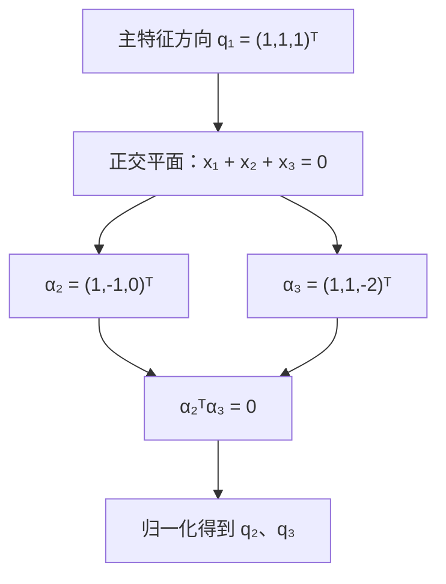

# 数二知识点习题集 · 答案与解析

> [!info] 怎么用这本答案
> - 题号 Q1–Q233 与 [[数二知识点习题集]] 一一对应，按章节/知识点同序排列。
> - 先独立做完再对照；解析保留 880 解析册原文、真题解析和外部错题本的错因分析。
> - **易错点** 按本知识点的陷阱轮换提示，不是这道题的唯一错法；**为什么选它** 说明它在组里的角色。
> - 证明题或原解析未单列答案的题，“答案”写“见解析”，以解析中的最终结论为准。

## 第一章 函数、极限、连续

### 1.1 函数性质与函数方程

**本组题号：** Q1–Q3 ｜ **掌握度：** 🟡 一般

#### Q1

**题源：** 880 做题本 · 第一章 函数、极限、连续 · 解答题 第1题（`gs-c01-basic-solution-001`）

**答案：** 见解析

**解析：**

证 首先解 $f(x)$ . 已知

$$
a f (x) + b f \left(\frac {1}{x}\right) = \frac {c}{x},\tag{①}
$$

在 ① 式中用 $\frac{1}{x}$ 代替 $x$ ，可得

$$
a f \left(\frac {1}{x}\right) + b f (x) = c x.\tag{②}
$$

再由 ① × a - ② × b，可得到 $(a^{2}-b^{2})f(x)=\frac{ac}{x}-bcx$ ，并且由 $|a|\neq|b|$ ，知

$$
f (x) = \frac {c}{a ^ {2} - b ^ {2}} \left(\frac {a}{x} - b x\right),
$$

而

$$
f (- x) = \frac {c}{a ^ {2} - b ^ {2}} \left(- \frac {a}{x} + b x\right) = - f (x),
$$

所以 $f(x)$ 是奇函数.

**易错点：** 重做时注意：忽略定义域（如 $1/x$ 在 $x=0$ 无定义）。

**为什么选它：** 已做对过，用来复现方法；做对一次不等于永久掌握。

#### Q2

**题源：** 外部错题本 · 高数-函数极限与连续 · 错题03

**答案：** $-\frac{1}{2}x(x+2)(x+4)$

**解析：**

**我的卡点 & 错因分析 🧠**

| 困惑点 | 表现 |
|--------|------|
| **方向不明确** | 看到 $f(x) = -\frac{1}{2}f(x+2)$ 时，不知道该把左边的 $x$ 替换掉，还是把右边的 $x+2$ 替换掉 |
| **思维定式** | 习惯了直接代入 $x$，而不敢把 $x+2$ 作为一个整体代入已知区间的公式 |
| **区间迷茫** | 没能第一时间意识到 $[-2, 0]$ 与 $[0, 2]$ 的位移关系是 $+2$ |

---

✅ **正确解法**：

**第一步：设元（锁定目标区间）**
设待求区间的自变量为 $x$，即 $x \in [-2, 0]$。

**第二步：平移（寻找已知区间"跳板"）**
因为 $x \in [-2, 0]$，所以 $(x+2) \in [0, 2]$。

此时，$x+2$ 恰好落在了已知解析式的范围内。

**第三步：代入（借壳上市）**
利用 $[0, 2]$ 上的法则 $f(t) = t(t^2 - 4)$，将 $t = x+2$ 代入：
$$f(x+2) = (x+2)[(x+2)^2 - 4]$$
$$f(x+2) = (x+2)(x^2 + 4x + 4 - 4)$$
$$f(x+2) = x(x+2)(x+4)$$

**第四步：转化（回归目标）**
利用题目给出的递推关系 $f(x) = -\frac{1}{2}f(x+2)$：
$$f(x) = -\frac{1}{2} \cdot [x(x+2)(x+4)]$$

**结果**：$f(x) = -\frac{1}{2}x(x+2)(x+4), \quad x \in [-2, 0]$

---

**认知突破：函数的本质 🏭**

**核心结症**：你是否曾经困惑——为什么不同区间的公式不一样，却都用同一个 $f$ 来表示？

> 答案：你把**"函数（$f$）"**和**"解析式（代数公式）"**等同起来了。

---

**1. 函数 $f$ 是一样的吗？**

| 维度 | 结论 |
|------|------|
| **映射关系** | 作为"整体的函数关系"，$f$ 是同一个 |
| **解析式** | 在不同区间，它的"计算公式"是不一样的 |

**通俗理解——"数字加工厂"比喻**：
> 你可以把函数 $f$ 想象成一个**"数字加工厂"**：
> - 送进 $[0, 2]$ 范围的原材料 $x$ → 启用**"1号车间"**，按配方 $x(x^2 - 4)$ 加工
> - 送进 $[-2, 0)$ 范围的原材料 $x$ → 启用**"2号车间"**，按配方 $-\frac{1}{2}(x+2)(x^2+4x)$ 加工

虽然配方（解析式）不同，但都属于同一个工厂 $f$。

---

**2. 如果公式不一样，为什么都用 $f$ 表示？**

在高等数学中，函数本质上是一个**名字（标识符）**，代表输入与输出的对应关系，它不一定由"唯一的代数式"从头管到尾。

**分段函数的标准写法**：
$$f(x) = \begin{cases}
x(x^2 - 4), & x \in [0, 2] \\[6pt]
-\frac{1}{2}(x+2)(x^2+4x), & x \in [-2, 0]
\end{cases}$$

（注：$x=0$ 处两个式子都等于 $0$，端点放在哪边都可以）

**关键认知**：无论用哪一行，最左边统一的名字都叫 $f(x)$。

---

**3. $f(x) = -\frac{1}{2}f(x+2)$ 这条"厂规"的作用？**

| 角色 | 功能 |
|------|------|
| **厂规** | 让你通过已知区间的公式，推导未知区间的公式 |
| **翻译器** | 把未知区间的自变量"平移"到已知区间处理 |

你笔记上的做法：
> $x \in [-2, 0] \Rightarrow x+2 \in [0, 2]$
>
> 这就是在**"利用厂规，把未知区间的自变量转移到已知区间"**——标准的降维打击！

---

**总结避坑**：
> 以后看到 $f(x)$，不要本能地认为它就是一个固定的公式。
> - 把它看作一个**黑盒子**
> - 遇到不同的 $x$，它可能会吐出**不同的公式**来应对

*认知突破日期：2026-03-12*

---

**💡 归纳总结（避坑指南）**

**核心口诀**："想求哪段设哪个，通过平移找已知。"

**关键动作**：
1. 观察已知区间和未知区间差了几个"步长"（本题差了 $2$）
2. 构造出一个落在"已知领地"的自变量（如 $x+2$）
3. 不要怕式子变复杂，把整体大胆地塞进 $f(x)$ 的模子里

**延伸**：这种方法同样适用于具有周期性（如 $f(x+T) = f(x)$）或对称性（如 $f(x) = f(2a-x)$）的函数题目。

---

**易错点：** 原错题本提醒：把 $f(x+T)=f(x)$ 与 $f(x+T)=-f(x)$（半周期）混淆。

**为什么选它：** 880/真题里这个角度的题不够，用外部错题补方法覆盖面。

*来源：[[external-notes/考研数学/高数-函数极限与连续/错题本.md#错题03：利用递推关系进行区间转化（函数的本质 🏭理解）|外部错题本 · 高数-函数极限与连续 · 错题03]]*

#### Q3

**题源：** 外部错题本 · 高数-函数极限与连续 · 错题04

**答案：** $f(x)=\begin{cases}x-\pi+\sin x, & x\in[\pi,2\pi)\\x-2\pi, & x\in[2\pi,3\pi)\end{cases}$

**解析：**

**我的卡点 & 错因分析 🧠**

| 困惑点 | 表现 |
|--------|------|
| **步长匹配** | 递推式的步长是 $\pi$，已知区间长度也是 $\pi$，但要求解的区间 $[\pi, 3\pi)$ 跨度是 $2\pi$，不能"一步到位" |
| **分段意识** | 没有意识到需要以 $\pi$ 为单位分段剥离，因为每一段增加的 $\sin x$ 值是不一样的 |
| **诱导公式** | 在转化过程中容易忽略 $\sin(x-\pi)$ 等三角函数的符号变化 |

---

✅ **正确解法**：

将目标区间拆分为两段逐一击破：

**第一段：当 $x \in [\pi, 2\pi)$ 时**

- **找跳板**：令 $x - \pi \in [0, \pi)$，此时满足已知条件 $f(t) = t$
- **代入**：$f(x - \pi) = x - \pi$
- **回归递推式**：
$$f(x) = f(x - \pi) + \sin x$$

**得出**：$f(x) = x - \pi + \sin x$

**第二段：当 $x \in [2\pi, 3\pi)$ 时**

- **找跳板**：令 $x - \pi \in [\pi, 2\pi)$。注意，此时要用到刚求出来的第一段结论
- **代入**：根据第一段结论 $f(t) = t - \pi + \sin t$，把 $t = x - \pi$ 代入：
$$f(x - \pi) = (x - \pi) - \pi + \sin(x - \pi)$$
- **利用诱导公式** $\sin(x - \pi) = -\sin x$：
$$f(x - \pi) = x - 2\pi - \sin x$$
- **回归递推式**：
$$f(x) = f(x - \pi) + \sin x$$
$$f(x) = (x - 2\pi - \sin x) + \sin x = x - 2\pi$$

**最终答案**：
$$f(x) = \begin{cases} x - \pi + \sin x, & x \in [\pi, 2\pi) \\ x - 2\pi, & x \in [2\pi, 3\pi) \end{cases}$$

---

**💡 归纳总结（避坑指南）**

**核心思路**："大区间分段吃，逐段递推用前果。"

**与错题03的对比**：

| 特征 | 错题03（单段转化） | 错题04（多段递进） |
|------|-------------------|-------------------|
| 目标区间跨度 | 1个步长 | 2+个步长 |
| 解法策略 | 一步到位 | 分段迭代 |
| 知识依赖 | 仅需已知区间 | 需要用到前一段的结论 |

**关键动作**：
1. **判断跨度**：目标区间是步长的几倍，就分几段
2. **逐段递推**：每一段都要用到上一段的结论（"滚雪球"式求解）
3. **注意符号**：涉及三角函数时，诱导公式要算准

**易错点提醒**：$\sin(x - \pi) = -\sin x$，不要漏掉负号！

---

**易错点：** 原错题本提醒：忽略定义域（如 $1/x$ 在 $x=0$ 无定义）。

**为什么选它：** 880/真题里这个角度的题不够，用外部错题补方法覆盖面。

*来源：[[external-notes/考研数学/高数-函数极限与连续/错题本.md#错题04：递推关系的多段递进求解|外部错题本 · 高数-函数极限与连续 · 错题04]]*

*返回题目：[[数二知识点习题集#1.1 函数性质与函数方程|函数性质与函数方程]]*

### 1.2 数列极限与递推数列

**本组题号：** Q4–Q8 ｜ **掌握度：** 🔴 薄弱

#### Q4

**题源：** 880 做题本 · 第一章 函数、极限、连续 · 选择题 第13题（`gs-c01-comprehensive-choice-013`）

**答案：** C

**解析：**

这句话的本质是在定义一个新的函数 $f(n)$。它是在告诉你：$f(n)$ 就是把数字 $n$ 代入方程后，解出来的那个 $x$ 的值。为了让你彻底明白，我们分三个层次来理解：

第一层：举个具体的例子（代入法）考研题目里的 $n$ 通常是正整数（$1, 2, 3, \dots$）。当 $n = 1$ 时：方程变成了 $x(1 + \ln x) = 1$。你能猜出哪个正数 $x$ 满足这个等式吗？显然 $x = 1$ 时，左边 $= 1 \times (1 + 0) = 1$，等式成立。所以，当 $n=1$ 时的正实根是 $1$。题目规定用 $f(n)$ 表示这个根，那么就有 $f(1) = 1$。当 $n = 2$ 时：方程变成了 $x(1 + \ln x) = 2$。此时你很难直接猜出一个有理数 $x$ 来满足等式，初等数学也解不出具体的表达式。但微积分告诉我们（通过单调性），这个解一定是客观存在且唯一的。既然解不出具体的数，我们就给这个未知的解起个名字，叫作 $f(2)$。

第二层：建立函数映射关系（抽象化）顺着上面的思路，对于每一个输入的 $n$，方程 $x(1 + \ln x) = n$ 都有唯一的一个 $x$ 与之对应。输入 $n \implies$ 解方程得到 $x$。数学家为了方便书写，就把这个过程写成了一个函数关系：$x = f(n)$。

第三层：如何使用这个条件？（考场最核心的“杀招”）既然 $f(n)$ 就是方程的根（也就是 $x$ 的值），那么把 $x = f(n)$ 代回原方程，等式一定必然成立！这就会得到一个极其重要的恒等式：

$$
f(n) \cdot [1 + \ln f(n)] \equiv n
$$

核心提醒： 在考研数学中，遇到“设某函数为某方程的根”这类话，第一反应也是唯一正确的反应，就是把这个函数代入原方程，得到一个恒等式。 后续无论是求极限（就像你上一题做的那样），还是求导数，全部都要基于这个恒等式来变形

第一阶段：定性分析，证明 $f(n) \to +\infty$（排除选项 A）官方答案首先构造了函数 $g(x) = x(1 + \ln x)$。因为方程是 $x(1 + \ln x) = t$，所以 $x$ 是 $t$ 的函数，即 $x = f(t)$ 是 $g(x)$ 的反函数。求导探单调性： $g'(x) = 1 \cdot (1+\ln x) + x \cdot \frac{1}{x} = 2 + \ln x$。因为题目限制 $x \geqslant 1$，所以 $g'(x) > 0$，说明原函数严格单调递增。推导反函数极限： 既然 $g(x)$ 单调递增且趋于 $+\infty$，那么它的反函数 $f(t)$ 也必然单调递增且趋于 $+\infty$。因此，当连续变量 $t \to +\infty$ 时，对应数列 $n \to \infty$ 时，有 $\lim_{n \to \infty} f(n) = +\infty$。选项 A 错误。

第二阶段：整体代换，判断 $\frac{f(n)}{n}$ 的极限（排除选项 B）这一步没有用到高深的微积分，纯粹利用原方程的等量代换。由于 $f(n)$ 是方程 $x(1+\ln x)=n$ 的根，直接代入得到恒等式：$f(n)[1+\ln f(n)] = n$。两边同除以 $n(1+\ln f(n))$，直接得到：

$$
\frac{f(n)}{n} = \frac{1}{1+\ln f(n)}
$$

因为第一阶段已证 $f(n) \to +\infty$，所以分母趋于无穷大，整个分式极限为 $0$。选项 B 错误。

第三阶段：化散为连与反函数求导（核心准备阶段）在判断 C、D 选项时，遇到了 $\lim_{n \to \infty} \frac{f(n)\ln n}{n}$。这是一个 $\frac{\infty}{\infty}$ 型极限，官方想用洛必达法则，但数列是离散的点，不能求导。核心提醒（海涅定理）： 官方通过写出 $\lim_{t \to +\infty} \frac{f(t)\ln t}{t}$，悄悄利用了海涅定理，把离散变量 $n$ 变成了连续变量 $t$。只要函数极限存在，对应的数列极限就必然存在且相等。接着，准备洛必达法则所需的导数。根据反函数求导法则：

$$
f'(t) = \frac{1}{g'(x)}\bigg\vert{}_{x=f(t)}
$$

因为 $g'(x) = 2 + \ln x$，把 $x$ 换成 $f(t)$，就得到了官方给出的：

$$
f'(t) = \frac{1}{2 + \ln f(t)}
$$

这步非常关键，它让我们不需要知道 $f(t)$ 的具体表达式，就能用 $f(t)$ 表示出它的导数。

第四阶段：洛必达法则与代数魔术（最精妙的一步）将原极限式进行变形，利用第二阶段的结论 $\frac{f(t)}{t} = \frac{1}{1+\ln f(t)}$，把式子整理成标准的 $\frac{\infty}{\infty}$ 型：

$$
\lim_{t \to +\infty} \frac{f(t)\ln t}{t} = \lim_{t \to +\infty} \frac{\ln t}{1 + \ln f(t)}
$$

上下同时对 $t$ 求导（洛必达法则）：分子 $\ln t$ 的导数是 $\frac{1}{t}$。分母 $1 + \ln f(t)$ 的导数是 $\frac{f'(t)}{f(t)}$（复合函数求导）。接下来是官方答案跳步比较多、学生最容易卡住的化简：

$$
\frac{\frac{1}{t}}{\frac{f'(t)}{f(t)}} = \frac{f(t)}{t \cdot f'(t)}
$$

此时，把题目给的原方程变形 $t = f(t)[1+\ln f(t)]$ 以及第三阶段求出的 $f'(t) = \frac{1}{2+\ln f(t)}$ 同时代入分母：

$$
\frac{f(t)}{f(t)[1+\ln f(t)] \cdot \frac{1}{2+\ln f(t)}}
$$

看！分子分母的 $f(t)$ 完美约掉，剩下的部分翻转上去，就得到了官方那极其漂亮的式子：

$$
= \frac{2 + \ln f(t)}{1 + \ln f(t)}
$$

最后，上下同除以 $\ln f(t)$（由于 $f(t) \to +\infty$），极限一眼看出等于 $1$。选项 C 正确。

💡 易错点提示

数列直接求导的致命错误：阅卷时，如果看到有考生直接写 $\lim_{n \to \infty} \frac{(\ln n)'}{(1+\ln f(n))'}$，会直接扣掉该步骤的全部分数。考场上一定要像官方答案那样，先把 $n$ 换成 $t$ 或 $x$，这一步仪式感绝不能省。

反函数导数公式记混：很多同学知道 $y'_x = \frac{1}{x'_y}$，但容易忘记变量的对应关系。官方答案中严格写了 $\Big\vert{}_{x=f(t)}$，这是在提醒你：分母对 $x$ 求导完之后，所有的 $x$ 必须替换回 $f(t)$，否则后面的代入化简根本无法进行。

洛必达后的迷茫：在得出 $\frac{1/t}{f'(t)/f(t)}$ 后，很多同学不知道怎么办了。考研数学的潜规则是：遇到隐函数求导化简，一定要“回头看原方程”。把 $t$ 换回含 $f(t)$ 的式子，是破局的唯一方法。

**易错点：** 你上次错在这类题上：归纳法漏起点或递推步；放缩过头。

**为什么选它：** 当前仍错，且最近一次判为“不会/半会”，最能暴露这一知识点的真实短板。

#### Q5

**题源：** 880 做题本 · 第一章 函数、极限、连续 · 解答题 第16题（`gs-c01-comprehensive-solution-016`）

**答案：** 见解析

**解析：**

##### 总体思路

知识点定位：高等数学——递推数列极限、代数裂项相消法、数列单调性及其极限性质。

本题要求一个由递推数列构成的 $n$ 项和的极限（即数学二中以数列极限形式考查的无穷项求和）。由于直接求通项公式 $x_n$ 是不可能的，考场上最主流、最高效的切入点是利用递推关系式进行「裂项相消」：将递推式因式分解为 $x_{n+1} = x_n(x_n + 1)$，观察到待求通项中含有因式 $\frac{1}{x_n + 1}$，因此对递推式取倒数并拆项，将 $\frac{1}{x_n + 1}$ 转化为前后两项倒数之差 $\frac{1}{x_n} - \frac{1}{x_{n+1}}$。累加消去中间项后，问题转化为求 $\lim_{n \to \infty} \frac{1}{x_{n+1}}$，最后通过分析 $\{x_n\}$ 的单调性与发散性得出最终极限。

##### 详细解题讲解

**第一阶段：递推式变形与裂项构造**

由已知递推关系：

$$
x_{n+1} = x_n^2 + x_n = x_n(x_n + 1)
$$

因为 $x_1 = \frac{1}{2} > 0$，由递推式易知对任意正整数 $n$，均有 $x_n > 0$。等式两边同时取倒数，并进行分式裂项：

$$
\frac{1}{x_{n+1}} = \frac{1}{x_n(x_n + 1)} = \frac{(x_n + 1) - x_n}{x_n(x_n + 1)} = \frac{1}{x_n} - \frac{1}{x_n + 1}
$$

移项整理，即可单独分离出待求和的通项：

$$
\frac{1}{x_n + 1} = \frac{1}{x_n} - \frac{1}{x_{n+1}}
$$

> [!tip] 核心提醒
> 为什么想到取倒数？在考研数列题中，遇到形如 $x_{n+1} = x_n^2 + x_n$ 或 $x_{n+1} = \frac{x_n}{1+x_n}$ 的非线性递推式时，因式分解后取倒数是将「乘积关系」转化为「加减（差）关系」的标准动作。只有出现形如 $a_n - a_{n+1}$ 的结构，才能处理后续的 $n$ 项累加。

**第二阶段：累加相消求部分和**

记原极限中的 $n$ 项和为 $S_n$，将第一阶段得到的裂项公式代入 $S_n$：

$$
\begin{aligned}
S_n &= \frac{1}{x_1 + 1} + \frac{1}{x_2 + 1} + \dots + \frac{1}{x_n + 1} \\
&= \left(\frac{1}{x_1} - \frac{1}{x_2}\right) + \left(\frac{1}{x_2} - \frac{1}{x_3}\right) + \dots + \left(\frac{1}{x_n} - \frac{1}{x_{n+1}}\right) \\
&= \frac{1}{x_1} - \frac{1}{x_{n+1}}
\end{aligned}
$$

已知 $x_1 = \frac{1}{2}$，故 $\frac{1}{x_1} = 2$，代入得：

$$
S_n = 2 - \frac{1}{x_{n+1}}
$$

**第三阶段：分析 $\lim_{n \to \infty} x_{n+1}$ 的走向并得出结果**

为了求出 $\lim_{n \to \infty} S_n$，需要先确定当 $n \to \infty$ 时 $x_n$ 的极限状态。由递推关系可得：

$$
x_{n+1} - x_n = x_n^2 > 0
$$

这说明数列 $\{x_n\}$ 是严格单调递增的。接下来判断 $\{x_n\}$ 是否有上界（反证法）：假设 $\{x_n\}$ 有上界，则由「单调有界数列必有极限」可知，$\lim_{n \to \infty} x_n = A$ 存在。又因为 $x_1 = \frac{1}{2}$ 且数列单调递增，必有 $A > \frac{1}{2} > 0$。在递推式 $x_{n+1} = x_n^2 + x_n$ 两边同时令 $n \to \infty$ 取极限：

$$
A = A^2 + A \implies A^2 = 0 \implies A = 0
$$

这与 $A > \frac{1}{2}$ 产生矛盾！因此假设不成立，单调递增数列 $\{x_n\}$ 无上界，即：

$$
\lim_{n \to \infty} x_n = +\infty
$$

从而有：

$$
\lim_{n \to \infty} \frac{1}{x_{n+1}} = 0
$$

将其代回 $S_n$ 的表达式，得最终极限：

$$
\lim_{n \to \infty} \left(\frac{1}{x_1 + 1} + \frac{1}{x_2 + 1} + \dots + \frac{1}{x_n + 1}\right) = \lim_{n \to \infty} \left(2 - \frac{1}{x_{n+1}}\right) = 2 - 0 = 2
$$

##### 考场易错点提示

- **忽略对 $\lim_{n \to \infty} x_n = +\infty$ 的严格说明（大题常见扣分点）**：很多同学在裂项得出 $2 - \frac{1}{x_{n+1}}$ 后，仅凭主观直觉写「显然 $x_n \to \infty$，所以原式等于 $2$」。如果是填空题这样处理没有问题，但如果是解答题，不证明 $x_n \to +\infty$ 会直接被扣 $2 \sim 3$ 分。除了上面的反证法外，考场上也可以用不等式放缩快速说明：因为 $x_n$ 单调递增，故 $x_n \geqslant x_1 = \frac{1}{2}$，从而 $x_{n+1} - x_n = x_n^2 \geqslant \frac{1}{4}$，累加可得 $x_{n+1} \geqslant x_1 + \frac{n}{4} \to +\infty\ (n \to \infty)$，这种方法同样极其严谨且高效。
- **数学二对「无穷求和」的考查形式**：数学二考纲中虽然不包含「无穷级数」这一章，但命题人非常喜欢将级数求和包装成此类「求前 $n$ 项和 $S_n$ 的数列极限」。遇到此类含省略号 $\dots$ 的 $n$ 项和极限，核心破题方向只有两个：裂项相消法（如本题）或夹逼准则。

**易错点：** 你上次错在这类题上：只求极限不证存在（循环论证）。

**为什么选它：** 当前仍错，且最近一次判为“不会/半会”，最能暴露这一知识点的真实短板。

#### Q6

**题源：** 880 做题本 · 第一章 函数、极限、连续 · 选择题 第12题（`gs-c01-comprehensive-choice-012`）

**答案：** A

**解析：**

解由 $\mathrm{e}^{x_n} = x_n + \mathrm{e}^{y_n}$ ，有 $y_{n} = \ln \left(\mathrm{e}^{x_{n}} - x_{n}\right)$

$$
\begin{array}{r l} & {\underset {n \to \infty} {\lim} \frac {y _ {n}}{x _ {n}} = \underset {n \to \infty} {\lim} \frac {\ln \left(\mathrm{e} ^ {x _ {n}} - x _ {n}\right)}{x _ {n}} = \underset {n \to \infty} {\lim} \frac {\ln \left(\mathrm{e} ^ {x _ {n}} - x _ {n} + 1 - 1\right)}{x _ {n}} = \underset {n \to \infty} {\lim} \frac {\mathrm{e} ^ {x _ {n}} - x _ {n} - 1}{x _ {n}}} \\ & {\quad \overset {x _ {n} = t} {=} \underset {t \to 0 ^ {+}} {\lim} \frac {\mathrm{e} ^ {t} - t - 1}{t} = \underset {t \to 0 ^ {+}} {\lim} \frac {\mathrm{e} ^ {t} - 1}{1} = 0,} \end{array}
$$

故 $y_{n}$ 是比 $x_{n}$ 高阶的无穷小. 选项 A 正确.

**易错点：** 重做时注意：归纳法漏起点或递推步；放缩过头。

**为什么选它：** 已做对过，用来复现方法；做对一次不等于永久掌握。

#### Q7

**题源：** 真题 · 2018 数二 · 解答21

**答案：** $\{x_n\}$ 单调递减且有下界 $0$，故收敛；$\lim_{n\to\infty}x_n=0$。

**解析：**

> [!info] 考点与破题思路
> **核心考点**：递推数列、数学归纳法、单调有界定理、辅助函数与中值定理。
> **总体思路与切入点**：标准四步——① 归纳证正项（$x_n>0$）；② 证单调递减；③ 单调有界得极限存在；④ 在递推式两边取极限解方程。
> **关键**：第 ④ 步必须在「极限已存在」之后才允许；第 ① 步的传递不能停在「右端为正」，要落到「比值 $>1$」。

---

**第一步：证明 $x_n>0$（归纳法，传递步要给足）**

递推式变形为

$$e^{x_{n+1}}=\frac{e^{x_n}-1}{x_n}\qquad(x_n>0).$$

底项：$x_1>0$。假设 $x_k>0$，则 $e^{x_k}>1$，分子为正。但要断言 $\ln\frac{e^{x_k}-1}{x_k}>0$，需要的是**比值大于 $1$**：

$$\frac{e^{x_k}-1}{x_k}>1\iff e^{x_k}-1>x_k.$$

这个不等式成立：令 $g(x)=e^{x}-1-x$，$g(0)=0$，$g'(x)=e^{x}-1>0\ (x>0)$，故 $g(x)>0$。于是

$$e^{x_{k+1}}=\frac{e^{x_k}-1}{x_k}>1\ \Longrightarrow\ x_{k+1}=\ln\frac{e^{x_k}-1}{x_k}>0.$$

> [!warning] 常见跳跃
> 「右端为正」推不出「指数为正」——$e^{t}>0$ 对**任何实数** $t$ 都成立，符号完全由对数决定。必须补上 $e^x>1+x$（或等价地，比值 $>1$）这一步。

**第二步：证明单调递减**

$$x_{n+1}<x_n\iff \frac{e^{x_n}-1}{x_n}<e^{x_n}\iff e^{x_n}-1<x_ne^{x_n}.$$

构造 $h(x)=xe^{x}-e^{x}+1$（$x\geqslant0$），则

$$h'(x)=(1+x)e^{x}-e^{x}=xe^{x}\geqslant0,$$

且 $h(0)=0$。故 $x_n>0$ 时 $h(x_n)>0$，即 $e^{x_n}-1<x_ne^{x_n}$，从而

$$x_{n+1}<x_n\qquad(n\geqslant1).$$

> [!tip] 一步到位的替代：拉格朗日中值定理
> 对 $e^{t}$ 在 $[0,x_n]$ 上用中值定理，存在 $\xi_n\in(0,x_n)$ 使 $\frac{e^{x_n}-1}{x_n}=e^{\xi_n}$。于是
> $$x_{n+1}=\ln\frac{e^{x_n}-1}{x_n}=\xi_n,$$
> 立刻得到 $0<x_{n+1}<x_n$——正项性与严格递减一次证完，无需归纳，也不必构造辅助函数。考场时间紧时首选。

**第三步：单调有界定理**

由第一步 $x_n>0$，由第二步 $\{x_n\}$ 单调递减，故由单调有界定理，$\lim_{n\to\infty}x_n=A$ 存在，且

$$0\leqslant A<x_1.$$

**第四步：取极限解方程**

$e^{t}$ 连续，在 $x_ne^{x_{n+1}}=e^{x_n}-1$ 两边取极限：

$$Ae^{A}=e^{A}-1\iff h(A)=0.$$

而 $h$ 在 $[0,+\infty)$ 上严格递增（$x>0$ 时 $h'(x)=xe^x>0$）、$h(0)=0$，故 $h$ 在 $[0,+\infty)$ 上只有唯一零点 $0$。于是

$$A=0,\qquad \lim_{n\to\infty}x_n=0.$$

> [!warning] 逻辑顺序不能倒
> 必须先「单调 + 有界」推出极限存在，再设 $\lim x_n=A$ 代入。若开篇就设 $A$ 解方程，收敛性证明整段缺失，直接丢采分点。
> 另外两个小严谨：除以 $x_n$ 前要说明 $x_n>0$（正是第一步的结论）；取极限时要提一句 $e^{t}$ 连续。

> [!tip] 数值感受
> 取 $x_1=1$：$x_2=\ln(e-1)\approx0.541$，$x_3\approx0.283$，$x_4\approx0.145$……递减趋于 $0$，与结论一致。

**易错点：** 真题常见陷阱：只求极限不证存在（循环论证）。

**为什么选它：** 真题原题，已做对过；用来检验能否在综合题里认出这个考点。

#### Q8

**题源：** 真题 · 2012 数二 · 解答21

**答案：** $x_n$ 在 $\left(\frac{1}{2},1\right)$ 内有且仅有一个实根；$\lim_{n\to\infty}x_{n}=\frac{1}{2}$

**解析：**

> [!info] 考点与破题思路
> **核心考点**：闭区间上连续函数的零点定理、导数与单调性（唯一性）、拉格朗日中值定理（把「自变量之差」与「函数值之差」互相转化）、夹逼定理（一并解决极限存在性与求值）。
> **一句话本质**：第（Ⅰ）问算端点值时顺手得到 $F_n\left(\frac{1}{2}\right)=-\frac{1}{2^{n}}\to 0$，等于**提前亮出底牌**——极限必为 $\frac{1}{2}$。既然目标已知，就不必再证「$x_n$ 单调有界」，直接考察 $\left|x_n-\frac{1}{2}\right|$。
> **破题一步**：用拉格朗日中值定理把 $\left|x_n-\frac{1}{2}\right|$ 放大成已知的 $\left|f_n(x_n)-f_n\left(\frac{1}{2}\right)\right|=\frac{1}{2^{n}}$，再夹逼，存在性与极限值一次拿下。
> **记号约定**：$F_n(x)=x^{n}+x^{n-1}+\cdots+x-1$，$f_n(x)=x^{n}+x^{n-1}+\cdots+x$（即 $F_n=f_n-1$）。$F_n$ 配零点定理，$f_n$ 让第（Ⅱ）问少写常数项（只设 $F_n$ 也可以，$F_n(x_n)-F_n\left(\frac{1}{2}\right)$ 里的 $-1$ 会自动抵消，且 $F_n'=f_n'$）。

---

**（Ⅰ）存在性 + 唯一性**

$F_n(x)$ 在 $\left[\frac{1}{2}, 1\right]$ 上连续。由等比数列前 $n$ 项和（首项 $\frac{1}{2}$、公比 $\frac{1}{2}$）：
$$f_n\left(\frac{1}{2}\right)=\frac{1}{2}+\frac{1}{2^{2}}+\cdots+\frac{1}{2^{n}}=\frac{\frac{1}{2}\left(1-\frac{1}{2^{n}}\right)}{1-\frac{1}{2}}=1-\frac{1}{2^{n}}$$
于是
$$F_n\left(\frac{1}{2}\right)=-\frac{1}{2^{n}}<0,\qquad F_n(1)=n-1>0\ (n>1)$$
> [!tip] 两个端点值怎么来的
> 记 $f_n(x)=x^{n}+x^{n-1}+\cdots+x$、$F_n=f_n-1$（见上文记号约定），两个端点值都是**直接代入**所得：
> - $x=\frac{1}{2}$：上一行已算出 $f_n\left(\frac{1}{2}\right)=1-\frac{1}{2^{n}}$，故 $F_n\left(\frac{1}{2}\right)=f_n\left(\frac{1}{2}\right)-1=\left(1-\frac{1}{2^{n}}\right)-1=-\frac{1}{2^{n}}<0$。
> - $x=1$：$1$ 的任何次幂都为 $1$，于是 $f_n(1)=1+1+\cdots+1=n$（共 $n$ 个 $1$）；此处公比 $q=1$，等比求和公式分母 $1-q=0$，**不能套用**，只能直接数项数。故 $F_n(1)=f_n(1)-1=n-1>0$，题设 $n>1$ 保证 $n-1\geqslant 1>0$。
由**零点定理**，方程 $f_n(x)=1$ 在 $\left(\frac{1}{2}, 1\right)$ 内**至少**有一个实根。

又
$$F_n'(x)=1+2x+\cdots+nx^{n-1}>0\qquad \left(\frac{1}{2}<x<1\right)$$
故 $F_n(x)$ 在 $\left(\frac{1}{2}, 1\right)$ 上单调增加，方程在 $\left(\frac{1}{2}, 1\right)$ 内**至多**有一个实根。「至少」+「至多」即**有且仅有一个实根**。

**（Ⅱ）拉格朗日中值定理 + 夹逼定理**

**第一步：给导数找一个与 $n$ 无关的正下界。**
$$f_n'(x)=1+2x+\cdots+nx^{n-1}>1,\qquad x\in\left(\frac{1}{2}, 1\right)$$
把第一项常数 $1$ 之外的各项全部舍弃（缩小），导数仍 $>1$。这一步是整个证明的枢纽——后面要把 $\left|f_n'(\xi_n)\right|$ 除到分母上。

**第二步：在 $\left[\frac{1}{2}, x_n\right]$ 上用拉格朗日中值定理。**
因 $x_n\in\left(\frac{1}{2}, 1\right)$ 是根，对 $f_n$ 在 $\left[\frac{1}{2}, x_n\right]$ 上应用拉格朗日中值定理，存在 $\frac{1}{2}<\xi_n<x_n<1$ 使得 $f_n(x_n)-f_n\left(\frac{1}{2}\right)=f_n'(\xi_n)\left(x_n-\frac{1}{2}\right)$。移项取绝对值，结合第一步：
$$\left|\frac{f_n(x_n)-f_n\left(\frac{1}{2}\right)}{x_n-\frac{1}{2}}\right|=\left|f_n'(\xi_n)\right|>1$$

**第三步：解不等式，把自变量之差放大为函数值之差。**
两边同乘正数 $\left|x_n-\frac{1}{2}\right|$，得
$$0<\left|x_n-\frac{1}{2}\right|<\left|f_n(x_n)-f_n\left(\frac{1}{2}\right)\right|$$
代入已知值：$x_n$ 是根 $\Rightarrow f_n(x_n)=1$；由第（Ⅰ）问 $f_n\left(\frac{1}{2}\right)=1-\frac{1}{2^{n}}$，故
$$\left|f_n(x_n)-f_n\left(\frac{1}{2}\right)\right|=\left|1-\left(1-\frac{1}{2^{n}}\right)\right|=\frac{1}{2^{n}}$$
> [!tip] 为什么 $f_n(x_n)=1$
> $x_n$ 就是第（Ⅰ）问的那个根，即原方程 $x^{n}+x^{n-1}+\cdots+x=1$ 的解；等式左边按定义正是 $f_n(x_n)$，把 $x=x_n$ 代回去，右边就是方程里的常数 $1$，所以 $f_n(x_n)=1$。
> 换个说法：方程可写为 $f_n(x)=1$（等价于 $F_n(x)=0$），$x_n$ 是它的根，当且仅当把 $x_n$ 代入左边得 $1$。这一步**由定义直接得到**、无需计算，正好与上一个端点值 $f_n\left(\frac{1}{2}\right)=1-\frac{1}{2^{n}}$（那个要算）对照。
得到干净的双边不等式：
$$0<\left|x_n-\frac{1}{2}\right|<\frac{1}{2^{n}}$$

**第四步：夹逼定结论。**
当 $n\to\infty$ 时左端为 $0$、右端 $\frac{1}{2^{n}}\to 0$，由**夹逼定理**得 $\lim_{n\to\infty}\left|x_n-\frac{1}{2}\right|=0$，即 $\lim_{n\to\infty}x_n$ 存在且
$$\boxed{\lim_{n\to\infty}x_n=\frac{1}{2}}$$

> [!warning] 易错点
> **一、导数下界必须是「与 $n$ 无关的正常数」**。构造 $\left|x_n-a\right|=\frac{\left|f_n(x_n)-f_n(a)\right|}{\left|f_n'(\xi_n)\right|}$ 时，绝不能只写 $\left|f_n'(\xi_n)\right|>0$，必须找到**与 $n$ 无关**的 $m>0$（本题巧妙地保留常数项 $1$ 得 $\left|f_n'(\xi_n)\right|>1$），才能写成 $\left|x_n-a\right|<\frac{1}{m}\left|f_n(x_n)-f_n(a)\right|$。若导数下界趋于 $0$，分母趋于 $0$，夹逼立即失效。
> **二、两种主流解法对比**（事先知道极限用「明牌法」，不知道用「盲盒法」）：
> - **单调有界准则（常规通法）**：先证存在、再设极限解方程。推导长——要证单调、找界、等比求和，还要处理 $x_n^{n+1}$ 的 $1^{\infty}$ 未定式；跳板是 $F_n(x_{n+1})<F_n(x_n)\Rightarrow x_{n+1}<x_n$。
> - **中值定理 + 夹逼（本题巧解）**：从 $F_n\left(\frac{1}{2}\right)=-\frac{1}{2^{n}}\to 0$ 一眼看出极限为 $\frac{1}{2}$。极短——无需证单调、无需处理 $x_n^{n+1}$，四行同时搞定存在性与求值；跳板是 $\left|f_n'(\xi_n)\right|>1$。
> **三、书写规范**：$(0,1)$ 不在曲线上要先设切点这类问题共通的坑在此表现为——「至少」与「至多」两半都要写满，缺一即不得「有且仅有」的分；夹逼要以「$\lim$ 存在且等于」收尾，而不是只写 $\left|x_n-\frac{1}{2}\right|\to 0$。

**易错点：** 真题常见陷阱：归纳法漏起点或递推步；放缩过头。

**为什么选它：** 真题原题，已做对过；用来检验能否在综合题里认出这个考点。

*返回题目：[[数二知识点习题集#1.2 数列极限与递推数列|数列极限与递推数列]]*

### 1.3 函数极限与无穷小比较

**本组题号：** Q9–Q13 ｜ **掌握度：** 🔴 薄弱

#### Q9

**题源：** 880 做题本 · 第一章 函数、极限、连续 · 选择题 第4题（`gs-c01-comprehensive-choice-004`）

**答案：** C

**解析：**

解 判断 $(1+x)^{\frac{2}{x}}-\mathrm{e}^{2}[1-\ln(1+x)]$ 是关于 $x$ 的几阶无穷小，就是考察它与 $x$ 之比的极限

$$
\lim_{x\to0}\frac{(1+x)^{\frac{2}{x}}-\mathrm{e}^{2}[1-\ln(1+x)]}{x}.
$$

极限为 $0$ 说明它比 $x$ 更高阶（选 C）。下面把这个极限逐步算到底——解析册原文跳步较多，这里把每一步「为什么能这么变」补全。

##### 总体思路

看到**幂指函数** $(1+x)^{2/x}$（底和指数都含 $x$），第一步永远化到 $e$ 底；再把 $-\mathrm{e}^{2}[1-\ln(1+x)]$ 用分配律拆开，凑出能用等价无穷小 $e^{u}-1\sim u$ 的结构，余下的交给洛必达。四个关键动作：**化 $e$ 底 → 拆项 → 凑 $e^{u}-1$ → 洛必达**。

##### 详细解题讲解

**第一步：幂指函数化 $e$ 底。** 由 $u^{v}=\mathrm{e}^{v\ln u}$，把底和指数都含 $x$ 的项转成 $e$ 的指数形式：

$$
\lim_{x\to0}\frac{(1+x)^{\frac{2}{x}}-\mathrm{e}^{2}[1-\ln(1+x)]}{x}=\lim_{x\to0}\frac{\mathrm{e}^{\frac{2}{x}\ln(1+x)}-\mathrm{e}^{2}[1-\ln(1+x)]}{x}.
$$

**第二步：把 $-\mathrm{e}^{2}[1-\ln(1+x)]$ 用分配律拆开。** 中括号展开得 $-\mathrm{e}^{2}+\mathrm{e}^{2}\ln(1+x)$，恰好多出一个干净的 $-\mathrm{e}^{2}$ 去和前面那一项配对：

$$
\frac{\mathrm{e}^{\frac{2}{x}\ln(1+x)}-\mathrm{e}^{2}+\mathrm{e}^{2}\ln(1+x)}{x}=\underbrace{\frac{\mathrm{e}^{\frac{2}{x}\ln(1+x)}-\mathrm{e}^{2}}{x}}_{\text{待处理}}+\underbrace{\frac{\mathrm{e}^{2}\ln(1+x)}{x}}_{\text{可直接算}}.
$$

**第三步：第二块直接出结果。** 由 $\ln(1+x)\sim x$，

$$
\lim_{x\to0}\frac{\mathrm{e}^{2}\ln(1+x)}{x}=\mathrm{e}^{2}\lim_{x\to0}\frac{\ln(1+x)}{x}=\mathrm{e}^{2}.
$$

这就是解析里突然冒出的那个「$+\mathrm{e}^{2}$」。

**第四步：第一块提公因子 $\mathrm{e}^{2}$，凑 $e^{u}-1$。**

$$
\frac{\mathrm{e}^{\frac{2}{x}\ln(1+x)}-\mathrm{e}^{2}}{x}=\mathrm{e}^{2}\cdot\frac{\mathrm{e}^{\frac{2}{x}\ln(1+x)-2}-1}{x}.
$$

当 $x\to0$ 时指数 $u=\frac{2}{x}\ln(1+x)-2\to0$，可用等价无穷小 $e^{u}-1\sim u$，把外面那层 $e$ 「脱掉」：

$$
\mathrm{e}^{2}\lim_{x\to0}\frac{\mathrm{e}^{\frac{2}{x}\ln(1+x)-2}-1}{x}=\mathrm{e}^{2}\lim_{x\to0}\frac{\frac{2}{x}\ln(1+x)-2}{x}.
$$

**第五步：化简指数里的常数项。**

$$
\frac{\frac{2}{x}\ln(1+x)-2}{x}=\frac{2\ln(1+x)-2x}{x^{2}}=\frac{2\,[\ln(1+x)-x]}{x^{2}}.
$$

**第六步：洛必达算 $\lim\limits_{x\to0}\dfrac{\ln(1+x)-x}{x^{2}}$。**

$$
\lim_{x\to0}\frac{\ln(1+x)-x}{x^{2}}\overset{\text{洛必达}}{=}\lim_{x\to0}\frac{\frac{1}{1+x}-1}{2x}=\lim_{x\to0}\frac{\frac{-x}{1+x}}{2x}=\lim_{x\to0}\frac{-1}{2(1+x)}=-\frac{1}{2}.
$$

**第七步：合并各项。**

$$
\mathrm{e}^{2}\cdot2\cdot\left(-\frac{1}{2}\right)+\mathrm{e}^{2}=-\mathrm{e}^{2}+\mathrm{e}^{2}=0.
$$

故原极限为 $0$，该无穷小相对 $x$ 是**高阶无穷小**，选项 C 正确。

##### 更快的做法：直接泰勒展开

不必来回拆项与洛必达，把两部分都展开到 $x^{2}$ 即可。由 $\ln(1+x)=x-\frac{x^{2}}{2}+\frac{x^{3}}{3}-\cdots$，

$$
\frac{2\ln(1+x)}{x}=2-x+\frac{2x^{2}}{3}+o(x^{2})\ \Longrightarrow\ (1+x)^{\frac{2}{x}}=\mathrm{e}^{2}\left(1-x+\frac{7x^{2}}{6}+o(x^{2})\right),
$$

$$
\mathrm{e}^{2}[1-\ln(1+x)]=\mathrm{e}^{2}\left(1-x+\frac{x^{2}}{2}+o(x^{2})\right).
$$

两者相减，$1$ 与 $-x$ 全部消掉，只剩 $x^{2}$ 项：

$$
\text{分子}=\mathrm{e}^{2}\left(\frac{7}{6}-\frac{1}{2}\right)x^{2}+o(x^{2})=\mathrm{e}^{2}\cdot\frac{2}{3}x^{2}+o(x^{2}).
$$

再除以 $x$ 得 $\frac{2}{3}\mathrm{e}^{2}x\to0$，结论不变。

> [!tip] 卡点对照：解析册那四处跳步
> 1. **第 2→3 行突然多项**：是把 $-\mathrm{e}^{2}[1-\ln(1+x)]$ 用分配律展开成 $-\mathrm{e}^{2}+\mathrm{e}^{2}\ln(1+x)$。
> 2. **突然冒出的「$+\mathrm{e}^{2}$」**：是 $\dfrac{\mathrm{e}^{2}\ln(1+x)}{x}\to\mathrm{e}^{2}$ 直接算出来的。
> 3. **$e^{\cdots}-1$ 变成指数上的分数**：用了等价无穷小 $e^{u}-1\sim u$，把外面那层 $e$ 「脱掉」。
> 4. **最后的 $-\mathrm{e}^{2}$**：洛必达算出 $\dfrac{\ln(1+x)-x}{x^{2}}=-\dfrac{1}{2}$，再乘上前面的 $2\mathrm{e}^{2}$。

> [!warning] 考场易错点
> - **幂指函数必须先化 $e$ 底**：$(1+x)^{2/x}$ 不能直接泰勒展开，先写成 $\mathrm{e}^{\frac{2}{x}\ln(1+x)}$ 才谈得上后续。
> - **等价无穷小要对准整体**：$e^{u}-1\sim u$ 替换的是整个指数 $u=\frac{2}{x}\ln(1+x)-2$，不是局部的 $\ln(1+x)$；替换前的时机判定（$u\to0$）也要在卷面上交代。
> - **别丢掉那个 $+\mathrm{e}^{2}$**：拆项后第二块是常数 $\mathrm{e}^{2}$，最后要加回去；漏了它结果会从 $0$ 变成 $-\mathrm{e}^{2}$，把「高阶」误判成「同阶」，错选 B。

**易错点：** 重做时注意：忽略 $x\to\infty$ 与 $x\to0$ 的替换不同。

**为什么选它：** 当前仍错，但最近一次判为“粗心/错”，用来检查步骤与计算规范。

> [!info] 错因分析
> **错因：** 概念/定理错误
> **出错环节：** 第 1 步把幂指函数 $(1+x)^{2/x}$ 当成常指数的幂函数 $(1+x)^{\alpha}$，令 $\alpha=2/x$ 代入二项式泰勒展开 $(1+x)^{\alpha}=1+\alpha x+\frac{\alpha(\alpha-1)}{2}x^{2}+o(x^{2})$，得 $5-x$。该展开要求 $\alpha$ 与 $x$ 无关；$\alpha=2/x$ 时第 $n$ 项 $\frac{\alpha(\alpha-1)\cdots(\alpha-n+1)}{n!}x^{n}$ 与 $x^{n}$ 约掉后仍含常数项与一次项，余项根本不是 $o(x^{2})$。
> **建议：** 幂指函数 $u^{v}$ 一律先写成 $e^{v\ln u}$ 再展开：$(1+x)^{2/x}=e^{2}e^{-x+\frac23x^{2}+o(x^{2})}$，常数项自动是 $e^{2}$；展开前先用重要极限核对常数项（$\lim(1+x)^{2/x}=e^{2}\neq5$），常数项对不上就说明用了不适用的定理。

#### Q10

**题源：** 880 做题本 · 第一章 函数、极限、连续 · 填空题 第2题（`gs-c01-comprehensive-fill-002`）

**答案：** -12

**解析：**

解 利用泰勒公式,分母中有 $\frac{x^{2}}{2}$ 项,将 $\sqrt{1+x^{2}}$ 展开到比 $x^{2}$ 高次幂的项:

$$
\sqrt {1 + x ^ {2}} = (1 + x ^ {2}) ^ {\frac {1}{2}} = 1 + \frac {1}{2} x ^ {2} + \frac {1}{2 !} \cdot \frac {1}{2} \cdot \left(\frac {1}{2} - 1\right) x ^ {4} + o (x ^ {4}),
$$

故

$$
\frac {x ^ {2}}{2} + 1 - \sqrt {1 + x ^ {2}} = \frac {x ^ {4}}{8} + o (x ^ {4}).
$$

又 $\sin x^2\sim x^2$ ，将 $\cos x,\mathrm{e}^{x^2}$ 分别展开到 $x^{2}$ 项，得

$$
\cos x = 1 - \frac {x ^ {2}}{2} + o (x ^ {2}), \mathrm{e} ^ {x ^ {2}} = 1 + x ^ {2} + o (x ^ {2}),
$$

故

$$
(\cos x - \mathrm{e} ^ {x ^ {2}}) \sin x ^ {2} = \frac {- 3 x ^ {4}}{2} + o (x ^ {4}).
$$

综上可知，原式 $= \lim_{x\to 0}\frac{-\frac{3}{2}x^4 + o(x^4)}{\frac{x^4}{8} + o(x^4)} = -12.$

**易错点：** 重做时注意：加减法滥用等价无穷小（如 $\sin x-x$）。

**为什么选它：** 当前仍错，但最近一次判为“粗心/错”，用来检查步骤与计算规范。

#### Q11

**题源：** 880 做题本 · 第一章 函数、极限、连续 · 选择题 第2题（`gs-c01-comprehensive-choice-002`）

**答案：** A

**解析：**

知识点定位

本题考查函数极限的计算，核心考点为等价无穷小代换结合拉格朗日中值定理（或反三角函数差角公式）确定无穷小的阶数。

解题思路

当 $x \to +\infty$ 时，$\arctan(x+1) \to \frac{\pi}{2}$，$\arctan x \to \frac{\pi}{2}$，对数内部比值趋近于 $1$。因此，切入点是将对数变形为 $\ln(1 + u)$ 的形式（其中 $u \to 0$），利用 $\ln(1+u) \sim u$ 转化。解题的关键在于求出分子差值 $\arctan(x+1) - \arctan x$ 关于 $\frac{1}{x}$ 的主部阶数。

详细解析

第一步：对数结构变形与等价无穷小代换

原式中的对数部分可写为：

$$
\ln \frac{\arctan(x+1)}{\arctan x} = \ln \left( 1 + \frac{\arctan(x+1) - \arctan x}{\arctan x} \right)
$$

因为当 $x \to +\infty$ 时，$\arctan(x+1) - \arctan x \to 0$，且 $\arctan x \to \frac{\pi}{2}$，所以：

$$
\frac{\arctan(x+1) - \arctan x}{\arctan x} \to 0
$$

根据等价无穷小公式 $\ln(1 + u) \sim u$（当 $u \to 0$），有：

$$
\ln \frac{\arctan(x+1)}{\arctan x} \sim \frac{\arctan(x+1) - \arctan x}{\arctan x}
$$

第二步：利用拉格朗日中值定理确定差值阶数

设 $f(t) = \arctan t$，在闭区间 $[x, x+1]$ 上应用拉格朗日中值定理：

$$
\arctan(x+1) - \arctan x = f'(\xi) \cdot ((x+1) - x) = \frac{1}{1+\xi^2}
$$

其中 $\xi \in (x, x+1)$。由于 $x < \xi < x+1$，两边同除以 $x$ 得 $1 < \frac{\xi}{x} < 1 + \frac{1}{x}$，由夹逼准则可知：当 $x \to +\infty$ 时，$\xi \sim x$，进而：

$$
\frac{1}{1+\xi^2} \sim \frac{1}{\xi^2} \sim \frac{1}{x^2}
$$

因此：

$$
\arctan(x+1) - \arctan x \sim \frac{1}{x^2}
$$

考场备选技巧（差角公式）：亦可利用反正切差角公式计算：

$$
\arctan(x+1) - \arctan x = \arctan \left( \frac{(x+1) - x}{1 + x(x+1)} \right) = \arctan \left( \frac{1}{x^2+x+1} \right) \sim \frac{1}{x^2}
$$

两种方法在考场上均可快速锁定阶数。

第三步：代入原极限，确定参数 $a$ 与 $b$

将等价无穷小代回原式：

$$
\lim_{x \to +\infty} x^a \ln \frac{\arctan(x+1)}{\arctan x} = \lim_{x \to +\infty} x^a \cdot \frac{\frac{1}{x^2}}{\frac{\pi}{2}} = \frac{2}{\pi} \lim_{x \to +\infty} x^{a-2}
$$

题目已知该极限存在且为非零有限值 $b$（结合选项可知 $b \neq 0$）：
若 $a - 2 > 0$，极限为 $\infty$；若 $a - 2 < 0$，极限为 $0$；必须满足指数 $a - 2 = 0$，即 $a = 2$。

当 $a = 2$ 时：

$$
b = \frac{2}{\pi} \cdot x^0 = \frac{2}{\pi}
$$

对应选项为 A。

核心提醒与易错点

- 分母常数遗漏：许多考生容易算出分子差值为 $\frac{1}{x^2}$ 后，忽略了分母 $\arctan x \to \frac{\pi}{2}$，导致误算成 $b = 1$ 或倒数 $b = \frac{\pi}{2}$。分母是非零极限时，可以直接先算出其极限值参与乘除。
- “函数差”的处理敏感度：看到类似 $f(x+1) - f(x)$ 或 $f(x+k) - f(x)$ 的连续可导函数之差，考研中最优先联想的武器就是拉格朗日中值定理，这是将“函数差”降维转化为“导函数乘以步长”的最快路径。

**易错点：** 重做时注意：泰勒阶数不足，丢掉关键低阶项。

**为什么选它：** 已做对过，用来复现方法；做对一次不等于永久掌握。

#### Q12

**题源：** 880 做题本 · 第一章 函数、极限、连续 · 填空题 第9题（`gs-c01-comprehensive-fill-009`）

**答案：** -2, 2

**解析：**

解 由 $\lim_{x\to 0^{+}}[x] = 0,\lim_{x\to 0^{-}}[x] = -1$ ，有

$$
\begin{array}{r l} \lim _ {x \to 0 ^ {+}} \left\{a [ x ] + \frac {\ln \left(1 + \mathrm{e} ^ {\frac {2}{x}}\right)}{\ln \left(1 + \mathrm{e} ^ {\frac {1}{x}}\right)} \right\} & = \lim _ {x \to 0 ^ {+}} \frac {\ln \left(1 + \mathrm{e} ^ {\frac {2}{x}}\right)}{\ln \left(1 + \mathrm{e} ^ {\frac {1}{x}}\right)} = \lim _ {x \to 0 ^ {+}} \frac {\ln \left[ \mathrm{e} ^ {\frac {2}{x}} \left(1 + \mathrm{e} ^ {- \frac {2}{x}}\right) \right]}{\ln \left[ \mathrm{e} ^ {\frac {1}{x}} \left(1 + \mathrm{e} ^ {- \frac {1}{x}}\right) \right]} \\ & = \lim _ {x \to 0 ^ {+}} \frac {2 + x \ln \left(1 + \mathrm{e} ^ {- \frac {2}{x}}\right)}{1 + x \ln \left(1 + \mathrm{e} ^ {- \frac {1}{x}}\right)} = 2 = b, \end{array}
$$

$$
\lim _ {x \to 0 ^ {-}} \left\{a [ x ] + \frac {\ln \left(1 + \mathrm{e} ^ {\frac {2}{x}}\right)}{\ln \left(1 + \mathrm{e} ^ {\frac {1}{x}}\right)} \right\} = - a + \lim _ {x \to 0 ^ {-}} \frac {\mathrm{e} ^ {\frac {2}{x}}}{\mathrm{e} ^ {\frac {1}{x}}} = - a + \lim _ {x \to 0 ^ {-}} \mathrm{e} ^ {\frac {1}{x}} = - a + 0 = 2.
$$

故 $a = -2, b = 2$ .

**易错点：** 重做时注意：忽略 $x\to\infty$ 与 $x\to0$ 的替换不同。

**为什么选它：** 已做对过，用来复现方法；做对一次不等于永久掌握。

#### Q13

**题源：** 真题 · 2017 数二 · 解答15

**答案：** $\dfrac23$

**解析：**

> [!info] 考点与破题思路
> **核心考点**：含变限积分的 $\frac00$ 型极限；被积函数中混入求导变量时的换元剥离；非零极限因子先行分离；洛必达法则 + 变限积分求导公式。
> **总体思路与切入点**：分子 $\int_{0}^{x}\sqrt{x-t}\,\mathrm{e}^{t}\,\mathrm{d}t$ 里，$x$ 既出现在上限、又出现在被积函数内部（与 $t$ 耦合），**绝不能直接对 $x$ 用洛必达**——那样会把 $t=x$ 代进去得到 $\sqrt{x-x}\mathrm{e}^{x}=0$，得出荒谬的极限 $0$。必须先用换元 $u=x-t$ 把 $x$ 从被积函数的核心结构中剥离，剩下的 $\mathrm{e}^{x}$ 作为因子提出，再做一次洛必达即可。

---

**第一阶段：换元剥离被积函数中的 $x$**

令 $u=x-t$（此时 $x$ 视为常数，$t$ 为积分变量），则 $t=x-u$，$\mathrm{d}t=-\mathrm{d}u$。当 $t=0$ 时 $u=x$；当 $t=x$ 时 $u=0$。于是

$$\int_{0}^{x}\sqrt{x-t}\,\mathrm{e}^{t}\,\mathrm{d}t=\int_{x}^{0}\sqrt{u}\,\mathrm{e}^{x-u}\,(-\mathrm{d}u)$$

下限 $0\to x$、上限 $x\to 0$ 同时颠倒与 $\mathrm{d}t=-\mathrm{d}u$ 的负号抵消，得到

$$=\int_{0}^{x}\sqrt{u}\,\mathrm{e}^{x}\mathrm{e}^{-u}\,\mathrm{d}u=\mathrm{e}^{x}\int_{0}^{x}\sqrt{u}\,\mathrm{e}^{-u}\,\mathrm{d}u$$

这里 $\mathrm{e}^{x}$ 与积分变量 $u$ 无关，可以提出积分号外——这一步是整个解法的分水岭。

**第二阶段：非零因子先行分离**

$$\text{原式}=\lim_{x\to0^{+}}\frac{\mathrm{e}^{x}\int_{0}^{x}\sqrt{u}\,\mathrm{e}^{-u}\,\mathrm{d}u}{x^{\frac32}}=\left(\lim_{x\to0^{+}}\mathrm{e}^{x}\right)\cdot\lim_{x\to0^{+}}\frac{\int_{0}^{x}\sqrt{u}\,\mathrm{e}^{-u}\,\mathrm{d}u}{x^{\frac32}}$$

因 $\lim_{x\to0^{+}}\mathrm{e}^{x}=1\neq0$，乘积的极限可拆：

$$=\lim_{x\to0^{+}}\frac{\int_{0}^{x}\sqrt{u}\,\mathrm{e}^{-u}\,\mathrm{d}u}{x^{\frac32}}$$

> [!tip] 为什么必须先把 $\mathrm{e}^{x}$ 拿掉
> 非零因子先代入是求极限的铁律。若带着 $\mathrm{e}^{x}$ 做乘积求导，分子会变成两项相加，零点附近还要额外判定每一项的阶，计算量与出错概率都会翻倍。

**第三阶段：洛必达 + 变限积分求导**

当 $x\to0^{+}$ 时，分子 $\int_{0}^{x}\sqrt{u}\mathrm{e}^{-u}\mathrm{d}u\to0$，分母 $x^{3/2}\to0$，是标准 $\frac00$ 型。分子分母分别求导：

$$\text{原式}=\lim_{x\to0^{+}}\frac{\left(\int_{0}^{x}\sqrt{u}\,\mathrm{e}^{-u}\,\mathrm{d}u\right)'}{\left(x^{\frac32}\right)'}=\lim_{x\to0^{+}}\frac{\sqrt{x}\,\mathrm{e}^{-x}}{\frac32 x^{\frac12}}$$

分子 $\sqrt{x}=x^{1/2}$ 与分母的 $x^{1/2}$ 约去：

$$=\lim_{x\to0^{+}}\frac{\mathrm{e}^{-x}}{\frac32}=\frac{1}{\frac32}=\frac23$$

> [!warning] 易错点
> - **不换元直接对上限求导**：把 $\left(\int_{0}^{x}\sqrt{x-t}\mathrm{e}^{t}\mathrm{d}t\right)'$ 当成 $\sqrt{x-x}\mathrm{e}^{x}=0$，直接把极限算成 $0$。变限积分求导公式 $\left(\int_a^x f(t)\mathrm{d}t\right)'=f(x)$ 的**前提是被积函数只含 $t$**；一旦被积函数里混进 $x$，必须先换元剥离。
> - **换元时漏符号**：$\mathrm{d}t=-\mathrm{d}u$ 带来一个负号，上下限颠倒再带来一个负号，两者抵消。只记一个就会得到 $-\frac23$。
> - **带着 $\mathrm{e}^{x}$ 硬用乘积求导**：能算对，但会多出「$\frac{\mathrm{e}^{x}\int_{0}^{x}\sqrt{u}\mathrm{e}^{-u}\mathrm{d}u}{\frac32\sqrt{x}}$ 这一项趋于 $0$」这种需要额外说明的步骤；漏写说明就是跳步，步骤分直接丢。**先提非零因子，是既快又不出错的标准动作。**
> - **跳步不写依据**：把某一项直接写 $=0$ 而不交代它是 $\frac00$ 型、比值 $\sim\frac49x$，阅卷组会按「跳步不够严谨」扣分。结果对但过程不闭环，仍是失分点。

**易错点：** 真题常见陷阱：加减法滥用等价无穷小（如 $\sin x-x$）。

**为什么选它：** 真题原题，已做对过；用来检验能否在综合题里认出这个考点。

*返回题目：[[数二知识点习题集#1.3 函数极限与无穷小比较|函数极限与无穷小比较]]*

### 1.4 连续性与间断点

**本组题号：** Q14–Q18 ｜ **掌握度：** 🔴 薄弱

#### Q14

**题源：** 880 做题本 · 第一章 函数、极限、连续 · 解答题 第4题（`gs-c01-comprehensive-solution-004`）

**答案：** 见解析

**解析：**

**【考点识别与思路剖析】**

**知识点定位：** 闭区间上连续函数的性质——零点定理的应用、辅助函数的构造。

**总体思路：** 遇到「存在点 $\xi$ 使 $f(\xi)=f(\xi+C)$」的命题，标准且最高效的切入点是构造差值辅助函数 $F(x)=f(x)-f(x+C)$。接着证明该辅助函数在若干离散节点处的函数值之和为 $0$，由此推出这些值要么全为 $0$，要么必有一正一负；最后用连续函数的零点定理判定 $F(x)$ 必有零点。第 (I) 问是第 (II) 问在 $n=2$ 时的特例，下面作递进式推导。

**【标准解析】**

**（I）证明：存在 $\xi$，使 $f(\xi)=f\left(\xi+\frac{1}{2}\right)$**

**第一步：构造辅助函数并确定定义域。** 令

$$
F(x)=f(x)-f\left(x+\frac{1}{2}\right).
$$

由于 $f(x)$ 的定义域是 $[0,1]$，要保证 $f\left(x+\frac{1}{2}\right)$ 有意义，须 $0\leqslant x+\frac{1}{2}\leqslant 1$，解得 $0\leqslant x\leqslant\frac{1}{2}$。因此 $F(x)$ 的定义域为 $\left[0,\frac{1}{2}\right]$。又 $f(x)$ 连续，故 $F(x)$ 在 $\left[0,\frac{1}{2}\right]$ 上连续。

**第二步：寻找端点值的关系。** 分别计算两端点处的值：

$$
F(0)=f(0)-f\left(\frac{1}{2}\right),\qquad F\left(\frac{1}{2}\right)=f\left(\frac{1}{2}\right)-f(1).
$$

两式相加，中间项 $f\left(\frac{1}{2}\right)$ 相互抵消，再由已知 $f(0)=f(1)$ 得

$$
F(0)+F\left(\frac{1}{2}\right)=f(0)-f(1)=0.
$$

**第三步：分类讨论 + 零点定理。**

- 若 $F(0)=F\left(\frac{1}{2}\right)=0$，取 $\xi=\frac{1}{2}\in(0,1)$ 即可；
- 若二者不全为 $0$，则由其和为 $0$ 知必一正一负，即 $F(0)\cdot F\left(\frac{1}{2}\right)<0$。由零点定理，连续函数 $F(x)$ 在 $\left(0,\frac{1}{2}\right)$ 内至少存在一点 $\xi$，使 $F(\xi)=0$。

综上，至少存在一点 $\xi\in(0,1)$，使 $f(\xi)=f\left(\xi+\frac{1}{2}\right)$。

**（II）证明：存在 $\xi$，使 $f(\xi)=f\left(\xi+\frac{1}{n}\right)$**

**第一步：构造通用辅助函数。** 令

$$
G(x)=f(x)-f\left(x+\frac{1}{n}\right).
$$

同理，为保证 $f\left(x+\frac{1}{n}\right)$ 有意义，$G(x)$ 的定义域收缩为 $\left[0,1-\frac{1}{n}\right]$，且 $G(x)$ 在该闭区间上连续。

**第二步：离散点取样与裂项累加（核心技巧）。** 用步长 $\frac{1}{n}$ 把区间 $[0,1]$ 等分成 $n$ 段，计算 $G$ 在 $n$ 个等分节点处的值：

$$
G(0)=f(0)-f\left(\frac{1}{n}\right),
$$

$$
G\left(\frac{1}{n}\right)=f\left(\frac{1}{n}\right)-f\left(\frac{2}{n}\right),
$$

$$
G\left(\frac{2}{n}\right)=f\left(\frac{2}{n}\right)-f\left(\frac{3}{n}\right),\quad\cdots,
$$

$$
G\left(\frac{n-1}{n}\right)=f\left(\frac{n-1}{n}\right)-f(1).
$$

将上述 $n$ 个等式全部相加，右端裂项相消，只剩首尾两项：

$$
\sum_{k=0}^{n-1}G\left(\frac{k}{n}\right)=f(0)-f(1)=0.
$$

**第三步：逻辑推断 + 零点定理。** 这 $n$ 个函数值之和为 $0$，逻辑上只有两种可能：

- 全部为 $0$。此时取 $\xi=\frac{1}{n}\in(0,1)$（任一节点 $\frac{k}{n}\ (1\leqslant k\leqslant n-1)$ 均可），即有 $f\left(\frac{1}{n}\right)=f\left(\frac{2}{n}\right)$，结论成立；
- 不全为 $0$。既然总和为 $0$，就不可能全正或全负，故必存在某项 $G\left(\frac{i}{n}\right)>0$，同时存在另一项 $G\left(\frac{j}{n}\right)<0$。由 $G(x)$ 连续，根据零点定理，在 $\frac{i}{n}$ 与 $\frac{j}{n}$ 之间必存在一点 $\xi$，使 $G(\xi)=0$。

又因节点 $\frac{i}{n},\frac{j}{n}\in\left[0,\frac{n-1}{n}\right]$，其间的零点满足 $\xi\in\left(0,1-\frac{1}{n}\right)\subset(0,1)$，符合题设。命题得证。

> [!warning] 易错点提示
> - **构造辅助函数要先交代定义域**：$F(x)=f(x)-f(x+C)$ 的定义域并非 $[0,1]$，而是收缩后的 $\left[0,1-\frac{1}{n}\right]$——必须保证 $x+C$ 仍落在 $f$ 的定义域内，这一步不写就属于推理不严。不过由上面的证明可见，零点严格落在 $\left(0,1-\frac{1}{n}\right)$ 的内部，自然满足题设的 $\xi\in(0,1)$，结论区间无须放宽。
> - **不要动辄上罗尔定理**：看到「连续、相等、找存在点」，很多同学本能地想构造函数再求导用罗尔定理——但本题只给了 $f$ 连续、没给可导！只有连续性时，只能用零点定理或介值定理；有可导性时，才谈得上微分中值定理。这是考研中非常经典的筛选条件。

> [!tip] 总结
> 本题是「辅助函数 + 零点定理」的教科书级范例，第 (II) 问的「离散点累加法」是常考的高级技巧：把条件 $f(0)=f(1)$ 用步长 $\frac{1}{n}$ 摊到 $n$ 个节点上，让求和自动裂项归零，再由「和为零 $\Rightarrow$ 有正有负 $\Rightarrow$ 有零点」得出结论，全程只用连续性，不涉及导数。

**易错点：** 你上次错在这类题上：把可去间断与跳跃间断混淆。

**为什么选它：** 当前仍错，且最近一次判为“不会/半会”，最能暴露这一知识点的真实短板。

#### Q15

**题源：** 880 做题本 · 第一章 函数、极限、连续 · 选择题 第19题（`gs-c01-comprehensive-choice-019`）

**答案：** A

**解析：**

解 将 $f(x)$ 改写为

$$
f(x)=\frac{x^3-1}{1+x^2}\cdot\frac{\sin x}{|x|}\quad(x\neq 0),
$$

按“局部（奇点）＋两头（无穷远）＋中间连续”三段判定有界性。

（1）奇点 $x=0$ 附近。由 $\lim\limits_{x\to0}\frac{\sin x}{x}=1$ 得

$$
\lim_{x\to0^{+}}\frac{\sin x}{|x|}=\lim_{x\to0^{+}}\frac{\sin x}{x}=1,\qquad
\lim_{x\to0^{-}}\frac{\sin x}{|x|}=\lim_{x\to0^{-}}\frac{\sin x}{-x}=-1,
$$

故

$$
\lim_{x\to0^{+}}f(x)=\frac{0^3-1}{1+0}\cdot1=-1,\qquad
\lim_{x\to0^{-}}f(x)=\frac{0^3-1}{1+0}\cdot(-1)=1,
$$

左右极限均为有限值；又 $f(0)=0$，所以存在 $\delta>0$，使 $f(x)$ 在 $|x|<\delta$ 上有界（$x=0$ 处是跳跃间断点，但函数值有限，不会“爆炸”）。

（2）无穷远处。因 $|\sin x|\leqslant 1$，有

$$
|f(x)|\leqslant\left|\frac{x^3-1}{|x|(1+x^2)}\right|\xrightarrow{|x|\to\infty}1,
$$

故存在 $X>0$，当 $|x|>X$ 时 $f(x)$ 有界。

（3）中间部分。$f(x)$ 在 $[\delta,X]$ 与 $[-X,-\delta]$ 上连续，故有界。

综上，$f(x)$ 在 $(-\infty,+\infty)$ 内有界，选项 A 正确。

**易错点：** 重做时注意：忘记闭区间/连续条件。

**为什么选它：** 已做对过，用来复现方法；做对一次不等于永久掌握。

#### Q16

**题源：** 外部错题本 · 高数-函数极限与连续 · 错题13

**答案：** 见解析

**解析：**

##### 🔴 易错点与思维盲区

###### 1. 零点陷阱（致命漏洞）

在进行分子分母**同除以 $x$** 的代数变形时，直接**忽略了 $x=0$ 的情况**。

**致命漏洞示例**
$$|f(x)| = \frac{|x|}{1+x^2} = \frac{1}{\frac{1}{x} + x}$$
上式变形**要求 $x \neq 0$**，必须单独讨论 $x=0$ 的情形！

**任何含有除法变形的步骤，必须优先剥离分母为零的点。**

###### 2. 均值不等式前提缺失

直接对 $\dfrac{1}{\frac{1}{x} + x}$ 使用 $\dfrac{a+b}{2} \geqslant \sqrt{ab}$，**忽略了该不等式要求 $a>0, b>0$ 的大前提**。

**前提缺失示例**
- 当 $x < 0$ 时，$\dfrac{1}{x} + x < 0$，**不满足均值不等式的前提条件**
- 原证明过程只覆盖了 $x > 0$ 的区间，**遗漏了 $x < 0$ 的情况**

---

##### ✅ 标准解法

###### 方法一：严谨的"分子分母同除法"（修补原思路）

**核心思想**
引入**绝对值** $|x|$，确保均值不等式的前提条件（$a>0, b>0$）始终满足。

**证明**：当 $x \neq 0$ 时，对函数整体取绝对值，分子分母同除以 $|x|$：
$$|f(x)| = \frac{|x|}{1+x^2} = \frac{1}{\frac{1}{|x|} + |x|}$$

因为 $|x| > 0$ 且 $\dfrac{1}{|x|} > 0$，满足均值不等式条件，则：
$$\frac{1}{|x|} + |x| \geqslant 2\sqrt{\frac{1}{|x|} \cdot |x|} = 2$$

故：
$$|f(x)| \leqslant \frac{1}{2}$$

当 $x = 0$ 时：$f(0) = 0 \leqslant \dfrac{1}{2}$

综上所述，对任意 $x \in (-\infty, +\infty)$，都有 $|f(x)| \leqslant \dfrac{1}{2}$，即函数 $f(x)$ 在 $(-\infty, +\infty)$ 内有界。

---

###### 方法二：直接放缩分母（🌟强烈推荐）

**核心思想**
**逆向思维**：不去动分子制造分式，而是直接利用均值不等式**放大分母**。

**证明**：当 $x \neq 0$ 时：

对于分母 $1+x^2$，由均值不等式得：
$$1 + x^2 \geqslant 2\sqrt{1 \cdot x^2} = 2|x|$$

所以：
$$|f(x)| = \frac{|x|}{1+x^2} \leqslant \frac{|x|}{2|x|} = \frac{1}{2}$$

当 $x = 0$ 时：$f(0) = 0 \leqslant \dfrac{1}{2}$

综上所述，函数 $f(x)$ 有界。

---

##### 💡 方法论提炼

###### 分式变形第一法则

**警示**
只要想把含有未知数的项放到分母上（例如同除 $x$），脑海里**必须立刻亮起红灯**——分母能不能为 0？
**必须分类讨论！**

###### 均值不等式的"护体神功"

**警示**
高数中只要用到 $\dfrac{a+b}{2} \geqslant \sqrt{ab}$，一定要先查"**户口**"（必须 $a>0, b>0$）。**在全实数域讨论时，套上绝对值 $|x|$ 是最稳妥的护体方式。**

###### 有界性证明策略

**推荐策略**
遇到分式证明有界性，**优先尝试"只动分母，不动分子"的放缩法**（如方法二）。

- 分母变小 → 整体变大
- 分母变大 → 整体变小

这种方法往往能避开除法变形带来的零点陷阱。

---

**易错点：** 原错题本提醒：只算极限不验证函数值。

**为什么选它：** 880/真题里这个角度的题不够，用外部错题补方法覆盖面。

*来源：[[external-notes/考研数学/高数-函数极限与连续/错题本.md#错题13：有界性证明的零点陷阱与均值不等式前提|外部错题本 · 高数-函数极限与连续 · 错题13]]*

#### Q17

**题源：** 外部错题本 · 高数-函数极限与连续 · 错题01

**答案：** $f(0) = \frac{3}{2}$

**解析：**

**分析**：由连续性定义，需计算 $\lim_{x \to 0} f(x)$

**通分化简**：
$$\lim_{x \to 0} \frac{x(e^x + xe^x) - (e^x - 1)}{x(e^x - 1)} = \lim_{x \to 0} \frac{xe^x + x^2e^x - e^x + 1}{x^2}$$
（此处应用 $e^x - 1 \sim x$ 正确）

---

❌ **典型错误轨迹**（泰勒展开精度不足）

仅使用 $e^x \approx 1+x$ 展开：
$$\frac{x(1+x) + x^2(1+x) - (1+x) + 1}{x^2} = \frac{2x^2 + x^3}{x^2} = 2 + x \to 2$$

**错误答案**：$f(0) = 2$ ❌

**错误原因**：
- 分母是 $x^2$（2阶），分子展开时也必须至少保留到 $x^2$ 项
- 在 $-e^x$ 这一项中丢掉了 $-\frac{1}{2}x^2$，而这一项恰恰是影响结果的关键系数
- **原则**：加减法中泰勒展开"宁多不少，阶数看齐"

---

✅ **正确解法**（精确展开至 $x^2$）

| 项 | 泰勒展开（至 $x^2$） |
|---|---|
| $xe^x$ | $x(1 + x + \frac{x^2}{2} + o(x^2)) = x + x^2 + o(x^2)$ |
| $x^2e^x$ | $x^2(1 + o(1)) = x^2 + o(x^2)$ |
| $-e^x$ | $-(1 + x + \frac{x^2}{2} + o(x^2)) = -1 - x - \frac{x^2}{2} + o(x^2)$ |
| $+1$ | $+1$ |

**合并计算**：
$$\lim_{x \to 0} \frac{(x + x^2) + x^2 - (1 + x + \frac{1}{2}x^2) + 1}{x^2} = \lim_{x \to 0} \frac{(2 - \frac{1}{2})x^2}{x^2} = \frac{3}{2}$$

**正确答案**：$f(0) = \frac{3}{2}$

---

💡 **避坑指南**：
> 如果算出来的结果是整数，而你过程中省略了某一项，记得自问一句："我丢掉的那一项是不是跟分母同阶？"

**易错点：** 原错题本提醒：把可去间断与跳跃间断混淆。

**为什么选它：** 880/真题里这个角度的题不够，用外部错题补方法覆盖面。

*来源：[[external-notes/考研数学/高数-函数极限与连续/错题本.md#错题01：泰勒展开精度陷阱|外部错题本 · 高数-函数极限与连续 · 错题01]]*

#### Q18

**题源：** 外部错题本 · 高数-函数极限与连续 · 错题11

**答案：** 第一类跳跃间断点

**解析：**

**我的卡点 & 错因分析 🧠**

**核心考点回顾**：

| 考点 | 内容 |
|------|------|
| **含参极限** | 在求关于 $t$ 的极限时，要把 $x$ 视为常数 |
| **分段讨论** | 指数函数 $e^{tx}$ 的极限行为完全取决于指数部分 $tx$ 的正负 |
| **间断点分类** | 左右极限均存在且有限 → 第一类（相等为可去，不等为跳跃） |

**思维误区**：

| 困惑点 | 表现 |
|--------|------|
| **变量与常数混淆** | 不清楚 $t$ 才是极限变量，$x$ 是"石像"参数 |
| **计算顺序颠倒** | 没有先代入 $x=x_0$ 简化表达式，再求 $t$ 的极限 |
| **$x=0$ 单独处理** | 忘记 $x=0$ 时 $tx=0$，$e^{tx}=1$，需要单独计算 |

---

✅ **正确解法**（三步走）：

**第一步：分区间讨论（根据 $tx$ 的正负）**

**1. 当 $x > 0$ 时**

此时 $tx \to +\infty$，则 $e^{tx} \to +\infty$，这是 $\frac{\infty}{\infty}$ 型。

分子分母同除以 $e^{tx}$：
$$f(x) = \lim_{t \to \infty} \frac{\frac{x}{e^{tx}} + 1}{\frac{1}{e^{tx}} + 1} = \frac{0 + 1}{0 + 1} = \mathbf{1}$$

**2. 当 $x = 0$ 时（关键！）**

**原则：先代入，再求极限。**

代入 $x=0$ 后：
$$\frac{0 + e^{t \cdot 0}}{1 + e^{t \cdot 0}} = \frac{0 + 1}{1 + 1} = \frac{1}{2}$$

$$f(0) = \lim_{t \to \infty} \frac{1}{2} = \mathbf{\frac{1}{2}}$$

**3. 当 $x < 0$ 时**

此时 $tx \to -\infty$，则 $e^{tx} \to 0$。

$$f(x) = \lim_{t \to \infty} \frac{x + 0}{1 + 0} = \mathbf{x}$$

---

**第二步：整理分段函数**

$$f(x) = \begin{cases} 1, & x > 0 \\ \frac{1}{2}, & x = 0 \\ x, & x < 0 \end{cases}$$

---

**第三步：判断间断点类型**

- 右极限：$f(0^+) = \lim_{x \to 0^+} 1 = 1$
- 左极限：$f(0^-) = \lim_{x \to 0^-} x = 0$

**结论**：因为 $f(0^+) \neq f(0^-)$，且两者都为有限常数，所以 $x=0$ 是 $f(x)$ 的**第一类跳跃间断点**。

---

**正确答案**：第一类跳跃间断点

---

**💡 避坑指南（归纳总结）**

**1. 谁才是老大？看极限符号下方的变量！**
- 若是 $t \to \infty$，那么 $x$ 就是个"石像"，雷打不动
- 不要因为 $x$ 最终也要趋近于 0，就把它在求 $t$ 的极限过程中当变量处理

**2. $e^{tx}$ 是个"变色龙"**
- 看到 $e$ 的无穷大次幂，第一反应必须是：**分正负讨论**
- 指数 $\to +\infty$，结果是 $\infty$
- 指数 $\to -\infty$，结果是 $0$
- 指数 $= 0$，结果是 $1$（$x=0$ 单独处理！）

**3. 计算顺序不可颠倒**
- 求 $f(x_0)$ 时，必须**先固定 $x=x_0$**，把函数表达式简化后，再去处理 $t$ 的极限过程
- 口诀：**先代入，再求极限**

**4. 间断点分类速查**

| 类型 | 判断条件 | 子类 |
|------|----------|------|
| 第一类 | 左右极限均存在且有限 | 可去（相等）、跳跃（不等） |
| 第二类 | 至少一个极限不存在或为无穷 | 无穷、振荡等 |

---

**易错点：** 原错题本提醒：忘记闭区间/连续条件。

**为什么选它：** 880/真题里这个角度的题不够，用外部错题补方法覆盖面。

*来源：[[external-notes/考研数学/高数-函数极限与连续/错题本.md#错题11：含参极限求分段函数间断点|外部错题本 · 高数-函数极限与连续 · 错题11]]*

*返回题目：[[数二知识点习题集#1.4 连续性与间断点|连续性与间断点]]*

## 第二章 一元函数微分学及其应用

### 2.1 导数定义与可导性

**本组题号：** Q19–Q23 ｜ **掌握度：** 🔴 薄弱

#### Q19

**题源：** 880 做题本 · 第二章 一元函数微分学及其应用 · 选择题 第18题（`gs-c02-basic-choice-018`）

**答案：** B

**解析：**

解 依题设,有

$$
f _ {+} ^ {\prime} (x _ {0}) = \lim _ {x \to x _ {0} ^ {+}} \frac {f (x) - f (x _ {0})}{x - x _ {0}} > 0.
$$

故由极限的保号性知，对于 $x \in (x_0, x_0 + \delta)$ ，有 $f(x) > f(x_0)$ . 选项B正确.
同理，

$$
f _ {-} ^ {\prime} (x _ {0}) = \lim _ {x \to x _ {0} ^ {-}} \frac {f (x) - f (x _ {0})}{x - x _ {0}} > 0,   x \in (x _ {0} - \delta , x _ {0}),
$$

有 $f(x) < f(x_{0})$ . 选项 A 错误.

对于选项 C, D: 由 $f'(x_{0}) > 0$ 不能推出 $f(x)$ 在 $(x_{0} - \delta, x_{0})$ 与 $(x_{0}, x_{0} + \delta)$ 内的单调性.

**易错点：** 重做时注意：增量方向/符号写错。

**为什么选它：** 已做对过，用来复现方法；做对一次不等于永久掌握。

> [!info] 错因分析
> **错因：** 概念/定理错误
> **出错环节：** 把 $f'(x_0)>0$ 直接用“保号性”推广成 $x_0$ 左右邻域内都有 $f'(x)>0$，再推出局部单调；但题目没有给出 $f'$ 在邻域存在或连续，导数在一点为正不能推出邻域单调。
> **建议：** 遇到“$f'(x_0)>0$”只回到导数定义：右侧差商为正推出右邻域 $f(x)>f(x_0)$；左侧因 $x-x_0<0$，推出左邻域 $f(x)<f(x_0)$，不要额外推出 $f'(x)>0$ 或单调性。

#### Q20

**题源：** 真题 · 2019 数二 · 选择6

**答案：** (A) 充分非必要条件

**解析：**

> [!info] 考点与破题思路
> **核心考点**：带皮亚诺余项的二阶泰勒展开（或连续两次洛必达）、极限与低阶项系数、曲线相切（共点 + 公切线）、曲率公式。
> **总体思路与切入点**：本题是把「代数极限条件 $P$」与「几何特征 $Q$」互相翻译再比强弱的三步动作——
> 1. **翻译 $P$**：分母是 $(x-a)^{2}$，直接对 $h(x)=f(x)-g(x)$ 在 $a$ 处作二阶泰勒展开，读出 $h(a)=h'(a)=h''(a)=0$；
> 2. **翻译 $Q$**：相切 $\Rightarrow f(a)=g(a)$、$f'(a)=g'(a)$；曲率相等且在斜率相同的前提下 $\Rightarrow \lvert f''(a)\rvert=\lvert g''(a)\rvert$；
> 3. **比强弱**：盯住曲率公式里的**绝对值**——它能从二阶导相等推出，但反推回来会丢掉符号，必要性就断在这里。
> **结论**：$P$ 是 $Q$ 的**充分非必要条件**，选 (A)。

---

**第一步：破译极限条件 $P$**

令 $h(x)=f(x)-g(x)$。已知 $f$、$g$ 的二阶导函数在 $x=a$ 处连续，故 $h$ 在 $x=a$ 处二阶可导且二阶导连续。作带皮亚诺余项的二阶泰勒展开：

$$h(x)=h(a)+h'(a)(x-a)+\frac{h''(a)}{2!}(x-a)^{2}+o\bigl((x-a)^{2}\bigr)$$

两边除以 $(x-a)^{2}$：

$$\frac{h(x)}{(x-a)^{2}}=\frac{h(a)}{(x-a)^{2}}+\frac{h'(a)}{x-a}+\frac{h''(a)}{2}+\frac{o\bigl((x-a)^{2}\bigr)}{(x-a)^{2}}$$

极限存在且等于 $0$，要求分子中低于二阶的项系数全为 $0$，二阶项系数也必须为 $0$，即 $h(a)=h'(a)=h''(a)=0$。于是

$$P\iff f(a)=g(a),\qquad f'(a)=g'(a),\qquad f''(a)=g''(a).$$

> [!tip] 也能用两次洛必达，但要看清题干给的「二阶导连续」
> 第一次洛必达得 $\lim\limits_{x\to a}\frac{h'(x)}{2(x-a)}$，仍是 $\frac{0}{0}$；第二次得 $\frac{h''(a)}{2}$，这一步用到 $\lim\limits_{x\to a}h''(x)=h''(a)$，正是题干「二阶导函数在 $x=a$ 处连续」保证的。若只说二阶可导，第二次不能直接对 $(x-a)$ 求导，应退回导数定义 $\frac{h'(x)-h'(a)}{x-a}\to h''(a)$；改用皮亚诺型泰勒则无此顾虑。

**第二步：翻译几何条件 $Q$**

「在 $x=a$ 对应的点处相切」包含两件事：两点重合、且在该点有相同的切线斜率，即

$$f(a)=g(a),\qquad f'(a)=g'(a).$$

曲线 $y=y(x)$ 的曲率为

$$K=\frac{\lvert y''(a)\rvert}{\bigl(1+[y'(a)]^{2}\bigr)^{3/2}}.$$

在 $f'(a)=g'(a)$ 的前提下，两边分母相同且恒为正，曲率相等等价于

$$\lvert f''(a)\rvert=\lvert g''(a)\rvert.$$

所以

$$Q\iff f(a)=g(a),\qquad f'(a)=g'(a),\qquad \lvert f''(a)\rvert=\lvert g''(a)\rvert.$$

**第三步：判断充分性与必要性**

**充分性（$P\Rightarrow Q$）**：若 $f(a)=g(a)$、$f'(a)=g'(a)$、$f''(a)=g''(a)$，显然有 $\lvert f''(a)\rvert=\lvert g''(a)\rvert$，两曲线相切且曲率相等。充分性成立。

**必要性（$Q\Rightarrow P$）不成立**。取 $a=0$，$f(x)=x^{2}$，$g(x)=-x^{2}$，则

$$f(0)=g(0)=0,\qquad f'(0)=g'(0)=0,\qquad \lvert f''(0)\rvert=\lvert g''(0)\rvert=2,$$

两曲线在原点相切、曲率同为 $2$；但

$$\lim_{x\to0}\frac{f(x)-g(x)}{x^{2}}=\lim_{x\to0}\frac{2x^{2}}{x^{2}}=2\neq0,$$

极限条件不成立。故 $Q\nRightarrow P$，必要性不成立。综上，选 **(A) 充分非必要条件**。

> [!warning] 考场易错点
> 1. **曲率公式漏绝对值**：若写成 $K=\frac{y''}{(1+y'^{2})^{3/2}}$，就会误得 $f''=g''$，把必要性也判成立而错选 (B)。曲率恒非负，二阶导的符号只表示凹凸方向。
> 2. **「相切」只写斜率相等**：相切必须先是同一点，$f(a)=g(a)$ 与 $f'(a)=g'(a)$ 两条都要。本题极限分母趋于 $0$ 会自动保证函数值相等，但做切线、公切线大题时漏掉会少一个方程。
> 3. **洛必达不看条件**：题干特意写「二阶导函数在 $x=a$ 处连续」，就是给第二次洛必达发许可证；只有二阶可导时硬用会把条件用超。

**易错点：** 真题常见陷阱：把连续当可导；分段点直接套求导公式。

**为什么选它：** 真题原题，已做对过；用来检验能否在综合题里认出这个考点。

#### Q21

**题源：** 外部错题本 · 高数-一元微分学 · 错题01

**答案：** (D)

**解析：**

**正确答案**：(D)

---

**我的卡点 & 错因分析 🧠**

**错误位置**：A 选项的推导过程

**错误过程**：
$f'(-x) = \lim_{\Delta x \to 0} \frac{f(x-\Delta x) - f(x)}{\Delta x} = f'(x)$ ❌

**致命伤**：
> 忽略了自变量增量的一致性！

根据导数定义：
$$f'(x) = \lim_{h \to 0} \frac{f(x+h) - f(x)}{h}$$

在我的式子中：
- 分子自变量从 $x$ 变成了 $x - \Delta x$，增量是 $-\Delta x$
- 分母却是 $+\Delta x$

**两者符号相反，差了一个负号！**

**思维误区**：

| 困惑点 | 表现 |
|--------|------|
| **符号一致性** | 没有意识到分母的增量必须与分子中的自变量增量保持一致 |
| **凑定义意识** | 不知道要主动调整符号来"凑"导数定义的标准形式 |

---

✅ **正确解法**（凑定义法）：

**A 选项验证**：

因为 $f(x)$ 是偶函数，所以 $f(-x) = f(x)$。

$$f'(-x) = \lim_{\Delta x \to 0} \frac{f(-x + \Delta x) - f(-x)}{\Delta x}$$

利用偶函数性质 $f(-x + \Delta x) = f(x - \Delta x)$ 和 $f(-x) = f(x)$：

$$f'(-x) = \lim_{\Delta x \to 0} \frac{f(x - \Delta x) - f(x)}{\Delta x}$$

**关键步骤**：提取负号，凑出标准定义形式

$$f'(-x) = \lim_{\Delta x \to 0} \frac{f(x - \Delta x) - f(x)}{\Delta x} = \mathbf{-1} \cdot \lim_{-\Delta x \to 0} \frac{f(x - \Delta x) - f(x)}{\mathbf{-\Delta x}} = -f'(x)$$

**结论**：$f'(-x) = -f'(x)$，即 $f'(x)$ 是奇函数 ✅

---

**D 选项验证（反例法）**：

"函数值有界"不代表"变化率（坡度）有界"

**反例 1（根号类）**：
- $f(x) = \sqrt{x}$ 在 $(0, 1]$ 上有界（$0 < f(x) \leq 1$）
- 但 $x \to 0^+$ 时，切线越来越陡
- $f'(x) = \frac{1}{2\sqrt{x}} \to +\infty$（无界）

**反例 2（振荡类）**：
- $f(x) = \sin(x^2)$ 在 $(-\infty, +\infty)$ 上有界（$|f(x)| \leq 1$）
- 但频率越来越快，导数 $f'(x) = 2x\cos(x^2)$ 在 $x \to \infty$ 时无界

**结论**：D 选项错误 ✅（题目问的是哪个命题错误）

---

**💡 归纳总结（避坑指南）**

**核心口诀**："原函数求导，奇偶性互换，周期性不变，有界性不一定。"

**函数性质与导数性质对照表**：

| 原函数性质 | 导函数性质 | 结论 |
|------------|------------|------|
| 偶函数 | 奇函数 | 互换 |
| 奇函数 | 偶函数 | 互换 |
| 周期函数 | 周期函数（同周期） | 不变 |
| 有界函数 | **不一定有界** | ❌ 无必然关系 |

**凑定义法的核心原则**：

1. **符号一致性**：分母的增量符号必须与分子中的自变量增量保持一致
2. **主动调整**：如果分子增量是 $-\Delta x$，分母也必须是 $-\Delta x$（或提取负号）
3. **定义优先**：不管怎么变形，最终要凑成 $\lim \frac{f(x+h)-f(x)}{h}$ 的标准形式

**记住一句话**：
> 看到分母的 $\Delta x$，一定要检查分子的增量方向是否一致！

---

**易错点：** 原错题本提醒：增量方向/符号写错。

**为什么选它：** 880/真题里这个角度的题不够，用外部错题补方法覆盖面。

*来源：[[external-notes/考研数学/高数-一元微分学/错题本.md#错题01：导数定义中的"符号"陷阱|外部错题本 · 高数-一元微分学 · 错题01]]*

#### Q22

**题源：** 外部错题本 · 高数-一元微分学 · 错题25

**答案：** $2f'(x_0)$

**解析：**

**正确答案**：$2f'(x_0)$

---

**我的卡点 & 错因分析 🧠**

**错误位置**：尝试直接整体换元

**错误过程**：
试图令 $t = \sin \frac{1}{n}$ 进行整体换元，但发现 $x_n$ 里的 $\frac{1}{n^2}$ 无法处理，越代换越乱。

**致命伤**：
> 看到 $f(A) - f(B)$ 双动点结构时，第一反应竟然是直接换元，而不是"无中生有"插入定点！

**思维误区**：

| 困惑点 | 表现 |
|--------|------|
| **双动点恐惧** | 分子两个括号里都在变（$\frac{1}{n}$ 和 $-x_n$），分母又是 $\sin \frac{1}{n}$，感觉无从下手 |
| **换元强迫症** | 一看到复杂表达式就想换元，结果把简单问题搞复杂了 |
| **凑定义意识薄弱** | 没有意识到可以在中间强行插入一个"定点" $f(x_0)$ 来拆分问题 |

---

**【我的原始错解记录②】 ⚠️**

**错误位置**：分母变号的"无中生有"操作

**错误过程**：

设 $x = \frac{1}{n}$，当 $n \to \infty \implies x \to 0$
$$= \lim_{x \to 0} \frac{f(x_0 + x) - f(x_0 - \sin x - x^2)}{x}$$
$$= \lim_{x \to 0} \frac{f(x_0 + x) - f(x_0)}{x} + \lim_{x \to 0} \frac{f(x_0) - f(x_0 - \sin x - x^2)}{x}$$
$$= \lim_{x \to 0} \frac{f(x_0 + x) - f(x_0)}{x} - \lim_{x \to 0} \frac{f(x_0 - \sin x - x^2) - f(x_0)}{x}$$

其中对 $\lim_{x \to 0} \frac{f(x_0 - \sin x - x^2) - f(x_0)}{x}$ 这一项：

由于 $\sin x + x^2$ 在 $x \to 0$ 时 $\to 0$，设 $t = \sin x + x^2$：
$$-\lim_{x \to 0} \frac{f(x_0 - t) - f(x_0)}{x} \stackrel{?}{=} - \lim_{-t \to 0} \frac{f(x_0 - t) - f(x_0)}{-t} = f'(x_0)$$

综上结果为 $2f'(x_0)$ ✅（碰巧对上了，但过程错了！）

**致命伤**：
> 在这一步画个大大的叉：
> $$- \lim_{x \to 0} \frac{f(x_0 - t) - f(x_0)}{x} \xrightarrow{\text{强行变分母，无中生有}} - \lim_{-t \to 0} \frac{f(x_0 - t) - f(x_0)}{-t}$$
> **分母的 $x$ 不能直接变成 $-t$，必须同乘同除增量 $-(\sin x + x^2)$ 来凑！**

**正确做法应该是**：
$$-\lim_{x \to 0} \frac{f(x_0 - t) - f(x_0)}{x} = -\lim_{x \to 0} \left[ \frac{f(x_0 - t) - f(x_0)}{-t} \cdot \frac{-t}{x} \right]$$
$$= -f'(x_0) \cdot \lim_{x \to 0} \frac{-(\sin x + x^2)}{x} = -f'(x_0) \cdot (-1) = f'(x_0)$$

**警示语**：
> "分母的 $x$ 不能直接变成 $-t$，必须同乘同除增量 $-(\sin x + x^2)$ 来凑！"

---

✅ **正确解法**（拆分+对齐法）：

**Step 1：加项减项，强行拆分**

将分子拆成两个熟悉的"单动点"结构：
$$\text{原式} = \lim_{n \to \infty} \frac{[f(x_0 + \frac{1}{n}) - f(x_0)] - [f(x_0 - x_n) - f(x_0)]}{\sin \frac{1}{n}}$$

**Step 2：分部处理，利用等价无穷小**

利用 $\sin \frac{1}{n} \sim \frac{1}{n}$，将极限拆开计算：

**第一部分**：
$$\lim_{n \to \infty} \frac{f(x_0 + \frac{1}{n}) - f(x_0)}{\frac{1}{n}}$$
这完全符合导数定义（增量 $h = \frac{1}{n} \to 0$），结果为 $f'(x_0)$ ✅

**第二部分（关键点）**：
$$\lim_{n \to \infty} \frac{f(x_0 - x_n) - f(x_0)}{\frac{1}{n}}$$

为了凑定义，分母必须和分子括号里的增量 $-x_n$ 完全一致：
$$\lim_{n \to \infty} \left[ \frac{f(x_0 - x_n) - f(x_0)}{-x_n} \cdot \frac{-x_n}{\frac{1}{n}} \right]$$

- **左边项**：标准的导数定义 $\to f'(x_0)$
- **右边项**：代入 $x_n = \sin \frac{1}{n} + \frac{1}{n^2}$
$$\lim_{n \to \infty} \frac{-(\sin \frac{1}{n} + \frac{1}{n^2})}{\frac{1}{n}} = \lim_{n \to \infty} \left[-\frac{\sin \frac{1}{n}}{\frac{1}{n}} - \frac{1}{n}\right] = -(1+0) = -1$$

所以第二部分的结果为 $f'(x_0) \cdot (-1) = -f'(x_0)$

**Step 3：合并结论**
$$\text{原式} = f'(x_0) - (-f'(x_0)) = 2f'(x_0)$$

---

**💡 归纳总结（避坑指南）**

**核心口诀**："中插定点拆两半，==分母对齐分子项==；多出系数单独求，合并极限看正负"

**双动点导数凑法模板**：

| 步骤 | 操作 | 目的 |
|------|------|------|
| 1 | 加减 $f(x_0)$ | 将 $f(A)-f(B)$ 拆成两个单动点结构 |
| 2 | 分母对齐分子增量 | 凑出标准导数定义形式 |
| 3 | 多出部分作补偿系数 | 单独求这部分极限 |
| 4 | 合并两项结果 | 注意正负号！ |

**避坑要点**：
1. **看到双动点先拆分**：$f(A) - f(B)$ 的第一反应应该是插入定点 $f(x_0)$，而不是整体换元
2. **增量必须一致**：分母的形式必须与分子中的自变量增量完全一致，差多少补多少
3. **补偿系数法**：多出来的部分作为系数踢到旁边单独求极限
4. **符号要仔细**：合并时注意正负号，$-(-f') = +f'$

**第一反应检查清单**：
> 看到抽象函数 $f(A) - f(B)$ 形式 → 立刻想"插入定点拆两半" → 分母对齐分子增量 → 补偿系数单独求

**核心认知升级**：
> 这道题考察的是对导数定义精髓的掌握：**增量必须一致**。即使分母看起来很复杂，只要能把分母强行写成和分子增量一样的形式，再把多出来的部分作为补偿系数踢到旁边求极限，任何复杂的抽象函数极限都能迎刃而解。

---

**易错点：** 原错题本提醒：把连续当可导；分段点直接套求导公式。

**为什么选它：** 880/真题里这个角度的题不够，用外部错题补方法覆盖面。

*来源：[[external-notes/考研数学/高数-一元微分学/错题本.md#错题25：双动点导数定义的"拆分与配凑"法|外部错题本 · 高数-一元微分学 · 错题25]]*

#### Q23

**题源：** 外部错题本 · 高数-一元微分学 · 错题05

**答案：** (C)

**解析：**

**正确答案**：(C)

---

**我的卡点 & 错因分析 🧠**

**陷阱一：误以为函数值 $f(0)$ 未知**

**我的想法**：题干没给 $f(0)$，所以不知道连不连续。

**真相**：不等式 $|f(x)| \le 1 - \cos x$ 在该邻域内**恒成立**，直接代入 $x=0$：

$$|f(0)| \le 1 - \cos 0 = 0 \implies \boxed{f(0) = 0}$$

**心得**：
> 看到不等式限制抽象函数，**第一步永远是代入特殊点"锁死"函数值！**

---

**陷阱二：纠结于左右导数的具体表达式**

**我的想法**：想去算左导数和右导数是否相等，但没有函数式...

**真相**：处理抽象函数导数，**唯一出路是"导数定义"**，直接写出定义式并套用绝对值进行"夹逼"。

---

✅ **正确解法**：标准"三步走"

**Step 1：锁死函数值 + 证明连续**

代入 $x=0$：
$$|f(0)| \le 1 - \cos 0 = 0 \implies f(0) = 0$$

证明连续（夹逼法）：
$$\lim_{x \to 0} |f(x)| \le \lim_{x \to 0} (1 - \cos x) = 0$$

由 $0 \le |f(x)| \le 0$ 得 $\lim_{x \to 0} f(x) = 0 = f(0)$

**结论**：$f(x)$ 在 $x=0$ 处 **连续** ✅

---

**Step 2：套用导数定义**

$$f'(0) = \lim_{x \to 0} \frac{f(x) - f(0)}{x - 0} = \lim_{x \to 0} \frac{f(x)}{x}$$

---

**Step 3：绝对值夹逼**

$$0 \le \left| \frac{f(x)}{x} \right| = \frac{|f(x)|}{|x|} \le \frac{1 - \cos x}{|x|}$$

**关键**：利用等价无穷小

$$\frac{1 - \cos x}{|x|} \sim \frac{\frac{1}{2}x^2}{|x|} = \frac{1}{2}|x| \xrightarrow{x \to 0} 0$$

根据夹逼准则：
$$\lim_{x \to 0} \left| \frac{f(x)}{x} \right| = 0 \implies \lim_{x \to 0} \frac{f(x)}{x} = 0$$

**结论**：$f'(0) = 0$ ✅，选 **(C)**

---

**💡 归纳总结（避坑指南）**

**核心口诀**："不等式锁函数值，绝对值套夹逼法"

**1. 抽象函数解题第一招**：

> 看到不等式 $|f(x)| \le g(x)$，**立即代入特殊点**（如 $x=0$）锁死函数值！

**2. 绝对值大法**：

- 证明极限为 $0$ 时，给整体套上绝对值
- 好处：避开讨论 $x$ 从左边还是右边趋近，**一步到位**

**3. 秒杀技巧——高阶必为 0**：

若已知 $|f(x) - f(0)| \le |x|^k$ 且 $k > 1$，则 $f(x)$ 在该点**必可导且 $f'(0) = 0$**

| 右侧形式 | 等价无穷小 | 幂次 | 结论 |
|----------|------------|------|------|
| $1 - \cos x$ | $\frac{1}{2}x^2$ | $2 > 1$ | $f'(0) = 0$ |
| $\sin^2 x$ | $x^2$ | $2 > 1$ | $f'(0) = 0$ |
| $x^3$ | $x^3$ | $3 > 1$ | $f'(0) = 0$ |
| $\vert x\vert$ | $\vert x\vert$ | $1 = 1$ | **不能确定** |

**4. 连续性判定优先级**：

1. 先证明 $f(0)$ 存在（锁死函数值）
2. 再证明 $\lim_{x \to 0} f(x)$ 存在且等于 $f(0)$
3. 最后套用导数定义 + 夹逼

---

**易错点：** 原错题本提醒：增量方向/符号写错。

**为什么选它：** 880/真题里这个角度的题不够，用外部错题补方法覆盖面。

*来源：[[external-notes/考研数学/高数-一元微分学/错题本.md#错题05：抽象函数的连续性与可导性|外部错题本 · 高数-一元微分学 · 错题05]]*

*返回题目：[[数二知识点习题集#2.1 导数定义与可导性|导数定义与可导性]]*

### 2.2 复合、隐函数与参数方程求导

**本组题号：** Q24–Q28 ｜ **掌握度：** 🔴 薄弱

#### Q24

**题源：** 880 做题本 · 第二章 一元函数微分学及其应用 · 填空题 第11题（`gs-c02-comprehensive-fill-011`）

**答案：** 1

**解析：**

所属知识点： 导数的定义、参数方程求导。

总体解题思路：看到形如 $\lim_{n \to \infty} n [f(\dots) - \text{常数}]$ 的极限，且内部自变量趋于某个常数时，第一反应必须是“凑导数的定义”。我们可以将外部的 $n$ 放到分母上变成 $\frac{1}{n}$，将其视为自变量的增量 $\Delta x$。成功将其转化为某一点的导数 $f'(x_0)$ 后，再利用参数方程的求导公式直接算出该点的导数值。

📝 详细解题讲解

第一步：改造极限式，识别导数定义我们将原极限式中的自变量进行化简整理：$\frac{2n + 1}{n} = 2 + \frac{1}{n}$将原极限变形，把乘在前面的 $n$ 移到分母上，变成 $\frac{1}{n}$：

$$
L = \lim_{n \to \infty} \frac{f\left(2 + \frac{1}{n}\right) - 3}{\frac{1}{n}}
$$

核心提醒： 回忆导数的基本定义 $f'(x_0) = \lim_{\Delta x \to 0} \frac{f(x_0 + \Delta x) - f(x_0)}{\Delta x}$。在本题中，令 $\Delta x = \frac{1}{n}$。当 $n \to \infty$ 时，$\Delta x \to 0^+$。原式完美对应了导数定义的结构，但前提是必须满足 $f(2) = 3$。我们需要在下一步进行验证。

第二步：寻找对应点，验证 $f(2) = 3$函数是由参数方程确定的。我们需要看看当 $x = 2$ 时，对应的参数 $t$ 是多少，以及此时的 $y$ 是否等于 3。由 $x = t^2 + 1 = 2$，解得 $t^2 = 1$。因为题目给定了限制条件 $t \geqslant 0$，所以取定 $t = 1$。将 $t = 1$ 代入 $y$ 的方程：

$$
y = 4(1) - (1)^2 = 3
$$

这说明 $f(2)$ 确实等于 3！因此，原极限式可以严谨地写为：

$$
L = \lim_{\Delta x \to 0^+} \frac{f(2 + \Delta x) - f(2)}{\Delta x} = f'(2)
$$

至此，求极限的问题被彻底转化为了求函数在 $x=2$ 处的导数问题。

第三步：利用参数方程求导对于参数方程 $\begin{cases} x = x(t) \\ y = y(t) \end{cases}$，其一阶导数公式为 $\frac{\mathrm{d}y}{\mathrm{d}x} = \frac{y'(t)}{x'(t)}$。分别对 $t$ 求导：

$$
x'(t) = (t^2 + 1)' = 2t
$$

$$
y'(t) = (4t - t^2)' = 4 - 2t
$$

所以函数的导数为：

$$
f'(x) = \frac{\mathrm{d}y}{\mathrm{d}x} = \frac{4 - 2t}{2t}
$$

我们将第二步中求得的对应点 $t = 1$ 代入导数表达式：

$$
f'(2) = \left. \frac{4 - 2t}{2t} \right\vert{}_{t=1} = \frac{4 - 2(1)}{2(1)} = \frac{2}{2} = 1
$$

最终得出极限结果为 1。

💡 易错点提示

强求显函数 $y=f(x)$ 导致计算繁琐：有的同学看到这题，第一反应是把 $t$ 从 $x=t^2+1$ 中解出来得到 $t = \sqrt{x-1}$，然后代入得到 $y = 4\sqrt{x-1} - (x-1)$，再去对这个带有根式的显函数求导。虽然本题由于方程简单，这种方法也能算出正确答案（$y' = \frac{2}{\sqrt{x-1}} - 1$，代入 $x=2$ 得 1），但这在考研中是极其危险的习惯。如果遇到解不出 $t$ 的方程（例如 $x = t - \sin t$），这种方法将直接破产。请务必养成直接使用参数方程求导公式的习惯。

混淆自变量 $x$ 与参数 $t$ 的赋值：在算出导数表达式 $\frac{4-2t}{2t}$ 后，极易有同学在大脑短路时，直接把要求导的点 $x=2$ 当成 $t=2$ 代入进去，算出 $\frac{4-4}{4} = 0$ 从而丢分。一定要时刻清醒：参数方程求导得到的结果是关于 $t$ 的函数，代入的必须是 $x$ 对应的那个 $t$ 值。

**易错点：** 重做时注意：隐函数求导把 $y$ 当常数。

**为什么选它：** 当前仍错，但最近一次判为“粗心/错”，用来检查步骤与计算规范。

#### Q25

**题源：** 真题 · 2010 数二 · 解答17

**答案：** $\psi(t) = t^{3} + \frac{3}{2}t^{2}$

**解析：**

> [!info] 考点与破题思路
> **核心考点**：参数方程所确定函数的二阶导数（链式法则），以及「已知二阶导反求原函数」的两次积分。
>
> **一句话本质**：把 $\frac{\mathrm{d}y}{\mathrm{d}x}$ 当成一个**整体中间变量** $u(t)$。求 $\frac{\mathrm{d}^{2}y}{\mathrm{d}x^{2}}$ 就是「$u$ 对 $t$ 求导，再乘 $\frac{\mathrm{d}t}{\mathrm{d}x}$」——**绝不**去展开含 $\psi''(t)$、$\psi'(t)$ 的长串公式。
>
> **破题三步**：先由参数方程写出一阶导 → 用二阶导公式建立关于 $\frac{\mathrm{d}u}{\mathrm{d}t}$ 的方程 → 两次积分并用两个初值定常数。

---

**第一步：由参数方程写出一阶导**

$$\frac{\mathrm{d}x}{\mathrm{d}t} = 2(1 + t), \qquad \frac{\mathrm{d}y}{\mathrm{d}t} = \psi'(t)$$

设 $u(t) = \frac{\mathrm{d}y}{\mathrm{d}x}$，则

$$u = \frac{\psi'(t)}{2(1 + t)}$$

**第二步：用二阶导公式建立方程（核心技巧）**

参数方程下二阶导**不是** $u$ 对 $t$ 的导数，而是

$$\frac{\mathrm{d}^{2}y}{\mathrm{d}x^{2}} = \frac{\mathrm{d}u}{\mathrm{d}t}\cdot\frac{\mathrm{d}t}{\mathrm{d}x} = \frac{\mathrm{d}u}{\mathrm{d}t}\cdot\frac{1}{2(1 + t)}$$

代入已知条件：

$$\frac{\mathrm{d}u}{\mathrm{d}t}\cdot\frac{1}{2(1 + t)} = \frac{3}{4(1 + t)} \quad\Longrightarrow\quad \frac{\mathrm{d}u}{\mathrm{d}t} = \frac{3}{2}$$

**第三步：两次积分，用初值定常数**

对 $\frac{\mathrm{d}u}{\mathrm{d}t} = \frac{3}{2}$ 积分：

$$u = \frac{3}{2}t + C_1$$

代回 $u = \frac{\psi'(t)}{2(1 + t)}$：

$$\psi'(t) = 2(1 + t)\left(\frac{3}{2}t + C_1\right) = (1 + t)(3t + 2C_1)$$

用 $\psi'(1) = 6$：$(1 + 1)(3 + 2C_1) = 6 \Longrightarrow 6 + 4C_1 = 6 \Longrightarrow C_1 = 0$，故

$$\psi'(t) = 3t^{2} + 3t$$

再积分一次：

$$\psi(t) = t^{3} + \frac{3}{2}t^{2} + C_2$$

用 $\psi(1) = \frac{5}{2}$：$1 + \frac{3}{2} + C_2 = \frac{5}{2} \Longrightarrow C_2 = 0$。

**结论**：$\psi(t) = t^{3} + \frac{3}{2}t^{2}$。

---

> [!warning] 陷阱总结
> **不要把 $\frac{\mathrm{d}^{2}y}{\mathrm{d}x^{2}}$ 展开成一长串包含 $\psi''(t)$ 和 $\psi'(t)$ 的式子。** 把 $\frac{\mathrm{d}y}{\mathrm{d}x}$ 当作中间变量 $u$，写成 $\frac{\mathrm{d}u}{\mathrm{d}t}\cdot\frac{\mathrm{d}t}{\mathrm{d}x}$，运算量会直接减少 80%。

**易错点：** 真题常见陷阱：漏内层导数。

**为什么选它：** 真题原题，已做对过；用来检验能否在综合题里认出这个考点。

#### Q26

**题源：** 外部错题本 · 高数-一元微分学 · 错题16

**答案：** y(1) = -2

**解析：**

**正确答案**：$x = 1$ 处取得极小值 $y(1) = -2$

---

**我的卡点 & 错因分析 🧠**

**核心考点识别**：

1. **隐函数求导法**：方程两边直接对 $x$ 求导，注意 $y$ 是 $x$ 的函数，应用链式法则
2. **极值的必要条件**：令一阶导数 $y' = 0$ 寻找驻点
3. **极值的第二充分条件**：在驻点处，$y'' > 0$ 为极小值；$y'' < 0$ 为极大值

**致命易错点**：

**陷阱一：隐函数求导时漏项**

**常见错误**：对 $xy^2$ 求导时只写了 $y^2$，忘记用乘法法则。

**正确做法**：
$$\frac{\mathrm{d}}{\mathrm{d}x}(xy^2) = y^2 + x \cdot 2yy' = y^2 + 2xyy'$$

**陷阱二：求二阶导时死算表达式**

**错误做法**：试图先把 $y''$ 的表达式完全解出来，再代入数值。

**致命伤**：
> 这样计算量巨大，而且极易出错！

**高效技巧**：
> 不需要把 $y''$ 的表达式解出来！直接在求导后的式子中代入 $y' = 0$，计算量最小。

**陷阱三：极值点与极值概念混淆** ⚠️

**致命错误**：算出 $x = 1$ 后就停笔，没有写出极值 $y(1) = -2$。

**概念辨析**：

| 术语 | 含义 | 本题答案 |
|------|------|----------|
| **极值点** | $x$ 的取值（横坐标） | $x = 1$ |
| **极值** | $y$ 的取值（纵坐标） | $y(1) = -2$ |

**避坑指南**：
> 题目问的是"求 $y(x)$ 的极值"，必须明确写出"极小值为 $y(1) = -2$"。只答 $x = 1$ 会被扣步骤分！

---

✅ **正确解法**：隐函数求导 + 极值判定

**Step 1：一阶导数（找驻点）**

对原方程两边关于 $x$ 求导：

$$\frac{\mathrm{d}}{\mathrm{d}x}(y^3 + xy^2 + x^2y + 6) = 0$$

逐项求导（注意链式法则和乘法法则）：

$$3y^2 y' + (y^2 + 2xyy') + (2xy + x^2y') = 0$$

整理得：
$$3y^2y' + y^2 + 2xyy' + 2xy + x^2y' = 0$$

**令 $y' = 0$（找驻点）**：

$$y^2 + 2xy = 0$$
$$y(y + 2x) = 0$$

**情况分析**：
- 若 $y = 0$：代入原方程得 $6 = 0$，矛盾 ❌
- 若 $y = -2x$：代入原方程求解

将 $y = -2x$ 代入原方程：
$$(-2x)^3 + x(-2x)^2 + x^2(-2x) + 6 = 0$$
$$-8x^3 + 4x^3 - 2x^3 + 6 = 0$$
$$-6x^3 + 6 = 0$$
$$x^3 = 1 \Rightarrow x = 1$$

所以 $y = -2x = -2(1) = -2$

**结论**：唯一驻点为 $(x, y) = (1, -2)$ ✅

---

**Step 2：二阶导数（判极值）**

**技巧**：不需要解出 $y''$ 的表达式，直接在求导后的式子中代入！

对一阶导数方程再次求导：
$$\frac{\mathrm{d}}{\mathrm{d}x}(3y^2y' + y^2 + 2xyy' + 2xy + x^2y') = 0$$

逐项求导（注意 $y'$ 也要参与）：

$$6yy'(y') + 3y^2y'' + 2yy' + 2x(y')^2 + 2xyy'' + 2y + 2xy' + 2xy' + x^2y'' = 0$$

**关键技巧**：直接代入 $x = 1, y = -2, y' = 0$

大部分项因为含 $y'$ 而直接消失：

$$0 + 3(-2)^2 y'' + 0 + 0 + 2(1)(-2)y'' + 2(-2) + 0 + 0 + (1)^2 y'' = 0$$

化简：
$$12y'' - 4y'' - 4 + y'' = 0$$
$$(12 - 4 + 1)y'' = 4$$
$$9y'' = 4$$
$$y''(1) = \frac{4}{9} > 0$$

**结论**：$y''(1) > 0$，所以 $x = 1$ 是**极小值点** ✅

---

**Step 3：写出最终答案**

极小值点：$x = 1$

**极小值**：$\boxed{y(1) = -2}$ ✅

---

**💡 归纳总结（避坑指南）**

**核心口诀**："隐函数求导，链式别忘；二阶代入算，极值要写全。"

**1. 隐函数求导的标准流程**：

| 步骤 | 操作 | 注意事项 |
|------|------|----------|
| ① | 方程两边对 $x$ 求导 | $y$ 是 $x$ 的函数，用链式法则 |
| ② | 令 $y' = 0$ 找驻点 | 与原方程联立求解 |
| ③ | 求二阶导判定极值类型 | **直接代入 $y' = 0$**，不求表达式 |

**2. 隐函数求导的常见形式**：

| 原式 | 求导结果 |
|------|----------|
| $y^n$ | $ny^{n-1}y'$ |
| $xy^n$ | $y^n + nxy^{n-1}y'$ |
| $x^my^n$ | $mx^{m-1}y^n + nx^my^{n-1}y'$ |
| $\sin y$ | $y'\cos y$ |
| $\mathrm{e}^y$ | $y'\mathrm{e}^y$ |

**3. 二阶导的高效计算技巧**：

> **不求表达式，直接代入数值！**

原理：在驻点处 $y' = 0$，大部分含 $y'$ 的项直接消失，计算量大减。

**口诀**："先代入，后化简"

**4. 极值点 vs 极值（概念区分）**：

| 术语 | 定义 | 记忆方法 |
|------|------|----------|
| 极值**点** | $x$ 的值 | "点"在 $x$ 轴上 |
| 极**值** | $y$ 的值 | "值"是函数值 |

**5. 答题规范**：

完整答案必须包含：
1. 极值点：$x = \dots$
2. 极值类型：极大值/极小值
3. 极值：$y(x_0) = \dots$

**6. 解题条件反射**：

| 题目特征 | 第一反应 |
|----------|----------|
| "由方程...确定" | 隐函数求导 |
| 求 $y''$ 且已知 $y' = 0$ | **直接代入不求表达式** |
| "求极值" | 必须写出 $y(x_0) = ?$ |
| 驻点代入原方程无解 | 该点不是极值点 |

**7. 与错题15的联系**：

- 错题15：强调二阶导数极值判别法的**逻辑辨析**
- 本题：强调隐函数情境下二阶导数的**计算技巧**

---

**易错点：** 原错题本提醒：参数方程二阶导忘记再除以 $x'(t)$。

**为什么选它：** 880/真题里这个角度的题不够，用外部错题补方法覆盖面。

*来源：[[external-notes/考研数学/高数-一元微分学/错题本.md#错题16：隐函数求导与极值判定|外部错题本 · 高数-一元微分学 · 错题16]]*

#### Q27

**题源：** 外部错题本 · 高数-一元微分学 · 错题17

**答案：** $\frac{(y^2 - \mathrm{e}^t)(1 + t^2)}{2(1 - ty)}$

**解析：**

**正确答案**：$\displaystyle\frac{\mathrm{d}y}{\mathrm{d}x} = \frac{(y^2 - \mathrm{e}^t)(1 + t^2)}{2(1 - ty)}$

---

**我的卡点 & 错因分析 🧠**

**核心考点识别**：

1. **参数方程求导公式**：$\dfrac{\mathrm{d}y}{\mathrm{d}x} = \dfrac{\mathrm{d}y/\mathrm{d}t}{\mathrm{d}x/\mathrm{d}t}$
2. **隐函数求导**：对含 $y$ 和 $t$ 的方程两边对 $t$ 求导，视 $y$ 为 $t$ 的函数

**思想盲点（重点反思！）**：

**陷阱：总觉得答案里带着字母 $t$ 和 $y$ 不算完**

**我的困惑**：
> "我都不知道 $t$ 和 $y$ 具体是几，怎么能把一个带着字母的一大坨式子作为答案呢？"

**顿悟**：
> 题目干巴巴地问 $\dfrac{\mathrm{d}y}{\mathrm{d}x} = \_$，没有给出具体的点（比如 $t=1$ 或 $x=0$），说明它要求的是一个**导函数（通用公式）**。

**数学上的合法性**：
> 对于无法显式解出 $y$ 的隐函数，答案中保留原变量（$x, y, t$）是数学上**标准的做法**！

**隐函数的"无奈与妥协"**：
- 方程 $2y - ty^2 + \mathrm{e}^t = 5$ 根本无法解出 $y = f(t)$（超越方程）
- 既然解不出，数学上允许退而求其次
- 推导出的导数公式虽然带着 $y$ 和 $t$，但已经是**完美的通用公式**
- 只要未来给出曲线上任意一点的坐标，往公式里一代就能算出导数值

---

✅ **正确解法**：参数方程 + 隐函数求导

**Step 1：求分母 $\dfrac{\mathrm{d}x}{\mathrm{d}t}$**

$$x = \arctan t \Rightarrow \frac{\mathrm{d}x}{\mathrm{d}t} = \frac{1}{1 + t^2}$$

---

**Step 2：求分子 $\dfrac{\mathrm{d}y}{\mathrm{d}t}$（隐函数求导）**

对方程 $2y - ty^2 + \mathrm{e}^t = 5$ 两边关于 $t$ 求导：

$$2\frac{\mathrm{d}y}{\mathrm{d}t} - \left(y^2 + t \cdot 2y\frac{\mathrm{d}y}{\mathrm{d}t}\right) + \mathrm{e}^t = 0$$

**注意**：$ty^2$ 对 $t$ 求导要用乘法法则！

整理：
$$2\frac{\mathrm{d}y}{\mathrm{d}t} - y^2 - 2ty\frac{\mathrm{d}y}{\mathrm{d}t} + \mathrm{e}^t = 0$$

解出 $\dfrac{\mathrm{d}y}{\mathrm{d}t}$：
$$(2 - 2ty)\frac{\mathrm{d}y}{\mathrm{d}t} = y^2 - \mathrm{e}^t$$
$$\frac{\mathrm{d}y}{\mathrm{d}t} = \frac{y^2 - \mathrm{e}^t}{2(1 - ty)}$$

---

**Step 3：组装最终答案**

$$\frac{\mathrm{d}y}{\mathrm{d}x} = \frac{\mathrm{d}y/\mathrm{d}t}{\mathrm{d}x/\mathrm{d}t} = \frac{\dfrac{y^2 - \mathrm{e}^t}{2(1 - ty)}}{\dfrac{1}{1 + t^2}} = \boxed{\frac{(y^2 - \mathrm{e}^t)(1 + t^2)}{2(1 - ty)}}$$

**到这一步就满分了！不需要再化简！**

---

**💡 归纳总结（避坑指南）**

**核心口诀**："看题眼，定生死；无点求函数，有点求数值。"

**1. 导函数 vs 导数值（概念辨析）**：

| 概念 | 含义 | 答案形式 |
|------|------|----------|
| **导函数** | 普遍适用的公式 | 带字母的代数式 |
| **导数值** | 某一具体点的导数 | 具体的数字 |

**2. 看题眼，定生死（答题规范）**：

| 题目关键词 | 答案要求 | 做法 |
|------------|----------|------|
| "求 $\dfrac{\mathrm{d}y}{\mathrm{d}x}$"（无具体点） | 导函数 | 算到带字母的式子就停笔 ✅ |
| "求 $t=t_0$ 时的 $\dfrac{\mathrm{d}y}{\mathrm{d}x}$" | 导数值 | 必须算出具体数字 |
| "求 $x=0$ 处的 $\dfrac{\mathrm{d}y}{\mathrm{d}x}$" | 导数值 | 必须算出具体数字 |
| "求点 $(x_0, y_0)$ 处的切线斜率" | 导数值 | 必须算出具体数字 |

**3. 求导数值时的完整流程**：

> 当题目给出具体点时，需要"三步走"：

1. 把给定值代入原方程，求出其他变量的值
2. 把所有数值代入导数公式
3. 计算出最终的数字

**示例**：若题目问"当 $t=0$ 时，求 $\dfrac{\mathrm{d}y}{\mathrm{d}x}$"
- 代入 $t=0$ 到原方程：$2y - 0 + 1 = 5$，得 $y = 2$
- 代入 $t=0, y=2$ 到导数公式
- 计算出具体数字

**4. 隐函数求导的常见形式**：

| 原式 | 对 $t$ 求导结果 |
|------|-----------------|
| $ty^2$ | $y^2 + 2ty\dfrac{\mathrm{d}y}{\mathrm{d}t}$ |
| $t^2y$ | $2ty + t^2\dfrac{\mathrm{d}y}{\mathrm{d}t}$ |
| $\mathrm{e}^t y$ | $\mathrm{e}^t y + \mathrm{e}^t \dfrac{\mathrm{d}y}{\mathrm{d}t}$ |
| $\sin(ty)$ | $\cos(ty) \cdot \left(y + t\dfrac{\mathrm{d}y}{\mathrm{d}t}\right)$ |

**5. 参数方程求导的标准流程**：

```
参数方程求导
    ↓
分别求 dx/dt 和 dy/dt
    ↓
相除得 dy/dx = (dy/dt) / (dx/dt)
    ↓
检查题目是否要求具体点的值
    ↓
是 → 代入计算数值
否 → 保留字母表达式 ✅
```

**6. 解题条件反射**：

| 题目特征 | 第一反应 |
|----------|----------|
| 参数方程 + 隐函数混合 | 先求 $\dfrac{\mathrm{d}x}{\mathrm{d}t}$，再用隐函数求 $\dfrac{\mathrm{d}y}{\mathrm{d}t}$ |
| 答案带着 $t$ 和 $y$ | 检查题目是否要求具体点 |
| 没有给定具体点 | 带字母的表达式就是最终答案 |
| 给定具体点 | 必须算出数字 |

**7. 本题与错题16的联系**：

- 错题16：隐函数求导 + 极值判定（需要具体数值）
- 本题：参数方程 + 隐函数求导（只需要通用公式）

**共同点**：都涉及隐函数求导，但答题要求不同！

---

**易错点：** 原错题本提醒：隐函数求导把 $y$ 当常数。

**为什么选它：** 880/真题里这个角度的题不够，用外部错题补方法覆盖面。

*来源：[[external-notes/考研数学/高数-一元微分学/错题本.md#错题17：参数方程求导与答题规范|外部错题本 · 高数-一元微分学 · 错题17]]*

#### Q28

**题源：** 外部错题本 · 高数-一元微分学 · 错题18

**答案：** $\frac{\mathrm{d}^2y}{\mathrm{d}x^2}=-\frac{(1+t^2)(2t+1)}{2t}$

**解析：**

**正确答案**：$\displaystyle\frac{\mathrm{d}^2y}{\mathrm{d}x^2} = -\frac{(1+t^2)(2t+1)}{2t}$

---

**我的卡点 & 错因分析 🧠**

**核心考点识别**：
1. 参数方程求一阶、二阶导数
2. 导数代数化简

**解题主线**：
1. 联立求一阶导 $\dfrac{\mathrm{d}y}{\mathrm{d}x} = \dfrac{\mathrm{d}y/\mathrm{d}t}{\mathrm{d}x/\mathrm{d}t}$
2. **破局点**：务必将一阶导数化简到最简形式（尽可能化为多项式），再进行下一步求导
3. 套用二阶导公式 $\dfrac{\mathrm{d}^2y}{\mathrm{d}x^2} = \dfrac{\frac{\mathrm{d}}{\mathrm{d}t}\left(\frac{\mathrm{d}y}{\mathrm{d}x}\right)}{\frac{\mathrm{d}x}{\mathrm{d}t}}$

**易错点 1：化简不彻底，硬算火葬场**

> 如果在得出 $\dfrac{\mathrm{d}y}{\mathrm{d}x} = \dfrac{1 - (t+1)(1+t^2)}{t}$ 后没有敏锐地察觉到分子可以展开约分，而是直接带着分式套用商的求导法则求二阶导，计算量会极其恐怖，且极易算错符号。

**易错点 2：链式法则最后一步漏项**

> 算完 $\dfrac{\mathrm{d}}{\mathrm{d}t}\left(\dfrac{\mathrm{d}y}{\mathrm{d}x}\right) = -(2t + 1)$ 后，大脑容易产生"大功告成"的错觉，**忘记最后必须再除以 $\dfrac{\mathrm{d}x}{\mathrm{d}t}$**。

---

✅ **正确解法**：参数方程求二阶导（化简优先）

**Step 1：求一阶导数 $\dfrac{\mathrm{d}y}{\mathrm{d}x}$**

分别对 $x$ 和 $y$ 关于 $t$ 求导：

$$\frac{\mathrm{d}x}{\mathrm{d}t} = \frac{1}{1+t^2} \cdot 2t = \frac{2t}{1+t^2}$$

$$\frac{\mathrm{d}y}{\mathrm{d}t} = 2 \cdot \frac{1}{1+t^2} - 2(t+1) = \frac{2 - 2(t+1)(1+t^2)}{1+t^2}$$

因此，一阶导数为：

$$\frac{\mathrm{d}y}{\mathrm{d}x} = \frac{\frac{\mathrm{d}y}{\mathrm{d}t}}{\frac{\mathrm{d}x}{\mathrm{d}t}} = \frac{2 - 2(t+1)(1+t^2)}{2t} = \frac{1 - (t+1)(1+t^2)}{t}$$

**关键步骤：化简分子**

展开 $(t+1)(1+t^2) = t + t^3 + 1 + t^2$

$$1 - (t + t^3 + 1 + t^2) = -t^3 - t^2 - t = -t(t^2 + t + 1)$$

所以：

$$\frac{\mathrm{d}y}{\mathrm{d}x} = \frac{-t(t^2 + t + 1)}{t} = \boxed{-(t^2 + t + 1)}$$

💡 **一阶导化简成多项式后，二阶导就简单多了！**

---

**Step 2：求二阶导数 $\dfrac{\mathrm{d}^2y}{\mathrm{d}x^2}$**

对一阶导数关于 $t$ 求导：

$$\frac{\mathrm{d}}{\mathrm{d}t}\left(\frac{\mathrm{d}y}{\mathrm{d}x}\right) = \frac{\mathrm{d}}{\mathrm{d}t}[-(t^2 + t + 1)] = -(2t + 1)$$

**注意**：这里容易忘掉最后一步！

代入参数方程二阶导公式：

$$\frac{\mathrm{d}^2y}{\mathrm{d}x^2} = \frac{\frac{\mathrm{d}}{\mathrm{d}t}\left(\frac{\mathrm{d}y}{\mathrm{d}x}\right)}{\frac{\mathrm{d}x}{\mathrm{d}t}} = \frac{-(2t+1)}{\frac{2t}{1+t^2}} = \boxed{-\frac{(1+t^2)(2t+1)}{2t}}$$

---

**💡 归纳总结（避坑指南）**

**核心口诀**："一阶导，先化简；二阶导，除分母。"

**1. 化简优先原则**：

> 遇到长分式，先尝试展开分子，看是否能提取公因式与分母约分降次。

| 情况 | 处理方式 |
|------|----------|
| 分子分母有公因式 | 约分化简后再求导 |
| 分子可展开成多项式 | 展开后约分，降低复杂度 |
| 无法化简 | 才使用商的求导法则 |

**2. 参数方程二阶导的标准流程**：

```
参数方程求二阶导
    ↓
分别求 dx/dt 和 dy/dt
    ↓
相除得 dy/dx
    ↓
【关键】化简 dy/dx 到最简形式
    ↓
对 dy/dx 关于 t 求导，得 d(dy/dx)/dt
    ↓
【易忘】再除以 dx/dt
    ↓
最终答案
```

**3. 链式法则的"最后一步陷阱"**：

| 计算阶段 | 容易犯的错 |
|----------|-----------|
| 求完 $\dfrac{\mathrm{d}}{\mathrm{d}t}\left(\dfrac{\mathrm{d}y}{\mathrm{d}x}\right)$ | 误以为这是最终答案 ❌ |
| 正确做法 | 必须再除以 $\dfrac{\mathrm{d}x}{\mathrm{d}t}$ ✅ |

**记忆方法**：
> 二阶导 = $\dfrac{\text{一阶导对} t \text{的导数}}{\text{x对} t \text{的导数}}$
>
> 口诀："一阶变二阶，除以 dx/dt"

**4. 本题与错题17的联系**：

- 错题17：参数方程求一阶导（注意答题规范）
- 本题：参数方程求二阶导（注意化简 + 链式法则完整性）

**共同点**：都涉及参数方程求导，但二阶导需要额外注意化简和链式法则！

---

**易错点：** 原错题本提醒：漏内层导数。

**为什么选它：** 880/真题里这个角度的题不够，用外部错题补方法覆盖面。

*来源：[[external-notes/考研数学/高数-一元微分学/错题本.md#错题18：参数方程求二阶导：化简与链式法则陷阱放|外部错题本 · 高数-一元微分学 · 错题18]]*

*返回题目：[[数二知识点习题集#2.2 复合、隐函数与参数方程求导|复合、隐函数与参数方程求导]]*

### 2.3 高阶导数与泰勒公式

**本组题号：** Q29–Q33 ｜ **掌握度：** 🔴 薄弱

#### Q29

**题源：** 880 做题本 · 第二章 一元函数微分学及其应用 · 填空题 第9题（`gs-c02-comprehensive-fill-009`）

**答案：** $(-2)^{n}n!$

**解析：**

##### 总体思路

在考研数学中，求某函数在 $x=a$ 处的 $n$ 阶导数时，**不要**尝试直接求导找规律，计算量极大。本题的核心切入点是「观察底数」：先把多项式因式分解，若能提取出 $(x-a)^n$ 形式的因子（本题为 $(x-1)^n$），再配合莱布尼茨公式，绝大多数项在代入 $x=a$ 时都因含有 $(x-a)$ 而等于 $0$，只需算出唯一存活的那一项。

##### 详细步骤解析

###### 第一步：因式分解，重构函数

观察底数 $x^{2}-4x+3$，十字相乘分解为 $(x-1)(x-3)$，于是原函数化为

$$f(x)=[(x-1)(x-3)]^{n}=(x-1)^{n}(x-3)^{n}.$$

###### 第二步：应用莱布尼茨公式

令 $u(x)=(x-1)^{n}$，$v(x)=(x-3)^{n}$，由乘积的高阶导数莱布尼茨公式

$$f^{(n)}(x)=[u(x)v(x)]^{(n)}=\sum_{k=0}^{n}\mathrm{C}_{n}^{k}u^{(k)}(x)v^{(n-k)}(x),$$

其中 $\mathrm{C}_{n}^{k}$ 为组合数。

###### 第三步：代入 $x=1$，消去零项（核心步骤）

单独分析 $u(x)=(x-1)^{n}$ 的各阶导数：当求导次数 $k<n$ 时，$u^{(k)}(x)$ 仍含 $(x-1)$ 的正整数次幂，代入 $x=1$ 必为 $0$；只有当 $k=n$ 时，$(x-1)^{n}$ 被求导 $n$ 次得到常数 $n!$，代入 $x=1$ 不为 $0$。

因此，$\sum_{k=0}^{n}$ 展开的 $n+1$ 项中，**当且仅当 $k=n$ 时该项在 $x=1$ 处不为 $0$**，其余项全部「灰飞烟灭」。

###### 第四步：计算最终存活项

当 $k=n$ 时，莱布尼茨公式中留下的项为 $\mathrm{C}_{n}^{n}\cdot u^{(n)}(1)\cdot v^{(0)}(1)$，三个部分分别是：

- $\mathrm{C}_{n}^{n}=1$；
- $u^{(n)}(x)=[(x-1)^{n}]^{(n)}=n!$，故 $u^{(n)}(1)=n!$；
- $v^{(0)}(x)$ 即 $v(x)=(x-3)^{n}$ 不求导，代入 $x=1$ 得 $v^{(0)}(1)=(1-3)^{n}=(-2)^{n}$。

三者相乘即得

$$f^{(n)}(1)=1\cdot n!\cdot(-2)^{n}=(-2)^{n}n!.$$

> [!tip] 核心提醒：可秒杀的二级结论
> 遇到 $f(x)=(x-a)^{n}g(x)$ 求 $f^{(n)}(a)$，直接套用
>
> $$f^{(n)}(a)=n!\cdot g(a).$$
>
> 原理正是上述用莱布尼茨公式剥离唯一非零项的过程，考场上可作「秒杀」公式使用，能省下大量宝贵时间。

> [!warning] 易错点提示
> - 计算 $v(1)$ 即 $(1-3)^{n}$ 时容易丢掉负号，写成 $2^{n}$；
> - $(x-1)^{n}$ 求 $n$ 阶导数是 $n!$（阶乘），切忌误记为 $n$ 或 $1$。

##### 结论

$$f^{(n)}(1)=(-2)^{n}n!.$$

**易错点：** 你上次错在这类题上：莱布尼茨组合数/符号错。

**为什么选它：** 当前仍错，且最近一次判为“不会/半会”，最能暴露这一知识点的真实短板。

#### Q30

**题源：** 880 做题本 · 第二章 一元函数微分学及其应用 · 解答题 第15题（`gs-c02-comprehensive-solution-015`）

**答案：** 见解析

**解析：**

##### 总体思路

本题考查**求函数在 $x=0$ 处的高阶导数值**。这类题考场上有两条成熟路线，先选第一条，第二条当兜底。

1. **麦克劳林展开（首选，秒杀）**：把 $f(x)=\arctan x$ 展开成幂级数，再由「泰勒系数唯一性」直接读出系数与导数的对应关系

$$
\frac{f^{(n)}(0)}{n!}=a_n\qquad\Longrightarrow\qquad f^{(n)}(0)=n!\,a_n ,
$$

即**不必求导**：展开式里没有 $x^{2k}$ 这项，就报 $f^{(2k)}(0)=0$。全题只用到 $\frac{1}{1+t}=\sum\limits_{k\geqslant0}(-1)^kt^k\ (|t|<1)$ 这一条基本展开式，以及逐项积分。
2. **莱布尼茨公式递推（兜底通法）**：先求一阶导并把分母移到左边，得到不含商的恒等式 $(1+x^2)y'=1$，再对它求 $n-1$ 阶导（莱布尼茨求和里只有 $j=0,1,2$ 三项活着），令 $x=0$ 便得到 $y^{(n)}(0)$ 与 $y^{(n-2)}(0)$ 的隔项递推。

> [!tip] 两条路线怎么分工
> 结论完全一致，选择只看题目要求：**填空 / 选择，或解答题只问结果 → 展开法**，一分钟内写完；**题目要求「求递推关系」或强调从微分方程 / 定义出发 → 莱布尼茨法**，它每一步都落在定义上，卷面更扎实。反过来，若只写「由 $\arctan x=x-\frac{x^3}{3}+\frac{x^5}{5}-\cdots$ 知……」而不交代展开式的来源，过程分容易吃亏。

##### 预备：母公式（等比级数）——三步凑出展开式

面对 $\frac{1}{1+x^{2}}$ 这类「分数型函数」，先用一条母公式把它变成级数，再逐项积分。母公式就是等比级数的求和公式。

**第一步：找「母公式」（等比级数求和）。** 对公比 $q$ 满足 $|q|<1$ 的等比数列，所有项之和为

$$
S=\frac{a_1}{1-q};
$$

当首项 $a_1=1$ 时，这个公式变为

$$
\frac{1}{1-q}=1+q+q^{2}+q^{3}+\cdots=\sum_{k=0}^{\infty}q^{k}\qquad(|q|<1),
$$

这就是所有分数型函数展开的「万能母模板」。

**第二步：对目标函数进行「拼凑」变形。** 目标函数是 $\frac{1}{1+x^{2}}$，为了把它硬套进上面 $\frac{1}{1-q}$ 的模板里，需要人为地构造出一个「减号」。所以把分母改写：

$$
\frac{1}{1+x^{2}}=\frac{1}{1-(-x^{2})},
$$

此时只要把 $-x^{2}$ 整体看作母公式里的 $q$ 即可。

**第三步：代入展开并化简。** 将 $q=-x^{2}$ 整体代入母公式 $\sum\limits_{k=0}^{\infty}q^{k}$ 中：

$$
\sum_{k=0}^{\infty}(-x^{2})^{k},
$$

利用指数运算法则对这个式子进行拆分：

$$
(-x^{2})^{k}=(-1)^{k}\cdot(x^{2})^{k}=(-1)^{k}x^{2k},
$$

于是

$$
\frac{1}{1+x^{2}}=\sum_{k=0}^{\infty}(-1)^{k}x^{2k}\qquad(|x|<1),
$$

这正是下面「方法一」第一步要用的展开式。

##### 详细解题讲解

**方法一：麦克劳林展开法（首选）**

**第一步：展开 $f'(x)$。** 由 $\frac{\mathrm{d}}{\mathrm{d}x}\arctan x=\frac{1}{1+x^2}$，把它凑成几何级数：

$$
f'(x)=\frac{1}{1+x^{2}}=\frac{1}{1-(-x^{2})}=\sum_{k=0}^{\infty}(-1)^{k}x^{2k}\qquad(|x|<1).
$$

**第二步：逐项积分，得 $f(x)$ 的展开式。** 由 $f(0)=0$，在 $[0,x]$（$|x|<1$）上逐项积分：

$$
f(x)=\int_{0}^{x}\frac{1}{1+t^{2}}\,\mathrm{d}t=\sum_{k=0}^{\infty}\frac{(-1)^{k}}{2k+1}x^{2k+1}=x-\frac{x^{3}}{3}+\frac{x^{5}}{5}-\cdots
$$

**第三步：与麦克劳林标准形式逐项对照。** 标准形式为 $f(x)=\sum\limits_{n=0}^{\infty}\frac{f^{(n)}(0)}{n!}x^{n}$，由泰勒系数唯一性，同次幂的系数必须相等：

$$
a_n=\frac{f^{(n)}(0)}{n!}=\begin{cases}0,&n=2k,\\[2pt] \dfrac{(-1)^{k}}{2k+1},&n=2k+1.\end{cases}
$$

于是

$$
f^{(2k)}(0)=0,\qquad f^{(2k+1)}(0)=(2k+1)!\cdot\frac{(-1)^{k}}{2k+1}=(-1)^{k}(2k)! .
$$

**结论：**

$$
f^{(n)}(0)=\begin{cases}0,&n=2k,\\[2pt] (-1)^{k}(2k)!,&n=2k+1,\end{cases}\qquad k=0,1,2,\cdots
$$

**第四步：自检（卷面可省，心里必须过一遍）。** $k=0$ 给出 $f'(0)=0!=1$，与 $f'(x)=\frac{1}{1+x^{2}}$ 在 $x=0$ 处取值 $1$ 吻合；$k=1$ 给出 $f'''(0)=-2!=-2$，与展开式 $x-\frac{x^3}{3}$ 中 $x^3$ 的系数 $3!\cdot\left(-\frac13\right)=-2$ 吻合。另外 $f(x)=\arctan x$ 是奇函数，偶数阶导在 $0$ 处本应全为 $0$，与此结论一致。

**方法二：莱布尼茨公式递推法（兜底通法）**

**第一步：去分母，凑出不带商的恒等式。** 由 $y=\arctan x$ 得 $y'=\frac{1}{1+x^{2}}$，两边同乘 $1+x^{2}$：

$$
(1+x^{2})y'=1 .
$$

**第二步：两边同求 $n-1$ 阶导数（$n\geqslant2$）。** 用莱布尼茨公式 $(uv)^{(m)}=\sum\limits_{j=0}^{m}\binom{m}{j}u^{(j)}v^{(m-j)}$，取 $u=1+x^{2},\ v=y'$，$m=n-1$。因 $(1+x^{2})'''=0$，求和只剩 $j=0,1,2$ 三项：

$$
\binom{n-1}{0}(1+x^{2})y^{(n)}+\binom{n-1}{1}(2x)y^{(n-1)}+\binom{n-1}{2}\cdot 2\,y^{(n-2)}=0 .
$$

其中 $\binom{n-1}{2}=\frac{(n-1)(n-2)}{2}$，与 $(1+x^{2})''=2$ 相乘时约掉分母 $2$，化简约得递推式

$$
(1+x^{2})y^{(n)}+2(n-1)xy^{(n-1)}+(n-1)(n-2)y^{(n-2)}=0 .
$$

**第三步：令 $x=0$。** 中间项含因子 $x$，自动消失：

$$
y^{(n)}(0)=-(n-1)(n-2)y^{(n-2)}(0)\qquad(n\geqslant2).
$$

**第四步：从两个初始值出发隔项递推。** 起点为 $y(0)=0$、$y'(0)=\frac{1}{1+0^{2}}=1$，往后每次只降 $2$ 阶：

- $n$ 为偶数 $2k$ 时，每步都落在 $y(0)$ 这一支上，故 $f^{(2k)}(0)=0$；
- $n$ 为奇数 $2k+1$ 时，每步都保留 $y'$ 这一支，连乘下去

$$
f^{(2k+1)}(0)=(-1)^{k}(2k)(2k-1)\cdots2\cdot1\cdot y'(0)=(-1)^{k}(2k)! .
$$

##### 考场易错点提示

- **组合数最容易错**：$\binom{n-1}{2}=\frac{(n-1)(n-2)}{2}$，与 $(1+x^{2})''=2$ 相乘后才等于 $(n-1)(n-2)$。若把 $\binom{n-1}{2}$ 当成 $n-1$、或忘了再乘那个 $2$，整条递推全废。
- **别忘记乘 $n!$**：泰勒系数唯一性给出的是 $\frac{f^{(n)}(0)}{n!}=a_n$，不是 $f^{(n)}(0)=a_n$。奇数阶还要再除 $(2k+1)$，最终是 $(-1)^{k}(2k)!$；少乘 $(2k+1)!$ 或漏除 $(2k+1)$，都会得到错值。
- **偶数阶别只写 $0$**：最好补一句理由（展开式无偶次项，或 $f$ 为奇函数 $\Rightarrow$ 偶数阶导在 $0$ 处为 $0$），这是过程分。
- **递推式有前提**：$y^{(n)}(0)=-(n-1)(n-2)y^{(n-2)}(0)$ 只在 $n\geqslant2$ 时成立（求 $n-1$ 阶导的前提），$y(0)=0$ 与 $y'(0)=1$ 必须写在卷面上作为递推起点。
- **$k$ 从 $0$ 起**：结论已把 $n=0$（$f(0)=0$）与 $n=1$（$f'(0)=1$）一并包含，不必另行讨论；写答案时注明 $k=0,1,2,\cdots$。

**易错点：** 重做时注意：泰勒系数漏 $1/n!$；展开阶数不足。

**为什么选它：** 已做对过，用来复现方法；做对一次不等于永久掌握。

#### Q31

**题源：** 880 做题本 · 第二章 一元函数微分学及其应用 · 选择题 第30题（`gs-c02-comprehensive-choice-030`）

**答案：** B

**解析：**

解 依题设, 知 $f(0)=1$ , $y=f(x)$ 在点 $(0,1)$ 处与 $x^{2}+\left(y-\frac{3}{2}\right)^{2}=\frac{1}{4}$ 相切, 且曲率半径为 $\frac{1}{2}$ . 方程 $x^{2}+\left(y-\frac{3}{2}\right)^{2}=\frac{1}{4}$ 两边同时对 $x$ 求导，得 $2x+2\left(y-\frac{3}{2}\right)y^{\prime}=0.$ 将 x = 0, y = 1 代入上式，得 $y'\mid_{x=0}=0$ ，故 $f'(0)=0$ . 又 $\frac{1}{2}=\frac{(1+y^{\prime2})^{\frac{3}{2}}}{|y''|}\bigg|_{(0,1)}=\frac{1}{|y''|}\bigg|_{(0,1)}$ ，解得 $y''|_{x=0}=2$ ，故 $f''(0)=2$ （由曲率圆在点 $(0,1)$ 处的凹向，知 $y''|_{x=0}>0$ ）. 由泰勒公式,有 $f(x)=f(0)+f^{\prime}(0)x+\frac{f^{\prime\prime}(0)}{2!}x^{2}+o(x^{2})=1+x^{2}+o(x^{2}),$ 故 $f(x)$ 在 x = 0 处的二次泰勒多项式为 $1+x^{2}$ . 选项 B 正确.

**易错点：** 重做时注意：莱布尼茨组合数/符号错。

**为什么选它：** 已做对过，用来复现方法；做对一次不等于永久掌握。

#### Q32

**题源：** 外部错题本 · 高数-一元微分学 · 错题19

**答案：** $-\frac{n!}{n-2}$

**解析：**

**正确答案**：$f^{(n)}(0) = -\dfrac{n!}{n-2}$

---

**我的卡点 & 错因分析 🧠**

**核心考点识别**：
1. 莱布尼茨高阶求导公式
2. 泰勒级数展开与系数比较

**主要错因**：泰勒展开式分母阶乘误写 ❌

> 惯性思维把 $\ln(1-x)$ 展开式的分母写成了 $n!$，实际上是 $n$，没有阶乘！

---

✅ **方法一：莱布尼茨求导公式**

**核心公式**：
$$(uv)^{(n)} = \sum_{k=0}^{n} C_n^k u^{(k)} v^{(n-k)}$$

**解析步骤**：

**Step 1：设函数分解**

令 $u = x^2$，$v = \ln(1-x)$

**Step 2：分析 $u$ 的导数**

$$u' = 2x, \quad u'' = 2, \quad u^{(k)} = 0 \ (k \geqslant 3)$$

**Step 3：在 $x=0$ 处分析**

- $u(0) = 0$
- $u'(0) = 0$
- $u''(0) = 2$

💡 **关键洞察**：在莱布尼茨级数中，只有 $k=2$ 这一项不为 0！

**Step 4：计算**

$$f^{(n)}(0) = C_n^2 \cdot u''(0) \cdot v^{(n-2)}(0)$$

对于 $v = \ln(1-x)$：
- $v' = \dfrac{-1}{1-x} = -(1-x)^{-1}$
- $v^{(m)} = -(m-1)! \cdot (1-x)^{-m}$（在 $x=0$ 处）
- 所以 $v^{(n-2)}(0) = -(n-3)!$

代入计算：
$$f^{(n)}(0) = \frac{n(n-1)}{2} \cdot 2 \cdot [-(n-3)!] = -n(n-1)(n-3)!$$

整理：
$$f^{(n)}(0) = -\frac{n(n-1)(n-2)(n-3)!}{n-2} = \boxed{-\frac{n!}{n-2}}$$

---

✅ **方法二：泰勒级数展开（系数比较法）**

**核心思想**：利用展开式的唯一性，对比 $x^n$ 的系数。

**解析步骤**：

**Step 1：基础展开式**

$$\ln(1-x) = -\sum_{m=1}^{\infty} \frac{x^m}{m} = -x - \frac{x^2}{2} - \cdots - \frac{x^m}{m} - \cdots$$

⚠️ **注意**：分母是 $m$，**没有阶乘**！

**Step 2：整体展开**

$$f(x) = x^2 \ln(1-x) = -\sum_{m=1}^{\infty} \frac{x^{m+2}}{m}$$

**Step 3：统一 $x$ 的次数**

令 $m+2 = n$，则 $m = n-2$

所以 $f(x)$ 展开式中 $x^n$ 项的系数为：
$$a_n = -\frac{1}{n-2}$$

**Step 4：对比泰勒公式标准项**

根据 $f(x) = \displaystyle\sum_{n=0}^{\infty} \frac{f^{(n)}(0)}{n!} x^n$，得：

$$\frac{f^{(n)}(0)}{n!} = a_n = -\frac{1}{n-2}$$

**结论**：
$$f^{(n)}(0) = \boxed{-\frac{n!}{n-2}}$$

---

**💡 归纳总结（避坑指南）**

**核心口诀**："泰勒分母看清楚，对数展开无阶乘；指数三角才有！"

**1. 常见函数泰勒展开分母规律**：

| 函数 | 展开式通项 | 分母结构 |
|------|-----------|----------|
| $e^x$ | $\dfrac{x^n}{n!}$ | 有阶乘 ✅ |
| $\sin x$ | $(-1)^n \dfrac{x^{2n+1}}{(2n+1)!}$ | 有阶乘 ✅ |
| $\cos x$ | $(-1)^n \dfrac{x^{2n}}{(2n)!}$ | 有阶乘 ✅ |
| $\ln(1+x)$ | $(-1)^{n-1} \dfrac{x^n}{n}$ | **无阶乘** ❌ |
| $\ln(1-x)$ | $-\dfrac{x^n}{n}$ | **无阶乘** ❌ |
| $(1+x)^\alpha$ | $C_\alpha^n x^n$ | 组合数形式 |

**2. 两种方法的适用场景**：

| 方法 | 适用场景 | 优势 |
|------|----------|------|
| 莱布尼茨公式 | 乘积形式、某项在某点为0 | 精确控制非零项 |
| 泰勒系数比较 | 展开式易写、求通项 | 一步到位得通式 |

**3. 统一次数的操作口诀**：

> 先写出通项的幂次（如 $x^{m+2}$），再令这个幂次等于目标阶数 $n$，最后反解出 $m$ 代入系数。

**4. 符号检查清单**：

- $\ln(1-x)$ 展开后**每一项都是负号**
- 莱布尼茨法中，复合函数求导的符号链要逐层计算
- 最后结果代入 $n=3$ 验证：$f^{(3)}(0) = -\dfrac{6}{1} = -6$（正数答案要警惕）

---

**🧠 深度理解：为什么需要"换元"？**

**困惑 ①**：$m$ 从 1 开始，$n$ 从 0 开始，不需要统一就直接比吗？

**答案**：**不能直接比，必须统一**。但是，我们这里需要"统一"的，**不是求和符号下方的起点数字，而是 $x$ 的幂次（指数）**。

**关键认知**：求和指标（$m$ 或 $n$）只是一个**"哑变量"**（跑龙套的符号），叫 $m$、$n$ 还是 $k$ 都不重要。

**级数展开对比的本质**：两个多项式如果相等，那么它们 $x$ 的**同次幂前面的系数必须完全一样**。

| 式子 | 展开后的幂次项 |
|------|---------------|
| $f(x) = -\sum_{m=1}^{\infty} \frac{x^{m+2}}{m}$ | $x^3, x^4, x^5, \dots$ |
| $f(x) = \sum_{n=0}^{\infty} \frac{f^{(n)}(0)}{n!} x^n$ | 常数项, $x^1, x^2, x^3, \dots$ |

为了能对比系数，我们需要把第一个式子里的 $x^{m+2}$ 变成 $x^n$ 的形式，这样才能直接去和第二个式子里的 $x^n$ 前面的系数 $\frac{f^{(n)}(0)}{n!}$ 划等号。

---

**困惑 ②**：Step 3 换元法的详细过程？

**核心操作**："换元法"（或叫指标平移）

**目标**：把 $-\sum_{m=1}^{\infty} \frac{x^{m+2}}{m}$ 变形成 $\sum (\dots) x^n$ 的样子

**详细步骤**：

1. **强行令幂次相等**：想要把 $x^{m+2}$ 变成 $x^n$，直接令 $n = m + 2$

2. **替换旧变量**：$m = n - 2$，把原式子里所有的 $m$ 都换成 $n - 2$
   - 分母的 $m$ 变成了 $(n - 2)$

3. **确定新的求和起点**（关键！）：
   - 原来 $m$ 是从 $1$ 开始的 ($m=1, 2, 3, \dots$)
   - 因为 $n = m + 2$，当 $m = 1$ 时，$n = 1 + 2 = 3$
   - 所以新变量 $n$ 的起点变成了 $3$ ($n=3, 4, 5, \dots$)

**换元结果**：
$$-\sum_{m=1}^{\infty} \frac{x^{m+2}}{m} \quad \xrightarrow{\text{换元}} \quad -\sum_{n=3}^{\infty} \frac{x^n}{n-2}$$

**系数对比**（$n \geqslant 3$）：
- 我们算出的展开：$f(x) = -\sum_{n=3}^{\infty} \frac{1}{n-2} \cdot x^n$
- 标准的公式：$f(x) = \sum_{n=0}^{\infty} \frac{f^{(n)}(0)}{n!} \cdot x^n$
- 两边 $x^n$ 前面的系数必须相等：
  $$\boxed{\frac{f^{(n)}(0)}{n!} = -\frac{1}{n-2} \quad (n \geqslant 3)}$$

---

**易错点：** 原错题本提醒：泰勒系数漏 $1/n!$；展开阶数不足。

**为什么选它：** 880/真题里这个角度的题不够，用外部错题补方法覆盖面。

*来源：[[external-notes/考研数学/高数-一元微分学/错题本.md#错题19：乘积函数的高阶导数：莱布尼茨与泰勒双解法|外部错题本 · 高数-一元微分学 · 错题19]]*

#### Q33

**题源：** 外部错题本 · 高数-一元微分学 · 错题51

**答案：** $a=1,\ b=1,\ c=-1\text{，答案选 (C)}$

**解析：**

**正确答案**：(C) $a=1,\ b=1,\ c=-1$

---

**我的卡点 & 错因分析 🧠**

**不会做**：算出了 $f'(0)=1$ 和 $f''(0)=-2$（隐函数求导做对了 ✅），但卡在后半句条件的理解上。

**核心障碍**：
> 没有识别出 "$f(x)$ 与 $a+bx+cx^2$ 的差为 $o(x^2)$" 这句话是**泰勒公式（麦克劳林展开）的黑话**。
>
> 即使识别出来了，也容易在二次项系数上犯错——忘记 $c$ 对应的是 $\dfrac{f''(0)}{2!}$ 而非 $f''(0)$ 本身。

---

✅ **正确解法**：两步拼图

 **第一步：曲率圆 → 挖掘 $f(0),\ f'(0),\ f''(0)$**

**曲率圆的"三同"性质**：曲线与其在某点的曲率圆，在该点处：

| 性质 | 含义 |
|------|------|
| 函数值相同 | $f(0) = y_{\text{圆}}(0) = 1$ |
| 一阶导相同 | $f'(0) = y'_{\text{圆}}(0)$ |
| 二阶导相同 | $f''(0) = y''_{\text{圆}}(0)$ |

对圆方程 $(x-1)^2+y^2=2$ 隐函数求导：

$$2(x-1)+2yy'=0 \implies y'=\frac{1-x}{y}$$

代入 $(0,1)$：$f'(0)=1$

对 $2(x-1)+2yy'=0$ 再求导：

$$2+2(y')^2+2yy''=0$$

代入 $(0,1,1)$：$2+2+2y''=0 \implies f''(0)=-2$

**第二步：泰勒系数比对**

题目条件：$f(x)-(a+bx+cx^2)=o(x^2)$，即 $f(x)=a+bx+cx^2+o(x^2)$。

麦克劳林展开（带皮亚诺余项）：

$$f(x) = \underbrace{f(0)}_{a} + \underbrace{f'(0)}_{b}\,x + \underbrace{\frac{f''(0)}{2!}}_{c}\,x^2 + o(x^2)$$

由多项式唯一性，比较系数：

| 系数 | 对应关系 | 计算结果 |
|------|----------|----------|
| $a$ | $f(0)$ | $= 1$ |
| $b$ | $f'(0)$ | $= 1$ |
| $c$ | $\dfrac{f''(0)}{2!}$ | $= \dfrac{-2}{2} = -1$ |

⚠️ **$c = \frac{f''(0)}{2!}$，不是 $c = f''(0)$！** 这就是 $\frac{1}{2!}$ 陷阱。

$$\boxed{a=1,\ b=1,\ c=-1\text{，答案选 (C)}}$$

---

**💡 归纳总结（两大知识点速查）**

**知识点一：曲率圆的"三同"性质**

> 题目提到"曲率圆"/"密切圆" = **白送你三个条件**：
> $$f(x_0) = y_{\text{圆}}(x_0),\quad f'(x_0) = y'_{\text{圆}}(x_0),\quad f''(x_0) = y''_{\text{圆}}(x_0)$$
> 只需对圆的方程做隐函数求导即可全部获取。

**知识点二：$o(x^n)$ 黑话解码器**

| 题目表述 | 本质含义 | 对应操作 |
|----------|----------|----------|
| $f(x) - P_n(x) = o(x^n)$，$x \to 0$ | $P_n(x)$ 是 $f(x)$ 的 $n$ 阶麦克劳林多项式 | 列泰勒展开，比对系数 |
| $f(x) - (a+bx+cx^2) = o(x^2)$ | $a=f(0),\ b=f'(0),\ c=\frac{f''(0)}{2!}$ | 注意 $\frac{1}{k!}$ 不能丢 |
| $f(x) - (a+bx) = o(x)$，$x \to x_0$ | $a=f(x_0),\ b=f'(x_0)$ | 在 $x_0$ 处展开 |

**深入理解："$x \to 0$"的两个决定性作用**

| 作用 | 说明 |
|------|------|
| **赋予 $o(x^2)$ 明确的数学意义** | 严格定义：$\lim_{x \to 0} \frac{o(x^2)}{x^2} = 0$。没有 $x \to 0$ 前提，无穷小无从谈起——某表达式在 $x \to 0$ 时是无穷小，在 $x \to 1$ 时可能是常数 |
| **锁定泰勒展开的"展开中心"** | 泰勒展开本质是局部逼近，$x \to 0$ 表明以 $x=0$ 为展开中心（麦克劳林展开），即 $f(x) = f(0) + f'(0)x + \frac{f''(0)}{2!}x^2 + o(x^2)$ |

**考场决策树**：

> 看到 "$f(x)$ 与某多项式之差为 $o(x^n)$"：
>
> 1. **立即写麦克劳林展开**：$f(x) = f(0)+f'(0)x+\frac{f''(0)}{2!}x^2+\cdots$
> 2. **逐项比对系数**：常数项、一次项、二次项……
> 3. **检查 $\frac{1}{k!}$**：第 $k$ 次项系数一定是 $\frac{f^{(k)}(0)}{k!}$，不是 $f^{(k)}(0)$

---

**易错点：** 原错题本提醒：莱布尼茨组合数/符号错。

**为什么选它：** 880/真题里这个角度的题不够，用外部错题补方法覆盖面。

*来源：[[external-notes/考研数学/高数-一元微分学/错题本.md#错题51：曲率圆与泰勒公式系数比对——"三同"性质与 $\frac{1}{2!}$ 陷阱|外部错题本 · 高数-一元微分学 · 错题51]]*

*返回题目：[[数二知识点习题集#2.3 高阶导数与泰勒公式|高阶导数与泰勒公式]]*

### 2.4 微分中值定理与不等式证明

**本组题号：** Q34–Q38 ｜ **掌握度：** 🔴 薄弱

#### Q34

**题源：** 880 做题本 · 第二章 一元函数微分学及其应用 · 解答题 第20题（`gs-c02-comprehensive-solution-020`）

**答案：** 见解析

**解析：**

##### 总体思路

知识点定位：高等数学——拉格朗日中值定理、一阶导数单调性与函数凹凸性的关系。

本题本质上是证明「导函数严格单调递增时，函数严格凹（下凸）」的定义不等式。注意题干只给出了「一阶可导」及 $f'(x)$ 严格单调增加，并未给出 $f''(x)$ 存在，因此在考场上严禁直接使用二阶导数 $f''(x)>0$ 或二阶泰勒公式。

最主流、最高效的考场切入点是**拆项变形 + 两次拉格朗日中值定理**：利用系数和 $\lambda + (1-\lambda) = 1$，将不等式左端的 $f[\lambda x_1 + (1-\lambda)x_2]$ 拆分为 $\lambda f[\dots] + (1-\lambda)f[\dots]$，移项凑出两个同结构的函数差，分别在两个相邻子区间上应用拉格朗日中值定理，转化为导数值的大小比较。

##### 详细解题讲解

**第一阶段：设定大小关系与区间划分**

由于 $x_1 \neq x_2$ 且在不等式中具有对称性，不妨设 $x_1 < x_2$。记中间点 $x_0 = \lambda x_1 + (1-\lambda)x_2$。因为 $0 < \lambda < 1$，容易验证 $x_0$ 严格位于 $x_1$ 和 $x_2$ 之间：

$$
x_0 - x_1 = (\lambda - 1)x_1 + (1-\lambda)x_2 = (1-\lambda)(x_2 - x_1) > 0
$$

$$
x_2 - x_0 = x_2 - \lambda x_1 - (1-\lambda)x_2 = \lambda(x_2 - x_1) > 0
$$

从而有严格的大小关系：

$$
a < x_1 < x_0 < x_2 < b
$$

> [!tip] 核心提醒
> 将 $\lambda x_1 + (1-\lambda)x_2$ 设为 $x_0$ 并明确求出 $x_0 - x_1$ 与 $x_2 - x_0$ 的表达式，是本题最关键的代数准备。这能直接看出两段区间长度与权重 $\lambda, 1-\lambda$ 的正比关系。

**第二阶段：恒等变形（作差拆项）**

要证原不等式：

$$
f(x_0) < \lambda f(x_1) + (1-\lambda)f(x_2)
$$

利用 $\lambda + (1-\lambda) = 1$，将左端改写为 $\lambda f(x_0) + (1-\lambda)f(x_0)$，移项整理为等价形式：

$$
(1-\lambda)[f(x_2) - f(x_0)] - \lambda[f(x_0) - f(x_1)] > 0
$$

> [!tip] 核心提醒
> 为什么要把 $f(x_0)$ 拆成两份？因为中值定理的核心是处理形如 $f(B) - f(A)$ 的函数增量。拆项后，正好把区间 $[x_1, x_2]$ 以 $x_0$ 为界一分为二，构造出 $[x_1, x_0]$ 和 $[x_0, x_2]$ 上的两个增量。

**第三阶段：应用拉格朗日中值定理**

因为 $f(x)$ 在 $(a, b)$ 内可导，故在闭区间 $[x_1, x_0]$ 和 $[x_0, x_2]$ 上均满足拉格朗日中值定理的条件（闭区间连续，开区间可导）。分别在两个区间上应用拉格朗日中值定理：

在 $[x_1, x_0]$ 上，存在 $\xi_1 \in (x_1, x_0)$，使得：

$$
f(x_0) - f(x_1) = f'(\xi_1)(x_0 - x_1) = f'(\xi_1)(1-\lambda)(x_2 - x_1)
$$

在 $[x_0, x_2]$ 上，存在 $\xi_2 \in (x_0, x_2)$，使得：

$$
f(x_2) - f(x_0) = f'(\xi_2)(x_2 - x_0) = f'(\xi_2)\lambda(x_2 - x_1)
$$

**第四阶段：利用导数单调性完成证明**

将第三阶段的两个结果代入第二阶段的差式中：

$$
\begin{aligned}
&(1-\lambda)[f(x_2) - f(x_0)] - \lambda[f(x_0) - f(x_1)] \\
&= (1-\lambda) \cdot f'(\xi_2)\lambda(x_2 - x_1) - \lambda \cdot f'(\xi_1)(1-\lambda)(x_2 - x_1) \\
&= \lambda(1-\lambda)(x_2 - x_1)[f'(\xi_2) - f'(\xi_1)]
\end{aligned}
$$

由于 $\xi_1 \in (x_1, x_0)$，$\xi_2 \in (x_0, x_2)$，故必有：

$$
\xi_1 < x_0 < \xi_2
$$

又因为 $f'(x)$ 在 $(a, b)$ 内严格单调增加，所以：

$$
f'(\xi_2) > f'(\xi_1) \implies f'(\xi_2) - f'(\xi_1) > 0
$$

结合 $0 < \lambda < 1$ 以及 $x_2 - x_1 > 0$，可知上式严格大于 $0$。即证得：

$$
f[\lambda x_1 + (1 - \lambda)x_2] < \lambda f(x_1) + (1 - \lambda)f(x_2)
$$

##### 考场易错点提示

- **严禁擅自增加二阶可导条件（考场第一大扣分陷阱）**：很多同学看到凹凸性或 $f'(x)$ 单调递增，第一反应是写「因为 $f'(x)$ 单调递增，所以 $f''(x) > 0$」。这是严重的逻辑错误。函数一阶导数单调，二阶导数未必存在；即便二阶导数存在，也只能推出 $f''(x) \geqslant 0$（如 $f(x)=x^4$ 在 $x=0$ 处）。一旦在卷面上出现 $f''(x)$，后续使用泰勒公式的证明将直接按零分或扣大分处理。
- **中值点的位置关系必须交代清楚**：在使用两次拉格朗日中值定理时，必须明确写出 $\xi_1 \in (x_1, x_0)$ 和 $\xi_2 \in (x_0, x_2)$，从而水到渠成地得出 $\xi_1 < \xi_2$。如果只写 $\xi_1, \xi_2 \in (x_1, x_2)$，则无法判断 $\xi_1$ 和 $\xi_2$ 的大小关系，推导链条断裂。

**易错点：** 你上次错在这类题上：辅助函数构造错。

**为什么选它：** 当前仍错，且最近一次判为“不会/半会”，最能暴露这一知识点的真实短板。

#### Q35

**题源：** 880 做题本 · 第二章 一元函数微分学及其应用 · 解答题 第11题（`gs-c02-comprehensive-solution-011`）

**答案：** 见解析

**解析：**

(11) 解 (I) $f(x) = f(c) + f'(c)(x - c) + \frac{f''(\xi)}{2!} (x - c)^2, \xi$ 介于 $x$ 与 $c$ 之间.
证（Ⅱ）在上式中，分别令 x = 0, x = 1，则有

$$
f (0) = f (c) + f ^ {\prime} (c) (0 - c) + \frac {f ^ {\prime \prime} (\xi_ {1})}{2 !} (0 - c) ^ {2}, 0 <   \xi_ {1} <   c <   1,
$$

$$
f (1) = f (c) + f ^ {\prime} (c) (1 - c) + \frac {f ^ {\prime \prime} (\xi_ {2})}{2 !} (1 - c) ^ {2}, 0 <   c <   \xi_ {2} <   1.
$$

两式相减, 得

$$
f (1) - f (0) = f ^ {\prime} (c) + \frac {1}{2 !} \big [ f ^ {\prime \prime} (\xi_ {2}) (1 - c) ^ {2} - f ^ {\prime \prime} (\xi_ {1}) c ^ {2} \big ],
$$

故

$$
\mid f ^ {\prime} (c) \mid \leqslant \mid f (1) \mid + \mid f (0) \mid + \frac {1}{2 !} \mid f ^ {\prime \prime} (\xi_ {2}) \mid (1 - c) ^ {2} + \frac {1}{2 !} \mid f ^ {\prime \prime} (\xi_ {1}) \mid c ^ {2}
$$

$$
\leqslant a + a + \frac {b}{2} [ (1 - c) ^ {2} + c ^ {2} ].
$$

又 $c \in (0,1), (1 - c)^2 + c^2 \leqslant 1$ ，所以 $|f'(c)| \leqslant 2a + \frac{b}{2}$ .

**易错点：** 重做时注意：忽略开闭区间/端点条件。

**为什么选它：** 已做对过，用来复现方法；做对一次不等于永久掌握。

#### Q36

**题源：** 真题 · 2013 数二 · 解答18

**答案：** （证明题）(Ⅰ) 存在 $\xi \in (0, 1)$ 使 $f'(\xi) = 1$；(Ⅱ) 构造 $F(x) = \mathrm{e}^{x}\big[f'(x) - 1\big]$，由罗尔定理得存在 $\eta \in (-1, 1)$ 使 $f''(\eta) + f'(\eta) = 1$。

**解析：**

> [!info] 考点
> 微分中值定理综合——奇函数的导数性质、拉格朗日中值定理、用积分因子构造辅助函数 + 罗尔定理。核心陷阱：多次使用中值定理时，各次得到的中值点互不相同，不可混为一点。

##### 第 (Ⅰ) 问

$f(x)$ 是 $[-1, 1]$ 上的奇函数，故

$$f(0) = 0.$$

$f(x)$ 在 $[0, 1]$ 上连续、在 $(0, 1)$ 内可导，由拉格朗日中值定理，存在 $\xi \in (0, 1)$，使得

$$f'(\xi) = \frac{f(1) - f(0)}{1 - 0} = \frac{1 - 0}{1} = 1.$$

即存在 $\xi \in (0, 1)$，使 $f'(\xi) = 1$。

##### 第 (Ⅱ) 问

**① 在左半区间再找一个 $f' = 1$ 的点 $\xi_2$。** 由奇函数性质 $f(-1) = -f(1) = -1$，在 $[-1, 0]$ 上对 $f(x)$ 用拉格朗日中值定理，存在 $\xi_2 \in (-1, 0)$，使得

$$f'(\xi_2) = \frac{f(0) - f(-1)}{0 - (-1)} = \frac{0 - (-1)}{1} = 1.$$

（等价写法：奇函数的导数为偶函数，$f(-x) = -f(x)$ 两边求导得 $f'(-x) = f'(x)$，取 $\xi_2 = -\xi_1$ 直接有 $f'(\xi_2) = f'(\xi_1) = 1$。）

**② 构造辅助函数。** 把待证式移项，使右端为 $0$：

$$f''(\eta) + f'(\eta) - 1 = 0.$$

令 $g(x) = f'(x) - 1$，则待证式即 $g'(\eta) + g(\eta) = 0$。乘积分因子 $\mathrm{e}^{x}$，构造

$$F(x) = \mathrm{e}^{x}\big[f'(x) - 1\big].$$

**③ 罗尔定理。** $F(x)$ 在 $[\xi_2, \xi_1] \subset (-1, 1)$ 上连续、在 $(\xi_2, \xi_1)$ 内可导，且

$$F(\xi_2) = \mathrm{e}^{\xi_2}\big[f'(\xi_2) - 1\big] = 0, \qquad F(\xi_1) = \mathrm{e}^{\xi_1}\big[f'(\xi_1) - 1\big] = 0.$$

由罗尔定理，存在 $\eta \in (\xi_2, \xi_1) \subset (-1, 1)$，使 $F'(\eta) = 0$。又

$$F'(x) = \mathrm{e}^{x}\big[f'(x) - 1\big] + \mathrm{e}^{x}f''(x) = \mathrm{e}^{x}\big[f''(x) + f'(x) - 1\big],$$

代入 $x = \eta$ 得 $\mathrm{e}^{\eta}\big[f''(\eta) + f'(\eta) - 1\big] = 0$，因 $\mathrm{e}^{\eta} > 0$，约去即得

$$f''(\eta) + f'(\eta) = 1. \qquad \blacksquare$$

> [!warning] 头号大忌：两个中值点混为一点
> 中值定理给出的是「**存在某个点**」，不是「任一点」。若由 $f'(\xi_1) = f'(\xi_2) = 1$ 罗尔得到 $f''(\eta_1) = 0$，又在 $[-1, 1]$ 上拉格朗日得到 $f'(\eta_2) = 1$，则只能得 $f''(\eta_1) + f'(\eta_2) = 1$——把 $\eta_1, \eta_2$ 都写成同一个 $\eta$ 便强行合并成「同一点处的等式」，不成立。反例：$f(x) = x^{3}$ 满足题设，使 $f'' = 0$ 的点唯一是 $0$，但 $f'(0) = 0 \neq 1$，故 $f''(0) + f'(0) = 0 \neq 1$。

##### 核心提醒：3 秒想辅助函数

> [!tip] 口诀：导数加本身，必乘 $\mathrm{e}^{kx}$
> 待证式能整理成 $g'(x) + k\,g(x) = 0$ 时，一律乘积分因子 $\mathrm{e}^{kx}$，取 $F(x) = \mathrm{e}^{kx}g(x)$。本题 $f''(x) + f'(x) - 1 = 0$ 中常数 $-1$ 求导为 $0$，把 $g(x) = f'(x) - 1$ 看作整体即得 $g'(x) + g(x) = 0$，故 $F(x) = \mathrm{e}^{x}\big[f'(x) - 1\big]$。

##### 易错点提示

> [!warning] 陷阱一：区间端点笔误
> 在 $[-1, 0]$ 上用拉格朗日必须写 $\dfrac{f(0) - f(-1)}{0 - (-1)}$；写成 $\dfrac{f(0) - f(1)}{0 - 1}$ 就把不在该区间上的端点 $1$ 掺了进来，白丢分。

> [!warning] 陷阱二：中值点下标不加区分
> 一处题干用两次以上中值定理时，找出的中值点必须用不同字母 / 下标严格区分（$\xi_1, \xi_2, \eta$）。草稿纸上养成区分 $\eta_1, \eta_2$ 的习惯，就会一眼发现 $f''(\eta_1) + f'(\eta_2) = 1$ 无法合体，从而倒逼去构造辅助函数。

> [!warning] 陷阱三：构造辅助函数漏把常数塞进括号
> 只盯着左端 $f'' + f'$ 会构造 $G(x) = \mathrm{e}^{x}f'(x)$，求导得 $\mathrm{e}^{x}(f'' + f') = 1$，右端仍为常数 $1$，罗尔定理用不了（罗尔要求两端相等、导数为 $0$）。务必先移项让右端为 $0$，再把 $-1$ 与 $f'(x)$ 绑进括号。

**易错点：** 真题常见陷阱：双中值用同一个 $\xi$。

**为什么选它：** 真题原题，已做对过；用来检验能否在综合题里认出这个考点。

#### Q37

**题源：** 真题 · 2017 数二 · 解答19

**答案：** （Ⅰ）见解析，$\xi\in(x_{0},1)$ 使 $f(\xi)=0$；（Ⅱ）见解析，$\xi_{1}\in(0,\eta)$、$\xi_{2}\in(\eta,\xi)$ 满足 $0<\xi_{1}<\eta<\xi_{2}<\xi<1$

**解析：**

> [!info] 考点与破题思路
> **核心考点**：分式极限存在且分母趋于零 ⇒ 分子趋于零（白送的 $f(0)=0$）；极限的局部保号性；闭区间连续函数零点定理；罗尔中值定理与乘积求导逆向构造辅助函数。
> **（Ⅰ）的切入点**：右端点 $f(1)>0$ 已知，左端未给符号——不能直接上零点定理。先用 $\lim_{x\to0^{+}}\frac{f(x)}{x}<0$ 反推 $f(0)=0$，再用**保号性**在 $0$ 的右邻域取一点 $x_{0}$ 使 $f(x_{0})<0$，然后在 $[x_{0},1]$ 上用零点定理。
> **（Ⅱ）的切入点**：待证式 $f f''+[f']^{2}$ 正是 $(f f')'$ 的展开式，故令 $F(x)=f(x)f'(x)$，目标降维成「$F'=0$ 有两个根」$\Leftarrow$「$F=0$ 至少有三个根」。三个根分别来自：$f(0)=0$、$f(\xi)=0$、以及**对 $f$ 在 $[0,\xi]$ 上用一次罗尔定理得到的 $f'(\eta)=0$**。乘积型辅助函数找零点要**双管齐下**——既榨干 $f$ 的零点，也去找 $f'$ 的零点。

---

##### （Ⅰ）保号性 + 零点定理

**第一步：由分式极限存在反推 $f(0)=0$**

$f$ 在 $[0,1]$ 上具有二阶导数，故在 $[0,1]$ 上连续。设 $\lim_{x\to0^{+}}\frac{f(x)}{x}=A<0$（$A$ 为有限数）。因为 $\lim_{x\to0^{+}}x=0$，由极限的乘积法则及分子极限必存在的结论：

$$\lim_{x\to0^{+}}f(x)=\lim_{x\to0^{+}}\left[\frac{f(x)}{x}\cdot x\right]=A\cdot0=0$$

再由 $f$ 在 $x=0$ 处右连续，得

$$f(0)=\lim_{x\to0^{+}}f(x)=0$$

> [!warning] 这里最容易犯的错
> $\frac{f(x)}{x}$ 的极限是**一个有限负数** $A$，不是「负无穷」，所以**不能**由此推出 $f(x)\to-\infty$ 或 $f(0)<0$。相反，分子必须趋于 $0$，否则分式会发散。正确结论是 $f(0)=0$，而不是 $f(0)<0$。

**第二步：用保号性找到 $f$ 取负值的点**

因 $\lim_{x\to0^{+}}\frac{f(x)}{x}=A<0$，由极限的局部保号性（取 $\varepsilon=\frac{|A|}{2}>0$），存在 $\delta>0$，当 $0<x<\delta$ 时

$$\frac{f(x)}{x}<\frac{A}{2}<0$$

取定一点 $x_{0}\in(0,\min\{\delta,1\})$，因 $x_{0}>0$，故

$$f(x_{0})<0$$

注意此处**不能用 $x=0$ 代替 $x_{0}$**：$f(0)=0$ 不是负数，端点同号（$0$ 与正数）不满足零点定理的异号条件。

**第三步：在缩小的闭区间上用零点定理**

$f$ 在 $[x_{0},1]\subset[0,1]$ 上连续，且

$$f(x_{0})<0,\qquad f(1)>0\ \Longrightarrow\ f(x_{0})f(1)<0$$

由零点定理，至少存在一点 $\xi\in(x_{0},1)\subset(0,1)$，使

$$f(\xi)=0$$

即方程 $f(x)=0$ 在 $(0,1)$ 内至少有一个实根。

---

##### （Ⅱ）构造 $F=ff'$ + 两次罗尔定理

**第四步：逆向构造辅助函数**

由乘积求导公式

$$[f(x)f'(x)]'=f'(x)f'(x)+f(x)f''(x)=[f'(x)]^{2}+f(x)f''(x)$$

故待证方程等价于 $F'(x)=0$，其中

$$F(x)=f(x)f'(x),\qquad x\in[0,1]$$

因 $f$ 在 $[0,1]$ 上二阶可导，$F$ 在 $[0,1]$ 上连续、在 $(0,1)$ 内可导，罗尔定理的条件满足。

**目标降维**：要证 $F'(x)=0$ 在 $(0,1)$ 内有两个不同根，只需证 $F(x)=0$ 在 $[0,1]$ 上有**三个**互异的根（每相邻两个根之间各用一次罗尔定理）。

**第五步：凑出 $F$ 的三个互异零点**

| 零点 | 来源 | 依据 |
| --- | --- | --- |
| $x=0$ | $f(0)=0\Rightarrow F(0)=f(0)f'(0)=0$ | 第（Ⅰ）问第一步 |
| $x=\eta$ | $f'(\eta)=0\Rightarrow F(\eta)=f(\eta)\cdot0=0$ | 对 $f$ 在 $[0,\xi]$ 上用罗尔定理 |
| $x=\xi$ | $f(\xi)=0\Rightarrow F(\xi)=f(\xi)f'(\xi)=0$ | 第（Ⅰ）问第三步 |

先补 $x=\eta$ 这一个：$f$ 在 $[0,\xi]$ 上连续、在 $(0,\xi)$ 内可导，且 $f(0)=f(\xi)=0$。由罗尔定理，存在

$$\eta\in(0,\xi),\qquad f'(\eta)=0$$

于是 $F(\eta)=f(\eta)f'(\eta)=0$。三个零点连同位置关系为

$$0<\eta<\xi<1$$

> [!tip] 为什么必须用 $[0,\xi]$ 上的罗尔定理来找 $f'$ 的零点
> 也可以用「拉格朗日中值定理 + 导数零点定理」去找 $f'$ 的零点，但那样得到的点落在某个与 $\xi$ 关系不明的区间里，**无法保证它不等于 $\xi$**。一旦重合，$F$ 只有两个零点，罗尔定理就崩了。直接对 $f$ 在 $[0,\xi]$ 上用罗尔定理，得到的 $\eta$ **天然满足 $\eta<\xi$**，三个零点自动严格错开，无需额外论证。
>
> 另需说明 $F(0)$ 有定义：题设「在 $[0,1]$ 上具有二阶导数」包含端点处的单侧导数，故 $f'(0)$ 存在。

**第六步：分两段用罗尔定理**

- 在 $[0,\eta]$ 上：$F$ 连续、$(0,\eta)$ 内可导、且 $F(0)=F(\eta)=0$，由罗尔定理，存在 $\xi_{1}\in(0,\eta)$ 使 $F'(\xi_{1})=0$；
- 在 $[\eta,\xi]$ 上：同理 $F(\eta)=F(\xi)=0$，存在 $\xi_{2}\in(\eta,\xi)$ 使 $F'(\xi_{2})=0$。

**第七步：结论与互异性**

由 $0<\xi_{1}<\eta<\xi_{2}<\xi<1$ 得 $\xi_{1}\neq\xi_{2}$，且两者都在 $(0,1)$ 内，而

$$F'(\xi_{i})=[f'(\xi_{i})]^{2}+f(\xi_{i})f''(\xi_{i})=0\quad(i=1,2)$$

即方程 $f(x)f''(x)+[f'(x)]^{2}=0$ 在 $(0,1)$ 内至少存在两个不同实根。证毕。

> [!warning] 易错点
> - **把 $f(0)$ 判成负数**：$\lim_{x\to0^{+}}\frac{f(x)}{x}<0$ 中分母趋于 $0$，分式却收敛到有限负数，说明分子必须趋于 $0$。正确结论 $f(0)=0$；写成 $f(0)<0$ 是概念性错误，第（Ⅰ）问直接被扣分。
> - **直接在 $[0,1]$ 上用零点定理**：$[0,1]$ 两端是 $f(0)=0$ 与 $f(1)>0$，**同号（非负）**，零点定理的异号条件不成立。必须先靠保号性缩到 $[x_{0},1]$。
> - **凑不出 $F$ 的第三个零点**：这是本题最主要的卡点。$F=ff'$ 是乘积型，找 $F=0$ 时要**双管齐下**——既用 $f$ 的零点，也用 $f'$ 的零点。只用 $f$ 的两个零点，永远只有两个根。
> - **找 $f'$ 的零点时区间选错**：用拉格朗日 + 导数零点定理时，所得点与 $\xi$ 的大小关系不明，可能重合，导致「两个不同根」不成立。选 $[0,\xi]$ 上的罗尔定理，位置关系自动成立。
> - **忘记说明根的互异性**：题目要的是「两个**不同**实根」。必须写出 $\xi_{1}<\eta<\xi_{2}$ 这个严格不等式链，否则论证不算闭环。

**易错点：** 真题常见陷阱：辅助函数构造错。

**为什么选它：** 真题原题，已做对过；用来检验能否在综合题里认出这个考点。

#### Q38

**题源：** 外部错题本 · 高数-一元微分学 · 错题74

**答案：** 见解析

**解析：**

❌ **常见误区**

1. **想不到构造辅助函数**：看到条件中分母 $2, 3, \dots, n+1$，不知道这暗示积分关系。
2. **构造 $F(x)$ 后忘记验证端点**：罗尔定理需要 $F(a) = F(b)$，不能跳过。
3. **混淆原函数法和微分方程法**：这里不需要解微分方程，只是逆向积分找辅助函数。

**关键认知 🧠**

| 关键点 | 说明 |
|--------|------|
| 条件的"积分特征" | 系数被 $2, 3, \dots, n+1$ 除，这正是积分 $\int x^k \, dx = \frac{x^{k+1}}{k+1}$ 的产物 |
| 逆向对比法 | 目标 $f(x)$ 的每一项积分一次就得到条件中的系数形式 |
| 原函数法口诀 | "系数除以比原指数大1的数，就是积分的痕迹" |

---

✅ **规范证明**

**核心思路**：对目标方程 $f(x)$ 积分得到 $F(x)$，验证 $F(0) = F(1)$，套用罗尔定理。

---

**第一步：构造辅助函数**

令 $f(x) = a_0 + a_1x + a_2x^2 + \dots + a_nx^n$。

构造 $F(x)$ 为 $f(x)$ 的原函数（令 $C = 0$）：

$$
F(x) = a_0x + \frac{a_1}{2}x^2 + \frac{a_2}{3}x^3 + \dots + \frac{a_n}{n+1}x^{n+1}
$$

$F(x)$ 是多项式函数，在 $[0,1]$ 上连续，在 $(0,1)$ 内可导，且 $F'(x) = f(x)$。

---

**第二步：验证罗尔定理条件**

$$
F(0) = 0
$$

$$
F(1) = a_0 + \frac{a_1}{2} + \frac{a_2}{3} + \dots + \frac{a_n}{n+1}
$$

由已知条件，$F(1) = 0$。

因此 $F(0) = F(1) = 0$，罗尔定理条件全部满足。

---

**第三步：应用罗尔定理**

由罗尔定理，至少存在一点 $\xi \in (0,1)$，使得：

$$
F'(\xi) = 0
$$

又 $F'(x) = f(x) = a_0 + a_1x + a_2x^2 + \dots + a_nx^n$，所以：

$$
f(\xi) = 0
$$

即原方程在 $(0,1)$ 内至少有一个实根。$\blacksquare$

---

**💡 "原函数法"识别特征**

| 特征 | 说明 |
|:----:|:----:|
| 系数被分母除 | $\frac{a_1}{2}, \frac{a_2}{3}, \dots, \frac{a_n}{n+1}$ 是积分 $\int x^k \, dx = \frac{x^{k+1}}{k+1}$ 的产物 |
| 目标是方程有根 | 逆向积分构造 $F(x)$，验证端点相等，套罗尔定理 |
| 已知条件 = 端点值 | 条件 $a_0 + \frac{a_1}{2} + \dots = 0$ 恰好保证 $F(1) = 0$ |

**核心口诀**：
> **系数除以指数加一，积分痕迹要识别；目标方程逆向积，端点相等罗尔定。**

---

**⚠️ 避坑指南**

**1. 不要"猜"辅助函数**

看到系数被除，直接积分目标函数即可，不需要灵感。

**2. 罗尔定理三条件缺一不可**

- 连续：多项式函数天然满足
- 可导：多项式函数天然满足
- 端点相等：由已知条件保证

**3. 这类题的变体**

若条件改为 $a_0 + \frac{a_1}{2} + \dots + \frac{a_n}{n+1} = c \neq 0$，则构造 $G(x) = F(x) - cx$，仍可套用罗尔定理。

---

**易错点：** 原错题本提醒：忽略开闭区间/端点条件。

**为什么选它：** 880/真题里这个角度的题不够，用外部错题补方法覆盖面。

*来源：[[external-notes/考研数学/高数-一元微分学/错题本.md#错题74：方程根的存在性——"原函数法"构造辅助函数 + 罗尔定理|外部错题本 · 高数-一元微分学 · 错题74]]*

*返回题目：[[数二知识点习题集#2.4 微分中值定理与不等式证明|微分中值定理与不等式证明]]*

### 2.5 单调性、极值与最值

**本组题号：** Q39–Q40 ｜ **掌握度：** 🟢 已掌握

#### Q39

**题源：** 880 做题本 · 第二章 一元函数微分学及其应用 · 填空题 第2题（`gs-c02-comprehensive-fill-002`）

**答案：** 64

**解析：**

由 $f(x) = 3x^{2} + kx^{-3}$ ，有 $f'(x) = 6x - 3kx^{-4} = 0$ ，得唯一驻点 $x = \sqrt[5]{\frac{k}{2}}$ . 又

$$
f ^ {\prime \prime} (x) = 6 + 1 2 k x ^ {- 5}, f ^ {\prime \prime} \Big (\sqrt [ 5 ]{\frac {k}{2}} \Big) > 0,
$$

故 $f\left(\sqrt[5]{\frac{k}{2}}\right) = 5\left(\frac{k}{2}\right)^{\frac{2}{5}}$ 为 $f(x)$ 在 $(0, + \infty)$ 内的最小值.
由 $5\left(\frac{k}{2}\right)^{\frac{2}{5}} \geqslant 20$ ，解得 $k \geqslant 64$ ，即 $k$ 至少为64.

**易错点：** 重做时注意：驻点不一定是极值。

**为什么选它：** 已做对过，用来复现方法；做对一次不等于永久掌握。

#### Q40

**题源：** 880 做题本 · 第二章 一元函数微分学及其应用 · 选择题 第14题（`gs-c02-comprehensive-choice-014`）

**答案：** B

**解析：**

##### 知识点归属

变限积分函数的求导（微积分基本定理）、函数的（局部）最值定义、单侧导数的定义与极限的保号性。属于一元函数微分学的综合小题：把「$F$ 在端点的二阶单侧导数符号」翻译成「$f$ 在端点的单侧导数符号」，再用最值给出的不等式关系定号。

##### 总体思路

题目给了积分上限函数 $F(x)=\int_{0}^{x}f(t)\,\mathrm{d}t$，又给了被积函数 $f(x)$ 在区间两端的最值条件，要求判断 $F''$ 在两端点的单侧符号。切入点是三步转化：

1. **降阶**：由变限积分求导定理把 $F''(x)$ 化为 $f'(x)$，把未知的问题变成已知的问题；
2. **回归定义**：$f$ 没有具体表达式，求其单侧导数只能回到导数定义；
3. **定号**：用「最值」给出 $f(x)-f(a)$（或 $f(x)-f(b)$）的符号，与分母 $x-a$（或 $x-b$）的符号配合，最后由保号性得到极限的符号。

> [!warning] 破题关键
> 全程**不需要** $f$ 的具体表达式，也**不需要**判断 $f$ 的单调性——只用「最值 ⟹ 差值符号」+「分子分母定号」+「保号性」。一旦动手去画单调图象，就走偏了。

##### 详细解题讲解

**第一阶段：转化目标**

已知 $F(x)=\int_{0}^{x}f(t)\,\mathrm{d}t$。因为 $f(x)$ 可导，所以 $f(x)$ 连续，由变限积分求导定理

$$F'(x)=f(x).$$

又因为 $f(x)$ 可导，所以 $F'(x)=f(x)$ 仍可导，再求一次导得

$$F''(x)=f'(x).$$

因此，题目要求判断的 $F''_{+}(a)$、$F''_{-}(b)$，实际上就是单侧导数 $f'_{+}(a)$、$f'_{-}(b)$ 的符号。

**第二阶段：用导数定义 + 最值条件定号**

先判断 $f'_{+}(a)$。由右导数定义

$$f'_{+}(a)=\lim_{x\to a^{+}}\frac{f(x)-f(a)}{x-a}.$$

因为 $f(a)$ 是 $f(x)$ 在 $[a,b]$ 上的最小值，所以在 $a$ 点右侧的去心邻域内（即 $x>a$ 时）恒有 $f(x)\geqslant f(a)$。此时观察分式 $\dfrac{f(x)-f(a)}{x-a}$：

$$\text{分子 } f(x)-f(a)\geqslant 0,\qquad \text{分母 } x-a>0.$$

分子非负、分母为正，所以整个分式 $\geqslant 0$。由极限的保号性（非负函数的极限必非负），它的极限

$$f'_{+}(a)=\lim_{x\to a^{+}}\frac{f(x)-f(a)}{x-a}\geqslant 0,\qquad\text{即 }F''_{+}(a)\geqslant 0.$$

再判断 $f'_{-}(b)$。由左导数定义

$$f'_{-}(b)=\lim_{x\to b^{-}}\frac{f(x)-f(b)}{x-b}.$$

因为 $f(b)$ 是 $f(x)$ 在 $[a,b]$ 上的最大值，所以在 $b$ 点左侧的去心邻域内（即 $x<b$ 时）恒有 $f(x)\leqslant f(b)$。此时观察分式 $\dfrac{f(x)-f(b)}{x-b}$：

$$\text{分子 } f(x)-f(b)\leqslant 0,\qquad \text{分母 } x-b<0\ (\text{因为 }x\text{ 从左侧趋近于 }b).$$

负负得正，所以整个分式 $\geqslant 0$。同理，它的极限

$$f'_{-}(b)=\lim_{x\to b^{-}}\frac{f(x)-f(b)}{x-b}\geqslant 0,\qquad\text{即 }F''_{-}(b)\geqslant 0.$$

综上，$F''_{+}(a)\geqslant 0$ 且 $F''_{-}(b)\geqslant 0$，正确答案是

$$\boxed{\mathrm{B}}$$

##### 错因复盘：为什么「端点取最值」推不出「单调」

草稿在得到 $F''(x)=f'(x)$ 之后接着写道：因为在 $x=a$ 处取最小值，所以 $f(x)$ 在 $[a,b]$ 上单调递增，故在 $(a,b)$ 内 $f'(x)>0$。

> [!warning] 考场致命陷阱
> 「端点取最值」**推不出**「函数在整个区间单调递增」！

这只是大脑为了方便想象，强行在脑海里画了一条从左下连到右上的平滑上升曲线。真实情况完全可以是：$f(x)$ 在 $a$ 处最低，随后涨涨跌跌、像波浪一样——只要中途任何一个波谷都不比 $a$ 处低、任何一个波峰都不比 $b$ 处高即可。在这样涨跌的过程中，$f'(x)$ 完全可能小于 $0$。

用「单调递增」这种**特殊**图象去代替**一般**的函数，在选择题里恰好蒙对了符号，但在严密的数学推导上站不住脚——「取特例法」在解答题里拿不到分。

##### 拨乱反正：考场正规军解法

真正严谨、能拿满分且无懈可击的做法，是**完全依赖极限定义**的降维打击：

- 第一阶段（转化目标）：$F'(x)=f(x)\Rightarrow F''(x)=f'(x)$，把问题化为判断 $f'_{+}(a)$ 与 $f'_{-}(b)$ 的符号；
- 第二阶段（定义 + 定号）：写出单侧导数定义式，用最值条件定分子符号、用趋近方向定分母符号，最后由保号性收口。

全程只用两件工具：**导数定义**与**极限的保号性**，没有任何一处依赖对函数图象的想象。

##### 考点复盘

> [!tip] 易错点
> - **$F''$ 与 $f'$ 的对应有前提**：$F''(x)=f'(x)$ 依赖 $f$ 连续（本题 $f$ 可导，满足）；变限积分求导是这类题的「降阶」标准动作，先做它，再谈别的。
> - **单侧导数必须回到定义**：$f$ 无解析式，$f'_{+}(a)$ 只能写成 $\lim_{x\to a^{+}}\frac{f(x)-f(a)}{x-a}$，不要试图对 $f$ 求导后代入端点。
> - **分母的符号别写反**：$x\to b^{-}$ 时 $x-b<0$，这个负号正是「负负得正」的来源；写反会得到 $F''_{-}(b)\leqslant 0$，误选 A。
> - **$\geqslant$ 与 $>$ 的区别是本题的考点**：最值只保证 $f(x)-f(a)\geqslant 0$，保号性也只保证极限 $\geqslant 0$，取严格号无据——取常数函数 $f\equiv c$，则 $F''_{+}(a)=F''_{-}(b)=0$，严格不等式不成立。这正是排除 A、C、D 的关键。
> - **积分下限不影响结论**：卷面写的是 $F(x)=\int_{0}^{x}f(t)\,\mathrm{d}t$。积分下限是常数，只给 $F$ 贡献一个常数项（求两次导后消失），所以下限取 $0$ 还是取 $a$ 都不改变本题答案。

**易错点：** 重做时注意：忽略不可导点；只比较驻点忘记端点。

**为什么选它：** 已做对过，用来复现方法；做对一次不等于永久掌握。

*返回题目：[[数二知识点习题集#2.5 单调性、极值与最值|单调性、极值与最值]]*

### 2.6 凹凸性、拐点、渐近线与几何应用

**本组题号：** Q41–Q42 ｜ **掌握度：** 🟢 已掌握

#### Q41

**题源：** 880 做题本 · 第二章 一元函数微分学及其应用 · 解答题 第5题（`gs-c02-comprehensive-solution-005`）

**答案：** 见解析

**解析：**

(5) 解 这是相关变化率问题, 先建立漏斗中液面高度与圆柱形筒中液面高度的关系. 如图 2-7 所示, 设 t 时刻圆柱形筒中溶液的高度为 $h_{1}$ , 漏斗中的溶液的高度为 $h_{2}$ , 其液面半径为 r, 则有
$\frac{r}{6}=\frac{h_{2}}{18}$ ，即 $r=\frac{1}{3}h_{2}$ .

![[eadb9ccf82b73b166988f63c9d06241a6ed2d854e6b670645702446fa8525483.jpg]]  

图2-7
依题设，

$$
\frac {1}{3} \pi \times 6 ^ {2} \times 1 8 - \frac {1}{3} \pi r ^ {2} h _ {2} = \pi \cdot 5 ^ {2} \cdot h _ {1},
$$

即

$$
\frac {1}{3} \times 6 ^ {2} \times 1 8 - \frac {1}{3} \cdot \frac {1}{9} h _ {2} ^ {3} = 5 ^ {2} \cdot h _ {1}.
$$

上式两边同时对 t 求导, 得

$$
- \frac {1}{3} \cdot \frac {1}{9} \cdot 3 h _ {2} ^ {2} \cdot \frac {\mathrm{d} h _ {2}}{\mathrm{d} t} = 5 ^ {2} \cdot \frac {\mathrm{d} h _ {1}}{\mathrm{d} t}.
$$

所以
当 $h_2 = 12$ 时， $\frac{\mathrm{d}h_2}{\mathrm{d}t} = -1$ （由于漏斗中液面下降，故取负值）.

$$
\frac {1}{9} \times 1 2 ^ {2} \times 1 = 5 ^ {2} \cdot \frac {\mathrm{d} h _ {1}}{\mathrm{d} t}, \text {解得} \frac {\mathrm{d} h _ {1}}{\mathrm{d} t} = 0. 6 4 \mathrm{cm/min}.
$$

**易错点：** 重做时注意：斜渐近线漏求 $b$。

**为什么选它：** 已做对过，用来复现方法；做对一次不等于永久掌握。

#### Q42

**题源：** 真题 · 2014 数二 · 填空12

**答案：** $y = -\frac{2}{\pi}x + \frac{\pi}{2}$（或 $2x + \pi y - \frac{\pi^{2}}{2} = 0$）

**解析：**

> [!info] 考点与破题思路
> **核心考点**：极坐标方程转化为参数方程、参数方程确定函数的导数、导数的几何意义（切线方程）。
> **总体思路与切入点**：题给极坐标方程 $r = \theta$（阿基米德螺线），要求直角坐标系下的切线方程。考场上最主流、最高效的切入点是**极坐标参数化**——直接利用直角坐标与极坐标的转换公式 $x = r\cos\theta,\ y = r\sin\theta$，把 $r = \theta$ 代入，将曲线化为以极角 $\theta$ 为参数的直角坐标参数方程；随后把极坐标点 $(r, \theta)$ 转成直角坐标切点 $(x_{0}, y_{0})$，用参数方程求导公式 $\left.\frac{\mathrm{d}y}{\mathrm{d}x}\right|_{\theta = \frac{\pi}{2}} = \frac{y'(\theta)}{x'(\theta)}$ 求切线斜率 $k$，最后用点斜式写出切线方程。

**第一阶段：把极坐标方程转化为直角坐标参数方程，并求切点坐标**

**核心提醒**：考研数学二遇到极坐标曲线 $r = r(\theta)$ 求切线或法线，一律不要死记硬背极坐标斜率公式，而是直接代入直角坐标与极坐标的变换关系：

$$\begin{cases} x = r(\theta)\cos\theta \\ y = r(\theta)\sin\theta \end{cases}$$

把已知曲线方程 $r = \theta$ 代入，得到曲线 $L$ 的直角坐标参数方程（以 $\theta$ 为参数）：

$$\begin{cases} x(\theta) = \theta\cos\theta \\ y(\theta) = \theta\sin\theta \end{cases}$$

求 $\theta = \frac{\pi}{2}$ 对应的直角坐标切点 $(x_{0}, y_{0})$：

$$x_{0} = x\left(\frac{\pi}{2}\right) = \frac{\pi}{2}\cos\frac{\pi}{2} = 0,$$

$$y_{0} = y\left(\frac{\pi}{2}\right) = \frac{\pi}{2}\sin\frac{\pi}{2} = \frac{\pi}{2},$$

即切点的直角坐标为 $\left(0, \frac{\pi}{2}\right)$。

**第二阶段：利用参数方程求导法则计算切线斜率 $k$**

分别对参数方程中的 $x(\theta)$ 与 $y(\theta)$ 关于参数 $\theta$ 求导（用乘积求导法则）：

$$x'(\theta) = \frac{\mathrm{d}x}{\mathrm{d}\theta} = (\theta)'\cos\theta + \theta(\cos\theta)' = \cos\theta - \theta\sin\theta,$$

$$y'(\theta) = \frac{\mathrm{d}y}{\mathrm{d}\theta} = (\theta)'\sin\theta + \theta(\sin\theta)' = \sin\theta + \theta\cos\theta.$$

**核心提醒**：根据参数方程的一阶导数公式 $\frac{\mathrm{d}y}{\mathrm{d}x} = \frac{y'(\theta)}{x'(\theta)}$，考场上无需先化简通式，直接把 $\theta = \frac{\pi}{2}$ 代入分子分母计算，效率最高、最不易出错：

$$x'\left(\frac{\pi}{2}\right) = \cos\frac{\pi}{2} - \frac{\pi}{2}\sin\frac{\pi}{2} = 0 - \frac{\pi}{2}\cdot 1 = -\frac{\pi}{2},$$

$$y'\left(\frac{\pi}{2}\right) = \sin\frac{\pi}{2} + \frac{\pi}{2}\cos\frac{\pi}{2} = 1 + 0 = 1.$$

因此曲线在 $\theta = \frac{\pi}{2}$ 处的切线斜率为

$$k = \left.\frac{\mathrm{d}y}{\mathrm{d}x}\right|_{\theta = \frac{\pi}{2}} = \frac{y'\left(\frac{\pi}{2}\right)}{x'\left(\frac{\pi}{2}\right)} = \frac{1}{-\frac{\pi}{2}} = -\frac{2}{\pi}.$$

**第三阶段：利用点斜式写出切线的直角坐标方程**

已知切点 $(x_{0}, y_{0}) = \left(0, \frac{\pi}{2}\right)$、切线斜率 $k = -\frac{2}{\pi}$，代入直线点斜式 $y - y_{0} = k(x - x_{0})$：

$$y - \frac{\pi}{2} = -\frac{2}{\pi}(x - 0).$$

整理得斜截式

$$y = -\frac{2}{\pi}x + \frac{\pi}{2},$$

或写成一般式

$$2x + \pi y - \frac{\pi^{2}}{2} = 0.$$

**结论**：切线方程为 $y = -\frac{2}{\pi}x + \frac{\pi}{2}$（或 $2x + \pi y - \frac{\pi^{2}}{2} = 0$）。本题展示了考研数学二处理「极坐标几何应用」的标准三步曲——**化参数 → 转切点 → 算导数**。

> [!warning] 易错点提示（三个陷阱）
> **陷阱 1 —— 把极坐标点当成直角坐标点代入（致命失误）**：题干给的是 $(r, \theta) = \left(\frac{\pi}{2}, \frac{\pi}{2}\right)$，两个数值长得一样，紧张时容易在算出 $k = -\frac{2}{\pi}$ 后直接把 $\left(\frac{\pi}{2}, \frac{\pi}{2}\right)$ 当作 $(x_{0}, y_{0})$ 写成 $y - \frac{\pi}{2} = -\frac{2}{\pi}\left(x - \frac{\pi}{2}\right)$，满盘皆输。审题见到 $(r, \theta)$ 务必先画圈标注，第一步先算出 $(x_{0}, y_{0}) = (r\cos\theta, r\sin\theta)$。
> **陷阱 2 —— 误把 $\frac{\mathrm{d}r}{\mathrm{d}\theta}$ 当作切线斜率**：极坐标下 $\frac{\mathrm{d}r}{\mathrm{d}\theta} = 1$ 只是极径对极角的变化率，绝不是直角坐标系下的切线斜率 $\frac{\mathrm{d}y}{\mathrm{d}x}$；切线斜率必须通过 $\frac{\mathrm{d}y}{\mathrm{d}x} = \frac{\mathrm{d}(r\sin\theta)/\mathrm{d}\theta}{\mathrm{d}(r\cos\theta)/\mathrm{d}\theta}$ 计算。
> **陷阱 3 —— 参数方程求导分子分母颠倒**：记住 $\frac{\mathrm{d}y}{\mathrm{d}x} = \frac{\mathrm{d}y/\mathrm{d}\theta}{\mathrm{d}x/\mathrm{d}\theta}$（上 $y$ 下 $x$）。参数方程习惯先写 $x(\theta)$ 再写 $y(\theta)$，顺手写成 $\frac{x'(\theta)}{y'(\theta)}$ 会把斜率算成倒数。

**易错点：** 真题常见陷阱：垂直渐近线只看分母零点。

**为什么选它：** 真题原题，已做对过；用来检验能否在综合题里认出这个考点。

*返回题目：[[数二知识点习题集#2.6 凹凸性、拐点、渐近线与几何应用|凹凸性、拐点、渐近线与几何应用]]*

## 第三章 一元函数积分学及其应用

### 3.1 不定积分计算

**本组题号：** Q43–Q47 ｜ **掌握度：** 🔴 薄弱

#### Q43

**题源：** 880 做题本 · 第三章 一元函数积分学及其应用 · 解答题 第4题（`gs-c03-basic-solution-004`）

**答案：** 见解析

**解析：**

(4) 解（I）用分部积分法.

$$
\begin{array}{r l} \int \arctan \sqrt {x} \mathrm{d} x & = x \arctan \sqrt {x} - \int x \cdot \frac {1}{1 + x} \cdot \frac {1}{2 \sqrt {x}} \mathrm{d} x \\ & = x \arctan \sqrt {x} - \frac {1}{2} \int \frac {x + 1 - 1}{\sqrt {x} (1 + x)} \mathrm{d} x \\ & = x \arctan \sqrt {x} - \int \frac {1}{2 \sqrt {x}} \mathrm{d} x + \int \frac {\mathrm{d} (\sqrt {x})}{1 + (\sqrt {x}) ^ {2}} \\ & = x \arctan \sqrt {x} - \sqrt {x} + \arctan \sqrt {x} + C. \end{array}
$$

$$
\begin{array}{r l} \int \frac {\ln x}{(1 - x) ^ {2}} \mathrm{d} x & = - \int \ln x \mathrm{d} \left(\frac {1}{x - 1}\right) = - \frac {\ln x}{x - 1} + \int \frac {1}{x - 1} \cdot \frac {1}{x} \mathrm{d} x \\ & = - \frac {\ln x}{x - 1} + \int \left(\frac {1}{x - 1} - \frac {1}{x}\right) \mathrm{d} x \\ & = - \frac {\ln x}{x - 1} + \ln | x - 1 | - \ln x + C. \end{array}
$$

(Ⅲ) $\int \frac{x^2\mathrm{e}^x}{(x + 2)^2}\mathrm{d}x = -\int x^2\mathrm{e}^xd\left(\frac{1}{x + 2}\right) = -x^2\mathrm{e}^x\cdot \frac{1}{x + 2} +\int \frac{1}{x + 2}\mathrm{d}(x^2\mathrm{e}^x)$

$$
\begin{array}{l} = - \frac {x ^ {2} \mathrm{e} ^ {x}}{x + 2} + \int \frac {x ^ {2} \mathrm{e} ^ {x} + 2 x \mathrm{e} ^ {x}}{x + 2} \mathrm{d} x = - \frac {x ^ {2} \mathrm{e} ^ {x}}{x + 2} + \int x \mathrm{e} ^ {x} \mathrm{d} x \\ = - \frac {x ^ {2} \mathrm{e} ^ {x}}{x + 2} + x \mathrm{e} ^ {x} - \int \mathrm{e} ^ {x} \mathrm{d} x = - \frac {x ^ {2} \mathrm{e} ^ {x}}{x + 2} + x \mathrm{e} ^ {x} - \mathrm{e} ^ {x} + C. \end{array}
$$

(Ⅳ) 令 $\ln x = t$ ，则 $x = e^{t}$ ， $dx = e^{t}dt$ .

$$
\begin{array}{r l} \int \sin (\ln x) \mathrm{d} x & = \int \sin t \cdot \mathrm{e} ^ {t} \mathrm{d} t = \int \sin t \mathrm{d} (\mathrm{e} ^ {t}) = \mathrm{e} ^ {t} \sin t - \int \mathrm{e} ^ {t} \cos t \mathrm{d} t \\ & = \mathrm{e} ^ {t} \sin t - \int \cos t \mathrm{d} (\mathrm{e} ^ {t}) = \mathrm{e} ^ {t} \sin t - \left(\mathrm{e} ^ {t} \cos t + \int \mathrm{e} ^ {t} \sin t \mathrm{d} t\right), \end{array}
$$

设 $I = \int \mathrm{e}^{t}\sin t\mathrm{d}t$ ，则 $I = \mathrm{e}^t\sin t - \mathrm{e}^t\cos t - I$ ，即

$$
I = \frac {1}{2} (\mathrm{e} ^ {t} \sin t - \mathrm{e} ^ {t} \cos t) + C = \frac {1}{2} x [ \sin (\ln x) - \cos (\ln x) ] + C.
$$

(V) 令 $\sqrt{\frac{1 - x}{1 + x}} = t$ ，则 $x = \frac{1 - t^2}{1 + t^2}, \mathrm{d}x = -\frac{4t}{(1 + t^2)^2} \mathrm{d}t$ ，故

$$
\begin{array}{r l} \int \frac {1}{x ^ {2}} \sqrt {\frac {1 - x}{1 + x}} \mathrm{d} x & = - \int \frac {4 t ^ {2}}{(1 - t ^ {2}) ^ {2}} \mathrm{d} t = - 2 \int \frac {t \mathrm{d} (t ^ {2})}{(1 - t ^ {2}) ^ {2}} = - 2 \int t \mathrm{d} \left(\frac {1}{1 - t ^ {2}}\right) \\ & = - \frac {2 t}{1 - t ^ {2}} + 2 \int \frac {1}{1 - t ^ {2}} \mathrm{d} t = - \frac {2 t}{1 - t ^ {2}} + \ln \left| \frac {1 + t}{1 - t} \right| + C \\ & = - \frac {\sqrt {1 - x ^ {2}}}{x} + \ln \left| \frac {\sqrt {1 + x} + \sqrt {1 - x}}{\sqrt {1 + x} - \sqrt {1 - x}} \right| + C. \end{array}
$$

【注】此题也可利用倒代换. 令 $x = \frac{1}{t}$ , 则 $\mathrm{d} x = -\frac{1}{t^2} \mathrm{d} t$ , 故

$$
\int \frac {1}{x ^ {2}} \sqrt {\frac {1 - x}{1 + x}} \mathrm{d} x = - \int \sqrt {\frac {t - 1}{t + 1}} \mathrm{d} t.
$$

再令 $\sqrt{\frac{t - 1}{t + 1}} = u$ ，去根号继续求解即可.

$$
\begin{array}{r l} \text {(VI)} & \int \mathrm{e} ^ {2 x} (1 + \tan x) ^ {2} \mathrm{d} x = \int \mathrm{e} ^ {2 x} (1 + 2 \tan x + \tan^ {2} x) \mathrm{d} x = \int \mathrm{e} ^ {2 x} \sec^ {2} x \mathrm{d} x + 2 \int \mathrm{e} ^ {2 x} \tan x \mathrm{d} x \\ & = \int \mathrm{e} ^ {2 x} \mathrm{d} (\tan x) + 2 \int \mathrm{e} ^ {2 x} \tan x \mathrm{d} x \\ & = \mathrm{e} ^ {2 x} \tan x - 2 \int \mathrm{e} ^ {2 x} \tan x \mathrm{d} x + 2 \int \mathrm{e} ^ {2 x} \tan x \mathrm{d} x \\ & = \mathrm{e} ^ {2 x} \tan x + C. \end{array}
$$

【注】此题通过分部积分法消去 $2 \int \mathrm{e}^{2x} \tan x \, \mathrm{d}x$ ，这类问题一般也可凑微分.

$$
\begin{array}{r l} \int \mathrm{e} ^ {2 x} \sec^ {2} x \mathrm{d} x + 2 \int \mathrm{e} ^ {2 x} \tan x \mathrm{d} x & = \int (\mathrm{e} ^ {2 x} \sec^ {2} x + 2 \mathrm{e} ^ {2 x} \tan x) \mathrm{d} x \\ & = \int \mathrm{d} (\mathrm{e} ^ {2 x} \tan x) = \mathrm{e} ^ {2 x} \tan x + C. \end{array}
$$

**易错点：** 重做时注意：忘记 $+C$。

**为什么选它：** 已做对过，用来复现方法；做对一次不等于永久掌握。

#### Q44

**题源：** 880 做题本 · 第三章 一元函数积分学及其应用 · 填空题 第10题（`gs-c03-comprehensive-fill-010`）

**答案：** $\arcsin\frac{1}{x}+\frac{\pi}{6}\quad(x<-1)$

**解析：**

解 依题设, 知 $\frac{dy}{dx} = \frac{1}{x\sqrt{x^{2}-1}}$ , 故

$$
\begin{array}{r l} y & = \int \frac {\mathrm{d} x}{x \sqrt {x ^ {2} - 1}} = - \int \frac {\mathrm{d} x}{x ^ {2} \sqrt {1 - \frac {1}{x ^ {2}}}} = \int \frac {\mathrm{d} \left(\frac {1}{x}\right)}{\sqrt {1 - \left(\frac {1}{x}\right) ^ {2}}} \\ & = \arcsin \frac {1}{x} + C (x <   - 1). \end{array}
$$

由 $y(-2) = 0$ ，得 $C = \frac{\pi}{6}$ 故所求曲线方程为

$$
y = \arcsin \frac {1}{x} + \frac {\pi}{6} (x <   - 1).
$$

【注】 $\frac{1}{x\sqrt{x^2 - 1}}$ 的定义域为 $(- \infty, -1) \cup (1, +\infty)$ ，由于曲线通过 $(-2,0)$ 点，表明 $x \in (-\infty, -1)$ ，所以如下解法是错误的：

$$
y = \int \frac {\mathrm{d} x}{x \sqrt {x ^ {2} - 1}} = - \int \frac {\mathrm{d} \left(\frac {1}{x}\right)}{\sqrt {1 - \left(\frac {1}{x}\right) ^ {2}}} = \arccos \frac {1}{x} + C.
$$

由 $y(-2) = 0$ ，得 $C = -\frac{2}{3}\pi$ ，故 $y = \arccos \frac{1}{x} -\frac{2}{3}\pi .$
事实上，

$$
y = \left\{ \begin{array}{l l} \arcsin \frac {1}{x} + \frac {\pi}{6}, & x <   - 1, \\ \arccos \frac {1}{x} + C, & x > 1. \end{array} \right.
$$

**易错点：** 重做时注意：换元不回代。

**为什么选它：** 已做对过，用来复现方法；做对一次不等于永久掌握。

> [!info] 错因分析
> **错因：** 计算/代数错误
> **出错环节：** 前面全对：定义域定为 $x<-1$、换元 $x=\sec t$、并用 $|\tan t|=-\tan t$ 正确去绝对值，得 $y=-t+C$（$t=\arccos\frac{1}{x}$）。唯一出错在最后一步代入初值求 $C$：把 $\arccos\left(-\frac{1}{2}\right)$ 当成了 $\arccos\frac{1}{2}=\frac{\pi}{3}$，得 $C=\frac{\pi}{3}$；而 $\arccos\left(-\frac{1}{2}\right)=\frac{2\pi}{3}$，故 $C$ 应为 $\frac{2\pi}{3}$。
> **建议：** 求出特解后把已知点代回验算——本题 $y=-\arccos\frac{1}{x}+\frac{\pi}{3}$ 在 $x=-2$ 处得 $-\frac{\pi}{3}\neq 0$，一眼可查出。负自变量处的反三角函数要单独记牢：$\arccos\left(-\frac{1}{2}\right)=\frac{2\pi}{3}$，正确结果 $y=-\arccos\frac{1}{x}+\frac{2\pi}{3}=\arcsin\frac{1}{x}+\frac{\pi}{6}$。

#### Q45

**题源：** 真题 · 2016 数二 · 解答21

**答案：** （Ⅰ）平均值为 $\frac{1}{3\pi}$；（Ⅱ）$f(x)$ 在 $\left(0,\frac{3\pi}{2}\right)$ 内存在唯一零点

**解析：**

> [!info] 考点与破题思路
> **核心考点**：变限积分函数的构建与性质；凑微分分部积分；积分中值定理与零点定理；函数的单调性与极值。
> **总体思路与切入点**：$\frac{\cos x}{2x-3\pi}$ 的原函数不能用初等函数表示，所以由微积分基本定理直接把 $f$ 写成变限积分 $f(x)=\int_0^x\frac{\cos t}{2t-3\pi}\,\mathrm{d}t$，并注意 $t=\frac{3\pi}{2}$ 是可去间断点。第（Ⅰ）问求的是「变限积分再积分」，唯一标准动作是分部积分：把 $\mathrm{d}x$ 凑成 $\frac{1}{2}\mathrm{d}(2x-3\pi)$，边界项因 $(2x-3\pi)\big|_{x=3\pi/2}=0$、$f(0)=0$ 直接归零，余下积分刚好与 $f'(x)$ 的分母约掉。第（Ⅱ）问用第（Ⅰ）问的 $\int_0^{3\pi/2}f=\frac{1}{2}>0$，经积分中值定理得到某点 $f>0$，再由单调性推出右端点为正；零点定理给存在，严格单调给唯一。

![[workspace/wrong-book/images/zt-2016-数二-解答21-单调性与零点示意图.png]]

---

**第一阶段：明确导数关系**

由题意，当 $x\in\left(0,\frac{3\pi}{2}\right)$ 时

$$f'(x)=\frac{\cos x}{2x-3\pi}$$

当 $x\to\frac{3\pi}{2}^{-}$ 时，由洛必达法则（或等价无穷小）

$$\lim_{x\to\frac{3\pi}{2}^{-}}\frac{\cos x}{2x-3\pi}=\lim_{x\to\frac{3\pi}{2}^{-}}\frac{-\sin x}{2}=-\frac{\sin\frac{3\pi}{2}}{2}=\frac{1}{2}$$

这说明 $f'(x)$ 在 $x=\frac{3\pi}{2}$ 处的左极限存在且有限，被积函数在右端点只是可去间断点，积分正常收敛。又 $f(x)$ 在 $\left[0,\frac{3\pi}{2}\right]$ 上连续且 $f(0)=0$，故

$$f(x)=\int_0^x\frac{\cos t}{2t-3\pi}\,\mathrm{d}t,\qquad x\in\left[0,\frac{3\pi}{2}\right]$$

**第二阶段：第（Ⅰ）问——函数在区间上的平均值**

由平均值定义

$$\bar{f}=\frac{1}{\frac{3\pi}{2}-0}\int_0^{\frac{3\pi}{2}}f(x)\,\mathrm{d}x=\frac{2}{3\pi}\int_0^{\frac{3\pi}{2}}f(x)\,\mathrm{d}x$$

不知道 $f$ 的初等表达式，但知道 $f'$。为了凑出 $f'$ 并约去分母 $(2x-3\pi)$，分部积分时不要直接写 $\mathrm{d}x$，而是凑成 $\frac{1}{2}\mathrm{d}(2x-3\pi)$：

$$\begin{aligned}\int_0^{\frac{3\pi}{2}}f(x)\,\mathrm{d}x&=\frac{1}{2}\int_0^{\frac{3\pi}{2}}f(x)\,\mathrm{d}(2x-3\pi)\\&=\frac{1}{2}\Big[(2x-3\pi)f(x)\Big]_0^{\frac{3\pi}{2}}-\frac{1}{2}\int_0^{\frac{3\pi}{2}}(2x-3\pi)f'(x)\,\mathrm{d}x\end{aligned}$$

边界项：$f\left(\frac{3\pi}{2}\right)$ 为有限常数，且 $f(0)=0$，故

$$\Big[(2x-3\pi)f(x)\Big]_0^{\frac{3\pi}{2}}=0\cdot f\left(\frac{3\pi}{2}\right)-(-3\pi)\cdot f(0)=0$$

代回 $f'(x)=\frac{\cos x}{2x-3\pi}$，分母 $(2x-3\pi)$ 约掉：

$$\int_0^{\frac{3\pi}{2}}f(x)\,\mathrm{d}x=-\frac{1}{2}\int_0^{\frac{3\pi}{2}}(2x-3\pi)\cdot\frac{\cos x}{2x-3\pi}\,\mathrm{d}x=-\frac{1}{2}\int_0^{\frac{3\pi}{2}}\cos x\,\mathrm{d}x$$

$$=-\frac{1}{2}\Big[\sin x\Big]_0^{\frac{3\pi}{2}}=-\frac{1}{2}\left(\sin\frac{3\pi}{2}-\sin 0\right)=-\frac{1}{2}(-1-0)=\frac{1}{2}$$

于是

$$\bar{f}=\frac{2}{3\pi}\times\frac{1}{2}=\frac{1}{3\pi}$$

**第三阶段：第（Ⅱ）问——零点的存在性与唯一性**

**1. 单调区间**

在 $x\in\left(0,\frac{3\pi}{2}\right)$ 上 $2x-3\pi<0$，故 $f'(x)$ 与 $\cos x$ 异号：

- $x\in\left(0,\frac{\pi}{2}\right)$ 时 $\cos x>0$，$f'(x)<0$，$f$ 在 $\left[0,\frac{\pi}{2}\right]$ 上严格递减；
- $x\in\left(\frac{\pi}{2},\frac{3\pi}{2}\right)$ 时 $\cos x<0$，$f'(x)>0$，$f$ 在 $\left[\frac{\pi}{2},\frac{3\pi}{2}\right]$ 上严格递增。

**2. 左半段无零点**

由 $f(0)=0$ 且 $f$ 在 $\left[0,\frac{\pi}{2}\right]$ 上严格递减，对任意 $x\in\left(0,\frac{\pi}{2}\right]$ 有

$$f(x)<f(0)=0$$

特别地 $f\left(\frac{\pi}{2}\right)<0$，即 $\left(0,\frac{\pi}{2}\right]$ 内没有零点。

**3. 右端点为正（用第（Ⅰ）问搭桥）**

由积分中值定理，存在 $\xi\in\left(0,\frac{3\pi}{2}\right)$ 使

$$f(\xi)=\frac{1}{\frac{3\pi}{2}-0}\int_0^{\frac{3\pi}{2}}f(x)\,\mathrm{d}x=\frac{1}{3\pi}>0$$

因为 $f(x)\leqslant 0$ 于 $\left[0,\frac{\pi}{2}\right]$，所以 $\xi\in\left(\frac{\pi}{2},\frac{3\pi}{2}\right)$。又 $f$ 在 $\left[\frac{\pi}{2},\frac{3\pi}{2}\right]$ 上严格递增，故

$$f\left(\frac{3\pi}{2}\right)>f(\xi)=\frac{1}{3\pi}>0$$

**4. 零点定理 + 单调性**

$f$ 在 $\left[\frac{\pi}{2},\frac{3\pi}{2}\right]$ 上连续，且

$$f\left(\frac{\pi}{2}\right)<0,\qquad f\left(\frac{3\pi}{2}\right)>0$$

由零点定理，存在 $x_0\in\left(\frac{\pi}{2},\frac{3\pi}{2}\right)$ 使 $f(x_0)=0$；由严格单调递增，这样的 $x_0$ 只有一个。结合左半段无零点，$f(x)$ 在 $\left(0,\frac{3\pi}{2}\right)$ 内存在唯一零点。

**易错点**

- **别直接用 $x$ 分部积分**：$\int f\,\mathrm{d}x=xf(x)-\int xf'(x)\,\mathrm{d}x$ 会带出未知的 $f\left(\frac{3\pi}{2}\right)$（虽可抵消，但极易算错符号）。当 $f'(x)=\frac{g(x)}{ax+b}$ 时，优先凑 $\frac{1}{a}\int f\,\mathrm{d}(ax+b)$，一步约掉分母。
- **别漏左半段**：$f$ 在 $\left(0,\frac{3\pi}{2}\right)$ 上不是整体单调（先减后增）。只证右半段有唯一零点而不说明 $\left(0,\frac{\pi}{2}\right]$ 上 $f(x)<0$，按步给分会扣逻辑分。
- **两问是连着的**：第（Ⅰ）问算出 $\frac{1}{3\pi}>0$，正是第（Ⅱ）问证明右端点为正的垫脚石，不要割裂硬算 $f\left(\frac{3\pi}{2}\right)$。

**易错点：** 真题常见陷阱：分部积分符号错。

**为什么选它：** 真题原题，已做对过；用来检验能否在综合题里认出这个考点。

#### Q46

**题源：** 真题 · 2020 数二 · 选择3

**答案：** (A) $\frac{\pi^{2}}{4}$

**解析：**

> [!info] 考点与破题思路
> **核心考点**：本题属于高等数学（微积分）中的反常积分（瑕积分）计算，核心考查第一类换元法（凑微分法）或第二类换元法（三角代换）。
> **总体思路与切入点**：观察被积函数 $\frac{\arcsin\sqrt{x}}{\sqrt{x(1-x)}}$。**定性判断**：积分区间为 $[0,1]$，在端点 $x=0$ 和 $x=1$ 处分母为 $0$，因此这是一个无界函数的反常积分（瑕积分）。但在考场上，对于选择题，我们通常直接按定积分的换元法则进行极限意义下的计算。**核心切入点**：被积函数中含有复杂的复合结构 $\arcsin\sqrt{x}$。我们在考研微积分中有一个高频敏感度——「看见复杂复合函数，先求导看看它的导数在不在旁边」。
> 尝试对 $\arcsin\sqrt{x}$ 求导：
> $$(\arcsin\sqrt{x})'=\frac{1}{\sqrt{1-(\sqrt{x})^{2}}}\cdot(\sqrt{x})'=\frac{1}{\sqrt{1-x}}\cdot\frac{1}{2\sqrt{x}}=\frac{1}{2\sqrt{x(1-x)}}$$
> 你会发现，被积函数中恰好有 $\frac{1}{\sqrt{x(1-x)}}\mathrm{d}x$！因此，本题考场上最主流、最高效的方法就是直接凑微分（第一类换元法），三步即可秒杀；此外，利用 $\sqrt{x}$ 与 $\arcsin$ 的天然联系，采用三角换元也是非常稳健的考场常规做法。下面重点展示这两种考场实战法。

**方法一：凑微分法（考场最速秒杀法，强烈推荐）**

**第一步：拆解分母，凑出 $\mathrm{d}(\sqrt{x})$。**

在区间 $(0,1)$ 内，$\sqrt{x(1-x)}=\sqrt{x}\cdot\sqrt{1-x}$。

我们知道 $(\sqrt{x})'=\frac{1}{2\sqrt{x}}$，即 $\frac{1}{\sqrt{x}}\mathrm{d}x=2\mathrm{d}(\sqrt{x})$。将其代入原积分：

$$I=\int_{0}^{1}\frac{\arcsin\sqrt{x}}{\sqrt{x}\sqrt{1-x}}\mathrm{d}x=2\int_{0}^{1}\frac{\arcsin\sqrt{x}}{\sqrt{1-(\sqrt{x})^{2}}}\mathrm{d}(\sqrt{x})$$

**第二步：继续凑出 $\mathrm{d}(\arcsin\sqrt{x})$。**

利用基本积分公式 $\frac{1}{\sqrt{1-u^{2}}}\mathrm{d}u=\mathrm{d}(\arcsin u)$（这里将 $\sqrt{x}$ 视为整体 $u$），上式可进一步凑微分为：

$$I=2\int_{0}^{1}\arcsin\sqrt{x}\,\mathrm{d}(\arcsin\sqrt{x})$$

> [!tip] 核心提醒
> 这一步的本质是把 $\arcsin\sqrt{x}$ 看作一个整体变量 $t$。此时积分结构直接简化为了最基础的幂函数积分 $2\int t\,\mathrm{d}t$，极大地降低了计算量，避免了分部积分的繁琐。

**第三步：利用牛顿-莱布尼茨公式计算结果。**

将 $\arcsin\sqrt{x}$ 视为整体直接积分：

$$I=2\cdot\left[\frac{1}{2}(\arcsin\sqrt{x})^{2}\right]_{0}^{1}=\left[(\arcsin\sqrt{x})^{2}\right]_{0}^{1}$$

代入上下限（严格来说是取 $x\to1^{-}$ 和 $x\to0^{+}$ 的极限）：当 $x=1$ 时，$\arcsin\sqrt{1}=\arcsin1=\frac{\pi}{2}$；当 $x=0$ 时，$\arcsin\sqrt{0}=\arcsin0=0$。因此：

$$I=\left(\frac{\pi}{2}\right)^{2}-0^{2}=\frac{\pi^{2}}{4}$$

**方法二：三角换元法（思维最自然的保底通法）**

如果你在考场上紧张，没有一眼看出 $\arcsin\sqrt{x}$ 的导数结构，看到 $\arcsin\sqrt{x}$ 和 $\sqrt{1-x}$ 时，直接令 $\sqrt{x}=\sin t$ 是最稳妥的破题方式。

**第一步：设定换元变量并确定新上下限。**

令 $\sqrt{x}=\sin t$，其中 $t\in\left[0,\frac{\pi}{2}\right]$。当 $x=0$ 时，$t=0$；当 $x=1$ 时，$t=\frac{\pi}{2}$。

**第二步：计算微分 $\mathrm{d}x$ 与化简被积表达式。**

由 $\sqrt{x}=\sin t$ 得 $x=\sin^{2}t$，两边取微分：

$$\mathrm{d}x=2\sin t\cos t\,\mathrm{d}t$$

同时，在 $t\in\left(0,\frac{\pi}{2}\right)$ 内：

$$\arcsin\sqrt{x}=\arcsin(\sin t)=t,\qquad \sqrt{x(1-x)}=\sqrt{\sin^{2}t(1-\sin^{2}t)}=\sin t\cos t$$

**第三步：代入原积分求解。**

$$I=\int_{0}^{\frac{\pi}{2}}\frac{t}{\sin t\cos t}\cdot2\sin t\cos t\,\mathrm{d}t=2\int_{0}^{\frac{\pi}{2}}t\,\mathrm{d}t=\left[t^{2}\right]_{0}^{\frac{\pi}{2}}=\frac{\pi^{2}}{4}$$

**最终结论：** 正确答案为 **(A)**。

> [!warning] 易错点提示与高频考点总结
> **漏掉常数系数 $2$（头号杀手）**：在凑微分 $\frac{\mathrm{d}x}{\sqrt{x}}=2\mathrm{d}(\sqrt{x})$ 或求导 $(\sqrt{x})'=\frac{1}{2\sqrt{x}}$ 时，极易漏掉系数 $2$（或者把 $2$ 写成分母 $\frac{1}{2}$）。如果漏掉 $2$，算出来的结果就会直接变成 $\frac{\pi^{2}}{8}$，从而误选强干扰项 (B)！命题人设置 (A) 和 (B) 两个选项，专门就是为了筛查这个计算细节。
> **盲目使用分部积分法**：很多同学看到被积函数含有 $\arcsin\dots$，条件反射就想用分部积分法。但如果没先把 $\frac{1}{\sqrt{x(1-x)}}\mathrm{d}x$ 的凑微分关系理顺，直接对 $\frac{1}{\sqrt{x(1-x)}}$ 原函数下手会非常痛苦。考研铁律：能先换元/凑微分简化的，绝不直接硬上分部积分！

> [!tip] 考研高频变式积累
> 在数二高数中，$\frac{1}{\sqrt{x(1-x)}}\mathrm{d}x=2\mathrm{d}(\arcsin\sqrt{x})$ 是一个极高频的黄金组合。如果题目问的是纯反常积分 $\int_{0}^{1}\frac{1}{\sqrt{x(1-x)}}\mathrm{d}x$，利用这个结论可以直接口算得出 $2[\arcsin\sqrt{x}]_{0}^{1}=2\times\frac{\pi}{2}=\pi$。

**易错点：** 真题常见陷阱：忘记 $+C$。

**为什么选它：** 真题原题，已做对过；用来检验能否在综合题里认出这个考点。

#### Q47

**题源：** 外部错题本 · 高数-一元函数积分学 · 错题37

**答案：** 见解析

**解析：**

**我的卡点 & 错因分析 🧠**

| 错误做法 | 正确认知 |
|----------|----------|
| 各段独立积分后草草写个 $+C$ 了事 | ❌ 各段常数不同，必须通过连续性联立方程统一 |
| 碎块化积分，忘记原函数必须处处连续 | ❌ 原函数 $F(x)$ 可导 $\Rightarrow$ $F(x)$ 必连续 |

**核心错因**：只求出了分段函数在各个区间内的单独原函数，没有利用分界点处 $F(x^-) = F(x^+)$ 建立常数之间的等量关系，导致拼凑出的原函数在分界点不连续。

---

✅ **满分解法**

**Step 1：去绝对值与 $\max$，写出分段函数（数形结合法）**

$$f(x) = \begin{cases} -x, & x < -1 \\ 1, & -1 \leqslant x \leqslant 1 \\ x, & x > 1 \end{cases}$$

---

**Step 2：分段各自求不定积分（注意赋予不同的常数）**

$$F(x) = \begin{cases} -\dfrac{1}{2}x^2 + C_1, & x < -1 \\ x + C_2, & -1 \leqslant x \leqslant 1 \\ \dfrac{1}{2}x^2 + C_3, & x > 1 \end{cases}$$

---

**Step 3：利用分界点的连续性"缝合"常数（关键步！）**

因为 $F(x)$ 处处连续（因为有原函数一定连续）：

- **$x = -1$ 处**：$\displaystyle\lim_{x\to -1^-} F(x) = \lim_{x\to -1^+} F(x)$

$$-\frac{1}{2}(-1)^2 + C_1 = -1 + C_2 \implies -\frac{1}{2} + C_1 = -1 + C_2$$

- **$x = 1$ 处**：$\displaystyle\lim_{x\to 1^-} F(x) = \lim_{x\to 1^+} F(x)$

$$1 + C_2 = \frac{1}{2}(1)^2 + C_3 \implies 1 + C_2 = \frac{1}{2} + C_3$$

---

**Step 4：统一常数表达**

令 $C_1 = C$（作为最终的任意常数），代入上述方程反解 $C_2$、$C_3$：

$$C_2 = C + \frac{1}{2}, \qquad C_3 = C_2 + \frac{1}{2} = C + 1$$

---

**Step 5：写出最终结果**

**最终答案：**

$$\int \max\{1,\,|x|\}\,\mathrm{d}x = \begin{cases} -\dfrac{1}{2}x^2 + C, & x < -1 \\ x + \dfrac{1}{2} + C, & -1 \leqslant x \leqslant 1 \\ \dfrac{1}{2}x^2 + 1 + C, & x > 1 \end{cases}$$

---

**🧠 考场方法论：分段函数不定积分标准动作**

| 步骤 | 操作 | 易错点 |
|------|------|--------|
| 1. 分段展开 | 去绝对值/$\max$/$\min$，写成分段函数 | 分界点归属搞错（哪段含等号） |
| 2. 各段积分 | 每段独立积分，常数用 $C_1, C_2, \dots$ 区分 | **禁止所有段共用一个 $C$** |
| 3. 连续性缝合 | 在每个分界点列 $F(x^-) = F(x^+)$，联立方程 | 忘记检查分界点处的连续性 |
| 4. 统一常数 | 选一个 $C_i$ 作为最终 $C$，其余用 $C$ 表示 | 方程解错导致常数关系错误 |

**核心口诀**：分段积分各写 $C$，分界连续来对齐！可导必连续是铁律。

---

**易错点：** 原错题本提醒：换元不回代。

**为什么选它：** 880/真题里这个角度的题不够，用外部错题补方法覆盖面。

*来源：[[external-notes/考研数学/高数-一元函数积分学/错题本.md#错题37：分段函数不定积分——原函数连续性"缝合"常数|外部错题本 · 高数-一元函数积分学 · 错题37]]*

*返回题目：[[数二知识点习题集#3.1 不定积分计算|不定积分计算]]*

### 3.2 定积分计算与性质

**本组题号：** Q48–Q50 ｜ **掌握度：** 🟡 一般

#### Q48

**题源：** 880 做题本 · 第三章 一元函数积分学及其应用 · 选择题 第10题（`gs-c03-basic-choice-010`）

**答案：** A

**解析：**

解

$$
\begin{array}{r l} I _ {1} & = \int_ {0} ^ {\pi} \frac {x \sin^ {2} x}{1 + \mathrm{e} ^ {\cos^ {2} x}} \mathrm{d} x \xlongequal {x = \frac {\pi}{2} - t} \int_ {- \frac {\pi}{2}} ^ {\frac {\pi}{2}} \frac {\left(\frac {\pi}{2} - t\right) \cos^ {2} t}{1 + \mathrm{e} ^ {\sin^ {2} t}} \mathrm{d} t \\ & = - \frac {\pi}{2} \int_ {\frac {\pi}{2}} ^ {- \frac {\pi}{2}} \frac {\cos^ {2} t}{1 + \mathrm{e} ^ {\sin^ {2} t}} \mathrm{d} t + \int_ {\frac {\pi}{2}} ^ {- \frac {\pi}{2}} \frac {t \cos^ {2} t}{1 + \mathrm{e} ^ {\sin^ {2} t}} \mathrm{d} t \\ & = \pi \int_ {0} ^ {\frac {\pi}{2}} \frac {\cos^ {2} t}{1 + \mathrm{e} ^ {\sin^ {2} t}} \mathrm{d} t (\text {利用被积函数的奇偶性}), \end{array}
$$

$$
I _ {2} = \int_ {0} ^ {\pi} \frac {\sin^ {2} x}{1 + \mathrm{e} ^ {\cos^ {2} x}} \mathrm{d} x \xlongequal {x = \frac {\pi}{2} - t} \int_ {\frac {\pi}{2}} ^ {- \frac {\pi}{2}} \frac {\cos^ {2} t}{1 + \mathrm{e} ^ {\sin^ {2} t}} \mathrm{d} t = 2 \int_ {0} ^ {\frac {\pi}{2}} \frac {\cos^ {2} t}{1 + \mathrm{e} ^ {\sin^ {2} t}} \mathrm{d} t,
$$

即 $I_{1}=\pi I_{3},I_{2}=2I_{3},I_{3}>0$ ，故 $I_{1}>I_{2}>I_{3}$ .选项A正确.

**易错点：** 重做时注意：定积分与不定积分混淆。

**为什么选它：** 已做对过，用来复现方法；做对一次不等于永久掌握。

#### Q49

**题源：** 880 做题本 · 第三章 一元函数积分学及其应用 · 解答题 第20题（`gs-c03-comprehensive-solution-020`）

**答案：** 见解析

**解析：**

知识点定位

本题考查定积分的性质与换元法。核心考点为：对称区间上定积分的性质（区间拆分与变量代换）、定积分中经典“二级结论”的推导与应用，以及基本初等函数的定积分计算（牛顿—莱布尼茨公式）。

解题思路

考研数学中，遇到积分区间是 $[-a,a]$ 这种对称区间，第一反应必须是口诀：“区间对称，必用奇偶”。

- 第（I）问（证明）：将对称区间的积分从 $0$ 处劈开，分为 $[-a,0]$ 和 $[0,a]$ 两段。对左边一段使用换元 $x=-t$，将其翻折到正半轴，再利用 $f(x)$ 为偶函数和 $g(x)g(-x)=1$ 这两个条件化简，最后与右半段合并。
- 第（II）问（计算）：对号入座。观察被积函数的结构，令 $f(x)=\frac{1}{\cos^2x}$、$g(x)=e^x$，验证其满足第（I）问的条件后，直接套用结论，将复杂积分降维为基础积分。

详细解题讲解

##### 第（I）问：证明题

###### 第一步：区间拆分与换元

将积分区间在 $x=0$ 处拆分为两段：

$$
\int_{-a}^{a} \frac{f(x)}{1+g(x)}\,\mathrm{d}x
=\int_{-a}^{0} \frac{f(x)}{1+g(x)}\,\mathrm{d}x
+\int_{0}^{a} \frac{f(x)}{1+g(x)}\,\mathrm{d}x。
$$

重点处理第一段。令 $x=-t$，则 $\mathrm{d}x=-\mathrm{d}t$。当 $x=-a$ 时，$t=a$；当 $x=0$ 时，$t=0$。于是：

$$
\begin{aligned}
\int_{-a}^{0} \frac{f(x)}{1+g(x)}\,\mathrm{d}x
&=\int_{a}^{0} \frac{f(-t)}{1+g(-t)}(-\mathrm{d}t) \\
&=\int_{0}^{a} \frac{f(-t)}{1+g(-t)}\,\mathrm{d}t。
\end{aligned}
$$

###### 第二步：利用已知条件化简

将积分变量 $t$ 重新写为 $x$：

$$
\int_{0}^{a} \frac{f(-x)}{1+g(-x)}\,\mathrm{d}x。
$$

题目已知 $f(x)$ 是偶函数，所以 $f(-x)=f(x)$；又由 $g(x)g(-x)=1$，得 $g(-x)=\frac{1}{g(x)}$。因此：

$$
\begin{aligned}
\int_{0}^{a} \frac{f(-x)}{1+g(-x)}\,\mathrm{d}x
&=\int_{0}^{a} \frac{f(x)}{1+\frac{1}{g(x)}}\,\mathrm{d}x \\
&=\int_{0}^{a} \frac{f(x)g(x)}{g(x)+1}\,\mathrm{d}x。
\end{aligned}
$$

###### 第三步：两段合并

将上式与右半段积分相加：

$$
\begin{aligned}
\int_{-a}^{a} \frac{f(x)}{1+g(x)}\,\mathrm{d}x
&=\int_{0}^{a} \frac{f(x)g(x)}{g(x)+1}\,\mathrm{d}x
+\int_{0}^{a} \frac{f(x)}{1+g(x)}\,\mathrm{d}x \\
&=\int_{0}^{a} \frac{f(x)g(x)+f(x)}{1+g(x)}\,\mathrm{d}x \\
&=\int_{0}^{a}f(x)\,\mathrm{d}x。
\end{aligned}
$$

故

$$
\boxed{\int_{-a}^{a} \frac{f(x)}{1+g(x)}\,\mathrm{d}x=\int_{0}^{a}f(x)\,\mathrm{d}x}。
$$

##### 第（II）问：计算题

###### 第一步：对号入座，验证条件

待求积分为

$$
\int_{-\frac{\pi}{4}}^{\frac{\pi}{4}}\frac{\mathrm{d}x}{(1+e^x)\cos^2x}。
$$

令

$$
f(x)=\frac{1}{\cos^2x}=\sec^2x，\qquad g(x)=e^x，\qquad a=\frac{\pi}{4}。
$$

验证 $f(x)$：

$$
f(-x)=\frac{1}{\cos^2(-x)}=\frac{1}{\cos^2x}=f(x)。
$$

所以 $f(x)$ 是偶函数。验证 $g(x)$：

$$
g(x)g(-x)=e^xe^{-x}=1。
$$

条件满足。

###### 第二步：套用结论降维

由第（I）问的结论：

$$
\int_{-\frac{\pi}{4}}^{\frac{\pi}{4}}\frac{1}{(1+e^x)\cos^2x}\,\mathrm{d}x
=\int_{0}^{\frac{\pi}{4}}\frac{1}{\cos^2x}\,\mathrm{d}x。
$$

###### 第三步：基础积分计算

因为 $\frac{1}{\cos^2x}=\sec^2x$，其原函数为 $\tan x$。由牛顿—莱布尼茨公式：

$$
\begin{aligned}
\int_{0}^{\frac{\pi}{4}}\sec^2x\,\mathrm{d}x
&=\left[\tan x\right]_{0}^{\frac{\pi}{4}} \\
&=\tan\left(\frac{\pi}{4}\right)-\tan(0)=1。
\end{aligned}
$$

最终答案为：

$$
\boxed{1}。
$$

核心提醒与易错点（考场排雷）

- 核心定理（二级结论）：在 $f(x)$ 为偶函数且 $g(x)g(-x)=1$ 的条件下，

  $$
  \int_{-a}^{a}\frac{f(x)}{1+g(x)}\,\mathrm{d}x=\int_{0}^{a}f(x)\,\mathrm{d}x。
  $$

  特别是 $g(x)=e^x$ 或 $g(x)=a^x$ 时，遇到对称区间上的类似结构可以直接套用；但使用前必须核对 $f$ 的偶性和 $g(x)g(-x)=1$ 条件。
- 致命陷阱（死磕原函数）：第（II）问中的 $\frac{1}{(1+e^x)\cos^2x}$ 没有必要硬求不定积分。遇到对称区间且被积函数含有 $e^x$ 或 $a^x$ 出现在分母中时，优先检查对称性抵消，通常不是考查复杂原函数。

**易错点：** 重做时注意：换元忘改上下限。

**为什么选它：** 已做对过，用来复现方法；做对一次不等于永久掌握。

#### Q50

**题源：** 外部错题本 · 高数-一元函数积分学 · 错题08

**答案：** I > ab

**解析：**

**我的卡点 & 错因分析 🧠**

**易错陷阱**：

| 错误做法 | 为什么错 |
|----------|----------|
| 习惯性把反函数 $y = f^{-1}(x)$ 画成关于 $y = x$ 的**对称曲线** | 题目给的是 $x = \varphi(y)$，不是 $y = f^{-1}(x)$！在同一坐标系下，$x = \varphi(y)$ 和 $y = f(x)$ 的图像**完全重合** |
| 没有读懂 $a < \varphi(b)$ 的几何含义 | 这句话决定了两个积分区域的"重叠关系"，是比较大小的前提 |

**关键认知纠正**：

> [!warning] $x = \varphi(y)$ vs $y = f^{-1}(x)$ 的区别
>
> - **$y = f^{-1}(x)$**：反函数的"函数形式"，图像与 $y=f(x)$ 关于 $y=x$ 对称
> - **$x = \varphi(y)$**：反函数的"隐式形式"，图像与 $y=f(x)$ **完全重合**
>
> $\int_0^b \varphi(y)\mathrm{d}y$ 的几何意义：**同一曲线**与 $y$ 轴之间、在 $y \in [0, b]$ 上的面积（对 $y$ 轴积分！）

---

✅ **正确解法（数形结合）**

**Step 1：画图——在同一坐标系中标注两个积分区域**

因为 $f'(x) > 0$，$f(0) = 0$，所以 $y = f(x)$ 是一条从原点出发的**严格递增曲线**。

在同一坐标系中：

- $\displaystyle\int_0^a f(x)\mathrm{d}x$ = 曲线下方、$x$ 轴上方、$x \in [0, a]$ 区域的面积（记为 $S_1$）
- $\displaystyle\int_0^b \varphi(y)\mathrm{d}y$ = 曲线右方、$y$ 轴右方、$y \in [0, b]$ 区域的面积（记为 $S_2$）

$$I = S_1 + S_2$$

**Step 2：理解条件 $a < \varphi(b)$ 的几何含义**

$\varphi(b)$ 是曲线上纵坐标为 $b$ 的那个点的横坐标。

$a < \varphi(b)$ 意味着：**竖线 $x = a$ 在曲线点 $(\varphi(b), b)$ 的左边**。

![[external-notes/考研数学/高数-一元函数积分学/assets/错题本/file-20260410181239821.png]]

**Step 3：比较 $I$ 与 $ab$**

矩形 $ab$ 的面积 = $a \times b$（由 $x$ 轴、$y$ 轴、$x=a$、$y=b$ 围成）。

- $S_1$（曲线下方面积）：完全在矩形内部
- $S_2$（曲线左方面积）：**横跨矩形内外**——因为 $a < \varphi(b)$，所以 $S_2$ 包含了矩形右边的那一块额外面积

$$I = S_1 + S_2 = \underbrace{(S_1 + S_2 \text{ 在矩形内的部分})}_{= ab \text{（恰好填满矩形）}} + \underbrace{S_2 \text{ 突出矩形的部分}}_{> 0}$$

因此：

$$\boxed{I > ab}$$

**正确答案**：**(A)**

---

**💡 归纳总结（避坑指南）**

##### 反函数积分的几何意义

| 形式 | 写法 | 积分方向 | 几何意义 | 与原函数图像关系 |
|------|------|----------|----------|-----------------|
| 函数形式 | $\displaystyle\int_0^b f^{-1}(y)\mathrm{d}y$ | 沿 $y$ 轴 | 曲线与 $y$ 轴间面积 | 关于 $y=x$ 对称的那条曲线 |
| 隐式形式 | $\displaystyle\int_0^b \varphi(y)\mathrm{d}y$ | 沿 $y$ 轴 | 曲线与 $y$ 轴间面积 | **与原函数图像重合** |

> [!warning] 关键区别
> $\int_0^b \varphi(y)\mathrm{d}y$ 和 $\int_0^b f^{-1}(y)\mathrm{d}y$ 的**数值相等**，但画图时：
> - $\varphi(y)$ 的图像就在原曲线上，直接在同一图上标注
> - $f^{-1}(y)$ 的图像需要翻转，容易画错

##### 定积分比大小的通用思路

| 方法 | 适用场景 | 核心操作 |
|------|----------|----------|
| **数形结合** | 积分区域有明确几何意义 | 画图→标注区域→比较面积 |
| **不等式放缩** | 被积函数可比较大小 | $f(x) \ge g(x) \Rightarrow \int f \ge \int g$ |
| **构造差函数** | 比较积分与常数 | 令 $F(a) = I - ab$，分析单调性 |

###### 🔑 核心口诀

> **"$x = \varphi(y)$ 不翻图，直接在原曲线标注面积"**
>
> **"反函数积分比大小，先看条件画矩形，超出部分就是答案"**

---

**易错点：** 原错题本提醒：对称性用错区间。

**为什么选它：** 880/真题里这个角度的题不够，用外部错题补方法覆盖面。

*来源：[[external-notes/考研数学/高数-一元函数积分学/错题本.md#错题08：反函数积分与定积分几何意义——数形结合比大小|外部错题本 · 高数-一元函数积分学 · 错题08]]*

*返回题目：[[数二知识点习题集#3.2 定积分计算与性质|定积分计算与性质]]*

### 3.3 变上限积分与积分方程

**本组题号：** Q51–Q55 ｜ **掌握度：** 🔴 薄弱

#### Q51

**题源：** 真题 · 2016 数二 · 填空12

**答案：** $5\cdot2^{n-1}$（$n\geqslant2$）

**解析：**

> [!info] 考点与破题思路
> **核心考点**：变限积分求导（微积分基本定理）；高阶导数的递推；一阶线性微分方程（备选路线）。
> **总体思路与切入点**：题目只求 $x=0$ 处的高阶导数 $f^{(n)}(0)$（$n\geqslant2$），**不需要求出 $f(x)$ 的显式表达式**。直接对积分方程两边连续求导：第一次求导去掉积分，第二次求导去掉多项式里的一次项，第三次起只剩纯齐次递推，再用等比数列写出通项。

---

**第一阶段：挖掘初值，一阶求导去积分**

已知

$$f(x)=(x+1)^{2}+2\int_{0}^{x}f(t)\,\mathrm{d}t$$

**1. 求 $f(0)$**：令 $x=0$，积分上下限相同，积分项为 $0$：

$$f(0)=(0+1)^{2}+0=1$$

**2. 两边求一阶导**：因为 $f$ 连续，由微积分基本定理 $\left(\int_{0}^{x}f(t)\mathrm{d}t\right)'=f(x)$，所以

$$f'(x)=2(x+1)+2f(x)$$

代入 $x=0$：

$$f'(0)=2(0+1)+2f(0)=2+2=4$$

**第二阶段：继续求导，建立高阶递推**

**1. 求 $f''(x)$**：对 $f'(x)=2(x+1)+2f(x)$ 再求导：

$$f''(x)=2+2f'(x)$$

代入 $x=0$：

$$f''(0)=2+2f'(0)=2+2\times4=10$$

**2. 求 $n\geqslant3$ 的递推**：对 $f''(x)=2+2f'(x)$ 再求导，常数 $2$ 的导数为 $0$，于是

$$f'''(x)=2f''(x)$$

继续求导，对任意 $n\geqslant3$ 都有

$$f^{(n)}(x)=2f^{(n-1)}(x)$$

**第三阶段：等比数列写出通项**

令 $x=0$，当 $n\geqslant3$ 时，

$$f^{(n)}(0)=2f^{(n-1)}(0)$$

因此从 $f''(0)=10$ 开始，$\{f^{(n)}(0)\}_{n\geqslant2}$ 是首项为 $10$、公比为 $2$ 的等比数列：

$$f^{(n)}(0)=f''(0)\cdot2^{n-2}=10\cdot2^{n-2}=5\cdot2^{n-1}$$

验证 $n=2$：$5\cdot2^{1}=10=f''(0)$，吻合。

**结论**：$f^{(n)}(0)=5\cdot2^{n-1}$（$n\geqslant2$）。

> [!warning] 易错点
> - **一上来就解微分方程**：求出 $f(x)$ 的通解再逐阶求导也能做，但需要先定常数、再算高阶导数，明显更慢；本题只需 $x=0$ 处的值，直接递推最快。
> - **忘记先取 $f(0)$**：$f'(0)$ 依赖 $f(0)$，而 $f(0)$ 只能由原积分方程令 $x=0$ 得到。
> - **递推起点弄错**：$f^{(n)}=2f^{(n-1)}$ 只对 $n\geqslant3$ 成立；$n=2$ 时多出的常数 $2$ 还没消失，必须单独算 $f''(0)=10$。

**易错点：** 真题常见陷阱：积分方程忘记初始条件。

**为什么选它：** 真题原题，已做对过；用来检验能否在综合题里认出这个考点。

#### Q52

**题源：** 真题 · 2018 数二 · 解答16

**答案：** $f(x)=2a\left(1-\mathrm{e}^{-x}\right)$，$a=\dfrac{\mathrm{e}}{2}$

**解析：**

> [!info] 考点与破题思路
> **核心考点**：变限积分求导、换元把 $f(x-t)$ 中的 $x$ 脱出、一阶线性微分方程、函数平均值。
> **总体思路与切入点**：第二个积分 $\int_0^x t f(x-t)\,\mathrm{d}t$ 的括号里含求导变量 $x$，先换元 $u=x-t$，把 $x$ 赶到积分限与系数上，拆成 $x\int_0^x f-\int_0^x t f$；再对 $x$ 求导，得到 $f(x)+\int_0^x f(t)\,\mathrm{d}t=2ax$。
> 到这里**不要设「常数 $A$」**——上限含 $x$，它是函数。正确动作是令 $F(x)=\int_0^x f(t)\,\mathrm{d}t$，化为 $F'+F=2ax$。

---

**第一步：换元，脱去括号里的 $x$**

令 $u=x-t$，则 $t=x-u$、$\mathrm{d}t=-\mathrm{d}u$；$t=0$ 时 $u=x$，$t=x$ 时 $u=0$：

$$\int_0^x t f(x-t)\,\mathrm{d}t=\int_x^0 (x-u)f(u)(-\mathrm{d}u)=\int_0^x (x-u)f(u)\,\mathrm{d}u=x\int_0^x f(u)\,\mathrm{d}u-\int_0^x u f(u)\,\mathrm{d}u.$$

代回原式：

$$\int_0^x f(t)\,\mathrm{d}t+x\int_0^x f(t)\,\mathrm{d}t-\int_0^x t f(t)\,\mathrm{d}t=ax^{2}.$$

**第二步：两边对 $x$ 求导**

$f$ 连续，故上式两端对 $x$ 可导。用乘积求导与变限积分求导公式：

$$f(x)+\left(\int_0^x f(t)\,\mathrm{d}t+x f(x)\right)-x f(x)=2ax,$$

化简消去 $x f(x)$，得核心积分方程

$$f(x)+\int_0^x f(t)\,\mathrm{d}t=2ax.$$

**第三步：设 $F(x)=\int_0^x f$，化为一阶线性方程**

令 $F(x)=\int_0^x f(t)\,\mathrm{d}t$，则 $F'(x)=f(x)$，且 $F(0)=0$。核心方程即

$$F'(x)+F(x)=2ax.$$

两边乘积分因子 $\mathrm{e}^{x}$：

$$\left(F(x)\mathrm{e}^{x}\right)'=2ax\mathrm{e}^{x}.$$

由 $\int x\mathrm{e}^{x}\,\mathrm{d}x=(x-1)\mathrm{e}^{x}$ 得

$$F(x)\mathrm{e}^{x}=2a(x-1)\mathrm{e}^{x}+C.$$

代入 $F(0)=0$：$0=-2a+C$，故 $C=2a$，于是

$$F(x)=2a(x-1)+2a\mathrm{e}^{-x},\qquad f(x)=F'(x)=2a\left(1-\mathrm{e}^{-x}\right).$$

> [!tip] 等价写法：第二次求导
> 在核心方程中令 $x=0$ 得 $f(0)=0$；又 $f(x)=2ax-\int_0^x f(t)\,\mathrm{d}t$ 右端可导，故 $f$ 可导。两边再对 $x$ 求导得 $f'(x)+f(x)=2a$，解出 $f(x)=2a+C\mathrm{e}^{-x}$，由 $f(0)=0$ 得 $C=-2a$，同样得到 $f(x)=2a\left(1-\mathrm{e}^{-x}\right)$。考场用这条更快，但要先补一句可导性说明。

**第四步：用平均值求 $a$**

$f$ 在 $[0,1]$ 上的平均值为 $1$，即

$$\int_0^1 f(x)\,\mathrm{d}x=1.$$

代入 $f(x)=2a\left(1-\mathrm{e}^{-x}\right)$：

$$\int_0^1 2a\left(1-\mathrm{e}^{-x}\right)\mathrm{d}x=2a\left[x+\mathrm{e}^{-x}\right]_0^1=2a\left(1+\mathrm{e}^{-1}-1\right)=\frac{2a}{\mathrm{e}}=1,$$

故

$$a=\frac{\mathrm{e}}{2}.$$

> [!tip] 借用核心方程秒算
> 在 $f(x)+\int_0^x f(t)\,\mathrm{d}t=2ax$ 中令 $x=1$：
>
> $$\int_0^1 f(t)\,\mathrm{d}t=2a-f(1)=2a-2a\left(1-\mathrm{e}^{-1}\right)=\frac{2a}{\mathrm{e}}.$$
>
> 由 $\frac{2a}{\mathrm{e}}=1$ 立刻得 $a=\frac{\mathrm{e}}{2}$，不必重新积分。

> [!warning] 易错点：定积分设 $A$ vs 变限积分设 $F(x)$
> - 上下限都是常数：$f(x)=2ax-\int_0^1 f(t)\,\mathrm{d}t$，积分结果是一个实数，可以设 $A=\int_0^1 f$，再两边在 $[0,1]$ 上积分求 $A$。
> - 上限含 $x$：$\int_0^x f(t)\,\mathrm{d}t=F(x)$ 是函数，不是常数；必须设 $F(x)$ 求导化微分方程，并用 $F(0)=0$（或 $f(0)=0$）定常数。
> - 代换时 $f(t)=2at-\int_0^t f(u)\,\mathrm{d}u$，不能把上限 $x$ 写进积分号内，也不能把 $2ax-A$ 当常数乘区间长度 $x$。

**易错点：** 真题常见陷阱：被积函数含 $x$ 直接求导。

**为什么选它：** 真题原题，已做对过；用来检验能否在综合题里认出这个考点。

#### Q53

**题源：** 真题 · 2018 数二 · 选择4

**答案：** (D) 当 $f''(x)>0$ 时，$f\left(\frac{1}{2}\right)<0$

**解析：**

![[zt-2018-数二-选择4-中点与面积抵消示意图.png]]

> [!info] 考点与破题思路
> **核心考点**：二阶导数判凹凸（$f''>0$ 时曲线在切线上方）、定积分保号性、区间中点处的泰勒展开。
> **总体思路与切入点**：题设同时给出「区间 $[0,1]$ 上的定积分」「二阶导数符号」「区间中点 $f\left(\frac{1}{2}\right)$」三条线索，标准动作是**在中点** $x_0=\frac{1}{2}$ 处作泰勒展开，再在 $[0,1]$ 上积分：一次项 $\left(x-\frac{1}{2}\right)$ 在对称区间上积分为 $0$，未知的 $f'\left(\frac{1}{2}\right)$ 被自动消去，只剩 $f\left(\frac{1}{2}\right)$ 与二阶余项比符号。
> 考场上还有 30 秒特值法：$f''>0$ 时取 $f(x)=x^{2}-\frac{1}{3}$ 一验即知 (D)。

---

**第一步：在区间中点 $x_0=\frac{1}{2}$ 处展开**

$f(x)$ 在 $[0,1]$ 上二阶可导，对任意 $x\in[0,1]$，在 $x_0=\frac{1}{2}$ 处作带拉格朗日余项的泰勒展开：

$$f(x)=f\left(\frac{1}{2}\right)+f'\left(\frac{1}{2}\right)\left(x-\frac{1}{2}\right)+\frac{f''(\xi_x)}{2}\left(x-\frac{1}{2}\right)^{2}$$

其中 $\xi_x$ 介于 $\frac{1}{2}$ 与 $x$ 之间，故 $\xi_x\in(0,1)$。

> [!tip] 为什么偏偏选 $x_0=\frac{1}{2}$？
> 一是选项问的就是 $f\left(\frac{1}{2}\right)$；二是 $\frac{1}{2}$ 是 $[0,1]$ 的中点，一次项 $\left(x-\frac{1}{2}\right)$ 在 $[0,1]$ 上的积分恰为 $0$，未知的 $f'\left(\frac{1}{2}\right)$ 被积掉——这是「中点泰勒 + 对称区间积分」的固定配合。

**第二步：两边在 $[0,1]$ 上积分**

$$\int_0^1 f(x)\,\mathrm{d}x=\int_0^1 f\left(\frac{1}{2}\right)\mathrm{d}x+f'\left(\frac{1}{2}\right)\int_0^1\left(x-\frac{1}{2}\right)\mathrm{d}x+\frac{1}{2}\int_0^1 f''(\xi_x)\left(x-\frac{1}{2}\right)^{2}\mathrm{d}x$$

逐项算：

- 常数项：$\int_0^1 f\left(\frac{1}{2}\right)\mathrm{d}x=f\left(\frac{1}{2}\right)$；
- 一次项：$\int_0^1\left(x-\frac{1}{2}\right)\mathrm{d}x=\frac{1}{2}\left(x-\frac{1}{2}\right)^{2}\Big|_0^1=\frac{1}{8}-\frac{1}{8}=0$；
- 余项：记 $R=\frac{1}{2}\int_0^1 f''(\xi_x)\left(x-\frac{1}{2}\right)^{2}\mathrm{d}x$。

代入已知 $\int_0^1 f(x)\,\mathrm{d}x=0$，得

$$0=f\left(\frac{1}{2}\right)+R\quad\Longrightarrow\quad f\left(\frac{1}{2}\right)=-R.$$

**第三步：判断余项符号，锁定 (D)**

当 $f''(x)>0$ 时，对每个 $x$ 都有 $f''(\xi_x)>0$；又 $\left(x-\frac{1}{2}\right)^{2}\geqslant 0$，且只在 $x=\frac{1}{2}$ 处为 $0$，故被积函数非负且不恒为零。由定积分保号性，

$$R=\frac{1}{2}\int_0^1 f''(\xi_x)\left(x-\frac{1}{2}\right)^{2}\mathrm{d}x>0,$$

于是 $f\left(\frac{1}{2}\right)=-R<0$，**(D) 正确**。

> [!abstract] 严谨版：用切线差函数，避开 $f''(\xi_x)$ 的积分
> 上式在考研答卷里通用，但严格说 $\xi_x$ 随 $x$ 变化，直接写进积分号需要交代。更干净的证法是构造
>
> $$\varphi(x)=f(x)-f\left(\frac{1}{2}\right)-f'\left(\frac{1}{2}\right)\left(x-\frac{1}{2}\right).$$
>
> $f''>0$ 蕴含 $f$ 严格凸，切线恒在曲线下方且除切点外严格：$x\neq\frac{1}{2}$ 时 $\varphi(x)>0$。又
>
> $$\int_0^1\varphi(x)\,\mathrm{d}x=\int_0^1 f(x)\,\mathrm{d}x-f\left(\frac{1}{2}\right)-f'\left(\frac{1}{2}\right)\int_0^1\left(x-\frac{1}{2}\right)\mathrm{d}x=-f\left(\frac{1}{2}\right)>0,$$
>
> 直接得到 $f\left(\frac{1}{2}\right)<0$。这一步不需要 $f''$ 连续，也不需要把 $\xi_x$ 提出积分号。

---

**考场秒杀法：一个反例家族排掉三个选项**

| 选项 | 断言 | 反例 | 检验 |
| --- | --- | --- | --- |
| (A) | $f'(x)<0\Rightarrow f\left(\frac{1}{2}\right)<0$ | $f(x)=\frac{1}{3}-x^{2}$ | $f'(x)=-2x<0\ (0<x<1)$，$\int_0^1 f=0$，但 $f\left(\frac{1}{2}\right)=\frac{1}{12}>0$，假 |
| (B) | $f''(x)<0\Rightarrow f\left(\frac{1}{2}\right)<0$ | 同上 | $f''(x)=-2<0$，但 $f\left(\frac{1}{2}\right)>0$，假 |
| (C) | $f'(x)>0\Rightarrow f\left(\frac{1}{2}\right)<0$ | $f(x)=x-\frac{1}{2}$ | $f'(x)=1>0$，$\int_0^1 f=0$，但 $f\left(\frac{1}{2}\right)=0$，假 |
| (D) | $f''(x)>0\Rightarrow f\left(\frac{1}{2}\right)<0$ | — | 已由第三步证明，真 |

**30 秒版本**：取 $f(x)=x^{2}-\frac{1}{3}$，$f''(x)=2>0$，$\int_0^1\left(x^{2}-\frac{1}{3}\right)\mathrm{d}x=\frac{1}{3}-\frac{1}{3}=0$，而

$$f\left(\frac{1}{2}\right)=\frac{1}{4}-\frac{1}{3}=-\frac{1}{12}<0,$$

直接锁定 **(D)**。

> [!warning] 易错点 1：把 $f''(\xi_x)$ 当成常数提出积分号
> 直接写 $\frac{f''(\xi)}{2}\int_0^1\left(x-\frac{1}{2}\right)^{2}\mathrm{d}x$ 结论虽然对，但 $\xi$ 依赖 $x$（应写 $\xi_x$），不能当常数。要么按上面的切线差函数避开，要么在 $f''$ 连续时用推广的积分第一中值定理：$\left(x-\frac{1}{2}\right)^{2}\geqslant 0$ 不变号，可提出 $f''(\eta)$，于是
>
> $$R=\frac{1}{2}f''(\eta)\int_0^1\left(x-\frac{1}{2}\right)^{2}\mathrm{d}x=\frac{1}{24}f''(\eta)>0,\qquad \eta\in(0,1).$$

> [!warning] 易错点 2：凹凸方向记反
> 本书约定 $f''>0$ 为**凹**（下凸、开口向上），曲线在切线上方、在弦下方，故中点值低于「平均高度」，即 $\int_0^1 f(x)\,\mathrm{d}x>f\left(\frac{1}{2}\right)$（Hermite–Hadamard 不等式 / 中点矩形公式的误差方向）。若把方向记反，就会误选 (B)。拿不准时用 $f(x)=x^{2}-\frac{1}{3}$ 验算：$f\left(\frac{1}{2}\right)=-\frac{1}{12}<0$，一秒定方向。

**易错点：** 真题常见陷阱：忽略 $f$ 不连续时 $\Phi$ 的可导性。

**为什么选它：** 真题原题，已做对过；用来检验能否在综合题里认出这个考点。

#### Q54

**题源：** 880 做题本 · 第三章 一元函数积分学及其应用 · 选择题 第2题（`gs-c03-comprehensive-choice-002`）

**答案：** C

**解析：**

**考点分析**

- 带参数的数列极限计算：利用“抓大头”思想处理含有不同底数指数函数的极限。
- 变上限积分函数的性态：被积函数连续 $\Rightarrow$ 变上限积分可导；被积函数可导 $\Rightarrow$ 变上限积分二阶可导。

**解题思路**

先按底数 $x$ 与 $e$ 的大小关系分类，化简

$$
f(x)=\lim_{n\to\infty}\frac{\ln(e^n+x^n)}{n}。
$$

再考察分段点 $x=e$ 处的连续性与可导性：$f$ 连续可推出 $F$ 可导；若 $f$ 在某点不可导，则 $F$ 在该点不具备二阶导数。

**第一步：分类讨论，求出 $f(x)$ 的表达式**

当 $0<x<e$ 时，$\left(\frac{x}{e}\right)^n\to0$。提出较大的项 $e^n$：

$$
f(x)=\lim_{n\to\infty}\frac{\ln\left[e^n\left(1+\left(\frac{x}{e}\right)^n\right)\right]}{n}
=\lim_{n\to\infty}\frac{n+\ln\left(1+\left(\frac{x}{e}\right)^n\right)}{n}=1
$$

当 $x=e$ 时，

$$
f(e)=\lim_{n\to\infty}\frac{\ln(2e^n)}{n}
=\lim_{n\to\infty}\frac{n+\ln2}{n}=1
$$

当 $x>e$ 时，$\left(\frac{e}{x}\right)^n\to0$。提出较大的项 $x^n$：

$$
f(x)=\lim_{n\to\infty}\frac{\ln\left[x^n\left(1+\left(\frac{e}{x}\right)^n\right)\right]}{n}
=\lim_{n\to\infty}\frac{n\ln x+\ln\left(1+\left(\frac{e}{x}\right)^n\right)}{n}=\ln x
$$

综上，

$$
f(x)=\begin{cases}
1, & 0<x\leqslant e,\\[2pt]
\ln x, & x>e.
\end{cases}
$$

**第二步：分析 $F(x)$ 的一阶可导性**

在分段点 $x=e$ 处，

$$
\lim_{x\to e^-}f(x)=1,\qquad
\lim_{x\to e^+}f(x)=\ln e=1,
$$

且 $f(e)=1$，所以 $f(x)$ 在 $x=e$ 处连续。于是 $f$ 在 $[1,+\infty)$ 上连续，根据变上限积分求导定理，

$$
F'(x)=f(x)
$$

且 $F$ 在该区间上处处可导。因此排除 A、B。

**第三步：分析 $F(x)$ 的二阶可导性**

在分段点两侧，

$$
f'(x)=\begin{cases}
0, & 1<x<e,\\[2pt]
\frac1x, & x>e.
\end{cases}
$$

计算 $x=e$ 处的左右导数：

$$
f'_-(e)=0,\qquad f'_+(e)=\frac1e
$$

因为 $f'_-(e)\neq f'_+(e)$，所以 $f$ 在 $x=e$ 处不可导，从而 $F''(e)=f'(e)$ 不存在。故 $F$ 在 $[1,+\infty)$ 上可导但不具备处处二阶可导性。

因此正确选项为 **C**。

**易错点提示**

- **变上限积分的“升阶”**：被积函数仅连续时，积分函数必可导，但未必二阶可导；只有被积函数处处可导，才能进一步确保积分函数二阶可导。
- **忽略分界点**：化简 $x^n$ 与 $e^n$ 的竞争时，必须以 $x=e$ 为分界点分类讨论；在分界点还要单独检查连续性和可导性。
- **抓大头**：处理指数型多项式竞争时，优先提取底数较大的项；底数相等时要保留两项的和，例如 $x=e$ 时出现 $2e^n$。

**易错点：** 重做时注意：积分方程忘记初始条件。

**为什么选它：** 已做对过，用来复现方法；做对一次不等于永久掌握。

#### Q55

**题源：** 外部错题本 · 高数-一元函数积分学 · 错题13

**答案：** $\text{选 (C)}$

**解析：**

**我的卡点 & 错因分析 🧠**

**核心错因**：缺乏条件反射，遇到分段函数的变上限积分第一反应是硬算 $F(x)$ 的表达式，而非利用定理直接秒杀。

| 错误倾向 | 正确认知 |
|----------|----------|
| 想硬算 $F(x)$ 的分段表达式再判断连续性/可导性 | ❌ 计算量大且易错，选择题完全不必要 |
| 混淆 $f(x)$ 的间断点和 $F(x)$ 的间断点 | $f(x)$ 有跳跃间断点 $\nRightarrow$ $F(x)$ 也有间断点！ |
| 不确定变上限积分函数是否一定连续 | 只要 $f(x)$ 可积（如有限个第一类间断点），$F(x)$ **必定连续** |

---

✅ **正确解法（定理秒杀法）**

**Step 1：分析被积函数 $f(x)$ 在分段点 $x = \pi$ 处的极限**

左极限：
$$\lim_{x \to \pi^-} f(x) = \lim_{x \to \pi^-} \cos x = -1$$

右极限：
$$\lim_{x \to \pi^+} f(x) = \lim_{x \to \pi^+} 1 = 1$$

**Step 2：判断间断点类型**

由于左右极限都存在但不相等（$-1 \neq 1$），所以 $x = \pi$ 是被积函数 $f(x)$ 的**跳跃间断点**。

**Step 3：直接得出 $F(x)$ 的性质**

根据变上限积分函数性质定理：

- **连续性**：只要被积函数 $f(x)$ 可积（例如只有有限个第一类间断点），其变上限积分 $F(x)$ 就**必定连续**。
- **可导性**：
  - 若 $f(x)$ 在某点**连续**，则 $F(x)$ 在该点可导，且 $F'(x) = f(x)$。
  - 若 $f(x)$ 在某点有**跳跃间断点**，则 $F(x)$ 在该点连续但**不可导**（因为 $F(x)$ 的左右导数分别等于 $f(x)$ 的左右极限，两者存在但不相等，图像上表现为"尖点"）。

由于被积函数在 $x = \pi$ 处有跳跃间断点，因此 $F(x)$ 在 $x = \pi$ 处**连续但不可导**。

$$\boxed{\text{选 (C)}}$$

**补充验证（理解用，考试不必算）**：

左导数：$F'_-(\pi) = \lim_{x \to \pi^-} f(x) = -1$

右导数：$F'_+(\pi) = \lim_{x \to \pi^+} f(x) = 1$

左右导数存在但不相等 → $F(x)$ 在 $x = \pi$ 处不可导（尖点），但连续。

---

**💡 归纳总结（避坑指南）**

##### 变上限积分函数 $F(x)$ 的性质速查

| 被积函数 $f(x)$ 在 $x_0$ 处的情况 | $F(x)$ 在 $x_0$ 处的连续性 | $F(x)$ 在 $x_0$ 处的可导性 | 图像特征 |
|----------------------------------|:------------------------:|:------------------------:|----------|
| 连续 | ✅ 连续 | ✅ 可导，$F'(x_0) = f(x_0)$ | 光滑 |
| 可去间断点 | ✅ 连续 | ✅ **可导**，$F'(x_0) = \lim_{x \to x_0} f(x)$（注意 $F'(x_0) \neq f(x_0)$） | 光滑 |
| 跳跃间断点 | ✅ 连续 | ❌ 不可导（左右导数 $\exists$ 但不相等） | 尖点 |
| 振荡间断点 | ✅ 连续 | ❓ 不确定 | — |
| 无穷间断点 | ✅ 连续 | ❓ 不确定 | — |

###### 🔑 核心口诀

> **"被积函数跳跃点，积分函数连不导"**
>
> **"极限存在即可导，不管 $f(x_0)$ 是多少"**

##### 选择题避坑提醒

| 陷阱 | 说明 |
|------|------|
| **选项 A/B 的迷惑** | 变上限积分函数 $F(x)$ **不可能出现跳跃或可去间断点**（只要 $f(x)$ 可积，$F(x)$ 就一定连续），所以 A 和 B 可以直接排除 |
| **硬算陷阱** | 选择题遇到分段函数的变上限积分，**绝对不要**先算 $F(x)$ 的表达式再判断性质 |
| **主体混淆** | 题目问的是 $F(x)$ 的性质，不是 $f(x)$ 的性质！$f(x)$ 有间断点 $\nRightarrow$ $F(x)$ 有间断点 |

---

**易错点：** 原错题本提醒：被积函数含 $x$ 直接求导。

**为什么选它：** 880/真题里这个角度的题不够，用外部错题补方法覆盖面。

*来源：[[external-notes/考研数学/高数-一元函数积分学/错题本.md#错题13：变上限积分函数性质——被积函数跳跃→积分函数连续不可导|外部错题本 · 高数-一元函数积分学 · 错题13]]*

*返回题目：[[数二知识点习题集#3.3 变上限积分与积分方程|变上限积分与积分方程]]*

### 3.4 定积分几何应用

**本组题号：** Q56–Q60 ｜ **掌握度：** 🔴 薄弱

#### Q56

**题源：** 880 做题本 · 第三章 一元函数积分学及其应用 · 填空题 第6题（`gs-c03-comprehensive-fill-006`）

**答案：** 8

**解析：**

解 这是极坐标曲线的弧长问题。

![[workspace/wrong-book/images/心形线-弧长示意图.png]]

**1. 极坐标弧长公式**

若曲线的极坐标方程为 $r=r(\theta)$，由

$$
x=r\cos\theta,\qquad y=r\sin\theta
$$

可得

$$
\frac{\mathrm{d}x}{\mathrm{d}\theta}=r'\cos\theta-r\sin\theta,
\qquad
\frac{\mathrm{d}y}{\mathrm{d}\theta}=r'\sin\theta+r\cos\theta.
$$

于是

$$
\left(\frac{\mathrm{d}x}{\mathrm{d}\theta}\right)^2
+\left(\frac{\mathrm{d}y}{\mathrm{d}\theta}\right)^2
=r'^2(\theta)+r^2(\theta),
$$

所以

$$
\mathrm{d}s=\sqrt{r^2(\theta)+r'^2(\theta)}\,\mathrm{d}\theta.
$$

**2. 代入心形线方程**

题中

$$
r=1+\cos\theta,\qquad r'=-\sin\theta.
$$

因此

$$
\begin{aligned}
\mathrm{d}s
&=\sqrt{(1+\cos\theta)^2+(-\sin\theta)^2}\,\mathrm{d}\theta\\
&=\sqrt{2+2\cos\theta}\,\mathrm{d}\theta\\
&=\sqrt{4\cos^2\frac{\theta}{2}}\,\mathrm{d}\theta
=2\left|\cos\frac{\theta}{2}\right|\,\mathrm{d}\theta.
\end{aligned}
$$

这里必须保留绝对值，因为 $\sqrt{\cos^2(\theta/2)}=|\cos(\theta/2)|$。

**3. 利用对称性计算**

心形线关于极轴（$x$ 轴）对称。$0\leqslant\theta\leqslant\pi$ 描出上半部分，且在此区间内

$$
\cos\frac{\theta}{2}\geqslant0,
$$

所以不必再写绝对值。全长为上半部分弧长的 2 倍：

$$
\begin{aligned}
L
&=2\int_0^\pi 2\cos\frac{\theta}{2}\,\mathrm{d}\theta\\
&=4\int_0^\pi\cos\frac{\theta}{2}\,\mathrm{d}\theta.
\end{aligned}
$$

令 $u=\theta/2$，则 $\mathrm{d}\theta=2\,\mathrm{d}u$，当 $\theta$ 从 $0$ 变到 $\pi$ 时，$u$ 从 $0$ 变到 $\pi/2$。因此

$$
L=8\int_0^{\pi/2}\cos u\,\mathrm{d}u
=8[\sin u]_0^{\pi/2}=8.
$$

也可以不利用对称性，直接写成

$$
L=\int_0^{2\pi}2\left|\cos\frac{\theta}{2}\right|\,\mathrm{d}\theta=8.
$$

若直接去掉绝对值，会得到错误结果；弧长微元必须始终是非负的。

故

$$
\boxed{L=8}.
$$

**易错点：** 重做时注意：旋转轴与公式不匹配。

**为什么选它：** 已做对过，用来复现方法；做对一次不等于永久掌握。

> [!info] 错因分析
> **错因：** 方法选择错误
> **出错环节：** 弧长微元化简到 $2|\cos(\theta/2)|\,\mathrm d\theta$ 是正确的；第一个卡点是没有把完整参数区间 $[0,2\pi]$ 先按对称性缩成上半支 $[0,\pi]$。在 $[0,\pi]$ 上 $\cos(\theta/2)\ge0$，绝对值即可去掉。
> **建议：** 遇到 $\sqrt{g^2}=|g|$ 时，先依次检查：完整描图区间、$g$ 的变号点、曲线对称性。本题关于极轴对称，直接写 $L=2\int_0^\pi2\cos(\theta/2)\,\mathrm d\theta$；若不利用对称性，再在 $\theta=\pi$ 处分段。

#### Q57

**题源：** 真题 · 2018 数二 · 解答20

**答案：** $\left.\dfrac{\mathrm{d}S}{\mathrm{d}t}\right|_{x_0=3}=10$（面积单位 / 秒）

**解析：**

> [!info] 考点与破题思路
> **核心考点**：定积分几何应用（平面图形面积）、相关变化率、复合函数链式法则。
> **总体思路与切入点**：设动点 $P(x_0,y_0)$，其中 $y_0=\frac{4}{9}x_0^2$、$x_0>0$。先把面积写成 $S(x_0)$，再对时间求导 $\frac{\mathrm{d}S}{\mathrm{d}t}=S'(x_0)\frac{\mathrm{d}x_0}{\mathrm{d}t}$，**最后**才代入 $x_0=3$ 与 $\frac{\mathrm{d}x_0}{\mathrm{d}t}=4$。
> **最省事的写法**：区域夹在弦 $AP$ 与抛物线段 $OP$ 之间，面积 = 直角梯形 $OAPM$ 的面积 − 抛物线下方的曲边梯形面积，不用写直线 $AP$ 的方程。

---

**第一步：把面积写成动点坐标的函数**

过 $P$ 作 $x$ 轴垂线，垂足 $M(x_0,0)$。四边形 $OAPM$ 的两条平行边是 $OA=1$ 与 $PM=y_0=\frac{4}{9}x_0^2$，高为 $OM=x_0$，故

$$S_{\text{梯形}OAPM}=\frac{1}{2}\left(1+\frac{4}{9}x_0^{2}\right)x_0.$$

抛物线下方的曲边梯形面积为

$$\int_{0}^{x_0}\frac{4}{9}x^{2}\,\mathrm{d}x=\frac{4}{27}x_0^{3}.$$

所求面积是两者之差：

$$S(x_0)=\frac{1}{2}\left(1+\frac{4}{9}x_0^{2}\right)x_0-\frac{4}{27}x_0^{3}=\frac{2}{27}x_0^{3}+\frac{1}{2}x_0.$$

> [!tip] 弦为什么一定在抛物线上方
> 弦 $AP$ 的斜率是两点连线斜率 $k=\dfrac{y_0-1}{x_0}=\dfrac{\frac49x_0^2-1}{x_0}$，直线为 $y=1+kx$。令
> $$f(x)=1+kx-\frac{4}{9}x^{2},$$
> 它开口向下，且 $f(0)=1>0$、$f(x_0)=0$，凹函数图像在其弦上方，故 $f(x)\geqslant0\ (0\leqslant x\leqslant x_0)$——弦确实始终压住曲线，面积才等于两者之差。

**等价写法：直接积分**

$$S=\int_{0}^{x_0}\left[\frac{\frac49x_0^2-1}{x_0}x+1-\frac{4}{9}x^{2}\right]\mathrm{d}x=\frac{2}{27}x_0^{3}+\frac{1}{2}x_0,$$

与梯形法结果一致。注意积分号内是积分变量 $x$、上限是参数 $x_0$，两者不能混写。

**第二步：对时间求导**

$P$ 沿 $L$ 运动，$x_0=x_0(t)$。由链式法则

$$\frac{\mathrm{d}S}{\mathrm{d}t}=\left(\frac{2}{9}x_0^{2}+\frac{1}{2}\right)\frac{\mathrm{d}x_0}{\mathrm{d}t}.$$

**第三步：代入瞬时条件**

$P$ 到 $(3,4)$ 时 $x_0=3$（验算：$\frac49\cdot9=4$ ✓），且沿 $x$ 轴正向运动，故 $\frac{\mathrm{d}x_0}{\mathrm{d}t}=4$：

$$\left.\frac{\mathrm{d}S}{\mathrm{d}t}\right|_{x_0=3}=\left(\frac{2}{9}\cdot9+\frac12\right)\cdot4=\frac52\cdot4=10.$$

即此时面积以 $10$（面积单位/秒）的速率增大。

> [!warning] 易错点一：割线斜率 ≠ 切线斜率
> 直线 $AP$ 的斜率由两点坐标决定：$k_{AP}=\dfrac{y_0-1}{x_0}$，与导数 $y'=\frac{8}{9}x_0$ 无关。$y'$ 只是**过 $P$ 的切线**斜率，而这条切线一般不经过 $A$。
> **一秒自查**：若写成 $k=\frac{8}{9}x_0$，直线为 $y=\frac{8}{9}x_0x+1$，代 $x=x_0$ 得 $y=\frac{8}{9}x_0^2+1\neq y_0$——直线不过 $P$，立刻暴露。

> [!warning] 易错点二：先代值后求导
> 提前把 $P(3,4)$ 代进去会得到常数 $S=3.5$，对 $t$ 求导恒为 $0$。相关变化率必须「先建函数关系、再求导、最后代瞬时值」。

> [!warning] 易错点三：上限与积分变量混用
> 写 $S=\int_0^{x_0}[\cdots]\mathrm{d}x$ 时，积分号内只能用 $x$（或另设 $u$）表示哑变量，$x_0$ 视为常数；化简行不要又把 $x_0$ 写回 $x$。

> [!tip] 结果核对
> $S(3)=\frac{54}{27}+\frac32=3.5$；梯形面积 $\frac12(1+4)\cdot3=7.5$，抛物线下方面积 $\frac{4}{27}\cdot27=4$，$7.5-4=3.5$ ✓。若用错斜率，会得 $S=\frac{8}{27}x_0^3+x_0$，$S(3)=8+3=11$——比整个梯形面积 $7.5$ 还大，几何上不可能，一眼可判错；相应 $\frac{\mathrm{d}S}{\mathrm{d}t}=36$。

**易错点：** 真题常见陷阱：弧长/侧面积漏根号。

**为什么选它：** 真题原题，已做对过；用来检验能否在综合题里认出这个考点。

#### Q58

**题源：** 真题 · 2019 数二 · 解答19

**答案：** $S_n=\frac{(1+e^{-\pi})(1-e^{-n\pi})}{2(1-e^{-\pi})}=\frac{e^{\pi}+1}{2(e^{\pi}-1)}(1-e^{-n\pi})$，$\lim\limits_{n\to\infty}S_n=\frac{e^{\pi}+1}{2(e^{\pi}-1)}$

**解析：**

> [!info] 考点与破题思路
> **核心考点**：定积分的几何意义（面积必须带绝对值）、按半周期分段、区间平移换元、$\int e^{ax}\sin bx\,\mathrm{d}x$ 的循环积分、等比数列求和与极限。
> **总体思路与切入点**：面积不是 $\int f$，而是 $\int |f|$。按 $\sin x$ 的零点把 $[0,n\pi]$ 切成 $n$ 段，每段用 $x=(k-1)\pi+t$ 平移到 $[0,\pi]$，绝对值里的 $(-1)^{k-1}$ 会被吸收掉；单拱积分是与 $k$ 无关的常数，各段面积自然构成公比为 $e^{-\pi}$ 的等比数列。
> **结论**：$S_n=\frac{(1+e^{-\pi})(1-e^{-n\pi})}{2(1-e^{-\pi})}$，$\lim\limits_{n\to\infty}S_n=\frac{e^{\pi}+1}{2(e^{\pi}-1)}$。

---

**第一步：写成带绝对值的面积积分并分段**

$$S_n=\int_0^{n\pi}e^{-x}|\sin x|\,\mathrm{d}x=\sum_{k=1}^{n}\int_{(k-1)\pi}^{k\pi}e^{-x}|\sin x|\,\mathrm{d}x.$$

在 $((k-1)\pi,k\pi)$ 内，$\sin x$ 的符号为 $(-1)^{k-1}$，故 $|\sin x|=(-1)^{k-1}\sin x$，于是

$$S_n=\sum_{k=1}^{n}(-1)^{k-1}\int_{(k-1)\pi}^{k\pi}e^{-x}\sin x\,\mathrm{d}x.$$

**第二步：区间平移换元**

令 $x=(k-1)\pi+t$，则 $\mathrm{d}x=\mathrm{d}t$，$t$ 从 $0$ 变到 $\pi$，且

$$|\sin((k-1)\pi+t)|=|(-1)^{k-1}\sin t|=\sin t.$$

于是第 $k$ 块面积为

$$A_k=\int_0^{\pi}e^{-(k-1)\pi-t}\sin t\,\mathrm{d}t=e^{-(k-1)\pi}\int_0^{\pi}e^{-t}\sin t\,\mathrm{d}t.$$

> [!tip] 平移换元为什么安全
> 它把绝对值里的 $(-1)^{k-1}$ 直接吸收掉，又把积分区间固定成 $[0,\pi]$，得到与 $k$ 无关的常数积分。若直接对 $e^{-x}\sin x$ 用牛顿-莱布尼茨公式，就必须正确处理 $\cos(k\pi)=(-1)^k$，符号极容易算错。

**第三步：计算单拱积分**

先求原函数：

$$\int e^{-t}\sin t\,\mathrm{d}t=-\frac{1}{2}e^{-t}(\sin t+\cos t)+C.$$

代入上下限：

$$\int_0^{\pi}e^{-t}\sin t\,\mathrm{d}t=\left[-\frac{1}{2}e^{-t}(\sin t+\cos t)\right]_0^{\pi}=-\frac{1}{2}e^{-\pi}(-1)+\frac{1}{2}=\frac{1+e^{-\pi}}{2}.$$

因此

$$A_k=\frac{1+e^{-\pi}}{2}e^{-(k-1)\pi}.$$

**第四步：等比数列求和并取极限**

首项 $A_1=\frac{1+e^{-\pi}}{2}$，公比 $q=e^{-\pi}$，故

$$S_n=\frac{1+e^{-\pi}}{2}\sum_{k=1}^{n}e^{-(k-1)\pi}
=\frac{1+e^{-\pi}}{2}\cdot\frac{1-e^{-n\pi}}{1-e^{-\pi}}
=\frac{(1+e^{-\pi})(1-e^{-n\pi})}{2(1-e^{-\pi})}.$$

分子分母同乘 $e^{\pi}$，也可写成

$$S_n=\frac{(e^{\pi}+1)(1-e^{-n\pi})}{2(e^{\pi}-1)}.$$

因为 $0<e^{-\pi}<1$，所以 $\lim\limits_{n\to\infty}e^{-n\pi}=0$，从而

$$\lim_{n\to\infty}S_n=\frac{1+e^{-\pi}}{2(1-e^{-\pi})}=\frac{e^{\pi}+1}{2(e^{\pi}-1)}.$$

**符号陷阱复盘**

错误做法是把 $\cos(k\pi)$ 与 $\cos((k-1)\pi)$ 都当成 $1$，得到

$$\int_{(k-1)\pi}^{k\pi}e^{-x}\sin x\,\mathrm{d}x\overset{\text{错}}{=}\frac{1}{2}e^{-k\pi}(1-e^{\pi}).$$

正确代入应为

$$\begin{aligned}
\int_{(k-1)\pi}^{k\pi}e^{-x}\sin x\,\mathrm{d}x
&=\left[-\frac{1}{2}e^{-x}(\sin x+\cos x)\right]_{(k-1)\pi}^{k\pi}\\
&=-\frac{1}{2}e^{-k\pi}(-1)^{k}+\frac{1}{2}e^{-(k-1)\pi}(-1)^{k-1}\\
&=(-1)^{k-1}\cdot\frac{1}{2}e^{-k\pi}(1+e^{\pi}).
\end{aligned}$$

积分自带的 $(-1)^{k-1}$ 与求和号前的 $(-1)^{k-1}$ 相乘得 $1$，符号恰好抵消。若保留交错号，最终会算出面积 $(e^{-\pi}-1)/(2(1+e^{-\pi}))<0$——面积不可能为负，这是最有效的自检。

> [!warning] 考场易错点
> 1. **面积忘加绝对值**：面积是 $\int|f|$，不是 $\int f$；不加绝对值会正负抵消。
> 2. **$k\pi$ 处乱代 $\cos$**：$\cos(k\pi)=(-1)^k$，相邻两端异号，牛顿-莱布尼茨公式里的「减号」实际会变成「加号」，$(1+e^{\pi})$ 就是这么来的。
> 3. **单拱积分后没识别等比数列**：$A_k$ 含 $e^{-(k-1)\pi}$，公比就是 $e^{-\pi}$，不要逐项硬加。
> 4. **几何量自检**：每块 $A_k>0$、$S_n$ 随 $n$ 单调递增；结果里残留 $(-1)^{k-1}$ 或出现负面积，立刻回查符号。

**易错点：** 真题常见陷阱：面积不加绝对值。

**为什么选它：** 真题原题，已做对过；用来检验能否在综合题里认出这个考点。

#### Q59

**题源：** 外部错题本 · 高数-一元函数积分学 · 错题48

**答案：** 见解析

**解析：**

**我的卡点 & 错因分析 🧠**

**核心失误**：没有根据边界特征选择积分变量。

| 错误倾向 | 正确思路 |
|----------|----------|
| 看到绕 $x$ 轴旋转，惯性选 $\mathrm{d}x$（圆盘法） | ❌ 边界由水平线 $y=\frac{1}{2},\frac{\sqrt{3}}{2}$ 和 $y$ 轴卡死，应选 $\mathrm{d}y$ |
| 用 $\mathrm{d}x$ 需要反解 $y$ 的上下限（解方程） | ❌ 反解极困难，且积分表达式复杂 |

**边界暗示**：当一个区域的上下界是固定的 $y$ 值，左右界含 $y$ 轴，这几乎是明示——把 $y$ 当作自变量，用柱壳法。

---

✅ **正确解法（柱壳法）**

**Step 1：反解 $x$**

由 $y = \dfrac{x}{\sqrt{1+x^2}}$，两边平方化简：

$$y^2(1+x^2) = x^2 \implies x^2(1-y^2) = y^2 \implies x = \frac{y}{\sqrt{1-y^2}} \quad (x>0,\,y>0)$$

**Step 2：套用柱壳法公式**

绕 $x$ 轴旋转的柱壳法：$V = \int_{c}^{d} 2\pi y \cdot x\,\mathrm{d}y$

- 半径 = $y$（横向长条到 $x$ 轴的距离）
- 高 = $x$（从 $y$ 轴到曲线的水平距离）

上下限直接就是题目给的 $\frac{1}{2}$ 和 $\frac{\sqrt{3}}{2}$：

$$V = \int_{\frac{1}{2}}^{\frac{\sqrt{3}}{2}} 2\pi y \cdot \frac{y}{\sqrt{1-y^2}}\,\mathrm{d}y = 2\pi \int_{\frac{1}{2}}^{\frac{\sqrt{3}}{2}} \frac{y^2}{\sqrt{1-y^2}}\,\mathrm{d}y$$

**为什么柱壳法更优？ 🧠**

用 $\mathrm{d}x$ 圆盘法：需要先解 $y=\frac{1}{2}$ 和 $y=\frac{\sqrt{3}}{2}$ 对应的 $x$ 值作为积分限，再处理 $\pi(f(x))^2$ 的复杂表达式，计算量暴增。

用 $\mathrm{d}y$ 柱壳法：积分限直接由题目给出，反解 $x$ 一步到位，$\sqrt{1-y^2}$ 触发三角换元肌肉记忆。

**Step 3：三角换元收尾**

看到 $\sqrt{1-y^2}$，令 $y = \sin t$。

- 积分限：$\frac{1}{2} \to \frac{\pi}{6}$，$\frac{\sqrt{3}}{2} \to \frac{\pi}{3}$
- $\mathrm{d}y = \cos t\,\mathrm{d}t$

$$V = 2\pi \int_{\frac{\pi}{6}}^{\frac{\pi}{3}} \frac{\sin^2 t}{\cos t} \cdot \cos t\,\mathrm{d}t = 2\pi \int_{\frac{\pi}{6}}^{\frac{\pi}{3}} \sin^2 t\,\mathrm{d}t$$

利用降幂公式 $\sin^2 t = \frac{1 - \cos 2t}{2}$：

$$= 2\pi \left[\frac{t}{2} - \frac{\sin 2t}{4}\right]_{\frac{\pi}{6}}^{\frac{\pi}{3}} = 2\pi\left(\frac{\pi}{6} - \frac{\sqrt{3}}{8} - \frac{\pi}{12} + \frac{\sqrt{3}}{8}\right) = 2\pi \cdot \frac{\pi}{12}$$

**最终答案：$\dfrac{\pi^2}{6}$**

---

**💡 以题带点：旋转体体积的"看边界选变量"口诀**

##### 选择积分变量的决策树

| 边界特征 | 积分变量 | 方法 |
|----------|----------|------|
| 左右被竖直线 $x=a, x=b$ 卡死 | $\mathrm{d}x$ | 圆盘法 $V = \int \pi y^2\,\mathrm{d}x$ |
| 上下被水平线 $y=c, y=d$ 卡死（含 $y$ 轴） | $\mathrm{d}y$ | 柱壳法 $V = \int 2\pi y \cdot x\,\mathrm{d}y$ |

##### 绕不同轴的两套公式交叉表

| 旋转轴 | $\mathrm{d}x$（竖切片） | $\mathrm{d}y$（横切片） |
|--------|------------------------|------------------------|
| 绕 $x$ 轴 | 圆盘法 $V = \int_a^b \pi y^2\,\mathrm{d}x$ | 柱壳法 $V = \int_c^d 2\pi y \cdot x\,\mathrm{d}y$ |
| 绕 $y$ 轴 | 柱壳法 $V = \int_a^b 2\pi x \cdot y\,\mathrm{d}x$ | 圆盘法 $V = \int_c^d \pi x^2\,\mathrm{d}y$ |

**记忆口诀**：切片垂直于旋转轴 → 圆盘法；切片平行于旋转轴 → 柱壳法。

##### 与 、 的关联

- 错题46（极坐标面积）：同样考"看图选公式"，坑在存在域
- 错题45（参数方程面积）：参数方程换元+三角函数周期性质
- 本题：柱壳法选变量+三角换元收尾，**三者共通：几何应用题的第一步永远是"分析边界"**

---

**易错点：** 原错题本提醒：旋转轴与公式不匹配。

**为什么选它：** 880/真题里这个角度的题不够，用外部错题补方法覆盖面。

*来源：[[external-notes/考研数学/高数-一元函数积分学/错题本.md#错题48：旋转体体积——看边界选变量：柱壳法反解 $x$ + 三角换元收尾|外部错题本 · 高数-一元函数积分学 · 错题48]]*

#### Q60

**题源：** 外部错题本 · 高数-一元函数积分学 · 错题103

**答案：** $V=4\sqrt2\pi^2$

**解析：**

**答案速览**：

$$
\boxed{V=4\sqrt2\pi^2}
$$

**难度**：⭐⭐⭐  
**模块**：一元函数积分学｜定积分几何应用｜旋转体体积｜古鲁金/巴普斯定理｜形心  
**核心陷阱**：旋转轴是斜线，不要本能硬套圆盘法、壳层法；本题真正考的是“面积 $S$ + 形心距旋转轴 $d$”。

##### 人话入口：这题为什么不用硬积分？

绕 $x$ 轴或 $y$ 轴旋转时，圆盘法/壳层法很自然；但绕 $y=-x$ 这种斜线旋转时，切片半径和切片方向都会变复杂。  
本题的反套路入口是：**整个平面区域绕一条不穿过其内部的直线旋转**，可以直接用古鲁金定理（也常叫巴普斯定理）：

$$
V=2\pi dS.
$$

其中：
- $S$ 是平面区域的面积；
- $d$ 是区域形心到旋转轴的距离；
- $2\pi d$ 是形心旋转一周走过的圆周长。

##### 图形与形心示意

![[external-notes/考研数学/高数-一元函数积分学/assets/错题本/错题103-古鲁金定理绕斜线旋转.svg]]

- **图的作用**：确认 $D$ 是上下两个正弦拱组成的区域，且整体关于 $(\pi,0)$ 中心对称。
- **关键标注**：旋转轴 $y=-x$ 不穿过区域内部；形心 $C=(\pi,0)$ 到旋转轴的距离是 $\dfrac{\pi}{\sqrt2}$。
- **做题结论**：斜线旋转体体积优先想古鲁金定理，而不是强行建立斜切片积分。

##### 标准 SOP

1. **先判定能否用定理**：旋转轴 $y=-x$ 不穿过区域 $D$ 的内部。
2. **求区域面积**：由于上下两拱都算几何面积，必须积分 $\lvert\sin x\rvert$。
3. **找形心**：上下两拱面积相等、形状中心翻转，整体关于 $(\pi,0)$ 中心对称。
4. **算形心到轴距离**：把 $y=-x$ 写成 $x+y=0$，套点到直线距离公式。
5. **代入古鲁金定理**：$V=2\pi dS$。

**标准解法：古鲁金定理 + 对称性求形心**
**第一步：求区域面积 $S$。**

区域由 $y=\sin x$ 与 $x$ 轴在 $[0,2\pi]$ 上围成。几何面积要取绝对值：

$$
S=\int_0^{2\pi}\lvert\sin x\rvert\,\mathrm{d}x
=\int_0^{\pi}\sin x\,\mathrm{d}x+\int_{\pi}^{2\pi}(-\sin x)\,\mathrm{d}x.
$$

因此

$$
S=2+2=4.
$$

**第二步：由对称性确定形心。**

上半拱 $0\leqslant x\leqslant\pi$ 与下半拱 $\pi\leqslant x\leqslant2\pi$ 面积相等，并关于点 $(\pi,0)$ 中心对称。均匀平面图形若有对称中心，则形心就在该对称中心：

$$
(\bar x,\bar y)=(\pi,0).
$$

**第三步：求形心到旋转轴的距离。**

旋转轴

$$
y=-x\quad\Longleftrightarrow\quad x+y=0.
$$

点 $(\pi,0)$ 到直线 $x+y=0$ 的距离为

$$
d=\frac{\lvert \pi+0\rvert}{\sqrt{1^2+1^2}}
=\frac{\pi}{\sqrt2}.
$$

**第四步：代入古鲁金定理。**

$$
V=2\pi dS
=2\pi\cdot\frac{\pi}{\sqrt2}\cdot4
=4\sqrt2\pi^2.
$$

所以

$$
\boxed{V=4\sqrt2\pi^2}.
$$

##### 独立验算：为什么古鲁金定理在这里合法？

区域内任一点满足 $x\geqslant0$，且 $y$ 位于 $\sin x$ 与 $0$ 之间。对下半拱也有

$$
x+y\geqslant \pi-1>0,
$$

上半拱更显然 $x+y\geqslant0$。因此直线 $x+y=0$ 只在原点处碰到边界，不穿过区域内部。

把每个面积微元 $\mathrm{d}A$ 到旋转轴的距离记为

$$
\rho=\frac{x+y}{\sqrt2},
$$

则总体积可看成

$$
V=\iint_D 2\pi\rho\,\mathrm{d}A
=2\pi\iint_D \frac{x+y}{\sqrt2}\,\mathrm{d}A.
$$

由形心定义，

$$
\iint_D x\,\mathrm{d}A=S\bar x,\qquad \iint_D y\,\mathrm{d}A=S\bar y,
$$

所以

$$
V=2\pi S\frac{\bar x+\bar y}{\sqrt2}
=2\pi\cdot4\cdot\frac{\pi}{\sqrt2}
=4\sqrt2\pi^2.
$$

这与古鲁金定理完全一致。

##### 易错点回收

- **误区 1：绕斜线旋转还硬套 $x$ 轴圆盘法**  
  旋转轴不是坐标轴，半径不是简单的 $\sin x$ 或 $x$，硬套会把几何关系搞乱。

- **误区 2：面积忘记取绝对值**  
  $\int_0^{2\pi}\sin x\,\mathrm{d}x=0$ 是代数面积；本题需要几何面积 $\int_0^{2\pi}\lvert\sin x\rvert\,\mathrm{d}x=4$。

- **误区 3：形心误以为在 $x$ 轴原点**  
  整个图形的对称中心是 $(\pi,0)$，不是 $(0,0)$。

- **误区 4：$d$ 算成到 $x$ 轴或 $y$ 轴距离**  
  古鲁金定理里的 $d$ 是形心到**旋转轴**的距离，本题必须算到 $x+y=0$ 的距离。

- **误区 5：不检查旋转轴是否穿过区域内部**  
  古鲁金/巴普斯定理要求旋转轴不穿过区域内部；本题只接触边界原点，不影响体积计算。

##### 一句话记忆

**绕斜线旋转体体积**
**斜线旋转先找古鲁金：面积算绝对值，形心靠对称，距离看旋转轴。**

**易错点：** 原错题本提醒：弧长/侧面积漏根号。

**为什么选它：** 880/真题里这个角度的题不够，用外部错题补方法覆盖面。

*来源：[[external-notes/考研数学/高数-一元函数积分学/错题本.md#错题103：古鲁金定理秒杀绕斜线旋转体体积：面积×形心路程|外部错题本 · 高数-一元函数积分学 · 错题103]]*

*返回题目：[[数二知识点习题集#3.4 定积分几何应用|定积分几何应用]]*

### 3.5 定积分物理应用

**本组题号：** Q61–Q63 ｜ **掌握度：** 🟡 一般

#### Q61

**题源：** 880 做题本 · 第三章 一元函数积分学及其应用 · 填空题 第21题（`gs-c03-basic-fill-021`）

**答案：** $\frac{7}{12}$

**解析：**

解 由细棒的质心坐标公式, 得

$$
\overline {{x}} = \frac {\int_ {0} ^ {1} x \rho (x) \mathrm{d} x}{\int_ {0} ^ {1} \rho (x) \mathrm{d} x} = \frac {\int_ {0} ^ {1} x (2 x + 1) \mathrm{d} x}{\int_ {0} ^ {1} (2 x + 1) \mathrm{d} x} = \frac {7}{1 2}.
$$

##### 补充：质心公式只有一条

> [!important] 只有一条公式
> 质心 = 位置的加权平均。**分母是总量，分子是「位置 × 微元量」之和。**
> $$\bar{x}=\frac{\displaystyle\int x\,\mathrm{d}m}{\displaystyle\int \mathrm{d}m},\qquad \bar{y}=\frac{\displaystyle\int y\,\mathrm{d}m}{\displaystyle\int \mathrm{d}m}$$
> 下面各节全部是它的特例，公式本身不变，只换 $\mathrm{d}m$。

**均质（$\rho\equiv 1$）时 $\rho$ 整体约掉**，退化为形心：

$$\bar{x}=\frac{\int x\,\mathrm{d}\Omega}{\int \mathrm{d}\Omega},\qquad \bar{y}=\frac{\int y\,\mathrm{d}\Omega}{\int \mathrm{d}\Omega}$$

| 对象 | $\mathrm{d}m$ | 化为 | 分母含义 |
|------|------|------|------|
| 曲线段 | $\rho\,\mathrm{d}s$，$\mathrm{d}s=\sqrt{1+[f'(x)]^2}\,\mathrm{d}x$ | 一重积分 | 弧长 $l$ |
| 平面区域 | $\rho\,\mathrm{d}\sigma$ | 二重积分 | 面积 $S$ |
| 立体 | $\rho\,\mathrm{d}V$ | 三重积分（数二不考） | 体积 $V$ |

**符号**：$\mathrm{d}m$ 质量微元；$\rho$ 密度（线密度 / 面密度 / 体密度）；$\mathrm{d}\Omega$ 几何微元（$\mathrm{d}s$ / $\mathrm{d}\sigma$ / $\mathrm{d}V$）；$\bar{x},\bar{y}$ 质心坐标。

**本题对照**：细棒落在 $x$ 轴线段上，$\mathrm{d}m=\rho(x)\,\mathrm{d}x$，分母是棒的总质量 $\int_{0}^{1}(2x+1)\,\mathrm{d}x=2$，分子是 $\int_{0}^{1}x(2x+1)\,\mathrm{d}x=\frac{7}{6}$，故 $\bar{x}=\frac{7}{12}$。

**易错点：** 重做时注意：压力深度取错。

**为什么选它：** 已做对过，用来复现方法；做对一次不等于永久掌握。

#### Q62

**题源：** 真题 · 2011 数二 · 解答20

**答案：** （Ⅰ）$V = \dfrac{9\pi}{4}\ \mathrm{m^{3}}$；（Ⅱ）$W = \dfrac{27\pi}{8}\rho g = 3375\pi g\ \mathrm{J}$（$\rho = 10^{3}\ \mathrm{kg/m^{3}}$，$g$ 为重力加速度）

**解析：**

> [!info] 考点与破题思路
> **核心考点**：旋转体体积的圆盘法（绕 $y$ 轴旋转，取 $y$ 为积分变量）；变力做功的微元法；分段积分。
> **总体思路**：两小问共用同一套切片——① 先定分段点（两段圆弧连接处的高度 $y = \frac{1}{2}$）；② 由边界曲线解出每一层的高度函数 $x^{2}(y)$；③ 体积按 $\mathrm{d}V = \pi x^{2}(y)\,\mathrm{d}y$ 分段积分；④ 做功在 $\mathrm{d}V$ 上再乘一层水的提升高度 $(2 - y)$。
> **题眼**：容器顶部在 $y = 2$（上方圆的最高点），提升高度是 $2 - y$，**不是** $1 - y$；下段球面一直延伸到 $y = -1$，积分下限**不是** $0$。

**第一步：确定分段点。**
两条曲线在连接处同时满足 $x^{2} + y^{2} = 2y$ 与 $x^{2} + y^{2} = 1$，两式相减得 $2y = 1$，即分段点 $y = \dfrac{1}{2}$（此时 $x = \pm\dfrac{\sqrt{3}}{2}$）。于是容器的侧面由两段球面拼成：
- $y \in \left[-1, \frac{1}{2}\right]$：由球面 $x^{2} + y^{2} = 1$ 生成，$x^{2} = 1 - y^{2}$；
- $y \in \left[\frac{1}{2}, 2\right]$：由球面 $x^{2} + (y - 1)^{2} = 1$ 生成，$x^{2} = 2y - y^{2}$。

注意 $y \leqslant \frac{1}{2}$ 的那段圆是**完整的**下侧球面，最低点在 $y = -1$；$y \geqslant \frac{1}{2}$ 的那段最高点在 $y = 2$（圆心 $y = 1$ 加上半径 $1$）。

**第二步（Ⅰ）：圆盘法分段求容积。**
绕 $y$ 轴旋转，用垂直于 $y$ 轴的水平面去截，截面是半径 $|x(y)|$ 的圆盘，$\mathrm{d}V = \pi x^{2}(y)\,\mathrm{d}y$：
$$V = \pi\int_{-1}^{\frac{1}{2}}(1 - y^{2})\,\mathrm{d}y + \pi\int_{\frac{1}{2}}^{2}(2y - y^{2})\,\mathrm{d}y$$
下段（球面 $x^{2} + y^{2} = 1$）：
$$\pi\int_{-1}^{\frac{1}{2}}(1 - y^{2})\,\mathrm{d}y = \pi\left[y - \frac{y^{3}}{3}\right]_{-1}^{\frac{1}{2}} = \pi\left(\frac{11}{24} + \frac{2}{3}\right) = \frac{9\pi}{8}$$
上段（球面 $x^{2} + (y - 1)^{2} = 1$）：
$$\pi\int_{\frac{1}{2}}^{2}(2y - y^{2})\,\mathrm{d}y = \pi\left[y^{2} - \frac{y^{3}}{3}\right]_{\frac{1}{2}}^{2} = \pi\left(\frac{4}{3} - \frac{5}{24}\right) = \frac{9\pi}{8}$$
两段恰好相等，合起来：
$$V = \frac{9\pi}{8} + \frac{9\pi}{8} = \frac{9\pi}{4} \approx 7.07\ (\mathrm{m^{3}})$$

**第三步（Ⅱ）：微元法求抽水做功。**
把水看成一片片水平薄层：高度 $y$ 处的一层水体积为 $\pi x^{2}(y)\,\mathrm{d}y$，质量为 $\rho\pi x^{2}(y)\,\mathrm{d}y$；它要被提到**容器顶部** $y = 2$ 处，提升高度为 $2 - y$。故
$$\mathrm{d}W = \rho g\,\pi x^{2}(y)\,(2 - y)\,\mathrm{d}y$$
同样分两段积分：
$$W_1 = \rho g\pi\int_{-1}^{\frac{1}{2}}(1 - y^{2})(2 - y)\,\mathrm{d}y = \rho g\pi\left[2y - \frac{y^{2}}{2} - \frac{2y^{3}}{3} + \frac{y^{4}}{4}\right]_{-1}^{\frac{1}{2}} = \frac{153\pi}{64}\rho g$$
$$W_2 = \rho g\pi\int_{\frac{1}{2}}^{2}(2y - y^{2})(2 - y)\,\mathrm{d}y = \rho g\pi\left[2y^{2} - \frac{4y^{3}}{3} + \frac{y^{4}}{4}\right]_{\frac{1}{2}}^{2} = \frac{63\pi}{64}\rho g$$
$$W = W_1 + W_2 = \frac{153\pi}{64}\rho g + \frac{63\pi}{64}\rho g = \frac{216\pi}{64}\rho g = \frac{27\pi}{8}\rho g$$
代入 $\rho = 10^{3}$（题目给定密度，$g$ 保留为符号）：$W = \dfrac{27\pi}{8} \times 10^{3}\,g = 3375\pi g\ (\mathrm{J})$。

**结论：** $\boxed{\ (\mathrm{Ⅰ})\ V = \frac{9\pi}{4}\ \mathrm{m^{3}} \qquad (\mathrm{Ⅱ})\ W = \frac{27\pi}{8}\rho g = 3375\pi g\ \mathrm{J}\ }$
检验：两段体积相等（$9\pi/8$）正是 $y = \frac{1}{2}$ 这个分段点的几何对称性使然；做功总量 $\frac{27\pi}{8}\rho g$ 与「容积 $\frac{9\pi}{4}$ 乘重心提升高度」量级相符（$\frac{27}{8}\big/\frac{9}{4} = \frac{3}{2}$，即平均提升高度 $1.5$ m，介于 $2 - 2 = 0$ 与 $2 - (-1) = 3$ 之间，合理）。

> [!tip] 归纳总结（旋转体体积 + 抽水做功）
>
> | 环节 | 做法 / 公式 |
> | --- | --- |
> | 分段点 | 两段边界联立**消去 $x$**，解出 $y$（本题 $2y = 1$，即 $y = \frac{1}{2}$） |
> | 切片面积 | 由边界曲线解出 $x^{2}(y)$，$A(y) = \pi x^{2}(y)$（绕 $y$ 轴必取 $y$ 为积分变量） |
> | 体积微元 | $\mathrm{d}V = \pi x^{2}(y)\,\mathrm{d}y$ |
> | 做功微元 | $\mathrm{d}W = \rho g\,(H - y)\,\mathrm{d}V$，$H$ 为**出水口**高度 |
>
> 通用模板：$V = \pi\int_{y_1}^{y_2}x^{2}(y)\,\mathrm{d}y$，$W = \rho g\pi\int_{y_1}^{y_2}x^{2}(y)(H - y)\,\mathrm{d}y$。两小问的差别只在被积函数多乘一个 $(H - y)$，**切片、分段、上下限完全共用**——先把体积的分段写对，做功只是照抄再加一项。

> [!warning] 易错点提示（陷阱预警）
> - **上段积分上限写成 $y = 1$**：$y = 1$ 是上方圆的**圆心**高度，不是容器顶；顶部是圆的最高点 $y = 2$，被圆心坐标带偏而上错限是本题最常见的失分点。
> - **下段积分下限写成 $y = 0$**：$y \leqslant \frac{1}{2}$ 的那段是完整的下侧球面，容器底在 $y = -1$，写成 $0$ 会整块漏掉 $\pi\int_{-1}^{0}(1 - y^{2})\mathrm{d}y = \frac{2\pi}{3}$ 的体积。
> - **分段时 $x^{2}$ 不换**：$y \in \left[\frac{1}{2}, 2\right]$ 段的 $x^{2}$ 必须换成 $2y - y^{2}$；硬套 $1 - y^{2}$ 在 $y > 1$ 处变成负数，积出来的体积是错的。
> - **提升高度写错**：出水口在 $y = 2$，每层水的提升高度恒为 $2 - y$；写成 $1 - y$（用圆心当顶）或在两段里各自换高度，都会把功算歪。
> - **漏掉 $\rho g$ 或 $\pi$**：$\mathrm{d}W$ 里 $\rho g$ 与 $\pi x^{2}$ 缺一不可；题目给的是密度 $10^{3}$，$g$ 保留为符号，最后答成 $3375\pi g\ \mathrm{J}$，不要擅自把 $g$ 也代成 $9.8$。

**易错点：** 真题常见陷阱：功的位移区间错。

**为什么选它：** 真题原题，已做对过；用来检验能否在综合题里认出这个考点。

#### Q63

**题源：** 外部错题本 · 高数-一元函数积分学 · 错题97

**答案：** $\frac{\sqrt{2}}{2}\rho g a^3.$

**解析：**

**答案**：

$$
\frac{\sqrt{2}}{2}\rho g a^3.
$$

---

##### 图示理解

![[external-notes/考研数学/高数-一元函数积分学/assets/错题97-静水压力微元示意图.svg]]

**图的作用**：这张图按你的手绘图优化：左端点落在 $y$ 轴上，下端点落在 $x$ 轴上，上顶点在水面，右端点的横坐标正好是 $\sqrt{2}a$。这样画的好处是，后面用水平薄条时，左右交点的横坐标 $x_1,x_2,x_3,x_4$ 很容易列出来。

**关键标注**：令

$$
d=\sqrt{2}a.
$$

四个顶点对应为

$$
(0,\frac d2),\quad (\frac d2,d),\quad (d,\frac d2),\quad (\frac d2,0).
$$

也就是说：
- 左端点高度是 $\dfrac d2=\dfrac{\sqrt{2}}{2}a$；
- 上顶点在水面 $y=d=\sqrt{2}a$；
- 下端点在 $x$ 轴上；
- 右端点横坐标是 $d=\sqrt{2}a$；
- 每条斜边都是正方形边长 $a$。

高度 $y$ 处的水深为

$$
h=d-y=\sqrt{2}a-y.
$$

**上半部分** $\dfrac d2\leqslant y\leqslant d$：

$$
y=x_1+\frac d2,\qquad y=-x_2+\frac{3d}{2},
$$

所以

$$
x_1=y-\frac d2,\qquad x_2=\frac{3d}{2}-y,
$$

水平宽度为

$$
x_2-x_1=2d-2y=2(d-y).
$$

**下半部分** $0\leqslant y\leqslant \dfrac d2$：

$$
y=-x_3+\frac d2,\qquad y=x_4-\frac d2,
$$

所以

$$
x_3=\frac d2-y,\qquad x_4=y+\frac d2,
$$

水平宽度为

$$
x_4-x_3=2y.
$$

**做题结论**：与你手写过程一致的积分式为

$$
F=\rho g\left[\int_0^{d/2}(d-y)(x_4-x_3)\,\mathrm{d}y+\int_{d/2}^{d}(d-y)(x_2-x_1)\,\mathrm{d}y\right],
$$

即

$$
F=\rho g\left[\int_0^{d/2}(d-y)\cdot 2y\,\mathrm{d}y+\int_{d/2}^{d}(d-y)\cdot 2(d-y)\,\mathrm{d}y\right].
$$

---

##### 你的做法整理：按水平微元分段积分

你这份手写解法的核心是对的：**取水平薄条，深度用“水面高度 $-$ 当前 $y$”，薄条宽度按上下两半分段**。

**方法一：按你的坐标法完整整理**
令竖直方向向上为 $y$ 轴，下端点为 $y=0$，上端点在水面处，因此水面高度为

$$
d=\sqrt{2}a.
$$

深度为“水面到该水平薄条的距离”，所以在高度 $y$ 处：

$$
h=d-y=\sqrt{2}a-y.
$$

在高度 $y$ 处取厚度为 $\mathrm{d}y$ 的水平薄条，薄条面积为

$$
\mathrm{d}A=w(y)\,\mathrm{d}y.
$$

关键是求水平宽度 $w(y)$。由于正方形以对角线竖直放置，水平宽度要上下分段。

**上半部分**：$\dfrac d2\leqslant y\leqslant d$。

这一段越靠近水面越窄，宽度为

$$
w_1(y)=2(d-y)=2(\sqrt{2}a-y).
$$

所以上半部分压力为

$$
\begin{aligned}
F_1
&=\rho g\int_{d/2}^{d}(d-y)\cdot 2(d-y)\,\mathrm{d}y\\
&=2\rho g\int_{d/2}^{d}(d-y)^2\,\mathrm{d}y\\
&=\rho g\cdot \frac{d^3}{12}\\
&=\frac{\sqrt{2}}{6}\rho g a^3.
\end{aligned}
$$

**下半部分**：$0\leqslant y\leqslant \dfrac d2$。

这一段越往上越宽，宽度为

$$
w_2(y)=2y.
$$

所以下半部分压力为

$$
\begin{aligned}
F_2
&=\rho g\int_0^{d/2}(d-y)\cdot 2y\,\mathrm{d}y\\
&=\rho g\int_0^{d/2}(2dy-2y^2)\,\mathrm{d}y\\
&=\rho g\left[dy^2-\frac{2}{3}y^3\right]_0^{d/2}\\
&=\rho g\left(\frac{d^3}{4}-\frac{d^3}{12}\right)\\
&=\rho g\cdot \frac{d^3}{6}\\
&=\frac{\sqrt{2}}{3}\rho g a^3.
\end{aligned}
$$

因此总压力为

$$
\begin{aligned}
F
&=F_1+F_2\\
&=\left(\frac{\sqrt{2}}{6}+\frac{\sqrt{2}}{3}\right)\rho g a^3\\
&=\frac{\sqrt{2}}{2}\rho g a^3.
\end{aligned}
$$

---

##### 对你手写过程的检查与修正

你的思路可以保留，核心检查如下：

- **分段点正确**：竖直对角线长 $d=\sqrt{2}a$，中点高度是 $\dfrac d2=\dfrac{\sqrt{2}}{2}a$。
- **压强深度正确**：若 $y$ 从下端点向上量，则深度不是 $y$，而是

$$
h=d-y=\sqrt{2}a-y.
$$

- **上半宽度正确**：$y\in\left[\dfrac d2,d\right]$ 时，水平宽度为

$$
w_1(y)=2(d-y).
$$

- **下半宽度正确**：$y\in\left[0,\dfrac d2\right]$ 时，水平宽度为

$$
w_2(y)=2y.
$$

- **小心一个系数**：上半部分最后应为

$$
F_1=\frac{\sqrt{2}}{6}\rho g a^3,
$$

如果草稿里写成 $\frac16\rho g a^3$，是漏了 $\sqrt{2}$；你的总结果使用的是 $\frac{\sqrt{2}}6+\frac{\sqrt{2}}3$，所以最终答案是对的。

---

##### 易错点与错因分析

**本题防坑清单**
- [ ] 不要用“底部压强 $\rho g\sqrt{2}a$”直接乘面积；压强随深度变化。
- [ ] 形心深度不是 $\dfrac a2$，因为竖直方向对应的是正方形的对角线。
- [ ] 若用水平薄条，宽度必须分段，不能从 $0$ 到 $\sqrt{2}a$ 全部套同一个宽度。
- [ ] 坐标若从下往上取，压强深度一定是 $\sqrt{2}a-y$，不是 $y$。
- [ ] “一侧所受压力”指压力大小，结果取正，不需要再乘 $2$。

---

##### 方法论提炼

**竖直平面薄板静水压力模板**
1. 建深度变量，水面处深度为 $0$；
2. 压强公式：$p=\rho gh$；
3. 微元压力：$\mathrm{d}F=\rho gh\,\mathrm{d}A$；
4. 总压力：

   $$
   F=\rho g\int_D h\,\mathrm{d}A;
   $$

口诀：**“水压看深度，薄条看宽度；上窄下宽要分段。”**

**易错点：** 原错题本提醒：单位不统一。

**为什么选它：** 880/真题里这个角度的题不够，用外部错题补方法覆盖面。

*来源：[[external-notes/考研数学/高数-一元函数积分学/错题本.md#错题97：静水压力——正方形平板形心公式与分段微元积分|外部错题本 · 高数-一元函数积分学 · 错题97]]*

*返回题目：[[数二知识点习题集#3.5 定积分物理应用|定积分物理应用]]*

### 3.6 反常积分敛散性

**本组题号：** Q64–Q68 ｜ **掌握度：** 🔴 薄弱

#### Q64

**题源：** 880 做题本 · 第三章 一元函数积分学及其应用 · 填空题 第12题（`gs-c03-basic-fill-012`）

**答案：** 1

**解析：**

##### 总体思路

观察被积函数 $\frac{1}{x(a+x^{3})}$，若直接强行部分分式展开（拆因式），由于 $a+x^{3}$ 在实数域分解会产生二次项，计算量极为恐怖，属于考场大忌。考研中遇到 $\int\frac{\mathrm{d}x}{x(x^{n}+a)}$ 这种结构，最主流高效的方法是**上下同乘 $x^{n-1}$ 凑微分**。本题 $n=3$，分子分母同乘 $x^{2}$ 即可把分子凑成 $\frac{1}{3}\mathrm{d}(x^{3})$，再换元就把原积分化为极简的部分分式。

##### 详细步骤解析

###### 第一步：凑微分与换元

被积函数分子分母同乘 $x^{2}$：

$$\int_{1}^{+\infty}\frac{x^{2}}{x^{3}(a+x^{3})}\,\mathrm{d}x.$$

观察到 $x^{2}\,\mathrm{d}x=\frac{1}{3}\mathrm{d}(x^{3})$，令 $t=x^{3}$。积分上下限随之变换：$x=1$ 时 $t=1$；$x\to+\infty$ 时 $t\to+\infty$。于是

$$\int_{1}^{+\infty}\frac{\mathrm{d}x}{x(a+x^{3})}=\frac{1}{3}\int_{1}^{+\infty}\frac{1}{t(a+t)}\,\mathrm{d}t.$$

###### 第二步：裂项相消（部分分式展开）

对有理函数 $\frac{1}{t(a+t)}$，用「遮挡法」或直接观察，拆成两项之差（已知 $a>0$）：

$$\frac{1}{t(a+t)}=\frac{1}{a}\left(\frac{1}{t}-\frac{1}{a+t}\right).$$

提出常数 $\frac{1}{a}$ 并代入反常积分：

$$\frac{1}{3}\int_{1}^{+\infty}\frac{1}{t(a+t)}\,\mathrm{d}t=\frac{1}{3a}\int_{1}^{+\infty}\left(\frac{1}{t}-\frac{1}{a+t}\right)\mathrm{d}t.$$

###### 第三步：计算反常积分

用反常积分的极限定义计算（切忌在反常积分里直接把 $+\infty$ 代进去，必须用极限严格书写）：

$$\frac{1}{3a}\lim_{M\to+\infty}\int_{1}^{M}\left(\frac{1}{t}-\frac{1}{a+t}\right)\mathrm{d}t.$$

原函数为对数函数：

$$=\frac{1}{3a}\lim_{M\to+\infty}\left[\ln t-\ln(a+t)\right]_{1}^{M}.$$

用对数性质 $\ln A-\ln B=\ln\frac{A}{B}$ 合并：

$$=\frac{1}{3a}\lim_{M\to+\infty}\left[\ln\left(\frac{t}{a+t}\right)\right]_{1}^{M}=\frac{1}{3a}\lim_{M\to+\infty}\left(\ln\left(\frac{M}{a+M}\right)-\ln\left(\frac{1}{a+1}\right)\right).$$

当 $M\to+\infty$ 时 $\frac{M}{a+M}\to1$，故 $\ln\left(\frac{M}{a+M}\right)\to\ln1=0$，剩下

$$=\frac{1}{3a}\left(0-\ln\left(\frac{1}{a+1}\right)\right)=\frac{1}{3a}\ln(a+1).$$

###### 第四步：解方程得出参数 $a$

由题意原积分等于 $\frac{1}{3}\ln2$，建立方程

$$\frac{1}{3a}\ln(a+1)=\frac{1}{3}\ln2,$$

两边约去 $\frac{1}{3}$，得

$$\frac{\ln(a+1)}{a}=\ln2.$$

解这种含对数与多项式的超越方程，填空题首选「观察法」：一眼看出 $a=1$ 时左边为 $\frac{\ln(1+1)}{1}=\ln2$，等式成立。（$f(a)=\frac{\ln(a+1)}{a}$ 在 $a>0$ 上单调递减，故 $a=1$ 是唯一解；考场上无需严格证明唯一性，看出来直接填即可。）

> [!tip] 核心提醒：$x(x^{n}\pm a)$ 型分母
> 考研有理函数积分的「三大模型」之一就是 $x(x^{n}\pm a)$ 型分母。建立肌肉记忆：看到 $\frac{1}{x(x^{n}\pm a)}$，毫不犹豫地分子分母同乘 $x^{n-1}$，再令 $t=x^{n}$。这套操作不仅适用于定积分与反常积分，也常作为微分方程求解中的基本功出现。

> [!warning] 易错点提示
> - **反常积分上下限代入错误**：求出 $\left[\ln t-\ln(a+t)\right]$ 后若习惯性地分别代入 $+\infty$，会得到 $\infty-\infty$ 而卡住。必须先用对数性质合并成 $\ln\left(\frac{t}{a+t}\right)$ 再求极限——这正是考研反常积分考查计算基本功的经典套路。
> - **漏乘系数**：裂项提出的 $\frac{1}{a}$ 与凑微分提出的 $\frac{1}{3}$ 极易在冗长计算中遗漏，导致最后解出的方程不对。养成把常数提到积分号最前方的习惯。

##### 结论

$$a=1.$$

**易错点：** 你上次错在这类题上：多点不拆。

**为什么选它：** 当前仍错，且最近一次判为“不会/半会”，最能暴露这一知识点的真实短板。

#### Q65

**题源：** 真题 · 2016 数二 · 选择3

**答案：** (B) ① 收敛，② 发散

**解析：**

> [!info] 考点与破题思路
> **核心考点**：反常积分的敛散性判别；凑微分（第一类换元）求原函数；牛顿-莱布尼茨公式的极限形式。
> **总体思路与切入点**：看到 $\frac{1}{x^{2}}\mathrm{e}^{\frac{1}{x}}$，第一反应容易去套 $p$-积分比较判别法，但被积函数里恰好有 $\frac{1}{x^{2}}\mathrm{d}x=-\mathrm{d}\left(\frac{1}{x}\right)$，原函数 $-\mathrm{e}^{\frac{1}{x}}$ 极其简单。**能直接求出原函数时，直接求原函数并取两端极限，比套审敛法更快、更稳。**
> 反常积分可能同时含无穷限与瑕点，必须**逐端拆分、逐端取极限**：两端极限都存在且有限才收敛，只要有一端不存在（或为无穷大）就发散。

---

**第一阶段：凑微分找原函数**

两个积分的被积函数相同，先求不定积分：

$$\int \frac{1}{x^{2}}\mathrm{e}^{\frac{1}{x}}\,\mathrm{d}x=-\int \mathrm{e}^{\frac{1}{x}}\,\mathrm{d}\left(\frac{1}{x}\right)=-\mathrm{e}^{\frac{1}{x}}+C$$

在反常积分中，只要原函数 $F(x)$ 初等且简单，就直接用牛顿-莱布尼茨公式的极限形式 $F(b^{-})-F(a^{+})$，看极限是否存在且有限：两端极限都存在且有限则收敛；只要有一端极限不存在（或为无穷大），则发散。

**第二阶段：逐一验证两端极限**

**1. 分析 ①：$\int_{-\infty}^{0}\frac{1}{x^{2}}\mathrm{e}^{\frac{1}{x}}\mathrm{d}x$**

下限 $x=-\infty$ 是无穷限；上限 $x=0$ 使分母为 $0$，是无界函数的瑕点。

$$\int_{-\infty}^{0}\frac{1}{x^{2}}\mathrm{e}^{\frac{1}{x}}\,\mathrm{d}x=\left[-\mathrm{e}^{\frac{1}{x}}\right]_{-\infty}^{0^{-}}=\lim_{x\to0^{-}}\left(-\mathrm{e}^{\frac{1}{x}}\right)-\lim_{x\to-\infty}\left(-\mathrm{e}^{\frac{1}{x}}\right)$$

当 $x\to0^{-}$ 时，$\frac{1}{x}\to-\infty$，故 $\mathrm{e}^{\frac{1}{x}}\to0$；当 $x\to-\infty$ 时，$\frac{1}{x}\to0$，故 $\mathrm{e}^{\frac{1}{x}}\to1$。于是

$$\text{原式}=-0-(-1)=1$$

极限存在且为有限值 $1$，故 ① **收敛**。

**2. 分析 ②：$\int_{0}^{+\infty}\frac{1}{x^{2}}\mathrm{e}^{\frac{1}{x}}\mathrm{d}x$**

下限 $x=0$ 是瑕点；上限 $x=+\infty$ 是无穷限。

$$\int_{0}^{+\infty}\frac{1}{x^{2}}\mathrm{e}^{\frac{1}{x}}\,\mathrm{d}x=\left[-\mathrm{e}^{\frac{1}{x}}\right]_{0^{+}}^{+\infty}=\lim_{x\to+\infty}\left(-\mathrm{e}^{\frac{1}{x}}\right)-\lim_{x\to0^{+}}\left(-\mathrm{e}^{\frac{1}{x}}\right)$$

当 $x\to+\infty$ 时，$\frac{1}{x}\to0$，故 $-\mathrm{e}^{\frac{1}{x}}\to-1$（此端正常）；当 $x\to0^{+}$ 时，$\frac{1}{x}\to+\infty$，故 $\mathrm{e}^{\frac{1}{x}}\to+\infty$，此端极限为无穷大、不存在。

因此 ② **发散**。

**结论**：① 收敛，② 发散，选 **(B)**。

> [!warning] 易错点
> - **把无穷限与瑕点当成一个整体算**：反常积分必须逐端取极限，任何一端发散都判整体发散。
> - **看到无穷限就只想到比较判别法**：本题原函数一步可得，直接算极限最省时；比较判别法反而容易被 $\mathrm{e}^{1/x}$ 的增长/衰减方向绕晕。
> - **忽略方向**：$x\to0^{-}$ 时 $\mathrm{e}^{1/x}\to0$，$x\to0^{+}$ 时 $\mathrm{e}^{1/x}\to+\infty$；左右方向相反，正是 ① 收敛、② 发散的分水岭。

**易错点：** 真题常见陷阱：加减法滥用等价无穷小。

**为什么选它：** 真题原题，已做对过；用来检验能否在综合题里认出这个考点。

#### Q66

**题源：** 外部错题本 · 高数-一元函数积分学 · 错题01

**答案：** $a > 1 \text{ 且 } b < 1$

**解析：**

**我的卡点 & 错因分析 🧠**

**错误认知**：

| 错误观点 | 实际情况 |
|----------|----------|
| 认为"因为 $x \to \infty$ 时被积函数趋于 0，所以 $+\infty$ 也是瑕点" | ❌ "瑕点"专指让函数值趋于无穷大的点（本题只有 $x=0$ 是瑕点） |
| $+\infty$ 是瑕点 | ❌ $+\infty$ 只是一个无穷积分上限，不是瑕点 |

**关键澄清**：
> $x \to \infty$ 时被积函数趋于 $0$，恰恰是该无穷限积分能够收敛的**必要前提**，而不是因为那里有瑕点！

---

✅ **正确解法**：

**Step 1：识别反常点（哪里"不正常"？）**

本积分区间存在两个"不正常"的地方：
1. **$x \to 0^+$**：分母趋于 0，函数趋于无穷大 → **瑕点**
2. **$x \to +\infty$**：上限趋于无穷 → **无穷限**

**Step 2：多点必拆（黄金法则）**

**⚠️ 判别前提**
所有敛散性判别法（比较判别法、等价无穷小等），其成立的前提都是**"积分区间内仅有一个反常点"**。

**出现两个及以上反常点，必须拆分！否则判别法直接失效！**

在 $x=1$ 处拆开：
$$I = \underbrace{\int_{0}^{1} \frac{1}{x^a+x^b} \mathrm{d}x}_{I_1} + \underbrace{\int_{1}^{+\infty} \frac{1}{x^a+x^b} \mathrm{d}x}_{I_2}$$

**Step 3：分别判别**

**针对 $I_1$（瑕积分，$x \to 0^+$）**：

因 $a > b > 0$，当 $x \to 0$ 时，$x^b$ 比 $x^a$ 趋于 0 的速度**慢**（$x^a$ 更快趋于 0）。

所以 $x^a + x^b \sim x^b$（主导项是趋于 0 慢的那个）

被积函数 $\displaystyle\frac{1}{x^a+x^b} \sim \frac{1}{x^b}$

根据 $p$-积分结论，$\displaystyle\int_0^1 \frac{1}{x^p}\mathrm{d}x$ 收敛 $\iff p < 1$

**$I_1$ 收敛条件**：$b < 1$

---

**针对 $I_2$（无穷限积分，$x \to +\infty$）**：

因 $a > b > 0$，当 $x \to +\infty$ 时，$x^a$ 是**高阶无穷大**（趋于 $\infty$ 更快）。

所以 $x^a + x^b \sim x^a$（主导项是趋于 $\infty$ 快的那个）

被积函数 $\displaystyle\frac{1}{x^a+x^b} \sim \frac{1}{x^a}$

根据 $p$-积分结论，$\displaystyle\int_1^{+\infty} \frac{1}{x^p}\mathrm{d}x$ 收敛 $\iff p > 1$

**$I_2$ 收敛条件**：$a > 1$

---

**Step 4：综合结论**

只有当 $I_1$ 和 $I_2$ **同时收敛**时，原积分才收敛。

$$\boxed{a > 1 \text{ 且 } b < 1}$$

**正确答案**：**(B)**

---

**💡 归纳总结（避坑指南）**

##### 终极反思：敛散性判别"黄金法则"

为了统一思维模型，可将**无穷限（$\infty$）**和**瑕点**统称为**"反常点"**。

###### 📋 常见必拆的 4 种形态清单

| 形态 | 例子 | 反常点 | 拆法 |
|------|------|--------|------|
| **两头都是无穷大** | $\int_{-\infty}^{+\infty} f(x)\mathrm{d}x$ | $-\infty, +\infty$ | 在 $0$ 处拆开：$\int_{-\infty}^{0} + \int_{0}^{+\infty}$ |
| **一头无穷，一头瑕点** | $\int_{0}^{+\infty} \frac{1}{x^a+x^b}\mathrm{d}x$ | $0, +\infty$ | 在 $1$ 处拆开：$\int_{0}^{1} + \int_{1}^{+\infty}$ |
| **瑕点隐藏在区间内部** | $\int_{-1}^{1} \frac{1}{x}\mathrm{d}x$ | $x=0$ | 沿瑕点切开：$\int_{-1}^{0} + \int_{0}^{1}$ |
| **区间两头都是瑕点** | $\int_{0}^{\pi} \frac{1}{\sin x}\mathrm{d}x$ | $x=0, x=\pi$ | 在 $\frac{\pi}{2}$ 处拆开：$\int_{0}^{\frac{\pi}{2}} + \int_{\frac{\pi}{2}}^{\pi}$ |

###### 🔑 核心口诀

> **"多点必拆，单点判别"**

###### 📊 等价无穷小替换原则

| 区域 | 主导项判定 | 原因 |
|------|-----------|------|
| $x \to 0^+$ | 趋于 0 **慢** 的项主导 | "慢者为王" |
| $x \to +\infty$ | 趋于 $\infty$ **快** 的项主导 | "快者为王" |

###### 📐 p-积分收敛条件速查

| 积分类型 | 形式 | 收敛条件 |
|----------|------|----------|
| 瑕积分（下限为 0） | $\int_0^1 \frac{1}{x^p}\mathrm{d}x$ | $p < 1$ |
| 无穷限积分 | $\int_1^{+\infty} \frac{1}{x^p}\mathrm{d}x$ | $p > 1$ |

---

**易错点：** 原错题本提醒：忽略瑕点。

**为什么选它：** 880/真题里这个角度的题不够，用外部错题补方法覆盖面。

*来源：[[external-notes/考研数学/高数-一元函数积分学/错题本.md#错题01：反常积分的敛散性判别：多点必拆原则|外部错题本 · 高数-一元函数积分学 · 错题01]]*

#### Q67

**题源：** 外部错题本 · 高数-一元函数积分学 · 错题17

**答案：** C

**解析：**

**正确答案**：C

---

**我的卡点 & 错因分析 🧠**

**核心雷区：加减法严禁滥用等价无穷小！**

| 错误操作 | 正确做法 |
|----------|----------|
| 在加减法结构 $\ln(1+\frac{1}{x}) - \frac{1}{1+x}$ 中直接使用 $\ln(1+\frac{1}{x}) \sim \frac{1}{x}$ | 必须用泰勒公式展开到更高阶，避免首项抵消丢失信息 |

**关键教训**：
> 等价无穷小替换主要用于**乘除法**。在加减法中，如果两项相减首项抵消，直接替换会导致丢失高阶信息，极易判断错 $p$ 级数。

---

**🔴 4月21日再犯新错：把整体拆成两个发散积分，误以为各自收敛**

在判断 (A) 选项时，将 $\int_{1}^{+\infty}\left[\ln(1+\frac{1}{x}) - \frac{1}{1+x}\right]\mathrm{d}x$ 拆成了：

$$\int_{1}^{+\infty}\ln\!\left(1+\frac{1}{x}\right)\mathrm{d}x \quad\text{和}\quad \int_{1}^{+\infty}\frac{1}{1+x}\,\mathrm{d}x$$

然后声称：当 $x \to +\infty$ 时，$\frac{1}{1+x} \to 0$，所以收敛。

**❌ 致命错误：被积函数趋于 $0$ 只是反常积分收敛的必要非充分条件！**

$$\int_{1}^{+\infty}\frac{1}{1+x}\,\mathrm{d}x = \ln(1+x)\Big|_{1}^{+\infty} = +\infty \quad\text{（发散，标准 $p=1$ 模型）}$$

同理，$\ln(1+\frac{1}{x}) \sim \frac{1}{x}$，$\int_{1}^{+\infty}\frac{1}{x}\,\mathrm{d}x$ 也发散。

> [!danger] 核心认知
> **发散 - 发散 $\neq$ 收敛**。你不能把一个未知的积分拆成两个无穷大，然后说它们各自收敛。$\infty - \infty$ 是未定型，不能直接判断。
>
> 正确做法：对**整体**做泰勒展开，找主部后用 $p$-判别法，不要拆开分别判断。

---

**✅ 逐项解析**

**（A）无穷区间上的"差式"积分**

**❌ 我的原始过程（逻辑有误）**：

当 $x \to +\infty$ 时，直接令 $\ln(1+\frac{1}{x}) \sim \frac{1}{x}$，则：

$$\int_1^{+\infty}\left(\frac{1}{x} - \frac{1}{1+x}\right)\mathrm{d}x = \int_1^{+\infty} \frac{1}{x(1+x)} \mathrm{d}x$$

由于 $x \to +\infty$ 时 $1+x$ 与 $x$ 同阶，等价于 $\displaystyle\int_1^{+\infty} \frac{1}{x^2} \mathrm{d}x$，$p=2>1$ 收敛。

⚠️ **零分警告！** 加减法不能直接等价替换，虽然歪打正着得出收敛，但逻辑有误。

**✅ 标准解法（泰勒展开）**：

令 $t = \frac{1}{x} \to 0$：

$$\ln(1+t) - \frac{t}{1+t} = \left(t - \frac{1}{2}t^2 + o(t^2)\right) - \left(t - t^2 + o(t^2)\right) = \frac{1}{2}t^2 + o(t^2)$$

被积函数真实等价于 $\dfrac{1}{2x^2}$，由 $\displaystyle\int_1^{+\infty} \frac{1}{x^2}\mathrm{d}x$ 的 $p=2>1$，故**收敛**。

---

**（B）带对数的混合型积分**

瑕点识别：$x=0$（$\ln x \to -\infty$）和 $x=+\infty$

拆分为两段：

$$\int_0^{1} \frac{\ln x}{1+x^2}\mathrm{d}x + \int_1^{+\infty} \frac{\ln x}{1+x^2}\mathrm{d}x$$

- **$x \to 0^+$**：$\dfrac{\ln x}{1+x^2} \le \ln x$，而 $\displaystyle\int_0^1 \ln x\,\mathrm{d}x$ 收敛 → 收敛
- **$x \to +\infty$**：$\dfrac{\ln x}{1+x^2} \le \dfrac{\ln x}{x^2}$，而 $\displaystyle\int_1^{+\infty} \frac{\ln x}{x^2}\mathrm{d}x$ 由 $p=2>1$ 收敛（$\ln x$ 是 $x^\varepsilon$ 的高阶无穷小） → 收敛

故**收敛**。

---

**（C）瑕积分（本题答案）✅**

瑕点：$x=0$（$\sin 0 = 0$，分母为零）

拆分：

$$\int_{-1}^{0} \frac{\mathrm{d}x}{\sin x} + \int_{0}^{1} \frac{\mathrm{d}x}{\sin x}$$

当 $x \to 0$ 时，$\dfrac{1}{\sin x} \sim \dfrac{1}{x}$

由 $p$-积分，$\displaystyle\int \frac{1}{x}\mathrm{d}x$ 的 $p=1$，**发散**！

**满分操作！直接切中要害，找准瑕点并正确使用极限比较判别法，秒杀。**

---

**（D）三角函数震荡积分**

拆分为：

$$\int_{-\infty}^{0} \frac{\sin x}{1+x^2}\mathrm{d}x + \int_{0}^{+\infty} \frac{\sin x}{1+x^2}\mathrm{d}x$$

利用绝对值放缩：

$$\left|\frac{\sin x}{1+x^2}\right| \le \frac{1}{1+x^2}$$

而 $\displaystyle\int_{-\infty}^{+\infty} \frac{1}{1+x^2}\mathrm{d}x = \pi$ 收敛，故原积分**绝对收敛** → 收敛。

---

**📋 本题方法论总结**

**反常积分敛散性判别四步法**

| 步骤 | 操作 | 注意事项 |
|------|------|----------|
| 1. 找反常点 | 瑕点 + 无穷端点 | $+\infty$ 不是瑕点！ |
| 2. 多点必拆 | 每段只含一个反常点 | 不拆则判别法失效 |
| 3. 等价/放缩 | 确定被积函数的主部 | **加减法用泰勒，不用等价无穷小** |
| 4. $p$-判别 | 对照 $p$-积分标准形 | 瑕积分 $p<1$ 收敛，无穷积分 $p>1$ 收敛 |

🔑 **核心口诀**
> **"加减法中慎替换，泰勒展开保平安"**
>
> **"乘除等价随便换，加减泰勒不可免"**

**⚠️ 高频易错**
1. 加减法中两项首项抵消时，等价无穷小只展开到一阶会得到 $0$，丢失高阶信息
2. 处理差式积分的标准流程：换元 $t=\frac{1}{x}$ → 泰勒展开 → 找主部 → $p$-判别
3. 选项 (D) 的三角震荡积分优先考虑**绝对收敛**，不要被 $\sin x$ 的震荡吓到

---

**易错点：** 原错题本提醒：多点不拆。

**为什么选它：** 880/真题里这个角度的题不够，用外部错题补方法覆盖面。

*来源：[[external-notes/考研数学/高数-一元函数积分学/错题本.md#错题17：反常积分发散判别——加减法中严禁滥用等价无穷小|外部错题本 · 高数-一元函数积分学 · 错题17]]*

#### Q68

**题源：** 外部错题本 · 高数-一元函数积分学 · 错题57

**答案：** a + b < 1

**解析：**

**我的卡点 & 错因分析 🧠**

**核心困惑**：

| 错误观点 | 实际情况 |
|----------|----------|
| $\tan\frac{\pi}{2}x$ 在 $x=1$ 附近是 $\infty$，反正会让分母趋于 $\infty$，$b$ 多大都收敛 | ❌ **若 $b < 0$，$\tan^b$ 是 $(\infty)^b = (\infty)^{\text{负数}} = 0$**，反而**让分母趋于 0**，$x=1$ 就是潜在瑕点！ |
| 一整段 $[0,1]$ 上等价放缩就能搞定 | ❌ 反常积分审敛法则**一次只能对付一个瑕点**。双瑕点强行一整段等价代换会犯逻辑错位 |
| 看到 $\ln x$ 出现在分子上很慌，以为收敛条件会复杂化 | ❌ $\ln x$ 增长（绝对值）极慢，**对数因子不改变 $p$-积分的临界点**，只看分母的幂次 |
| 右端点 $x \to 1^-$ 直接套 $p$-积分 | ❌ 必须先**换元平移** $t = 1-x$ 把 $x=1$ 移到 $t=0$，再判 $p$-积分 |

> [!warning] 思维盲区
> **盲区一**：幂次 $b$ 的正负决定了 $\tan^b$ 的发散方向——这一点是本题**最阴险的陷阱**。
> **盲区二**：等价放缩只在"一个积分号对付一个瑕点"时合法，多瑕点必须先拆。
> **盲区三**：$\ln x$ 因子是"纸老虎"，增长太慢不影响临界点。

---

✅ **正确解法：双瑕点拆分 + 等价放缩**

**核心原则：反常积分审敛的"一夫一妻制"**
一个积分号只能对付一个瑕点。**双瑕点必须从中间切开独立审查**！

**Step 1：识别瑕点 + 区间拆分**

被积函数 $f(x) = \dfrac{\ln x}{x^a (\tan\frac{\pi}{2}x)^b}$：

- **$x \to 0^+$**：分子 $\ln x \to -\infty$、分母 $x^a \to 0$（当 $a>0$）或 $\to 1$（当 $a \leq 0$），分母的 $\tan$ 项 $\to 0$——**显性瑕点**
- **$x \to 1^-$**：分子 $\ln x \to 0$，分母 $x^a \to 1$，但 $\tan\frac{\pi}{2}x \to +\infty$
    - 若 $b > 0$：$\tan^b \to +\infty$ ⇒ 分母 $\to +\infty$ ⇒ $f \to 0$（**无瑕点**）
    - 若 $b < 0$：$\tan^b \to 0$ ⇒ 分母 $\to 0$ ⇒ $f$ 可能发散（**潜在瑕点**）
    - 若 $b = 0$：$\tan^0 = 1$，$f = \ln x / x^a$，由 $x=0$ 单独决定（**无瑕点**）

**无论 $b$ 正负，$x=1$ 都是必须审查的"嫌疑点"。从中间切开最安全。**

**强行在 $x = \dfrac{1}{2}$ 处劈开**：
$$I = \underbrace{\int_0^{1/2} f(x)\,\mathrm{d}x}_{I_1} + \underbrace{\int_{1/2}^1 f(x)\,\mathrm{d}x}_{I_2}$$

**整体收敛的充要条件**：$I_1$ 与 $I_2$ **同时收敛**。

---

**Step 2：审查左端点 $I_1$（$x \to 0^+$）**

利用等价无穷小 $\tan\dfrac{\pi}{2}x \sim \dfrac{\pi}{2}x$（$x \to 0^+$）：

$$f(x) \sim \frac{\ln x}{x^a \cdot \left(\frac{\pi}{2}x\right)^b} = \frac{1}{(\pi/2)^b} \cdot \frac{\ln x}{x^{a+b}}$$

**应用 $p$-积分判别法**（带对数因子的版本）：

$$\int_0^{1/2} \frac{\ln x}{x^p}\,\mathrm{d}x \text{ 收敛} \iff p < 1$$

**为什么对数因子不影响临界点？**
$\ln x$ 增长（绝对值）极慢，$\ln x = o(x^{-\varepsilon})$ 对任意 $\varepsilon > 0$。这意味着：
- $p < 1$：分母衰减慢于 $1/x$，加上 $\ln x$ 增长更慢 ⇒ 收敛
- $p \geq 1$：分母衰减比 $1/x$ 还快，再加上 $\ln x$ ⇒ 仍发散

**结论**：$\ln x$ 是"纸老虎"，**临界点完全由分母的幂次 $p$ 决定**。

**$I_1$ 收敛条件**：

$$\boxed{a + b < 1}$$

---

**Step 3：审查右端点 $I_2$（$x \to 1^-$）**

**🌟 考场上最安全的方法：拆解为 $\sin$ 和 $\cos$（强烈推荐）**
因为大家对 $\cot$ 不熟，但对 $\sin x \sim x$ 可是刻在骨子里的。**遇到 $\tan$ 直接拆成 $\dfrac{\sin}{\cos}$，把不趋于 0 的部分直接剥离出来扔掉，只对趋于 0 的部分做等价替换**。这个方法全过程只用最基础的三角恒等式和 $\sin u \sim u$，完全避开冷门的 $\cot$。

**第一步：换元平移**。令 $t = 1 - x$，则 $t \to 0^+$（当 $x \to 1^-$），且 $\mathrm{d}x = -\mathrm{d}t$。

- **分子**：$\ln x = \ln(1-t) \sim -t = -(1-x)$
- **分母常数项**：$x^a \to 1^a = 1$（$x \to 1$ 时为常数）

**第二步：分母三角函数——拆解为 $\sin/\cos$**。

$$\tan\left(\frac{\pi}{2}x\right) = \frac{\sin(\frac{\pi}{2}x)}{\cos(\frac{\pi}{2}x)}$$

**抓大放小（分离非零因子）**：当 $x \to 1^-$ 时，分子 $\sin\left(\dfrac{\pi}{2}x\right) \to \sin\dfrac{\pi}{2} = 1$。

既然分子不趋于 0，它就是确定的常数 1，可以**直接剥离**出来不看，**整体行为完全由分母 $\cos$ 决定**：
$$\tan\left(\frac{\pi}{2}x\right) \sim \frac{1}{\cos(\frac{\pi}{2}x)}$$

**对分母使用诱导公式 + 最基础的 $\sin u \sim u$**：

$$\cos\left(\frac{\pi}{2}x\right) = \cos\left(\frac{\pi}{2}(1-t)\right) = \cos\left(\frac{\pi}{2} - \frac{\pi}{2}t\right) = \sin\left(\frac{\pi}{2}t\right)$$

因为 $t \to 0^+$ 时，$\sin\left(\dfrac{\pi}{2}t\right) \sim \dfrac{\pi}{2}t = \dfrac{\pi}{2}(1-x)$。

**组合**：

$$\tan\left(\frac{\pi}{2}x\right) \sim \frac{1}{\frac{\pi}{2}(1-x)} = \frac{2}{\pi(1-x)}$$

**点评：这个方法极其丝滑**
全过程只用到了**初中三角函数变换**（诱导公式 $\cos(\frac{\pi}{2}-u) = \sin u$）和最基础的 $\sin u \sim u$。**完全避开了冷门的 $\cot$**。考场上闭着眼都能写。

**第三步：整体代入**。

$$f(x) \sim \frac{-(1-x)}{1 \cdot \left[\frac{2}{\pi(1-x)}\right]^b} = -\left(\frac{\pi}{2}\right)^b \cdot (1-x)^{1+b} = -\left(\frac{\pi}{2}\right)^b \cdot \frac{1}{(1-x)^{-(1+b)}}$$

**第四步：$p$-积分判别**。

$\displaystyle\int_{1/2}^1 \frac{1}{(1-x)^{-(1+b)}}\,\mathrm{d}x$ 收敛 $\iff -(1+b) < 1$

**关键：分母的指数必须 $< 1$**
$p$-积分 $\displaystyle\int_0^c \frac{1}{t^p}\,\mathrm{d}t$ 收敛 $\iff p < 1$。

本题 $f \sim \dfrac{1}{(1-x)^{-(1+b)}}$，即 $p = -(1+b)$。

求解：
$$-(1+b) < 1 \iff -1 - b < 1 \iff b > -2$$

**$I_2$ 收敛条件**：

$$\boxed{b > -2}$$

---

**Step 4：联立得定论**

左右两端的收敛条件**必须同时满足**：

$$\begin{cases} I_1 \text{ 收敛：} a + b < 1 \\ I_2 \text{ 收敛：} b > -2 \end{cases} \implies \boxed{a + b < 1 \text{ 且 } b > -2}$$

**正确答案**：**(B)**

---

**💡 通用解题模板：双瑕点反常积分审敛 4 步走**

##### Step 1：识别瑕点

> 把积分区间端点、中点（$1/2$ 等）逐一代入，看被积函数是否发散。**只要 $b < 0$ 这种"条件性发散"也算嫌疑点**。

##### Step 2：区间拆分

> 从嫌疑点中间劈开（一刀切成两半），每个子积分只对付一个瑕点。

##### Step 3：等价放缩 + $p$-积分判别

> 在每个子区间上**单独**用等价无穷小（$\tan u \sim u$、$\sin u \sim u$、$\ln(1+u) \sim u$ 等），化为 $p$-积分标准型。
>
> **注意**：$\ln x$、$\arctan x$ 这种增长极慢的因子**不影响临界点**。

##### Step 4：联立条件

> 各子积分的收敛条件取**交集**。

---

##### 双瑕点 vs 单瑕点判定流程

```
反常积分 I
    │
    ├── 检查 x = a（下限）是否瑕点
    ├── 检查 x = b（上限）是否瑕点
    ├── 检查区间内中点（1/2, π 等）是否瑕点
    │
    ▼
  瑕点数量 = 0 → 正常积分，按定义算
  瑕点数量 = 1 → 找一个等价无穷小放缩 + p-积分判别
  瑕点数量 ≥ 2 → ⚠️ 必须从中间切分独立审查
```

---

##### 等价无穷小速查表

| 等价形式 | 适用条件 | 用途 |
|----------|----------|------|
| $\tan u \sim u$ | $u \to 0$ | $\tan$ 在 $0$ 附近化简 |
| $\tan(\frac{\pi}{2} - u) = \cot u \sim \frac{1}{u}$ | $u \to 0$ | $\tan$ 在 $\frac{\pi}{2}$ 附近化简（冷门，慎用） |
| **$\dfrac{\sin(\frac{\pi}{2}x)}{\cos(\frac{\pi}{2}x)} \sim \dfrac{1}{\cos(\frac{\pi}{2}x)} \xrightarrow{\cos(\frac{\pi}{2}-\frac{\pi}{2}t)=\sin\frac{\pi}{2}t \sim \frac{\pi}{2}t} \dfrac{1}{\frac{\pi}{2}(1-x)}$** | $x \to 1^-$ | $\tan\frac{\pi}{2}x$ 在 $x=1$ 附近化简（**🌟 强烈推荐：拆 $\tan$ 为 $\sin/\cos$，只对分母用 $\sin u \sim u$**） |
| $\sin u \sim u$ | $u \to 0$ | $\sin$ 在 $0$ 附近化简 |
| $\ln(1-u) \sim -u$ | $u \to 0$ | $\ln$ 在 $1$ 附近化简 |
| $\ln(1+u) \sim u$ | $u \to 0$ | $\ln$ 在 $0$ 附近化简 |
| $1 - \cos u \sim \frac{u^2}{2}$ | $u \to 0$ | $1 - \cos$ 在 $0$ 附近化简 |
| $\mathrm{e}^u - 1 \sim u$ | $u \to 0$ | 指数在 $0$ 附近化简 |

> [!tip] 🌟 考场黄金法则
> 遇到 $\tan\frac{\pi}{2}x$ 在 $x=1$ 附近化简时，**永远优先选择拆解为 $\sin/\cos$ 的方法**：
> 1. 分子 $\sin(\frac{\pi}{2}x) \to 1$（常数，直接剥离）
> 2. 分母 $\cos(\frac{\pi}{2}x) = \sin(\frac{\pi}{2}(1-x)) \sim \frac{\pi}{2}(1-x)$（用 $\sin u \sim u$）
> 3. 全程不碰冷门的 $\cot$，更不容易算错

##### 与 、 的关联

- 错题01（多点必拆原则）：核心是"**多个反常点必须拆分**"——本题是其在双瑕点参数型反常积分中的具体应用
- 错题17（加减法严禁滥用等价无穷小）：在审敛时**只有乘除**才能等价代换，加减中**绝对不能**——本题 $f \sim$ 化简全程只用乘除（分母是 $x^a \cdot \tan^b$）

---

**易错点：** 原错题本提醒：加减法滥用等价无穷小。

**为什么选它：** 880/真题里这个角度的题不够，用外部错题补方法覆盖面。

*来源：[[external-notes/考研数学/高数-一元函数积分学/错题本.md#错题57：反常积分敛散性——双瑕点区间拆分与等价放缩判别|外部错题本 · 高数-一元函数积分学 · 错题57]]*

*返回题目：[[数二知识点习题集#3.6 反常积分敛散性|反常积分敛散性]]*

### 3.7 定积分定义求极限

**本组题号：** Q69–Q73 ｜ **掌握度：** 🔴 薄弱

#### Q69

**题源：** 880 做题本 · 第三章 一元函数积分学及其应用 · 填空题 第22题（`gs-c03-basic-fill-022`）

**答案：** 0

**解析：**

解

$$
\begin{array}{r l} & {\underset {n \to \infty} {\lim} \sum_ {k = 1} ^ {n} \frac {1}{n} \ln \frac {n + 2 k}{3 n - 2 k} = \underset {n \to \infty} {\lim} \frac {1}{2} \sum_ {k = 1} ^ {n} \frac {2 - 0}{n} \ln \frac {1 + \frac {2 k}{n}}{3 - \frac {2 k}{n}} = \frac {1}{2} \int_ {0} ^ {2} \ln \frac {1 + x}{3 - x} \mathrm{d} x} \\ & \qquad \underline {{{{\underline {{{{x = 1 + t}}}}}}} \frac {1}{2} \int_ {- 1} ^ {1} \ln \frac {2 + t}{2 - t} \mathrm{d} t.} \end{array}
$$

因 $\ln\frac{2+t}{2-t}$ 为奇函数, 故原式 =0.

**易错点：** 重做时注意：忽略可积条件。

**为什么选它：** 当前仍错，但最近一次判为“粗心/错”，用来检查步骤与计算规范。

#### Q70

**题源：** 880 做题本 · 第三章 一元函数积分学及其应用 · 填空题 第22题（`gs-c03-comprehensive-fill-022`）

**答案：** $\pi$

**解析：**

解

$$
\begin{array}{r l} f (t) & = \lim _ {n \to \infty} \sum_ {i = 1} ^ {n} \frac {t - 1}{[ n + (t - 1) i ] \sqrt {\frac {t - 1}{n} i}} \\ & = \lim _ {n \to \infty} \sum_ {i = 1} ^ {n} \frac {t - 1}{n \left(1 + \frac {t - 1}{n} i\right) \sqrt {1 + \frac {t - 1}{n} i - 1}} \\ & = \lim _ {n \to \infty} \sum_ {i = 1} ^ {n} \frac {\frac {t - 1}{n}}{\left(1 + \frac {t - 1}{n} i\right) \sqrt {1 + \frac {t - 1}{n} i - 1}} = \int_ {1} ^ {t} \frac {\mathrm{d} x}{x \sqrt {x - 1}}, \end{array}
$$

故

$$
\begin{array}{r l} \lim _ {t \to + \infty} f (t) & = \lim _ {t \to + \infty} \int_ {1} ^ {t} \frac {\mathrm{d} x}{x \sqrt {x - 1}} \\ & = \int_ {1} ^ {+ \infty} \frac {\mathrm{d} x}{x \sqrt {x - 1}} = \int_ {1} ^ {2} \frac {\mathrm{d} x}{x \sqrt {x - 1}} + \int_ {2} ^ {+ \infty} \frac {\mathrm{d} x}{x \sqrt {x - 1}} \\ & = \lim _ {\xi \to 0 ^ {+}} \int_ {1 + \xi} ^ {2} \frac {2 \mathrm{d} (\sqrt {x - 1})}{1 + (\sqrt {x - 1}) ^ {2}} + \lim _ {b \to + \infty} \int_ {2} ^ {b} \frac {2 \mathrm{d} (\sqrt {x - 1})}{1 + (\sqrt {x - 1}) ^ {2}} \\ & = \lim _ {\xi \to 0 ^ {+}} 2 \arctan \sqrt {x - 1} \left| _ {1 + \xi} ^ {2} + \lim _ {b \to + \infty} 2 \arctan \sqrt {x - 1} \right| _ {2} ^ {b} \end{array}
$$

$$
\begin{array}{l}= \lim _ {\xi \rightarrow 0 ^ {+}} \left(\frac {\pi}{2} - 2 \arctan \sqrt {\xi}\right) + \lim _ {b \rightarrow + \infty} 2 \arctan \sqrt {b - 1} - \frac {\pi}{2}\\= \frac {\pi}{2} - 0 + \pi - \frac {\pi}{2} = \pi .\end{array}
$$

**易错点：** 重做时注意：生搬定积分定义。

**为什么选它：** 当前仍错，但最近一次判为“粗心/错”，用来检查步骤与计算规范。

#### Q71

**题源：** 880 做题本 · 第三章 一元函数积分学及其应用 · 选择题 第7题（`gs-c03-basic-choice-007`）

**答案：** C

**解析：**

##### 总体思路

本题考查定积分的区间可加性、无穷区间上的反常积分（广义积分）以及无理函数的换元积分法。考场上的核心切入点是：**千万别急于计算含参数 $k$ 的单项积分**。先观察求和符号 $\sum_{k=1}^{n}$ 与积分区间 $[k, k+1]$ 的关系，利用定积分的区间拼接性质，把 $n$ 个首尾相接的小区间合并成一个大区间；随后再取极限转化为反常积分，最后换元计算。

##### 详细解题讲解

**第一步：利用定积分区间可加性合并求和项。**

将原式中的级数部分展开，可以看到相邻的积分区间首尾相连：

$$\sum_{k=1}^{n}\int_{k}^{k+1}\frac{dx}{x\sqrt{x-1}} = \int_{1}^{2}\frac{dx}{x\sqrt{x-1}} + \int_{2}^{3}\frac{dx}{x\sqrt{x-1}} + \dots + \int_{n}^{n+1}\frac{dx}{x\sqrt{x-1}}$$

利用定积分的性质，直接将它们无缝拼接为一个整体积分：

$$\sum_{k=1}^{n}\int_{k}^{k+1}\frac{dx}{x\sqrt{x-1}} = \int_{1}^{n+1}\frac{dx}{x\sqrt{x-1}}$$

**第二步：取极限，转化为广义积分。**

将上一步化简的结果代入原极限式，并令 $n \to \infty$：

$$\lim_{n\to\infty} \int_{1}^{n+1} \frac{dx}{x\sqrt{x-1}} = \int_{1}^{+\infty} \frac{dx}{x\sqrt{x-1}}$$

此时原极限问题已经彻底转化为计算一个标准的定积分。需要注意的是，积分下限 $x=1$ 使得分母为 $0$，所以这是一个同时包含瑕点（$x=1$）和无穷限（$+\infty$）的反常积分。

**第三步：换元积分法求解。**

为了消除根号，采用令 $t = \sqrt{x-1}$ 的代数换元。则有 $x - 1 = t^2$，即 $x = t^2 + 1$，对其微分得 $\mathrm{d}x = 2t\,\mathrm{d}t$。同步更新积分上下限：当 $x \to 1^{+}$ 时，$t = 0$；当 $x \to +\infty$ 时，$t \to +\infty$。代入广义积分中化简：

$$\int_{1}^{+\infty} \frac{dx}{x\sqrt{x-1}} = \int_{0}^{+\infty} \frac{2t\,\mathrm{d}t}{(t^2 + 1) \cdot t} = \int_{0}^{+\infty} \frac{2}{t^2 + 1}\,\mathrm{d}t$$

**第四步：求原函数并代入上下限。**

$$2 \arctan t \Big\vert_{0}^{+\infty} = 2 \left( \frac{\pi}{2} - 0 \right) = \pi$$

因此原极限等于 $\pi$，正确答案选 **C**。

##### 考场易错点提示

- **核心策略（先拼后算）**：考研中遇到 $\sum$ 与 $\int$ 结合且边界连续的题目，“先拼区间，再求极限，最后积分”是最高效的解法。如果本题非要硬算 $\int_{k}^{k+1}$ 的原函数，会产生繁琐的 $\arctan\sqrt{k} - \arctan\sqrt{k-1}$，虽然最后也能通过裂项相消得出答案，但计算量倍增且极易算错。
- **易错陷阱（换元必换限）**：考场上处理此类反常积分换元时，最容易忘记将积分下限 $x=1$ 映射为 $t=0$。合理的换元能顺势把复杂的“瑕点”转化为正常的积分边界，降低计算风险。

**易错点：** 重做时注意：$\Delta x$ 与项数不匹配。

**为什么选它：** 已做对过，用来复现方法；做对一次不等于永久掌握。

#### Q72

**题源：** 外部错题本 · 高数-一元函数积分学 · 错题54

**答案：** (B)

**解析：**

**我的卡点 & 错因分析 🧠**

**核心误区**：

| 错误观点 | 实际情况 |
|----------|----------|
| 黎曼和里的 $\xi_k$ 必须是右端点 $\frac{k}{N}$ | ❌ 区间内任意点都合法：左端点 $\frac{k-1}{N}$、右端点 $\frac{k}{N}$、中点、甚至 $\frac{3k-1}{3N}$ 这种偏差点都可以 |
| 看到 $\frac{1}{3n}$ 这种分母就以为步长是 $\frac{1}{3n}$ | ❌ $\Delta x$ 严格等于 $\frac{1}{N}$（$N$ 是上限定下的分割份数），外面的乘积项是否匹配 $\Delta x$ 才是关键 |
| 题目给的"凑巧"形式就一定是定积分 | ❌ 命题人常通过"步长缩水"或"步长膨胀"设置陷阱，结果是 $\frac{1}{c}\int$ 或 $c\int$（$c$ 为常数） |

> [!warning] 思维盲区
> **基础题默认取右端点 $\frac{k}{N}$** 仅仅是因为代数化简最方便。但这只是微积分思想的冰山一角。命题人正是利用"采样点可以不是右端点"这一点设置陷阱。
>
> **本质理解**：只要函数连续可积，无论取区间内哪个点作为采样点，当 $n \to \infty$ 时矩形面积之和都会殊途同归，收敛到曲线下方的真实面积。

---

✅ **正确解法**

**Step 1：定积分的黎曼和定义（三匹配条件）**

$$\int_0^1 f(x)\,\mathrm{d}x = \lim_{N \to \infty} \sum_{k=1}^{N} f(\xi_k) \cdot \Delta x \quad \text{其中} \quad \Delta x = \frac{1 - 0}{N} = \frac{1}{N}$$

要使极限等于 $\displaystyle\int_0^1 f(x)\,\mathrm{d}x$，必须严格满足**三匹配**：

| 条件 | 来源 | 含义 |
|------|------|------|
| **分割数 $N$** | 求和上限 | 决定区间 $[0,1]$ 被分成多少等份 |
| **步长 $\Delta x$** | 外面乘积项 | 必须严格等于 $\frac{1}{N}$ |
| **采样点 $\xi_k$** | $f(\cdot)$ 里的变量 | 必须落在第 $k$ 个小区间 $\left[\frac{k-1}{N}, \frac{k}{N}\right]$ 内 |

**Step 2：选项逐一拆解**

**选项 (B) ✅ 正确项**

- 分割数：上限 $n \Rightarrow N = n$
- 采样点：$\xi_k = \frac{3k-1}{3n}$。将第 $k$ 个区间 $\left[\frac{k-1}{n}, \frac{k}{n}\right]$ 通分得 $\left[\frac{3k-3}{3n}, \frac{3k}{3n}\right]$，显然 $3k-3 < 3k-1 < 3k$ 恒成立，因此采样点**合法落在区间内** ✓

$$\text{选项 (B)} = \int_0^1 f(x)\,\mathrm{d}x$$

---

**选项 (A) ❌ 步长缩水**

$$\text{选项 (A)} = \frac{1}{3}\int_0^1 f(x)\,\mathrm{d}x$$

---

**选项 (C) ❌ 步长膨胀**

- 分割数：上限 $3n \Rightarrow N = 3n$，标准步长应为 $\frac{1}{3n}$

$$\text{选项 (C)} = 3\int_0^1 f(x)\,\mathrm{d}x$$

---

**选项 (D) ❌ 步长严重膨胀**

- 分割数：$N = 3n$，标准步长应为 $\frac{1}{3n}$
- 实际乘积项：$\frac{3}{n} = 9 \cdot \frac{1}{3n} = 9 \cdot \Delta x$

$$\text{选项 (D)} = 9\int_0^1 f(x)\,\mathrm{d}x$$

**正确答案**：**(B)**

---

**💡 通用解题模板：3步秒杀法**

做"数列极限转化为定积分"的题目时，严格执行以下三步：

##### Step 1：看上限，定 $N$

> 求和符号上面的字母是几，总分割份数 $N$ 就是几。

##### Step 2：盯外面，凑 $\Delta x$

> 看求和式外面的因式，**强行提取常数**，使其严格变成 $\frac{1}{N}$ 的形式。提出来的常数就是最后积分值前面的系数。

##### Step 3：验里面，定 $\xi_k$

> 检查函数括号里的表达式，看它是否落在 $\left[\frac{k-1}{N}, \frac{k}{N}\right]$ 区间内。**只要落在区间内**，无论是不是右端点，n→∞ 时都收敛到 $\int_0^1 f(x)\,\mathrm{d}x$。

---

##### 速查判定表

| 检查项 | 判定 |
|--------|------|
| 上限定 $N$ | 必须明确为求和上限 |
| 外面乘积项 | 必须能化为 $\frac{c}{N}$ 形式，$c$ 即为积分前的系数 |
| $\xi_k$ 区间合法性 | 通分后验证 $\frac{k-1}{N} \leq \xi_k \leq \frac{k}{N}$ |
| 终极判定 | 三个条件**全部满足**才等于 $\int_0^1 f(x)\,\mathrm{d}x$，否则是 $c \cdot \int$ |

---

##### 核心认知更新

**采样点 $\xi_k$ 的选取远比想象的自由**。常见合法取法：

| 采样点 | 名称 | 备注 |
|--------|------|------|
| $\frac{k-1}{N}$ | 左端点 | 等价于右端点（$n\to\infty$ 极限下） |
| $\frac{k}{N}$ | 右端点 | 最常见、化简最方便 |
| $\frac{2k-1}{2N}$ | 中点 | 复合梯形公式基础 |
| $\frac{3k-1}{3N}$、$\frac{2k+1}{3N}$ | 任意偏差点 | 只要落在区间内就合法 |

**本质**：连续函数 + 区间无限细分 $\Rightarrow$ 任何采样点的矩形面积都收敛到真实面积。

##### 与 、 的关联

- 错题02：用定积分定义求极限的标准题型
- 错题15：含"捣乱项"的黎曼和需要夹逼处理
- 本题：用黎曼和定义**反推**定积分，考察"三匹配条件"——是错题02、15的逆向思维

---

**易错点：** 原错题本提醒：忽略可积条件。

**为什么选它：** 880/真题里这个角度的题不够，用外部错题补方法覆盖面。

*来源：[[external-notes/考研数学/高数-一元函数积分学/错题本.md#错题54：黎曼和定义"三匹配"条件——上看限定 $N$、盯外面凑 $\Delta x$、验里面定 $\xi_k$|外部错题本 · 高数-一元函数积分学 · 错题54]]*

#### Q73

**题源：** 外部错题本 · 高数-一元函数积分学 · 错题15

**答案：** $\dfrac{2}{\pi}$

**解析：**

**我的卡点 & 错因分析 🧠**

**我的初始思路**：

**致命错误——"局部求极限"**：

| 错误做法 | 为什么错 |
|----------|----------|
| 在无限项求和中，对通项的一部分提前求极限（$\frac{1}{in} \to 0$） | ❌ 随着 $n \to \infty$，累加的项数也在趋于无穷，微小误差不断累积可能导致最终结果错误 |
| 即使本题巧合算对了答案 | 在解答题中也会被判定为**过程严重错误**，扣除大量分数 |

> [!danger] 铁律：无限项求和的极限中，严禁对通项局部提前求极限！
>
> $\lim_{n \to \infty} \sum f(i, n) \neq \sum \lim_{n \to \infty} f(i, n)$
>
> 这不是有限项求和，极限与求和**不能交换顺序**！

**我的卡点 & 错因分析 🧠4月21**

**❌ 错因一：局部变量 $i$ 与整体求和 $\sum$ 的逻辑错位**

试图用带有未求和变量 $i$ 的式子，去夹逼一个已经完成求和的 $\sum$ 整体。写出了这样的不等式：

$$\frac{\sin\dfrac{i\pi}{n}}{n} < \sum_{i=1}^{n} \frac{\sin\dfrac{i\pi}{n}}{n+\dfrac{1}{i}} \leqslant n \cdot \frac{\sin\dfrac{i\pi}{n}}{n}$$

**致命问题**：中间的 $\sum$ 已经完成遍历求和，是一个只与 $n$ 有关的确定整体，里面没有游离的 $i$。但左右两边却带着一个孤零零的变量 $i$。

$\sum$ 符号是一个"循环累加器"，在它内部 $i$ 是一个不断变化的哑变量（局部变量）。一旦求和结束，$i$ 就被完全消耗掉了。如果在求和式之外还保留游离的 $i$，此时的 $i$ 就成了没有定义的"幽灵变量"——犹如用"未知某一位同学的分数"去衡量"全班的总分"。

左右两边的这个 $i$，到底等于几？等于 $1$？等于 $2$？还是等于 $n$？因为 $i$ 是不断变化的，边界飘忽不定，无法用飘忽不定的边界去夹逼已经确定的总和。

---

**❌ 错因二：对"异类项"的处理顺序反了**

错误观念：以为凑不出完美的定积分形式 $f\!\left(\frac{i}{n}\right)$，就必须完全抛弃定积分定义，直接去夹逼总和。

**正确认知**：夹逼准则和定积分定义是黄金搭档。夹逼准则是用来"清理"通项里像 $\frac{1}{i}$ 这种阻碍凑定积分的微小"异类项"的。清理干净后，依然要回归定积分定义去计算极限。

---

✅ **正确解法（夹逼准则 + 定积分定义）**

**Step 1：识别"捣乱项"，寻找放缩界限**

对分母放缩（分母变大→分数变小；分母变小→分数变大）：

$$\sum_{i=1}^{n} \frac{\sin\dfrac{i\pi}{n}}{n+1} \leqslant \sum_{i=1}^{n} \frac{\sin\dfrac{i\pi}{n}}{n+\dfrac{1}{i}} \leqslant \sum_{i=1}^{n} \frac{\sin\dfrac{i\pi}{n}}{n}$$

**Step 2：对右端求极限（放大端）**

**Step 3：对左端求极限（缩小端）**

**Step 4：夹逼准则得结论**

左右两端极限均等于 $\dfrac{2}{\pi}$，由夹逼准则：

$$\boxed{\dfrac{2}{\pi}}$$

---

**💡 归纳总结（避坑指南）**

##### $\lim_{n \to \infty} \sum$ 型极限的两大流派

| 类型 | 特征 | 方法 | 判断标志 |
|------|------|------|----------|

##### 夹逼放缩的通用操作

| 步骤 | 操作 | 要点 |
|------|------|------|
| ② 对分母放缩 | 分母最大/最小分别对应下界/上界 | 分母大→值小，分母小→值大 |
| ④ 两端用定积分定义 | 两端趋于同一个积分值 | 夹逼完成 |

###### 🔑 核心口诀

> **"通项能统一，直接定积分；通项有异类，放缩用夹逼"**
>
> **"无限项求和，禁止局部求极限！"**

###### ⚠️ 高频易错

> 1. **局部求极限是解答题的致命错误**——即使答案碰巧正确，过程分全扣
> 2. 夹逼放缩时注意方向：分母变大→值变小（下界），分母变小→值变大（上界）
> 3. 左端极限不要忘记 $\dfrac{n}{n+1} \to 1$ 这一步，它是连接放缩与定积分定义的桥梁

---

**易错点：** 原错题本提醒：生搬定积分定义。

**为什么选它：** 880/真题里这个角度的题不够，用外部错题补方法覆盖面。

*来源：[[external-notes/考研数学/高数-一元函数积分学/错题本.md#错题15：含捣乱项的黎曼和极限——局部求极限与夹逼准则|外部错题本 · 高数-一元函数积分学 · 错题15]]*

*返回题目：[[数二知识点习题集#3.7 定积分定义求极限|定积分定义求极限]]*

### 3.8 积分不等式与积分中值定理

**本组题号：** Q74–Q78 ｜ **掌握度：** 🔴 薄弱

#### Q74

**题源：** 880 做题本 · 第三章 一元函数积分学及其应用 · 选择题 第8题（`gs-c03-basic-choice-008`）

**答案：** B

**解析：**

解 由已知条件,画出示意图,如图 3-1 所示.
由 $f'(x) < 0$ ，知当 $x \in [0,1)$ 时， $f(x) > f(1)$ ，故

$$
N = (1 - 0) f (1) <   M = \int_ {0} ^ {1} f (x) \mathrm{d} x.
$$

由 $f''(x)>0$ , 知

![[286cc248f0add84f5b09bdc948d5b42ef29a1a5055b1caa9eb81e818415d0889.jpg]]

$$
P = \frac {1}{2} (1 - 0) [ f (0) + f (1) ] > \int_ {0} ^ {1} f (x) \mathrm{d} x = M.
$$

选项 B 正确.
图3-1

**易错点：** 你上次错在这类题上：放缩方向错。

**为什么选它：** 当前仍错，且最近一次判为“不会/半会”，最能暴露这一知识点的真实短板。

#### Q75

**题源：** 880 做题本 · 第三章 一元函数积分学及其应用 · 解答题 第27题（`gs-c03-comprehensive-solution-027`）

**答案：** 见解析

**解析：**

证 $\int_{a}^{b}f^{\prime\prime}(x)(x-a)^{2}\mathrm{d}x=\int_{a}^{b}(x-a)^{2}\mathrm{d}[f^{\prime}(x)]=(x-a)^{2}f^{\prime}(x)\Big|_{a}^{b}-\int_{a}^{b}2(x-a)f^{\prime}(x)\mathrm{d}x=-2\int_{a}^{b}(x-a)\mathrm{d}[f(x)]=-2[(x-a)f(x)\Big|_{a}^{b}-\int_{a}^{b}f(x)\mathrm{d}x]=2\int_{a}^{b}f(x)\mathrm{d}x$，所以 $\int_{a}^{b}f(x)\mathrm{d}x=\frac{1}{2}\int_{a}^{b}f^{\prime\prime}(x)(x-a)^{2}\mathrm{d}x$.
【注】此题也可以如下证明：$\int_{a}^{b}f(x)\mathrm{d}x=\int_{a}^{b}f(x)\mathrm{d}(x-a)=(x-a)f(x)\Big|_{a}^{b}-\int_{a}^{b}(x-a)f^{\prime}(x)\mathrm{d}x=-\int_{a}^{b}(x-a)f^{\prime}(x)\mathrm{d}x=-\frac{1}{2}\int_{a}^{b}f^{\prime}(x)\mathrm{d}[(x-a)^{2}]=-\frac{1}{2}\left[(x-a)^{2}f^{\prime}(x)\Big|_{a}^{b}-\int_{a}^{b}(x-a)^{2}f^{\prime\prime}(x)\mathrm{d}x\right]=\frac{1}{2}\int_{a}^{b}(x-a)^{2}f^{\prime\prime}(x)\mathrm{d}x$. 这里将 $\int_{a}^{b}f(x)\mathrm{d}x$ 写成 $\int_{a}^{b}f(x)\mathrm{d}(x-a)$ 的技巧值得注意. 又如下例：设 $f(x)$ 在 $[0,1]$ 上有连续导数，且 $f(0)=f(1)=0$，证明：$\left|\int_{0}^{1}f(x)\mathrm{d}x\right|\leqslant\frac{M}{4},M=\max_{0\leqslant x\leqslant1}\{|f^{\prime}(x)|\}$. 证 $\int_{0}^{1}f(x)\mathrm{d}x=\int_{0}^{1}f(x)\mathrm{d}\left(x-\frac{1}{2}\right)=f(x)\left(x-\frac{1}{2}\right)\Big|_{0}^{1}-\int_{0}^{1}\left(x-\frac{1}{2}\right)f^{\prime}(x)\mathrm{d}x=0-\int_{0}^{1}\left(x-\frac{1}{2}\right)f^{\prime}(x)\mathrm{d}x$，故 $\left|\int_{0}^{1}f(x)\mathrm{d}x\right|=\left|\int_{0}^{1}\left(x-\frac{1}{2}\right)f^{\prime}(x)\mathrm{d}x\right|\leqslant\int_{0}^{1}\left|x-\frac{1}{2}\right||f^{\prime}(x)|\mathrm{d}x\leqslant\int_{0}^{1}\left|x-\frac{1}{2}\right|\cdot M\mathrm{d}x=M\int_{0}^{1}\left|x-\frac{1}{2}\right|\mathrm{d}x=M\left[\int_{0}^{\frac{1}{2}}\left(\frac{1}{2}-x\right)\mathrm{d}x+\int_{\frac{1}{2}}^{1}\left(x-\frac{1}{2}\right)\mathrm{d}x\right]=\frac{M}{4}$.

**易错点：** 你上次错在这类题上：忽略等号条件。

**为什么选它：** 当前仍错，且最近一次判为“不会/半会”，最能暴露这一知识点的真实短板。

#### Q76

**题源：** 外部错题本 · 高数-一元函数积分学 · 错题92

**答案：** 见解析

**解析：**

##### 考点剖析

**核心考点**
本题本质是比较

$$
\cos x
\quad\text{和}\quad
\sin x
$$

在区间 $\left[0,\frac{\pi}{2}\right]$ 上被同一个递减权重 $\frac{1}{1+x^2}$ 加权后的积分大小。

关键观察：
1. $\cos x-\sin x$ 在 $\left[0,\frac{\pi}{4}\right]$ 上非负，在 $\left[\frac{\pi}{4},\frac{\pi}{2}\right]$ 上非正。
2. 但左半段的权重 $\frac{1}{1+x^2}$ 更大，右半段的权重更小。
3. 因此正贡献被“放大”，负贡献被“压小”，总和应当非负。

---

**我的卡点 & 错因分析 🧠**

**卡点1：只看 $\cos x-\sin x$ 会误以为正负抵消。**

如果没有分母，确实有

$$
\int_0^{\frac{\pi}{2}}(\cos x-\sin x)\,\mathrm{d}x=0.
$$

但现在多了权重 $\frac{1}{1+x^2}$，它随 $x$ 增大而减小，所以左半段正值部分权重大，右半段负值部分权重小，总体不再抵消，而是偏正。

**卡点2：对称换元不是为了“算积分”，而是为了把右半段搬到左半段配对比较。**

令 $x=\frac{\pi}{2}-t$ 后，右半段的 $\cos x-\sin x$ 会变成 $\sin t-\cos t$，刚好是左半段 $\cos t-\sin t$ 的相反数。这样就能把正负两块放在同一个区间上比较权重。

**卡点3：方法二要谨慎使用积分中值定理。**

在 $\left[\frac{\pi}{4},\frac{\pi}{2}\right]$ 上，$\cos x-\sin x\leqslant0$，不能粗心地把它当作非负权函数。更稳妥的写法是把它改成

$$
\cos x-\sin x=-(\sin x-\cos x),
$$

其中 $\sin x-\cos x\geqslant0$，再使用积分第一中值定理。

---

**方法一：对称拆半配对证明**
要证原不等式，只需证明

$$
I=\int_0^{\frac{\pi}{2}}\frac{\cos x-\sin x}{1+x^2}\,\mathrm{d}x\geqslant0.
$$

先从 $\frac{\pi}{4}$ 处拆开：

$$
I=
\int_0^{\frac{\pi}{4}}\frac{\cos x-\sin x}{1+x^2}\,\mathrm{d}x
+
\int_{\frac{\pi}{4}}^{\frac{\pi}{2}}\frac{\cos x-\sin x}{1+x^2}\,\mathrm{d}x.
$$

对第二项作换元

$$
x=\frac{\pi}{2}-t,
\qquad
\mathrm{d}x=-\mathrm{d}t.
$$

当 $x=\frac{\pi}{4}$ 时，$t=\frac{\pi}{4}$；当 $x=\frac{\pi}{2}$ 时，$t=0$。并且

$$
\cos\left(\frac{\pi}{2}-t\right)-\sin\left(\frac{\pi}{2}-t\right)
=\sin t-\cos t.
$$

所以

$$
\int_{\frac{\pi}{4}}^{\frac{\pi}{2}}\frac{\cos x-\sin x}{1+x^2}\,\mathrm{d}x
=
\int_0^{\frac{\pi}{4}}\frac{\sin t-\cos t}{1+\left(\frac{\pi}{2}-t\right)^2}\,\mathrm{d}t.
$$

将 $t$ 改回 $x$，与第一项合并，得

$$
I=
\int_0^{\frac{\pi}{4}}
(\cos x-\sin x)
\left[
\frac{1}{1+x^2}
\frac{1}{1+\left(\frac{\pi}{2}-x\right)^2}
\right]
\mathrm{d}x.
$$

当 $0\leqslant x\leqslant\frac{\pi}{4}$ 时，

$$
\cos x\geqslant\sin x,
$$

所以

$$
\cos x-\sin x\geqslant0.
$$

同时

$$
x\leqslant\frac{\pi}{2}-x,
$$

因而

$$
x^2\leqslant\left(\frac{\pi}{2}-x\right)^2.
$$

所以

$$
1+x^2\leqslant1+\left(\frac{\pi}{2}-x\right)^2,
$$

取倒数后不等号反向，得到

$$
\frac{1}{1+x^2}
\geqslant
\frac{1}{1+\left(\frac{\pi}{2}-x\right)^2}.
$$

因此括号中的差也非负：

$$
\frac{1}{1+x^2}
\frac{1}{1+\left(\frac{\pi}{2}-x\right)^2}
\geqslant0.
$$

被积函数是两个非负因子的乘积，所以

$$
I\geqslant0.
$$

故

$$
\int_0^{\frac{\pi}{2}}\frac{\cos x}{1+x^2}\,\mathrm{d}x
\geqslant
\int_0^{\frac{\pi}{2}}\frac{\sin x}{1+x^2}\,\mathrm{d}x.
$$

---

**方法二：积分第一中值定理证明**
仍记

$$
I=\int_0^{\frac{\pi}{2}}\frac{\cos x-\sin x}{1+x^2}\,\mathrm{d}x.
$$

从 $\frac{\pi}{4}$ 处拆开：

$$
I=I_1+I_2,
$$

其中

$$
I_1=\int_0^{\frac{\pi}{4}}\frac{\cos x-\sin x}{1+x^2}\,\mathrm{d}x,
\qquad
I_2=\int_{\frac{\pi}{4}}^{\frac{\pi}{2}}\frac{\cos x-\sin x}{1+x^2}\,\mathrm{d}x.
$$

###### Step 1：处理左半段

在 $\left[0,\frac{\pi}{4}\right]$ 上，$\cos x-\sin x\geqslant0$，且 $\frac{1}{1+x^2}$ 连续，所以由积分第一中值定理，存在

$$
\xi\in\left[0,\frac{\pi}{4}\right],
$$

使得

$$
I_1=\frac{1}{1+\xi^2}\int_0^{\frac{\pi}{4}}(\cos x-\sin x)\,\mathrm{d}x.
$$

计算

$$
\int_0^{\frac{\pi}{4}}(\cos x-\sin x)\,\mathrm{d}x
=\left[\sin x+\cos x\right]_0^{\frac{\pi}{4}}
=\sqrt{2}-1.
$$

因此

$$
I_1=\frac{\sqrt{2}-1}{1+\xi^2}.
$$

###### Step 2：处理右半段

在 $\left[\frac{\pi}{4},\frac{\pi}{2}\right]$ 上，$\cos x-\sin x\leqslant0$。为了使用非负权函数，改写为

$$
I_2=-\int_{\frac{\pi}{4}}^{\frac{\pi}{2}}\frac{\sin x-\cos x}{1+x^2}\,\mathrm{d}x.
$$

此时 $\sin x-\cos x\geqslant0$。由积分第一中值定理，存在

$$
\eta\in\left[\frac{\pi}{4},\frac{\pi}{2}\right],
$$

使得

$$
I_2=-\frac{1}{1+\eta^2}\int_{\frac{\pi}{4}}^{\frac{\pi}{2}}(\sin x-\cos x)\,\mathrm{d}x.
$$

计算

$$
\int_{\frac{\pi}{4}}^{\frac{\pi}{2}}(\sin x-\cos x)\,\mathrm{d}x
=\left[-\cos x-\sin x\right]_{\frac{\pi}{4}}^{\frac{\pi}{2}}
=\sqrt{2}-1.
$$

因此

$$
I_2=-\frac{\sqrt{2}-1}{1+\eta^2}.
$$

###### Step 3：合并并比较

于是

$$
I=(\sqrt{2}-1)
\left(
\frac{1}{1+\xi^2}
\frac{1}{1+\eta^2}
\right).
$$

又因为

$$
0\leqslant \xi\leqslant\frac{\pi}{4}
\leqslant\eta\leqslant\frac{\pi}{2},
$$

所以

$$
\xi\leqslant\eta.
$$

函数 $\frac{1}{1+x^2}$ 在 $[0,+\infty)$ 上单调递减，因此

$$
\frac{1}{1+\xi^2}\geqslant\frac{1}{1+\eta^2}.
$$

又 $\sqrt{2}-1>0$，所以

$$
I\geqslant0.
$$

原不等式得证。

---

##### 直观理解：为什么左边积分更大

$\cos x$ 在左端大，$\sin x$ 在右端大；如果没有权重，两者在 $\left[0,\frac{\pi}{2}\right]$ 上的积分相等。

但本题的权重

$$
\frac{1}{1+x^2}
$$

越往右越小。

所以：

- $\cos x$ 大的地方主要在左侧，权重大；
- $\sin x$ 大的地方主要在右侧，权重小。

因此加权后，$\cos x$ 的积分不少于 $\sin x$ 的积分。

---

##### 方法论提炼

**对称区间上的积分比较模板**
遇到

$$
\int_0^a f(x)w(x)\,\mathrm{d}x
\quad\text{和}\quad
\int_0^a f(a-x)w(x)\,\mathrm{d}x
$$

的比较，尤其当 $w(x)$ 单调时，优先考虑：

1. 作差，把问题转为证明一个积分非负；
2. 从对称点 $\frac{a}{2}$ 拆开；
3. 右半段作换元 $x=a-t$；
4. 合并到左半段，比较两个对称点处的权重 $w(x)$ 与 $w(a-x)$。

**本题防坑清单**
- [ ] 不要只说 $\int_0^{\frac{\pi}{2}}\cos x\,\mathrm{d}x=\int_0^{\frac{\pi}{2}}\sin x\,\mathrm{d}x$，分母权重会打破完全对称。
- [ ] 对第二段换元时，积分上下限会反向，别漏掉 $\mathrm{d}x=-\mathrm{d}t$。
- [ ] 在 $\left[0,\frac{\pi}{4}\right]$ 上要同时证明两个因子非负：$\cos x-\sin x\geqslant0$，以及权重差非负。
- [ ] 方法二中右半段建议改用 $\sin x-\cos x\geqslant0$，避免把积分中值定理直接套在变号/负权函数上。

**易错点：** 原错题本提醒：中值点 $\xi$ 依赖 $n$，不能当常数。

**为什么选它：** 880/真题里这个角度的题不够，用外部错题补方法覆盖面。

*来源：[[external-notes/考研数学/高数-一元函数积分学/错题本.md#错题92：对称拆半配对与积分中值定理证明三角积分不等式|外部错题本 · 高数-一元函数积分学 · 错题92]]*

#### Q77

**题源：** 外部错题本 · 高数-一元函数积分学 · 错题94

**答案：** 见解析

**解析：**

##### 考点剖析

**核心考点**
本题要证明的是一个带有 $x$ 权重的积分不等式。直接看

$$
(a+b)\int_a^b f(x)\,\mathrm{d}x-2\int_a^bxf(x)\,\mathrm{d}x
$$

不容易判断符号，因为系数 $a+b-2x$ 在区间中间会变号。

标准做法是：把右端点 $b$ 临时换成变量 $t$，构造辅助函数

$$
F(t)=(a+t)\int_a^t f(x)\,\mathrm{d}x-2\int_a^txf(x)\,\mathrm{d}x.
$$

这样最终要证的就是

$$
F(b)<0.
$$

再证明 $F'(t)<0$ 且 $F(a)=0$，即可推出 $F(b)<0$。

---

**我的卡点 & 错因分析 🧠**

**卡点1：直接作差后不知道怎么判号。**

原不等式等价于

$$
(a+b)\int_a^b f(x)\,\mathrm{d}x-2\int_a^bxf(x)\,\mathrm{d}x<0.
$$

但如果直接合并为

$$
\int_a^b(a+b-2x)f(x)\,\mathrm{d}x<0,
$$

因为 $a+b-2x$ 在 $x=\frac{a+b}{2}$ 左右变号，不能直接靠 $f$ 单调判定。

**卡点2：为什么辅助函数里要写 $a+t$，而不是仍写 $a+b$。**

若构造

$$
F(t)=(a+t)\int_a^t f(x)\,\mathrm{d}x-2\int_a^txf(x)\,\mathrm{d}x,
$$

求导时会自然出现抵消：

$$
(a+t)f(t)-2tf(t)=-(t-a)f(t).
$$

这样才能化成

$$
F'(t)=\int_a^t[f(x)-f(t)]\,\mathrm{d}x.
$$

**卡点3：严格单调增加给的是严格小于。**

当 $a<t\leqslant b$ 且 $x\in[a,t)$ 时，由严格单调增加可知

$$
f(x)<f(t),
$$

所以

$$
f(x)-f(t)<0.
$$

因此积分严格小于 $0$，从而得到严格不等式，而不是非严格不等式。

---

**正确证明：构造辅助函数并证明其严格递减**
要证

$$
(a+b)\int_a^b f(x)\,\mathrm{d}x
<2\int_a^bxf(x)\,\mathrm{d}x,
$$

等价于证明

$$
(a+b)\int_a^b f(x)\,\mathrm{d}x
-2\int_a^bxf(x)\,\mathrm{d}x<0.
$$

###### Step 1：构造变上限辅助函数

令

$$
F(t)=(a+t)\int_a^t f(x)\,\mathrm{d}x
-2\int_a^txf(x)\,\mathrm{d}x,
\qquad t\in[a,b].
$$

那么目标左端差值正好是

$$
F(b)=(a+b)\int_a^b f(x)\,\mathrm{d}x
-2\int_a^bxf(x)\,\mathrm{d}x.
$$

所以只需证明

$$
F(b)<0.
$$

###### Step 2：求导并化简

对 $F(t)$ 求导：

$$
\begin{aligned}
F'(t)
&=\frac{\mathrm{d}}{\mathrm{d}t}\left[(a+t)\int_a^t f(x)\,\mathrm{d}x\right]
-2\frac{\mathrm{d}}{\mathrm{d}t}\left[\int_a^txf(x)\,\mathrm{d}x\right] \\
&=\int_a^t f(x)\,\mathrm{d}x+(a+t)f(t)-2tf(t) \\
&=\int_a^t f(x)\,\mathrm{d}x-(t-a)f(t).
\end{aligned}
$$

因为

$$
(t-a)f(t)=\int_a^t f(t)\,\mathrm{d}x,
$$

所以

$$
F'(t)=\int_a^t[f(x)-f(t)]\,\mathrm{d}x.
$$

###### Step 3：利用严格单调性判断 $F'(t)$ 的符号

当 $a<t\leqslant b$ 时，对任意 $x\in[a,t)$，由 $f(x)$ 严格单调增加可得

$$
f(x)<f(t).
$$

因而

$$
f(x)-f(t)<0.
$$

所以

$$
F'(t)=\int_a^t[f(x)-f(t)]\,\mathrm{d}x<0,
\qquad a<t\leqslant b.
$$

因此 $F(t)$ 在 $[a,b]$ 上严格单调减少。

###### Step 4：由 $F(a)=0$ 推出 $F(b)<0$

由定义可得

$$
F(a)=(a+a)\int_a^a f(x)\,\mathrm{d}x
-2\int_a^axf(x)\,\mathrm{d}x=0.
$$

又因为 $F(t)$ 严格单调减少，所以

$$
F(b)<F(a)=0.
$$

即

$$
(a+b)\int_a^b f(x)\,\mathrm{d}x
-2\int_a^bxf(x)\,\mathrm{d}x<0.
$$

故

$$
(a+b)\int_a^b f(x)\,\mathrm{d}x
<2\int_a^bxf(x)\,\mathrm{d}x.
$$

命题得证。

---

##### 直观理解：为什么严格递增会让右边更大

右边积分

$$
2\int_a^bxf(x)\,\mathrm{d}x
$$

给较大的 $x$ 更高权重。由于 $f(x)$ 严格单调增加，越靠右的地方 $f(x)$ 越大，所以“右侧大函数值”又被“大 $x$ 权重”放大，最终右边严格大于用平均权重 $a+b$ 乘出来的左边。

也可以把结论理解为：严格递增函数与自变量 $x$ 正相关，因而加权积分偏向右端，右端贡献更大。

---

##### 方法论提炼

**单调函数积分不等式的辅助函数模板**
遇到形如

$$
(a+b)\int_a^b f(x)\,\mathrm{d}x
\quad\text{与}\quad
2\int_a^bxf(x)\,\mathrm{d}x
$$

的比较，若 $f$ 单调，优先考虑构造

$$
F(t)=(a+t)\int_a^t f(x)\,\mathrm{d}x-2\int_a^txf(x)\,\mathrm{d}x.
$$

核心目标是把导数化成

$$
F'(t)=\int_a^t[f(x)-f(t)]\,\mathrm{d}x,
$$

再用 $f(x)<f(t)$ 判号。

**本题防坑清单**
- [ ] 直接合并成 $\int_a^b(a+b-2x)f(x)\,\mathrm{d}x$ 后，不能立刻判断符号，因为 $a+b-2x$ 会变号。
- [ ] 辅助函数必须用 $a+t$，这样求导后才会出现 $(a+t)f(t)-2tf(t)=-(t-a)f(t)$。
- [ ] 判断 $F'(t)<0$ 时，要限定 $a<t\leqslant b$；$t=a$ 时积分区间长度为 $0$。
- [ ] 严格单调增加给出的是 $x<t\Rightarrow f(x)<f(t)$，所以最后是不等号严格成立。

**易错点：** 原错题本提醒：放缩方向错。

**为什么选它：** 880/真题里这个角度的题不够，用外部错题补方法覆盖面。

*来源：[[external-notes/考研数学/高数-一元函数积分学/错题本.md#错题94：严格单调函数的积分不等式——构造变上限辅助函数证明|外部错题本 · 高数-一元函数积分学 · 错题94]]*

#### Q78

**题源：** 外部错题本 · 高数-一元函数积分学 · 错题82

**答案：** $f''(\xi) < 0$

**解析：**

##### 考点剖析

**核心考点**
1. **推广的积分中值定理（找隐藏第三点）**：从积分等式中提取 $f(\eta)$，补足三点的第三个已知值
2. **罗尔定理 + 拉格朗日中值定理（一阶导数信息）**：利用第三点 $f(\eta)=2$ 与 $f(0)=2$ 得 $f'(\xi_1)=0$；在 $[\eta, \frac{\pi}{2}]$ 上用拉格朗日得 $f'(\xi_2) < 0$
3. **对一阶导数再用拉格朗日（二阶导数符号）**：由 $f'(\xi_1) = 0$ 和 $f'(\xi_2) < 0$，对 $f'(x)$ 在 $[\xi_1, \xi_2]$ 上用拉格朗日中值定理得 $f''(\xi) < 0$

---

**核心陷阱 & 解题思维链 🧠**

**陷阱1：不会从积分等式中"挖"出隐藏的第三点**
- 看到 $f(0), f(\pi/2)$ 两个点就想直接用中值定理——但二阶导数需要三个点才能产生两个一阶导数信息
- **关键一步**：积分等式中 $g(x) = \mathrm{e}^{\sin x} \cos x$ 在 $[0, \pi/2]$ 上不变号（$>0$），且 $\mathrm{e}^{\sin x} \cos x$ 刚好能凑微分算出积分值 $\mathrm{e} - 1$
- 用推广的积分中值定理提出 $f(\eta)$，代入等式解得 $f(\eta) = 2$，得到第三点 $(\eta, 2)$

**陷阱2：找到 $f(0)=f(\eta)$ 后没条件反射用罗尔定理**
- 两个端点值相等（都是 2），这是罗尔定理的经典信号
- 应该立刻反应：$\exists \xi_1 \in (0, \eta)$ 使得 $f'(\xi_1) = 0$

**陷阱3：几何直观与代数推导脱节**
- 三个点的高度关系是：$f(0)=2$, $f(\eta)=2$, $f(\pi/2)=1$ —— 中间平两边降，形似"台阶"
- 几何直观：曲线从左到右先平后降 → 斜率从 0 变负 → 斜率在减小 → 二阶导数为负
- 这个直观是代数推导的方向指引，但最后必须用拉格朗日中值定理严格证明

---

##### 解法

###### Step 1：破解积分，寻找"隐藏的第三点"

被积函数中 $g(x) = \mathrm{e}^{\sin x} \cos x$ 在 $(0, \pi/2)$ 上恒正（不变号），满足推广的积分中值定理条件：

$$\exists \eta \in (0, \pi/2), \quad f(\eta) \int_{0}^{\frac{\pi}{2}} \mathrm{e}^{\sin x} \cos x \mathrm{~d}x = 2(\mathrm{e} - 1)$$

计算剩余积分（凑微分：$\cos x \mathrm{d}x = \mathrm{d}(\sin x)$）：

$$\int_{0}^{\frac{\pi}{2}} \mathrm{e}^{\sin x} \cos x \mathrm{~d}x = \int_{0}^{\frac{\pi}{2}} \mathrm{e}^{\sin x} \mathrm{d}(\sin x) = \mathrm{e}^{\sin x} \Big|_{0}^{\frac{\pi}{2}} = \mathrm{e} - 1$$

代入得：

$$f(\eta) \cdot (\mathrm{e} - 1) = 2(\mathrm{e} - 1) \quad\Rightarrow\quad f(\eta) = 2$$

成功找到第三点：$f(0)=2$, $f(\eta)=2$, $f(\pi/2)=1$。

###### Step 2：在 $[0, \eta]$ 上用罗尔定理

$f(0) = f(\eta) = 2$，满足罗尔定理条件：

$$\exists \xi_1 \in (0, \eta), \quad f'(\xi_1) = 0$$

###### Step 3：在 $[\eta, \pi/2]$ 上用拉格朗日中值定理

$$\exists \xi_2 \in (\eta, \pi/2), \quad f'(\xi_2) = \frac{f(\pi/2) - f(\eta)}{\pi/2 - \eta} = \frac{1 - 2}{\pi/2 - \eta} = \frac{-1}{\text{正数}} < 0$$

###### Step 4：对 $f'(x)$ 用拉格朗日中值定理 $\to$ $f''(\xi)$ 的符号

已知 $f'(\xi_1) = 0$, $f'(\xi_2) < 0$，且 $\xi_1 < \eta < \xi_2$ 故 $\xi_1 < \xi_2$。

对 $f'(x)$ 在 $[\xi_1, \xi_2]$ 上用拉格朗日中值定理：

$$\exists \xi \in (\xi_1, \xi_2) \subset (0, \pi/2), \quad f''(\xi) = \frac{f'(\xi_2) - f'(\xi_1)}{\xi_2 - \xi_1} = \frac{\text{负数} - 0}{\text{正数}} < 0$$

$\boxed{f''(\xi) < 0}$，证明完毕。

---

##### 思维模板：已知三点 $\to$ 二阶导数符号

**标准三步模板**
1. **找三点**：如果只有两个点，用推广的积分中值定理（或其他条件）挖出第三点
2. **两段区间分别算 $f'$**：
   - 左段端值相等 $\to$ 罗尔定理得 $f'(\xi_1) = 0$
   - 右段端值不等 $\to$ 拉格朗日得 $f'(\xi_2)$ 的符号
3. **对 $f'$ 用拉格朗日**：$f''(\xi) = \dfrac{f'(\xi_2) - f'(\xi_1)}{\xi_2 - \xi_1}$，分子分母判号即得结论

**几何直观对照表**

| 三点形态 | 斜率变化 | $f''$ 符号 |
|----------|----------|:----------:|
| 平局：$f(a)=f(b)=f(c)$ | $f'$ 从 $0$ 到 $0$ | $f''(\xi)=0$（拐点） |
| 山谷：中间低两边高 | $f'$ 从负到正（递增） | $f''(\xi) > 0$（凹） |
| 山峰：中间高两边低 | $f'$ 从正/零到负（递减） | $f''(\xi) < 0$（凸） |

**易错点：** 原错题本提醒：忽略等号条件。

**为什么选它：** 880/真题里这个角度的题不够，用外部错题补方法覆盖面。

*来源：[[external-notes/考研数学/高数-一元函数积分学/错题本.md#错题82：积分条件隐含"第三点"——推广积分中值定理找第三点 $\to$ 罗尔/拉格朗日求 $f'$ $\to$ 再拉格朗日得 $f''$ 符号|外部错题本 · 高数-一元函数积分学 · 错题82]]*

*返回题目：[[数二知识点习题集#3.8 积分不等式与积分中值定理|积分不等式与积分中值定理]]*

## 第四章 多元函数微分学及其应用

### 4.1 二元函数极限、连续、偏导与可微

**本组题号：** Q79–Q83 ｜ **掌握度：** 🔴 薄弱

#### Q79

**题源：** 880 做题本 · 第四章 多元函数微分学及其应用 · 选择题 第3题（`gs-c04-basic-choice-003`）

**答案：** B

**解析：**

解 依题设,有

$$
f _ {x} ^ {\prime} (0, 0) = \lim _ {x \to 0} \frac {f (x , 0) - f (0 , 0)}{x} = \lim _ {x \to 0} \frac {0 - 0}{x} = 0.
$$

同理, $f_{y}^{\prime}(0,0)=0.$
当 $x^{2} + y^{2}\neq 0$ 时，有

$$
f _ {x} ^ {\prime} (x, y) = \frac {2 x (y ^ {4} - y ^ {2})}{(x ^ {2} + y ^ {4}) ^ {2}} \sin (x y ^ {2}) + \frac {(x ^ {2} + y ^ {2}) y ^ {2}}{x ^ {2} + y ^ {4}} \cos (x y ^ {2}).
$$

故

$$
f _ {x y} ^ {\prime \prime} (0, 0) = \lim _ {y \to 0} \frac {f _ {x} ^ {\prime} (0 , y) - f _ {x} ^ {\prime} (0 , 0)}{y} = \lim _ {y \to 0} \frac {1}{y}   \text {不存在}.
$$

当 $x^{2} + y^{2}\neq 0$ 时，有

$$
f _ {y} ^ {\prime} (x, y) = \frac {2 y \left(x ^ {2} + y ^ {4}\right) - \left(x ^ {2} + y ^ {2}\right) 4 y ^ {3}}{\left(x ^ {2} + y ^ {4}\right) ^ {2}} \sin \left(x y ^ {2}\right) + \frac {\left(x ^ {2} + y ^ {2}\right) 2 x y}{x ^ {2} + y ^ {4}} \cos \left(x y ^ {2}\right).
$$

故

$$
f _ {y x} ^ {\prime \prime} (0, 0) = \lim _ {x \to 0} \frac {f _ {y} ^ {\prime} (x , 0) - f _ {y} ^ {\prime} (0 , 0)}{x} = \lim _ {x \to 0} \frac {0}{x} = 0.
$$

选项 B 正确.

**易错点：** 你上次错在这类题上：一条路径代替任意路径。

**为什么选它：** 当前仍错，且最近一次判为“不会/半会”，最能暴露这一知识点的真实短板。

#### Q80

**题源：** 880 做题本 · 第四章 多元函数微分学及其应用 · 选择题 第4题（`gs-c04-comprehensive-choice-004`）

**答案：** D

**解析：**

解 由 $\sin\frac{1}{y}$ 与 $\sin\frac{1}{x}$ 在 y=0 与 x=0 处的函数极限均不存在, 知两个累次极限
$\lim_{x\to0}\lim_{y\to0}f(x,y)$ 和 $\lim_{y\to0}\lim_{x\to0}f(x,y)$ 均不存在.

$$
f _ {x} ^ {\prime} (0, 0) = \lim _ {x \to 0} \frac {f (x , 0) - f (0 , 0)}{x} = \lim _ {x \to 0} \frac {0 - 0}{x} = 0,
$$

$$
f _ {y} ^ {\prime} (0, 0) = \lim _ {y \to 0} \frac {f (0 , y) - f (0 , 0)}{y} = \lim _ {y \to 0} \frac {0 - 0}{y} = 0.
$$

又

$$
0 \leqslant | f (x, y) | = \left| x \sin \frac {1}{y} + y \sin \frac {1}{x} \right| \leqslant | x | \left| \sin \frac {1}{y} \right| + | y | \left| \sin \frac {1}{x} \right| \leqslant | x | + | y |,
$$

$$
\lim_{\substack{x\to 0\\ y\to 0}}\big(\mid x \mid +\mid y \mid \big) = 0,
$$

且由夹逼准则，知

$$
\lim_{\substack{x\to 0\\ y\to 0}}f(x,y) = 0 = f(0,0).
$$

选项D正确.

##### 补充：A、B 两个累次极限为什么都不存在

> [!info] 结论与考点
> 累次极限的**内层极限本身就不存在**，外层再求极限便无源无水，所以 A、B 都错。
> 本题考的是一个反直觉的经典反例：**二重极限存在（D 正确），并不保证累次极限存在**——二重极限要求动点沿任意路径逼近原点时函数值都趋于同一目标，累次极限只要求沿平行于坐标轴的方向逼近，二者没有包含关系。

**第一步：剥离内层极限（以 A 为例）**

选项 A 是 $\lim\limits_{x\to0}\lim\limits_{y\to0}f(x,y)$，这是一个「累次极限」：先让 $y\to0$，再让 $x\to0$。

求内层极限 $\lim\limits_{y\to0}f(x,y)$ 时，必须把 $x$ 视为**固定且不为 $0$ 的常数**——外层是 $x\to0$，$x$ 在整个趋近过程中始终无限接近但不等于 $0$。此时内层极限为

$$
\lim_{y\to0}\left(x\sin\frac{1}{y}+y\sin\frac{1}{x}\right).
$$

**第二步：逐项分析内层极限**

- 后半部分 $y\sin\frac{1}{x}$：$x$ 是固定非零常数，$\sin\frac{1}{x}$ 就是一个确定的常数，$y\to0$ 时该项趋于 $0$。
- 前半部分 $x\sin\frac{1}{y}$（致命点）：$x$ 是非零常数，而 $y\to0$ 时 $\frac{1}{y}\to\infty$，$\sin\frac{1}{y}$ 在 $[-1,1]$ 之间剧烈振荡，极限不存在——它把整个内层极限拖垮。

**第三步：用海涅定理（数列归结原则）严谨证伪**

要严谨说明 $\lim\limits_{y\to0}f(x,y)$ 不存在，需构造两个都趋于 $0$ 的数列，看对应的函数值是否趋于同一目标。注意后半部分 $y\sin\frac{1}{x}$ 在两种取法下都趋于 $0$（因 $\left|\sin\frac{1}{x}\right|\leqslant1$），不影响结论。

取数列一 $y_{n}=\frac{1}{2n\pi}$（$n\to\infty$ 时 $y_{n}\to0$），此时 $\sin\frac{1}{y_{n}}=\sin 2n\pi=0$，于是

$$
f(x,y_{n})=x\cdot 0+y_{n}\sin\frac{1}{x}\longrightarrow 0.
$$

取数列二 $y_{n}'=\frac{1}{2n\pi+\frac{\pi}{2}}$（$n\to\infty$ 时 $y_{n}'\to0$），此时 $\sin\frac{1}{y_{n}'}=\sin\left(2n\pi+\frac{\pi}{2}\right)=1$，于是

$$
f(x,y_{n}')=x\cdot 1+y_{n}'\sin\frac{1}{x}\longrightarrow x.
$$

两个数列都趋于 $0$，函数值却分别趋于 $0$ 与 $x$；而求内层极限时 $x\neq0$，二者不相等。由海涅定理，内层极限 $\lim\limits_{y\to0}f(x,y)$ 不存在。内层极限都不存在，外层再对 $x$ 求极限就成了无源之水，整个式子无意义，选项 A 错误。

**第四步：同理推导 B**

选项 B 是 $\lim\limits_{y\to0}\lim\limits_{x\to0}f(x,y)$，此时 $y$ 视为非零常数，先算内层

$$
\lim_{x\to0}\left(x\sin\frac{1}{y}+y\sin\frac{1}{x}\right).
$$

前半部分 $x\sin\frac{1}{y}\to0$（$\sin\frac{1}{y}$ 是常数）；后半部分 $y\sin\frac{1}{x}$ 因 $\sin\frac{1}{x}$ 无限振荡而极限不存在——同一套构造（取 $x_{n}=\frac{1}{2n\pi}$、$x_{n}'=\frac{1}{2n\pi+\frac{\pi}{2}}$）即可证得。故选项 B 错误。

*（选项 C、D 的判定见上文解析册原文：两个偏导数用定义算得均为 $0$，C 错；夹逼准则给出二重极限为 $0$ 且等于 $f(0,0)$，D 对。）*

> [!warning] 易错点提示：二重极限存在，累次极限未必存在
> 很多考生会陷入强烈的直觉陷阱：「既然 D 证明了 $f$ 在 $(0,0)$ 处连续（二重极限存在且为 $0$），那么无论先求 $x$ 还是先求 $y$，极限肯定也等于 $0$ 吧？」这是绝对错误的。二重极限要求动点以**任何路径**逼近原点时函数值都趋于同一目标；累次极限本质上只要求动点**平行于坐标轴**逼近。当函数在坐标轴附近剧烈发生振荡时，累次极限就会失效。
>
> **硬结论：二重极限存在，累次极限未必存在。**

**易错点：** 你上次错在这类题上：偏导存在误判可微。

**为什么选它：** 当前仍错，且最近一次判为“不会/半会”，最能暴露这一知识点的真实短板。

#### Q81

**题源：** 880 做题本 · 第四章 多元函数微分学及其应用 · 选择题 第3题（`gs-c04-comprehensive-choice-003`）

**答案：** C

**解析：**

知识点定位

本题考查多元函数微分学。核心考点为：二元函数在分段点处连续性的判定（无穷小量与有界函数的乘积）、分段点处偏导数存在性的判定（必须使用偏导数定义）、二元函数可微性的判定（全微分的极限定义式），以及反三角函数的恒等变换技巧。

解题思路

对于在 $(0,0)$ 点分段的多元函数，考场上最稳妥的流程是“三步走”：

1. 看连续：直接求二元极限，利用“无穷小量与有界函数的乘积仍为无穷小”判定。
2. 看偏导：不能对非零区域的表达式求导后直接代入 $(0,0)$，必须回到偏导数定义，分别求 $f_x(0,0)$ 和 $f_y(0,0)$。
3. 看可微：写出可微性的极限定义式

   $$
   \lim_{\rho\to0}\frac{\Delta z-(A\Delta x+B\Delta y)}{\rho}，
   $$

   再利用反三角函数恒等式和放缩法判定该极限是否为 $0$。

详细解题讲解

第一步：判定连续性

当 $(x,y)\to(0,0)$ 时，考察

$$
\lim_{(x,y)\to(0,0)}y\arctan\frac{1}{\sqrt{x^2+y^2}}。
$$

因为反正切函数有界，对于任意实数 $u$，都有

$$
\left|\arctan u\right|<\frac{\pi}{2}。
$$

又因为 $y\to0$，所以由无穷小量与有界函数的乘积仍为无穷小：

$$
\lim_{(x,y)\to(0,0)}y\arctan\frac{1}{\sqrt{x^2+y^2}}=0=f(0,0)。
$$

因此，$f(x,y)$ 在 $(0,0)$ 处连续，排除选项 B。

第二步：判定偏导数的存在性（必须用定义）

对 $x$ 求偏导：

$$
\begin{aligned}
f_x(0,0)
&=\lim_{x\to0}\frac{f(x,0)-f(0,0)}{x} \\
&=\lim_{x\to0}\frac{0\cdot\arctan\frac{1}{\sqrt{x^2+0}}-0}{x}=0。
\end{aligned}
$$

对 $y$ 求偏导：

$$
\begin{aligned}
f_y(0,0)
&=\lim_{y\to0}\frac{f(0,y)-f(0,0)}{y} \\
&=\lim_{y\to0}\arctan\frac{1}{\sqrt{y^2}} \\
&=\lim_{y\to0}\arctan\frac{1}{|y|}=\frac{\pi}{2}。
\end{aligned}
$$

这里必须注意：

$$
\sqrt{y^2}=|y|，
$$

所以无论 $y$ 从左侧还是右侧趋近于 $0$，都有 $1/|y|\to+\infty$，极限均为 $\pi/2$。

两个偏导数都存在且为有限值，排除选项 D。

第三步：判定可微性

令

$$
\rho=\sqrt{x^2+y^2}。
$$

由可微性的定义，需要考察

$$
\lim_{\rho\to0}
\frac{f(x,y)-f(0,0)-\left[f_x(0,0)x+f_y(0,0)y\right]}{\rho}。
$$

代入 $f(0,0)=0$、$f_x(0,0)=0$、$f_y(0,0)=\frac{\pi}{2}$，得

$$
\begin{aligned}
&\lim_{\rho\to0}\frac{y\arctan\frac{1}{\rho}-\frac{\pi}{2}y}{\rho} \\
&=\lim_{\rho\to0}\frac{y}{\rho}\left(\arctan\frac{1}{\rho}-\frac{\pi}{2}\right)。
\end{aligned}
$$

因为 $\rho>0$，利用反三角函数恒等式

$$
\arctan u+\arctan\frac1u=\frac{\pi}{2}\qquad(u>0)，
$$

取 $u=1/\rho$，可得

$$
\arctan\frac1\rho-\frac{\pi}{2}=-\arctan\rho。
$$

因此原极限化为

$$
\lim_{\rho\to0}\frac{y}{\rho}(-\arctan\rho)。
$$

又因为

$$
\left|\frac{y}{\rho}\right|=\frac{|y|}{\sqrt{x^2+y^2}}\le1，
$$

所以

$$
0\le\left|\frac{y}{\rho}(-\arctan\rho)\right|le|\arctan\rho|\to0。
$$

由夹逼定理，原极限等于 $0$。因此，$f(x,y)$ 在 $(0,0)$ 处可微，正确答案为：

$$
\boxed{\mathrm{C}}。
$$

核心提醒与易错点（考场排雷）

- 致命陷阱（偏导数存在的符号陷阱）：求 $f_y(0,0)$ 时，不能把 $\sqrt{y^2}$ 直接写成 $y$。本题正是因为 $\sqrt{y^2}=|y|$，使左右两侧都趋向 $+\infty$，从而偏导数存在。
- 核心流程：分段点处先用定义判偏导，再用全微分定义判可微；不能用非零区域的偏导公式直接代入分段点。
- 高效技巧（反三角函数恒等式）：

  $$
  \arctan\frac1\rho-\frac{\pi}{2}=-\arctan\rho。
  $$

  这一步把难处理的无穷大自变量转化为趋于 $0$ 的小量；也可以使用 $-\arctan\rho\sim-\rho$ 得到同样结论。

**易错点：** 重做时注意：忽略 $\rho\to0$ 的阶。

**为什么选它：** 已做对过，用来复现方法；做对一次不等于永久掌握。

#### Q82

**题源：** 外部错题本 · 高数-多元函数微分学 · 错题21

**答案：** (B)

**解析：**

**正确答案**：(B)

---

**我的卡点 & 错因分析 🧠**

**错误根因**：没有形成"奇点可微判定"的肌肉记忆，做题时在"偏导是否连续"和"可微定义"之间犹豫不决。

**纠正**：判断奇点/分段点可微性的唯一正道，就是死磕可微定义"三步曲"，不要去纠结偏导是否连续。"偏导连续"是证明题用的充分条件，不是计算题用的。

**关键教训**：最后一步算极限时，如果不会放缩，果断用 $y=kx^m$ 找反例！

---

**核心解析：可微判定三步曲**

##### Step 1：用定义求偏导数（拿 $A$ 和 $B$）

遇到原点有绝对值，严禁使用求导公式代入，必须用极限定义：

$$f_x'(0, 0) = \lim_{x \to 0} \frac{f(x, 0) - f(0, 0)}{x} = \lim_{x \to 0} \frac{0 - 0}{x} = 0 \quad (\text{即 } A=0)$$

同理，$f_y'(0, 0) = 0 \quad (\text{即 } B=0)$。

故偏导数存在，排除 (A)。

##### Step 2 & 3：列极限并判定

代入可微性判定极限：

$$\lim_{\substack{x\to 0\\ y\to 0}} \frac{f(x,y) - f(0,0) - (0\cdot x + 0\cdot y)}{\sqrt{x^2+y^2}} = \lim_{\substack{x\to 0\\ y\to 0}} \frac{\sqrt{\lvert xy\rvert}}{\sqrt{x^2+y^2}}$$

分子分母同为 $1$ 阶，取直线路径 $y = kx$ 代入：

$$\lim_{x\to 0} \frac{\sqrt{\lvert x \cdot kx\rvert}}{\sqrt{x^2 + (kx)^2}} = \lim_{x\to 0} \frac{\lvert x\rvert\sqrt{\lvert k\rvert}}{\lvert x\rvert\sqrt{1+k^2}} = \frac{\sqrt{\lvert k\rvert}}{\sqrt{1+k^2}}$$

极限值随 $k$ 的变化而变化，因此二重极限不存在（不等于 $0$）。

故函数在 $(0,0)$ 处**不可微**，选 **(B)**。

##### 选项逐项排除：补 C / D 的解析

- **(C) 可微，但偏导数不连续**：错在前半句。上面已经用可微定义算出

  $$
  \lim_{\substack{x\to 0\\ y\to 0}} \frac{\sqrt{\lvert xy\rvert}}{\sqrt{x^2+y^2}}
  $$

  沿 $y=kx$ 的结果为 $\frac{\sqrt{\lvert k\rvert}}{\sqrt{1+k^2}}$，随 $k$ 改变，所以极限不存在，更不可能等于 $0$。因此函数在 $(0,0)$ 处**不可微**，(C) 直接排除。

- **(D) 偏导数连续**：错在“连续”。虽然 $f_x'(0,0)=f_y'(0,0)=0$，但偏导函数在原点附近并不连续。

  不用记复杂公式，直接在靠近原点的一串点 $(a,a)$ 上看 $f_x'$，其中 $a>0$。

  在点 $(a,a)$ 处，对 $x$ 求偏导，就是把 $y=a$ 固定：

  $$
  f_x'(a,a)
  =\lim_{h\to0}\frac{f(a+h,a)-f(a,a)}{h}
  =\lim_{h\to0}\frac{\sqrt{\lvert a(a+h)\rvert}-a}{h}.
  $$

  因为 $a>0$，当 $h\to0$ 时 $a+h>0$，所以

  $$
  \sqrt{\lvert a(a+h)\rvert}=\sqrt{a(a+h)}.
  $$

  于是

  $$
  f_x'(a,a)
  =\lim_{h\to0}\frac{\sqrt{a(a+h)}-a}{h}
  =\lim_{h\to0}\frac{a h}{h\left(\sqrt{a(a+h)}+a\right)}
  =\frac12.
  $$

  也就是说，沿着 $(a,a)\to(0,0)$ 时，$f_x'(a,a)=\frac12$，但原点处 $f_x'(0,0)=0$。
  所以 $f_x'$ 在 $(0,0)$ 处不连续，(D) 排除。

**一句话记忆**
本题的判断顺序是：**偏导存在 $\nRightarrow$ 可微，偏导连续 $\Rightarrow$ 可微**。既然已经证出不可微，就能立刻排除 (C) 和 (D)；再用路径法说明“为什么不可微”。

---

**📝 考研实战总结 (Takeaways)**

1. **奇点可微判定铁律**：见到"绝对值"或"分段点"判定可微性，不要去想偏导是否连续，直接无脑上"可微三步曲"。

2. **三步曲速记**：
   - Step 1：定义法求偏导（拿 $A,B$）—— **偏导都不存在，直接判定不可微**
   - Step 2：列式 $\Delta z - (A\Delta x + B\Delta y)$
   - Step 3：算极限 $\lim \frac{\lvert \Delta z - (A\Delta x + B\Delta y)\rvert}{\rho}$ —— **结果为 $0$ 则可微，否则不可微**

3. **最后一步找反例技巧**：观察分子分母阶数，如果同阶 → 果断用 $y=kx$ 路径法；如果次数不匹配 → 用 $y=kx^m$ 凑同阶。只要结果含 $k$，极限就不存在。

4. **防错口诀**：
   > **奇点可微三步曲，偏导定义先走起；**
   > **路径反例找 $k$ 值，无需纠结偏导续。**

5. **与错题 09 对比记忆**：错题 09 的 $z_1=\lvert xy\rvert$ 是可微的（因为分子 $\lvert xy\rvert$ 是 2 阶，分母 $\rho$ 是 1 阶，放缩可证极限为 $0$），而本题 $\sqrt{\lvert xy\rvert}$ 是 1 阶（开根降阶），分子分母同阶导致路径法可找反例。**本质差异在阶数**。

6. **与错题 33 串联**：本题问“在 $(0,0)$ 是否可微”，错题 33 问“完整的 $f_x'(x,y)$ 分段表达”。同一个函数，复习顺序建议：先看  的偏导分段，再回到本题判断可微性。

---

**易错点：** 原错题本提醒：一条路径代替任意路径。

**为什么选它：** 880/真题里这个角度的题不够，用外部错题补方法覆盖面。

*来源：[[external-notes/考研数学/高数-多元函数微分学/错题本.md#错题21：$\sqrt{\lvert xy\rvert}$ 在 $(0,0)$ 处的可微性判定|外部错题本 · 高数-多元函数微分学 · 错题21]]*

#### Q83

**题源：** 880 做题本 · 第四章 多元函数微分学及其应用 · 解答题 第17题（`gs-c04-comprehensive-solution-017`）

**答案：** 见解析

**解析：**

解 分段函数,用偏导数的定义进行求解.

$$
f _ {x} ^ {\prime} (0, 0) = \lim _ {x \rightarrow 0} \frac {f (0 + x , 0) - f (0 , 0)}{x} = \lim _ {x \rightarrow 0} \frac {0 - 0}{x} = 0.
$$

同理, $f_{y}^{\prime}(0,0)=0$ .由于

$$
\begin{aligned} & \lim_{\substack{x\to 0\\ y\to 0}}\frac{f(0 + x,0 + y) - f(0,0) - [f_{x}^{\prime}(0,0)x + f_{y}^{\prime}(0,0)y]}{\sqrt{x^{2} + y^{2}}}\\ & = \lim_{\substack{x\to 0\\ y\to 0}}\frac{xy\sin\frac{1}{\sqrt{x^{2} + y^{2}}}}{\sqrt{x^{2} + y^{2}}} = \lim_{\substack{x\to 0\\ y\to 0}}x\cdot \frac{y}{\sqrt{x^{2} + y^{2}}}\cdot \sin \frac{1}{\sqrt{x^{2} + y^{2}}} = 0, \end{aligned}
$$

其中当 $x \to 0$ 时， $\frac{y}{\sqrt{x^2 + y^2}}$ 有界， $\sin \frac{1}{\sqrt{x^2 + y^2}}$ 有界，故 $f(x, y)$ 在点 $(0, 0)$ 处可微.

$$
f _ {x} ^ {\prime} (x, y) = y \sin \frac {1}{\sqrt {x ^ {2} + y ^ {2}}} - \frac {y x ^ {2}}{(x ^ {2} + y ^ {2}) ^ {\frac {3}{2}}} \cdot \cos \frac {1}{\sqrt {x ^ {2} + y ^ {2}}},
$$

取 $y = x$ ，则

$$
\lim _ {y = x \to 0} f _ {x} ^ {\prime} (x, y) = \lim _ {x \to 0} \Bigl (x \sin \frac {1}{\sqrt {2} | x |} - \frac {1}{2 \sqrt {2}} \cdot \frac {x}{| x |} \cos \frac {1}{\sqrt {2} x} \Bigr) \text {不存在},
$$

故 $f_{x}^{\prime}(x,y)$ 在点 $(0,0)$ 处不连续.
同理, $f_{y}^{\prime}(x,y)$ 在点 $(0,0)$ 处不连续.

**易错点：** 新题注意：偏导存在误判可微。

**为什么选它：** 880 同章新题，用来补齐题量并检验方法迁移；没有历史判分，做完按首次成绩记录。

*返回题目：[[数二知识点习题集#4.1 二元函数极限、连续、偏导与可微|二元函数极限、连续、偏导与可微]]*

### 4.2 偏导数与全微分计算

**本组题号：** Q84–Q85 ｜ **掌握度：** 🟢 已掌握

#### Q84

**题源：** 880 做题本 · 第四章 多元函数微分学及其应用 · 填空题 第3题（`gs-c04-comprehensive-fill-003`）

**答案：** $n!\left[1+\frac{(-1)^n}{3^{n+1}}\right]$

**解析：**

解 $z = \frac{2x}{x^2 - y^2} = \frac{1}{x + y} - \frac{1}{y - x}$ , 利用 $\left(\frac{1}{x}\right)^{(n)} = (-1)^n \frac{n!}{x^{n+1}}$ , 有

$$
\frac {\partial^ {n} z}{\partial y ^ {n}} = (- 1) ^ {n} \frac {n !}{(x + y) ^ {n + 1}} - (- 1) ^ {n} \frac {n !}{(y - x) ^ {n + 1}},
$$

故

$$
\left. \frac {\partial^ {n} z}{\partial y ^ {n}} \right| _ {(2, 1)} = (- 1) ^ {n} \frac {n !}{3 ^ {n + 1}} - (- 1) ^ {n} \frac {n !}{(- 1) ^ {n + 1}} = n! \left[ 1 + \frac {(- 1) ^ {n}}{3 ^ {n + 1}} \right].
$$

**易错点：** 重做时注意：隐函数全微分漏项。

**为什么选它：** 已做对过，用来复现方法；做对一次不等于永久掌握。

#### Q85

**题源：** 880 做题本 · 第四章 多元函数微分学及其应用 · 填空题 第2题（`gs-c04-comprehensive-fill-002`）

**答案：** $\frac{1}{2}x^{2}y+\frac{1}{2}xy^{2}+x+y^{2}$

**解析：**

解 $\frac{\partial^2z}{\partial y\partial x} = x + y$ ，两边同时对 $x$ 积分，得

$$
\frac {\partial z}{\partial y} = \int (x + y) \mathrm{d} x + \varphi (y) = \frac {1}{2} x ^ {2} + x y + \varphi (y).
$$

由 $z(0,y) = y^2$ ，有 $\frac{\mathrm{d}(y^2)}{\mathrm{dy}} = \varphi (y)$ ，故 $\varphi (y) = 2y.$
又由 $\frac{\partial z}{\partial y} = \frac{1}{2} x^2 + xy + 2y$ ，两端同时对 $y$ 积分，得

$$
z = \frac {1}{2} x ^ {2} y + \frac {1}{2} x y ^ {2} + y ^ {2} + \varphi_ {1} (x).
$$

由 $z(x,0) = x$ ，有 $\varphi_{1}(x) = x$ ，所以

$$
z (x, y) = \frac {1}{2} x ^ {2} y + \frac {1}{2} x y ^ {2} + x + y ^ {2}.
$$

**易错点：** 重做时注意：偏导与全导混淆。

**为什么选它：** 已做对过，用来复现方法；做对一次不等于永久掌握。

*返回题目：[[数二知识点习题集#4.2 偏导数与全微分计算|偏导数与全微分计算]]*

### 4.3 复合函数与隐函数求导

**本组题号：** Q86–Q90 ｜ **掌握度：** 🔴 薄弱

#### Q86

**题源：** 880 做题本 · 第四章 多元函数微分学及其应用 · 解答题 第22题（`gs-c04-comprehensive-solution-022`）

**答案：** 见解析

**解析：**

##### 总体思路

本题考查**二阶偏导数在变量替换下的换算**与**偏积分**，主线只有两条。

1. **先把题设方程翻译成 $u$ 的语言。** 由 $u=x+y$ 得 $\frac{\partial}{\partial x}+\frac{\partial}{\partial y}=2\frac{\partial}{\partial u}$，而题设方程的左端恰是完全平方型的微分算子，于是它等价于一个极简的等式：

$$
\frac{\partial^2 z}{\partial x^2}+2\frac{\partial^2 z}{\partial x\partial y}+\frac{\partial^2 z}{\partial y^2}=\left(\frac{\partial}{\partial x}+\frac{\partial}{\partial y}\right)^2z=4\frac{\partial^2 z}{\partial u^2}=0\quad\Longrightarrow\quad \frac{\partial^2 z}{\partial u^2}=0 .
$$

第 (Ⅰ) 问随即一步到位：$w=xy-z$ 中 $xy=\frac{u^2-v^2}{4}$ 对 $u$ 的贡献是 $\frac12$，$z$ 的贡献是 $0$。

2. **偏积分 + 用初始条件定「常数」。** 第 (Ⅱ) 问把 $\frac{\partial^2 w}{\partial u^2}=\frac12$ 对 $u$ 连积两次，每次积出的任意「常数」都是 $v$ 的函数，正好由两个初始条件分别定出，最后用 $z=xy-w$ 回代成 $x,y$ 的表达式。

> [!tip] 为什么走「正向」比走「逆向」省力
> 解析册原路线是先由 $z=xy-w$ 反解出 $\frac{\partial^2 z}{\partial x^2},\frac{\partial^2 z}{\partial x\partial y},\frac{\partial^2 z}{\partial y^2}$ 再相加，要老老实实算三个二阶偏导（还会带出一堆 $\pm$ 号）。上面的正向路线只用一次链式法则就把 $\frac{\partial^2 z}{\partial u^2}$ 定死——**变换关系式若简单，就让它当「已知」去推目标量，别反过来把目标量拆成三个复杂偏导。**

##### 详细解题讲解

**第一步：把 $z$ 的方程换成 $u,v$ 的语言。**

由 $u=x+y,\ v=x-y$ 反解得

$$
x=\frac{u+v}{2},\qquad y=\frac{u-v}{2},
$$

故 $x_u=y_u=\frac12$。记 $Z(u,v)=z\left(\frac{u+v}{2},\frac{u-v}{2}\right)$，用两次链式法则：

$$
Z_u=\frac12 z_x+\frac12 z_y ,
$$

$$
Z_{uu}=\frac12\left(\frac12 z_{xx}+\frac12 z_{xy}\right)+\frac12\left(\frac12 z_{xy}+\frac12 z_{yy}\right)=\frac14\left(z_{xx}+2z_{xy}+z_{yy}\right).
$$

代入题设 $z_{xx}+2z_{xy}+z_{yy}=0$，得

$$
\frac{\partial^2 z}{\partial u^2}=0 .
$$

**第二步：求 $\frac{\partial^2 w}{\partial u^2}$。**

由 $xy=\frac{(u+v)(u-v)}{4}=\frac{u^2-v^2}{4}$，把 $w$ 写成 $u,v$ 的函数：

$$
w=\frac{u^2-v^2}{4}-z .
$$

两边对 $u$ 求两次偏导：$\frac{u^2-v^2}{4}$ 对 $u$ 两次求导得 $\frac12$，而 $z_{uu}=0$，所以

$$
\frac{\partial^2 w}{\partial u^2}=\frac12 .
$$

**第三步：对 $u$ 偏积分两次，用初始条件定出两个任意函数。**

（i）积一次（$v$ 视为常数）：

$$
\frac{\partial w}{\partial u}=\frac12 u+\varphi_1(v).
$$

令 $u=0$，由 $\frac{\partial w(0,v)}{\partial u}=v\mathrm{e}^{-v}$ 得 $\varphi_1(v)=v\mathrm{e}^{-v}$，即 $\frac{\partial w}{\partial u}=\frac12 u+v\mathrm{e}^{-v}$。

（ii）再积一次：

$$
w=\frac{u^2}{4}+uv\mathrm{e}^{-v}+\varphi_2(v).
$$

令 $u=0$，由 $w(0,v)=\frac{v^2}{4}$ 得 $\varphi_2(v)=\frac{v^2}{4}$，于是

$$
w(u,v)=\frac{u^2}{4}+\frac{v^2}{4}+uv\mathrm{e}^{-v}.
$$

**第四步：用 $z=xy-w$ 回代，得到 $z(x,y)$。**

$$
\begin{array}{r l} z & =xy-w=\frac{u^2-v^2}{4}-\left(\frac{u^2}{4}+\frac{v^2}{4}+uv\mathrm{e}^{-v}\right) \\ & =-\frac{v^2}{2}-uv\mathrm{e}^{-v}. \end{array}
$$

再把 $u=x+y,\ v=x-y$ 代回：

$$
z(x,y)=-\frac12(x-y)^2-(x+y)(x-y)\mathrm{e}^{-(x-y)}=-\frac12(x-y)^2-(x^2-y^2)\mathrm{e}^{y-x}.
$$

**第五步：验算。**

- **原方程成立**：所得 $z=-\frac{v^2}{2}-uv\mathrm{e}^{-v}$ 中，$-\frac{v^2}{2}$ 与 $u$ 无关，而 $\frac{\partial}{\partial u}\left(uv\mathrm{e}^{-v}\right)=v\mathrm{e}^{-v}$，故 $\frac{\partial^2 z}{\partial u^2}=0$；再由第一步的恒等式 $\frac{\partial^2 z}{\partial u^2}=\frac14\left(z_{xx}+2z_{xy}+z_{yy}\right)$，即满足题设方程。
- **初始条件吻合**：在 $u=0$（即 $x=y$）处，$xy=\frac{0-v^2}{4}=-\frac{v^2}{4}$、$z=-\frac{v^2}{2}$，故 $w=xy-z=\frac{v^2}{4}$，与题设 $w(0,v)=\frac{v^2}{4}$ 一致。

##### 考场易错点提示

- **偏积分的「常数」必须写成函数**：对 $u$ 积分时出现的是 $\varphi_1(v)$、$\varphi_2(v)$，写成常数 $C_1,C_2$ 就丢了 $v$ 的自由度，两个初始条件也无从落手。
- **算子代换别漏系数 $2$**：$\frac{\partial}{\partial x}+\frac{\partial}{\partial y}=2\frac{\partial}{\partial u}$，平方后系数是 $4$。漏掉它，第 (Ⅰ) 问会算成 $2$ 而不是 $\frac12$。
- **回代 $xy$ 时别丢 $v^2$ 项**：$xy=\frac{u^2-v^2}{4}$ 不能当成 $\frac{u^2}{4}$；漏掉 $-\frac{v^2}{4}$，最终答案的第一项会从 $-\frac{v^2}{2}$ 错成 $-\frac{v^2}{4}$。
- **分清是对 $u$ 还是对 $x$ 求导**：变换后 $w,z$ 都已是 $(u,v)$ 的函数，$\frac{\partial w(0,v)}{\partial u}$ 就是「$u=0$ 处对 $u$ 的偏导」，直接把 $u=0$ 代入所得表达式即可，不必去消 $v$。
- **收尾要代回 $x,y$**：题目问的是 $z(x,y)$，最后一步必须把 $u=x+y,\ v=x-y$ 代回；顺手把 $\mathrm{e}^{-(x-y)}$ 写成 $\mathrm{e}^{y-x}$，卷面更干净。

**易错点：** 你上次错在这类题上：隐函数存在定理条件。

**为什么选它：** 当前仍错，且最近一次判为“不会/半会”，最能暴露这一知识点的真实短板。

> [!info] 错因分析
> **错因：** 概念/定理错误
> **出错环节：** 把「对第二个位置求导 $f'_1,f'_2$」当成了「对自变量求导 $\partial z/\partial x$」——即符号重载：换元 $u=x+y,\ v=x-y$ 后 $z$ 已被看成 $(u,v)$ 的函数 $\tilde z(u,v)$，$x$ 只是中间变量，$\partial z/\partial x$ 必须走链式法则（$\partial_x=\partial_u+\partial_v$）。第二步里把 $w(u,v)$（$w=xy-z$）的 $w_u$ 直接当作 $z_x$ 来用，等于跳过了 $x\to(u,v)$ 这一层；二阶偏导还会再多一层链式（$z_{xx}=-(w_{uu}+2w_{uv}+w_{vv})$、$z_{xy}=1-w_{uu}+w_{vv}$、$z_{yy}=-(w_{uu}-2w_{uv}+w_{vv})$），不能只在 $u,v$ 里对同一个 $u$ 求一次导。
> **建议：** 看到 $\partial z/\partial x$ 而 $z$ 是由 $u=x+y,\ v=x-y$ 复合而来时，先分清「对谁求导」：$f'_1$ 是**按位置**求导，$\partial z/\partial x$ 是**按自变量**求导，两者只有当 $u_x=1$ 且 $v_x=0$（第二位置不掺 $x$）时才相等——本题 $v_x=1\ne0$，不能等同。做法：先把 $z$ 写成 $(u,v)$ 的函数，再用链式法则逐层展开（含二阶）；推荐反向代入 $w=xy-z$，把 $z$ 的高阶偏导一次性换算成 $w$ 的偏导再回代 PDE，可避免逐项漏链式层。

#### Q87

**题源：** 880 做题本 · 第四章 多元函数微分学及其应用 · 解答题 第3题（`gs-c04-comprehensive-solution-003`）

**答案：** 见解析

**解析：**

解 方法一: 方程 $F\left(\frac{1}{x}-\frac{1}{y}-\frac{1}{z}\right)=\frac{1}{z}$ ，两边分别对 x, y 求导，得

$$
\left(F ^ {\prime} \bullet \left(- \frac {1}{x ^ {2}} + \frac {1}{z ^ {2}} \frac {\partial z}{\partial x}\right) = - \frac {1}{z ^ {2}} \frac {\partial z}{\partial x}, \right.\tag{①}
$$

$$
\left\{F ^ {\prime} \cdot \left(\frac {1}{y ^ {2}} + \frac {1}{z ^ {2}} \frac {\partial z}{\partial y}\right) = - \frac {1}{z ^ {2}} \frac {\partial z}{\partial y}, \right.\tag{②}
$$

解得

$$
\frac {\partial z}{\partial x} = \frac {z ^ {2} F ^ {\prime}}{(F ^ {\prime} + 1) x ^ {2}}, \frac {\partial z}{\partial y} = - \frac {z ^ {2} F ^ {\prime}}{(F ^ {\prime} + 1) y ^ {2}},
$$

故

$$
x ^ {2} \frac {\partial z}{\partial x} + y ^ {2} \frac {\partial z}{\partial y} = 0.
$$

方法二:用公式求.令 $G = F\left(\frac{1}{x} - \frac{1}{y} - \frac{1}{z}\right) - \frac{1}{z}$ ，则

$$
G _ {x} ^ {\prime} = F ^ {\prime} \cdot \left(- \frac {1}{x ^ {2}}\right), G _ {y} ^ {\prime} = F ^ {\prime} \cdot \frac {1}{y ^ {2}}, G _ {z} ^ {\prime} = F ^ {\prime} \cdot \frac {1}{z ^ {2}} + \frac {1}{z ^ {2}},
$$

故

$$
\frac {\partial z}{\partial x} = - \frac {G _ {x} ^ {\prime}}{G _ {z} ^ {\prime}} = \frac {z ^ {2} F ^ {\prime}}{x ^ {2} (F ^ {\prime} + 1)},
$$

$$
\frac {\partial z}{\partial y} = - \frac {G _ {y} ^ {\prime}}{G _ {z} ^ {\prime}} = - \frac {z ^ {2} F ^ {\prime}}{y ^ {2} (F ^ {\prime} + 1)},
$$

从而

$$
x ^ {2} \frac {\partial z}{\partial x} + y ^ {2} \frac {\partial z}{\partial y} = 0.
$$

**易错点：** 重做时注意：抽象函数二阶导。

**为什么选它：** 已做对过，用来复现方法；做对一次不等于永久掌握。

#### Q88

**题源：** 880 做题本 · 第四章 多元函数微分学及其应用 · 解答题 第19题（`gs-c04-comprehensive-solution-019`）

**答案：** 见解析

**解析：**

解 方程组等号两边同时对 y 求导, 得

$$
\left\{ \begin{array}{l} F _ {1} ^ {\prime} \bullet \left(1 - \frac {\mathrm{d} x}{\mathrm{d} y}\right) + F _ {2} ^ {\prime} \bullet \left(1 - \frac {\mathrm{d} z}{\mathrm{d} y}\right) = 0, \\ G _ {1} ^ {\prime} \bullet \left(x + y \frac {\mathrm{d} x}{\mathrm{d} y}\right) + G _ {2} ^ {\prime} \bullet \left(- \frac {z}{y ^ {2}} + \frac {1}{y} \frac {\mathrm{d} z}{\mathrm{d} y}\right) = 0. \end{array} \right.
$$

整理得

$$
\left\{ \begin{array}{l} F _ {1} ^ {\prime} \frac {\mathrm{d} x}{\mathrm{d} y} + F _ {2} ^ {\prime} \frac {\mathrm{d} z}{\mathrm{d} y} = F _ {1} ^ {\prime} + F _ {2} ^ {\prime}, \\ y G _ {1} ^ {\prime} \frac {\mathrm{d} x}{\mathrm{d} y} + \frac {1}{y} G _ {2} ^ {\prime} \frac {\mathrm{d} z}{\mathrm{d} y} = \frac {z}{y ^ {2}} G _ {2} ^ {\prime} - x G _ {1} ^ {\prime}. \end{array} \right.
$$

解得

$$
\frac {\mathrm{d} x}{\mathrm{d} y} = \frac {\left| \begin{array}{c c} F _ {1} ^ {\prime} + F _ {2} ^ {\prime} & F _ {2} ^ {\prime} \\ \frac {z}{y ^ {2}} G _ {2} ^ {\prime} - x G _ {1} ^ {\prime} & \frac {1}{y} G _ {2} ^ {\prime} \end{array} \right|}{\left| \begin{array}{c c} F _ {1} ^ {\prime} & F _ {2} ^ {\prime} \\ y G _ {1} ^ {\prime} & \frac {1}{y} G _ {2} ^ {\prime} \end{array} \right|} = \frac {\frac {1}{y} F _ {1} ^ {\prime} G _ {2} ^ {\prime} + x F _ {2} ^ {\prime} G _ {1} ^ {\prime} + \left(\frac {1}{y} - \frac {z}{y ^ {2}}\right) F _ {2} ^ {\prime} G _ {2} ^ {\prime}}{\frac {1}{y} F _ {1} ^ {\prime} G _ {2} ^ {\prime} - y F _ {2} ^ {\prime} G _ {1} ^ {\prime}}.
$$

同理,可得

$$
\frac {\mathrm{d} z}{\mathrm{d} y} = - \frac {(x + y) F _ {1} ^ {\prime} G _ {1} ^ {\prime} + y F _ {2} ^ {\prime} G _ {1} ^ {\prime} - \frac {z}{y ^ {2}} F _ {1} ^ {\prime} G _ {2} ^ {\prime}}{\frac {1}{y} F _ {1} ^ {\prime} G _ {2} ^ {\prime} - y F _ {2} ^ {\prime} G _ {1} ^ {\prime}}.
$$

**易错点：** 重做时注意：漏中间变量。

**为什么选它：** 已做对过，用来复现方法；做对一次不等于永久掌握。

#### Q89

**题源：** 外部错题本 · 高数-多元函数微分学 · 错题26

**答案：** $\frac{\mathrm{d}u}{\mathrm{d}x} = 2xf'_1 + \frac{y}{1 - x\cos xy}\,f'_2 + \frac{z\mathrm{e}^z}{\mathrm{e}^z - x\sin xz}\,f'_3$

**解析：**

**正确答案**：
$$\frac{\mathrm{d}u}{\mathrm{d}x} = 2xf'_1 + \frac{y}{1 - x\cos xy}\,f'_2 + \frac{z\mathrm{e}^z}{\mathrm{e}^z - x\sin xz}\,f'_3$$

---

**❌ 三个经典死穴（易错点剖析）**

##### 死穴 1：忘记 $y$ 和 $z$ 是 $x$ 的函数

在求 $(xy)'_x$ 时错写成 $y$。正确写法必须用乘积求导法：
$$(xy)'_x = y + x\frac{\mathrm{d}y}{\mathrm{d}x}$$

##### 死穴 2：变限积分漏乘"上限的导数"

对 $\displaystyle\int_{0}^{xz}\sin t\,\mathrm{d}t$ 求导时，光把 $xz$ 代进去变成 $\sin(xz)$ 就结束了，忘记对上限 $xz$ 本身再求一次导：
$$\frac{\mathrm{d}}{\mathrm{d}x}\int_{0}^{xz}\sin t\,\mathrm{d}t = \sin(xz) \cdot (xz)'_x$$

##### 死穴 3：符号混乱

没有搞清偏导数 $f'_1, f'_2, f'_3$ 与全导数 $\dfrac{\mathrm{d}u}{\mathrm{d}x}$ 的区别，导致公式张冠李戴。

---

**✅ 正确解析与标准步骤**

##### Step 1：依赖树与全导数框架

$u$ 的三个位置都含有 $x$，且 $y$、$z$ 也受 $x$ 控制，故对 $x$ 求全导数：

$$\frac{\mathrm{d}u}{\mathrm{d}x} = f'_1 \cdot (x^2)'_x + f'_2 \cdot (xy)'_x + f'_3 \cdot (xz)'_x$$

展开内层导数（注意乘积法则）：

$$\frac{\mathrm{d}u}{\mathrm{d}x} = f'_1 \cdot 2x + f'_2 \cdot \left(y + x\frac{\mathrm{d}y}{\mathrm{d}x}\right) + f'_3 \cdot \left(z + x\frac{\mathrm{d}z}{\mathrm{d}x}\right) \quad \text{--- (式 ①)}$$

##### Step 2：攻克第一个隐函数，求 $\dfrac{\mathrm{d}y}{\mathrm{d}x}$

方程 $\sin xy = y$ 两边同时对 $x$ 求导：

$$(\cos xy) \cdot \left(y + x\frac{\mathrm{d}y}{\mathrm{d}x}\right) = \frac{\mathrm{d}y}{\mathrm{d}x}$$

移项并提取 $\dfrac{\mathrm{d}y}{\mathrm{d}x}$：

$$\frac{\mathrm{d}y}{\mathrm{d}x} = \frac{y\cos xy}{1 - x\cos xy} \quad \text{--- (式 ②)}$$

##### Step 3：攻克第二个隐函数（含变限积分），求 $\dfrac{\mathrm{d}z}{\mathrm{d}x}$

方程 $\mathrm{e}^z = \displaystyle\int_{0}^{xz}\sin t\,\mathrm{d}t$ 两边同时对 $x$ 求导（高危易错步）：

$$\mathrm{e}^z \cdot \frac{\mathrm{d}z}{\mathrm{d}x} = (\sin xz) \cdot (xz)'_x$$

$$\mathrm{e}^z \cdot \frac{\mathrm{d}z}{\mathrm{d}x} = (\sin xz) \cdot \left(z + x\frac{\mathrm{d}z}{\mathrm{d}x}\right)$$

移项并解出 $\dfrac{\mathrm{d}z}{\mathrm{d}x}$：

$$\frac{\mathrm{d}z}{\mathrm{d}x} = \frac{z\sin xz}{\mathrm{e}^z - x\sin xz} \quad \text{--- (式 ③)}$$

##### Step 4：代入合并与化简

将 ②、③ 代回 ①，并在括号内通分化简：

$f'_2$ 的系数项：
$$y + x\cdot\frac{y\cos xy}{1 - x\cos xy} = \frac{y - xy\cos xy + xy\cos xy}{1 - x\cos xy} = \frac{y}{1 - x\cos xy}$$

$f'_3$ 的系数项：
$$z + x\cdot\frac{z\sin xz}{\mathrm{e}^z - x\sin xz} = \frac{z\mathrm{e}^z - xz\sin xz + xz\sin xz}{\mathrm{e}^z - x\sin xz} = \frac{z\mathrm{e}^z}{\mathrm{e}^z - x\sin xz}$$

**最终答案**：

$$\boxed{\frac{\mathrm{d}u}{\mathrm{d}x} = 2xf'_1 + \frac{y}{1 - x\cos xy}\,f'_2 + \frac{z\mathrm{e}^z}{\mathrm{e}^z - x\sin xz}\,f'_3}$$

---

**📝 考场破局 Skills（防坑指南）**

1. **"见隐函数先打括号"**：遇到 $xy$、$xz$ 这种复合项，求导前先在脑子里打个括号 $(xy)'_x$，逼迫自己写出 $y + xy'$，绝不漏项。

2. **变限积分两步走策略**：对 $\displaystyle\int_{a}^{\varphi(x)} f(t)\,\mathrm{d}t$ 求导，死记口诀**"一代替，二求导"**。先无脑把上限代入积分函数，然后立刻乘以上限的导数 $\varphi'(x)$。

3. **符号隔离法（考场最佳实践）**：把求 $\dfrac{\mathrm{d}y}{\mathrm{d}x}$ 和 $\dfrac{\mathrm{d}z}{\mathrm{d}x}$ 当成两道独立的小题在草稿纸上分别算，算出一个干净的结果再代回主式子。切忌在一长串式子里同时展开，极易眼花算错。

4. **代数化简的绝杀**：最后将 $y + x\frac{dy}{dx}$ 通分时，分子会神奇地消去交叉项，得到一个极其简洁的表达式。这是这类题的标准套路，可以当作模板记住。

**易错点：** 原错题本提醒：隐函数存在定理条件。

**为什么选它：** 880/真题里这个角度的题不够，用外部错题补方法覆盖面。

*来源：[[external-notes/考研数学/高数-多元函数微分学/错题本.md#错题26：全导数综合题——抽象复合函数 + 隐函数求导 + 变限积分|外部错题本 · 高数-多元函数微分学 · 错题26]]*

#### Q90

**题源：** 外部错题本 · 高数-多元函数微分学 · 错题01

**答案：** (B) 充分非必要条件

**解析：**

**正确答案**：(B) 充分非必要条件

---

**我的卡点 & 错因分析 🧠**

**错误根因**：代数执念 + 忽视几何意义

- 过度纠结于怎么去解方程式，没有跳出代数层面
- 没有把 $F(x,y)=0$ 放到三维空间（空间曲面与平面的交线）中去俯瞰
- 死记硬背定理条件，导致无法理解为什么"不满足条件也能有隐函数"

---

**核心解析：全微分与三维几何视角**

方程 $F(x,y)=0$ 在三维空间中，代表曲面 $z = F(x,y)$ 与水平面 $z = 0$ 相交截出的一条等高线。沿着这条线移动时，全增量 $\Delta F = 0$。

由全微分公式 $dF = F'_x dx + F'_y dy = 0$ 可得隐函数求导核心公式：
$$\frac{dy}{dx} = -\frac{F'_x}{F'_y}$$

##### 1. 为什么是"充分条件"？（分母不为 0）

**公式解释**：只要 $F'_y \neq 0$，分母就不为零。对于极小的 $dx$，都有唯一确定的 $dy$ 与之对应，且导数 $\frac{dy}{dx}$ 稳稳存在。

**几何本质**：曲面在这里是"倾斜"的，干脆利落地切穿了 $z=0$ 平面，切出来的线一定是一条光滑曲线 $y=y(x)$。

##### 2. 为什么"不是必要条件"？（分子分母同为 0 的奇点）

**公式解释**：当 $F'_y = 0$ 时，通常代表存在垂直切线（$\frac{dy}{dx} \to \infty$），一个 $x$ 对应多个 $y$，构不成函数。但如果此时分子也满足 $F'_x = 0$，导数变成 $\frac{0}{0}$ 型未定式——既然是未定式，就有可能存在完美的极限。

**几何本质**：此时曲面在 $x$ 和 $y$ 方向都是平坦的（切平面为 $z=0$），这是一个**奇点**。如果这个平坦的谷底刚好贴在 $z=0$ 平面上，它依然能完美交出一条线，隐函数依然存在！

---

**💣 必须背诵的经典反例（降维打击必要性）**

**反例模型**：$F(x, y) = (y - x)^2 = 0$ 在点 $(0,0)$ 处

**算偏导（假装条件不成立）**：
$$F'_y = 2(y-x) \implies F'_y(0,0) = 0$$
定理条件被破坏！

**看本质（依然有完美解）**：
空间中它是一个平底的"抛物槽"，谷底正好压在 $xy$ 平面上。直接解方程 $(y-x)^2=0$，脱去平方得到 $y=x$。

**结论**：在 $(0,0)$ 处虽然偏导数为 $0$，但依然解出了连续可导的完美函数 $y=x$。铁证如山，$F'_y \neq 0$ 并非必不可少。

---

**📝 考研实战总结 (Takeaways)**

1. **定理给的都是"充分"**：课本上的定理是为了保证 100% 不翻车，所以 $F'_y \neq 0$ 是强有力的充分条件。

2. **看到"必要性"找作弊反例**：考研中如果想证明某个求导条件不是必要的，最常用的手段就是构造一个完全平方式（如 $(y-x)^2$ 或者 $(y-x^3)^2$），人为制造偏导数为 $0$ 的假象，但实际方程极其简单。

3. **大局观**：微积分中，条件失效往往意味着碰到了 $\frac{0}{0}$ 的奇点，而奇点处依然可能诞生完美的函数。

---

**易错点：** 原错题本提醒：抽象函数二阶导。

**为什么选它：** 880/真题里这个角度的题不够，用外部错题补方法覆盖面。

*来源：[[external-notes/考研数学/高数-多元函数微分学/错题本.md#错题01：隐函数存在定理中 $F'_y \neq 0$ 的条件性质（充分非必要）|外部错题本 · 高数-多元函数微分学 · 错题01]]*

*返回题目：[[数二知识点习题集#4.3 复合函数与隐函数求导|复合函数与隐函数求导]]*

### 4.4 多元函数极值与条件极值

**本组题号：** Q91–Q95 ｜ **掌握度：** 🔴 薄弱

#### Q91

**题源：** 880 做题本 · 第四章 多元函数微分学及其应用 · 解答题 第9题（`gs-c04-basic-solution-009`）

**答案：** 见解析

**解析：**

(9) 解 设第一象限内, 曲线上任一点为 $P(x, y)$ . 方程 $3x^{2} + 2xy + 3y^{2} = a$ 两边同时对 x 求导, 解得

$$
y ^ {\prime} = - \frac {3 x + y}{x + 3 y},
$$

则过点 P 的切线方程为

$$
Y - y = - \frac {3 x + y}{x + 3 y} (X - x).
$$

切线与两个坐标轴的截距分别为

$$
x + \frac {x + 3 y}{3 x + y} y \text {和} y + \frac {3 x + y}{x + 3 y} x.
$$

三角形的面积为

$$
\begin{array}{r l} & {S = \frac {1}{2} \Big (x + \frac {x + 3 y}{3 x + y} y \Big) \Big (y + \frac {3 x + y}{x + 3 y} x \Big)} \\ & {\qquad = \frac {1}{2} \bullet \frac {a ^ {2}}{a + 8 x y} \quad (\text {这里利用了} 3 x ^ {2} + 2 x y + 3 y ^ {2} = a).} \end{array}
$$

由已知 a > 0，只需求 xy 在条件 $3x^{2} + 2xy + 3y^{2} = a$ 下的最大值.
令 $L = xy + \lambda (3x^{2} + 2xy + 3y^{2} - a)$ ，则

$$
\left\{ \begin{array}{l l} L _ {x} ^ {\prime} = y + 6 \lambda x + 2 \lambda y = 0, \\ L _ {y} ^ {\prime} = x + 2 \lambda x + 6 \lambda y = 0, \\ L _ {\lambda} ^ {\prime} = 3 x ^ {2} + 2 x y + 3 y ^ {2} - a = 0, \end{array} \right. \text {解得} x = y = \frac {\sqrt {2 a}}{4}.
$$

故

$$
S _ {\min} = \frac {1}{2} \cdot \frac {a ^ {2}}{a + 8 \cdot \frac {\sqrt {2 a}}{4} \cdot \frac {\sqrt {2 a}}{4}} = \frac {1}{4}, \text {解得} a = 1.
$$

**易错点：** 你上次错在这类题上：只求驻点忘边界。

**为什么选它：** 当前仍错，且最近一次判为“不会/半会”，最能暴露这一知识点的真实短板。

#### Q92

**题源：** 880 做题本 · 第四章 多元函数微分学及其应用 · 填空题 第17题（`gs-c04-basic-fill-017`）

**答案：** $[-1,1]$

**解析：**

解 令 $L = 2x + y + \lambda \left(4x^{2} + 4y^{2} - 2xy - \frac{5}{8}\right)$ , 则

$$
\left[ \frac {\partial L}{\partial x} = 2 + \lambda (8 x - 2 y) = 0, \right.\tag{①}
$$

$$
\left\{\frac {\partial L}{\partial y} = 1 + \lambda (8 y - 2 x) = 0, \right.\tag{②}
$$

$$
\left[ \frac {\partial L}{\partial \lambda} = 4 x ^ {2} + 4 y ^ {2} - 2 x y - \frac {5}{8} = 0. \right.\tag{③}
$$

由 ① 式与 ② 式解得 $3y = 2x$ ，即 $x = \frac{3}{2} y$ . 代入 ③ 式，解得 $y = \pm \frac{1}{4}$ .
故由 $2x + y = 4y = 4 \times \left(\pm \frac{1}{4}\right) = \pm 1$ ，知 $2x + y$ 的最大值与最小值为1与-1.
$2x + y$ 的取值范围为 $[-1,1]$ .

**易错点：** 重做时注意：$AC-B^2=0$ 无法判定。

**为什么选它：** 已做对过，用来复现方法；做对一次不等于永久掌握。

#### Q93

**题源：** 外部错题本 · 高数-多元函数微分学 · 错题16

**答案：** $S_{\max} = \frac{\sqrt{2}}{3},\qquad S_{\min} = \frac{1}{6}$

**解析：**

**正确答案**：最大值 $S_{\max} = \dfrac{\sqrt{2}}{3}$，最小值 $S_{\min} = \dfrac{1}{6}$

---

**我的卡点 & 错因分析 🧠**

**错误根因**：拉格朗日乘数法求出的只是约束曲线上的驻点，**不封闭的约束曲线**（如本题四分之一圆弧）必须补充端点检查！两个端点 $(0,1)$ 和 $(-1,0)$ 被遗漏了。

- 忽略了绝对值积分需要分段处理，约束条件隐藏在积分中
- 目标函数化简不熟练——没想到利用 $f(t)=\frac{1}{6}t^3$ 的单调性将 $S$ 的极值转化为求 $b-a$ 的极值
- 最致命的盲区：拉格朗日乘数法只求出了驻点 $\left(-\frac{\sqrt{2}}{2}, \frac{\sqrt{2}}{2}\right)$，忘了检查圆弧端点，否则会丢掉最小值

---

##### 完整解析

**一句话流程**
绝对值拆积分 → 求交点定区间 → 算面积 → 单调转化 → 拉格朗日求驻点 → **检查端点**（最容易被跳过！）

---

###### 第一步：化简约束条件（处理绝对值积分）

题目条件：$\displaystyle\int_{a}^{b}\lvert x\rvert\mathrm{d}x = \frac{1}{2}$，且 $a \leqslant 0, b \geqslant 0$。

$x=0$ 在区间 $[a,b]$ 内部，按零点分段：

| 区间 | $x$ 的符号 | $\vert x \vert$ | 积分 |
|:---:|:---:|:---:|:---|
| $[a, 0]$ | $x \leqslant 0$ | $-x$ | $\displaystyle\int_{a}^{0}(-x)\mathrm{d}x$ |
| $[0, b]$ | $x \geqslant 0$ | $x$ | $\displaystyle\int_{0}^{b}x\mathrm{d}x$ |

$$
\int_{a}^{0}(-x)\mathrm{d}x
= \left[ -\frac{1}{2}x^2 \right]_{a}^{0}
= 0 - \left(-\frac{1}{2}a^2\right)
= \frac{1}{2}a^2
$$

$$
\int_{0}^{b}x\mathrm{d}x
= \left[ \frac{1}{2}x^2 \right]_{0}^{b}
= \frac{1}{2}b^2
$$

相加并化简：

$$
\frac{1}{2}a^2 + \frac{1}{2}b^2 = \frac{1}{2}
\quad\Longrightarrow\quad
a^2 + b^2 = 1 \quad (a \leqslant 0,\ b \geqslant 0)
$$

**几何意义**：$(a,b)$ 是单位圆在第二象限及坐标轴上的**四分之一圆弧**。

---

###### 第二步：求交点，确定积分区间

联立 $y = x^2 + ax$ 与 $y = bx$：

$$
x^2 + ax = bx \;\Longrightarrow\; x^2 + (a-b)x = 0 \;\Longrightarrow\; x\big(x-(b-a)\big) = 0
$$

$$x_1 = 0,\qquad x_2 = b-a \ (\geqslant 0)$$

积分区间：$[0,\ b-a]$。

---

###### 第三步：计算面积

**判断谁在上方**：构造差值函数

$$
\Delta(x) = bx - (x^2 + ax) = -x^2 + (b-a)x
$$

开口向下的抛物线，两根为 $0$ 和 $b-a$，区间内 $\Delta(x) > 0$。

$\Rightarrow$ 直线 $y=bx$ 在曲线上方。

**计算定积分**：

$$
\begin{aligned}
S &= \int_{0}^{b-a} (bx - x^2 - ax) \,\mathrm{d}x
   = \int_{0}^{b-a} \big((b-a)x - x^2\big) \,\mathrm{d}x \\[2pt]
  &= \left[ \frac{b-a}{2}x^2 - \frac{1}{3}x^3 \right]_{0}^{b-a} \\[2pt]
  &= \frac{b-a}{2}(b-a)^2 - \frac{1}{3}(b-a)^3 \\[2pt]
  &= \frac{1}{2}(b-a)^3 - \frac{1}{3}(b-a)^3
   = \frac{1}{6}(b-a)^3
\end{aligned}
$$

---

###### 第四步：转化目标函数（单调性技巧）

需要求 $S = \dfrac{1}{6}(b-a)^3$ 在 $a^2+b^2=1$ 下的最值。

令 $t = b-a \geqslant 0$，$S = f(t) = \dfrac{1}{6}t^3$。

$f'(t) = \dfrac{1}{2}t^2 \geqslant 0$（仅 $t=0$ 时为零），所以 $f(t)$ **严格单调递增**。

**核心洞察**
$t$ 取最大 $\Leftrightarrow$ $S$ 取最大，$t$ 取最小 $\Leftrightarrow$ $S$ 取最小。

所以转化为求 **$S^* = b-a$** 的最值，省掉了 $(\cdot)^3$ 的求导麻烦。

---

###### 第五步：拉格朗日乘数法求驻点

构造：

$$
F(a,b,\lambda) = (b-a) + \lambda(a^2 + b^2 - 1)
$$

求偏导：

$$
\begin{aligned}
F'_a &= -1 + 2\lambda a = 0 \;\Longrightarrow\; a = \frac{1}{2\lambda} \quad\text{(1)} \\[2pt]
F'_b &= 1 + 2\lambda b = 0 \;\Longrightarrow\; b = -\frac{1}{2\lambda} \quad\text{(2)} \\[2pt]
F'_\lambda &= a^2 + b^2 - 1 = 0 \quad\text{(3)}
\end{aligned}
$$

(1)(2) 代入 (3)：

$$
\frac{1}{4\lambda^2} + \frac{1}{4\lambda^2} = 1 \;\Longrightarrow\; \frac{2}{4\lambda^2} = 1 \;\Longrightarrow\; \lambda^2 = \frac{1}{2}
$$

$$
\lambda = \pm\frac{\sqrt{2}}{2}
$$

| $\lambda$ | $a$ | $b$ | 满足 $a\leqslant0, b\geqslant0$？ |
|:---:|:---:|:---:|:---:|
| $\dfrac{\sqrt{2}}{2}$ | $\dfrac{\sqrt{2}}{2} > 0$ | — | ❌ |
| $-\dfrac{\sqrt{2}}{2}$ | $-\dfrac{\sqrt{2}}{2}$ | $\dfrac{\sqrt{2}}{2}$ | ✅ |

唯一驻点：

$$
(a, b) = \left(-\frac{\sqrt{2}}{2},\ \frac{\sqrt{2}}{2}\right),\qquad
S = \frac{1}{6}(\sqrt{2})^3 = \frac{\sqrt{2}}{3}
$$

---

###### 第六步：检查边界端点 🔴 最容易被遗忘！

拉格朗日乘数法**只能求约束曲线上**的驻点。若约束本身不封闭（如本题的四分之一圆弧），端点不满足梯度平行条件，却可能是最值点——必须单独计算：

| 端点 | 条件 | 坐标 | $S$ |
|:---:|:---|:---:|:---:|
| ① | $a=0,\ a^2+b^2=1$ | $(0, 1)$ | $\dfrac{1}{6}$ |
| ② | $b=0,\ a^2+b^2=1$ | $(-1, 0)$ | $\dfrac{1}{6}$ |

---

###### 结论

| | 位置 | 坐标 | $S$ |
|:---:|:---|:---:|:---:|
| 驻点 | 弧内部 | $\left(-\dfrac{\sqrt{2}}{2},\dfrac{\sqrt{2}}{2}\right)$ | $\dfrac{\sqrt{2}}{3} \approx 0.471$ |
| 端点 | 弧两端 | $(0,1),\;(-1,0)$ | $\dfrac{1}{6} \approx 0.167$ |

$$
\boxed{S_{\max} = \frac{\sqrt{2}}{3},\qquad S_{\min} = \frac{1}{6}}
$$

---

**📝 考研实战总结 (Takeaways)**

1. **拉格朗日乘数法只求约束曲线上的驻点** — 约束不封闭时（如圆弧的一段），必须补充端点检查。
2. **约束的几何意义是破局点** — $a^2+b^2=1$ 加 $a \leqslant 0, b \geqslant 0$ 是四分之一圆弧，不是完整圆，端点非零。
3. **目标函数单调性转化** — 当 $S = g(h(x))$ 且 $g$ 严格单调时，可转化为求 $h(x)$ 的最值。

| 见到 | 可转化为 | 原理 |
|:---:|:---:|:---|
| $\sqrt{u}$、$\sqrt[3]{u}$ | $u$ | 同单调性 |
| $\|u\|$ ⭐ | $u^2$ | $\|u\|=\sqrt{u^2}$，平方消绝对值 |
| $u_1u_2u_3$ | $\ln(u_1u_2u_3)$ | 化积为和，需 $u_i>0$ |
| $\dfrac{1}{u}\ (u>0)$ | $u$（结论相反） | 严格递减，最大/最小互换 |

> [!warning] 注意
> $g$ 单调增 → 最值点不变；$g$ 单调减（如 $\frac{1}{u}$）→ 最大/最小点互换，但候选点集合不变

4. **绝对值积分口诀**：找零点 $\to$ 分段 $\to$ 积分。

**易错点：** 原错题本提醒：约束曲线端点漏检。

**为什么选它：** 880/真题里这个角度的题不够，用外部错题补方法覆盖面。

*来源：[[external-notes/考研数学/高数-多元函数微分学/错题本.md#错题16：条件极值的边界端点检查 —— 拉格朗日乘数法只求约束曲线上的驻点|外部错题本 · 高数-多元函数微分学 · 错题16]]*

#### Q94

**题源：** 外部错题本 · 高数-多元函数微分学 · 错题27

**答案：** 极小值 $-\dfrac{1}{\mathrm{e}}$，在点 $\left(\dfrac{1}{\mathrm{e}}, 0\right)$ 处取得。

**解析：**

**正确答案**：极小值 $-\dfrac{1}{\mathrm{e}}$，在点 $\left(\dfrac{1}{\mathrm{e}}, 0\right)$ 处取得。

---

**✅ 满分标准解析：四步模板法**

##### Step 1：求一阶偏导数并寻找驻点（先排定义域雷！）

计算一阶偏导数：
$$f'_x(x,y) = 2xy^2 + \ln x + 1$$
$$f'_y(x,y) = 2x^2y$$

令一阶偏导数等于 $0$：
$$\begin{cases}
2xy^2 + \ln x + 1 = 0 \\
2x^2y = 0
\end{cases}$$

**⚡ 定义域暗坑**
原函数中含有 $\ln x$，**隐含定义域为 $x > 0$**。因此从 $2x^2y = 0$ 可知 $x \neq 0$，**必有 $y = 0$**。

将 $y = 0$ 代入第一个方程：
$$\ln x + 1 = 0 \implies x = \frac{1}{\mathrm{e}}$$

得唯一驻点：$\left(\dfrac{1}{\mathrm{e}}, 0\right)$。

##### Step 2：求二阶偏导数（准备判别式材料）

$$f''_{xx} = 2y^2 + \frac{1}{x},\qquad f''_{xy} = 4xy,\qquad f''_{yy} = 2x^2$$

##### Step 3：代入驻点，使用 $AC - B^2$ 判别法

将 $\left(\dfrac{1}{\mathrm{e}}, 0\right)$ 代入：
$$A = f''_{xx}\left(\tfrac{1}{\mathrm{e}}, 0\right) = 0 + \mathrm{e} = \mathrm{e}$$
$$B = f''_{xy}\left(\tfrac{1}{\mathrm{e}}, 0\right) = 0$$
$$C = f''_{yy}\left(\tfrac{1}{\mathrm{e}}, 0\right) = \frac{2}{\mathrm{e}^2}$$

计算判别式：
$$\Delta = AC - B^2 = \mathrm{e} \cdot \frac{2}{\mathrm{e}^2} - 0 = \frac{2}{\mathrm{e}} > 0$$

$\Delta > 0$ 且 $A = \mathrm{e} > 0$ ⇒ 该点为**极小值点**。

##### Step 4：回代算极值

$$f\left(\frac{1}{\mathrm{e}}, 0\right) = \left(\frac{1}{\mathrm{e}}\right)^2 \cdot 0^2 + \frac{1}{\mathrm{e}} \ln\frac{1}{\mathrm{e}} = 0 + \frac{1}{\mathrm{e}} \cdot (-1) = -\frac{1}{\mathrm{e}}$$

---

**📝 考场破局 Skills（防坑指南）**

1. **定义域敏感度（Domain Trap）**：解方程组找驻点时，不要机械死算。看到 $\ln x$、分母、偶次根号，第一反应是写下隐含定义域（如 $x > 0$）。这能帮你迅速排除增根（如本题避免了讨论 $x=0$ 的死胡同）。

2. **模块化答题法**：解答无条件极值大题，严格遵循四步结构：
   ```
   ① 求一阶导找驻点 → ② 求二阶导写 ABC → ③ 判别式定性 → ④ 回代算极值
   ```
   这种规范的"八股文"写法是阅卷老师的最爱，即使最后一步算错，前面 80% 的过程分也能稳稳拿到。

3. **与相关错题的关联**：
   - 错题14：讨论了 $AC-B^2$ 判别的边界情况（平顶极值 $a=0$）
   - 错题15：隐函数极值（本题是显函数极值的基础模板）
   - 本题是二者的基础功——**无条件显函数极值的标准化求解模板**

**易错点：** 原错题本提醒：只求驻点忘边界。

**为什么选它：** 880/真题里这个角度的题不够，用外部错题补方法覆盖面。

*来源：[[external-notes/考研数学/高数-多元函数微分学/错题本.md#错题27：无条件极值标准化求解——ABC判别法 + 定义域排雷|外部错题本 · 高数-多元函数微分学 · 错题27]]*

#### Q95

**题源：** 880 做题本 · 第四章 多元函数微分学及其应用 · 解答题 第4题（`gs-c04-basic-solution-004`）

**答案：** 见解析

**解析：**

(4) 解 由下式

$$
\left\{ \begin{array}{l} f _ {x} ^ {\prime} = - (1 + \mathrm{e} ^ {y}) \sin x = 0, \\ f _ {y} ^ {\prime} = \mathrm{e} ^ {y} (\cos x - 1 - y) = 0, \end{array} \right.
$$

可得驻点: $(x,y)=(2n\pi,0),(x,y)=((2n+1)\pi,-2)(n=0,\pm1,\pm2,\cdots)$ ，且

$$
f _ {x x} ^ {\prime \prime} = - (1 + \mathrm{e} ^ {y}) \cos x, f _ {x y} ^ {\prime \prime} = - \mathrm{e} ^ {y} \sin x, f _ {y y} ^ {\prime \prime} = \mathrm{e} ^ {y} (\cos x - 2 - y).
$$

在点 $(2n\pi,0)$ 处，

$$
A = f _ {x x} ^ {\prime \prime} = - 2, B = f _ {x y} ^ {\prime \prime} = 0, C = f _ {y y} ^ {\prime \prime} = - 1,
$$

$$
A C - B ^ {2} = (- 2) \times (- 1) - 0 = 2 > 0, \text {且} A = - 2 <   0,
$$

故 $(2n\pi,0)$ 为 $f(x,y)$ 的极大值点，极大值为 $f(2n\pi,0)=2$ .
在点 $((2n+1)\pi,-2)$ 处，

$$
A = f _ {x x} ^ {\prime \prime} = 1 + \mathrm{e} ^ {- 2}, B = f _ {x y} ^ {\prime \prime} = 0, C = f _ {y y} ^ {\prime \prime} = - \mathrm{e} ^ {- 2},
$$

$$
A C - B ^ {2} = (1 + \mathrm{e} ^ {- 2}) (- \mathrm{e} ^ {- 2}) - 0 = - \frac {\mathrm{e} ^ {2} + 1}{\mathrm{e} ^ {4}} <   0.
$$

故 $((2n+1)\pi,-2)$ 不是极值点, $f(x,y)$ 没有极小值.

**易错点：** 新题注意：$AC-B^2=0$ 无法判定。

**为什么选它：** 880 同章新题，用来补齐题量并检验方法迁移；没有历史判分，做完按首次成绩记录。

*返回题目：[[数二知识点习题集#4.4 多元函数极值与条件极值|多元函数极值与条件极值]]*

### 4.5 多元函数最值与应用

**本组题号：** Q96–Q100 ｜ **掌握度：** 🔴 薄弱

#### Q96

**题源：** 真题 · 2018 数二 · 解答18

**答案：** 存在最小值 $S_{\min}=\dfrac{1}{\pi+4+3\sqrt{3}}\ \mathrm{m^{2}}\approx0.0811\ \mathrm{m^{2}}$，此时圆半径 $a=\dfrac{1}{D}$、正方形边长 $b=\dfrac{2}{D}$、正三角形边长 $c=\dfrac{2\sqrt{3}}{D}$（$D=\pi+4+3\sqrt{3}$）

**解析：**

> [!info] 考点与破题思路
> **核心考点**：条件极值、拉格朗日乘数法、二次齐次目标函数 + 一次线性约束的「降次」技巧。
> **总体思路与切入点**：先选几何量设元——圆半径 $a$、正方形边长 $b$、正三角形边长 $c$，这样目标函数直接是平方项，约束是线性式；再用拉格朗日乘数法求唯一驻点；最后**必须**回答「是否存在最小值」并算出 $S_{\min}$。
> **关键技巧**：解方程组时不要解出 $a,b,c$ 再回代平方，而要全部用 $\lambda$ 表示，一步得出 $S_{\min}$，既快又不会在带根号的分母上出错。

---

**第一步：建模**

三段铁丝分别围成圆、正方形、正三角形，周长依次为 $2\pi a$、$4b$、$3c$，总长 $2\,\mathrm{m}$：

$$2\pi a+4b+3c=2\quad(a>0,\ b>0,\ c>0).$$

三个图形面积之和：

$$S(a,b,c)=\pi a^{2}+b^{2}+\frac{\sqrt{3}}{4}c^{2}.$$

（正三角形高为 $\frac{\sqrt{3}}{2}c$，面积 $\frac{1}{2}c\cdot\frac{\sqrt{3}}{2}c=\frac{\sqrt{3}}{4}c^{2}$。）

**第二步：拉格朗日函数与方程组**

$$F(a,b,c,\lambda)=\pi a^{2}+b^{2}+\frac{\sqrt{3}}{4}c^{2}+\lambda(2\pi a+4b+3c-2),$$

$$\begin{cases}F'_a=2\pi a+2\pi\lambda=0,\\ F'_b=2b+4\lambda=0,\\ F'_c=\frac{\sqrt{3}}{2}c+3\lambda=0,\\ F'_\lambda=2\pi a+4b+3c-2=0.\end{cases}$$

**第三步：全部用 $\lambda$ 表示，一步解出**

$$\lambda=-a=-\frac{b}{2}=-\frac{\sqrt{3}}{6}c\ \Longrightarrow\ a=-\lambda,\quad b=-2\lambda,\quad c=-2\sqrt{3}\lambda.$$

代入约束：

$$2\pi(-\lambda)+4(-2\lambda)+3(-2\sqrt{3}\lambda)=2\ \Longrightarrow\ -\lambda\left(2\pi+8+6\sqrt{3}\right)=2,$$

记 $D=\pi+4+3\sqrt{3}$，则

$$-\lambda=\frac{1}{D},\qquad a=\frac{1}{D},\quad b=\frac{2}{D},\quad c=\frac{2\sqrt{3}}{D}.$$

代回周长验算：$\dfrac{2\pi+8+6\sqrt{3}}{D}=\dfrac{2D}{D}=2$ ✓。

**第四步：求 $S_{\min}$——不要展开 $a^2,b^2,c^2$**

把 $a=-\lambda$、$b=-2\lambda$、$c=-2\sqrt{3}\lambda$ 代入面积：

$$S=\pi\lambda^{2}+4\lambda^{2}+\frac{\sqrt{3}}{4}\cdot12\lambda^{2}=\lambda^{2}\left(\pi+4+3\sqrt{3}\right)=\lambda^{2}D.$$

再由 $-\lambda=\frac{1}{D}$ 得 $\lambda^{2}=\frac{1}{D^{2}}$，于是

$$S_{\min}=\frac{1}{D^{2}}\cdot D=\frac{1}{D}=\frac{1}{\pi+4+3\sqrt{3}}.$$

> [!tip] 更快的「降次公式」：$S=-\lambda$
> 目标函数是二次齐次式、约束是一次式。把三个偏导方程分别乘 $a$、$b$、$c$ 再相加：
>
> $$2\pi a^{2}+2b^{2}+\frac{\sqrt{3}}{2}c^{2}+\lambda(2\pi a+4b+3c)=0,$$
>
> 即 $2S+\lambda\cdot2=0$，故 $S=-\lambda=\dfrac{1}{D}$。一般式为 $2S+\lambda L=0\Rightarrow S=-\dfrac{L}{2}\lambda$（本题 $L=2$ 才退化成 $S=-\lambda$）。**前提**：目标无一次项、无交叉项；有交叉项时这条不成立，要重新验证。

**第五步：说明最小值确实存在（采分点）**

题目问「是否存在最小值」，只给驻点不够。两种写法任选：

（1）严格凸论证：$S$ 的 Hessian 为 $\operatorname{diag}\left(2\pi,2,\frac{\sqrt{3}}{2}\right)$ 正定，故 $S$ 在 $\mathbb{R}^{3}$ 上严格凸；约束集 $2\pi a+4b+3c=2$ 是平面（凸集）。严格凸函数在凸集上的驻点即唯一全局最小点，故最小值存在且等于驻点值。

（2）边界比较：三段趋于极端时

$$\text{全给圆：}\frac{1}{\pi}\approx0.318,\qquad \text{全给正方形：}\frac{1}{4}=0.25,\qquad \text{全给正三角形：}\frac{\sqrt{3}}{9}\approx0.192,$$

均大于 $0.0811$，而 $S$ 在可行域上连续，故最小值在内部取到，即驻点值。

最终：

$$S_{\min}=\frac{1}{\pi+4+3\sqrt{3}}\ \mathrm{m^{2}}\approx0.0811\ \mathrm{m^{2}}.$$

> [!warning] 易错点一：解出 $a,b,c$ 再平方，容易在根号分母上翻车
> 由 $c=\dfrac{2\sqrt{3}}{D}$ 反推：$a=\dfrac{\sqrt{3}}{6}c=\dfrac{1}{D}$、$b=\dfrac{\sqrt{3}}{3}c=\dfrac{2}{D}$。若把 $c$ 写成 $\dfrac{6}{D}$（忘了 $\dfrac{6}{\sqrt{3}D}$ 还要约掉 $\sqrt{3}$），推出的 $a,b$ 会带 $\sqrt{3}$，后面 $S$ 全错。**自检**：用 $-\lambda=a=\dfrac{1}{D}$ 对一下，两秒就能发现。

> [!warning] 易错点二：$S=-\lambda$ 的适用前提
> 只在「目标二次齐次无交叉项 + 约束一次」时成立。若目标里出现 $ab$、$a$ 之类的项，$2S+\lambda L=0$ 这条式子不再等于 $2S$，必须老老实实代回。

> [!warning] 易错点三：只算驻点，不答存在性
> 题干明问「是否存在最小值」，必须给一句判据。丢这一步通常扣 1–2 分。

**易错点：** 真题常见陷阱：最值与极值混淆。

**为什么选它：** 真题原题，已做对过；用来检验能否在综合题里认出这个考点。

#### Q97

**题源：** 外部错题本 · 高数-多元函数微分学 · 错题17

**答案：** $\left(\dfrac{8}{5},\ \dfrac{3}{5}\right)$

**解析：**

**正确答案**：$\left(\dfrac{8}{5},\ \dfrac{3}{5}\right)$

---

**我的卡点 & 错因分析 🧠**

**错误根因 1：强算根号和绝对值（计算地狱）**

直接拿 $d = \dfrac{|2x+3y-6|}{\sqrt{13}}$ 构造拉格朗日函数，求导过程极其复杂。

**破局点**：因为 $d \geqslant 0$，求 $d$ 的最值等价于求 $d^2$ 的最值，转化为 $f(x,y) = (2x+3y-6)^2$。

**错误根因 2：拉格朗日方程组解不出（代数卡壳）**

面对非线性方程组不知如何下手。

**破局点（相除法）**：将含 $\lambda$ 的项移到等式一边，两式相除消去 $\lambda$ 和公因式，瞬间得出 $x = \dfrac{8}{3}y$。

**错误根因 3：缺乏几何直觉（痛失秒杀局）**

没想到用切线平行原理，浪费了大量考场时间。

---

**方法一：拉格朗日乘数法（代数视角）**

##### 第一步：建立数学模型

点到直线距离：$d = \dfrac{|2x+3y-6|}{\sqrt{13}}$，约束：$x^2 + 4y^2 = 4$。

令目标函数 $d^2 = \dfrac{1}{13}(2x+3y-6)^2$，构造：
$$F(x,y,\lambda) = \frac{1}{13}(2x+3y-6)^2 + \lambda(x^2 + 4y^2 - 4)$$

##### 第二步：求偏导并解方程组

$$
\begin{aligned}
F'_x &= \frac{4}{13}(2x+3y-6) + 2\lambda x = 0 \quad\text{①}\\
F'_y &= \frac{6}{13}(2x+3y-6) + 8\lambda y = 0 \quad\text{②}\\
F'_\lambda &= x^2 + 4y^2 - 4 = 0 \quad\text{③}
\end{aligned}
$$

##### 第三步：相除法消 $\lambda$（核心技巧）

① ② 移项后相除：
$$\frac{4}{6} = \frac{-2\lambda x}{-8\lambda y} \implies \frac{2}{3} = \frac{x}{4y} \implies x = \frac{8}{3}y$$

##### 第四步：代回约束求驻点

代入 ③：$\left(\frac{8}{3}y\right)^2 + 4y^2 = 4 \implies y^2 = \frac{9}{25}$，得 $y = \pm\frac{3}{5}$，$x = \pm\frac{8}{5}$。

比较得最近点 $P\left(\frac{8}{5}, \frac{3}{5}\right)$。

---

**方法二：几何法（切线平行原理）**

**核心思想**：与已知直线平行的直线平移到与椭圆相切时，切点即为最近点。

##### 第一步：求直线斜率

$$k_1 = -\frac{2}{3}$$

##### 第二步：隐函数求导求曲线切线斜率

$$x^2 + 4y^2 = 4 \implies 2x + 8y \cdot y' = 0 \implies y' = -\frac{x}{4y}$$

##### 第三步：平行条件 $k_1 = k_2$

$$-\frac{2}{3} = -\frac{x}{4y} \implies x = \frac{8}{3}y$$

##### 第四步：联立曲线方程求解（同方法一）

接下来的步骤和方法一完全一样。把 $x = \frac{8}{3}y$ 塞回椭圆方程 $x^2 + 4y^2 = 4$ 里，解出 $y = \pm\frac{3}{5}$，进而得出坐标。最后根据几何直觉或计算距离，确定第一象限的那个点是最近点。

---

**📝 考研实战总结 (Takeaways)**

1. **降维技巧**：求 $d$ 最值 $\iff$ 求 $d^2$ 最值，消除根号和绝对值。

2. **解拉格朗日方程组的核心技巧——相除法**：遇到有公共因子的方程组，两式相除消 $\lambda$ 和公因式，快速得到变量比例关系。

3. **几何优先原则**：遇到"曲线到直线距离最值"，优先在脑海中过一遍几何法：
   - "相切" $\iff$ 切线平行于已知直线
   - 隐函数求导一步得到比例关系

4. **双方法对比**：

| 方法 | 优势 | 劣势 |
|------|------|------|
| 拉格朗日乘数法 | 通用性强，纯代数推土机 | 解方程组易卡壳 |
| 几何切线法 | 计算量极小，优雅秒杀 | 依赖几何直觉 |

**口诀**：先想几何，再算代数；相除消 $\lambda$，切线定比例。

---

**易错点：** 原错题本提醒：边界分段漏点。

**为什么选它：** 880/真题里这个角度的题不够，用外部错题补方法覆盖面。

*来源：[[external-notes/考研数学/高数-多元函数微分学/错题本.md#错题17：二次曲线与直线的距离最值（代数与几何的碰撞）|外部错题本 · 高数-多元函数微分学 · 错题17]]*

#### Q98

**题源：** 真题 · 2013 数二 · 解答19

**答案：** 最短距离 $d_{\min} = 1$（在 $(1, 0)$、$(0, 1)$ 处取得）；最长距离 $d_{\max} = \sqrt{2}$（在 $(1, 1)$ 处取得）。

**解析：**

> [!info] 考点
> 带不等式约束的条件极值最值——距离平方去根号、拉格朗日乘数法（轮换对称交叉相乘消元）、三次方程试根因式分解，以及「内部驻点 + 边界端点」全候选比较。

##### 第一阶段：转化目标函数并构造拉格朗日函数

曲线上的点 $(x, y)$ 到原点的距离 $d = \sqrt{x^{2} + y^{2}}$，因 $d \geqslant 0$，求 $d$ 的最值等价于求距离平方 $d^{2} = x^{2} + y^{2}$ 的最值（规避根式求导）。在区域内部 $(x > 0, y > 0)$ 令

$$L(x, y, \lambda) = x^{2} + y^{2} + \lambda\big(x^{3} - xy + y^{3} - 1\big).$$

令各偏导为 $0$：

$$\begin{cases} L_x = 2x + \lambda(3x^{2} - y) = 0 & \text{①} \\ L_y = 2y + \lambda(3y^{2} - x) = 0 & \text{②} \\ L_\lambda = x^{3} - xy + y^{3} - 1 = 0 & \text{③} \end{cases}$$

##### 第二阶段：对称消元求内部驻点

先判 $\lambda \neq 0$：若 $\lambda = 0$，由 ①、② 得 $x = y = 0$，代入 ③ 得 $-1 = 0$，矛盾。故 $\lambda \neq 0$。

用 $\text{①} \times y - \text{②} \times x$，消去不含 $\lambda$ 的项 $2xy$：

$$\lambda\big[y(3x^{2} - y) - x(3y^{2} - x)\big] = 0 \Longrightarrow \lambda\big[3xy(x - y) + (x^{2} - y^{2})\big] = 0 \Longrightarrow \lambda(x - y)(3xy + x + y) = 0.$$

因内部 $x > 0, y > 0$ 使 $3xy + x + y > 0$，且 $\lambda \neq 0$，故只能 $x - y = 0$，即 $y = x$。代入 ③：

$$2x^{3} - x^{2} - 1 = 0 \Longrightarrow 2(x^{3} - 1) - (x^{2} - 1) = 0 \Longrightarrow (x - 1)\big[2(x^{2} + x + 1) - (x + 1)\big] = 0 \Longrightarrow (x - 1)(2x^{2} + x + 1) = 0.$$

二次因子判别式 $\Delta = 1 - 4 \times 2 \times 1 = -7 < 0$ 无实根，故唯一实根 $x = 1$，从而 $y = 1$。内部唯一驻点

$$(1, 1), \qquad d^{2}(1, 1) = 1^{2} + 1^{2} = 2 \Longrightarrow d = \sqrt{2}.$$

##### 第三阶段：考察边界端点

- $x = 0$ 代入 ③：$y^{3} = 1 \Rightarrow y = 1$，得端点 $(0, 1)$，$d^{2} = 0^{2} + 1^{2} = 1$；
- $y = 0$ 代入 ③：$x^{3} = 1 \Rightarrow x = 1$，得端点 $(1, 0)$，$d^{2} = 1^{2} + 0^{2} = 1$。

##### 第四阶段：汇总结论

曲线段 $x^{3} - xy + y^{3} = 1\ (x \geqslant 0, y \geqslant 0)$ 是有界闭曲线段，连续函数 $d = \sqrt{x^{2} + y^{2}}$ 必取到最值。比较驻点与端点：$d^{2}(1, 1) = 2$，$d^{2}(1, 0) = d^{2}(0, 1) = 1$，故

$$d_{\max} = \sqrt{2}\ \text{（在 } (1, 1) \text{ 处取得）}, \qquad d_{\min} = 1\ \text{（在 } (1, 0),\ (0, 1) \text{ 处取得）}.$$

##### 核心提醒

> [!tip] 为什么用 $\text{①}\times y - \text{②}\times x$，而非 $\text{①} - \text{②}$
> 直接 $\text{①} - \text{②}$ 得 $(x - y)\big[2 + \lambda(3x + 3y + 1)\big] = 0$，括号里仍残留 $\lambda$，无法直接判定其是否为零，还得回头消 $\lambda$，耽误时间。而 $\text{①}\times y - \text{②}\times x$ 能同时消去不含 $\lambda$ 的 $2xy$，把 $\lambda$ 提成公因子，得到纯关于 $x, y$ 的方程 $\lambda(x - y)(3xy + x + y) = 0$，配合 $x > 0, y > 0$ 一步锁定 $x = y$。

> [!tip] 三次方程试根与拆项
> 真题高次方程 $99\%$ 可通过试 $x = \pm 1, \pm 2$ 找到整数根。试出 $x = 1$ 后，把常数 $-1$ 拆成 $-2 + 1$，配成 $2(x^{3} - 1) - (x^{2} - 1)$，用立方差 $x^{3} - 1 = (x - 1)(x^{2} + x + 1)$ 与平方差 $x^{2} - 1 = (x - 1)(x + 1)$ 直接提公因式 $(x - 1)$，最快。

##### 易错点提示

> [!warning] 陷阱一：漏看边界 $x \geqslant 0, y \geqslant 0$（头号杀手）
> 拉格朗日乘数法只能找出开区域内部的驻点，**找不出区域边界上的端点极值**。题干一旦出现 $x \geqslant 0, y \geqslant 0$ 这类不等式范围，必须像一元闭区间 $[a, b]$ 最值一样，把端点 $x = 0$、$y = 0$ 单独代进去算，否则会丢掉最短距离。

> [!warning] 陷阱二：算出 $d^{2} = 2$ 后忘开根号
> 第一阶段为方便求导用的是距离平方 $d^{2}$；题目问的是**距离** $d$。$d^{2}$ 最大值 $2$ 对应 $d_{\max} = \sqrt{2}$，最小 $1$ 对应 $d_{\min} = 1$，别把 $2$ 当成最长距离。

> [!warning] 陷阱三：无 $x \geqslant 0, y \geqslant 0$ 时不可直接约 $3xy + x + y$
> 能直接约去因子 $(3xy + x + y)$ 完全得益于第一象限限制。若变式题在全平面 $(x, y) \in \mathbb{R}^{2}$ 上讨论，就不能直接约，必须讨论 $3xy + x + y = 0$ 是否与原曲线有实数交点。

**易错点：** 真题常见陷阱：实际意义舍解。

**为什么选它：** 真题原题，已做对过；用来检验能否在综合题里认出这个考点。

#### Q99

**题源：** 880 做题本 · 第四章 多元函数微分学及其应用 · 解答题 第6题（`gs-c04-basic-solution-006`）

**答案：** 见解析

**解析：**

(6) 解 在 xy = 4 上任取一点 $P(x, y)$ ，则点 P 到直线 $2x + y = 1$ 的距离为

$$
d = \frac {\mid 2 x + y - 1 \mid}{\sqrt {5}},
$$

只需求 $d^2 = \frac{(2x + y - 1)^2}{5}$ 的最小值.
利用拉格朗日乘数法. 令 $L = \frac{1}{5} (2x + y - 1)^2 + \lambda (xy - 4)$ , 则

$$
\left\{ \begin{array}{l} L _ {x} ^ {\prime} = \frac {4}{5} (2 x + y - 1) + \lambda y = 0, \\ L _ {y} ^ {\prime} = \frac {2}{5} (2 x + y - 1) + \lambda x = 0, \\ L _ {\lambda} ^ {\prime} = x y - 4 = 0. \end{array} \right.
$$

解方程组，得驻点 $(\sqrt{2}, 2\sqrt{2})$ ， $(- \sqrt{2}, -2\sqrt{2})$ . 比较

$$
d (\sqrt {2}, 2 \sqrt {2}) = \frac {1}{\sqrt {5}} (4 \sqrt {2} - 1), d (- \sqrt {2}, - 2 \sqrt {2}) = \frac {1}{\sqrt {5}} (1 + 4 \sqrt {2}),
$$

得最短距离为 $\frac{1}{\sqrt{5}}(4\sqrt{2}-1)$ .

**易错点：** 新题注意：最值与极值混淆。

**为什么选它：** 880 同章新题，用来补齐题量并检验方法迁移；没有历史判分，做完按首次成绩记录。

#### Q100

**题源：** 880 做题本 · 第四章 多元函数微分学及其应用 · 解答题 第7题（`gs-c04-basic-solution-007`）

**答案：** 见解析

**解析：**

(7) 解 (1) 在 $D: x^{2} + y^{2} < 16$ 内. 由

$$
\left\{ \begin{array}{l} z _ {x} ^ {\prime} = 3 x ^ {2} - 6 x = 0, \\ z _ {y} ^ {\prime} = - 6 y = 0, \end{array} \right.
$$

得驻点 $(0,0)$ ， $(2,0)$ .
(2) 在 $D: x^{2} + y^{2} = 16$ 上. 利用拉格朗日乘数法, 令 $L = x^{3} - 3x^{2} - 3y^{2} + \lambda (x^{2} + y^{2} - 16)$ , 则

$$
\left\{ \begin{array}{l} L _ {x} ^ {\prime} = 3 x ^ {2} - 6 x + 2 \lambda x = 0, \\ L _ {y} ^ {\prime} = - 6 y + 2 \lambda y = 0, \\ L _ {\lambda} ^ {\prime} = x ^ {2} + y ^ {2} - 1 6 = 0, \end{array} \right.
$$

解得 $(0,\pm4)$ ， $(\pm4,0)$ .
(3) 比较大小.

$$
\begin{array}{r l} & z (0, 0) = 0,   z (2, 0) = - 4,   z (0, 4) = - 4 8, \\ & z (0, - 4) = - 4 8,   z (4, 0) = 1 6,   z (- 4, 0) = - 1 1 2, \end{array}
$$

得最大值为 $z(4,0)=16$ .
【注】① 在 $D: x^{2} + y^{2} = 16$ 上，考虑到 $z = x^{3} - 3x^{2} - 3y^{2}$ 中含 $x^{2} + y^{2}$ ，可以化为一元函数极值问题.
将 $y^{2}=16-x^{2}$ 代入 $z=x^{3}-3x^{2}-3y^{2}$ ，得 $z=x^{3}-48(-4\leqslant x\leqslant4)$ .
又由 $\frac{\mathrm{d}z}{\mathrm{d}x} = 3x^2 = 0$ ，解得 $x = 0$ ，则可得 $y = \pm 4.$ 又因为当 $x = \pm 4$ 时， $y = 0$ ，所以在 $D$ 边界上可能的最值点有 $(0,4),(0, - 4),(4,0),(-4,0)$
比较大小: $z(0,0)=0$ , $z(2,0)=-4$ , $z(0,4)=-48$ , $z(0,-4)=-48$ , $z(4,0)=16$ , $z(-4,0)=-112$ , 得最大值为 $z(4,0)=16$ .
② 求一元函数 $f(x)$ 在闭区间 $[a, b]$ 上的最值时，若可导函数 $f(x)$ 在 $(a, b)$ 内有唯一极值点 P，则 $f(x)$ 在 $[a, b]$ 上，在点 P 处取得最值，但对二元函数 $f(x, y)$ 在有界闭区域 D 上，此结论不一定成立.
此例，在 D 内有两个驻点 $(0,0)$ ， $(2,0)$ ，则有 $z_{xx}^{\prime\prime}=6x-6, z_{xy}^{\prime\prime}=0, z_{yy}^{\prime\prime}=-6.$
对点 $(0,0)$ ，有A=-6,B=0,C=-6，则 $AC-B^{2}=36>0,A=-6<0$ ，故 $(0,0)$ 是 $z=f(x,y)$ 的极大值点；
对点 $(2,0)$ ，有A=12,B=0,C=-6，则 $AC-B^{2}=12\times(-6)-0<0$ ，故 $(2,0)$ 不是 $f(x,y)$ 的极值点.
综上可知，点 $(0,0)$ 是 $z = x^{3} - 3x^{2} - 3y^{2}$ 在 $x^{2} + y^{2} < 16$ 内的唯一极大值点，但不是 $D: x^{2} + y^{2} \leqslant 16$ 上的最大值点，最大值 $z(4,0) = 16$ 在边界 $x^{2} + y^{2} = 16$ 上取得.

**易错点：** 新题注意：边界分段漏点。

**为什么选它：** 880 同章新题，用来补齐题量并检验方法迁移；没有历史判分，做完按首次成绩记录。

*返回题目：[[数二知识点习题集#4.5 多元函数最值与应用|多元函数最值与应用]]*

## 第五章 二重积分

### 5.1 二重积分直角坐标计算

**本组题号：** Q101–Q105 ｜ **掌握度：** 🔴 薄弱

#### Q101

**题源：** 880 做题本 · 第五章 二重积分 · 填空题 第1题（`gs-c05-comprehensive-fill-001`）

**答案：** $4\pi$

**解析：**

解 积分区域 D 如图 5-38 所示, 为去掉绝对值符号, 用 $y = x + \pi$ , 将 D 划分为 $D_{1}$ 与 $D_{2}$ ,

$$
\begin{array}{r l} & D _ {1}: - \pi \leqslant x - y \leqslant 0, \\ & D _ {2}: - 2 \pi \leqslant x - y \leqslant - \pi , \end{array}
$$

![[f310c4290628d3d856143bab818e2f027630e039da994f96f6eec0568a87003b.jpg]]

故

$$
\begin{array}{r l} I & = \iint_ {D} | \sin (x - y) |   \mathrm{d} x   \mathrm{d} y \\ & = \iint_ {D _ {1}} [ - \sin (x - y) ]   \mathrm{d} x   \mathrm{d} y + \iint_ {D _ {2}} \sin (x - y)   \mathrm{d} x   \mathrm{d} y \\ & = \int_ {0} ^ {\pi} \mathrm{d} y \int_ {0} ^ {y} [ - \sin (x - y) ]   \mathrm{d} x + \int_ {\pi} ^ {2 \pi} \mathrm{d} y \int_ {y - \pi} ^ {y} [ - \sin (x - y) ]   \mathrm{d} x + \int_ {\pi} ^ {2 \pi} \mathrm{d} y \int_ {0} ^ {y - \pi} \sin (x - y)   \mathrm{d} x = 4 \pi . \end{array}
$$

**易错点：** 重做时注意：分块漏区域。

**为什么选它：** 已做对过，用来复现方法；做对一次不等于永久掌握。

#### Q102

**题源：** 真题 · 2018 数二 · 解答17

**答案：** $3\pi^{2}+5\pi$

**解析：**

> [!info] 考点与破题思路
> **核心考点**：参数曲线围成区域的二重积分、化累次积分、参数换元（换自变量 / 换微分 / 换被积函数）、三角函数整周期积分。
> **总体思路与切入点**：曲线是摆线的一拱。$x(t)=t-\sin t$ 在 $[0,2\pi]$ 上严格递增，所以区域内每个横坐标 $x$ 只对应一个 $t$，也只对应一个 $y$，区域可写成 $x$ 型：$0\leqslant x\leqslant 2\pi$，$0\leqslant y\leqslant y(x)$。
> 记号 $y(x)$ 只是占位符，表示「横坐标为 $x$ 时摆线上的纵坐标」：同一个 $t$ 同时给出 $x=t-\sin t$ 与 $y=1-\cos t$。求出 $\int_0^{2\pi}[xy(x)+y^2(x)]\mathrm{d}x$ 后，再把 $y(x)$ 与 $\mathrm{d}x$ 一起换回 $t$。

---

**第一步：写清区域，化累次积分**

$x(0)=0$、$x(2\pi)=2\pi$，且 $x'(t)=1-\cos t\geqslant0$（仅在 $t=2k\pi$ 处取 $0$），故 $x$ 从 $0$ 单调增到 $2\pi$，摆线上的纵坐标 $y(x)=1-\cos t\geqslant0$。因此

$$D=\{(x,y)\mid 0\leqslant x\leqslant 2\pi,\ 0\leqslant y\leqslant y(x)\}.$$

先对 $y$ 积分：

$$\iint_{D}(x+2y)\,\mathrm{d}x\mathrm{d}y=\int_{0}^{2\pi}\mathrm{d}x\int_{0}^{y(x)}(x+2y)\,\mathrm{d}y=\int_{0}^{2\pi}\left[x\,y(x)+y^{2}(x)\right]\mathrm{d}x.$$

**第二步：换元，三换同步**

令 $x=t-\sin t$（$t:0\to 2\pi$ 对应 $x:0\to 2\pi$），则

$$y(x)=1-\cos t,\qquad \mathrm{d}x=(1-\cos t)\,\mathrm{d}t.$$

代入得

$$\iint_{D}(x+2y)\,\mathrm{d}x\mathrm{d}y=\int_{0}^{2\pi}\left[(t-\sin t)(1-\cos t)^{2}+(1-\cos t)^{3}\right]\mathrm{d}t.$$

**第三步：逐项积分**

拆成三项：

$$\int_{0}^{2\pi}t(1-\cos t)^{2}\,\mathrm{d}t-\int_{0}^{2\pi}\sin t(1-\cos t)^{2}\,\mathrm{d}t+\int_{0}^{2\pi}(1-\cos t)^{3}\,\mathrm{d}t.$$

（1）第一项：展开 $(1-\cos t)^2=1-2\cos t+\cos^2t$，

$$\int_{0}^{2\pi}t\,\mathrm{d}t=2\pi^{2},\qquad \int_{0}^{2\pi}t\cos t\,\mathrm{d}t=\left[t\sin t+\cos t\right]_{0}^{2\pi}=0,$$

$$\int_{0}^{2\pi}t\cos^{2}t\,\mathrm{d}t=\frac{1}{2}\int_{0}^{2\pi}t\,\mathrm{d}t+\frac{1}{2}\int_{0}^{2\pi}t\cos 2t\,\mathrm{d}t=\pi^{2}+0=\pi^{2},$$

故第一项 $=2\pi^{2}+0+\pi^{2}=3\pi^{2}$。

（2）第二项：凑微分，$\sin t\,\mathrm{d}t=-\mathrm{d}(1-\cos t)$，

$$\int_{0}^{2\pi}\sin t(1-\cos t)^{2}\,\mathrm{d}t=-\left[\frac{(1-\cos t)^{3}}{3}\right]_{0}^{2\pi}=0.$$

（3）第三项：展开 $(1-\cos t)^{3}=1-3\cos t+3\cos^{2}t-\cos^{3}t$，在一个整周期上 $\int\cos t\,\mathrm{d}t=0$、$\int\cos^{2}t\,\mathrm{d}t=\pi$、$\int\cos^{3}t\,\mathrm{d}t=0$（$\cos^3$ 为奇次幂，整周期积分为零），

$$\int_{0}^{2\pi}(1-\cos t)^{3}\,\mathrm{d}t=2\pi-0+3\pi-0=5\pi.$$

合起来：

$$\iint_{D}(x+2y)\,\mathrm{d}x\mathrm{d}y=3\pi^{2}-0+5\pi=3\pi^{2}+5\pi.$$

> [!tip] 对称性捷径：$x$ 项可以秒算
> 摆线拱关于直线 $x=\pi$ 对称（即 $y(2\pi-x)=y(x)$），于是 $\int_0^{2\pi}(x-\pi)y(x)\,\mathrm{d}x=0$，即
>
> $$\int_{0}^{2\pi}x\,y(x)\,\mathrm{d}x=\pi\int_{0}^{2\pi}y(x)\,\mathrm{d}x=\pi\int_{0}^{2\pi}(1-\cos t)^{2}\,\mathrm{d}t=3\pi^{2}.$$
>
> 再用 $\int_0^{2\pi}(1-\cos t)^{3}\mathrm{d}t=5\pi$，一步得 $3\pi^{2}+5\pi$，省去第一项的逐项计算。

> [!warning] 易错点一：把被积函数里的 $x$ 写成 $\pi$
> 化简后应是 $\int_0^{2\pi}x\,y(x)\,\mathrm{d}x+\int_0^{2\pi}y^{2}(x)\,\mathrm{d}x$，**不是** $\pi\int_0^{2\pi}y\,\mathrm{d}x+\int_0^{2\pi}y^{2}\,\mathrm{d}x$。本题因摆线关于 $x=\pi$ 对称，$\int xy=\pi\int y$ 恰好成立，两种写法数值相同——这是一次「错得对」的巧合：换成不对称区域或被积函数（如 $\iint x^{2}y$）立刻算出不同的值。

> [!warning] 易错点二：三换不同步
> 换自变量 $x=t-\sin t$、换微分 $\mathrm{d}x=(1-\cos t)\mathrm{d}t$、换被积函数 $y(x)=1-\cos t$ 必须同时完成。只换了 $y$ 却留着 $\mathrm{d}x$（或只换 $\mathrm{d}x$ 而把 $x$ 当常数）都会得到半成品式子，无法积分。

> [!warning] 易错点三：上下限别丢
> $t$ 从 $0$ 到 $2\pi$ 时，$x$ 恰好从 $0$ 增到 $2\pi$，换元后仍是 $0\to 2\pi$；如果区域只取半拱或换元区间取错，上下限会变。这里单调性论证（$x'(t)=1-\cos t\geqslant0$）既是写区域的前提，也是上下限不变的依据。

**易错点：** 真题常见陷阱：被积函数与区域不匹配。

**为什么选它：** 真题原题，已做对过；用来检验能否在综合题里认出这个考点。

#### Q103

**题源：** 真题 · 2019 数二 · 选择5

**答案：** (A) $I_3<I_2<I_1$

**解析：**

> [!info] 考点与破题思路
> **核心考点**：二重积分的比较定理（保号性）；区域 $|x|+|y|\leqslant\frac{\pi}{2}$ 上 $t=\sqrt{x^{2}+y^{2}}$ 的取值范围；三角不等式 $\sin t<t$ 与 $\sin t+\cos t>1$。
> **总体思路与切入点**：三个积分的区域完全相同，被积函数又都只依赖 $t=\sqrt{x^{2}+y^{2}}$，所以**一分钱都不用算**——先把 $t$ 卡在同一个区间里，再比较三个一元函数，最后用保号性收口。
> 1. 由 $|x|+|y|\leqslant\frac{\pi}{2}$ 推出 $0\leqslant t\leqslant\frac{\pi}{2}$；
> 2. 在 $\left(0,\frac{\pi}{2}\right)$ 上证明 $1-\cos t<\sin t<t$；
> 3. 二重积分保号性 $\Rightarrow I_3<I_2<I_1$。
> **结论**：选 (A)。

---

**第一步：确定 $t=\sqrt{x^{2}+y^{2}}$ 的取值范围**

区域 $D$ 是以原点为中心、四个顶点为 $\left(\pm\frac{\pi}{2},0\right)$、$\left(0,\pm\frac{\pi}{2}\right)$ 的菱形。

代数法：由 $|x|+|y|\leqslant\frac{\pi}{2}$ 且两边非负，平方得

$$x^{2}+y^{2}+2|x||y|\leqslant\left(\frac{\pi}{2}\right)^{2}.$$

因为 $2|x||y|\geqslant0$，所以

$$x^{2}+y^{2}\leqslant\left(|x|+|y|\right)^{2}\leqslant\left(\frac{\pi}{2}\right)^{2},$$

开方得

$$0\leqslant t=\sqrt{x^{2}+y^{2}}\leqslant\frac{\pi}{2}.$$

几何意义：菱形到原点最远的点就是四个顶点，距离恰好为 $\frac{\pi}{2}$。

> [!warning] 最容易错的范围
> 别把 $D$ 当成正方形 $|x|\leqslant\frac{\pi}{2},\ |y|\leqslant\frac{\pi}{2}$。菱形的顶点在坐标轴上，不在四个角上，所以 $t_{\max}=\frac{\pi}{2}$，而不是 $\sqrt{\left(\frac{\pi}{2}\right)^{2}+\left(\frac{\pi}{2}\right)^{2}}=\frac{\sqrt{2}}{2}\pi$。

**第二步：比较三个一元函数**

在 $t\in\left(0,\frac{\pi}{2}\right)$ 上：

**（1）$\sin t<t$**：这是经典三角不等式。可令 $g(t)=t-\sin t$，则 $g'(t)=1-\cos t>0$，$g(0)=0$，故 $g(t)>0$。

**（2）$1-\cos t<\sin t$**：作差并用辅助角公式，

$$\sin t-(1-\cos t)=\sin t+\cos t-1=\sqrt{2}\sin\left(t+\frac{\pi}{4}\right)-1.$$

当 $t\in\left(0,\frac{\pi}{2}\right)$ 时，$t+\frac{\pi}{4}\in\left(\frac{\pi}{4},\frac{3\pi}{4}\right)$，于是 $\sin\left(t+\frac{\pi}{4}\right)>\frac{\sqrt{2}}{2}$，从而

$$\sqrt{2}\sin\left(t+\frac{\pi}{4}\right)-1>0.$$

也可用单位圆秒杀：$\sin t$、$\cos t$ 是单位圆中直角三角形两条直角边，斜边为 $1$，由「两边之和大于第三边」得 $\sin t+\cos t>1$，移项即 $1-\cos t<\sin t$。

综上，在 $0<t<\frac{\pi}{2}$ 上

$$1-\cos t<\sin t<t.$$

> [!note] 边界点
> $t=\frac{\pi}{2}$ 时 $1-\cos t=\sin t=1$，前两个函数相等；但这只发生在菱形的四个顶点上，是零测集，不影响积分之间的严格不等号。

**第三步：用二重积分的保号性**

在 $D$ 内除原点与四个顶点（测度为零）外，恒有

$$1-\cos\sqrt{x^{2}+y^{2}}<\sin\sqrt{x^{2}+y^{2}}<\sqrt{x^{2}+y^{2}}.$$

由二重积分的比较定理（被积函数连续、逐点不等且不恒等），三个积分严格保持同一大小顺序：

$$I_3<I_2<I_1.$$

选 **(A)**。

> [!warning] 考场易错点
> 1. **把菱形当正方形**：误以为 $t$ 能取到 $\frac{\sqrt{2}}{2}\pi$，一超过 $\frac{\pi}{2}$，$1-\cos t$ 与 $\sin t$ 的大小关系就会在 $\left(\frac{\pi}{2},\pi\right)$ 内翻转，结论直接失效。先把区域画成菱形、卡准 $t\in\left[0,\frac{\pi}{2}\right]$ 再动笔。
> 2. **只用等价无穷小比大小**：$t\to0^{+}$ 时 $1-\cos t\sim\frac{t^{2}}{2}$ 比 $\sin t\sim t$ 高阶，这只是**局部**结论。若区间放大到含 $t\in\left(\frac{\pi}{2},\pi\right)$ 的点，例如 $t=\pi$ 时 $1-\cos\pi=2>\sin\pi=0$，顺序立刻反转。必须先在全局区间上证明不等式，再用保号性。
> 3. **在边界点上纠结等号**：$t=\frac{\pi}{2}$ 处前两个被积函数相等，但那是零测集；积分比较看的是「几乎处处」的严格不等，不影响结论。

**易错点：** 真题常见陷阱：上下限写反。

**为什么选它：** 真题原题，已做对过；用来检验能否在综合题里认出这个考点。

#### Q104

**题源：** 880 做题本 · 第五章 二重积分 · 解答题 第1题（`gs-c05-basic-solution-001`）

**答案：** 见解析

**解析：**

(I) D 如图 5-16 阴影所示, 先对 y 积分较简便.
$$\begin{array}{rl}I&=\iint_{D}xy(x-y)\mathrm{d}x\mathrm{d}y\\&=\int_{0}^{1}\mathrm{d}x\int_{-x}^{x}xy(x-y)\mathrm{d}y\\&=\int_{0}^{1}\left(\frac{x^{2}y^{2}}{2}-\frac{xy^{3}}{3}\right)\Big|_{-x}^{x}\mathrm{d}x\\&=-\frac{2}{3}\int_{0}^{1}x^{4}\mathrm{d}x=-\frac{2}{15}.\end{array}$$
(Ⅱ)D 如图 5-17 阴影所示, 若先对 y 积分, 则 $\int\frac{\sin y}{y}dy$ 不能表示为初等函数, 故只能先对 x 积分.
$$\begin{array}{rl}I&=\iint_{D}\frac{\sin y}{y}\mathrm{d}x\mathrm{d}y=\int_{0}^{1}\mathrm{d}y\int_{y^{2}}^{y}\frac{\sin y}{y}\mathrm{d}x\\&=\int_{0}^{1}\frac{\sin y}{y}(y-y^{2})\mathrm{d}y\\&=\int_{0}^{1}(1-y)\sin y\mathrm{d}y\\&=[-(1-y)\cos y-\sin y]\Big|_{0}^{1}\\&=1-\sin 1.\end{array}$$
(Ⅲ)D 如图 5-18 阴影所示, 先对 x 积分.
$$\begin{array}{rl}I&=\iint_{D}\frac{xy}{\sqrt{1+y^{3}}}\mathrm{d}x\mathrm{d}y\\&=\int_{0}^{1}\frac{y}{\sqrt{1+y^{3}}}\mathrm{d}y\int_{0}^{\sqrt{y}}x\mathrm{d}x\\&=\frac{1}{2}\int_{0}^{1}\frac{y^{2}}{\sqrt{1+y^{3}}}\mathrm{d}y\\&=\frac{1}{2}\cdot\frac{2}{3}(1+y^{3})^{\frac{1}{2}}\Big|_{0}^{1}=\frac{1}{3}(\sqrt{2}-1).\end{array}$$
(Ⅳ)D 如图 5-19 阴影所示,作辅助线 $y=-\arcsin x(-1\leqslant x\leqslant 0)$ , 将 D 划分为 $D_{1}$ 与 $D_{2}$ .
$$\begin{array}{rl}&{I=\iint_{D}x(\mathrm{e}^{x^{2}+\cos y}\sin y-1)\mathrm{d}x\mathrm{d}y=\iint_{D}x\mathrm{e}^{x^{2}+\cos y}\sin y\mathrm{d}x\mathrm{d}y-\iint_{D}x\mathrm{d}x\mathrm{d}y\stackrel{\text{记}}{=}I_{1}-I_{2}.}\\&{I_{1}=\iint_{D}x\mathrm{e}^{x^{2}+\cos y}\sin y\mathrm{d}x\mathrm{d}y=\iint_{D_{1}}x\mathrm{e}^{x^{2}+\cos y}\sin y\mathrm{d}x\mathrm{d}y+\iint_{D_{2}}x\mathrm{e}^{x^{2}+\cos y}\sin y\mathrm{d}x\mathrm{d}y.}\end{array}$$
由 $D_{1}$ 关于 y 轴对称， $x\mathrm{e}^{x^{2}+\cos y}\sin y$ 关于 x 是奇函数，故
$$\iint_{D_{1}}x\mathrm{e}^{x^{2}+\cos y}\sin y\mathrm{d}x\mathrm{d}y=0.$$
同理, $\iint_{D_{2}}x\mathrm{e}^{x^{2}+\cos y}\sin y\mathrm{d}x\mathrm{d}y=0$ ,故 $I_{1}=0$ .
$$I_{2}=\iint_{D}x\mathrm{d}x\mathrm{d}y=\iint_{D_{1}}x\mathrm{d}x\mathrm{d}y+\iint_{D_{2}}x\mathrm{d}x\mathrm{d}y,$$
根据对称性, $\iint_{D_{1}}x\,dx\,dy=0.$ 又
$$\iint_{D_{2}}x\mathrm{d}x\mathrm{d}y=2\int_{0}^{\frac{\pi}{2}}\mathrm{d}y\int_{-1}^{-\sin y}x\mathrm{d}x=-\frac{\pi}{4},$$
$$I=0-\left(-\frac{\pi}{4}\right)=\frac{\pi}{4}.$$

**易错点：** 新题注意：分块漏区域。

**为什么选它：** 880 同章新题，用来补齐题量并检验方法迁移；没有历史判分，做完按首次成绩记录。

#### Q105

**题源：** 880 做题本 · 第五章 二重积分 · 解答题 第1题（`gs-c05-comprehensive-solution-001`）

**答案：** 见解析

**解析：**

解 由 $y = x^{2}$ 将 D 划分为 $D_{1}$ 与 $D_{2}$ ，如图 5-42 所示，则

$$
\begin{array}{r l} I & = \iint_ {D} | y - x ^ {2} | \mathrm{d} x \mathrm{d} y = \iint_ {D _ {1}} (y - x ^ {2}) \mathrm{d} x \mathrm{d} y + \iint_ {D _ {2}} (x ^ {2} - y) \mathrm{d} x \mathrm{d} y \\ & = \int_ {- 1} ^ {1} \mathrm{d} x \int_ {x ^ {2}} ^ {2} (y - x ^ {2}) \mathrm{d} y + \int_ {- 1} ^ {1} \mathrm{d} x \int_ {0} ^ {x ^ {2}} (x ^ {2} - y) \mathrm{d} y \\ & = \int_ {- 1} ^ {1} \frac {1}{2} (y - x ^ {2}) ^ {2} \Big | _ {x ^ {2}} ^ {2} \mathrm{d} x - \int_ {- 1} ^ {1} \frac {1}{2} (y - x ^ {2}) ^ {2} \Big | _ {0} ^ {x ^ {2}} \mathrm{d} x \\ & = \frac {1}{2} \int_ {- 1} ^ {1} (4 - 4 x ^ {2} + x ^ {4}) \mathrm{d} x + \frac {1}{2} \int_ {- 1} ^ {1} x ^ {4} \mathrm{d} x \\ & = 2 \int_ {0} ^ {1} (2 - 2 x ^ {2} + x ^ {4}) \mathrm{d} x = 2 \times \left(2 - \frac {2}{3} + \frac {1}{5}\right) = \frac {4 6}{1 5}. \end{array}
$$

![[625467567eba5995959d8f7fa656d9176c7c86ec62c0586f4e6afc713b800994.jpg]]  

图5-42

**易错点：** 新题注意：被积函数与区域不匹配。

**为什么选它：** 880 同章新题，用来补齐题量并检验方法迁移；没有历史判分，做完按首次成绩记录。

*返回题目：[[数二知识点习题集#5.1 二重积分直角坐标计算|二重积分直角坐标计算]]*

### 5.2 交换积分次序

**本组题号：** Q106–Q110 ｜ **掌握度：** 🔴 薄弱

#### Q106

**题源：** 880 做题本 · 第五章 二重积分 · 填空题 第4题（`gs-c05-comprehensive-fill-004`）

**答案：** $\frac{4}{3}e^{\pi^{2}}(\pi^{2}-1)+\frac{4}{3}$

**解析：**

总体解题思路：面对形如 $e^{r^2}$ 或 $e^{x^2}$ 这种原函数不是初等函数的被积函数，“交换积分次序”是唯一出路。你的困惑点在于“画不出极坐标的图”。这里的核心破局点是：这道题根本就不需要、也不应该在 $x-y$ 直角坐标系下去画真实的极坐标图形！ 我们只需要把 $r$ 和 $\theta$ 当作两个普通的抽象字母（就像 $y$ 和 $x$ 一样），在一个以 $\theta$ 为横轴、$r$ 为纵轴的“假直角坐标系”里画图定限即可。

📝 详细解题讲解

第一步：打破“极坐标”思维定势，在直角坐标系下画草图题目给出的原始积分次序是先对 $r$ 积分，后对 $\theta$ 积分。提取出积分限的不等式组：

$$
\begin{cases} 0 \leqslant \theta \leqslant 2\pi \\ \frac{\theta}{2} \leqslant r \leqslant \pi \end{cases}
$$

核心提醒（降维打击）：忘掉极坐标！我们在草稿纸上画一个普通的直角坐标系：规定横轴叫 $\theta$ 轴，纵轴叫 $r$ 轴。在这个 $\theta-r$ 坐标系中找边界线：横轴范围是从 $\theta = 0$ 到 $\theta = 2\pi$。下边界线是直线 $r = \frac{\theta}{2}$（这是一条过原点，斜率为 $\frac{1}{2}$ 的直线）。上边界线是水平直线 $r = \pi$。你会发现，当 $\theta = 2\pi$ 时，正好 $r = \frac{2\pi}{2} = \pi$。所以，这个积分区域 $D$ 在 $\theta-r$ 坐标系中，就是一个纯粹的三角形！它的三个顶点分别是 $(0,0)$、$(0,\pi)$ 和 $(2\pi,\pi)$。

![[ff86b42d4e8072d634705ff74ef1f0083288f8039fd8966cf339a092e1e70782.jpg]]

图 5-40 积分区域 $D$（$\theta$–$r$ 直角坐标系下的三角形，顶点 $(0,0)$、$(0,\pi)$、$(2\pi,\pi)$）

第二步：看图交换积分次序现在我们要变成“先对 $\theta$ 积分，后对 $r$ 积分”，也就是投影到纵轴（$r$ 轴）上。定纵轴范围： 看三角形在 $r$ 轴上的投影，显然是从底部的原点 $r = 0$ 到顶部的水平线 $r = \pi$。所以外层积分限为 $0 \leqslant r \leqslant \pi$。定横向穿线： 在 $0$ 到 $\pi$ 之间任取一个 $r$，画一条水平线穿过三角形区域。从左边穿入：碰到的是 $r$ 轴，即 $\theta = 0$。从右边穿出：碰到的是斜线 $r = \frac{\theta}{2}$，将它反解为关于 $\theta$ 的表达式，得到 $\theta = 2r$。所以内层积分限为 $0 \leqslant \theta \leqslant 2r$。

新的积分表达式诞生：

$$
I = \int_{0}^{\pi} \mathrm{d}r \int_{0}^{2r} \theta^2 e^{r^2} \mathrm{d}\theta
$$

第三步：计算内层积分对于内层积分，被积函数 $\theta^2 e^{r^2}$ 中的 $e^{r^2}$ 只是个常数，可以直接提出来：

$$
\int_{0}^{2r} \theta^2 \mathrm{d}\theta = \left[ \frac{1}{3}\theta^3 \right]_{0}^{2r} = \frac{1}{3}(2r)^3 = \frac{8}{3}r^3
$$

将这个结果代入外层积分：

$$
I = \int_{0}^{\pi} \frac{8}{3}r^3 e^{r^2} \mathrm{d}r = \frac{8}{3} \int_{0}^{\pi} r^3 e^{r^2} \mathrm{d}r
$$

第四步：计算外层积分（凑微分与分部积分）遇到 $r^3 e^{r^2}$，标准动作是拆出一个 $r$ 拿去和 $\mathrm{d}r$ 凑成 $\mathrm{d}(r^2)$。令 $u = r^2$，当 $r=0$ 时 $u=0$；当 $r=\pi$ 时 $u=\pi^2$。积分式中的 $r^3 \mathrm{d}r = r^2 \cdot r \mathrm{d}r = u \cdot \frac{1}{2} \mathrm{d}u$。

$$
I = \frac{8}{3} \int_{0}^{\pi^2} u e^u \cdot \frac{1}{2} \mathrm{d}u = \frac{4}{3} \int_{0}^{\pi^2} u e^u \mathrm{d}u
$$

最后，使用分部积分法处理 $\int u e^u \mathrm{d}u$：

$$
\int_{0}^{\pi^2} u e^u \mathrm{d}u = \int_{0}^{\pi^2} u \mathrm{d}(e^u)
$$

$$
= [u e^u]_{0}^{\pi^2} - \int_{0}^{\pi^2} e^u \mathrm{d}u
$$

$$
= (\pi^2 e^{\pi^2} - 0) - [e^u]_{0}^{\pi^2}
$$

$$
= \pi^2 e^{\pi^2} - (e^{\pi^2} - e^0)
$$

$$
= \pi^2 e^{\pi^2} - e^{\pi^2} + 1 = e^{\pi^2}(\pi^2 - 1) + 1
$$

将前面的系数 $\frac{4}{3}$ 乘回来：

$$
I = \frac{4}{3} \left[ e^{\pi^2}(\pi^2 - 1) + 1 \right] = \frac{4}{3}e^{\pi^{2}}(\pi^{2}-1)+\frac{4}{3}
$$

计算结果完全正确！

💡 易错点提示

极坐标执念： 绝大多数同学做不出来这道题，就是非要在极坐标平面里去画一个 $\rho = \frac{\theta}{2}$ 的阿基米德螺线。考研数学中，只要题目给定了二次积分的形式，不管变量叫 $(x, y)$ 还是叫 $(r, \theta)$ 还是 $(u, v)$，它们都只是一对地位平等的代数符号。直接画 $\theta-r$ 直角坐标系是最稳妥的。

反解边界线： 在从 $r = \frac{\theta}{2}$ 换到 $\theta = 2r$ 时，有的同学会不小心写错系数变成 $\theta = \frac{r}{2}$，导致全盘皆输。

定积分下限计算： 在最后分部积分算 $e^u$ 时，极容易顺手把 $e^0$ 当成 $0$，丢掉了后面的那个 $+1$，导致最终答案少了常数项。记住 $e^0 = 1$。

**易错点：** 你上次错在这类题上：直接交换上下限。

**为什么选它：** 当前仍错，且最近一次判为“不会/半会”，最能暴露这一知识点的真实短板。

#### Q107

**题源：** 880 做题本 · 第五章 二重积分 · 填空题 第3题（`gs-c05-comprehensive-fill-003`）

**答案：** $\frac{1}{4}(1-\cos1)$

**解析：**

##### 总体思路

本题考查**交换积分次序**与**凑微分**。原次序是「先 $x$ 后 $y$」，而 $\sin(1-x)^{2}$ 里恰好藏着因子 $(1-x)$——它只有在先对 $y$ 积分、把 $x$ 当常数时才能「生」出来。所以主线是：先画图定限换序，让内层积出 $(1-x)$，再对外层凑微分。

##### 详细解题讲解

**第一步：画图定限，交换积分次序。**

原积分的外层 $y$ 是常数限，内层 $x$ 的上下限依赖 $y$，故积分区域为

$$
D:\ 0 \leqslant y \leqslant 1,\qquad 0 \leqslant x \leqslant y^{2}.
$$

区域 $D$ 的边界是抛物线 $x=y^{2}$（由 $y \geqslant 0$ 反解得 $y=\sqrt{x}$）、直线 $y=1$ 以及 $y$ 轴 $x=0$。改为先对 $y$ 积分：

- 外层 $x$ 的范围：$D$ 在 $x$ 轴上的投影为 $0 \leqslant x \leqslant 1^{2}=1$；
- 内层 $y$ 的范围：对固定的 $x\in[0,1]$ 作垂直于 $x$ 轴、自下而上穿过 $D$ 的射线，先碰到下边界 $y=\sqrt{x}$，离开区域时碰到上边界 $y=1$，故 $\sqrt{x} \leqslant y \leqslant 1$。

于是

$$
I=\int_{0}^{1}\mathrm{d}x\int_{\sqrt{x}}^{1}y\sin(1-x)^{2}\,\mathrm{d}y .
$$

> [!warning] 定限必须靠图，不能凭直觉
> 不要直接把积分限倒过来，也不要把 $y^{2}$ 顺手改成 $x^{2}$。务必画出区域 $D$，按「先穿过下边界、后穿过上边界」重写不等式。反解 $x=y^{2}$ 得到的是 $y=\sqrt{x}$（因 $y \geqslant 0$），写成 $0 \leqslant y \leqslant x^{2}$ 会直接崩盘。

**第二步：先算内层（把 $x$ 视为常数）。**

$\sin(1-x)^{2}$ 对 $y$ 而言是常数，剩下的 $y$ 一次因子正好能积出来：

$$
\int_{\sqrt{x}}^{1}y\sin(1-x)^{2}\,\mathrm{d}y=\sin(1-x)^{2}\cdot\left[\frac{1}{2}y^{2}\right]_{\sqrt{x}}^{1}=\frac{1}{2}(1-x)\sin(1-x)^{2}.
$$

**第三步：外层凑微分。**

内层结果里的因子 $(1-x)$ 正是 $(1-x)^{2}$ 求导所产生的结构。令 $u=(1-x)^{2}$，则 $\mathrm{d}u=-2(1-x)\mathrm{d}x$，即 $(1-x)\mathrm{d}x=-\frac{1}{2}\mathrm{d}u$，且 $x=0$ 时 $u=1$、$x=1$ 时 $u=0$。代入后逐段算完：

$$
\begin{array}{r l}
I & = \frac{1}{2}\int_{0}^{1}(1-x)\sin(1-x)^{2}\,\mathrm{d}x = -\frac{1}{4}\int_{0}^{1}\sin(1-x)^{2}\,\mathrm{d}\left[(1-x)^{2}\right] \\
& = \frac{1}{4}\cos(1-x)^{2}\Big|_{0}^{1} = \frac{1}{4}(1-\cos 1).
\end{array}
$$

##### 考场易错点提示

- **符号辨析（最容易翻车）**：按考研命题规范，$\sin(1-x)^{2}$ 表示 $\sin\left[(1-x)^{2}\right]$，不是正弦函数的平方 $\sin^{2}(1-x)$。定义看错，整题全错。
- **凑微分是配套机制**：交换次序后内层算出的 $(1-x)$，必定是为外层凑微分准备的「拼图」。若这一步依然积不出，说明新边界多半求错了，应立刻回头检查，而不是硬往下算。
- **反解要认准 $y \geqslant 0$**：由 $x=y^{2}$ 得 $y=\pm\sqrt{x}$，本题只在 $y \geqslant 0$ 的一支上，所以下边界是 $y=\sqrt{x}$；漏掉这个限制就会错写成 $y \leqslant x^{2}$。

**易错点：** 重做时注意：忽略区域分块。

**为什么选它：** 已做对过，用来复现方法；做对一次不等于永久掌握。

#### Q108

**题源：** 外部错题本 · 二重积分 · 错题04

**答案：** $ab=-\frac12$

**解析：**

**答案速览**：

$$
\boxed{ab=-\frac12}
$$

**难度**：⭐⭐⭐  
**模块**：二重积分｜累次积分换序｜含参变量积分｜等价无穷小  
**核心陷阱**：$0\leqslant y\leqslant x^2$ 且 $x>0$ 时有 $\sqrt y\leqslant x$，原内层积分是“从大到小”积分，必须先补负号；换序后再对 $y$ 积分，才能避开对 $t$ 积分时没有初等原函数的问题。

##### 原图识别卡

![[external-notes/考研数学/二重积分/images/例14.6-原题区域图.png]]

- **视觉盘点**：横轴是 $t$，纵轴是 $y$；区域 $D$ 在曲线 $y=t^2$ 下方，右边界是 $t=x$，上方虚线是 $y=x^2$。
- **解决的问题**：把原来的 $0\leqslant y\leqslant x^2$，$\sqrt y\leqslant t\leqslant x$ 改写成更好积分的顺序。
- **关键读图结论**：固定 $t$ 时，$y$ 从 $0$ 到 $t^2$，而 $t$ 从 $0$ 到 $x$，即

  $$
  D=\{(t,y)\mid 0\leqslant t\leqslant x,\ 0\leqslant y\leqslant t^2\}.
  $$

##### 标准区域图

![[external-notes/考研数学/二重积分/images/例14.6-换序积分区域.png]]

##### 人话入口：这题为什么要换序？

原 integrand 是 $\sin\dfrac{y}{t}$。如果先对 $t$ 积分，要面对

$$
\int \sin\frac{y}{t}\,\mathrm{d}t,
$$

这个积分在初等函数范围内不好处理；但如果先对 $y$ 积分，则

$$
\int \sin\frac{y}{t}\,\mathrm{d}y=-t\cos\frac{y}{t}+C,
$$

因为对 $y$ 求导时 $t$ 被看成常数。  
所以本题的破局点是：**先把积分区域换序，让内层变成对 $y$ 积分。**

##### 标准 SOP

1. **先判上下限大小**：由 $0\leqslant y\leqslant x^2$ 且 $x>0$，得 $\sqrt y\leqslant x$。
2. **交换内层上下限并补负号**：

   $$
   \int_x^{\sqrt y}=-\int_{\sqrt y}^{x}.
   $$

3. **画区域并换序**：原区域为 $0\leqslant y\leqslant x^2,\ \sqrt y\leqslant t\leqslant x$，等价于 $0\leqslant t\leqslant x,\ 0\leqslant y\leqslant t^2$。
4. **先积 $y$**：利用 $\int \sin(y/t)\,\mathrm{d}y=-t\cos(y/t)$。
5. **求 $f(x)$ 的最低阶等价**：得到 $f(x)=\int_0^x t(\cos t-1)\,\mathrm{d}t\sim -\dfrac{x^4}{8}$。
6. **对比 $ax^b$**：阶数给出 $b=4$，系数给出 $a=-\dfrac18$，所以 $ab=-\dfrac12$。

**标准解法：换序积分 + 等价无穷小定阶**
**第一步：处理原积分的负号。**

当 $x\to0^+$ 时，可取 $x>0$。由

$$
0\leqslant y\leqslant x^2
$$

得

$$
0\leqslant \sqrt y\leqslant x.
$$

因此原式内层积分是从较大的 $x$ 积到较小的 $\sqrt y$，所以

$$
f(x)
=-\int_0^{x^2}\mathrm{d}y\int_{\sqrt y}^{x}\sin\frac{y}{t}\,\mathrm{d}t.
$$

**第二步：把累次积分写成区域。**

负号外面的二重积分区域为

$$
D=\{(t,y)\mid 0\leqslant y\leqslant x^2,\ \sqrt y\leqslant t\leqslant x\}.
$$

条件 $\sqrt y\leqslant t$ 等价于 $y\leqslant t^2$，再结合 $t\leqslant x$，得到换序后的区域：

$$
D=\{(t,y)\mid 0\leqslant t\leqslant x,\ 0\leqslant y\leqslant t^2\}.
$$

所以

$$
f(x)
=-\int_0^x \mathrm{d}t\int_0^{t^2}\sin\frac{y}{t}\,\mathrm{d}y.
$$

**第三步：先对 $y$ 积分。**

因为 $t$ 是常数，

$$
\int \sin\frac{y}{t}\,\mathrm{d}y=-t\cos\frac{y}{t}+C.
$$

于是

$$
\int_0^{t^2}\sin\frac{y}{t}\,\mathrm{d}y
=\left[-t\cos\frac{y}{t}\right]_{0}^{t^2}
=-t\cos t+t
=t(1-\cos t).
$$

因此

$$
f(x)=-\int_0^x t(1-\cos t)\,\mathrm{d}t
=\int_0^x t(\cos t-1)\,\mathrm{d}t.
$$

**第四步：求最低阶等价。**

当 $t\to0$ 时，

$$
\cos t-1\sim -\frac{t^2}{2},
$$

所以

$$
t(\cos t-1)\sim -\frac{t^3}{2}.
$$

由等价无穷小积分性质，

$$
f(x)=\int_0^x t(\cos t-1)\,\mathrm{d}t
\sim \int_0^x -\frac{t^3}{2}\,\mathrm{d}t
=-\frac{x^4}{8}.
$$

**第五步：和 $ax^b$ 对比。**

已知 $f(x)\sim g(x)=ax^b$，因此

$$
ax^b\sim -\frac{x^4}{8}.
$$

比较阶数与系数：

$$
b=4,\qquad a=-\frac18.
$$

所以

$$
\boxed{ab=-\frac12}.
$$

##### 独立验算：直接展开确认阶数

为了避免把 $x^3$、$x^4$ 的阶数看错，可以把最后一步积分算成精确表达式：

$$
\int_0^x t(\cos t-1)\,\mathrm{d}t
=x\sin x+\cos x-1-\frac{x^2}{2}.
$$

用泰勒展开：

$$
 x\sin x+\cos x-1-\frac{x^2}{2}
=-\frac{x^4}{8}+O(x^6).
$$

因此 $f(x)\sim -\dfrac{x^4}{8}$ 是正确的。

##### 常见疑问：$f(x)=\int_0^x t(\cos t-1)\,\mathrm{d}t$ 为什么不继续算下去？

**疑问：既然这个积分可以算出来，为什么不直接积分？**
**你的想法**：$f(x)=\int_0^x t(\cos t-1)\,\mathrm{d}t$ 明明可以用分部积分算出精确表达式，为什么不继续算，而是直接用等价无穷小？

**答案**：完全可以求出积分，但在这里"不求积分"才是更高效的策略。下面对比两种做法你就清楚了。

**解法一：先积分再展开（繁琐路线）**
硬算积分：

$$
\begin{aligned}
f(x) &= \int_0^x t(\cos t-1)\,\mathrm{d}t \\
&= \int_0^x t\cos t\,\mathrm{d}t - \int_0^x t\,\mathrm{d}t.
\end{aligned}
$$

前半部分用分部积分：

$$
\begin{aligned}
\int_0^x t\cos t\,\mathrm{d}t
&= \int_0^x t\,\mathrm{d}(\sin t) \\
&= \left.t\sin t\right|_0^x - \int_0^x \sin t\,\mathrm{d}t \\
&= x\sin x + \left.\cos t\right|_0^x \\
&= x\sin x + \cos x - 1.
\end{aligned}
$$

后半部分：

$$
\int_0^x t\,\mathrm{d}t = \frac12 x^2.
$$

所以

$$
f(x) = x\sin x + \cos x - 1 - \frac12 x^2.
$$

然后求极限 $\displaystyle\lim_{x\to0^+}\frac{f(x)}{ax^b}=1$，你需要对分子做泰勒展开到第 4 阶：

$$
x\sin x = x^2 - \frac{x^4}{6} + O(x^6),\quad
\cos x = 1 - \frac{x^2}{2} + \frac{x^4}{24} + O(x^6).
$$

代入得

$$
f(x) = -\frac{x^4}{8} + O(x^6).
$$

两步做完：一次分部积分 + 一次高阶泰勒展开，**计算量明显更大，系数容易算错**。

**解法二：洛必达 + 等价无穷小（简洁路线）**
本题最终目的是求极限，不是求原函数。对于 $\dfrac{0}{0}$ 型变上限积分极限，最直接的做法是**洛必达法则**——上下同时求导。

由变上限积分求导定理：

$$
f'(x) = x(\cos x - 1).
$$

直接用等价无穷小：$\cos x - 1 \sim -\dfrac12 x^2$，所以

$$
f'(x) \sim x\cdot\left(-\frac12 x^2\right) = -\frac12 x^3.
$$

再积分回来：

$$
f(x) \sim \int_0^x -\frac12 t^3\,\mathrm{d}t = -\frac{x^4}{8}.
$$

**三步出结果，无需分部积分、无需泰勒展开、不易算错。**

**核心认知**
**变上限积分求 $\dfrac{0}{0}$ 型极限时，优先用洛必达剥掉积分号**——这比先算出原函数再展开高效得多。只有在积分无法求导（如被积函数在端点不连续）或洛必达越用越复杂时才考虑其他方法。

##### 易错点回收

- **误区 1：忘记补负号**  
  因为 $\sqrt y\leqslant x$，所以 $\int_x^{\sqrt y}$ 是反向积分，必须写成 $-\int_{\sqrt y}^{x}$。

- **误区 2：换序后上限写成 $x^2$**  
  固定 $t$ 后，纵向高度由曲线 $y=t^2$ 决定，不是一直到 $x^2$；正确是 $0\leqslant y\leqslant t^2$。

- **误区 3：对错变量代上下限**  
  内层已经变成对 $y$ 积分，代入的是 $y=0$ 与 $y=t^2$，不是 $t=0$ 与 $t=x$。

- **误区 4：只看到导数近似，漏掉积分使阶数升一阶**  
  $t(\cos t-1)\sim -t^3/2$，积分后才是 $-x^4/8$，不是 $-x^3/2$。

- **误区 5：题目问 $ab$，不是只问 $a$ 或 $b$**  
  最后要用 $a=-1/8$、$b=4$ 得 $ab=-1/2$。

##### 一句话记忆

**换序积分求等价无穷小**
**先看上下限要不要补负号；再画 $D$ 换成“外 $t$、内 $y$”；最后用最低阶等价定 $a,b$。**
---

**易错点：** 原错题本提醒：上下限含变量。

**为什么选它：** 880/真题里这个角度的题不够，用外部错题补方法覆盖面。

*来源：[[external-notes/考研数学/二重积分/错题本.md#错题04：累次积分换序：负号处理与等价无穷小定阶|外部错题本 · 二重积分 · 错题04]]*

#### Q109

**题源：** 外部错题本 · 二重积分 · 错题12

**答案：** $\iint_D \mathrm{e}^{\max\{x^2,y^2\}}\,\mathrm{d}x\mathrm{d}y=\mathrm{e}-1$

**解析：**

##### 🎯 题型识别与破题点

这题的关键不是硬算，而是先把 $\max\{x^2,y^2\}$ 的外壳拆掉。

在第一象限内，$x,y\ge0$，所以

$$
x^2\ge y^2\iff x\ge y.
$$

因此，正方形区域 $D=[0,1]\times[0,1]$ 要按直线 $y=x$ 分成两块：

- 下三角区域 $D_1$：$0\leqslant y\leqslant x\leqslant1$，此时 $\max\{x^2,y^2\}=x^2$；
- 上三角区域 $D_2$：$0\leqslant x\leqslant y\leqslant1$，此时 $\max\{x^2,y^2\}=y^2$。

##### 🖼️ 区域拆分示意

![[external-notes/考研数学/二重积分/14.9-max函数二重积分区域拆分.svg]]

---

##### ✅ 标准解法：轮换对称性 + 正确积分顺序

原区域 $D$ 关于直线 $y=x$ 对称，且被积函数满足

$$
\mathrm{e}^{\max\{x^2,y^2\}}
$$

在交换 $x,y$ 后不变。因此上下两个三角区域上的积分相等。

在下三角区域

$$
D_1=\{(x,y)\mid 0\leqslant y\leqslant x\leqslant1\}
$$

上，有 $x\ge y\ge0$，故

$$
\max\{x^2,y^2\}=x^2.
$$

所以

$$
I=2\iint_{D_1}\mathrm{e}^{x^2}\,\mathrm{d}x\mathrm{d}y.
$$

按 $X$ 型区域写为

$$
I=2\int_0^1\mathrm{d}x\int_0^x \mathrm{e}^{x^2}\,\mathrm{d}y.
$$

先对 $y$ 积分，此时 $x$ 视为常数：

$$
\int_0^x \mathrm{e}^{x^2}\,\mathrm{d}y
=x\mathrm{e}^{x^2}.
$$

于是

$$
I=2\int_0^1 x\mathrm{e}^{x^2}\,\mathrm{d}x.
$$

凑微分：

$$
\mathrm{d}(x^2)=2x\,\mathrm{d}x.
$$

因此

$$
I=\int_0^1 \mathrm{e}^{x^2}\,\mathrm{d}(x^2)
=\left.\mathrm{e}^{x^2}\right|_0^1
=\mathrm{e}-1.
$$

##### ✅ 最终答案

$$
\boxed{\iint_D \mathrm{e}^{\max\{x^2,y^2\}}\,\mathrm{d}x\mathrm{d}y=\mathrm{e}-1}
$$

---

**如果不用对称性，怎样直接分区？**
也可以写成

$$
I=\iint_{D_1}\mathrm{e}^{x^2}\,\mathrm{d}x\mathrm{d}y
+\iint_{D_2}\mathrm{e}^{y^2}\,\mathrm{d}x\mathrm{d}y.
$$

其中

$$
D_1:0\leqslant y\leqslant x\leqslant1,
\qquad
D_2:0\leqslant x\leqslant y\leqslant1.
$$

两块区域互换 $x,y$ 后完全一致，所以两个积分相等。故直接化为

$$
I=2\iint_{D_1}\mathrm{e}^{x^2}\,\mathrm{d}x\mathrm{d}y.
$$

这就是轮换对称性的本质：区域对称，函数换元后形式不变，两块积分值相等。

##### 💡 核心提醒与易错点

| 易错点 | 正确做法 |
|---|---|
| 看到 $\max$ 不分区，直接把它当成 $x^2$ 或 $y^2$ | 先比较 $x^2$ 与 $y^2$，用 $y=x$ 分区 |
| 忽略第一象限条件 | 因为 $x,y\ge0$，才有 $x^2\ge y^2\iff x\ge y$ |
| 积分顺序选错，遇到 $\int \mathrm{e}^{x^2}\,\mathrm{d}x$ | 在 $D_1$ 上先对 $y$ 积分，制造因子 $x$ 凑 $\mathrm{d}(x^2)$ |
| 分成两块后重复计算 | 区域和函数都关于 $y=x$ 轮换对称，只算一半再乘 2 |

##### 📋 本题 SOP

1. **去壳**：遇到 $\max\{x^2,y^2\}$，先找 $x^2=y^2$ 的分界线。
2. **结合区域**：本题在第一象限，分界线就是 $y=x$。
3. **用对称性**：正方形关于 $y=x$ 对称，被积函数轮换不变。
4. **只算下三角**：$D_1:0\leqslant y\leqslant x\leqslant1$，积分变成 $2\iint_{D_1}\mathrm{e}^{x^2}$。
5. **选对次序**：先积 $y$，得到 $x\mathrm{e}^{x^2}$。
6. **凑微分**：$2x\,\mathrm{d}x=\mathrm{d}(x^2)$，答案 $\mathrm{e}-1$。

##### 💡 解题口诀

**“max 先分区，对称先砍半；遇到 $\mathrm{e}^{x^2}$，先积别的变量凑出 $x$。”**

**易错点：** 原错题本提醒：直接交换上下限。

**为什么选它：** 880/真题里这个角度的题不够，用外部错题补方法覆盖面。

*来源：[[external-notes/考研数学/二重积分/错题本.md#错题12：max 函数二重积分的轮换对称性与积分顺序选择|外部错题本 · 二重积分 · 错题12]]*

#### Q110

**题源：** 外部错题本 · 二重积分 · 错题13

**答案：** $I=\frac13-\frac{\pi}{16}$

**解析：**

##### 🖼️ 区域图

![[external-notes/考研数学/二重积分/14.10-极坐标区域转直角坐标.png]]

---

##### 🎯 题型识别与破题点

这题虽然给的是极坐标形式，但被积函数里出现

$$
1-r^2\cos2\theta.
$$

利用

$$
\cos2\theta=\cos^2\theta-\sin^2\theta,
$$

可得

$$
r^2\cos2\theta=r^2\cos^2\theta-r^2\sin^2\theta=x^2-y^2.
$$

所以根号内会变成

$$
1-r^2\cos2\theta=1-x^2+y^2.
$$

这说明本题更适合转回直角坐标计算。

---

##### ✅ 第一步：把积分区域转为直角坐标

极坐标区域为

$$
0\leqslant\theta\leqslant\frac{\pi}{4},
\qquad
0\leqslant r\leqslant\sec\theta.
$$

边界

$$
r=\sec\theta=\frac{1}{\cos\theta}
$$

等价于

$$
r\cos\theta=1.
$$

由于

$$
x=r\cos\theta,
$$

所以边界就是

$$
x=1.
$$

角度范围

$$
0\leqslant\theta\leqslant\frac{\pi}{4}
$$

对应第一象限中从 $x$ 轴到直线 $y=x$ 的区域，即

$$
0\leqslant y\leqslant x.
$$

再结合 $x=1$，得到直角坐标区域

$$
D=\{(x,y)\mid 0\leqslant x\leqslant1,
\ 0\leqslant y\leqslant x\}.
$$

---

##### ✅ 第二步：处理积分微元与被积函数

极坐标与直角坐标的面积微元关系是

$$
\mathrm{d}x\mathrm{d}y=r\,\mathrm{d}r\mathrm{d}\theta.
$$

本题原积分中有

$$
r^2\sin\theta\,\mathrm{d}r\mathrm{d}\theta.
$$

注意

$$
y=r\sin\theta.
$$

所以

$$
r^2\sin\theta\,\mathrm{d}r\mathrm{d}\theta
=(r\sin\theta)(r\,\mathrm{d}r\mathrm{d}\theta)
=y\,\mathrm{d}x\mathrm{d}y.
$$

根号部分：

$$
\begin{aligned}
1-r^2\cos2\theta
&=1-r^2(\cos^2\theta-\sin^2\theta)\\
&=1-r^2\cos^2\theta+r^2\sin^2\theta\\
&=1-x^2+y^2.
\end{aligned}
$$

因此原积分化为

$$
I=\iint_D y\sqrt{1-x^2+y^2}\,\mathrm{d}x\mathrm{d}y.
$$

---

##### ✅ 第三步：选择正确积分顺序

区域为

$$
0\leqslant x\leqslant1,
\qquad
0\leqslant y\leqslant x.
$$

所以

$$
I=\int_0^1\mathrm{d}x\int_0^x y\sqrt{1-x^2+y^2}\,\mathrm{d}y.
$$

这里必须先对 $y$ 积分，因为

$$
\mathrm{d}(1-x^2+y^2)=2y\,\mathrm{d}y.
$$

于是

$$
\begin{aligned}
I
&=\frac12\int_0^1\mathrm{d}x\int_0^x
\sqrt{1-x^2+y^2}\,\mathrm{d}(1-x^2+y^2)\\
&=\frac13\int_0^1\left.(1-x^2+y^2)^{\frac32}\right|_{y=0}^{y=x}\,\mathrm{d}x.
\end{aligned}
$$

代入上下限：

- 当 $y=x$ 时，$1-x^2+y^2=1$；
- 当 $y=0$ 时，$1-x^2+y^2=1-x^2$。

所以

$$
I=\frac13\int_0^1\left[1-(1-x^2)^{\frac32}\right]\,\mathrm{d}x.
$$

---

##### ✅ 第四步：计算剩余单积分

拆开：

$$
I=\frac13-\frac13\int_0^1(1-x^2)^{\frac32}\,\mathrm{d}x.
$$

令

$$
x=\sin t,
\qquad
\mathrm{d}x=\cos t\,\mathrm{d}t.
$$

当 $x=0$ 时，$t=0$；当 $x=1$ 时，$t=\dfrac{\pi}{2}$。

于是

$$
\int_0^1(1-x^2)^{\frac32}\,\mathrm{d}x
=\int_0^{\frac{\pi}{2}}\cos^3t\cdot\cos t\,\mathrm{d}t
=\int_0^{\frac{\pi}{2}}\cos^4t\,\mathrm{d}t.
$$

由降幂公式或常用结论：

$$
\int_0^{\frac{\pi}{2}}\cos^4t\,\mathrm{d}t=\frac{3\pi}{16}.
$$

因此

$$
I=\frac13-\frac13\cdot\frac{3\pi}{16}
=\frac13-\frac{\pi}{16}.
$$

##### ✅ 最终答案

$$
\boxed{I=\frac13-\frac{\pi}{16}}
$$

---

**为什么原式能直接变成直角坐标积分？**
关键是面积微元补偿：

$$
\mathrm{d}x\mathrm{d}y=r\,\mathrm{d}r\mathrm{d}\theta.
$$

原式前面的 $r^2\sin\theta$ 要拆成

$$
r^2\sin\theta=(r\sin\theta)\cdot r=y\cdot r.
$$

所以

$$
r^2\sin\theta\,\mathrm{d}r\mathrm{d}\theta
=y\,r\mathrm{d}r\mathrm{d}\theta
=y\,\mathrm{d}x\mathrm{d}y.
$$

这一步如果漏掉极坐标面积微元中的 $r$，就会把 integrand 转错。

##### 💡 核心提醒与易错点

| 易错点 | 正确做法 |
|---|---|
| 看到 $\mathrm{d}r\mathrm{d}\theta$ 就直接把 $r^2\sin\theta$ 当成 $y$ | 必须结合 $\mathrm{d}x\mathrm{d}y=r\,\mathrm{d}r\mathrm{d}\theta$，所以 $r^2\sin\theta\mathrm{d}r\mathrm{d}\theta=y\mathrm{d}x\mathrm{d}y$ |
| 不会把 $r=\sec\theta$ 转成直线 | 两边乘 $\cos\theta$：$r\cos\theta=1$，即 $x=1$ |
| 角度范围 $0\leqslant\theta\leqslant\pi/4$ 看不出区域 | 第一象限中 $x$ 轴到 $y=x$，即 $0\leqslant y\leqslant x$ |
| 内层不选 $y$，错过凑微分 | 根号里是 $1-x^2+y^2$，对 $y$ 求导会出 $2y$，正好配被积函数的 $y$ |
| 算 $\int_0^{\pi/2}\cos^4t\,\mathrm{d}t$ 出错 | 记住 $\int_0^{\pi/2}\cos^4t\,\mathrm{d}t=\frac{3\pi}{16}$ |

##### 📋 本题 SOP

1. **看根号**：$1-r^2\cos2\theta\Rightarrow1-x^2+y^2$。
2. **转区域**：$r=\sec\theta\Rightarrow x=1$，$0\leqslant\theta\leqslant\pi/4\Rightarrow0\leqslant y\leqslant x$。
3. **补面积微元**：$r^2\sin\theta\,\mathrm{d}r\mathrm{d}\theta=y\,\mathrm{d}x\mathrm{d}y$。
4. **先积 $y$**：利用 $\mathrm{d}(1-x^2+y^2)=2y\mathrm{d}y$。
5. **三角代换**：$x=\sin t$，得到 $\int_0^{\pi/2}\cos^4t\mathrm{d}t$。

##### 💡 解题口诀

**“极坐标转直角，先管区域再管微元；$r=\sec\theta$ 是 $x=1$，根号配 $y\mathrm{d}y$ 凑微分。”**

**易错点：** 原错题本提醒：忽略区域分块。

**为什么选它：** 880/真题里这个角度的题不够，用外部错题补方法覆盖面。

*来源：[[external-notes/考研数学/二重积分/错题本.md#错题13：极坐标区域转直角坐标与面积微元补偿|外部错题本 · 二重积分 · 错题13]]*

*返回题目：[[数二知识点习题集#5.2 交换积分次序|交换积分次序]]*

### 5.3 二重积分极坐标计算

**本组题号：** Q111–Q113 ｜ **掌握度：** 🟡 一般

#### Q111

**题源：** 880 做题本 · 第五章 二重积分 · 选择题 第5题（`gs-c05-comprehensive-choice-005`）

**答案：** C

**解析：**

##### 总体思路

本题考查二重积分的性质、直角坐标向极坐标的转换，以及最容易拉开分差的**极坐标下交换积分次序**。考场上的解题主线是「先排雷、再转换、最后比对选项」：

1. **识别陷阱**：先观察原积分的上下限。在 $x\in[0,2]$ 上，上限 $x$ 实际上小于下限 $\sqrt{3}x$。考研选择题非常喜欢在这里做文章，必须先利用定积分性质翻转上下限，提出一个负号。
2. **极坐标转换**：被积函数含 $\sqrt{x^{2}+y^{2}}$，这是转极坐标的强烈信号。需要画出积分区域，再将其化为极坐标表示。
3. **比对选项、交换次序**：初步转换后发现无法直接匹配 A、B，说明还需要在极坐标下交换积分次序（先积 $\theta$、再积 $r$），才能推出 C 或 D。

##### 详细解题讲解

**第一阶段：排雷与区域重构（最易错点）**

原积分为

$$I=\int_{0}^{2}\mathrm{d}x\int_{\sqrt{3}x}^{x}f\left(\sqrt{x^{2}+y^{2}}\right)\mathrm{d}y$$

> [!warning] 考场陷阱
> 很多同学拿到题目直接画图，习惯性认为从 $y=\sqrt{3}x$ 积到 $y=x$。但在 $x>0$ 时 $\sqrt{3}x>x$，上下限是「上小下大」。根据定积分性质 $\int_{a}^{b}=-\int_{b}^{a}$，必须先把上下限纠正为「下小上大」。

纠正后

$$I=-\int_{0}^{2}\mathrm{d}x\int_{x}^{\sqrt{3}x}f\left(\sqrt{x^{2}+y^{2}}\right)\mathrm{d}y=-\iint_{D}f\left(\sqrt{x^{2}+y^{2}}\right)\mathrm{d}x\mathrm{d}y$$

积分区域 $D$ 是以 $(0,0)$、$(2,2)$、$(2,2\sqrt{3})$ 为顶点的三角形：

$$0\leqslant x\leqslant 2,\qquad x\leqslant y\leqslant \sqrt{3}x$$

![[workspace/wrong-book/images/二重积分-极坐标交换次序分块示意图.png]]

> [!info] 看图读区域
> 左图是本题的「雷」：在 $x\in(0,2]$ 上，$y=\sqrt{3}x$（上端红点）高于 $y=x$（下端红点），所以 $\int_{\sqrt{3}x}^{x}$ 是「上小下大」，必须提负号。
> 右图是换序的依据——想象一条以原点为圆心、半径 $r$ 由小到大的圆弧扫过三角形：$0\leqslant r\leqslant 2\sqrt{2}$ 时圆弧整段都夹在两条射线 $\theta=\frac{\pi}{4}$ 与 $\theta=\frac{\pi}{3}$ 之间；$r>2\sqrt{2}$ 时圆弧左端已越过射线 $y=x$，只能从直线 $x=2$ 出发，这正是第二块积分下限变成 $\theta=\arccos\frac{2}{r}$ 的几何来源（图中 $r=3.4$ 的虚线圆弧左端就落在这条直线上）。

**第二阶段：转换为极坐标**

令 $x=r\cos\theta$、$y=r\sin\theta$，面积元素 $\mathrm{d}x\mathrm{d}y=r\,\mathrm{d}r\mathrm{d}\theta$。确定区域 $D$ 在极坐标下的边界：

- 下边界 $y=x$，即 $\tan\theta=1$，故 $\theta=\frac{\pi}{4}$；
- 上边界 $y=\sqrt{3}x$，即 $\tan\theta=\sqrt{3}$，故 $\theta=\frac{\pi}{3}$；
- 右边界 $x=2$，即 $r\cos\theta=2$，故 $r=2\sec\theta$。

于是在传统的「先 $r$ 后 $\theta$」顺序下

$$I=-\int_{\frac{\pi}{4}}^{\frac{\pi}{3}}\mathrm{d}\theta\int_{0}^{2\sec\theta}f(r)r\,\mathrm{d}r$$

观察选项：A 缺少负号；B 虽然通过颠倒 $\theta$ 的积分限吸收了负号，却漏掉了极坐标的雅可比因子 $r$（写成 $f(r)\mathrm{d}r$ 而不是 $f(r)r\,\mathrm{d}r$）。A、B 均排除。

**第三阶段：极坐标下交换积分次序（核心难点）**

既然 A、B 都不对，就把积分顺序改为「先 $\theta$ 后 $r$」，即按 $r$ 的大小切割区域 $D$。区域顶点 $(0,0)$、$(2,2)$、$(2,2\sqrt{3})$ 对应的极径分别为

$$r=0,\qquad r=\sqrt{2^{2}+2^{2}}=2\sqrt{2},\qquad r=\sqrt{2^{2}+(2\sqrt{3})^{2}}=4$$

以 $r=2\sqrt{2}$ 为界把区域分成两块（想象一条以原点为圆心、半径 $r$ 逐渐增大的圆弧扫过整个三角形）：

- 当 $0\leqslant r\leqslant 2\sqrt{2}$ 时，圆弧完全落在两条射线之间，$\theta$ 从 $\frac{\pi}{4}$ 扫到 $\frac{\pi}{3}$：

$$\int_{0}^{2\sqrt{2}}\mathrm{d}r\int_{\frac{\pi}{4}}^{\frac{\pi}{3}}f(r)r\,\mathrm{d}\theta$$

- 当 $2\sqrt{2}\leqslant r\leqslant 4$ 时，圆弧左端已越过射线 $y=x$，改从直线 $x=2$ 出发，即 $\cos\theta=\frac{2}{r}$，故 $\theta=\arccos\frac{2}{r}$；右端仍是 $\theta=\frac{\pi}{3}$：

$$\int_{2\sqrt{2}}^{4}\mathrm{d}r\int_{\arccos\frac{2}{r}}^{\frac{\pi}{3}}f(r)r\,\mathrm{d}\theta$$

**汇总：** 将两块相加，并保留第一阶段提出的负号

$$I=-\int_{0}^{2\sqrt{2}}\mathrm{d}r\int_{\frac{\pi}{4}}^{\frac{\pi}{3}}f(r)r\,\mathrm{d}\theta-\int_{2\sqrt{2}}^{4}\mathrm{d}r\int_{\arccos\frac{2}{r}}^{\frac{\pi}{3}}f(r)r\,\mathrm{d}\theta$$

与选项 C 完全一致，故选项 C 正确。

> [!tip] 易错点
> - **上下限翻转**：$x>0$ 时 $\sqrt{3}x>x$，必须先提负号；漏掉负号就会误选 D。
> - **雅可比因子 $r$**：极坐标下 $\mathrm{d}x\mathrm{d}y=r\,\mathrm{d}r\mathrm{d}\theta$，漏写 $r$ 正是选项 B 的陷阱。
> - **交换次序要分块**：$r$ 的分界点是顶点极径 $2\sqrt{2}$，第二块的左边界来自直线 $x=2$（即 $\theta=\arccos\frac{2}{r}$），不能想当然地仍取 $\frac{\pi}{4}$。

**易错点：** 重做时注意：$r$ 上限随 $\theta$ 变。

**为什么选它：** 已做对过，用来复现方法；做对一次不等于永久掌握。

#### Q112

**题源：** 真题 · 2019 数二 · 解答18

**答案：** $\frac{43\sqrt{2}}{120}$

**解析：**

> [!info] 考点与破题思路
> **核心考点**：二重积分的奇偶对称性、极坐标变换与面积元素、极径上限由区域边界动态确定、奇次幂三角函数的凑微分。
> **总体思路与切入点**：拿到二重积分计算题，固定三步走——**先看对称性，再选坐标系，最后定上下限**，不要上来就换元硬算。
> 1. **对称性**：把 $x$ 换成 $-x$，两条边界不等式都不变，所以 $D$ 关于 $y$ 轴对称；被积函数拆开后，$\frac{x}{\sqrt{x^{2}+y^{2}}}$ 是关于 $x$ 的奇函数，积分直接归零。
> 2. **坐标系**：边界与被积函数里密集出现 $x^{2}+y^{2}$，是极坐标信号；$(x^{2}+y^{2})^{3}\leqslant y^{4}$ 会在极坐标下退化成关于 $r$ 的简单上界。
> 3. **定限**：折半到第一象限后角度是干净的 $\left[\frac{\pi}{4},\frac{\pi}{2}\right]$，再解出 $0\leqslant r\leqslant\sin^{2}\theta$。
> **结论**：$I=\frac{43\sqrt{2}}{120}$。

---

**第一步：用对称性砍掉奇函数项**

区域

$$D=\left\{(x,y)\mid |x|\leqslant y,\ (x^{2}+y^{2})^{3}\leqslant y^{4}\right\}$$

对 $x\mapsto -x$ 不变，故 $D$ 关于 $y$ 轴对称。把被积函数拆成两项：

$$\iint_D \frac{x+y}{\sqrt{x^{2}+y^{2}}}\,\mathrm{d}x\mathrm{d}y
=\iint_D \frac{x}{\sqrt{x^{2}+y^{2}}}\,\mathrm{d}x\mathrm{d}y
+\iint_D \frac{y}{\sqrt{x^{2}+y^{2}}}\,\mathrm{d}x\mathrm{d}y.$$

其中 $f_1(x,y)=\frac{x}{\sqrt{x^{2}+y^{2}}}$ 满足 $f_1(-x,y)=-f_1(x,y)$，是关于 $x$ 的奇函数，在对称区域 $D$ 上的积分为 $0$；$f_2(x,y)=\frac{y}{\sqrt{x^{2}+y^{2}}}$ 关于 $x$ 为偶函数，在 $D$ 上的积分等于右半区域 $D_1$ 上积分的 $2$ 倍：

$$I=2\iint_{D_1}\frac{y}{\sqrt{x^{2}+y^{2}}}\,\mathrm{d}x\mathrm{d}y,\qquad
D_1=\left\{(x,y)\mid 0\leqslant x\leqslant y,\ (x^{2}+y^{2})^{3}\leqslant y^{4}\right\}.$$

> [!warning] 为什么先折半再转极坐标
> 若不利用对称性、直接在原区域上转极坐标，由 $|x|\leqslant y$ 得 $\theta\in\left[\frac{\pi}{4},\frac{3\pi}{4}\right]$，上下限不对称，还要处理绝对值；折半到 $D_1$ 后 $x\geqslant0,\ y\geqslant0$，角度立刻收成 $\left[\frac{\pi}{4},\frac{\pi}{2}\right]$，少一层符号干扰。

**第二步：极坐标定限**

令 $x=r\cos\theta$，$y=r\sin\theta$，$r\geqslant0$，面积元素 $\mathrm{d}x\mathrm{d}y=r\,\mathrm{d}r\mathrm{d}\theta$。

**角度范围**：在 $D_1$ 中 $0\leqslant x\leqslant y$，即 $0\leqslant\cos\theta\leqslant\sin\theta$，故

$$\frac{\pi}{4}\leqslant\theta\leqslant\frac{\pi}{2}.$$

**极径范围**：把极坐标代入边界 $(x^{2}+y^{2})^{3}\leqslant y^{4}$：

$$(r^{2})^{3}\leqslant(r\sin\theta)^{4}\quad\Longrightarrow\quad r^{6}\leqslant r^{4}\sin^{4}\theta.$$

当 $r>0$ 时两边除以 $r^{4}$，得 $r^{2}\leqslant\sin^{4}\theta$；在 $\left[\frac{\pi}{4},\frac{\pi}{2}\right]$ 上 $\sin\theta>0$，开方得

$$0\leqslant r\leqslant\sin^{2}\theta.$$

于是

$$D_1=\left\{(r,\theta)\ \middle|\ \frac{\pi}{4}\leqslant\theta\leqslant\frac{\pi}{2},\ 0\leqslant r\leqslant\sin^{2}\theta\right\}.$$

> [!tip] 极径上限是「动态」的
> 这里的 $r$ 上限不是常数，而是随 $\theta$ 变化的 $\sin^{2}\theta$；定限时先解边界方程，再对 $r$ 积分，不能把上限写成某个定值。

**第三步：化为累次积分**

被积函数与面积元素一起换：

$$\frac{y}{\sqrt{x^{2}+y^{2}}}\,\mathrm{d}x\mathrm{d}y
=\frac{r\sin\theta}{r}\cdot r\,\mathrm{d}r\mathrm{d}\theta
=r\sin\theta\,\mathrm{d}r\mathrm{d}\theta.$$

所以

$$I=2\int_{\frac{\pi}{4}}^{\frac{\pi}{2}}\sin\theta\,\mathrm{d}\theta\int_{0}^{\sin^{2}\theta}r\,\mathrm{d}r.$$

内层积分

$$\int_{0}^{\sin^{2}\theta}r\,\mathrm{d}r=\left[\frac{r^{2}}{2}\right]_{0}^{\sin^{2}\theta}=\frac{1}{2}\sin^{4}\theta.$$

代回外层，系数 $2$ 与 $\frac{1}{2}$ 恰好抵消：

$$I=2\int_{\frac{\pi}{4}}^{\frac{\pi}{2}}\sin\theta\cdot\frac{1}{2}\sin^{4}\theta\,\mathrm{d}\theta
=\int_{\frac{\pi}{4}}^{\frac{\pi}{2}}\sin^{5}\theta\,\mathrm{d}\theta.$$

**第四步：凑微分计算 $\displaystyle\int_{\frac{\pi}{4}}^{\frac{\pi}{2}}\sin^{5}\theta\,\mathrm{d}\theta$**

奇次幂的处理办法：拆出一个 $\sin\theta$ 去凑 $-\mathrm{d}(\cos\theta)$，剩下的用 $\sin^{2}\theta=1-\cos^{2}\theta$ 转化。

$$\int_{\frac{\pi}{4}}^{\frac{\pi}{2}}\sin^{5}\theta\,\mathrm{d}\theta
=\int_{\frac{\pi}{4}}^{\frac{\pi}{2}}(1-\cos^{2}\theta)^{2}\sin\theta\,\mathrm{d}\theta.$$

令 $u=\cos\theta$，则 $\mathrm{d}u=-\sin\theta\,\mathrm{d}\theta$；$\theta=\frac{\pi}{4}$ 时 $u=\frac{\sqrt{2}}{2}$，$\theta=\frac{\pi}{2}$ 时 $u=0$。于是

$$I=\int_{0}^{\frac{\sqrt{2}}{2}}(1-u^{2})^{2}\,\mathrm{d}u
=\int_{0}^{\frac{\sqrt{2}}{2}}(1-2u^{2}+u^{4})\,\mathrm{d}u
=\left[u-\frac{2}{3}u^{3}+\frac{1}{5}u^{5}\right]_{0}^{\frac{\sqrt{2}}{2}}.$$

代入上限：

$$I=\frac{\sqrt{2}}{2}-\frac{2}{3}\cdot\frac{\sqrt{2}}{4}+\frac{1}{5}\cdot\frac{\sqrt{2}}{8}
=\sqrt{2}\left(\frac{1}{2}-\frac{1}{6}+\frac{1}{40}\right)
=\sqrt{2}\cdot\frac{60-20+3}{120}
=\frac{43\sqrt{2}}{120}.$$

> [!warning] 考场易错点
> 1. **乱套点火公式**：Wallis 公式 $\int_{0}^{\frac{\pi}{2}}\sin^{n}\theta\,\mathrm{d}\theta=\frac{n-1}{n}\cdot\frac{n-3}{n-2}\cdots$ 只对 $\left[0,\frac{\pi}{2}\right]$ 成立。本题下限是 $\frac{\pi}{4}$，直接套 $\frac{4}{5}\cdot\frac{2}{3}=\frac{8}{15}$ 是错的（$\frac{8}{15}\approx0.533$ 与正确值 $\frac{43\sqrt{2}}{120}\approx0.507$ 很接近，尤其容易蒙混过关），必须老老实实凑微分。
> 2. **漏乘面积元素的 $r$**：$\frac{y}{\sqrt{x^{2}+y^{2}}}$ 约掉一个 $r$ 后只剩 $\sin\theta$，但 $\mathrm{d}x\mathrm{d}y=r\,\mathrm{d}r\mathrm{d}\theta$ 还提供一个 $r$，内层积分是 $\int r\,\mathrm{d}r$ 而不是 $\int\mathrm{d}r$。
> 3. **高次根式算错**：$\left(\frac{\sqrt{2}}{2}\right)^{n}$ 不要按 $(\sqrt{2})^{n}/2^{n}$ 硬展开，直接看成 $\left(\frac{1}{\sqrt{2}}\right)^{n}$：每两个因子贡献一个 $\frac{1}{2}$，口算即可。

**易错点：** 真题常见陷阱：忘记 $r$。

**为什么选它：** 真题原题，已做对过；用来检验能否在综合题里认出这个考点。

#### Q113

**题源：** 外部错题本 · 二重积分 · 错题15

**答案：** $\frac{4}{27}$

**解析：**

**答案速览**：

$$
\boxed{\frac{4}{27}}
$$

**难度**：⭐⭐⭐  
**模块**：二重积分｜极坐标｜玫瑰线｜点火公式（Wallis）  
**核心陷阱**：含 $\sqrt{x^2+y^2}$ 的二重积分最标准做法是转极坐标；破题关键在于极径 $r$ 的上限——它是随 $\theta$ 动态变化的 $\sin3\theta$（玫瑰线一瓣），**不是常数 $1$**。

##### 区域图：玫瑰线的一瓣

![[external-notes/考研数学/二重积分/images/错题15-玫瑰线积分区域.png]]

- **图的作用**：直观展示 $D$ 是玫瑰线 $r=\sin3\theta$ 在 $0\leqslant\theta\leqslant\frac{\pi}{3}$ 上围出的一瓣，而非"以原点为圆心、半径 $1$ 的扇形"。
- **关键标注**：$\theta=0$ 时 $r=0$（原点）；$\theta=\frac{\pi}{6}$ 时 $r=1$（最远点）；$\theta=\frac{\pi}{3}$ 时 $r=0$（收回原点）。
- **做题结论**：固定角度 $\theta$ 时，极径从原点 $0$ 出发，穿过区域碰到边界 $r=\sin3\theta$ 为止，故 $0\leqslant r\leqslant\sin3\theta$。

##### 人话入口：为什么极径上限不是 1？

被积函数带 $\sqrt{x^2+y^2}$，这是极坐标的"信号弹"：

$$
\sqrt{x^2+y^2}=r,\qquad \mathrm{d}x\mathrm{d}y=r\,\mathrm{d}r\mathrm{d}\theta.
$$

方向（$\theta$ 范围）题目直接给好了：$0$ 到 $\frac{\pi}{3}$。真正的坑在**极径的走法**：

玫瑰线的极径不是固定半径，而是随角度伸缩的：$\theta=0\to r=0$，$\theta=\frac{\pi}{6}\to r=1$，$\theta=\frac{\pi}{3}\to r=0$。

所以对每个固定的 $\theta$，极径都从原点出发、沿当前方向一直走到边界曲线 $r=\sin3\theta$。上限**必须含 $\theta$**，写成 $\sin3\theta$。

##### 错误诊断：把极径上限当成常数 1（核心陷阱）

**你的做法**：写了 $0\leqslant r\leqslant 1$，画了一个圆心在原点、半径为 $1$ 的扇形。

**为什么错**：题干给出的边界是 $r=\sin3\theta$，这是一条玫瑰线的一瓣，**不是圆**。只有边界方程形如 $x^2+y^2=R^2$（即 $r=R$ 为常数）时，$r$ 上限才是常数。一旦曲线方程里出现 $\theta$（玫瑰线、心形线 $r=a(1+\cos\theta)$、双纽线 $r^2=a^2\cos2\theta$ 等），$r$ 上限一定是一个 $\theta$ 的函数式。

**附带小失误**：$\int_0^1 r^2\,\mathrm{d}r$ 的结果是 $\dfrac13$，你直接当成 $1$ 乘了，属于粗心计算错误。

##### 标准 SOP

1. **认题型**：含 $\sqrt{x^2+y^2}$ → 转极坐标，$\sqrt{x^2+y^2}=r$。
2. **写面积微元**：$\mathrm{d}x\mathrm{d}y=r\,\mathrm{d}r\mathrm{d}\theta$，被积函数 $r$ 与微元 $r$ 相乘得 $r^2\,\mathrm{d}r$。
3. **定 $\theta$ 范围**：题目已给 $0\leqslant\theta\leqslant\frac{\pi}{3}$。
4. **定 $r$ 范围**：从原点出发到边界，$0\leqslant r\leqslant\sin3\theta$（上限含 $\theta$）。
5. **先积 $r$ 再积 $\theta$**：内层 $=\frac13\sin^3 3\theta$，外层用换元 + 对称性 + 点火公式。
6. **检查区间**：点火公式只适用于 $[0,\frac{\pi}{2}]$，$[0,\pi]$ 必须先折半。

**标准解法：极坐标 + 点火公式**
**第一步：建立极坐标下的累次积分。**

被积函数与面积元素转化为极坐标：

$$
\sqrt{x^2+y^2}=r,\qquad \mathrm{d}x\mathrm{d}y=r\,\mathrm{d}r\mathrm{d}\theta.
$$

根据题意确定上下限：

$$
0\leqslant\theta\leqslant\frac{\pi}{3},\qquad 0\leqslant r\leqslant\sin3\theta.
$$

代入得

$$
I=\int_{0}^{\frac{\pi}{3}}\mathrm{d}\theta\int_{0}^{\sin3\theta}r\cdot r\,\mathrm{d}r
=\int_{0}^{\frac{\pi}{3}}\mathrm{d}\theta\int_{0}^{\sin3\theta}r^2\,\mathrm{d}r.
$$

**第二步：先对 $r$ 积分（$\theta$ 视为常数）。**

$$
\int_{0}^{\sin3\theta}r^2\,\mathrm{d}r
=\left[\frac13r^3\right]_{0}^{\sin3\theta}
=\frac13\sin^3 3\theta.
$$

**第三步：对外层做换元。**

$$
I=\frac13\int_{0}^{\frac{\pi}{3}}\sin^3 3\theta\,\mathrm{d}\theta.
$$

令 $u=3\theta$，则 $\mathrm{d}\theta=\frac13\mathrm{d}u$，$\theta:0\to\frac{\pi}{3}$ 对应 $u:0\to\pi$：

$$
I=\frac13\int_{0}^{\pi}\sin^3 u\left(\frac13\mathrm{d}u\right)
=\frac19\int_{0}^{\pi}\sin^3 u\,\mathrm{d}u.
$$

**第四步：对称性折半 + 点火公式。**

由 $\int_0^\pi f(\sin x)\mathrm{d}x=2\int_0^{\frac{\pi}{2}}f(\sin x)\mathrm{d}x$：

$$
I=\frac19\times 2\int_{0}^{\frac{\pi}{2}}\sin^3 u\,\mathrm{d}u.
$$

点火公式（$n$ 为奇数，系数连乘到 $\frac23\times1$）：

$$
\int_{0}^{\frac{\pi}{2}}\sin^3 u\,\mathrm{d}u=\frac23.
$$

所以

$$
I=\frac29\times\frac23=\boxed{\frac{4}{27}}.
$$

##### 独立验算：数值近似核对

粗算量级：区域是一瓣玫瑰线，$r$ 最大为 $1$、$\theta$ 宽度 $\frac{\pi}{3}$，面积大约 $\frac12\int_0^{\frac{\pi}{3}}r^2\,\mathrm{d}\theta\sim\frac12\cdot\frac43\cdot\frac13\cdot\cdots$，被积函数 $\sqrt{x^2+y^2}=r\leqslant1$，所以积分值应明显小于面积、接近 $\frac{4}{27}\approx0.148$，量级合理。

也可直接换元核对外层积分：

$$
\int_0^{\pi}\sin^3 u\,\mathrm{d}u=2\int_0^{\frac{\pi}{2}}\sin^3u\,\mathrm{d}u=2\cdot\frac23=\frac43,
$$

$$
I=\frac19\cdot\frac43=\frac{4}{27}.
$$

##### 核心提醒与易错点

| 易错点 | 正确做法 |
|---|---|
| 一看到极坐标积分就写 $0\leqslant r\leqslant R$（常数上限） | 只有当边界是 $x^2+y^2=R^2$（即 $r=R$ 为常数）时才这样写 |
| 忘记玫瑰线/心形线/双纽线的 $r$ 上限含 $\theta$ | 曲线方程里出现 $\theta$，则 $r$ 上限一定是 $\theta$ 的函数，如 $r=\sin3\theta$ |
| 漏乘面积微元的 $r$ | $\mathrm{d}x\mathrm{d}y=r\,\mathrm{d}r\mathrm{d}\theta$，被积函数 $r$ 乘微元 $r$ 得 $r^2$ |
| 点火公式直接套在 $[0,\pi]$ 上 | 先用对称性 $\int_0^\pi=2\int_0^{\frac{\pi}{2}}$ 折半，再套 Wallis 公式 |
| $\int_0^1 r^2\,\mathrm{d}r$ 算成 $1$ | 结果是 $\dfrac13$，粗心计算要警惕 |

##### 一句话记忆

**玫瑰线极坐标积分**
**边界含 $\theta$，$r$ 上限必含 $\theta$；先积 $r$ 后积 $\theta$，点火前先折半区间。**

**易错点：** 原错题本提醒：$\theta$ 范围错。

**为什么选它：** 880/真题里这个角度的题不够，用外部错题补方法覆盖面。

*来源：[[external-notes/考研数学/二重积分/错题本.md#错题15：玫瑰线一瓣区域：极坐标积分的极径上限动态确定|外部错题本 · 二重积分 · 错题15]]*

*返回题目：[[数二知识点习题集#5.3 二重积分极坐标计算|二重积分极坐标计算]]*

### 5.4 二重积分对称性与奇偶性

**本组题号：** Q114–Q118 ｜ **掌握度：** 🔴 薄弱

#### Q114

**题源：** 880 做题本 · 第五章 二重积分 · 选择题 第7题（`gs-c05-comprehensive-choice-007`）

**答案：** C

**解析：**

所属知识点： 二重积分中值定理、极限的性质（保号性与连续性）、参数方程求平面图形面积、华里士公式（点火公式）。

总体解题思路：官方解答的切入点非常狡猾且高效：当参数 $t \to 0^+$ 时，整个星形线区域 $D_t$ 其实正在无限缩小，最终缩成原点 $(0,0)$。既然区域缩成了一个点，那么积分区域内的任何一点 $(\xi, \eta)$ 也必然趋近于原点。因此，可以通过二重积分中值定理，把带有变量的被积函数 $(\sin x + \cos y)$ 变成具体的点值 $(\sin \xi + \cos \eta)$ 提到积分号外面。在取极限时，这部分直接变成了常数 $1$。这样一来，原问题瞬间从“求复杂函数的积分极限”降维成了“求区域面积的极限”，最后代入星形线的参数方程即可算出结果。

📝 详细解题讲解

我们可以把官方解答分为三个清晰的阶段：

第一阶段：利用中值定理“剥离”被积函数（神来之笔）官方解答的第一步：

$$
\iint_{D_{t}} (\sin x + \cos y) \, \mathrm{d}x\mathrm{d}y = (\sin \xi + \cos \eta) \iint_{D_{t}} \, \mathrm{d}x\mathrm{d}y, \quad (\xi, \eta) \in D_t
$$

核心提醒（二重积分中值定理）：如果被积函数在闭区域上连续，那么积分值一定等于“区域内某一点的函数值”乘以“区域的面积”。这是考研中用来处理复杂被积函数与极小区域的首选定理。接着官方分析了极限过程：当 $t \to 0^+$ 时，区域 $x^{\frac{2}{3}} + y^{\frac{2}{3}} \leqslant t^{\frac{2}{3}}$ 半径趋于 0，即缩向原点。既然 $(\xi, \eta)$ 被困在 $D_t$ 内部，根据夹逼定理的直观体现，当 $D_t \to (0,0)$ 时，必然有 $\xi \to 0, \eta \to 0$。所以：

$$
\lim_{t \to 0^+} (\sin \xi + \cos \eta) = \sin 0 + \cos 0 = 0 + 1 = 1
$$

此时，原极限式被极大地简化：

$$
\lim_{t \to 0^{+}} \frac{1}{t^{2}} \iint_{D_{t}} (\sin x + \cos y) \, \mathrm{d}x\mathrm{d}y = \lim_{t \to 0^{+}} \frac{1}{t^{2}} \iint_{D_{t}} 1 \, \mathrm{d}x\mathrm{d}y
$$

（注：$\iint_{D_{t}} 1 \, \mathrm{d}x\mathrm{d}y$ 就是区域 $D_t$ 的面积）。

第二阶段：转化为单变量参数方程求面积官方解答利用对称性，算出第一象限的面积再乘 4：

$$
\iint_{D_{t}} \mathrm{d}x\mathrm{d}y = 4 \int_{0}^{t} y(x) \, \mathrm{d}x
$$

核心提醒： 在第一象限，曲线与两坐标轴围成的面积，在定积分中就是标准公式 $\int_{0}^{上限} y \, \mathrm{d}x$。这里的上限是 $x$ 轴的截距，令 $y=0$ 代入方程可知 $x=t$。此时引入带有参数 $t$ 的星形线参数方程：

$$
x = t \cos^3 \theta
$$

$$
y = t \sin^3 \theta
$$

将 $x, y$ 全部替换为 $\theta$ 的表达式：被积函数： $y(x) = t \sin^3 \theta$微分微元： $\mathrm{d}x = (t \cos^3 \theta)' \, \mathrm{d}\theta = 3t \cos^2 \theta (-\sin \theta) \, \mathrm{d}\theta$积分上下限： 当 $x=0$ 时，$\theta = \frac{\pi}{2}$；当 $x=t$ 时，$\theta = 0$。代入后得到官方的式子：

$$
4 \int_{\frac{\pi}{2}}^{0} (t \sin^3 \theta) \cdot [3t \cos^2 \theta (-\sin \theta)] \, \mathrm{d}\theta
$$

式子中的 $(-\sin \theta)$ 提供了一个负号，刚好用来把积分上下限颠倒回正常状态（从 $0$ 到 $\frac{\pi}{2}$）：

$$
= 12 t^2 \int_{0}^{\frac{\pi}{2}} \sin^4 \theta \cos^2 \theta \, \mathrm{d}\theta
$$

（这与我们上一次的解法中面积公式推导殊途同归）。

第三阶段：点火公式（华里士公式）的变形计算官方答案把上一步代回原极限式中：

$$
= 12 \lim_{t \to 0^+} \frac{t^2}{t^2} \int_{0}^{\frac{\pi}{2}} \sin^4 \theta \cos^2 \theta \, \mathrm{d}\theta
$$

$t^2$ 完美约掉！此时极限的使命结束，剩下的纯粹是一个定积分计算。解密官方公式变形：官方给出的形式是 $\int_0^{\frac{\pi}{2}} (\sin^4 \theta - \sin^6 \theta) \, \mathrm{d}\theta$，很多同学不明白这是怎么来的。其实官方是把 $\cos^2 \theta$ 换成了 $(1 - \sin^2 \theta)$：$\sin^4 \theta \cos^2 \theta = \sin^4 \theta (1 - \sin^2 \theta) = \sin^4 \theta - \sin^6 \theta$。为什么官方要这么换？因为官方想直接套用最基础的华里士公式（仅含有单项 $\sin$ 的点火公式）：

$$
\int_0^{\frac{\pi}{2}} \sin^4 \theta \, \mathrm{d}\theta = \frac{3}{4} \cdot \frac{1}{2} \cdot \frac{\pi}{2}
$$

$$
\int_0^{\frac{\pi}{2}} \sin^6 \theta \, \mathrm{d}\theta = \frac{5}{6} \cdot \frac{3}{4} \cdot \frac{1}{2} \cdot \frac{\pi}{2}
$$

将这两项相减，提取公因式 $(\frac{3}{4} \cdot \frac{1}{2} \cdot \frac{\pi}{2})$：

$$
12 \times \left[ \frac{3}{4} \cdot \frac{1}{2} \cdot \frac{\pi}{2} \cdot \left(1 - \frac{5}{6}\right) \right] = 12 \times \frac{3\pi}{16} \times \frac{1}{6} = \frac{3\pi}{8}
$$

最终得出答案 C。

💡 易错点提示

中值定理乱用： 二重积分中值定理能把复杂的被积函数化简的前提是积分区域在趋于一个点。如果积分区域不趋于 $0$（比如 $t \to 1$），那么 $\sin \xi + \cos \eta$ 也是一个变量，无法当常数提出来求极限！

参数代换时忘记换限： 很多考生写出 $\mathrm{d}x$ 的替换后，忘记了当 $x$ 从 $0$ 变到 $t$ 时，极角 $\theta$ 是从 $\frac{\pi}{2}$ 变到 $0$ 的。如果少了这个上下限的翻转，最终面积算出来就会变成负数，从而导致错选。

点火公式路径依赖： 官方答案用的是转化为单项的华里士公式；但在考场上，我更推荐你使用推广版的双项公式（即 $\int_{0}^{\frac{\pi}{2}} \sin^m \theta \cos^n \theta \, \mathrm{d}\theta = \frac{(m-1)!!(n-1)!!}{(m+n)!!} \cdot K$，其中 $m, n$ 同为偶数时 $K = \frac{\pi}{2}$，否则 $K = 1$）。这样可以省去“拆项减法”的步骤，极大地降低算错风险。

🗣️ 总结与互动

换元法（我的上一版解析） 的思想是“定区域”：不管被积函数怎么变，先把积分区域固定住，在代数层面上强行提取因式化简。这是最普适的做法。

官方解法 的思想是“先极限剥离”：利用积分中值定理，巧妙结合极限 $t \to 0^+$ 的几何意义，先干掉恶心的被积函数，再算面积。这两种方法殊途同归，都是考研中极具价值的硬核技巧。官方解答中利用 “二重积分中值定理处理区域趋向一点的极限” 这一招非常精妙。

动作一：几何意义的降维（从“二重积分”到“定积分”）首先我们要明确：$\iint_{D_t} 1 \, \mathrm{d}x\mathrm{d}y$ 的几何意义就是求区域 $D_t$ 的面积。方程 $x^{\frac{2}{3}} + y^{\frac{2}{3}} = t^{\frac{2}{3}}$ 画出来是一个星形线（你可以想象成一个被捏扁了四个边的菱形）。利用对称性： 这个图形在四个象限是绝对对称的。所以我们不需要算一整圈，只需要算第一象限的面积，然后乘以 4 即可。回归本科定积分： 在第一象限里，一条曲线 $y=y(x)$ 与 $x$ 轴围成的面积怎么算？回到《高等数学》最基础的定积分几何应用，面积公式就是：

$$
S = \int_{a}^{b} y(x) \, \mathrm{d}x
$$

这里的上下限 $a$ 和 $b$，就是曲线在 $x$ 轴上的起点和终点。在第一象限，最左边显然是原点 $x=0$；最右边是它与 $x$ 轴的交点，令方程中的 $y=0$，得到 $x^{\frac{2}{3}} = t^{\frac{2}{3}}$，解得 $x=t$。所以，第一象限的面积就是 $\int_{0}^{t} y(x) \, \mathrm{d}x$。这就解释了官方的第一步：总面积 $= 4 \int_{0}^{t} y(x) \, \mathrm{d}x$。

**易错点：** 你上次错在这类题上：奇偶性用错。

**为什么选它：** 当前仍错，且最近一次判为“不会/半会”，最能暴露这一知识点的真实短板。

#### Q115

**题源：** 880 做题本 · 第五章 二重积分 · 解答题 第3题（`gs-c05-comprehensive-solution-003`）

**答案：** 见解析

**解析：**

解 以 -x 代替 x，方程 $\left|x\right|y+\left|x\right|+y=1$ 不变，可知曲线关于 y 轴对称.
当 $x \geqslant 0$ 时，由 $xy + x + y = 1$ ，得 $y = \frac{1 - x}{1 + x}$ 即 $y + 1 = \frac{2}{1 + x}$ 它是以 $x = -1, y = -1$ 为渐近线的双曲线.有界区域 D 如图 5-44 阴影所示.

$$
\begin{array}{r l} I & = \iint_ {D} [ 2 \ln (1 + y) - y + x ]   \mathrm{d} x   \mathrm{d} y \\ & = \iint_ {D} [ 2 \ln (1 + y) - y ]   \mathrm{d} x   \mathrm{d} y + \iint_ {D} x   \mathrm{d} x   \mathrm{d} y \\ & \stackrel {\text {记}} {=} I _ {1} + I _ {2}. \end{array}
$$

![[2d22e1a7f19cd546346e2f252b54d9a040d4dff284ceb83b07da4ab3933f15af.jpg]]

对于 $I_{2},x$ 是奇函数,于是 $I_{2}=0$ .
图5-44
对于 $I_{1}, 2\ln (1 + y) - y = [2\ln (1 + y) - y]x^{0}$ , 它是关于 $x$ 的偶函数, 故
$I_{1}=2\iint_{D_{1}}\left[2\ln(1+y)-y\right]\mathrm{d}x\mathrm{d}y$ ( $D_{1}$ 是D在第一象限的部分).
考虑到被积函数的特性,先对 x 积分,后对 y 积分,由 $xy + x + y = 1$ , 知 $x = \frac{1 - y}{1 + y}$ , 则

$$
\begin{array}{r l} I _ {1} & = 2 \int_ {0} ^ {1} [ 2 \ln (1 + y) - y ] \mathrm{d} y \int_ {0} ^ {\frac {1 - y}{1 + y}} \mathrm{d} x \\ & = 2 \int_ {0} ^ {1} [ 2 \ln (1 + y) - y ] \cdot \frac {1 - y}{1 + y} \mathrm{d} y. \end{array}
$$

注意到， $[2\ln (1 + y) - y]^{\prime} = \frac{2}{1 + y} -1 = \frac{1 - y}{1 + y}$ 故

$$
\begin{array}{r l} I _ {1} & = 2 \int_ {0} ^ {1} [ 2 \ln (1 + y) - y ] \mathrm{d} [ 2 \ln (1 + y) - y ] \\ & = 2 \times \frac {1}{2} [ 2 \ln (1 + y) - y ] ^ {2} \Big | _ {0} ^ {1} = (2 \ln 2 - 1) ^ {2}. \end{array}
$$

综上所述， $I = I_{1} + I_{2} = (2\ln 2 - 1)^{2}$

**易错点：** 重做时注意：伪对称。

**为什么选它：** 当前仍错，但最近一次判为“粗心/错”，用来检查步骤与计算规范。

#### Q116

**题源：** 外部错题本 · 二重积分 · 错题03

**答案：** $J_3\<J_1\<J_2$

**解析：**

**答案速览**：

$$
\boxed{J_3<J_1<J_2}
$$

选 **(B)**。

**难度**：⭐⭐⭐  
**模块**：二重积分｜普通对称性｜反对称函数｜保号性  
**核心陷阱**：不能凭“区域面积大/小”判断积分大小；被积函数 $\sqrt[3]{x-y}$ 有正有负，关键看区域中关于 $y=x$ 的对称抵消和剩余部分的正负。

##### 原图识别卡

###### 图 1：$D_1$ 正方形区域

![[external-notes/考研数学/二重积分/images/例14.3-D1-正方形对称.png]]

- **视觉盘点**：$D_1$ 是单位正方形，被直线 $y=x$ 分成上三角 $D_{11}$ 与下三角 $D_{12}$。
- **解决的问题**：判断整个正方形关于 $y=x$ 是否对称。
- **关键结论**：$D_1$ 关于 $y=x$ 对称，而

  $$
  f(y,x)=\sqrt[3]{y-x}=-\sqrt[3]{x-y}=-f(x,y),
  $$

  所以 $J_1=0$。

###### 图 2：$D_2$ 补辅助线 $y=x^2$

![[external-notes/考研数学/二重积分/images/例14.3-D2-补辅助线.png]]

- **视觉盘点**：$D_2$ 是曲线 $y=\sqrt{x}$ 下方区域；补上其反函数曲线 $y=x^2$ 后，分成“对称透镜区” $D_{21}$ 与下方剩余区 $D_{22}$。
- **解决的问题**：把不对称区域拆出一块关于 $y=x$ 对称的部分。
- **关键结论**：
  - $D_{21}: x^2\leqslant y\leqslant\sqrt{x}$ 关于 $y=x$ 对称，积分为 $0$；
  - $D_{22}: 0\leqslant y\leqslant x^2$ 上有 $y\leqslant x^2\leqslant x$，所以 $x-y\geqslant0$，从而 $J_2>0$。

###### 图 3：$D_3$ 补辅助线 $y=\sqrt{x}$

![[external-notes/考研数学/二重积分/images/例14.3-D3-补辅助线.png]]

- **视觉盘点**：$D_3$ 是曲线 $y=x^2$ 上方区域；补上反函数曲线 $y=\sqrt{x}$ 后，分成上方剩余区 $D_{31}$ 与“对称透镜区” $D_{32}$。
- **解决的问题**：同样拆出关于 $y=x$ 对称的抵消部分。
- **关键结论**：
  - $D_{32}: x^2\leqslant y\leqslant\sqrt{x}$ 关于 $y=x$ 对称，积分为 $0$；
  - $D_{31}: \sqrt{x}\leqslant y\leqslant1$ 上有 $y\geqslant\sqrt{x}\geqslant x$，所以 $x-y\leqslant0$，从而 $J_3<0$。

##### 人话入口：这题为什么不用算？

被积函数是

$$
f(x,y)=\sqrt[3]{x-y}.
$$

它的符号只由 $x-y$ 决定：

- 在直线 $y=x$ 下方，$x>y$，所以 $f(x,y)>0$；
- 在直线 $y=x$ 上方，$x<y$，所以 $f(x,y)<0$；
- 关于 $y=x$ 对称的两块区域会一正一负抵消。

所以本题本质不是“计算积分”，而是：

**先找能抵消的对称区域，再判断剩余区域的符号。**

##### 标准 SOP

1. **看被积函数对换 $x,y$ 后的关系**：

   $$
   f(y,x)=\sqrt[3]{y-x}=-\sqrt[3]{x-y}.
   $$

2. **找区域是否关于 $y=x$ 对称**：
   - 若整个区域对称，则积分为 $0$；
   - 若不完全对称，则补辅助曲线，把对称部分拆出来。
3. **对剩余区域用保号性**：
   - 剩余区域在 $y=x$ 下方，则积分 $>0$；
   - 剩余区域在 $y=x$ 上方，则积分 $<0$。

**标准解法：反对称抵消 + 剩余区域保号**
**第一步：判断 $J_1$。**

$D_1$ 是单位正方形，关于直线 $y=x$ 对称。又因为

$$
\sqrt[3]{y-x}=-\sqrt[3]{x-y},
$$

所以由普通对称性，

$$
J_1=\iint_{D_1}\sqrt[3]{x-y}\,\mathrm{d}x\mathrm{d}y=0.
$$

**第二步：判断 $J_2$。**

对 $D_2$ 补辅助曲线 $y=x^2$。由于 $y=\sqrt{x}$ 与 $y=x^2$ 互为反函数，二者围成的区域

$$
D_{21}=\{(x,y)\mid 0\leqslant x\leqslant1,\ x^2\leqslant y\leqslant\sqrt{x}\}
$$

关于 $y=x$ 对称，因此

$$
\iint_{D_{21}}\sqrt[3]{x-y}\,\mathrm{d}x\mathrm{d}y=0.
$$

剩余部分为

$$
D_{22}=\{(x,y)\mid 0\leqslant x\leqslant1,\ 0\leqslant y\leqslant x^2\}.
$$

在 $0\leqslant x\leqslant1$ 上，$x^2\leqslant x$，所以 $D_{22}$ 内有

$$
y\leqslant x^2\leqslant x.
$$

因此

$$
\sqrt[3]{x-y}\geqslant0,
$$

且在非零面积区域内严格为正，所以

$$
J_2=\iint_{D_{22}}\sqrt[3]{x-y}\,\mathrm{d}x\mathrm{d}y>0.
$$

**第三步：判断 $J_3$。**

对 $D_3$ 补辅助曲线 $y=\sqrt{x}$。曲线 $y=x^2$ 与 $y=\sqrt{x}$ 围成的区域

$$
D_{32}=\{(x,y)\mid 0\leqslant x\leqslant1,\ x^2\leqslant y\leqslant\sqrt{x}\}
$$

关于 $y=x$ 对称，因此

$$
\iint_{D_{32}}\sqrt[3]{x-y}\,\mathrm{d}x\mathrm{d}y=0.
$$

剩余部分为

$$
D_{31}=\{(x,y)\mid 0\leqslant x\leqslant1,\ \sqrt{x}\leqslant y\leqslant1\}.
$$

在 $0\leqslant x\leqslant1$ 上，$\sqrt{x}\geqslant x$，所以 $D_{31}$ 内有

$$
y\geqslant\sqrt{x}\geqslant x.
$$

因此

$$
\sqrt[3]{x-y}\leqslant0,
$$

且在非零面积区域内严格为负，所以

$$
J_3=\iint_{D_{31}}\sqrt[3]{x-y}\,\mathrm{d}x\mathrm{d}y<0.
$$

**第四步：排序。**

已得

$$
J_3<0,\qquad J_1=0,\qquad J_2>0.
$$

所以

$$
\boxed{J_3<J_1<J_2}.
$$

##### 易错点回收

- **误区 1：按面积大小比较积分大小**  
  这里 $\sqrt[3]{x-y}$ 有正有负，面积大不代表积分大。

- **误区 2：只看到 $D_2,D_3$ 不对称就放弃对称性**  
  它们不是整体对称，但可以通过补辅助曲线拆出对称部分。

- **误区 3：辅助线补反**  
  $D_2$ 原边界有 $y=\sqrt{x}$，要补它的反函数 $y=x^2$；  
  $D_3$ 原边界有 $y=x^2$，要补它的反函数 $y=\sqrt{x}$。

- **误区 4：弄反正负区域**  
  直线 $y=x$ 下方：$x-y>0$；直线 $y=x$ 上方：$x-y<0$。

##### 一句话记忆

**二重积分比较题的对称性口诀**
**反对称先抵消，剩下看符号；下方为正，上方为负。**
---

**易错点：** 原错题本提醒：忽略区域不对称。

**为什么选它：** 880/真题里这个角度的题不够，用外部错题补方法覆盖面。

*来源：[[external-notes/考研数学/二重积分/错题本.md#错题03：二重积分区域比较：对称性抵消与保号性判断|外部错题本 · 二重积分 · 错题03]]*

#### Q117

**题源：** 外部错题本 · 二重积分 · 错题17

**答案：** I=0

**解析：**

**答案速览**：

$$
\boxed{I=0}
$$

**难度**：⭐⭐⭐  
**模块**：二重积分｜累次积分｜对称区间奇偶性｜抽象函数构造  
**核心陷阱**：被积函数含抽象连续函数 $f(x)$，**无法硬算原函数**。区域 $D$ 下边界 $y=x^3$ 使 $D$ **不关于 $y$ 轴对称**，二重积分阶段的"伪对称"不可用；必须先化为累次积分、先积掉 $y$，再在对称区间 $[-1,1]$ 上用定积分奇偶性判断。

##### 区域图：为什么"看起来对称"其实是伪对称

![[external-notes/考研数学/二重积分/images/错题17-伪对称区域.png]]

- **图的作用**：展示区域 $D$ 的真实形状——上边界是水平直线 $y=1$，下边界是奇函数曲线 $y=x^3$。
- **关键标注**：$x=0.5$ 处竖直线段长 $1-0.5^3=0.875$，$x=-0.5$ 处竖直线段长 $1-(-0.5)^3=1.125$，**左右竖线长度不同**。
- **做题结论**：若区域关于 $y$ 轴对称，左右竖线应等高；本题不等高，故 $D$ **不关于 $y$ 轴对称**，二重积分对称性不可直接使用。

##### 人话入口：这题为什么不能硬算，也不能直接对称？

被积函数里藏着**未知的抽象函数** $f(x)$：

- 想对 $x$ 或 $y$ 求原函数？$f$ 连具体表达式都没有，**这条路直接封死**。
- 想用二重积分对称性？$D$ 的下边界 $y=x^3$ 是奇函数曲线，它在第三象限"切掉"的面积和第一象限"增加"的面积不对等，导致 $D$ **不关于 $y$ 轴对称**。

所以唯一的出路是：**先把不含 $f$ 的变量 $y$ 积掉**，把二重积分降维成关于 $x$ 的一元定积分，再用对称区间上的奇偶性一举清零。

##### 错误诊断：二重积分"伪对称"的误用（最大陷阱）

**你的做法**：看到 $-1\leqslant x\leqslant1$，直接宣称"区域关于 $y$ 轴对称，奇函数积分为 $0$"。

**为什么错**：

| 判断 | 依据 |
|---|---|
| $D$ 关于 $y$ 轴对称？ | **否**。下边界 $y=x^3$ 是奇函数，左右竖线不等高（$0.875\neq1.125$），区域在第三象限被斜边多切、在第一象限少切 |
| 能在二重积分阶段用对称性？ | **不能**。对称性的前提是区域对称，$D$ 不满足 |
| 那 $x\in[-1,1]$ 的对称区间还能用吗？ | 能，但要**先积掉 $y$**，把问题降维到一元定积分后，$x$ 的积分区间才是对称的 |

**纠正**：老老实实先对 $y$ 积分，再处理 $x$。

##### 标准 SOP

1. **看区域形状**：$D$ 是 $X$-型区域，$-1\leqslant x\leqslant1$，$x^3\leqslant y\leqslant1$。
2. **化累次积分**：方括号部分只含 $x$，对 $y$ 积分时提出。
3. **先积 $y$**：$\int_{x^3}^{1}\sin y\,\mathrm{d}y=\cos x^3-\cos1$，成功剥离 $y$ 变量。
4. **写出降维后的一元积分**：区间是对称的 $[-1,1]$。
5. **分块判奇偶**：$H(x)=\cos x^3-\cos1$ 为偶函数；$G(x)=(x+1)f(x)+(x-1)f(-x)$ 为奇函数（见下）。
6. **奇×偶=奇**：奇函数在对称区间 $[-1,1]$ 上积分为 $0$。

**标准解法：累次积分 + 对称区间奇偶性**
**第一步：化为累次积分。**

$D$ 是 $X$-型区域。方括号部分仅依赖 $x$，对 $y$ 积分时可视为常数提出：

$$
I=\int_{-1}^{1}[(x+1)f(x)+(x-1)f(-x)]
\left(\int_{x^3}^{1}\sin y\,\mathrm{d}y\right)\mathrm{d}x.
$$

**第二步：计算内层积分，降维至一元定积分。**

$$
\int_{x^3}^{1}\sin y\,\mathrm{d}y
=[-\cos y]_{x^3}^{1}
=-\cos1-(-\cos x^3)
=\cos x^3-\cos1.
$$

代回，成功剥离 $y$：

$$
I=\int_{-1}^{1}(\cos x^3-\cos1)\,[(x+1)f(x)+(x-1)f(-x)]\,\mathrm{d}x.
$$

**第三步：分块判断奇偶性。**

设 $F(x)=H(x)G(x)$，其中 $H(x)=\cos x^3-\cos1$，$G(x)=(x+1)f(x)+(x-1)f(-x)$。

**$H(x)$ 为偶函数：**

$$
H(-x)=\cos(-x^3)-\cos1=\cos x^3-\cos1=H(x).
$$

**$G(x)$ 为奇函数：** 用代数展开构造法

$$
\begin{aligned}
G(x)&=xf(x)+f(x)+xf(-x)-f(-x)\\
&=x\big[f(x)+f(-x)\big]+\big[f(x)-f(-x)\big].
\end{aligned}
$$

考研核心结论：$f(x)+f(-x)$ 为**偶函数**，乘以 $x$ 后为**奇函数**；$f(x)-f(-x)$ 为**奇函数**。奇函数加奇函数仍为奇函数，故 $G(x)$ 为奇函数。

**第四步：利用对称区间性质。**

$$
F(x)=H(x)G(x)=\text{偶函数}\times\text{奇函数}=\text{奇函数}.
$$

奇函数在对称区间 $[-1,1]$ 上的积分为 $0$：

$$
I=\int_{-1}^{1}F(x)\,\mathrm{d}x=\boxed{0}.
$$

##### 独立验算：代入具体 $f$ 数值核对

取 $f(x)=\mathrm{e}^{x}$（任意连续函数之一），数值积分

$$
I=\int_{-1}^{1}(\cos x^3-\cos1)\,[(x+1)\mathrm{e}^x+(x-1)\mathrm{e}^{-x}]\,\mathrm{d}x
$$

得到 $I\approx6.8\times10^{-18}\approx0$，与结论一致，验证了奇偶性推理的正确性。

##### 核心提醒与易错点

| 易错点 | 正确做法 |
|---|---|
| 看到 $-1\leqslant x\leqslant1$ 就直接用二重积分对称性 | 先确认区域是否真对称：下边界 $y=x^3$ 是奇函数曲线，左右竖线不等高，$D$ 不关于 $y$ 轴对称 |
| 想对含 $f(x)$ 的被积函数硬算原函数 | 抽象函数无表达式，求原函数路线封死；只能靠奇偶性消零 |
| 忘记"先积 $y$"的降维步骤 | 对 $y$ 积分时方括号部分是常数可提出，$\int_{x^3}^{1}\sin y\,\mathrm{d}y=\cos x^3-\cos1$ |
| $f(x)+f(-x)$ 与 $f(x)-f(-x)$ 的奇偶性记反 | 和为偶（$\frac{f(x)+f(-x)}{2}$ 是偶部），差为奇（$\frac{f(x)-f(-x)}{2}$ 是奇部） |
| 判断 $G(x)$ 奇偶性时漏看 $x\cdot$ 偶=奇 | $x[f(x)+f(-x)]$ 中偶函数乘 $x$ 变成奇函数，两个奇函数相加仍是奇函数 |

##### 一句话记忆

**抽象函数二重积分**
**"先积 $y$ 再判奇偶"：区域伪对称别乱用，降维到 $[-1,1]$ 后，偶×奇=奇，对称区间积分即零。**

**易错点：** 原错题本提醒：奇偶性用错。

**为什么选它：** 880/真题里这个角度的题不够，用外部错题补方法覆盖面。

*来源：[[external-notes/考研数学/二重积分/错题本.md#错题17：伪对称误用与抽象函数奇偶性构造|外部错题本 · 二重积分 · 错题17]]*

#### Q118

**题源：** 外部错题本 · 二重积分 · 错题05

**答案：** $\frac{3\pi}{4}$

**解析：**

**答案速览**：

$$
\boxed{\frac{3\pi}{4}}
$$

**难度**：⭐⭐⭐  
**模块**：二重积分｜轮换对称性｜极坐标｜圆域积分  
**核心陷阱**：区域是圆域，所以 $x$ 与 $y$ 互换后区域不变；但被积函数 $x^2+\dfrac{y^2}{2}$ 不是 $x^2+y^2$，要先用轮换对称性把它平均成 $x^2+y^2$ 的形式，再用极坐标。

##### 图像识别卡

![[external-notes/考研数学/二重积分/images/例14.8-圆域轮换对称.png]]

- **视觉盘点**：$D$ 是以原点为圆心的圆盘，边界为 $x^2+y^2=\sqrt2$。
- **半径提醒**：极坐标中 $r^2=x^2+y^2$，所以

  $$
  r^2\leqslant\sqrt2\quad\Longrightarrow\quad 0\leqslant r\leqslant (\sqrt2)^{1/2}=2^{1/4}.
  $$

- **对称性提醒**：把点 $(x,y)$ 换成 $(y,x)$，仍在同一个圆盘内，因此

  $$
  \iint_D x^2\,\mathrm{d}\sigma=\iint_D y^2\,\mathrm{d}\sigma.
  $$

##### 人话入口：为什么这题不能直接硬套极坐标？

当然可以直接把

$$
x=r\cos\theta,\qquad y=r\sin\theta
$$

代进去算，但会出现 $\cos^2\theta$ 与 $\sin^2\theta$。这不难，只是更绕。  
本题给的是圆域，圆域对 $x,y$ 完全公平，所以更快的想法是：

**在对称区域里，$x^2$ 和 $y^2$ 的积分贡献一样。**

也就是说，虽然被积函数不是 $x^2+y^2$，但可以通过“轮换平均”把它凑成 $x^2+y^2$。

##### 标准 SOP

1. **先看区域是否轮换不变**：若 $(x,y)\in D$，则 $(y,x)\in D$。
2. **写轮换等式**：

   $$
   \iint_D f(x,y)\,\mathrm{d}\sigma=\iint_D f(y,x)\,\mathrm{d}\sigma.
   $$

3. **原式与轮换式相加再除以 2**：把不对称 integrand 平均成对称 integrand。
4. **换极坐标**：$x^2+y^2=r^2$，$\mathrm{d}\sigma=r\,\mathrm{d}r\mathrm{d}\theta$。
5. **注意半径**：$r^2\leqslant\sqrt2$，所以 $r\leqslant2^{1/4}$。

**标准解法：轮换对称性 + 极坐标**
记

$$
I=\iint_D \left(x^2+\frac{y^2}{2}\right)\,\mathrm{d}\sigma.
$$

**第一步：利用区域关于 $y=x$ 的轮换对称性。**

因为

$$
D=\{(x,y)\mid x^2+y^2\leqslant\sqrt2\}
$$

满足 $(x,y)$ 与 $(y,x)$ 同时属于 $D$，所以

$$
I=\iint_D \left(y^2+\frac{x^2}{2}\right)\,\mathrm{d}\sigma.
$$

**第二步：两式相加取平均。**

$$
2I
=\iint_D \left(x^2+\frac{y^2}{2}+y^2+\frac{x^2}{2}\right)\,\mathrm{d}\sigma.
$$

合并同类项：

$$
2I=\frac32\iint_D (x^2+y^2)\,\mathrm{d}\sigma.
$$

因此

$$
I=\frac34\iint_D (x^2+y^2)\,\mathrm{d}\sigma.
$$

**第三步：极坐标计算。**

在极坐标下，

$$
x^2+y^2=r^2,\qquad \mathrm{d}\sigma=r\,\mathrm{d}r\mathrm{d}\theta.
$$

由 $x^2+y^2\leqslant\sqrt2$ 得

$$
0\leqslant r\leqslant2^{1/4},\qquad 0\leqslant\theta\leqslant2\pi.
$$

所以

$$
\iint_D (x^2+y^2)\,\mathrm{d}\sigma
=\int_0^{2\pi}\mathrm{d}\theta\int_0^{2^{1/4}} r^2\cdot r\,\mathrm{d}r.
$$

计算径向积分：

$$
\int_0^{2^{1/4}} r^3\,\mathrm{d}r
=\left[\frac{r^4}{4}\right]_0^{2^{1/4}}
=\frac{2}{4}=\frac12.
$$

因此

$$
\iint_D (x^2+y^2)\,\mathrm{d}\sigma
=2\pi\cdot\frac12=\pi.
$$

代回：

$$
I=\frac34\cdot\pi=\boxed{\frac{3\pi}{4}}.
$$

##### 独立验算：直接拆开验证

由于圆域关于 $x$ 轴、$y$ 轴和 $y=x$ 都对称，设

$$
A=\iint_D x^2\,\mathrm{d}\sigma=\iint_D y^2\,\mathrm{d}\sigma.
$$

则

$$
2A=\iint_D (x^2+y^2)\,\mathrm{d}\sigma=\pi,
$$

所以 $A=\dfrac{\pi}{2}$。原积分为

$$
I=A+\frac12A=\frac32A=\frac32\cdot\frac{\pi}{2}=\frac{3\pi}{4}.
$$

结果与标准解法一致。

##### 易错点回收

- **误区 1：把半径看成 $\sqrt2$**  
  区域条件是 $x^2+y^2\leqslant\sqrt2$，即 $r^2\leqslant\sqrt2$，所以半径是 $2^{1/4}$，不是 $\sqrt2$。

- **误区 2：只看到圆域，却忘记轮换平均**  
  被积函数 $x^2+\dfrac{y^2}{2}$ 本身不等于 $x^2+y^2$，要先与轮换后的 $y^2+\dfrac{x^2}{2}$ 平均。

- **误区 3：漏掉极坐标雅可比因子 $r$**  
  $\mathrm{d}x\mathrm{d}y$ 变成 $r\,\mathrm{d}r\mathrm{d}\theta$，所以 integrand $r^2$ 最后要积 $r^3$。

- **误区 4：把“关于 $y=x$ 对称”误用成奇函数抵消**  
  本题不是正负抵消，而是 $x^2$ 与 $y^2$ 互换后积分相等。

##### 一句话记忆

**圆域上的轮换对称性**
**圆域里 $x,y$ 地位一样：先轮换平均，凑出 $x^2+y^2=r^2$，再极坐标。**
---

**易错点：** 原错题本提醒：伪对称。

**为什么选它：** 880/真题里这个角度的题不够，用外部错题补方法覆盖面。

*来源：[[external-notes/考研数学/二重积分/错题本.md#错题05：轮换对称性：圆域下 x² 与 y² 积分相等|外部错题本 · 二重积分 · 错题05]]*

*返回题目：[[数二知识点习题集#5.4 二重积分对称性与奇偶性|二重积分对称性与奇偶性]]*

### 5.5 二重积分综合与应用

**本组题号：** Q119–Q123 ｜ **掌握度：** 🔴 薄弱

#### Q119

**题源：** 880 做题本 · 第五章 二重积分 · 解答题 第12题（`gs-c05-comprehensive-solution-012`）

**答案：** 见解析

**解析：**

解 积分区间 $D_{t}$ 如图 5-51 所示, 故

$$
\begin{array}{r l} F (t) & = \iint_ {D _ {t}} f _ {y x} ^ {\prime \prime} (x, y) \mathrm{d} x \mathrm{d} y \\ & = \int_ {0} ^ {2 t} \mathrm{d} x \int_ {0} ^ {t} f _ {y x} ^ {\prime \prime} (x, y) \mathrm{d} y \\ & = \int_ {0} ^ {2 t} \mathrm{d} x \int_ {0} ^ {t} \mathrm{d} [ f _ {x} ^ {\prime} (x, y) ] \\ & = \int_ {0} ^ {2 t} f _ {x} ^ {\prime} (x, y) \Big | _ {0} ^ {t} \mathrm{d} x \\ & = \int_ {0} ^ {2 t} [ f _ {x} ^ {\prime} (x, t) - f _ {x} ^ {\prime} (x, 0) ] \mathrm{d} x \\ & = \int_ {0} ^ {2 t} \mathrm{d} [ f (x, t) ] - \int_ {0} ^ {2 t} \mathrm{d} [ f (x, 0) ] \\ & = f (x, t) \Big | _ {0} ^ {2 t} - f (x, 0) \Big | _ {0} ^ {2 t} \\ & = f (2 t, t) - f (0, t) - [ f (2 t, 0) - f (0, 0) ], \end{array}
$$

![[7851d85b1b1d6fc32d6447f6e76ccf5076a37c68b1f8e78f49d9716c67a8102d.jpg]]  

图5-51

$$
\begin{array}{r l} & {\underset {t \to 0 ^ {+}} {\lim} \frac {F (t)}{t} = \underset {t \to 0 ^ {+}} {\lim} \frac {f (2 t , t) - f (2 t , 0) - [ f (0 , t) - f (0 , 0) ]}{t}} \\ & {\quad \frac {\text {洛必达}}{\text {法则}} \underset {t \to 0 ^ {+}} {\lim} \frac {f _ {1} ^ {\prime} (2 t , t) \bullet 2 + f _ {2} ^ {\prime} (2 t , t) \bullet 1 - f _ {1} ^ {\prime} (2 t , 0) \bullet 2}{1} - \underset {t \to 0 ^ {+}} {\lim} \frac {f (0 , t) - f (0 , 0)}{t}} \\ & {\quad = 2 f _ {1} ^ {\prime} (0, 0) + f _ {2} ^ {\prime} (0, 0) - 2 f _ {1} ^ {\prime} (0, 0) - f _ {2} ^ {\prime} (0, 0) = 0.} \end{array}
$$

**易错点：** 重做时注意：极限与积分交换条件。

**为什么选它：** 当前仍错，但最近一次判为“粗心/错”，用来检查步骤与计算规范。

#### Q120

**题源：** 880 做题本 · 第五章 二重积分 · 解答题 第20题（`gs-c05-comprehensive-solution-020`）

**答案：** 见解析

**解析：**

解 设 $\iint_{D} f(u,v) \, du \, dv = A$ (A 为一个数). 在已知等式两边同时取二重积分, 得

$$
A = \iint_ {D} f (x, y) \mathrm{d} x \mathrm{d} y = \iint_ {D} (x ^ {2} + y ^ {2} - x + y - 1) \mathrm{d} x \mathrm{d} y + A \iint_ {D} \mathrm{d} x \mathrm{d} y.
$$

如图 5-56 所示, D 关于直线 x = y 对称, 则

$$
\begin{array}{r l} A & = \frac {1}{2} \iint_ {D} (x ^ {2} + y ^ {2} - x + y - 1 + y ^ {2} + x ^ {2} - y + x - 1) \mathrm{d} x \mathrm{d} y + A \cdot \frac {\pi}{4} \cdot 2 ^ {2} \\ & = \iint_ {D} (x ^ {2} + y ^ {2} - 1) \mathrm{d} x \mathrm{d} y + \pi A = \int_ {0} ^ {\frac {\pi}{2}} \mathrm{d} \theta \int_ {0} ^ {2} (r ^ {2} - 1) r \mathrm{d} r + \pi A = \pi + \pi A, \end{array}
$$

![[ac89b5f5375fb48e0a5916f9ff3246ad69b5b39010e28478819681997222661b.jpg]]  

图 5-56

故 $A = \frac{\pi}{1 - \pi}$ . 所求函数为

$$
f (x, y) = x ^ {2} + y ^ {2} - x + y - 1 + \frac {\pi}{1 - \pi}.
$$

**易错点：** 重做时注意：计算复杂度。

**为什么选它：** 已做对过，用来复现方法；做对一次不等于永久掌握。

#### Q121

**题源：** 真题 · 2010 数二 · 选择6

**答案：** (D) $\int_{0}^{1}dx\int_{0}^{1}\frac{1}{(1+x)(1+y^{2})}dy$

**解析：**

> [!info] 总体思路
> 双重求和 $\sum\sum$ 的极限：先把通项**分离变量**成「只含 $i$ 的因式 × 只含 $j$ 的因式」，拆成两个独立单重和的乘积；再各自用**定积分定义**（黎曼和）化为定积分，最后相乘。

---

**第一步：分离变量，拆成两个单重和的乘积**

$$\lim_{n\to\infty}\sum_{i=1}^{n}\sum_{j=1}^{n}\frac{n}{(n+i)(n^{2}+j^{2})}=\left(\sum_{i=1}^{n}\frac{1}{n+i}\right)\left(\sum_{j=1}^{n}\frac{n}{n^{2}+j^{2}}\right)$$

**第二步：分别用定积分定义求两个极限**

$$\lim_{n\to\infty}\sum_{i=1}^{n}\frac{1}{n+i}=\lim_{n\to\infty}\frac{1}{n}\sum_{i=1}^{n}\frac{1}{1+\frac{i}{n}}=\int_{0}^{1}\frac{1}{1+x}dx$$

$$\lim_{n\to\infty}\sum_{j=1}^{n}\frac{n}{n^{2}+j^{2}}=\lim_{n\to\infty}\frac{1}{n}\sum_{j=1}^{n}\frac{1}{1+\left(\frac{j}{n}\right)^{2}}=\int_{0}^{1}\frac{1}{1+y^{2}}dy$$

**第三步：把两个极限乘起来**

$$\lim_{n\to\infty}\sum_{i=1}^{n}\sum_{j=1}^{n}\frac{n}{(n+i)(n^{2}+j^{2})}=\left(\lim_{n\to\infty}\sum_{i=1}^{n}\frac{1}{n+i}\right)\left(\lim_{n\to\infty}\sum_{j=1}^{n}\frac{n}{n^{2}+j^{2}}\right)$$

$$=\left(\int_{0}^{1}\frac{1}{1+x}dx\right)\left(\int_{0}^{1}\frac{1}{1+y^{2}}dy\right)=\int_{0}^{1}dx\int_{0}^{1}\frac{1}{(1+x)(1+y^{2})}dy$$

**正确答案：**(D)

**易错点：** 真题常见陷阱：积分区域/定义域。

**为什么选它：** 真题原题，已做对过；用来检验能否在综合题里认出这个考点。

#### Q122

**题源：** 880 做题本 · 第五章 二重积分 · 解答题 第16题（`gs-c05-comprehensive-solution-016`）

**答案：** 见解析

**解析：**

解

$$
\begin{array}{r l} & {\int_ {- \sqrt {t ^ {2} - x ^ {2}}} ^ {\sqrt {t ^ {2} - x ^ {2}}} \left[ f (\sqrt {x ^ {2} + y ^ {2}}) + 2 y \right] \mathrm{d} y = 2 \int_ {0} ^ {\sqrt {t ^ {2} - x ^ {2}}} f (\sqrt {x ^ {2} + y ^ {2}}) \mathrm{d} y} \\ & {\qquad \frac {\sqrt {x ^ {2} + y ^ {2}} = u}{x} 2 \int_ {x} ^ {t} \frac {u f (u)}{\sqrt {u ^ {2} - x ^ {2}}} \mathrm{d} u,} \end{array}
$$

故

$$
\begin{array}{r l} \lim _ {t \to 0 ^ {+}} \frac {\int_ {0} ^ {t} \mathrm{d} x \int_ {- \sqrt {t ^ {2} - x ^ {2}}} ^ {\sqrt {t ^ {2} - x ^ {2}}} \left[ f (\sqrt {x ^ {2} + y ^ {2}}) + 2 y \right] \mathrm{d} y}{t ^ {3}} & = \lim _ {t \to 0 ^ {+}} \frac {2 \int_ {0} ^ {t} \mathrm{d} x \int_ {x} ^ {t} \frac {u f (u)}{\sqrt {u ^ {2} - x ^ {2}}} \mathrm{d} u}{t ^ {3}} \\ & = 2 \lim _ {t \to 0 ^ {+}} \frac {\int_ {0} ^ {t} u f (u) \mathrm{d} u \int_ {0} ^ {u} \frac {1}{\sqrt {u ^ {2} - x ^ {2}}} \mathrm{d} x}{t ^ {3}} \\ & = \pi \lim _ {t \to 0 ^ {+}} \frac {\int_ {0} ^ {t} u f (u) \mathrm{d} u}{t ^ {3}} = \pi \lim _ {t \to 0 ^ {+}} \frac {t f (t)}{3 t ^ {2}} = \frac {\pi}{3}. \end{array}
$$

**易错点：** 新题注意：极限与积分交换条件。

**为什么选它：** 880 同章新题，用来补齐题量并检验方法迁移；没有历史判分，做完按首次成绩记录。

#### Q123

**题源：** 880 做题本 · 第五章 二重积分 · 解答题 第5题（`gs-c05-extension-solution-005`）

**答案：** 见解析

**解析：**

(5) 证 (Ⅰ) 令 $F(x) = \int_{0}^{x} f(t) \, \mathrm{d}t$ ，则

$$
F ^ {\prime} (x) = f (x), F ^ {\prime \prime} (x) = f ^ {\prime} (x), F (0) = 0, F (1) = 0.
$$

对 $F(x)$ 应用泰勒公式，对于 $\forall a\in [0,1]$ ，有

$$
F (x) = F (a) + F ^ {\prime} (a) (x - a) + \frac {F ^ {\prime \prime} (\xi)}{2} (x - a) ^ {2},\tag{①}
$$

其中 $\xi$ 介于 a 与 x 之间. 将 x = 1, x = 0 分别代入 ① 式, 有

$$
0 = F (1) = F (a) + F ^ {\prime} (a) (1 - a) + \frac {1}{2} F ^ {\prime \prime} (\xi_ {1}) (1 - a) ^ {2},\tag{②}
$$

$$
0 = F (0) = F (a) + F ^ {\prime} (a) (0 - a) + \frac {1}{2} F ^ {\prime \prime} (\xi_ {2}) (0 - a) ^ {2},\tag{③}
$$

其中， $\xi_{1}$ 介于 1 与 a 之间， $\xi_{2}$ 介于 0 与 a 之间.
②—③，得
故

$$
\begin{array}{r l} & {f (a) = F ^ {\prime} (a) = - \frac {1}{2} \Big [ F ^ {\prime \prime} (\xi_ {1}) (1 - a) ^ {2} - F ^ {\prime \prime} (\xi_ {2}) a ^ {2} \Big ].} \\ & {| f (a) | = | F ^ {\prime} (a) | \leqslant \frac {1}{2} \Big [ | F ^ {\prime \prime} (\xi_ {1}) | (1 - a) ^ {2} + | F ^ {\prime \prime} (\xi_ {2}) | a ^ {2} \Big ]} \\ & {\quad = \frac {1}{2} \big [ | f ^ {\prime} (\xi_ {1}) | (1 - a) ^ {2} + | f ^ {\prime} (\xi_ {2}) | a ^ {2} \big ].} \end{array}
$$

令

$$
\mid f ^ {\prime} (\xi) \mid = \max \{\mid f ^ {\prime} (\xi_ {1}) \mid , \mid f ^ {\prime} (\xi_ {2}) \mid \}, \xi \in (0, 1),
$$

则

$$
\mid f (a) \mid = \mid F ^ {\prime} (a) \mid \leqslant \frac {1}{2} \mid f ^ {\prime} (\xi) \mid [ (1 - a) ^ {2} + a ^ {2} ] \leqslant \frac {1}{2} \mid f ^ {\prime} (\xi) \mid \leqslant \frac {1}{2} M.
$$

由 $a$ 是 $[0,1]$ 上任一点，知 $|f(x)| \leqslant \frac{1}{2} M, x \in [0,1]$ .
(Ⅱ) 由于

$$
\begin{array}{r l} \iint_ {D} f (y) \mathrm{d} x \mathrm{d} y & = \int_ {0} ^ {1} \mathrm{d} y \int_ {y} ^ {1} f (y) \mathrm{d} x = \int_ {0} ^ {1} (1 - y) f (y) \mathrm{d} y \\ & = \int_ {0} ^ {1} \left(\frac {1}{2} - y\right) f (y) \mathrm{d} y + \frac {1}{2} \int_ {0} ^ {1} f (y) \mathrm{d} y \\ & = \int_ {0} ^ {1} \left(\frac {1}{2} - y\right) f (y) \mathrm{d} y, \end{array}
$$

故

$$
\left| \iint_ {D} f (y) \mathrm{d} x \mathrm{d} y \right| \leqslant \frac {M}{2} \int_ {0} ^ {1} \left| \frac {1}{2} - y \right| \mathrm{d} y \xlongequal {t = y - \frac {1}{2}} \frac {M}{2} \int_ {- \frac {1}{2}} ^ {\frac {1}{2}} | t | \mathrm{d} t = M \int_ {0} ^ {\frac {1}{2}} t \mathrm{d} t = \frac {M}{8}.
$$

**易错点：** 新题注意：计算复杂度。

**为什么选它：** 880 同章新题，用来补齐题量并检验方法迁移；没有历史判分，做完按首次成绩记录。

*返回题目：[[数二知识点习题集#5.5 二重积分综合与应用|二重积分综合与应用]]*

## 第六章 微分方程及其应用

### 6.1 一阶微分方程

**本组题号：** Q124–Q126 ｜ **掌握度：** 🟡 一般

#### Q124

**题源：** 真题 · 2010 数二 · 选择2

**答案：** (A) $\lambda=\mu=\frac{1}{2}$

**解析：**

##### 错题27：一阶非齐次方程解的线性组合——系数判定

> [!personal] 核心卡点 & 错因分析 🧠
>
> | 困惑点 | 表现 |
> |--------|------|
> | **死套通解公式** | 想写 $y=\mathrm{e}^{-\int p\,\mathrm{d}x}\left(\int q\,\mathrm{e}^{\int p\,\mathrm{d}x}\mathrm{d}x+C\right)$ 再强行代入，计算量大且绕远 |
> | **没提取线性结构** | 没意识到把组合代入左端后可重组为 $\lambda[y_1'+py_1]+\mu[y_2'+py_2]$，直接用已知条件替换 |
> | **负号跟丢** | 处理 $\lambda y_1-\mu y_2$ 时把系数提成 $\lambda+\mu$，忘了第二个系数是 $-\mu$ |
>
> **一句话本质**：利用线性算子 $L(y)=y'+p(x)y$ 的**线性性**，把组合解代入直接拆成已知条件，比较右端（$q(x)$ 还是 $0$）即可，**完全不用积分**。

---

✅ **正确解法**（直接代入 + 提取系数）：

记 $L(y)=y'+p(x)y$。已知 $y_1,y_2$ 是特解：
$$L(y_1)=q(x),\qquad L(y_2)=q(x)$$

**条件一**：$\lambda y_1+\mu y_2$ 是非齐次方程的解 ⟹ $L(\lambda y_1+\mu y_2)=q(x)$：
$$L(\lambda y_1+\mu y_2)=\lambda L(y_1)+\mu L(y_2)=(\lambda+\mu)q(x)=q(x)\ \Longrightarrow\ \lambda+\mu=1\quad(\text{因 } q\not\equiv 0)$$

**条件二**：$\lambda y_1-\mu y_2$ 是齐次方程的解 ⟹ $L(\lambda y_1-\mu y_2)=0$：
$$L(\lambda y_1-\mu y_2)=\lambda L(y_1)-\mu L(y_2)=(\lambda-\mu)q(x)=0\ \Longrightarrow\ \lambda=\mu\quad(\text{因 } q\not\equiv 0)$$

联立 $\lambda+\mu=1,\ \lambda=\mu$ ⟹ $\lambda=\mu=\dfrac{1}{2}$，选 $\boxed{(A)}$。

---

> [!tip] 💡 归纳总结（避坑指南）
>
> ### 1. 解的组合规律（口诀表）
>
> | 组合 | 代入左端 | 结论 |
> |------|----------|------|
> | $\lambda y_1+\mu y_2$ 是**非齐**解 | $(\lambda+\mu)q$ | $\lambda+\mu=1$ |
> | $\lambda y_1+\mu y_2$ 是**齐次**解 | $(\lambda+\mu)q$ | $\lambda+\mu=0$ |
> | $\lambda y_1-\mu y_2$ 是**齐次**解 | $(\lambda-\mu)q$ | $\lambda=\mu$ |
>
> 本质都是“线性算子作用在组合上 = 组合系数作用在 $q$ 上”。
>
> ### 2. 考场策略
>
> > 遇到“已知特解，求组合解系数”：
> > 1. **绝不求通解**，直接代入
> > 2. 用线性性把左端拆成 $\sum \text{系数}\cdot[y_i'+p(x)y_i]$
> > 3. 用已知条件把 $y_i'+p(x)y_i$ 替换成 $q$ 或 $0$
> > 4. 比较右端，列出关于系数的代数方程
>
> ### 3. 与错题02、17、23 的本质联系
>
> | 错题 | 核心思想 |
> |:----:|----------|
> | 02 / 17 / 23 | 已知特解反求方程 / 通解——解的结构反推 |
> | **27** | 已知特解与组合性质，定组合系数 |
>
> 共用同一根主线：**线性叠加原理 + 直接代入比较**，都不需要真去积分。
>
> ### 4. 隐含前提
>
> > 若 $q(x)\equiv 0$，则原方程本身就是齐次的，$\lambda,\mu$ 有无穷多取法——题目能唯一确定答案，前提是 $q\not\equiv 0$（选择题默认成立）。

**易错点：** 真题常见陷阱：类型识别错。

**为什么选它：** 真题原题，已做对过；用来检验能否在综合题里认出这个考点。

#### Q125

**题源：** 真题 · 2012 数二 · 填空12

**答案：** $y=\sqrt{x}$

**解析：**

> [!info] 考点与破题思路
> **核心考点**：一阶微分形式不变性与凑微分法、一阶线性微分方程的主元对调法（$\frac{\mathrm{d}x}{\mathrm{d}y}+P(y)x=Q(y)$）、初值条件定常数并定分支。
> **一句话本质**：方程里 $x$ 只以一次幂出现、$y$ 带高次幂（$3y^{2}$），按常规把 $y$ 当未知函数既不能分离变量也非线性；要么逆用 $\mathrm{d}(xy)=y\,\mathrm{d}x+x\,\mathrm{d}y$ 一步凑出，要么把 $x$ 视作 $y$ 的函数降一维。
> **破题一步**：$y\,\mathrm{d}x+x\,\mathrm{d}y-3y^{2}\,\mathrm{d}y=0\Rightarrow\mathrm{d}(xy)-\mathrm{d}(y^{3})=0\Rightarrow xy-y^{3}=C$。

---

**方法一：凑微分法（考场秒杀）**

展开并重组微分项：
$$(y\,\mathrm{d}x+x\,\mathrm{d}y)-3y^{2}\,\mathrm{d}y=0$$

由 $y\,\mathrm{d}x+x\,\mathrm{d}y=\mathrm{d}(xy)$、$3y^{2}\,\mathrm{d}y=\mathrm{d}(y^{3})$，得
$$\mathrm{d}(xy)-\mathrm{d}(y^{3})=0\ \Longrightarrow\ \mathrm{d}(xy-y^{3})=0$$
积分得隐式通解
$$xy-y^{3}=C\quad(C\ \text{为任意常数})$$

**方法二：主元对调法（数二通法）**

由初值 $y\mid_{x=1}=1\neq0$，在 $y=1$ 邻域内 $y\neq0$。原方程两边同除 $y\,\mathrm{d}y$，整理为关于 $x$ 的一阶线性方程：
$$\frac{\mathrm{d}x}{\mathrm{d}y}+\frac{1}{y}x=3y$$

此时 $P(y)=\frac{1}{y}$，$Q(y)=3y$；由 $y\mid_{x=1}=1>0$，在 $y>0$ 上求解，积分因子
$$\mathrm{e}^{\int\frac{1}{y}\mathrm{d}y}=\mathrm{e}^{\ln y}=y$$
两边同乘 $y$：
$$y\frac{\mathrm{d}x}{\mathrm{d}y}+x=3y^{2}\ \Longrightarrow\ \frac{\mathrm{d}(xy)}{\mathrm{d}y}=3y^{2}$$
对 $y$ 积分得 $xy=y^{3}+C$，与方法一一致。

**第三步：代入初值定常数，取显式解**

将 $x=1,\,y=1$ 代入 $xy-y^{3}=C$：
$$1\times1-1^{3}=C\ \Longrightarrow\ C=0$$
故 $xy-y^{3}=0$，即 $y(x-y^{2})=0$，给出 $y=0$ 或 $y=\pm\sqrt{x}$。由初值 $y\mid_{x=1}=1$，仅 $y=\sqrt{x}$ 在 $x=1$ 处取 $1$，其余分支舍去。

$$y=\sqrt{x}$$

> [!warning] 易错点
> **忽略初值的「定号作用」**：解出 $y^{2}=x$ 后开方得 $y=\pm\sqrt{x}$，必须再用 $y\mid_{x=1}=1>0$ 选定正分支——初值条件既用来定常数 $C$，也用来唯一确定显式解的正负分支，漏定号会痛失全分。
> **审题与书写**：题干已给出「$y=$」，横线上只填表达式 $\sqrt{x}$；写成 $y=\sqrt{x}$、隐式 $y^{2}-x=0$ 或 $\pm\sqrt{x}$ 在严格阅卷下都有判错风险。
> **高频凑微分（考场三剑客）**：$y\,\mathrm{d}x+x\,\mathrm{d}y=\mathrm{d}(xy)$；$\dfrac{y\,\mathrm{d}x-x\,\mathrm{d}y}{y^{2}}=\mathrm{d}\!\left(\dfrac{x}{y}\right)$；$\dfrac{x\,\mathrm{d}y-y\,\mathrm{d}x}{x^{2}}=\mathrm{d}\!\left(\dfrac{y}{x}\right)$。

**易错点：** 真题常见陷阱：通解公式符号。

**为什么选它：** 真题原题，已做对过；用来检验能否在综合题里认出这个考点。

#### Q126

**题源：** 真题 · 2011 数二 · 解答18

**答案：** $y(x) = \arcsin\dfrac{\mathrm{e}^{x}}{\sqrt{2}} - \dfrac{\pi}{4}\ \left(x < \frac{1}{2}\ln 2\right)$

**解析：**

> [!info] 考点与破题思路
> **核心考点**：导数的几何意义 $y' = \tan\alpha$（倾角条件）；「相切于原点」的双重含义；缺 $y$ 型二阶可降阶方程 $y'' = f(y')$。
> **总体思路**：几何条件建方程类题固定四步——① 把「相切于原点」翻译成两个初值；② 把倾角条件翻译成含 $y''$、$y'$ 的方程；③ 令 $p = y'$ 降阶，解可分离变量方程得 $p$；④ 再积分一次得 $y$，用两个初值分别定两个常数。
> **题眼**：见到「切线倾角 $\alpha$」，立刻写 $\alpha = \arctan y'$，再两边对 $x$ 求导——把 $\dfrac{\mathrm{d}\alpha}{\mathrm{d}x}$ 换成 $\dfrac{y''}{1 + (y')^{2}}$。

**第一步：把「相切于原点」翻译成两个初值条件。**
曲线 $l$ 与直线 $y = x$ 相切于原点，「相切」含两件事：
- 曲线过原点：$y(0) = 0$；
- 公共点处切线斜率相等：直线 $y = x$ 的斜率为 $1$，故 $y'(0) = 1$。
这两个初值在后文分别用来定 $C_1$ 与 $C_2$，缺一不可。

**第二步：翻译倾角条件，建立微分方程。**
由导数的几何意义，切线斜率等于倾角的正切，即 $y' = \tan\alpha$，也就是 $\alpha = \arctan y'$。两边对 $x$ 求导（$y'$ 是 $x$ 的函数，必须用链式法则）：
$$\frac{\mathrm{d}\alpha}{\mathrm{d}x} = \frac{1}{1 + (y')^{2}} \cdot y''$$
代入题设 $\dfrac{\mathrm{d}\alpha}{\mathrm{d}x} = \dfrac{\mathrm{d}y}{\mathrm{d}x} = y'$：
$$\frac{y''}{1 + (y')^{2}} = y' \ \Longrightarrow\ y'' = y'\left[1 + (y')^{2}\right]$$
到此几何条件已变成不显含 $y$、只含 $y'$ 与 $y''$ 的可降阶方程。

**第三步：降阶求 $y'$。**
令 $p = y'$，则 $y'' = \dfrac{\mathrm{d}p}{\mathrm{d}x}$，方程化为可分离变量形式：
$$\frac{\mathrm{d}p}{\mathrm{d}x} = p(1 + p^{2}) \ \Longrightarrow\ \frac{\mathrm{d}p}{p(1 + p^{2})} = \mathrm{d}x$$
按 $\dfrac{1}{p(1 + p^{2})} = \dfrac{1}{p} - \dfrac{p}{1 + p^{2}}$ 拆项后两边积分：
$$\ln|p| - \frac{1}{2}\ln(1 + p^{2}) = x + C_1 \ \Longrightarrow\ \ln\frac{|p|}{\sqrt{1 + p^{2}}} = x + C_1$$
左端有现成的几何含义：$\dfrac{p}{\sqrt{1 + p^{2}}} = \dfrac{\tan\alpha}{\sqrt{1 + \tan^{2}\alpha}} = \sin\alpha$。
代入 $x = 0$ 处的 $y'(0) = 1$（即 $p = 1$）：$\ln\dfrac{1}{\sqrt{2}} = C_1$，即 $C_1 = -\dfrac{1}{2}\ln 2$。
又由 $y'(0) = 1 > 0$ 知 $p > 0$，去掉绝对值取正号分支：
$$\frac{p}{\sqrt{1 + p^{2}}} = \frac{\mathrm{e}^{x}}{\sqrt{2}} \ \Longrightarrow\ \sin\alpha = \frac{\mathrm{e}^{x}}{\sqrt{2}}$$

> [!info] 补注：上一行是怎么来的
> 左端这一个量，用两次代换各认出一次。
>
> **① 指数化脱掉 $\ln$**：由 $\ln\dfrac{p}{\sqrt{1+p^{2}}} = x + C_1$ 且 $C_1 = -\dfrac{1}{2}\ln 2$，
> $$\frac{p}{\sqrt{1+p^{2}}} = \mathrm{e}^{x+C_1} = \mathrm{e}^{x}\cdot\mathrm{e}^{-\frac{1}{2}\ln 2} = \frac{\mathrm{e}^{x}}{\sqrt{2}}$$
>
> **② 代 $p = y' = \tan\alpha$**，把左端认成 $\sin\alpha$：
> $$\frac{p}{\sqrt{1+p^{2}}} = \frac{\tan\alpha}{\sqrt{1+\tan^{2}\alpha}} = \frac{\tan\alpha}{|\sec\alpha|} = \frac{\sin\alpha}{\cos\alpha}\cdot|\cos\alpha| = \sin\alpha$$
> 其中 $\alpha \in \left[\dfrac{\pi}{4}, \dfrac{\pi}{2}\right)$ 为锐角、$\cos\alpha > 0$，故 $|\cos\alpha| = \cos\alpha$——这正是「去绝对值取正号分支」的几何理由。
>
> 两者是同一个量，于是 $\dfrac{\mathrm{e}^{x}}{\sqrt{2}} = \sin\alpha$；下一步反解 $y' = p$ 走 $\sin\alpha$ 最快：$\tan\alpha = \dfrac{\sin\alpha}{\sqrt{1-\sin^{2}\alpha}}$。

**第四步：解出 $y'$ 再积分一次得 $y$。**
由 $\sin\alpha = \dfrac{\mathrm{e}^{x}}{\sqrt{2}}$ 及 $\tan\alpha = \dfrac{\sin\alpha}{\sqrt{1 - \sin^{2}\alpha}}$ 得
$$y' = p = \frac{\mathrm{e}^{x}}{\sqrt{2 - \mathrm{e}^{2x}}}$$

> [!info] 补注：$\tan\alpha = \dfrac{\sin\alpha}{\sqrt{1-\sin^{2}\alpha}}$ 是怎么来的
> 纯三角变形，两步：
> - 正切定义：$\tan\alpha = \dfrac{\sin\alpha}{\cos\alpha}$；
> - 用 $\sin^{2}\alpha + \cos^{2}\alpha = 1$ 把分母换成 $\sin$：$\cos\alpha = \pm\sqrt{1-\sin^{2}\alpha}$，本题 $\alpha \in \left[\dfrac{\pi}{4}, \dfrac{\pi}{2}\right)$ 为锐角，$\cos\alpha > 0$，取正号。
>
> **为什么要绕这一步**：$\sin\alpha = \dfrac{\mathrm{e}^{x}}{\sqrt{2}}$ 已经求出，而此刻要的是 $y' = p = \tan\alpha$——$\tan$ 里那个 $\cos$ 没法直接用，于是用 $\sin$ 把 $\tan$ 重新表示一遍，好把已知的 $\sin\alpha$ 代进去（把待求量用已知量表示，仍是纯代数）。代入后：
> $$\tan\alpha = \frac{\sin\alpha}{\sqrt{1-\sin^{2}\alpha}} = \frac{\dfrac{\mathrm{e}^{x}}{\sqrt{2}}}{\sqrt{1 - \dfrac{\mathrm{e}^{2x}}{2}}} = \frac{\mathrm{e}^{x}}{\sqrt{2 - \mathrm{e}^{2x}}}$$

再对 $x$ 积分，令 $u = \mathrm{e}^{x}$（$\mathrm{d}u = \mathrm{e}^{x}\mathrm{d}x$）：
$$y = \int \frac{\mathrm{e}^{x}}{\sqrt{2 - \mathrm{e}^{2x}}}\,\mathrm{d}x = \int \frac{\mathrm{d}u}{\sqrt{2 - u^{2}}} = \arcsin\frac{u}{\sqrt{2}} + C_2 = \arcsin\frac{\mathrm{e}^{x}}{\sqrt{2}} + C_2$$
代入 $y(0) = 0$：$\arcsin\dfrac{1}{\sqrt{2}} + C_2 = 0$，即 $\dfrac{\pi}{4} + C_2 = 0$，得 $C_2 = -\dfrac{\pi}{4}$。

**结论：** $\boxed{\ y(x) = \arcsin\frac{\mathrm{e}^{x}}{\sqrt{2}} - \frac{\pi}{4}\ }\qquad \left(x < \frac{1}{2}\ln 2\right)$
回代检验：$y(0) = \dfrac{\pi}{4} - \dfrac{\pi}{4} = 0$ ✓；$y'(0) = \dfrac{1}{\sqrt{2 - 1}} = 1$ ✓（确与 $y = x$ 相切于原点）。

> [!tip] 归纳总结（几何条件→微分方程的翻译）
>
> | 条件文字 | 数学翻译 |
> | --- | --- |
> | 「曲线与直线相切于某点」 | ① 曲线过该点；② 该点处 $y'$ 等于直线斜率 |
> | 「$\alpha$ 为某点处切线倾角」 | $y' = \tan\alpha$，即 $\alpha = \arctan y'$ |
> | 「$\frac{\mathrm{d}\alpha}{\mathrm{d}x} = \cdots$」 | 对 $\alpha = \arctan y'$ 链式求导：$\frac{\mathrm{d}\alpha}{\mathrm{d}x} = \frac{y''}{1 + (y')^{2}}$ |
>
> 主线固定：几何翻译 → 得缺 $y$ 型可降阶方程 → 令 $p = y'$ 分离变量 → 拆项积分 → 反三角积分。两个高频公式：$\int\frac{\mathrm{d}p}{p(1+p^{2})} = \ln\frac{p}{\sqrt{1+p^{2}}}$、$\int\frac{\mathrm{d}u}{\sqrt{a^{2}-u^{2}}} = \arcsin\frac{u}{a}$。

> [!warning] 易错点提示（陷阱预警）
> - **只提出 $y(0) = 0$，漏掉 $y'(0) = 1$**：「相切于原点」同时给出过点与斜率相等两个条件，$C_1$ 只能由 $y'(0) = 1$ 定；漏掉它解里就会挂着自由常数。
> - **链式求导漏分母**：$\frac{\mathrm{d}\alpha}{\mathrm{d}x} = \frac{y''}{1 + (y')^{2}}$，分母 $1 + (y')^{2}$ 是 $\arctan$ 求导的产物，漏掉方程就建错了。
> - **去绝对值不定号**：$\ln\frac{|p|}{\sqrt{1+p^{2}}} = x + C_1$ 中 $|p|$ 的符号由 $y'(0) = 1 > 0$ 钉死，必须说明取正号分支（$\alpha$ 为锐角）。
> - **反三角积分写错系数**：$\int\frac{\mathrm{d}u}{\sqrt{2 - u^{2}}} = \arcsin\frac{u}{\sqrt{2}} + C$，别写成 $\arcsin u$，也别漏掉分母上的 $\sqrt{2}$。
> - **定义域**：$y' = \frac{\mathrm{e}^{x}}{\sqrt{2 - \mathrm{e}^{2x}}}$ 要求 $2 - \mathrm{e}^{2x} > 0$，即 $x < \frac{1}{2}\ln 2$；当 $x$ 从左侧趋于 $\frac{1}{2}\ln 2$ 时切线趋于竖直（$\alpha \to \frac{\pi}{2}$）。

**易错点：** 真题常见陷阱：丢特解/定号。

**为什么选它：** 真题原题，已做对过；用来检验能否在综合题里认出这个考点。

*返回题目：[[数二知识点习题集#6.1 一阶微分方程|一阶微分方程]]*

### 6.2 可降阶高阶方程

**本组题号：** Q127–Q129 ｜ **掌握度：** ⚪ 未测

#### Q127

**题源：** 外部错题本 · 微分方程 · 错题10

**答案：** $y = \arcsin \frac{\mathrm{e}^x}{\sqrt{2}} - \frac{\pi}{4}$

**解析：**

**正确答案**：$y = \arcsin \dfrac{\mathrm{e}^x}{\sqrt{2}} - \dfrac{\pi}{4}$

---

**常见卡点 & 跳步分析 🧠**

| 卡点 | 表现 |
|------|------|
| **拆项积分 $\frac{1}{p(1+p^2)}$ 卡壳** | 不知如何拆分 $\frac{1}{p(1+p^2)}$，教材直接给结果，缺中间推导：$\frac{1}{p(1+p^2)} = \frac{1}{p} - \frac{p}{1+p^2}$ |
| **对数合并跳步** | 从 $\ln\lvert p \rvert - \frac{1}{2}\ln(1+p^2) = x + C$ 到 $\ln\frac{p^2}{1+p^2} = 2x + \ln C_1$ 的系数处理和常数写法不熟练 |
| **开平方符号不验证** | 求出 $p^2$ 表达式后无脑取正根，忽略 $y'(0)=1>0$ 的符号条件 |
| **凑微分反三角函数识别慢** | 没看出 $\frac{\frac{1}{\sqrt{2}}\mathrm{e}^x}{\sqrt{1-(\frac{1}{\sqrt{2}}\mathrm{e}^x)^2}}$ 的分子恰是分母根号内平方项的导数，错过凑 $\arcsin$ 的机会 |

---

✅ **正确解法**（五步拆解）：

##### 第一步：题型识别与降阶

方程 $y'' = y'[1 + (y')^2]$ 中既没有出现自变量 $x$，也没有出现未知函数 $y$（缺 $x$ 缺 $y$）。

令 $y' = p$（$p$ 是关于 $x$ 的函数），则 $y'' = p'$，代入得：

$$p' = p(1 + p^2)$$

成功降为一阶可分离变量方程。

##### 第二步：分离变量与拆项积分

分离变量：

$$\frac{\mathrm{d}p}{p(1 + p^2)} = \mathrm{d}x$$

左边拆项（部分分式法）：

$$\frac{1}{p(1+p^2)} = \frac{(1+p^2) - p^2}{p(1+p^2)} = \frac{1}{p} - \frac{p}{1+p^2}$$

两边同时积分：

$$\int \left( \frac{1}{p} - \frac{p}{1+p^2} \right) \mathrm{d}p = \int \mathrm{d}x$$

$$\ln|p| - \frac{1}{2}\ln(1+p^2) = x + C$$

两边同乘 $2$ 合并对数：

$$2\ln|p| - \ln(1+p^2) = 2x + 2C$$

$$\ln \frac{p^2}{1+p^2} = 2x + \ln C_1 \quad (\text{令 } 2C = \ln C_1)$$

##### 第三步：代入初值，解出 $p$（注意符号取舍）

代入 $x=0$ 时 $p = y'(0) = 1$：

$$\ln \frac{1}{2} = 0 + \ln C_1 \;\Longrightarrow\; C_1 = \frac{1}{2}$$

代回并去对数：

$$\frac{p^2}{1+p^2} = \frac{1}{2}\mathrm{e}^{2x}$$

解出 $p^2$：

$$p^2 = \frac{\frac{1}{2}\mathrm{e}^{2x}}{1 - \frac{1}{2}\mathrm{e}^{2x}}$$

**开平方定号**：由 $p(0)=1>0$，在 $x=0$ 附近 $p$ 为正，取正根：

$$y' = p = \frac{\frac{1}{\sqrt{2}}\mathrm{e}^x}{\sqrt{1 - \frac{1}{2}\mathrm{e}^{2x}}}$$

##### 第四步：再积分——凑微分反三角函数

$$y = \int \frac{\frac{1}{\sqrt{2}}\mathrm{e}^x}{\sqrt{1 - \left(\frac{1}{\sqrt{2}}\mathrm{e}^x\right)^2}} \,\mathrm{d}x$$

分子 $\frac{1}{\sqrt{2}}\mathrm{e}^x$ 恰好是分母根号内平方项的导数。令 $u = \frac{1}{\sqrt{2}}\mathrm{e}^x$，则 $\mathrm{d}u = \frac{1}{\sqrt{2}}\mathrm{e}^x \mathrm{d}x$：

$$y = \int \frac{1}{\sqrt{1 - u^2}} \,\mathrm{d}u = \arcsin u + C_2$$

回代 $u$：

$$y = \arcsin\left(\frac{\mathrm{e}^x}{\sqrt{2}}\right) + C_2$$

##### 第五步：代入 $y(0) = 0$ 求 $C_2$

$$0 = \arcsin\left(\frac{1}{\sqrt{2}}\right) + C_2 = \frac{\pi}{4} + C_2 \;\Longrightarrow\; C_2 = -\frac{\pi}{4}$$

最终特解：

$$\boxed{y = \arcsin \frac{\mathrm{e}^x}{\sqrt{2}} - \frac{\pi}{4}}$$

---

**💡 归纳总结（避坑指南）**

**1. 可降阶方程识别与策略**

| 方程特征 | 降阶手法 | 说明 |
|:--------:|----------|------|
| 缺 $y$（不显含 $y$） | 令 $y' = p$，$y'' = p'$ | $p$ 关于 $x$ 的函数 |
| 缺 $x$（不显含 $x$） | 令 $y' = p$，$y'' = p\frac{\mathrm{d}p}{\mathrm{d}y}$ | $p$ 关于 $y$ 的函数 |
| 缺 $x$ 缺 $y$ | 两种均可，推荐令 $y' = p$ | 降为一阶后再判断类型 |

**2. 拆项积分速查**

$$\frac{1}{p(1+p^2)} = \frac{1}{p} - \frac{p}{1+p^2}$$

这种 $p^2$ 在分母出现二次的拆分，是考研高频操作。通用思想：分子加一项再减一项。

**3. 对数合并的规范流程**

$$ \ln|p| - \frac{1}{2}\ln(1+p^2) \;\xrightarrow{\times 2}\; 2\ln|p| - \ln(1+p^2) \;\xrightarrow{\text{合并}}\; \ln\frac{p^2}{1+p^2} $$

注意系数 $\frac{1}{2}$ 处理：先两边乘 2 消去分数，再合并为单个 $\ln$。

**4. 开平方必验初始条件**

解出 $p^2$ 后，必须回头用 $y'(x_0)$ 的符号决定正负号。不要默认取正！

**5. 凑微分反三角函数的条件反射**

看到分母为 $\sqrt{1 - [g(x)]^2}$ 且分子是 $g'(x)$，立即联想到 $\arcsin$：

$$\int \frac{g'(x)}{\sqrt{1 - [g(x)]^2}} \,\mathrm{d}x = \arcsin[g(x)] + C$$

---

**易错点：** 原错题本提醒：缺 $x$/缺 $y$ 混淆。

**为什么选它：** 880/真题里这个角度的题不够，用外部错题补方法覆盖面。

*来源：[[external-notes/考研数学/微分方程/错题本.md#错题10：可降阶微分方程——缺 x 缺 y 型|外部错题本 · 微分方程 · 错题10]]*

#### Q128

**题源：** 外部错题本 · 微分方程 · 错题11

**答案：** $y = Cx^3$

**解析：**

**正确答案**：$y = Cx^3$（$C$ 为任意常数）

---

**我的卡点 & 错因分析 🧠**

| 卡点 | 表现 |
|------|------|
| **缺 x 型识别滞后** | 方程不显含 $x$，应令 $y'=p$，$y''=p\frac{\mathrm{d}p}{\mathrm{d}y}$，但初学时容易搞混三种降阶方式 |
| **两次积分衔接卡顿** | 第一次积分得到 $p = C_1 y^{2/3}$ 后，没有立刻将 $p$ 换回 $\frac{\mathrm{d}y}{\mathrm{d}x}$ 继续积分，而是在 $p$ 的表达式上停留太久 |
| **初值代入时机错位** | 试图在含 $p$ 和 $y$ 的方程里代入 $y(0)=0$（$p$ 和 $y$ 的关系式中 $y$ 出现在分母，无法确定 $C_1$） |
| **漏解讨论** | 忽略 $p=0$ 即 $y\equiv0$ 是否为解 |

---

✅ **正确解法**（四步拆解）：

##### 第一步：题型识别与降阶

方程 $yy'' - \dfrac{2}{3}(y')^2 = 0$ 中不显含自变量 $x$，属于**缺 $x$ 型**。

令 $y' = p$，则 $y'' = p\dfrac{\mathrm{d}p}{\mathrm{d}y}$。代入原方程：

$$y \cdot p\frac{\mathrm{d}p}{\mathrm{d}y} - \frac{2}{3}p^2 = 0$$

##### 第二步：第一次分离变量与积分（对 $p$ 和 $y$）

分离变量（假设 $p \neq 0$）：

$$\frac{\mathrm{d}p}{p} = \frac{2}{3}\frac{\mathrm{d}y}{y}$$

两边积分：

$$\ln|p| = \frac{2}{3}\ln|y| + \ln C_0 \implies p = C_1 y^{\frac{2}{3}}$$

##### 第三步：第二次分离变量与积分（🔥 "不撞南墙不回头"——立刻将 $p$ 换回 $\frac{\mathrm{d}y}{\mathrm{d}x}$）

不要停！立刻还原：

$$\frac{\mathrm{d}y}{\mathrm{d}x} = C_1 y^{\frac{2}{3}}$$

再次分离变量：

$$y^{-\frac{2}{3}}\mathrm{d}y = C_1 \mathrm{d}x$$

两边积分：

$$3y^{\frac{1}{3}} = C_1 x + C_2$$

##### 第四步：代入初值条件，确定特解

此时方程只含 $x$ 和 $y$，正是代入 $y(0)=0$ 的时机：

$$3(0)^{\frac{1}{3}} = C_1(0) + C_2 \implies C_2 = 0$$

方程化简为 $3y^{\frac{1}{3}} = C_1 x$。两边三次方：

$$y = \left(\frac{C_1}{3}\right)^3 x^3$$

令 $C = \left(\dfrac{C_1}{3}\right)^3$，最终解为：

$$\boxed{y = Cx^3}$$

（注：当 $C=0$ 时 $y\equiv0$ 也满足原方程，故无需单独讨论 $p=0$ 的情况）

---

**💡 归纳总结（避坑指南）**

##### 1. 可降阶三种类型速查

| 方程特征 | 降阶手法 | 说明 |
|:--------:|----------|------|
| 缺 $y$（不显含 $y$） | 令 $y' = p$，$y'' = p'$ | $p$ 关于 $x$ 的函数 |
| **缺 $x$（不显含 $x$）** | 令 $y' = p$，$y'' = p\frac{\mathrm{d}p}{\mathrm{d}y}$ | **$p$ 关于 $y$ 的函数** |
| 缺 $x$ 缺 $y$ | 两种均可 | 降为一阶后再判断类型 |

##### 2. "配对代入"法则

| 初值条件 | 只能代入的方程类型 |
|-----------|-------------------|
| $y(x_0) = y_0$ | 只含 $x, y$ 的方程 |
| $y'(x_0) = p_0$ | 含 $p, x$ 或 $p, y$ 的方程 |

**核心原则**：变量不对口，坚决不代入！

- $y(0)=0$ 不能代入 $p = C_1 y^{2/3}$ → 此时 $y=0$ 在分母上，无法确定 $C_1$
- 必须等到出现 $x$ 和 $y$ 的最终关系式再代入

##### 3. "不撞南墙不回头"法则

缺 $x$ 型降阶的标准动作是连积两次：
1. 第一次积分：得到 $p$ 与 $y$ 的关系
2. **立刻**将 $p$ 换回 $\frac{\mathrm{d}y}{\mathrm{d}x}$，继续积分
3. 直到出现最终的 $x, y$ 通解式子，再去处理初值条件

不要在第一次积分后停留——初值条件此时还对不上号，继续往下积才是正解。

##### 4. 漏解检查

分离变量时假设了 $p \neq 0$，需检查 $p=0$（即 $y \equiv 0$）是否为解：
- $y \equiv 0$ 代入原方程，$0 - 0 = 0$ 成立 ✅
- 但 $y \equiv 0$ 已被包含在通解 $y = Cx^3$ 中（$C=0$ 的情况）
- 故无需单独列出

---

**易错点：** 原错题本提醒：二阶导代换错。

**为什么选它：** 880/真题里这个角度的题不够，用外部错题补方法覆盖面。

*来源：[[external-notes/考研数学/微分方程/错题本.md#错题11：可降阶微分方程——缺 x 型降阶 + 两次分离变量 + 配对代入法则|外部错题本 · 微分方程 · 错题11]]*

#### Q129

**题源：** 外部错题本 · 微分方程 · 错题25

**答案：** $3y y'' = 2(y')^2$

**解析：**

**正确答案**：$y = Cx^3 \ (C > 0)$

---

**我的卡点 & 错因分析 🧠**

##### 错误操作还原

起手式的思路完全正确（几何条件代数化无误）：成功列出等式 $\frac{2}{3} \int_0^x y \mathrm{d}t = \frac{1}{2} \frac{y^2}{y'}$。但随后的等式两边求导和解方程出现三个致命失误：

| 失误 | 错误操作 | 正确操作 |
|:----:|----------|----------|
| **链式法则漏项** | 对 $y^2$ 求导直接写成了 $2y$ | $(y^2)' = 2y \cdot y'$（$y$ 是 $x$ 的函数，必须带"尾巴"） |
| **商法则符号记反** | 分子写成了加法 $u'v + uv'$ | $\left(\frac{u}{v}\right)' = \frac{u'v - uv'}{v^2}$，分子中间必须是减号 |
| **分离变量概念性错误** | 直接写出了 $\int y' \mathrm{d}y$ 这种荒谬的积分式 | 必须把 $\mathrm{d}x$ 和 $\mathrm{d}y$ 彻底拆到等号两边，再挂积分号 |

##### 与错题11的本质关联

本题求导化简后得到的缺 x 型二阶微分方程 $3yy'' = 2(y')^2$，正是错题11中 $yy'' - \frac{2}{3}(y')^2 = 0$ 的等价形式。两题的差异在于：
- 错题11：直接给出微分方程，考降阶求解技术
- **本题：先通过几何条件建方程（含变上限积分），求导化简后才得到该微分方程**

本题真正的难点在**建方程 → 求导化简**这一步，而非后续解微分方程。

---

✅ **正确解法**（四步拆解）：

##### 第一步：列出面积等式（建立关系）

切线方程（点斜式）：$Y - y = y'(X - x)$

令 $Y = 0$ 求切线与 $x$ 轴交点 $T$ 的横坐标：
$$X_T = x - \frac{y}{y'}$$

$\triangle MTP$ 的面积：
$$S_{\triangle MTP} = \frac{1}{2} \cdot (x - X_T) \cdot y = \frac{1}{2} \cdot \frac{y}{y'} \cdot y = \frac{y^2}{2y'}$$

由曲线 $y = f(x)$、直线 $MP$ 以及 $x$ 轴所围图形的面积为 $\int_0^x y \,\mathrm{d}t$。

根据题意 $S_{\text{曲}} : S_{\triangle MTP} = 3 : 2$，即 $\dfrac{S_{\text{曲}}}{S_{\triangle MTP}} = \dfrac{3}{2}$，得：
$$\frac{2}{3} \int_0^x y \,\mathrm{d}t = \frac{1}{2} \frac{y^2}{y'}$$

##### 第二步：两边对 $x$ 求导（极其关键的化简）

左边求导（变上限积分求导）：
$$\frac{2}{3} y$$

右边求导（🔥 小心商法则和链式法则）：
$$\frac{1}{2} \left[ \frac{(y^2)' \cdot y' - y^2 \cdot (y')'}{(y')^2} \right] = \frac{1}{2} \left[ \frac{2yy' \cdot y' - y^2 y''}{(y')^2} \right] = \frac{1}{2} \left[ \frac{2y (y')^2 - y^2 y''}{(y')^2} \right]$$

联立等式：
$$\frac{2}{3} y = \frac{1}{2} \left[ \frac{2y (y')^2 - y^2 y''}{(y')^2} \right]$$

两边同乘 $6$ 整理：
$$4y = \frac{6y (y')^2 - 3y^2 y''}{(y')^2}$$

两边同乘 $(y')^2$：
$$4y(y')^2 = 6y(y')^2 - 3y^2 y''$$

移项：
$$3y^2 y'' = 2y(y')^2$$

约去 $y$（因为 $y \neq 0$，曲线非平凡），得到**缺 $x$ 型**二阶微分方程：
$$\boxed{3y y'' = 2(y')^2}$$

##### 第三步：换元降阶求解

缺 $x$ 型识别 → 令 $y' = p$，则 $y'' = p\dfrac{\mathrm{d}p}{\mathrm{d}y}$。代入方程：
$$3y \cdot p\frac{\mathrm{d}p}{\mathrm{d}y} = 2p^2$$

分离变量并积分（假设 $p \neq 0$）：
$$\frac{\mathrm{d}p}{p} = \frac{2}{3}\frac{\mathrm{d}y}{y}$$

两边积分：
$$\ln|p| = \frac{2}{3}\ln|y| + C_1 \implies p = C_2 y^{2/3}$$

把 $p$ 换回 $y'$：
$$\frac{\mathrm{d}y}{\mathrm{d}x} = C_2 y^{2/3}$$

##### 第四步：解一阶方程并代初值

再次分离变量：
$$y^{-2/3}\mathrm{d}y = C_2 \mathrm{d}x$$

两边积分：
$$3y^{1/3} = C_2 x + C_3$$

代入初值 $y(0)=0$ 得 $C_3=0$。

整理得：
$$y = \left(\frac{C_2}{3}\right)^3 x^3$$

因为 $f'(x)>0$，令 $C = \left(\dfrac{C_2}{3}\right)^3 > 0$，最终答案为：
$$\boxed{y = Cx^3 \quad (C > 0)}$$

---

**💡 归纳总结（避坑指南）**

##### 1. 分步计算法

遇到复杂的除法求导或复合函数求导，严禁在脑子里一步出结果！强迫自己在草稿纸边缘把 $u, v, u', v'$ 四个零件分别写出来，再往公式 $\frac{u'v - uv'}{v^2}$ 里填空拼装。

##### 2. 微分方程的底线

看到 $y'$，立刻在脑子里替换成 $\dfrac{\mathrm{d}y}{\mathrm{d}x}$。在没有把 $\mathrm{d}x$ 乘到等号另一边之前，绝对不可以画积分号 $\int$。

##### 3. 与错题11的对比学习

| 对比项 | 错题11 | 错题25 |
|:------:|--------|--------|
| 微分方程来源 | 直接给出 $yy'' - \frac{2}{3}(y')^2 = 0$ | 几何条件建方程→求导化简→$3yy''=2(y')^2$ |
| 核心难点 | 降阶 + 两次分离变量 | 几何条件翻译 + 求导运算（商法则+链式法则） |
| 求解过程 | 缺 x 型降阶后同 | 缺 x 型降阶后同 |
| 最终答案 | $y = Cx^3$ | $y = Cx^3 \ (C>0)$ |

##### 4. 几何条件建方程标准流程

| 步骤 | 操作 | 说明 |
|:---:|------|------|
| ① | 写出切线方程 | 点斜式：$Y - y = y'(X - x)$ |
| ② | 求关键交点 | 令 $X=0$ 得 $y$ 截距；令 $Y=0$ 得 $x$ 截距 |
| ③ | 求三角形面积 | $\frac{1}{2} \times$ 底 $\times$ 高 |
| ④ | 列面积比等式 | 曲线下面积用 $\int$ 表示 |
| ⑤ | 两边对 $x$ 求导 | **商法则 + 链式法则需分步写！** |

##### 5. 考场策略

> 遇到"曲边图形面积 : 三角形面积 = 定值"的题：
> 1. 先分别写出两面积表达式（曲边面积 $\to$ 积分，三角形面积 $\to$ 用切线截距表达）
> 2. 列等式后**两边对 $x$ 求导**（变上限积分求导消去积分号）
> 3. 求导时**分步写法**：先写 $u, v, u', v'$ 再组装，防止符号错误
> 4. 化简后通常得到可降阶的二阶微分方程

---

**易错点：** 原错题本提醒：常数确定。

**为什么选它：** 880/真题里这个角度的题不够，用外部错题补方法覆盖面。

*来源：[[external-notes/考研数学/微分方程/错题本.md#错题25：几何条件→可降阶缺 x 型——面积条件建方程 + 商法则/链式法则综合失误|外部错题本 · 微分方程 · 错题25]]*

*返回题目：[[数二知识点习题集#6.2 可降阶高阶方程|可降阶高阶方程]]*

### 6.3 二阶常系数齐次线性方程

**本组题号：** Q130–Q131 ｜ **掌握度：** 🟢 已掌握

#### Q130

**题源：** 880 做题本 · 第六章 微分方程及其应用 · 选择题 第1题（`gs-c06-comprehensive-choice-001`）

**答案：** A

**解析：**

由通解 $y = C_1 \mathrm{e}^x + C_2 \cos x + C_3 \sin x$ ，知其特征根为 $r_1 = 1, r_2 = \mathrm{i}, r_3 = -\mathrm{i}$ ，故对应的特征方程为 $(r-1)(r^2+1) = 0$ ，即 $r^3 - r^2 + r - 1 = 0$ ，对应的微分方程为 $y''' - y'' + y' - y = 0$ . 选项 A 正确.

**易错点：** 重做时注意：重根漏 $x$。

**为什么选它：** 已做对过，用来复现方法；做对一次不等于永久掌握。

#### Q131

**题源：** 外部错题本 · 微分方程 · 错题22

**答案：** (1) $y=C_1+C_2\mathrm{e}^x+C_3\cos x+C_4\sin x$；(2) $y=C(2-\mathrm{e}^x-\cos x+\sin x)$

**解析：**

**我的卡点 & 错因分析 🧠**

##### 错误操作还原

| 困惑点 | 表现 |
|--------|------|
| **"局部无穷小"误当作"全局多项式"** | 第二问看到"三阶无穷小"，直接令 $y(x) = Ax^3$ 代回微分方程求导，算出 $A = 0$，无法继续 |
| **泰勒展开应用意识缺失** | 没有意识到"$x\to0$ 时的三阶无穷小"描述的是 $x=0$ 附近的局部近似特征，应在通解框架内用泰勒展开对比系数 |
| **条件识别不敏感** | 附加条件是"阶数"而非具体数值 $y(0), y'(0)$，应立刻触发"泰勒展开"雷达 |

##### 错误本质

将"局部近似"等同于"全局表达式"——$f(x) \sim x^3$ 只是在 $x\to0$ 时成立，不能把 $Ax^3$ 强行塞进要求全局适用的微分方程里求导计算。

---

✅ **正确解法**：

##### 第 (1) 问：求通解

**第一步**：写出特征方程

$$r^4 - r^3 + r^2 - r = 0$$

**第二步**：因式分解

$$r(r - 1)(r^2 + 1) = 0$$

**第三步**：解得特征根

$$r_1 = 0,\quad r_2 = 1,\quad r_{3,4} = \pm \mathrm{i}$$

**第四步**：严格对应通解形式

| 特征根 | 通解项 |
|--------|--------|
| $r=0$ | $C_1\mathrm{e}^{0x} = C_1$ |
| $r=1$ | $C_2\mathrm{e}^x$ |
| $r=\pm\mathrm{i}$ | $C_3\cos x + C_4\sin x$ |

通解拼接：

$$\boxed{y = C_1 + C_2\mathrm{e}^x + C_3\cos x + C_4\sin x}$$

##### 第 (2) 问：利用泰勒展开求特解

**第一步**：明确目标

"是 $x$ 的三阶无穷小" $\Leftrightarrow$ 通解在 $x=0$ 处的麦克劳林展开式中，常数项、一次项、二次项系数全为 $0$，且三次项系数不为 $0$。

**第二步**：泰勒展开通解（展开到 $x^3$）

$$y = C_1 + C_2\left(1 + x + \frac{1}{2}x^2 + \frac{1}{6}x^3\right) + C_3\left(1 - \frac{1}{2}x^2\right) + C_4\left(x - \frac{1}{6}x^3\right) + o(x^3)$$

**第三步**：按 $x$ 的幂次合并同类项

$$y = (C_1 + C_2 + C_3) + (C_2 + C_4)x + \left(\frac{C_2}{2} - \frac{C_3}{2}\right)x^2 + \left(\frac{C_2}{6} - \frac{C_4}{6}\right)x^3 + o(x^3)$$

**第四步**：令前三项系数为 $0$，列方程组

$$
\begin{cases}
C_1 + C_2 + C_3 = 0 \\[4pt]
C_2 + C_4 = 0 \\[4pt]
\dfrac{C_2}{2} - \dfrac{C_3}{2} = 0 \;\Rightarrow\; C_2 = C_3
\end{cases}
$$

**第五步**：解方程组

解得：$C_2 = C_3 = -C_4 = -\dfrac{C_1}{2}$

**第六步**：代回通解化简

令 $C_1 = 2C$（其中 $C \neq 0$，保证三次项系数不为 $0$），则 $C_2 = -C,\ C_3 = -C,\ C_4 = C$。

最终特解为：

$$\boxed{y = 2C - C\mathrm{e}^x - C\cos x + C\sin x}$$

---

**💡 归纳总结（避坑指南）**

##### 1. 核心陷阱：局部 vs 全局

| 错误做法 | 正确做法 |
|----------|----------|
| 看到"三阶无穷小"→ 令 $y=Ax^3$ 代入微分方程 | 看到"无穷小/阶数"→ 泰勒展开通解，对比系数 |

$f(x) \sim x^3$ 只是在 $x\to0$ 时成立的**局部**近似，不能在要求**全局**适用的微分方程中直接设 $y=Ax^3$。

##### 2. 条件触发雷达

| 附加条件类型 | 处理方法 |
|:-----------:|----------|
| 具体数值（$y(0)=1,\ y'(0)=2$） | 直接代入通解求常数 |
| **阶数/无穷小/极限**（"是 $x$ 的三阶无穷小"） | **泰勒展开通解，对比系数** |

##### 3. 泰勒展开求系数的标准流程

| 步骤 | 操作 |
|:---:|------|
| ① | 写出通解 $y = C_1 + C_2\mathrm{e}^x + C_3\cos x + C_4\sin x$ |
| ② | 将通解中各函数泰勒展开到所需阶数 |
| ③ | 合并同类项，得到 $y = a_0 + a_1x + a_2x^2 + a_3x^3 + \cdots$ |
| ④ | 令低于目标阶数的系数全为 $0$，列方程组 |
| ⑤ | 解出 $C_1, C_2, \dots$ 的关系 |
| ⑥ | 代回通解，保留一个自由参数 |

##### 4. 肌肉记忆速查

- 看到特征根 $r = \alpha \pm \beta\mathrm{i}$ → 无条件写出 $\mathrm{e}^{\alpha x}(C_1\cos\beta x + C_2\sin\beta x)$
- 看到"无穷小/极限/阶数" → 立刻触发"泰勒展开"雷达
- $\mathrm{e}^x$ 展开：$1 + x + \dfrac{x^2}{2!} + \dfrac{x^3}{3!} + \cdots$
- $\cos x$ 展开：$1 - \dfrac{x^2}{2!} + \dfrac{x^4}{4!} - \cdots$
- $\sin x$ 展开：$x - \dfrac{x^3}{3!} + \dfrac{x^5}{5!} - \cdots$

##### 5. 考场策略

> 微分方程综合题中，若附加条件不是具体数值而是"阶数"或"无穷小"：
> 1. 先求出通解（第 1 问）
> 2. 将通解中各函数泰勒展开到所需阶数
> 3. 对比系数建立方程组
> 4. 解出常数关系，保留一个自由参数作为特解族

> **只要看到"无穷小" + "微分方程" 同时出现，先写泰勒展开再想别的！**

---

**易错点：** 原错题本提醒：复根符号。

**为什么选它：** 880/真题里这个角度的题不够，用外部错题补方法覆盖面。

*来源：[[external-notes/考研数学/微分方程/错题本.md#错题22：四阶常系数齐次方程——通解泰勒展开 + 无穷小阶数条件|外部错题本 · 微分方程 · 错题22]]*

*返回题目：[[数二知识点习题集#6.3 二阶常系数齐次线性方程|二阶常系数齐次线性方程]]*

### 6.4 二阶常系数非齐次线性方程

**本组题号：** Q132–Q134 ｜ **掌握度：** ⚪ 未测

#### Q132

**题源：** 外部错题本 · 微分方程 · 错题16

**答案：** (B)

**解析：**

**正确答案**：(B)

---

**我的卡点 & 错因分析 🧠**

##### 错误操作还原

漏判了特征根的重数。在使用叠加原理处理右端项 $f_2(x) = 8\mathrm{e}^{2x}$ 时，特征方程为 $r^2 - 4r + 4 = 0$，解得特征根 $r_{1,2} = 2$（二重根）。此时 $\lambda = 2$ 与特征根相等，我误将其视作单根（取 $k=1$），但实际上它是二重特征根，必须取 $k=2$。

| 陷阱类型 | 说明 |
|----------|------|
| **特征根重数漏判** | $\lambda = 2$ 与特征根相等，且为二重根，$k$ 应取 $2$ 而非 $1$ |
| **叠加原理应用不完整** | 拆解右端项时，只对第二项 $8\mathrm{e}^{2x}$ 的 $k$ 判定出错 |

---

✅ **正确解法**（四步拆解）：

##### 第一步：解齐次方程，锁定特征根

特征方程 $r^2 - 4r + 4 = 0$，因式分解 $(r - 2)^2 = 0$，解得 $r_1 = 2$，$r_2 = 2$（二重特征根）。

##### 第二步：拆解 $f_1(x) = x^2$，构造 $y_1^*$

$f_1(x) = x^2 = \mathrm{e}^{0\cdot x} \cdot x^2$，$\lambda_1 = 0$，$n = 2$。
$\lambda_1 = 0 \neq 2$（不是特征根），故 $k = 0$。
设 $Q_2(x) = ax^2 + bx + c$，则：
$$y_1^* = x^0 \cdot (ax^2 + bx + c) \cdot \mathrm{e}^{0\cdot x} = ax^2 + bx + c$$

##### 第三步：拆解 $f_2(x) = 8\mathrm{e}^{2x}$，构造 $y_2^*$

$f_2(x) = \mathrm{e}^{2x} \cdot 8$，$\lambda_2 = 2$，$n = 0$。
$\lambda_2 = 2$ 与特征根相等，且为二重根，故 $k = 2$。
设 $Q_0(x) = d$，则：
$$y_2^* = x^2 \cdot d \cdot \mathrm{e}^{2x} = dx^2\mathrm{e}^{2x}$$

##### 第四步：叠加原理

$$y^* = y_1^* + y_2^* = ax^2 + bx + c + dx^2\mathrm{e}^{2x}$$

故正确选项为 $\boxed{(B)}$。

---

**💡 归纳总结（避坑指南）**

##### 核心口诀

> **右端拆解看 $\lambda$，照妖镜（特征根）比对定 $k$ 值；是几重根 $k$ 取几，单根 $1$ 来二重 $2$！**

##### 特解形式设定的标准流程

| 步骤 | 操作 | 说明 |
|:---:|------|------|
| ① | 求特征根 | 齐次方程 $r^2 - 4r + 4 = 0$ |
| ② | 将右端 $f(x)$ 拆为 $f_1(x) + f_2(x)$ | 每一项凑成 $\mathrm{e}^{\lambda x}P_n(x)$ 形式 |
| ③ | 对每一项分别确定 $\lambda$、$n$ | $\lambda$ 看指数，$n$ 看多项式次数 |
| ④ | 拿 $\lambda$ 与特征根比对 | 不是根→$k=0$；单根→$k=1$；$m$ 重根→$k=m$ |
| ⑤ | 设 $y_i^* = x^k Q_n(x)\mathrm{e}^{\lambda x}$ | $Q_n(x)$ 为 $n$ 次一般多项式 |
| ⑥ | 叠加所有 $y_i^*$ 得 $y^*$ | 线性叠加原理 |

##### $\lambda$ 与特征根比对速查

| 右端项形式 | $\lambda$ | 与特征根 $r=2$ 的关系 | $k$ 值 |
|-----------|:---------:|:-------------------:|:-----:|
| $x^2$（即 $\mathrm{e}^{0x} \cdot x^2$） | $0$ | $0 \neq 2$ | $k=0$ |
| $8\mathrm{e}^{2x}$ | $2$ | $2 = 2$ 且为二重根 | $k=2$ |

##### 考场策略

> 遇到非齐次方程特解形式选择题：
> 1. 先求特征根（这是"照妖镜"）
> 2. 将右端每一项拆成 $\mathrm{e}^{\lambda x}P_n(x)$ 标准形式
> 3. **$\lambda$ 和特征根比**——相等则 $k$ 取对应重数，不等则 $k=0$
> 4. 有多项就叠加，最终合并同类项时注意不要漏项

**易错点：** 原错题本提醒：共振情形。

**为什么选它：** 880/真题里这个角度的题不够，用外部错题补方法覆盖面。

*来源：[[external-notes/考研数学/微分方程/错题本.md#错题16：非齐次特解形式设定——叠加原理 + 特征根重数判断|外部错题本 · 微分方程 · 错题16]]*

#### Q133

**题源：** 外部错题本 · 微分方程 · 错题31

**答案：** $y'' - y' - 2y = (1-2x)e^x$

**解析：**

**正确答案**：$y'' - y' - 2y = (1 - 2x)e^x$

---

**常见卡点 & 错因分析 🧠**

| 卡点 | 表现 |
|------|------|
| **作差对象选择犹豫** | 不知道用哪两个解作差：应两两作差找最简齐次解，本题 $y_1-y_2$ 得 $e^{2x}-e^{-x}$，$y_1-y_3$ 得 $e^{-x}$，组合出基解 $e^{2x}, e^{-x}$ |
| **特征方程系数符号** | 特征根 $2$ 与 $-1$ 时，一次项系数为 $-(2+(-1))=-1$，误写成 $+1$ |
| **整体代入求导算爆炸** | 求 $f(x)$ 时把整个 $y_1=xe^x+e^{2x}$ 代入求一、二阶导，计算量爆炸；应**剥离齐次解部分**，仅留 $y^*=xe^x$ 求导代入 |
| **剥离识别不清** | 不确定 $e^{2x}$ 是齐次解（$r=2$ 对应）所以可剥离；若误把 $xe^x$ 当齐次解则全盘皆错 |

---

✅ **正确解法**（三阶段）：

##### 阶段一：作差得齐次解（"非减非 = 齐"）

设待求方程为 $y'' + py' + qy = f(x)$。非齐次方程两解之差必为对应齐次方程的解：

$$\eta_1 = y_1 - y_2 = (xe^x + e^{2x}) - (xe^x + e^{-x}) = e^{2x} - e^{-x}$$

$$\eta_2 = y_1 - y_3 = (xe^x + e^{2x}) - (xe^x + e^{2x} - e^{-x}) = e^{-x}$$

线性组合 $\eta_1 + \eta_2 = e^{2x}$ 仍是齐次解，故两个线性无关的齐次基解为：

$$y_{h1} = e^{2x}, \qquad y_{h2} = e^{-x}$$

##### 阶段二：特征根 → 左端系数

由齐次基解得特征根 $r_1 = 2$，$r_2 = -1$：

$$(r - 2)(r + 1) = r^2 - r - 2 = 0$$

故方程左端为：
$$y'' - y' - 2y$$

##### 阶段三：剥离齐次部分得最简特解，代入求 $f(x)$（🔥 核心技巧）

在 $y_1 = xe^x + e^{2x}$ 中，$e^{2x}$ 是对应齐次方程的解（$r=2$ 对应），可**剥离**；剩下的 $xe^x$ 即为最简非齐次特解：

$$y^* = xe^x$$

对 $y^*$ 单独求导（不碰 $y_1$ 整体）：
$$(y^*)' = (x+1)e^x, \qquad (y^*)'' = (x+2)e^x$$

代入左端 $y'' - y' - 2y$ 即得右端项：
$$f(x) = (x+2)e^x - (x+1)e^x - 2xe^x = (1-2x)e^x$$

$$\boxed{y'' - y' - 2y = (1-2x)e^x}$$

---

**💡 归纳总结（避坑指南）**

##### 1. 三类"已知解反求方程"题型的统一打法

| 题型 | 定左边 | 定右边 |
|:----:|--------|--------|
| 已知一个"伪装特解"（错题02） | 整体代入合并同类项，搭便车项自动归零 | 比较系数 |
| 已知非齐次特解 + 齐次特解（错题23） | 齐次特解代入 $y''+ay'+by=0$ | 非齐次特解整体代入 |
| **已知三个解（错题31）** | **作差得齐次解 → 特征根 → 左端系数** | **剥离齐次部分 → 最简特解代入** |

##### 2. "剥离最简特解"技巧（🔥 本题题眼）

非齐次通解 = 齐次通解 + 特解。任何已知解里**属于齐次解的部分可以任意剥离/吸收**。识别标准：该函数是否是特征根对应的齐次解。
- 本题：$y_1 = \underbrace{xe^x}_{y^*} + \underbrace{e^{2x}}_{\text{齐次解，}r=2\text{对应}}$ → $y^* = xe^x$

**别把整个 $y_1$ 代入求导**——那会让计算量爆炸且极易出错。

##### 3. 特征根符号速查

$$(r - r_1)(r - r_2) = r^2 - (r_1 + r_2)\,r + r_1 r_2$$

特征根 $2, -1$：一次项系数 $-(2 + (-1)) = -1$（**不是 $+1$**），常数项 $2 \times (-1) = -2$。

##### 4. 考场策略

> 遇到"已知 $n$ 个解，求非齐次方程"：
> 1. **两两作差**找齐次基解（"非减非 = 齐"），凑出 $e^{r_1x}, e^{r_2x}$ 或 $e^{\alpha x}\cos\beta x, e^{\alpha x}\sin\beta x$
> 2. 特征根 → 特征方程 → 左端 $y'' + py' + qy$
> 3. 任选一个已知解，**剥离齐次部分**，留最简特解 $y^*$，只对它求导代入左端求 $f(x)$
> 4. 复核：把 $y_1, y_2$ 代回验算一遍（30 秒）

**易错点：** 原错题本提醒：特解形式设错。

**为什么选它：** 880/真题里这个角度的题不够，用外部错题补方法覆盖面。

*来源：[[external-notes/考研数学/微分方程/错题本.md#错题31：已知三解反求二阶常系数非齐次方程——作差得齐次 + 剥离特解|外部错题本 · 微分方程 · 错题31]]*

#### Q134

**题源：** 外部错题本 · 微分方程 · 错题02

**答案：** $\alpha = -3,\quad \beta = 2,\quad \gamma = -1$

**解析：**

##### 核心洞察：这是一个"伪装包"

题目给的 $y^* = e^{2x} + e^x + xe^x$ 看起来是一个"特解"，实际上是 **"真正的非齐次特解"** + **"跑来搭便车的齐次解"** 拼凑而成的。

但**不需要我们"看穿"它**——把 $y^*$ **整个代入方程、合并同类项、比较系数**，谁干活、谁搭便车会被自动算出来。原笔记引入"线性算子 $L$"来解释，其实是绕了远路。

---

##### 前置知识：为什么可以"合并同类项、比较系数"？

**一个常识——不同形状的函数，凑不成同一个东西**

$e^{2x}$、$e^x$、$xe^x$ 是**线性无关**的：要让组合 $C_1e^{2x}+C_2e^x+C_3xe^x$ 在**所有 $x$** 上恒等于 $0$，只能 $C_1=C_2=C_3=0$。

所以一旦等式两边都整理成"这三类项的组合"，**对应项的系数必须逐个相等**。

类比：$a\cos x+b\sin x = 2\cos x+3\sin x$ 对一切 $x$ 成立 ⟹ $a=2$ 且 $b=3$，没有第二种可能。

---

##### 我的卡点

| 困惑点 | 表现 |
|--------|------|
| **被"一个特解"骗了** | 以为特解是唯一的、纯粹的，没想到里面能藏齐次解（$e^{2x}$、$e^x$ 都不为右端出力） |
| **$e^x$ 和 $xe^x$ 谁负责？** | 两者求导都能"变"出 $e^x$ 形状的项，靠直觉分不清 |
| **没打通"算出来"与"看出来"** | 比较系数给出的零系数方程，其实就是"该函数是齐次解"的代数化身 |

---

##### ✅ 正确解法（直接代入 + 比较系数）

###### Step 1：求导（注意 $xe^x$ 是乘积，求导会多生一个 $e^x$）

$$y^* = e^{2x} + e^x + xe^x, \qquad y^{*\prime} = 2e^{2x} + 2e^x + xe^x, \qquad y^{*\prime\prime} = 4e^{2x} + 3e^x + xe^x$$

###### Step 2：整个代入 $y''+\alpha y'+\beta y=\gamma e^x$，合并同类项

$$
\begin{aligned}
\text{左边} &= y^{*\prime\prime}+\alpha y^{*\prime}+\beta y^* \\
&= (4+2\alpha+\beta)\,e^{2x} + (3+2\alpha+\beta)\,e^x + (1+\alpha+\beta)\,xe^x
\end{aligned}
$$

右边补上零项：$\gamma e^x = 0\cdot e^{2x} + \gamma\cdot e^x + 0\cdot xe^x$。

###### Step 3：比较系数（核心一步）

| 项 | 左边系数 | 右边系数 |
|----|----------|----------|
| $e^{2x}$ | $4+2\alpha+\beta$ | $0$ |
| $e^x$ | $3+2\alpha+\beta$ | $\gamma$ |
| $xe^x$ | $1+\alpha+\beta$ | $0$ |

⟹ 三个方程：
$$4+2\alpha+\beta=0, \qquad 1+\alpha+\beta=0, \qquad 3+2\alpha+\beta=\gamma$$

###### Step 4：解出 $\alpha, \beta, \gamma$

前两式相减：$(4+2\alpha+\beta)-(1+\alpha+\beta)=0 \Rightarrow \alpha=-3$

代回第二式：$1-3+\beta=0 \Rightarrow \beta=2$

代入第三式：$\gamma = 3+2(-3)+2 = -1$

$$
\boxed{\alpha = -3,\quad \beta = 2,\quad \gamma = -1}
$$

###### Step 5：求通解

齐次方程 $y''-3y'+2y=0$，特征方程 $r^2-3r+2=(r-1)(r-2)=0$，根 $r=1,2$：

$$y_h = C_1e^x + C_2e^{2x}$$

###### Step 6：验证"谁是真特解"（30 秒，推荐做）

把 $xe^x$ 单独代入 $y''-3y'+2y$ 检验：

$$
\begin{aligned}
y_p &= xe^x,\quad y_p'=(x+1)e^x,\quad y_p''=(x+2)e^x \\[2pt]
\text{左边} &= (x+2)e^x - 3(x+1)e^x + 2(xe^x) \\
&= e^x(x+2-3x-3+2x) = -e^x
\end{aligned}
$$

与 $\gamma e^x = -e^x$ 吻合 ✓，确认 $xe^x$ 才是真正的非齐次特解（$e^{2x}$、$e^x$ 是搭便车的齐次解）。

$$
\boxed{y = C_1 e^{2x} + C_2 e^x + xe^x}
$$

---

**避坑总结**

**1. 特解不唯一性（核心原理）**

设 $Y$ 满足齐次方程（代入左边得 $0$），$y_p$ 满足非齐次方程（代入左边得 $f(x)$），那么 $y_p+Y$ 代入左边仍是 $f(x)$：
$$(y_p+Y)''+\alpha(y_p+Y)'+\beta(y_p+Y) = f(x)+0 = f(x)$$
所以**特解不唯一**。命题人正是往 $y^*$ 里塞了"搭便车"的齐次解——**特解 ≠ 全是干活的部分**。

**2. 概念区分**

| 概念 | 定义 | 本例 |
|------|------|------|
| **齐次解** | 代入 $y''+\alpha y'+\beta y$ 得 $0$ | $e^{2x}$、$e^x$ |
| **非齐次特解** | 代入 $y''+\alpha y'+\beta y$ 得 $\gamma e^x$ | $xe^x$ |
| **通解** | 齐次通解 $+$ 一个特解 | $C_1 e^{2x} + C_2 e^x + xe^x$ |

**3. 比较系数法速查**

| 步骤 | 操作 | 结论 |
|:---:|------|:----:|
| ① | 对 $y^*$ 求两阶导（$xe^x$ 乘积求导多一项） | 得 $y^{*\prime}, y^{*\prime\prime}$ |
| ② | 代入方程，按 $e^{2x}$、$e^x$、$xe^x$ 合并同类项 | 三个系数表达式 |
| ③ | 右边没有 $e^{2x}$、$xe^x$ ⟹ 对应系数 $=0$ | 解出 $\alpha, \beta$ |
| ④ | $e^x$ 项系数 $= \gamma$ | $\gamma = -1$ |
| ⑤ | 特征根反推通解，单独验证特解 | 完整答案 |

**4. $x^n e^{kx}$ 与重根的关系**（理解"为什么 $xe^x$ 能当特解"）

| 齐次解形式 | 特征根情况 |
|------------|-----------|
| $e^{kx}$ | 单根 $r=k$ |
| $xe^{kx}$ | 二重根 $r=k,k$ |
| $x^2e^{kx}$ | 三重根 $r=k,k,k$ |

本题右端 $\gamma e^x$ 与特征根 $r=1$ **撞车（共振）**，特解必须多乘一个 $x$ 变成 $xe^x$ 才能"分离共振"。

**5. 考场策略**
> 遇到"已知非齐次特解反推参数"的题，**别猜、别拆，直接代入**：
> 1. 对 $y^*$ 求两阶导
> 2. 代入方程，按指数函数"形状"合并同类项
> 3. 右边没有的项 ⟹ 系数强制为 $0$；右边有的项 ⟹ 系数 $=\gamma$
> 4. 解方程得参数，特征根求通解，验证特解

**易错点：** 原错题本提醒：重根多乘 $x$。

**为什么选它：** 880/真题里这个角度的题不够，用外部错题补方法覆盖面。

*来源：[[external-notes/考研数学/微分方程/错题本.md#错题02：非齐次特解中"找"齐次解——解的结构反推|外部错题本 · 微分方程 · 错题02]]*

*返回题目：[[数二知识点习题集#6.4 二阶常系数非齐次线性方程|二阶常系数非齐次线性方程]]*

### 6.5 微分方程应用

**本组题号：** Q135–Q137 ｜ **掌握度：** 🟡 一般

#### Q135

**题源：** 真题 · 2015 数二 · 解答20

**答案：** 还需冷却 $30$ min（自开始共 $60$ min）

**解析：**

> [!info] 考点
> 牛顿冷却定律的物理建模（一阶可分离变量微分方程）+ 分离变量法 + 用两个已知状态定出参数、再求第三个时刻。

**总体思路。** 先由「变化率与温差成正比」建方程 $\frac{\mathrm{d}T}{\mathrm{d}t} = k(T - 20)$，再用分离变量法解出通解 $T - 20 = C\mathrm{e}^{kt}$，最后依次代入 $t = 0$、$t = 30$、$T = 21$ 三个状态定参数、求时间。

**第一步：建方程。**

设任一时刻 $t$ 物体的温度为 $T$，初始温度 $T_0 = 120^{\circ}\mathrm{C}$，介质恒温 $T_1 = 20^{\circ}\mathrm{C}$。「物体和介质的温差」应为 $(T - T_1) = T - 20$，故

$$\frac{\mathrm{d}T}{\mathrm{d}t} = k(T - T_1) \quad \text{即} \quad \frac{\mathrm{d}T}{\mathrm{d}t} = k(T - 20)$$

**第二步：用分离变量法积分（关键步）。**

方程左边是 $\mathrm{d}T$、右边含 $T - 20$，两边同除以 $(T - 20)$、同乘 $\mathrm{d}t$，让变量各归其位：

$$\frac{1}{T - 20}\,\mathrm{d}T = k\,\mathrm{d}t$$

> [!warning] 易错对比
> **错误做法：** 直接把 $\mathrm{d}t$ 乘过去得 $\mathrm{d}T = k(T - T_0)\,\mathrm{d}t$，此时右边既有 $T$ 又有 $\mathrm{d}t$，变量混在一起，无法对 $t$ 积分；更不能用 $T = \int k(T - T_0)\,\mathrm{d}t = k(T - T_0)t$——$T$ 是 $t$ 的函数，不能当常数提出积分号（正如 $\int y\,\mathrm{d}x \neq yx$）。
> **正确做法：** 必须把 $(T - 20)$ 除到左边分母上，得 $\frac{1}{T - 20}\,\mathrm{d}T$，此时左边只含 $T$、右边只含 $k$ 与 $\mathrm{d}t$，两边才能各自独立积分。

两边同时积分：

$$\int \frac{1}{T - 20}\,\mathrm{d}T = \int k\,\mathrm{d}t \implies \ln|T - 20| = kt + C_1$$

由于冷却过程中物体温度 $T > 20$，去掉绝对值并两边同时取指数（令 $C = \mathrm{e}^{C_1}$）：

$$T - 20 = C\mathrm{e}^{kt}$$

**第三步：代入三个时刻的状态定解。**

代入 $t = 0,\ T = 120$：

$$120 - 20 = C\mathrm{e}^{k \cdot 0} \implies C = 100$$

方程确定为 $T - 20 = 100\mathrm{e}^{kt}$。代入 $t = 30,\ T = 30$：

$$30 - 20 = 100\mathrm{e}^{30k} \implies \mathrm{e}^{30k} = \frac{10}{100} = \frac{1}{10}$$

代入目标温度 $T = 21$，求总时间 $t$：

$$21 - 20 = 100\mathrm{e}^{kt} \implies \mathrm{e}^{kt} = \frac{1}{100}$$

利用指数幂性质 $\mathrm{e}^{kt} = \left(\mathrm{e}^{30k}\right)^{\frac{t}{30}} = \left(\frac{1}{10}\right)^{\frac{t}{30}}$，可得

$$\left(\frac{1}{10}\right)^{\frac{t}{30}} = \frac{1}{100} = \left(\frac{1}{10}\right)^{2} \implies \frac{t}{30} = 2 \implies t = 60\ (\text{min})$$

**第四步：作差得最终答案。**

从 $30^{\circ}\mathrm{C}$ 继续降至 $21^{\circ}\mathrm{C}$ 还需冷却的时间为

$$\Delta t = 60 - 30 = 30\ (\text{min})$$

**易错点：** 真题常见陷阱：实际意义取舍。

**为什么选它：** 真题原题，已做对过；用来检验能否在综合题里认出这个考点。

#### Q136

**题源：** 外部错题本 · 微分方程 · 错题30

**答案：** $S(z) = 16\pi\,\mathrm{e}^{\frac{\pi}{3}z}$

**解析：**

**正确答案**：$y = 4\,\mathrm{e}^{\frac{\pi}{6}z}\quad(z \ge 0)$

---

**常见卡点 & 错因分析 🧠**

| 卡点 | 表现 |
|------|------|
| **混淆对 $t$ 求导与对 $z$ 求导** | 相关变化率中所有变量默认是时间 $t$ 的函数，直接对 $z$ 求导、忘写 $\frac{\mathrm{d}z}{\mathrm{d}t}$ 项，链式法则展开不完整 |
| **$V'(z)=S(z)$ 的定理不熟** | 体积 $V(z)=\int_0^z S(u)\,\mathrm{d}u$ 是变上限积分，其导数为 $V'(z)=S(z)$（微积分基本定理），意识薄弱就接不上链式法则 |
| **不会消去未知速率** | 两个变化率都含 $\frac{\mathrm{d}z}{\mathrm{d}t}$，没想到**两式相除**消去未知量，而是硬解含 $t$ 的关系走弯路 |
| **开方漏符号讨论** | $[f(z)]^2=16\,\mathrm{e}^{\frac{\pi}{3}z}$ 开方后，$f$ 是旋转半径（$y\ge0$），几何意义取非负，不加 $\pm$ |

---

✅ **正确解法**（四阶段）：

##### 阶段一：用水深 $z$ 表示截面面积与体积

水面是半径 $y=f(z)$ 的圆盘，截面面积为：
$$S(z) = \pi\,[f(z)]^2$$

体积用旋转体截面积分（变上限积分）：
$$V(z) = \int_0^z S(u)\,\mathrm{d}u = \int_0^z \pi\,[f(u)]^2\,\mathrm{d}u$$

##### 阶段二：链式法则写变化率（🔥 核心）

水深 $z$ 随时间 $t$ 变化。由变上限积分求导性质 $V'(z)=S(z)$ 与链式法则：

体积变化速率：
$$\frac{\mathrm{d}V}{\mathrm{d}t} = \frac{\mathrm{d}V}{\mathrm{d}z}\cdot\frac{\mathrm{d}z}{\mathrm{d}t} = S(z)\cdot\frac{\mathrm{d}z}{\mathrm{d}t} = 3$$

面积变化速率：
$$\frac{\mathrm{d}S}{\mathrm{d}t} = \frac{\mathrm{d}S}{\mathrm{d}z}\cdot\frac{\mathrm{d}z}{\mathrm{d}t} = S'(z)\cdot\frac{\mathrm{d}z}{\mathrm{d}t} = \pi$$

关键区分：$\frac{\mathrm{d}V}{\mathrm{d}z}=S(z)$ 是对**空间坐标 $z$** 的导数（FTC）；$\frac{\mathrm{d}V}{\mathrm{d}t}$ 是对**时间 $t$** 的变化率。

##### 阶段三：两式相除消去 $\frac{\mathrm{d}z}{\mathrm{d}t}$，解关于 $S(z)$ 的方程

$$\frac{S'(z)\cdot\frac{\mathrm{d}z}{\mathrm{d}t}}{S(z)\cdot\frac{\mathrm{d}z}{\mathrm{d}t}} = \frac{\pi}{3} \implies \frac{S'(z)}{S(z)} = \frac{\pi}{3}$$

可分离变量，两边积分（$S>0$ 直接去绝对值）：
$$\int\frac{\mathrm{d}S}{S} = \int\frac{\pi}{3}\,\mathrm{d}z \implies \ln S = \frac{\pi}{3}z + C_1 \implies S(z) = C\,\mathrm{e}^{\frac{\pi}{3}z}\quad(C>0)$$

代入初始条件 $S(0)=16\pi$，得 $C=16\pi$：
$$\boxed{S(z) = 16\pi\,\mathrm{e}^{\frac{\pi}{3}z}}$$

##### 阶段四：还原曲线方程 $y=f(z)$

$$\pi\,[f(z)]^2 = 16\pi\,\mathrm{e}^{\frac{\pi}{3}z} \implies f(z) = \sqrt{16\,\mathrm{e}^{\frac{\pi}{3}z}} = 4\,\mathrm{e}^{\frac{\pi}{6}z}$$

$f$ 为旋转半径（$y\ge0$），取算术平方根：
$$\boxed{y = 4\,\mathrm{e}^{\frac{\pi}{6}z}\quad(z\ge0)}$$

---

**💡 归纳总结（避坑指南）**

##### 1. 相关变化率问题标准流程

| 步骤 | 操作 |
|:---:|------|
| ① | 选中间量（水深 $z$），把面积、体积写成它的函数 |
| ② | 体积用变上限积分表达 $V(z)=\int_0^z S(u)\,\mathrm{d}u$，记住 $V'(z)=S(z)$ |
| ③ | 链式法则对 $t$ 求导：$\frac{\mathrm{d}V}{\mathrm{d}t}=V'(z)\frac{\mathrm{d}z}{\mathrm{d}t}$ |
| ④ | **两个变化率相除消去未知的 $\frac{\mathrm{d}z}{\mathrm{d}t}$**，得关于 $z$ 的微分方程 |
| ⑤ | 解方程 + 初始条件定常数，最后还原曲线 |

##### 2. 核心口诀

> **几何量全是 $z$ 的函数，对 $t$ 求导必带 $\frac{\mathrm{d}z}{\mathrm{d}t}$；两个速率相除，消掉水位变化率。**

##### 3. 与错题14、15、26 的本质关联

| 错题 | 相似技术 |
|:----:|----------|
| 14 | 链式法则消 $t$（$a=v\frac{\mathrm{d}v}{\mathrm{d}x}$） |
| 15 | 可分离变量 + 双参数定解 |
| 26 | 变上限积分求导消积分号 |
| **30** | 相关变化率：链式法则 + 两式相除消 $\frac{\mathrm{d}z}{\mathrm{d}t}$ |

##### 4. 考场策略

> 遇到"以某速率注水/放水 + 另一量变化率 → 求曲线"的题：
> 1. 先选中间量（水深/半径），面积、体积写成它的函数
> 2. 体积用变上限积分 → $V'(z)=S(z)$
> 3. 对 $t$ 求导时**不落地**，直接带 $\frac{\mathrm{d}z}{\mathrm{d}t}$
> 4. 两式相除消去 $\frac{\mathrm{d}z}{\mathrm{d}t}$ → 微分方程
> 5. 开方时看几何意义定符号（半径/距离 $\ge 0$）

**易错点：** 原错题本提醒：单位。

**为什么选它：** 880/真题里这个角度的题不够，用外部错题补方法覆盖面。

*来源：[[external-notes/考研数学/微分方程/错题本.md#错题30：相关变化率——旋转体注水 + 截面面积/体积建方程|外部错题本 · 微分方程 · 错题30]]*

#### Q137

**题源：** 外部错题本 · 微分方程 · 错题29

**答案：** $\arctan\frac{y}{x}+\frac{3}{2}\ln(x^2+y^2)=C$

**解析：**

**正确答案**：$\arctan\dfrac{y}{x} + \dfrac{3}{2}\ln(x^2 + y^2) = C$（通解，含任意常数 $C$）

---

**常见卡点 & 错因分析 🧠**

| 卡点 | 表现 |
|------|------|
| **截距概念混淆** | 把"截距"当成"距离"（加绝对值），或把 $y$ 轴截距求成 $x$ 轴截距。正解：截距是**坐标值**，可正可负可为零，直接令另一坐标为 $0$ 求解，**不要加绝对值** |
| **法线斜率符号漏负号** | 切线斜率为 $y'$，法线斜率为 $-\dfrac{1}{y'}$，前面的负号不能丢 |
| **凑微分结构识别不敏感** | 看到 $x\,dy - y\,dx$ 与 $x\,dx + y\,dy$ 没有触发肌肉记忆：$x\,dx+y\,dy=\frac{1}{2}\,\mathrm{d}(x^2+y^2)$，$x\,dy-y\,dx=x^2\,\mathrm{d}\!\left(\frac{y}{x}\right)$，除以 $x^2+y^2$ 即 $d\left(\arctan\frac{y}{x}\right)$ |
| **漏写积分常数 $C$** | 题目未给初值条件，结果必含常数 $C$；漏写直接扣结果分 |

---

✅ **正确解法**（三步拆解）：

##### 第一步：几何语言代数化，建立微分方程

设曲线上任意一点为 $P(x, y)$，该点处的导数为 $y'$。

**切线在 $y$ 轴上的截距**：切线方程 $Y - y = y'(X - x)$，令 $X = 0$：
$$b_T = y - xy'$$

**法线在 $x$ 轴上的截距**：法线方程 $Y - y = -\dfrac{1}{y'}(X - x)$（隐含 $y' \neq 0$），令 $Y = 0$：
$$-y = -\frac{1}{y'}(X - x) \implies a_N = x + yy'$$

代入比例条件 $b_T : a_N = 3 : 1$，即 $b_T = 3a_N$：
$$y - xy' = 3(x + yy')$$

整理并乘 $\mathrm{d}x$，化为标准微分形式：
$$\boxed{(x + 3y)\,\mathrm{d}y = (y - 3x)\,\mathrm{d}x}$$

##### 第二步：考场最高效解法——"凑微分法"（极坐标分组）

原方程各项都是一次的，属于**一阶齐次方程**。常规 $y = ux$ 换元可行但计算量大，推荐凑微分法：

移项分组，把交叉项归到一边、同元项归到另一边：
$$x\,dy + 3y\,dy = y\,dx - 3x\,dx \;\Longrightarrow\; x\,dy - y\,dx = -3(x\,dx + y\,dy)$$

**核心肌肉记忆**：
$$x\,dx + y\,dy = \frac{1}{2}\,\mathrm{d}(x^2 + y^2), \qquad x\,dy - y\,dx = x^2\,\mathrm{d}\!\left(\frac{y}{x}\right)$$

两边同时除以 $x^2 + y^2$：
$$\frac{x\,dy - y\,dx}{x^2 + y^2} = -3\,\frac{x\,dx + y\,dy}{x^2 + y^2}$$

左边正是 $d\left(\arctan\dfrac{y}{x}\right)$ 的全微分，右边是 $\ln(x^2 + y^2)$ 全微分的 $-\dfrac{3}{2}$ 倍：
$$d\left(\arctan\frac{y}{x}\right) = -\frac{3}{2}\,d\left(\ln(x^2 + y^2)\right)$$

##### 第三步：两边积分得通解

$$\arctan\frac{y}{x} = -\frac{3}{2}\ln(x^2 + y^2) + C$$

移项写成美观形式：
$$\boxed{\arctan\frac{y}{x} + \frac{3}{2}\ln(x^2 + y^2) = C}$$

---

**💡 归纳总结（避坑指南）**

##### 1. 切线与法线在坐标轴上的截距速查

| 几何量 | 公式 | 求法 |
|--------|------|------|
| 切线在 $y$ 轴截距 | $y - xy'$ | 切线 $Y-y=y'(X-x)$ 令 $X=0$ |
| 切线在 $x$ 轴截距 | $x - \dfrac{y}{y'}$ | 令 $Y=0$ |
| 法线在 $x$ 轴截距 | $x + yy'$ | 法线 $Y-y=-\frac{1}{y'}(X-x)$ 令 $Y=0$ |
| 法线在 $y$ 轴截距 | $y + \dfrac{x}{y'}$ | 令 $X=0$ |

**截距是坐标值，不是距离**：不加绝对值，可正可负可为零。

##### 2. 凑微分（极坐标分组）的肌肉记忆

| 结构 | 全微分 |
|------|--------|
| $x\,dx + y\,dy$ | $\frac{1}{2}\,\mathrm{d}(x^2 + y^2)$（即 $r\,dr$） |
| $x\,dy - y\,dx$ | $x^2\,\mathrm{d}\!\left(\frac{y}{x}\right)$ |
| $\dfrac{x\,dy - y\,dx}{x^2 + y^2}$ | $d\left(\arctan\dfrac{y}{x}\right)$（即 $d\theta$） |
| $\dfrac{x\,dx + y\,dy}{x^2 + y^2}$ | $\frac{1}{2}\,d\ln(x^2 + y^2)$（即 $\dfrac{dr}{r}$） |

遇到 $(x+3y)dy = (y-3x)dx$ 型（各项一次、交叉项对称）的齐次方程，优先尝试"凑 $x\,dy-y\,dx$ 与 $x\,dx+y\,dy$，再除以 $x^2+y^2$"。

##### 3. 与错题06 的对比

| 对比项 | 错题06 | 错题29 |
|:------:|--------|--------|
| 几何条件 | 到原点距离 = 切线 $y$ 轴截距 | 切线 $y$ 轴截距 : 法线 $x$ 轴截距 $= 3:1$ |
| 微分方程 | $\sqrt{x^2+y^2} = y - xy'$ | $(x+3y)dy = (y-3x)dx$ |
| 求解主线 | 除以 $x$ 化 $y'=f(y/x)$ + 齐次换元 $u=y/x$ | 凑微分（极坐标分组）+ 除以 $x^2+y^2$ |
| 共同本质 | 几何条件 → 一阶齐次方程 | 同左 |

##### 4. 考场策略

> 遇到"切线/法线在坐标轴上的截距之比"题：
> 1. 写切线、法线方程，分别令 $X=0$、$Y=0$ 求对应截距（**注意截距是坐标值，不加绝对值**）
> 2. 按比例列等式 → 整理成一阶微分方程
> 3. 若各项一次（齐次），首选凑微分：交叉项归到 $x\,dy - y\,dx$，同元项归到 $x\,dx + y\,dy$，除以 $x^2+y^2$ 直接积分
> 4. 无初值条件 → 通解必含常数 $C$

**易错点：** 原错题本提醒：初始条件。

**为什么选它：** 880/真题里这个角度的题不够，用外部错题补方法覆盖面。

*来源：[[external-notes/考研数学/微分方程/错题本.md#错题29：一阶齐次微分方程——切线/法线截距比 + 凑微分法|外部错题本 · 微分方程 · 错题29]]*

*返回题目：[[数二知识点习题集#6.5 微分方程应用|微分方程应用]]*

## 第七章 行列式

### 7.1 行列式性质与计算

**本组题号：** Q138–Q139 ｜ **掌握度：** 🟢 已掌握

#### Q138

**题源：** 880 做题本 · 第七章 行列式 · 解答题 第2题（`la-c07-comprehensive-solution-002`）

**答案：** 见解析

**解析：**

解 $D_{n}$ 中除主对角线外, 各列元素分别相同, 用加边法.

$$
D _ {n} = D _ {n + 1} = \left| \begin{array}{c c c c c} 1 & 0 & 0 & \dots & 0 \\ 1 & a + b _ {1} & a & \dots & a \\ 1 & a & a + b _ {2} & \dots & a \\ \vdots & \vdots & \vdots & & \vdots \\ 1 & a & a & \dots & a + b _ {n} \end{array} \right| = \left| \begin{array}{c c c c c} 1 & - a & - a & \dots & - a \\ 1 & b _ {1} & 0 & \dots & 0 \\ 1 & 0 & b _ {2} & \dots & 0 \\ \vdots & \vdots & \vdots & & \vdots \\ 1 & 0 & 0 & \dots & b _ {n} \end{array} \right|,
$$

该行列式为箭形行列式,故可求得 $D_{n}=\left(1+\sum_{i=1}^{n}\frac{a}{b_{i}}\right)\prod_{j=1}^{n}b_{j}$ .

【注】① 将行列式添加一行或一列,使其升阶后的行列式的值不变,这种方法称为“加边法”.

②行列式除主对角线外,第 $i(i=1,2,\cdots,n)$ 行(列)元素分别与第 $j(j\neq i)$ 行(列)元素有倍数关系或相同,此类行列式的计算可采用“加边法”.

**易错点：** 重做时注意：范德蒙符号。

**为什么选它：** 已做对过，用来复现方法；做对一次不等于永久掌握。

#### Q139

**题源：** 外部错题本 · 第一章：行列式 · 错题05

**答案：** $D=a^4$

**解析：**

❌ **我的错解与误区**

看到含参数的 $4 \times 4$ 行列式，第一反应是直接套公式或硬展开——这通常是考场上的"自杀式操作"。本题若直接按第一行展开，将面临 $3 \times 3$ 子式里仍有参数 $a$，继续展开计算量巨大且极易出错。

**核心误区 🧠**

| 困惑点 | 表现 |
|--------|------|
| **未识别行和相等** | 没发现每一行元素之和均为 $a$，错失提公因式的秒杀机会 |
| **畏惧升阶法** | 看到加边法不知道如何选择升阶位置，或升阶后不敢操作 |
| **副对角线符号错误** | $n$ 阶副对角线行列式符号 $(-1)^{\frac{n(n-1)}{2}}$ 记错或算错 |

---

**题目解析：正确解法**
✅ **正确解法一：行和相等提公因式法（极简秒杀）**

**Step 1：观察行和相等**

每一行四个元素的总和均为 $a$：
- 第 1 行：$1 + (-1) + 1 + (a-1) = a$
- 第 2 行：$1 + (-1) + (a+1) + (-1) = a$
- 第 3 行：$1 + (a-1) + 1 + (-1) = a$
- 第 4 行：$(a+1) + (-1) + 1 + (-1) = a$

**Step 2：列变换汇聚公因式**

将第 $2, 3, 4$ 列全部加到第 $1$ 列上（$C_1 \leftarrow C_1 + C_2 + C_3 + C_4$）：

$$
D = \begin{vmatrix}
a & -1 & 1 & a-1 \\
a & -1 & a+1 & -1 \\
a & a-1 & 1 & -1 \\
a & -1 & 1 & -1
\end{vmatrix}
$$

**Step 3：提取公因式**

将第 $1$ 列的公因式 $a$ 提出：

$$
D = a \begin{vmatrix}
1 & -1 & 1 & a-1 \\
1 & -1 & a+1 & -1 \\
1 & a-1 & 1 & -1 \\
1 & -1 & 1 & -1
\end{vmatrix}
$$

**Step 4：行变换构造副对角线矩阵**

用第 $1, 2, 3$ 行分别减去第 $4$ 行（$r_i - r_4$）：

$$
D = a \begin{vmatrix}
0 & 0 & 0 & a \\
0 & 0 & a & 0 \\
0 & a & 0 & 0 \\
1 & -1 & 1 & -1
\end{vmatrix}
$$

**Step 5：按列展开**

按第一列展开，得：

$$
\begin{aligned}
D &= a \times \bigl[1 \times (-1)^{4+1} \times M_{41}\bigr] \\
  &= a \times (-1) \times
  \begin{vmatrix}
  0 & 0 & a \\
  0 & a & 0 \\
  a & 0 & 0
  \end{vmatrix} \\
  &= -a \times \bigl[(-1)^{\frac{3\times2}{2}} a^3\bigr] \\
  &= -a \times (-a^3) \\
  &= a^4
\end{aligned}
$$

其中 $M_{41}$ 是删去第 $4$ 行第 $1$ 列后的 $3$ 阶子式。该子式为副对角线行列式，$3$ 阶副对角线符号为 $(-1)^3 = -1$，乘积为 $a^3$，故 $M_{41} = -a^3$。

✅ **答案：$D = a^4$**

---

##### 解法二：加边法（升阶法）

从解法一的 Step 3 出发，记

$$
D_1 = \begin{vmatrix}
1 & -1 & 1 & a-1 \\
1 & -1 & a+1 & -1 \\
1 & a-1 & 1 & -1 \\
1 & -1 & 1 & -1
\end{vmatrix}
$$

则 $D = a \cdot D_1$。下面用加边法求 $D_1$。

**Step 1：加边构造**

将 $D_1$ 升阶为 $5\times5$ 行列式（第一行展开后值不变）：

$$
D_1 = \begin{vmatrix}
1 & 0 & 0 & 0 & 0 \\
0 & 1 & -1 & 1 & a-1 \\
0 & 1 & -1 & a+1 & -1 \\
0 & 1 & a-1 & 1 & -1 \\
0 & 1 & -1 & 1 & -1
\end{vmatrix}
$$

**Step 2：消去重复行**

观察第 $2$ 行和第 $5$ 行：前 $4$ 列完全相同（均为 $[0, 1, -1, 1]$），仅第 $5$ 列不同。

作行变换 $r_5 \leftarrow r_5 - r_2$：

$$
D_1 = \begin{vmatrix}
1 & 0 & 0 & 0 & 0 \\
0 & 1 & -1 & 1 & a-1 \\
0 & 1 & -1 & a+1 & -1 \\
0 & 1 & a-1 & 1 & -1 \\
0 & 0 & 0 & 0 & -a
\end{vmatrix}
$$

**Step 3：按第 $5$ 行展开**

第 $5$ 行仅第 $5$ 列非零，展开得：

$$
\begin{aligned}
D_1 &= (-a) \times (-1)^{5+5} \times
\begin{vmatrix}
1 & 0 & 0 & 0 \\
0 & 1 & -1 & 1 \\
0 & 1 & -1 & a+1 \\
0 & 1 & a-1 & 1
\end{vmatrix} \\
&= -a \times
\begin{vmatrix}
1 & 0 & 0 & 0 \\
0 & 1 & -1 & 1 \\
0 & 1 & -1 & a+1 \\
0 & 1 & a-1 & 1
\end{vmatrix}
\end{aligned}
$$

**Step 4：按第 $1$ 列展开**

$$
\begin{aligned}
D_1 &= -a \times 1 \times (-1)^{1+1} \times
\begin{vmatrix}
1 & -1 & 1 \\
1 & -1 & a+1 \\
1 & a-1 & 1
\end{vmatrix} \\
&= -a \times
\begin{vmatrix}
1 & -1 & 1 \\
1 & -1 & a+1 \\
1 & a-1 & 1
\end{vmatrix}
\end{aligned}
$$

**Step 5：行变换化简 $3$ 阶行列式**

$r_2 \leftarrow r_2 - r_1,\; r_3 \leftarrow r_3 - r_1$：

$$
D_1 = -a \times
\begin{vmatrix}
1 & -1 & 1 \\
0 & 0 & a \\
0 & a & 0
\end{vmatrix}
$$

**Step 6：按第 $1$ 列展开**

$$
\begin{aligned}
D_1 &= -a \times 1 \times (-1)^{1+1} \times
\begin{vmatrix}
0 & a \\
a & 0
\end{vmatrix} \\
&= -a \times (0 - a^2) \\
&= -a \times (-a^2) = a^3
\end{aligned}
$$

故 $D = a \cdot D_1 = a \cdot a^3 = a^4$。

---

##### 解法三：图片升阶法（邻边消元）

![[external-notes/线性代数/第一章：行列式/错题05-升阶法截图.png]]

**图的作用**：这张图展示的是本题更漂亮的“升阶 + 邻边消元”做法。它不先提取行和公因式，而是直接把 $4$ 阶行列式升成 $5$ 阶，再利用第 $1$ 行去消下面四行，最后得到一个副对角线全为 $a$ 的行列式。

**关键标注/区域**：
- 红色第一列 $1,0,0,0,0$：说明升阶后按第一列展开，值仍等于原来的 $4$ 阶行列式。
- 蓝色副对角线上的 $a$：这是最终真正参与乘积的部分。
- 红色箭头：表示把第 $2\text{～}5$ 行都减去第 $1$ 行，利用“相邻结构只差一个 $a$”制造大量 $0$。

**Step 1：原行列式升阶**

原式记为 $D$：

$$
D=\begin{vmatrix}
1 & -1 & 1 & a-1 \\
1 & -1 & a+1 & -1 \\
1 & a-1 & 1 & -1 \\
a+1 & -1 & 1 & -1
\end{vmatrix}.
$$

在左上角加一个 $1$，第一列下面补 $0$，第一行补成

$$
1,\quad 1,\quad -1,\quad 1,\quad -1.
$$

得到

$$
D=\begin{vmatrix}
1 & 1 & -1 & 1 & -1 \\
0 & 1 & -1 & 1 & a-1 \\
0 & 1 & -1 & a+1 & -1 \\
0 & 1 & a-1 & 1 & -1 \\
0 & a+1 & -1 & 1 & -1
\end{vmatrix}.
$$

这一步不改变行列式值，因为按第 $1$ 列展开，只剩左上角元素 $1$ 乘原来的 $4$ 阶行列式。

**Step 2：用第 $1$ 行消下面四行**

对第 $2,3,4,5$ 行分别作

$$
R_i\rightarrow R_i-R_1\qquad (i=2,3,4,5).
$$

例如：

$$
R_2-R_1=(0,1,-1,1,a-1)-(1,1,-1,1,-1)=(-1,0,0,0,a).
$$

同理可得

$$
D=\begin{vmatrix}
1 & 1 & -1 & 1 & -1 \\
-1 & 0 & 0 & 0 & a \\
-1 & 0 & 0 & a & 0 \\
-1 & 0 & a & 0 & 0 \\
-1 & a & 0 & 0 & 0
\end{vmatrix}.
$$

这一步的核心是：每一行都和第 $1$ 行“几乎一样”，只在一个位置多出 $a$，所以一减就只剩一个 $a$。

**Step 3：消去第一列下面的 $-1$**

当 $a\neq 0$ 时，作列变换

$$
C_1\rightarrow C_1+\frac{1}{a}(C_2+C_3+C_4+C_5).
$$

因为第 $2\text{～}5$ 行中，$C_2,C_3,C_4,C_5$ 里每行恰好只有一个 $a$，所以这些行的第一列都变成

$$
-1+\frac{1}{a}\cdot a=0.
$$

而第 $1$ 行对应变化为

$$
1+\frac{1}{a}(1-1+1-1)=1.
$$

所以

$$
D=\begin{vmatrix}
1 & 1 & -1 & 1 & -1 \\
0 & 0 & 0 & 0 & a \\
0 & 0 & 0 & a & 0 \\
0 & 0 & a & 0 & 0 \\
0 & a & 0 & 0 & 0
\end{vmatrix}.
$$

**Step 4：按第 $1$ 列展开**

$$
D=\begin{vmatrix}
0 & 0 & 0 & a \\
0 & 0 & a & 0 \\
0 & a & 0 & 0 \\
a & 0 & 0 & 0
\end{vmatrix}.
$$

这是一个 $4$ 阶副对角线行列式。副对角线行列式的符号为

$$
(-1)^{\frac{4\cdot 3}{2}}=(-1)^6=1.
$$

因此

$$
D=a^4.
$$

**Step 5：补充 $a=0$ 的情况**

上面第 3 步用了 $\frac{1}{a}$，所以需要补一句：当 $a=0$ 时，原行列式四行都变成

$$
(1,-1,1,-1),
$$

四行相同，故 $D=0$，也等于 $a^4$。所以最终对任意 $a$ 都有

$$
\boxed{D=a^4}.
$$

**做题结论**：本题最关键不是硬算，而是看出“升阶后每一行都能被第 $1$ 行消成单个 $a$”，最后转化为副对角线行列式。

---

**避坑指南**

| 易错点 | 错误表现 | 正确做法 |
|:---|:---|:---|
| **未识别行和相等** | 直接硬展开 $4\times4$ 行列式，含参数 $a$ 极易算错 | 先看每行元素之和是否相等——相等则提公因式直接秒杀 |
| **畏惧升阶法** | 不知道加边后如何操作，或在 $5\times5$ 的大矩阵前退缩 | 加边后寻找"子式相同"的行或列，作差消元创造零行再展开 |
| **副对角线符号遗漏** | $n$ 阶副对角线行列式符号 $(-1)^{n(n-1)/2}$ 算错 | 熟记口诀："一阶正、二阶负、三阶负、四阶正"（从 $n=1$ 开始：$+,-,-,+$） |
| **$D$ 与 $D_1$ 混淆** | 算出 $D_1 = a^3$ 就当作最终答案 | 牢记 $D = a \cdot D_1$，最终 $D = a \cdot a^3 = a^4$ |

**考场策略**：
1. **第一眼**：看各行元素和是否相等 $\to$ 列变换提公因式
2. **第二眼**：提完公因式后看是否有两行在前 $n-1$ 列相同 $\to$ 行相减创造零行
3. **第三眼**：遇到含参行列式不要硬算，优先考虑行和相等、加边法、递推等技巧

**易错点：** 原错题本提醒：行变换与行列式值的关系。

**为什么选它：** 880/真题里这个角度的题不够，用外部错题补方法覆盖面。

*来源：[[external-notes/线性代数/第一章：行列式/错题本.md#错题05：含参数行列式的行和相等与加边法|外部错题本 · 第一章：行列式 · 错题05]]*

*返回题目：[[数二知识点习题集#7.1 行列式性质与计算|行列式性质与计算]]*

### 7.2 余子式、代数余子式与展开

**本组题号：** Q140–Q144 ｜ **掌握度：** 🔴 薄弱

#### Q140

**题源：** 880 做题本 · 第十章 线性方程组 · 填空题 第2题（`la-c10-comprehensive-fill-002`）

**答案：** $(x_{1},x_{2},x_{3})^{\mathrm{T}}=(0,0,1)^{\mathrm{T}}.$

**解析：**

$(x_{1},x_{2},x_{3})^{\mathrm{T}}=(0,0,1)^{\mathrm{T}}.$

解 由已知, $A_{ij}=a_{ij}$ ,知 $A^{*}=A^{T}$ ,故

$$
\left( \begin{array}{l} x _ {1} \\ x _ {2} \\ x _ {3} \end{array} \right) = \boldsymbol {A} ^ {- 1} \left( \begin{array}{l} 0 \\ 0 \\ 1 \end{array} \right) = \frac {\boldsymbol {A} ^ {*}}{| \boldsymbol {A} |} \left( \begin{array}{l} 0 \\ 0 \\ 1 \end{array} \right) = \boldsymbol {A} ^ {\mathrm{T}} \left( \begin{array}{l} 0 \\ 0 \\ 1 \end{array} \right) = \left( \begin{array}{l} a _ {3 1} \\ a _ {3 2} \\ 1 \end{array} \right).
$$

又由 $|\mathbf{A}| = a_{31}A_{31} + a_{32}A_{32} + a_{33}A_{33} = a_{31}^2 +a_{32}^2 +1 = 1,$

知 $a_{31}=a_{32}=0$ ，所以 $(x_{1},x_{2},x_{3})^{\mathrm{T}}=(0,0,1)^{\mathrm{T}}$ .

**易错点：** 重做时注意：余子式与代数余子式。

**为什么选它：** 已做对过，用来复现方法；做对一次不等于永久掌握。

#### Q141

**题源：** 真题 · 2013 数二 · 填空14

**答案：** $-1$

**解析：**

> [!info] 考点与破题思路
> **核心考点**：行列式按行（列）展开定理、伴随矩阵的定义与性质（$\lvert A^*\rvert=\lvert A\rvert^{n-1}$）、行列式运算性质（$\lvert kA\rvert=k^n\lvert A\rvert$，$\lvert A^{\mathsf T}\rvert=\lvert A\rvert$）。
> **一句话本质**：见到「元素 $a_{ij}$ 与其代数余子式 $A_{ij}$ 的关系」，立刻**升维翻译成矩阵方程**——由 $A^*=(A_{ij})^{\mathsf T}$ 把 9 个元素等式合并为 $A^*=-A^{\mathsf T}$，再两边取行列式解出 $\lvert A\rvert$。
> **破题三步**：① 元素关系 → $A^*=-A^{\mathsf T}$；② 用「非零矩阵」证明 $\lvert A\rvert<0$（排除 $\lvert A\rvert=0$）；③ 两边取行列式 → 关于 $\lvert A\rvert$ 的方程。

##### 第一阶段：元素关系升维为伴随矩阵方程

由 $a_{ij}+A_{ij}=0$ 得 $A_{ij}=-a_{ij}$。伴随矩阵按代数余子式**转置**排列：
$$A^*=\begin{pmatrix}A_{11} & A_{21} & A_{31} \\ A_{12} & A_{22} & A_{32} \\ A_{13} & A_{23} & A_{33}\end{pmatrix}=\begin{pmatrix}-a_{11} & -a_{21} & -a_{31} \\ -a_{12} & -a_{22} & -a_{32} \\ -a_{13} & -a_{23} & -a_{33}\end{pmatrix}=-A^{\mathsf T}$$
故得核心关系式
$$A^*=-A^{\mathsf T}$$

##### 第二阶段：用「非零矩阵」定 $\lvert A\rvert$ 的符号

$A\neq O$，故至少有一行不全为 $0$，不妨设 $a_{i1}^2+a_{i2}^2+a_{i3}^2>0$。按第 $i$ 行展开行列式并代入 $A_{ij}=-a_{ij}$：
$$\lvert A\rvert=\sum_{j=1}^{3}a_{ij}A_{ij}=-\sum_{j=1}^{3}a_{ij}^2<0$$
故 $\lvert A\rvert\neq 0$。

##### 第三阶段：两边取行列式解 $\lvert A\rvert$

对 $A^*=-A^{\mathsf T}$ 两边取行列式：
$$\lvert A^*\rvert=\lvert -A^{\mathsf T}\rvert$$
左边 $\lvert A^*\rvert=\lvert A\rvert^{3-1}=\lvert A\rvert^2$；右边 $\lvert -A^{\mathsf T}\rvert=(-1)^3\lvert A^{\mathsf T}\rvert=-\lvert A\rvert$。联立得
$$\lvert A\rvert^2=-\lvert A\rvert\Longrightarrow \lvert A\rvert(\lvert A\rvert+1)=0$$
由第二阶段 $\lvert A\rvert\neq 0$ 排除零根，故
$$\lvert A\rvert=-1$$

> [!tip] 等价视角：$AA^*=\lvert A\rvert E$
> 由 $A^*=-A^{\mathsf T}$ 左乘 $A$，结合 $AA^*=\lvert A\rvert E$ 得
> $$AA^{\mathsf T}=-\lvert A\rvert E$$
> 这也是解答题中证明 $\dfrac{1}{\sqrt{-\lvert A\rvert}}A$（或 $A_{ij}=a_{ij}$ 时的 $A$）为正交矩阵的标准桥梁。

> [!warning] 易错点
> **陷阱一：$\lvert -A^{\mathsf T}\rvert$ 漏算阶数次方。** 误以为 $\lvert -A^{\mathsf T}\rvert=\lvert A\rvert$（漏掉负号），算出 $\lvert A\rvert=1$。切记 $\lvert kA\rvert=k^n\lvert A\rvert$，本题 $n=3$ 为奇数，故 $\lvert -A^{\mathsf T}\rvert=(-1)^3\lvert A\rvert=-\lvert A\rvert$。
> **陷阱二：忽略「非零矩阵」，多写增根。** 只解到 $\lvert A\rvert^2=-\lvert A\rvert$ 就填「$0$ 或 $-1$」。题干「非零矩阵」正是用来排根——由 $\lvert A\rvert=-\sum a_{ij}^2<0$ 排除 $\lvert A\rvert=0$。这类限定词（非零矩阵、正项数列、非常数函数）都是排根的决定性条件。
> **陷阱三：写 $A^*$ 忘记转置。** $A^*$ 的第 $i$ 行第 $j$ 列元素是 $A_{ji}$ 而非 $A_{ij}$，故 $A_{ij}=-a_{ij}$ 对应 $A^*=-A^{\mathsf T}$ 而非 $A^*=-A$。本题只求行列式时 $\lvert A^{\mathsf T}\rvert=\lvert A\rvert$ 恰好掩盖了遗漏，但若要求 $A^{\mathsf T}A$ 或伴随矩阵具体元素就会全盘皆输。

**易错点：** 真题常见陷阱：替换行/列。

**为什么选它：** 真题原题，已做对过；用来检验能否在综合题里认出这个考点。

#### Q142

**题源：** 外部错题本 · 第一章：行列式 · 错题02

**答案：** 见解析

**解析：**

❌ **我的错解与误区**

这道题三问层层递进，容易踩的坑正好对应了三个不同的错误方向：

| 坑位 | 易错点 | 表现 |
|------|--------|------|
| **坑1（笨算）** | 第一问不知道用替换法构造新行列式 | 试图逐个求 $A_{1j}$，4 阶行列式的代数余子式是 3 阶，算 4 个够算半天，且容易算错 |
| **坑2（没认出异乘变零）** | 第二问系数恰好是第二行元素，没识别出来 | 老老实实算构造后的行列式，浪费大量时间，没使用 $a_{2j}A_{1j}=0$ 秒杀 |
| **坑3（M转A符号遗漏）** | 第三问余子式 $M$ 转代数余子式 $A$ 时忘带 $(-1)^{i+j}$ | $M_{11}=A_{11}, M_{21}=-A_{21}$，正负号搞反会导致结果完全错误 |

**核心方法论 🧠**

**替换法核心口诀**：
- **行下标变，列下标不变** $\implies$ 对**行**求和 $\implies$ 替换原行列式的**对应行**
- **行下标不变，列下标变** $\implies$ 对**列**求和 $\implies$ 替换原行列式的**对应列**

**异乘变零定理**（秒杀利器）：

$$
\sum_{j=1}^n a_{kj}A_{ij} = 0 \quad (k \neq i)
$$

某行元素与另一行对应代数余子式乘积之和 = 0。

**M与A的转换**：

$$
M_{ij} = (-1)^{i+j}A_{ij}
$$

务必注意符号！$M_{11}=A_{11},\; M_{21}=-A_{21},\; M_{31}=A_{31},\; M_{41}=-A_{41}$

**考场火眼金睛**：降阶后 $3 \times 3$ 行列式先别急着算，扫一眼有没有成比例的列/行——直接秒出 0。

---

**题目解析：正确解法**
✅ **正确解法**

##### 第 (1) 问：$A_{11} + A_{12} + A_{13} + A_{14}$

**思路**：行标全是 1，对第一行求和。将第一行替换为系数 $(1,1,1,1)$ 构造 $D_1$。

$$
D_1 = \begin{vmatrix}
1 & 1 & 1 & 1 \\
1 & 1 & 0 & -5 \\
-1 & 3 & 1 & 3 \\
2 & -4 & -1 & -3
\end{vmatrix}
$$

$r_2 - r_1,\; r_3 + r_1,\; r_4 - 2r_1$：

$$
= \begin{vmatrix}
1 & 1 & 1 & 1 \\
0 & 0 & -1 & -6 \\
0 & 4 & 2 & 4 \\
0 & -6 & -3 & -5
\end{vmatrix}
$$

按第一列展开：

$$
= 1 \cdot \begin{vmatrix}
0 & -1 & -6 \\
4 & 2 & 4 \\
-6 & -3 & -5
\end{vmatrix}
$$

按第一行展开：

$$
= -(-1) \begin{vmatrix}
4 & 4 \\ -6 & -5
\end{vmatrix}
+ (-6) \begin{vmatrix}
4 & 2 \\ -6 & -3
\end{vmatrix}
$$

第二个 $2\times2$ 行列式两列成比例（$2:(-3)$），值为 $0$：

$$
= 1 \cdot (-20-(-24)) - 6 \cdot 0 = 4
$$

✅ **答案：4**

---

##### 第 (2) 问：$A_{11} + A_{12} - 5A_{14}$

**思路**：系数为 $(1, 1, 0, -5)$，恰好就是原行列式第二行元素！

$$
1\cdot A_{11} + 1\cdot A_{12} + 0\cdot A_{13} + (-5)\cdot A_{14} = \sum_{j=1}^4 a_{2j}A_{1j}
$$

根据 **异乘变零定理**（第二行元素与第一行代数余子式相乘求和），直接得：

$$
= 0
$$

✅ **答案：0** （秒杀！不用算任何东西）

---

##### 第 (3) 问：$M_{11} + M_{21} + M_{31} + M_{41}$

**思路**：列标全是 1，对第一列求和。先将余子式 $M$ 转为代数余子式 $A$：

$$
M_{11}=A_{11},\; M_{21}=-A_{21},\; M_{31}=A_{31},\; M_{41}=-A_{41}
$$

原式 $= A_{11} - A_{21} + A_{31} - A_{41}$，将第一列替换为 $(1, -1, 1, -1)^T$：

$$
D_3 = \begin{vmatrix}
1 & -5 & 2 & 1 \\
-1 & 1 & 0 & -5 \\
1 & 3 & 1 & 3 \\
-1 & -4 & -1 & -3
\end{vmatrix}
$$

$r_2 + r_1,\; r_3 - r_1,\; r_4 + r_1$：

$$
= \begin{vmatrix}
1 & -5 & 2 & 1 \\
0 & -4 & 2 & -4 \\
0 & 8 & -1 & 2 \\
0 & -9 & 1 & -2
\end{vmatrix}
$$

按第一列展开：

$$
= 1 \cdot \begin{vmatrix}
-4 & 2 & -4 \\
8 & -1 & 2 \\
-9 & 1 & -2
\end{vmatrix}
$$

观察降阶后的行列式：第二列 $(2, -1, 1)$，第三列 $(-4, 2, -2) = -2 \times$ 第二列。两列成比例，值为 $0$。

✅ **答案：0**

---

**避坑指南**

| 场景 | 易错操作 | 正确操作 |
|:---|:---|:---|
| 同一下标求和 | 逐个计算代数余子式 | 用替换法构造新行列式 |
| 系数恰好是另一行元素 | 构造行列式硬算 | 直接套异乘变零定理 = 0 |
| 给的是余子式 $M$ 而非 $A$ | 直接代入替换公式 | 先转 $A$，注意 $(-1)^{i+j}$ 符号 |
| 降阶后 $3\times3$ 行列式 | 展开硬算 6 项 | 先扫一眼有没有成比例的列/行 |

**考场策略**：
1. 先看系数是否恰好对应某行/列元素 $\to$ 异乘变零秒杀
2. 否则用替换法构造新行列式，尽量用消元降阶而非直接展开
3. 降阶后看一眼有无成比例列/行，不要埋头傻算

**易错点：** 原错题本提醒：符号。

**为什么选它：** 880/真题里这个角度的题不够，用外部错题补方法覆盖面。

*来源：[[external-notes/线性代数/第一章：行列式/错题本.md#错题02：代数余子式求和的三种构造法|外部错题本 · 第一章：行列式 · 错题02]]*

#### Q143

**题源：** 外部错题本 · 第一章：行列式 · 错题22

**答案：** $a=0\text{ 或 }a=\frac32$

**解析：**

✅ **答案速览**：选 **B**，即

$$
\boxed{a=0\text{ 或 }a=\frac32}.
$$

对应地，条件式还会给出 $b=a+1$，所以两组参数是

$$
(a,b)=(0,1),\qquad \left(\frac32,\frac52\right).
$$

---

⚠️ **易错点与思路障碍**

| 易错点 | 错误表现 | 正确抓手 |
|:---|:---|:---|
| **把 $A_{23}$ 看错** | 误以为 $A_{23}$ 是矩阵第 $2$ 行第 $3$ 列元素 $1$ | 本题已定义 $M_{ij}$ 为余子式，因此 $A_{ij}$ 默认是代数余子式 |
| **余子式与代数余子式符号混淆** | 忘记 $A_{ij}=(-1)^{i+j}M_{ij}$ | $A_{23}=(-1)^5M_{23}=-M_{23}$ |
| **一上来硬展开** | 先完整算两个变量，计算量变大 | 先用 $-M_{21}+M_{22}+A_{23}=0$ 得到 $a,b$ 的一次关系，再代入 $\lvert A\rvert$ |
| **只看一个选项** | 看到 $b=1$ 就想选 C | 必须得到完整解集；另一个解是 $b=\dfrac52$，所以 C/D 都不对 |

**这题我的抓手 🧠**

看到题目同时出现 $M_{ij}$ 和 $A_{ij}$，先停一下：**$M$ 是普通余子式，$A$ 是带符号的代数余子式**。不要把 $A_{23}$ 当成原矩阵元素。

---

**题目解析：先由余子式条件降维，再代入行列式值**

##### Step 1：先把涉及的余子式算出来

原矩阵为

$$
A=\begin{pmatrix}
a+1&b&3\\
a&\dfrac b2&1\\
1&1&2
\end{pmatrix}.
$$

逐个计算：

$$
M_{21}=\begin{vmatrix}
b&3\\
1&2
\end{vmatrix}=2b-3.
$$

$$
M_{22}=\begin{vmatrix}
a+1&3\\
1&2
\end{vmatrix}=2(a+1)-3=2a-1.
$$

再算 $M_{23}$：

$$
M_{23}=\begin{vmatrix}
a+1&b\\
1&1
\end{vmatrix}=a+1-b.
$$

但题目中给的是 $A_{23}$，即代数余子式：

$$
A_{23}=(-1)^{2+3}M_{23}=-M_{23}=b-a-1.
$$

##### Step 2：代入条件式

题设

$$
-M_{21}+M_{22}+A_{23}=0.
$$

代入上面的结果：

$$
\begin{aligned}
-(2b-3)+(2a-1)+(b-a-1)&=0\\
a-b+1&=0.
\end{aligned}
$$

所以得到关键关系：

$$
\boxed{b=a+1}.
$$

这一步是本题的降维关键：两个未知数先变成一个未知数。

##### Step 3：计算行列式

沿第一行展开：

$$
\begin{aligned}
\lvert A\rvert
&=(a+1)\begin{vmatrix}
\dfrac b2&1\\
1&2
\end{vmatrix}
-b\begin{vmatrix}
a&1\\
1&2
\end{vmatrix}
+3\begin{vmatrix}
a&\dfrac b2\\
1&1
\end{vmatrix}\\[4pt]
&=(a+1)(b-1)-b(2a-1)+3\left(a-\frac b2\right)\\[4pt]
&=-ab+2a+\frac b2-1.
\end{aligned}
$$

由题设 $\lvert A\rvert=-\dfrac12$，得

$$
-ab+2a+\frac b2-1=-\frac12.
$$

两边乘以 $2$：

$$
-2ab+4a+b-1=0.
$$

##### Step 4：把 $b=a+1$ 代入

$$
\begin{aligned}
-2a(a+1)+4a+(a+1)-1&=0\\
-2a^2+3a&=0\\
a(3-2a)&=0.
\end{aligned}
$$

因此

$$
\boxed{a=0\quad \text{或}\quad a=\frac32}.
$$

所以选 **B**。

##### Step 5：代回验算，防止选项陷阱

由 $b=a+1$：

- 若 $a=0$，则 $b=1$；
- 若 $a=\dfrac32$，则 $b=\dfrac52$。

因此 $b$ 的完整取值不是选项 C/D 中给出的形式，不能因为出现了一个 $b=1$ 就误选 C。

**避坑指南**

1. **符号口诀**：$M_{ij}$ 不带符号，$A_{ij}=(-1)^{i+j}M_{ij}$ 带符号。
2. **看到混合式先统一符号**：题目若混用 $M$ 与 $A$，先把它们统一成同一种余子式再算。
3. **条件式优先**：$-M_{21}+M_{22}+A_{23}=0$ 是一次关系，比直接二元硬解更省力。
4. **选择题要看完整解集**：本题完整参数为 $(0,1)$ 与 $\left(\dfrac32,\dfrac52\right)$。

**易错点：** 原错题本提醒：余子式与代数余子式。

**为什么选它：** 880/真题里这个角度的题不够，用外部错题补方法覆盖面。

*来源：[[external-notes/线性代数/第一章：行列式/错题本.md#错题22：余子式与代数余子式的参数反推|外部错题本 · 第一章：行列式 · 错题22]]*

#### Q144

**题源：** 外部错题本 · 第一章：行列式 · 错题03

**答案：** $\sum_{j=1}^{n}A_{kj}=\frac{(-1)^{n+1}n!}{k}$

**解析：**

**错因剖析 🧠**

**根源**：原行列式按第一列展开确实得到 $D = n \cdot (-1)^{n+1}(n-1)! = (-1)^{n+1}n!$。但题目问的是 $\sum_{j=1}^n A_{kj}$，不是 $D$ 本身。这是考场上极易犯的"算完一个数就往上填"的低级错误——看到题目里有代数余子式就慌，算出个什么东西都敢往上写。

**正确直觉**：遇到 $\sum A_{ij}$，第一反应永远是"构造新行列式"，而不是"求原行列式的值"。

---

**题目解析：正确解法**
✅ **正确解法（符号化/矩阵化推导）**

已知原行列式 $D$ 的值（副对角线平移一位的结构）：

$$
D = (-1)^{n-1} n! = (-1)^{n+1} n!
$$

---

##### 解法一：逻辑推理法（找零列法）

**1. 寻找唯一的非零代数余子式**

将原行列式 $D$ 的第 $k$ 行完整展示出来，它的非零元素 $k$ 恰好在第 $k+1$ 列：

$$
D = \begin{vmatrix}
0 & 1 & \cdots & 0 & \cdots & 0 \\
\vdots & \vdots & & \vdots & & \vdots \\
0 & 0 & \cdots & k & \cdots & 0 \\
\vdots & \vdots & & \vdots & & \vdots \\
n & 0 & \cdots & 0 & \cdots & 0
\end{vmatrix}
\leftarrow \text{第 } k \text{ 行，元素 } k \text{ 位于第 } k+1 \text{ 列}
$$

按第 $k$ 行展开，只有一项存活：

$$
D = 0 \cdot A_{k1} + \cdots + k \cdot A_{k,k+1} + \cdots + 0 \cdot A_{kn} = k A_{k,k+1}
$$

$$
\Longrightarrow A_{k, k+1} = \frac{D}{k}
$$

**2. 直观证明其他 $A_{kj} = 0$（致命一击：全零列）**

对于任何 $j \neq k+1$，划去第 $k$ 行和第 $j$ 列得到余子式 $M_{kj}$。

> **关键观察**：原矩阵的第 $k+1$ 列只有一个非零元素 $k$（位于第 $k$ 行）。当我们划掉第 $k$ 行后，第 $k+1$ 列就全军覆没变成了 **全 0 列**！
>
> $$
> M_{kj} = \begin{vmatrix}
> \cdots & \mathbf{0} & \cdots \\
> \ddots & \mathbf{0} & \ddots \\
> \cdots & \mathbf{0} & \cdots
> \end{vmatrix}
> \leftarrow \text{原本的第 } k+1 \text{ 列变成了全 0 列}
> $$

由于行列式中存在全 0 列，故 $M_{kj} = 0 \Longrightarrow A_{kj} = 0$。

**3. 求和得出结论**

$$
\sum_{j=1}^{n} A_{kj} = 0 + \cdots + \frac{D}{k} + \cdots + 0 = \frac{(-1)^{n+1}n!}{k}
$$

---

##### 解法二：全 1 构造法（初等行变换消元）

**1. 构造新行列式 $D^*$**

根据代数余子式求和定理，将第 $k$ 行全换成 $1$，展开式即为所求：

$$
\sum_{j=1}^{n} A_{kj} = D^* =
\begin{vmatrix}
0 & 1 & 0 & \cdots & 0 \\
0 & 0 & 2 & \cdots & 0 \\
\vdots & \vdots & \vdots & \ddots & \vdots \\
1 & 1 & 1 & \cdots & 1 \\
\vdots & \vdots & \vdots & \ddots & \vdots \\
n & 0 & 0 & \cdots & 0
\end{vmatrix}
\leftarrow \text{第 } k \text{ 行全为 } 1
$$

**2. 行变换"精准狙击"**

利用其他行的非零元素，把第 $k$ 行的 $1$ 全部消掉（除了第 $k+1$ 列）：

- $r_k - 1 \times r_1$ ⟹ 消去第 2 列的 $1$
- $r_k - \frac{1}{2} \times r_2$ ⟹ 消去第 3 列的 $1$
- $\dots$
- $r_k - \frac{1}{n} \times r_n$ ⟹ 消去第 1 列的 $1$

> **为什么唯独第 $k+1$ 列的 $1$ 杀不死？**
>
> 原矩阵中，能消灭第 $k+1$ 列元素的"武器"（非零元素 $k$），恰好就在第 $k$ 行！但现在第 $k$ 行已经被我们替换成全 $1$ 了，其他所有行在第 $k+1$ 列都是 $0$，毫无战斗力。

**3. 消元后的终极形态**

经过上述初等行变换（不改变行列式的值），$D^*$ 变成了：

$$
D^* = \begin{vmatrix}
0 & 1 & 0 & \cdots & 0 \\
\vdots & \vdots & \vdots & \ddots & \vdots \\
0 & 0 & \cdots & 1 & \cdots & 0 \\
\vdots & \vdots & \vdots & \ddots & \vdots \\
n & 0 & 0 & \cdots & 0
\end{vmatrix}
\leftarrow \text{第 } k \text{ 行只剩第 } k+1 \text{ 列为 } 1
$$

对这个全新的 $D^*$ 按第 $k$ 行展开：

$$
D^* = 1 \cdot A_{k, k+1} = \frac{D}{k} = \frac{(-1)^{n+1} n!}{k}
$$

> （注：由于其他行与原矩阵完全一致，这里的 $A_{k, k+1}$ 等价于原矩阵的代数余子式）

---

**避坑指南**

| 易错点 | 错误表现 | 正确做法 |
|:---|:---|:---|
| **答非所问** | 算出 $D = (-1)^{n+1}n!$ 就当答案写上去 | 看清题目问的是 $\sum A_{kj}$ 而不是 $D$ |
| **未分情形讨论** | 默认 $k \neq n$ 时 $A_{k,k+1}=D/k$，没考虑 $k=n$ 的特殊位置 | $k=n$ 时 $A_{n,1}=D/n$，结论形式一致 |
| **忽视同行非零元素唯一性** | 直接构造全 1 行列式然后硬算 | 先意识到同行只有一个非零代数余子式，可秒杀 |

**核心口诀**："同行仅一非零元，按行展开便知天；全一构造虽稳妥，逻辑推理更在先。"

**易错点：** 原错题本提醒：替换行/列。

**为什么选它：** 880/真题里这个角度的题不够，用外部错题补方法覆盖面。

*来源：[[external-notes/线性代数/第一章：行列式/错题本.md#错题03：极简矩阵的代数余子式求和——唯一非零法|外部错题本 · 第一章：行列式 · 错题03]]*

*返回题目：[[数二知识点习题集#7.2 余子式、代数余子式与展开|余子式、代数余子式与展开]]*

### 7.3 行列式与伴随矩阵综合

**本组题号：** Q145–Q147 ｜ **掌握度：** 🟡 一般

#### Q145

**题源：** 880 做题本 · 第七章 行列式 · 填空题 第4题（`la-c07-comprehensive-fill-004`）

**答案：** 126.

**解析：**

126.

解 先求出 A 的特征值, 再求 $2A^{*}-3E$ 的特征值.

由 $\left|A-E\right|=\left|(-1)(E-A)\right|=(-1)^{3}\left|E-A\right|=0$ , 得 $\left|1\cdot E-A\right|=0$ , 可知 $\lambda_{1}=1$ 是 A 的一个特征值.

同理，由 $|\mathbf{A} + 2\mathbf{E}| = |2\mathbf{A} + 3\mathbf{E}| = 0$ ，得 $\mathbf{A}$ 的特征值 $\lambda_{2} = -2,\lambda_{3} = -\frac{3}{2}$ 故

$$
| \textbf {A} | = \lambda_ {1} \lambda_ {2} \lambda_ {3} = 3 \neq 0 (\textbf {A} \text {可逆}),
$$

所以 $A^{*}$ 的特征值分别为

$$
\frac {| \textbf {A} |}{\lambda_ {1}} = \frac {3}{1} = 3,
$$

$$
\frac {| \textbf {A} |}{\lambda_ {2}} = \frac {3}{- 2} = - \frac {3}{2},
$$

$$
\frac {| \textbf {A} |}{\lambda_ {3}} = - 2,
$$

于是 $2A^{*}-3E$ 的特征值分别为

$$
2 \times 3 - 3 = 3,   2 \times \left(- \frac {3}{2}\right) - 3 = - 6,   2 \times (- 2) - 3 = - 7,
$$

所以 $\left|2A^{*}-3E\right|=3\times(-6)\times(-7)=126.$

【注】设 A 的特征值为 $\lambda$ ，则 $f(A)$ 的特征值为 $f(\lambda)$ ，其中 $f(x)$ 为多项式.

**易错点：** 重做时注意：伴随转置。

**为什么选它：** 已做对过，用来复现方法；做对一次不等于永久掌握。

#### Q146

**题源：** 外部错题本 · 第二章：矩阵 · 错题17

**答案：** D

**解析：**

**正确答案**：D

**考点剖析**：本题综合考察伴随矩阵的四个运算性质。核心痛点是伴随矩阵的上标角标极易记混。破题绝招是**万能公式法**：只要遇到可逆矩阵的伴随矩阵，立刻条件反射写出 $A^* = |A|A^{-1}$，然后将选项中的矩阵替换进去推导。

---

❌ **我的卡壳点与误区**

| 困惑点 | 表现 |
|:---|:---|
| **单独记忆公式容易混淆** | 试图死记硬背四个独立公式，考场上一紧张就记错 |
| **不注意 $n$ 的阶数** | 忘记 $\lvert kA \rvert = k^n \lvert A \rvert$ 或 $(kA)^{-1} = \frac{1}{k}A^{-1}$ 中的 $n$ |
| **转置与伴随的顺序** | 分不清 $(A^*)^T$ 和 $(A^T)^*$ 谁是谁 |

**💡 万能公式法**

**核心公式（必须背诵）**：
$$A^* = |A| \cdot A^{-1}$$

所有伴随矩阵的运算题，都可以先把 $A^*$ 替换成 $|A|A^{-1}$，然后进行正常矩阵运算推导。

---

✅ **正确解法**

##### 命题①：$(A^*)^{-1} = (A^{-1})^*$（求逆与求伴随可交换）

**推导右边**：将万能公式里的 $A$ 换成 $A^{-1}$

$$
(A^{-1})^* = |A^{-1}| \cdot (A^{-1})^{-1} = \frac{1}{|A|} \cdot A
$$

**推导左边**：已知 $A^* = |A|A^{-1}$，整体求逆

$$
(A^*)^{-1} = (|A|A^{-1})^{-1} = \frac{1}{|A|} \cdot (A^{-1})^{-1} = \frac{1}{|A|} \cdot A
$$

**结论**：左右相等，命题正确。✅

---

##### 命题②：$(kA)^* = k^{n-1}A^*$（常数提干降阶法）

**推导**：将万能公式里的 $A$ 换成 $kA$

$$
(kA)^* = |kA| \cdot (kA)^{-1}
$$

注意两个易错基础：
- $|kA| = k^n|A|$
- $(kA)^{-1} = \frac{1}{k}A^{-1}$

$$
= (k^n|A|) \cdot \left(\frac{1}{k}A^{-1}\right) = k^{n-1}|A|A^{-1} = k^{n-1}A^*
$$

**结论**：命题正确。✅

---

##### 命题③：$(A^*)^T = (A^T)^*$（转置与求伴随可交换）

**推导右边**：将万能公式里的 $A$ 换成 $A^T$

$$
(A^T)^* = |A^T| \cdot (A^T)^{-1}
$$

因为转置不改变行列式 $|A^T| = |A|$：

$$
= |A| \cdot (A^{-1})^T
$$

**推导左边**：已知 $A^* = |A|A^{-1}$，整体转置

$$
(A^*)^T = (|A|A^{-1})^T = |A|(A^{-1})^T
$$

**结论**：左右相等，命题正确。✅

---

##### 命题④：$(A^*)^* = |A|^{n-2}A$（双重伴随矩阵）

**推导**：将万能公式里的 $A$ 换成 $A^*$

$$
(A^*)^* = |A^*| \cdot (A^*)^{-1}
$$

代入两个已知结论：
- $|A^*| = |A|^{n-1}$（伴随矩阵行列式公式）
- 由①得 $(A^*)^{-1} = \frac{1}{|A|}A$

$$
= |A|^{n-1} \cdot \frac{1}{|A|}A = |A|^{n-2}A
$$

**结论**：命题正确。✅（特例：2阶矩阵 $n-2=0$，系数为1，即 $(A^*)^* = A$）

---

**💡 考场秒杀总结（Cheat Sheet）**

**一、"三符互换"定律**

伴随 $*$、求逆 $-1$、转置 $T$，这三个符号无论谁在括号里、谁在括号外，运算完全可交换：

$$
(A^*)^{-1} = (A^{-1})^*,\quad (A^*)^T = (A^T)^*,\quad (A^{-1})^* = ((A^*)^{-1})^T
$$

**二、常数逃逸法则**

伴随矩阵里往外提常数 $k$，必须降一级，变成 $k^{n-1}$：

$$
(kA)^* = k^{n-1}A^*
$$

**三、双星回归**

矩阵套两层伴随 $(A^*)^*$ 会变回 $A$ 本体，前面加上系数 $|A|^{n-2}$：

$$
(A^*)^* = |A|^{n-2}A
$$

特殊情况：2阶矩阵的双重伴随就是它自己（$n-2=0 \Rightarrow |A|^0 = 1$）。

**易错点：** 原错题本提醒：$|A^*|$ 的指数。

**为什么选它：** 880/真题里这个角度的题不够，用外部错题补方法覆盖面。

*来源：[[external-notes/线性代数/第二章：矩阵/错题本.md#错题17：伴随矩阵运算性质——$*$、$^{-1}$、$^{T}$ 三符互换|外部错题本 · 第二章：矩阵 · 错题17]]*

#### Q147

**题源：** 外部错题本 · 第二章：矩阵 · 错题31

**答案：** (C)

**解析：**

**正确答案**：(C)

**考点剖析**：本题考察三个核心能力：(1) 原矩阵与伴随矩阵秩的联动定理——$r(A^*)$ 只有 $0,1,n$ 三种取值，$r(A^*)=1$ 严格对应 $r(A)=n-1$；(2) "行和相等"型特殊矩阵行列式计算；(3) 参数求解后的反向代入检验——$|A|=0$ 是 $r(A)<n$ 的必要不充分条件，解出的参数必须回代验证是否真的 $r(A)=n-1$。$a=b$ 是经典增根，检验这步考场上极易跳过。

---

❌ **常见误区**

| 困惑点 | 表现 |
|:---|:---|
| **记不住伴随矩阵秩的联动关系** | 不知道 $r(A^*)=1$ 意味着什么，看到伴随矩阵的秩无从下手 |
| **不验证直接选含 $a=b$ 的选项** | 算出 $a=b$ 和 $a+2b=0$ 两个根后，直接选了 (B) 或者认为 (A) 也对 |
| **行列式为零 ≠ 秩等于 $n-1$** | 混淆了"降秩"和"秩等于 $n-1$"的区别，$\vert A \vert =0$ 只能保证 $r(A) \le 2$，不能保证 $r(A)=2$ |
| **忘记 $a,b$ 均不为 $0$ 的条件** | 这个条件在排除 $a=0$ 或 $b=0$ 的特殊情况时很关键 |

**核心方法 🧠**

**伴随矩阵秩联动定理速查（$A$ 为 $n$ 阶方阵）**：

| $r(A)$ | $r(A^*)$ | 口诀 |
|:---:|:---:|:---|
| $n$ | $n$ | 满秩 → 满秩 |
| $n-1$ | $1$ | **降一阶 → 伴随为 1** |
| $< n-1$ | $0$ | 再降 → 零矩阵 |

**解题三步走**：
1. **秩联动**：$r(A^*)=1$ 立即翻译 $r(A)=n-1$
2. **算行列式**：$r(A)<n \Rightarrow |A|=0$，解出候选参数
3. **必验证**：每个候选代回矩阵，验证 $r$ 是否真的 $=n-1$

---

✅ **正确解法**

##### 第一步：伴随矩阵秩联动，反推 $r(A)$

$A$ 为 $3$ 阶方阵，$n=3$。由伴随矩阵秩的联动定理：

当 $r(A) = n-1$ 时，$r(A^*) = 1$

已知 $r(A^*) = 1$，反推得：

$$r(A) = 3 - 1 = 2$$

##### 第二步：$r(A) = 2 < 3 \Rightarrow |A| = 0$

计算"行和相等"型行列式——各列加到第一列，提取公因式：

$$
|A| = \begin{vmatrix} a & b & b \\ b & a & b \\ b & b & a \end{vmatrix}
= \begin{vmatrix} a+2b & b & b \\ a+2b & a & b \\ a+2b & b & a \end{vmatrix}
= (a+2b) \begin{vmatrix} 1 & b & b \\ 1 & a & b \\ 1 & b & a \end{vmatrix}
$$

第一行乘 $-1$ 加到第二、三行：

$$
|A| = (a+2b) \begin{vmatrix} 1 & b & b \\ 0 & a-b & 0 \\ 0 & 0 & a-b \end{vmatrix}
= (a+2b)(a-b)^2
$$

令 $|A| = 0$：
$$(a+2b)(a-b)^2 = 0 \Rightarrow a+2b = 0 \text{ 或 } a = b$$

##### 第三步：验证排除增根（最关键！）

**检验 $a=b$**：

代入 $A = \begin{pmatrix} b & b & b \\ b & b & b \\ b & b & b \end{pmatrix}$，所有行完全相同。

因 $b \neq 0$，三行成比例，只有 $1$ 个独立行向量：
$$r(A) = 1 \neq 2$$

与第一步推导出的 $r(A)=2$ 矛盾！**❌ 舍去 $a=b$**。

**检验 $a+2b=0$**（即 $a=-2b$）：

此时 $a \neq b$（否则 $-2b = b \Rightarrow b=0$，与 $b\neq0$ 矛盾）。

矩阵中存在非零 $2$ 阶子式，$r(A)=2$，完全符合。**✓ 保留**。

##### 最终答案

$$a + 2b = 0 \quad \Rightarrow \quad \boxed{(C)}$$

---

**💡 考场复盘与秒杀指南**

**一、$r(A^*)$ 的"非 $1$ 即 $0$ 规则"（降秩情况）**

只要题目出现 $r(A^*)=1$，**毫不犹豫翻译**成 $r(A)=n-1$；
若 $A^* = O$（零矩阵），**直接翻译**成 $r(A) \le n-2$。
这是考场上必须形成的条件反射。

**二、行列式为零只是"必要不充分条件"**

$|A|=0$ 只能说明 $r(A) < n$，不能保证秩具体等于多少。本题 $|A|=0$ 时，$r(A)$ 可能是 $2$，也可能是 $1$。**解出参数后绝不能省略回代验证这一步**。这是命题人最喜欢的挖坑方式。

**三、速记口诀**
> 伴随秩一原降阶，行列式零参数解；
> 回代验证不可少，增根陷阱需排掉。

**易错点：** 原错题本提醒：$A$ 不可逆时。

**为什么选它：** 880/真题里这个角度的题不够，用外部错题补方法覆盖面。

*来源：[[external-notes/线性代数/第二章：矩阵/错题本.md#错题31：伴随矩阵秩联动定理——由 $r(A^*)=1$ 反推原矩阵秩|外部错题本 · 第二章：矩阵 · 错题31]]*

*返回题目：[[数二知识点习题集#7.3 行列式与伴随矩阵综合|行列式与伴随矩阵综合]]*

## 第八章 矩阵

### 8.1 矩阵运算与方阵幂

**本组题号：** Q148–Q150 ｜ **掌握度：** 🟡 一般

#### Q148

**题源：** 880 做题本 · 第八章 矩阵 · 填空题 第3题（`la-c08-comprehensive-fill-003`）

**答案：** $\left\{\begin{aligned}4^{k-1}\boldsymbol{A},&n=2k-1,\\ 4^{k}\boldsymbol{E},&n=2k\end{aligned}\right.$ $(k=1,2,\cdots).$

**解析：**

$\left\{\begin{aligned}4^{k-1}\boldsymbol{A},&n=2k-1,\\ 4^{k}\boldsymbol{E},&n=2k\end{aligned}\right.$ $(k=1,2,\cdots).$

解 找出 $A^{n}$ 的规律.

$$
\boldsymbol {A} ^ {2} = \left( \begin{array}{r r r r} 1 & - 1 & - 1 & - 1 \\ - 1 & 1 & - 1 & - 1 \\ - 1 & - 1 & 1 & - 1 \\ - 1 & - 1 & - 1 & 1 \end{array} \right) \left( \begin{array}{r r r r} 1 & - 1 & - 1 & - 1 \\ - 1 & 1 & - 1 & - 1 \\ - 1 & - 1 & 1 & - 1 \\ - 1 & - 1 & - 1 & 1 \end{array} \right) = \left( \begin{array}{r r r r} 4 & 0 & 0 & 0 \\ 0 & 4 & 0 & 0 \\ 0 & 0 & 4 & 0 \\ 0 & 0 & 0 & 4 \end{array} \right) = 4 \boldsymbol {E},
$$

$$
\boldsymbol {A} ^ {3} = \left( \begin{array}{c c c c} 1 & - 1 & - 1 & - 1 \\ - 1 & 1 & - 1 & - 1 \\ - 1 & - 1 & 1 & - 1 \\ - 1 & - 1 & - 1 & 1 \end{array} \right) \cdot 4 \boldsymbol {E} = 4 \boldsymbol {A},
$$

故

$$
\mathbf {A} ^ {n} = \left\{ \begin{array}{l l} 4 ^ {k - 1} \mathbf {A}, & n = 2 k - 1, \\ 4 ^ {k} \mathbf {E}, & n = 2 k \end{array} \right. (k = 1, 2, \dots).
$$

**易错点：** 重做时注意：交换律。

**为什么选它：** 已做对过，用来复现方法；做对一次不等于永久掌握。

#### Q149

**题源：** 真题 · 2013 数二 · 解答22

**答案：** $a = -1$，$b = 0$；此时所有满足条件的矩阵为 $C = \begin{pmatrix} k_1 + k_2 + 1 & -k_1 \\ k_1 & k_2 \end{pmatrix} = k_1\begin{pmatrix} 1 & -1 \\ 1 & 0 \end{pmatrix} + k_2\begin{pmatrix} 1 & 0 \\ 0 & 1 \end{pmatrix} + \begin{pmatrix} 1 & 0 \\ 0 & 0 \end{pmatrix}$（$k_1, k_2$ 为任意常数）。

**解析：**

> [!info] 考点
> 双侧矩阵方程 $AC - CA = B$——待定元素法化为四元非齐次线性方程组、含参增广矩阵初等行变换、有解判据 $r(M) = r(\overline{M})$ 定参数、求通解并回填矩阵 $C$；附矩阵的迹 $\operatorname{tr}$ 性质秒杀 $a, b$ 的验算技巧。

##### 第一阶段：设元并转化为线性方程组

设 $C = \begin{pmatrix} x_1 & x_2 \\ x_3 & x_4 \end{pmatrix}$，分别计算

$$AC = \begin{pmatrix} 1 & a \\ 1 & 0 \end{pmatrix}\begin{pmatrix} x_1 & x_2 \\ x_3 & x_4 \end{pmatrix} = \begin{pmatrix} x_1 + a x_3 & x_2 + a x_4 \\ x_1 & x_2 \end{pmatrix},$$

$$CA = \begin{pmatrix} x_1 & x_2 \\ x_3 & x_4 \end{pmatrix}\begin{pmatrix} 1 & a \\ 1 & 0 \end{pmatrix} = \begin{pmatrix} x_1 + x_2 & a x_1 \\ x_3 + x_4 & a x_3 \end{pmatrix}.$$

代入 $AC - CA = B$：

$$\begin{pmatrix} -x_2 + a x_3 & -a x_1 + x_2 + a x_4 \\ x_1 - x_3 - x_4 & x_2 - a x_3 \end{pmatrix} = \begin{pmatrix} 0 & 1 \\ 1 & b \end{pmatrix}.$$

由矩阵相等逐元素对应，得关于 $x_1, x_2, x_3, x_4$ 的四元非齐次线性方程组

$$\begin{cases} -x_2 + a x_3 = 0 \\ -a x_1 + x_2 + a x_4 = 1 \\ x_1 - x_3 - x_4 = 1 \\ x_2 - a x_3 = b \end{cases}$$

##### 第二阶段：含参增广矩阵初等行变换定参数

对增广矩阵 $\overline{M}$ 作初等行变换（先用不含参数的常数 $1$ 作主元，避免对含参行做除法）：

$$\begin{aligned}
\overline{M} &= \left(\begin{array}{cccc:c} 0 & -1 & a & 0 & 0 \\ -a & 1 & 0 & a & 1 \\ 1 & 0 & -1 & -1 & 1 \\ 0 & 1 & -a & 0 & b \end{array}\right)
\xrightarrow{r_1 \leftrightarrow r_3}
\left(\begin{array}{cccc:c} 1 & 0 & -1 & -1 & 1 \\ -a & 1 & 0 & a & 1 \\ 0 & -1 & a & 0 & 0 \\ 0 & 1 & -a & 0 & b \end{array}\right) \\
&\xrightarrow{r_2 + a r_1}
\left(\begin{array}{cccc:c} 1 & 0 & -1 & -1 & 1 \\ 0 & 1 & -a & 0 & 1 + a \\ 0 & -1 & a & 0 & 0 \\ 0 & 1 & -a & 0 & b \end{array}\right)
\xrightarrow{\substack{r_2 + r_3 \\ r_4 + r_3}}
\left(\begin{array}{cccc:c} 1 & 0 & -1 & -1 & 1 \\ 0 & 0 & 0 & 0 & 1 + a \\ 0 & -1 & a & 0 & 0 \\ 0 & 0 & 0 & 0 & b \end{array}\right) \\
&\xrightarrow{\substack{r_2 \leftrightarrow r_3 \\ -r_2}}
\left(\begin{array}{cccc:c} 1 & 0 & -1 & -1 & 1 \\ 0 & 1 & -a & 0 & 0 \\ 0 & 0 & 0 & 0 & 1 + a \\ 0 & 0 & 0 & 0 & b \end{array}\right)
\end{aligned}$$

由非齐次线性方程组有解的充分必要条件 $r(M) = r(\overline{M})$，当且仅当后两行的常数项同时为零时方程组有解：

$$\begin{cases} 1 + a = 0 \\ b = 0 \end{cases} \Longrightarrow a = -1, \quad b = 0.$$

##### 第三阶段：求通解并还原矩阵 $C$

当 $a = -1, b = 0$ 时，增广矩阵化为行最简形：

$$\overline{M} \to \left(\begin{array}{cccc:c} 1 & 0 & -1 & -1 & 1 \\ 0 & 1 & 1 & 0 & 0 \\ 0 & 0 & 0 & 0 & 0 \\ 0 & 0 & 0 & 0 & 0 \end{array}\right).$$

此时 $r(M) = r(\overline{M}) = 2 < 4$，方程组有无穷多解，自由未知量个数为 $4 - 2 = 2$。取 $x_3, x_4$ 为自由未知量，得同解方程组

$$\begin{cases} x_1 = x_3 + x_4 + 1 \\ x_2 = -x_3 \end{cases}$$

令 $x_3 = k_1, x_4 = k_2$（$k_1, k_2$ 为任意常数），回填得所有满足条件的矩阵

$$C = \begin{pmatrix} k_1 + k_2 + 1 & -k_1 \\ k_1 & k_2 \end{pmatrix} = k_1\begin{pmatrix} 1 & -1 \\ 1 & 0 \end{pmatrix} + k_2\begin{pmatrix} 1 & 0 \\ 0 & 1 \end{pmatrix} + \begin{pmatrix} 1 & 0 \\ 0 & 0 \end{pmatrix} \quad (k_1, k_2 \text{ 为任意常数}).$$

##### 核心提醒

> [!tip] 用矩阵的迹 $\operatorname{tr}$ 秒定 $a, b$（验算必备）
> 由 $\operatorname{tr}(XY) = \operatorname{tr}(YX)$ 与 $\operatorname{tr}(X - Y) = \operatorname{tr}X - \operatorname{tr}Y$：对 $AC - CA = B$ 两边取迹，得 $\operatorname{tr}B = \operatorname{tr}(AC) - \operatorname{tr}(CA) = 0$，而 $\operatorname{tr}B = b$，故 **$b = 0$**；再对 $AC - CA = B$ 两边左乘 $A$ 得 $A^2C - ACA = AB$，两边取迹得 $\operatorname{tr}(AB) = \operatorname{tr}(A^2C) - \operatorname{tr}(A(CA)) = \operatorname{tr}(A^2C) - \operatorname{tr}(A^2C) = 0$，而 $AB = \begin{pmatrix} a & 1 + ab \\ 0 & 1 \end{pmatrix}$，$\operatorname{tr}(AB) = a + 1 = 0 \Rightarrow$ **$a = -1$**。选填题 10 秒秒杀，解答题用来 100% 校验行变换是否算对。

> [!tip] 为什么通解里恰好含 $A$ 与 $E$？
> 齐次矩阵方程 $AC - CA = O$ 即 $AC = CA$，求与 $A$ 可交换的全部矩阵。显然 $A$ 本身以及 $E$ 都与 $A$ 可交换，故 $k_1 A + k_2 E$ 正是齐次部分的通解，而 $\begin{pmatrix} 1 & 0 \\ 0 & 0 \end{pmatrix}$ 则是 $AC - CA = B$ 的一个特解。

##### 易错点提示

> [!warning] 陷阱一：把 $AC - CA$ 强行提公因式
> 左乘的 $A$ 与右乘的 $A$ 位置不同，绝不能套数的乘法习惯合并成 $(A - A)C = O = B$ 之类。遇到 $AX - XB = C$ 型双侧矩阵方程，设元素列方程组是唯一通法。

> [!warning] 陷阱二：算出列向量通解却忘回填矩阵 $C$
> 题目问的是「所有矩阵 $C$」（$2 \times 2$ 方阵），不是 $4 \times 1$ 列向量。必须把 $x_1, x_2, x_3, x_4$ 填回 $\begin{pmatrix} x_1 & x_2 \\ x_3 & x_4 \end{pmatrix}$ 并注明 $k_1, k_2$ 为任意常数，否则被扣结果分。

> [!warning] 陷阱三：对含参行做除法致漏解
> 第 2 行含 $-a$，若用「除以 $a$」消第 1 行就要分类讨论 $a = 0$ 与 $a \neq 0$。铁律：行变换尽量以不含参数的常数 $1$ 为主元（本题先做 $r_1 \leftrightarrow r_3$，把左下角的 $1$ 换到左上角），全程只用加减倍法，免去讨论。

**易错点：** 真题常见陷阱：零因子。

**为什么选它：** 真题原题，已做对过；用来检验能否在综合题里认出这个考点。

#### Q150

**题源：** 外部错题本 · 第二章：矩阵 · 错题03

**答案：** $A^n = 3^{n-1} A, \quad n \geq 1$

**解析：**

**考点剖析**：本题的核心在于观察矩阵行向量之间的比例关系，利用矩阵乘法的"拆分—结合"技巧，将矩阵高次幂问题转化为标量幂次问题，是考研线代中矩阵高次幂的经典题型之一。

---

❌ **我的错解与误区**

初次遇到这类题，容易出现的误区：

**我的误区**：
- **盲目硬算**：试图直接计算 $A^2$、$A^3$ 找规律，没有先观察矩阵内部的结构特征
- **列视角思维固化**：只习惯列向量拆分法（按列提公因式），不会从行向量角度拆分
- **忽视结合律**：不知道在 $A = uv$ 拆分后，可以用结合律将中间 $(vu)$ 先算成一个常数

**核心方法 🧠**

**行向量视角的拆分法**

**第一步：观察每一行内部的比例关系**

矩阵 $A = \begin{pmatrix} 2 & 6 & 4 \\ -1 & -3 & -2 \\ 2 & 6 & 4 \end{pmatrix}$ 的每一行，第二个数是第一个数的 3 倍，第三个数是第一个数的 2 倍。因此每行都可以写成某个系数 $\times (1,3,2)$：
- 第一行：$2 \times (1,3,2)$
- 第二行：$-1 \times (1,3,2)$
- 第三行：$2 \times (1,3,2)$

**第二步：拆成列向量 $\times$ 行向量**

将系数竖起来排成列向量 $u = \begin{pmatrix} 2 \\ -1 \\ 2 \end{pmatrix}$，公共行向量 $v = (1,3,2)$，则：
$$A = u \cdot v$$

**第三步：利用结合律递推**
$$A^2 = (uv)(uv) = u(vu)v = u(3)v = 3A$$
$$A^3 = A^2 \cdot A = 3A \cdot A = 3A^2 = 3^2 A$$
$$A^n = 3^{n-1}A$$

---

✅ **正确解法**

##### 1. 行向量拆分

将矩阵 $A$ 按行切分，观察比例关系：

$$
A = \begin{pmatrix} 2 & 6 & 4 \\ -1 & -3 & -2 \\ 2 & 6 & 4 \end{pmatrix}
$$

每行都提取因子 $(1,3,2)$：
- 第一行 $= 2 \times (1,3,2)$
- 第二行 $= -1 \times (1,3,2)$
- 第三行 $= 2 \times (1,3,2)$

设 $u = \begin{pmatrix} 2 \\ -1 \\ 2 \end{pmatrix}$，$v = (1,3,2)$，则：

$$
A = u \cdot v = \begin{pmatrix} 2 \\ -1 \\ 2 \end{pmatrix} (1,3,2)
$$

##### 2. 计算 $A^2$

利用结合律，优先计算中间的 $vu$：

$$
A^2 = (uv)(uv) = u(vu)v
$$

$$
vu = (1,3,2) \begin{pmatrix} 2 \\ -1 \\ 2 \end{pmatrix} = 1 \times 2 + 3 \times (-1) + 2 \times 2 = 2 - 3 + 4 = 3
$$

故：

$$
A^2 = u \cdot 3 \cdot v = 3(uv) = 3A
$$

##### 3. 递推求 $A^n$

$$
A^3 = A^2 \cdot A = (3A) \cdot A = 3A^2 = 3(3A) = 3^2 A
$$

$$
A^4 = A^3 \cdot A = (3^2 A) \cdot A = 3^2 A^2 = 3^2 (3A) = 3^3 A
$$

以此类推：

$$
\boxed{A^n = 3^{n-1} A, \quad n \geq 1}
$$

---

**核心规律与实战技巧**

**一、行向量拆分法的适用条件**

当矩阵各行之间**成比例**时（即各行都是某个公共行向量的倍数），可用此法。典型特征是矩阵的**各行成比例**（类比列向量拆分法要求各列成比例）。

**二、与列向量拆分法的对比**

| 方法 | 拆分方式 | 适用条件 | 公式 |
|:---|:---|:---|:---:|
| 列向量拆分 | $A = \text{列} \times \text{行}$ | 各列成比例 | $A^n = (vu)^{n-1} A$ |
| **行向量拆分** | $A = \text{列} \times \text{行}$ | **各行成比例** | $A^n = (vu)^{n-1} A$ |

殊途同归！两种视角下最终都得到 $A = uv$ 的形式，$vu$ 是一个标量，$A^n = (vu)^{n-1}A$。

**三、关键步骤清单**
1. 观察矩阵：检查行/列是否成比例 ✅
2. 提取公因式：找到公共行/列向量 ✅
3. 拆为 $uv$：列向量 $\times$ 行向量 ✅
4. 计算 $vu$：得到标量常数 ✅
5. 写出通项：$A^n = (vu)^{n-1} A$ ✅

**易错点：** 原错题本提醒：二项式条件（$N$ 幂零且交换）。

**为什么选它：** 880/真题里这个角度的题不够，用外部错题补方法覆盖面。

*来源：[[external-notes/线性代数/第二章：矩阵/错题本.md#错题03：特殊矩阵求高次幂——行向量视角的拆分法|外部错题本 · 第二章：矩阵 · 错题03]]*

*返回题目：[[数二知识点习题集#8.1 矩阵运算与方阵幂|矩阵运算与方阵幂]]*

### 8.2 逆矩阵与伴随矩阵

**本组题号：** Q151–Q153 ｜ **掌握度：** 🟡 一般

#### Q151

**题源：** 880 做题本 · 第八章 矩阵 · 填空题 第6题（`la-c08-comprehensive-fill-006`）

**答案：** $\frac{3}{4}.$

**解析：**

$\frac{3}{4}.$

解 由 $A^{*} + 2A = O$ ，得 $A^{*}A + 2A^{2} = O$ ，即 $|A|E + 2A^{2} = O$ ，可得

$$
\mathbf {A} ^ {2} = - \frac {1}{2} | \mathbf {A} | \mathbf {E}.\tag{①}
$$

①式两边同时取行列式,得

$$
\mid A ^ {2} \mid = - \frac {1}{8} \mid A \mid^ {3}.
$$

由此可得 $\left|A\right|=-8$ 或者 $\left|A\right|=0.$

当 $\left|A\right|=0$ 时，A 不可逆，由 $A\neq O$ ，知 $r(A)=2$ 或 1.

当 $r(A)=2$ 时， $r(A^{*})=1$ ，不符合 $A^{*}=-2A$ 。

当 $r(A)=1$ 时， $r(A^{*})=0$ ，不符合 $A^{*}=-2A$ 。

故 $|\mathbf{A}| \neq 0$ ，从而 $|\mathbf{A}| = -8$ ，代入 $\mathbf{A}^2 = -\frac{1}{2} |\mathbf{A}| \mathbf{E}$ ，得 $\mathbf{A}^2 = 4\mathbf{E}, (\mathbf{A}^2)^{-1} = \frac{1}{4}\mathbf{E}$ .

故 $\operatorname{tr}\left[(\mathbf{A}^2)^{-1}\right] = \frac{3}{4}$ .

**易错点：** 你上次错在这类题上：$|A|\ne0$ 条件。

**为什么选它：** 当前仍错，且最近一次判为“不会/半会”，最能暴露这一知识点的真实短板。

#### Q152

**题源：** 外部错题本 · 第二章：矩阵 · 错题35

**答案：** 60

**解析：**

⚠️ **易错点与思路障碍**

这题不是让你把 $B$ 解出来。题目只问 $\lvert B^*\rvert$，而方程两边都是矩阵乘积结构，所以最直接的办法是：**先把左边因式分解，再对矩阵方程两边取行列式**。

| 易错点 | 错误表现 | 正确抓手 |
|:---|:---|:---|
| **试图求出矩阵 $B$** | 把矩阵方程当普通方程硬解 | 题目只问行列式，优先整体取行列式 |
| **左边不会提因式** | 看不出 $ABA^*-BA^*$ 的公共右因子 | $ABA^*-BA^*=(AB-B)A^*=(A-E)BA^*$ |
| **伴随行列式公式遗忘** | 不会处理 $\lvert A^*\rvert$、$\lvert B^*\rvert$ | $n$ 阶矩阵满足 $\lvert M^*\rvert=\lvert M\rvert^{n-1}$ |
| **忘记 $B$ 可逆可约去** | 取行列式后不敢消去 $\lvert B\rvert$ | $B$ 可逆，所以 $\lvert B\rvert\ne0$ |

**这题要记住的抓手 🧠**

看到“矩阵方程 + 伴随矩阵 + 只问行列式”，优先想：

$$
\text{不要解矩阵，直接取行列式。}
$$

尤其是 $M^*=\lvert M\rvert M^{-1}$ 和 $\lvert M^*\rvert=\lvert M\rvert^{n-1}$ 是伴随矩阵题的核心抓手。

---

**题目解析：对矩阵方程整体取行列式**
**Step 1：先确认 $A$ 可逆，并计算 $\lvert A\rvert$**

$A$ 是分块对角结构：

$$
A=\begin{pmatrix}
2&1&0\\
1&3&0\\
0&0&4
\end{pmatrix}.
$$

因此

$$
\begin{aligned}
\lvert A\rvert
&=4\begin{vmatrix}2&1\\1&3\end{vmatrix}\\
&=4(2\cdot3-1\cdot1)\\
&=4\cdot5=20.
\end{aligned}
$$

所以 $A$ 可逆。

**Step 2：把矩阵方程左边提因式**

原方程为

$$
ABA^{*}-BA^{*}=BAB^{*}.
$$

左边先提公共右因子 $A^*$：

$$
ABA^{*}-BA^{*}=(AB-B)A^*.
$$

又因为

$$
AB-B=(A-E)B,
$$

所以方程可写为

$$
(A-E)BA^*=BAB^*.
$$

**Step 3：两边取行列式**

对

$$
(A-E)BA^*=BAB^*
$$

两边取行列式：

$$
\lvert A-E\rvert\,\lvert B\rvert\,\lvert A^*\rvert
=\lvert B\rvert\,\lvert A\rvert\,\lvert B^*\rvert.
$$

因为 $B$ 可逆，所以

$$
\lvert B\rvert\ne0,
$$

可以约去 $\lvert B\rvert$，得

$$
\lvert A-E\rvert\,\lvert A^*\rvert
=\lvert A\rvert\,\lvert B^*\rvert.
$$

**Step 4：计算 $\lvert A-E\rvert$ 与 $\lvert A^*\rvert$**

先算

$$
A-E=\begin{pmatrix}
1&1&0\\
1&2&0\\
0&0&3
\end{pmatrix}.
$$

所以

$$
\begin{aligned}
\lvert A-E\rvert
&=3\begin{vmatrix}1&1\\1&2\end{vmatrix}\\
&=3(2-1)=3.
\end{aligned}
$$

对于 $3$ 阶矩阵，伴随矩阵满足

$$
\lvert A^*\rvert=\lvert A\rvert^{3-1}=\lvert A\rvert^2.
$$

因此

$$
\lvert A^*\rvert=20^2=400.
$$

**Step 5：代回求 $\lvert B^*\rvert$**

由

$$
\lvert A-E\rvert\,\lvert A^*\rvert
=\lvert A\rvert\,\lvert B^*\rvert
$$

得

$$
\lvert B^*\rvert
=\frac{\lvert A-E\rvert\,\lvert A^*\rvert}{\lvert A\rvert}
=\frac{3\cdot400}{20}=60.
$$

所以最终答案为

$$
\boxed{60}.
$$

**避坑指南**

1. **问行列式就不要先解矩阵**：矩阵方程里只要乘积结构明显，优先整体取行列式。
2. **先整理成乘积形式**：本题关键一步是

   $$
   ABA^*-BA^*=(A-E)BA^*.
   $$

3. **伴随矩阵行列式公式要按阶数带指数**：$n$ 阶矩阵满足

   $$
   \lvert M^*\rvert=\lvert M\rvert^{n-1}.
   $$

   本题是 $3$ 阶，所以指数是 $2$。
4. **可逆条件用于约去 $\lvert B\rvert$**：题中明确 $B$ 可逆，故 $\lvert B\rvert\ne0$。
5. **别把 $A-E$ 写成 $A-1$**：矩阵减法必须减单位矩阵 $E$。

**易错点：** 原错题本提醒：伴随公式。

**为什么选它：** 880/真题里这个角度的题不够，用外部错题补方法覆盖面。

*来源：[[external-notes/线性代数/第二章：矩阵/错题本.md#错题35：伴随矩阵方程取行列式秒杀法|外部错题本 · 第二章：矩阵 · 错题35]]*

#### Q153

**题源：** 外部错题本 · 第二章：矩阵 · 错题25

**答案：** $A^{-1} = \begin{pmatrix} -\frac{1}{2} & \frac{5}{2} & \frac{3}{2} \\ -\frac{1}{2} & \frac{3}{2} & \frac{3}{2} \\ \frac{1}{2} & -\frac{1}{2} & -\frac{1}{2} \end{pmatrix}$

**解析：**

**考点剖析**：本题是初等行变换法求逆矩阵的标准题型。核心方法是构造增广矩阵 $(A \vdash E)$，通过初等行变换将左侧 $A$ 化为单位矩阵 $E$，此时右侧的 $E$ 就变成了 $A^{-1}$。

---

❌ **我的错解与误区**

| 困惑点 | 表现 |
|:---|:---|
| **首元为0时不会处理** | 第一行第一列为0，不知道要先交换行 |
| **行变换顺序混乱** | 消元时忘记从上到下逐列处理，导致回代困难 |
| **回代时符号错误** | 自下而上回代时，乘以负数后符号搞错 |

**核心方法 🧠**

**初等行变换求逆的"四步标准化流程"**

1. **构造增广矩阵**：$(A \vdash E)$
2. **从上往下消元**：逐列将主对角线以下元素消为0，形成上三角矩阵
3. **主对角线化1**：将主对角线元素通过行倍乘化为1
4. **从下往上回代**：将主对角线以上元素消为0，得到 $(E \vdash A^{-1})$

---

✅ **正确解法**

##### 第一步：构造增广矩阵 $(A \vdash E)$

$$
\left(\begin{array}{ccc|ccc}
0 & 1 & 3 & 1 & 0 & 0 \\
1 & -1 & 0 & 0 & 1 & 0 \\
-1 & 2 & 1 & 0 & 0 & 1
\end{array}\right)
$$

##### 第二步：处理第一列，选定首元

**操作1**：交换第1行和第2行（$r_1 \leftrightarrow r_2$），让左上角首元变为1。

**操作2**：将新的第1行加到第3行上（$r_3 + r_1$），消去第3行首个元素。

$$
\xrightarrow{\begin{subarray}{l} r_1 \leftrightarrow r_2 \\ r_3 + r_1 \end{subarray}}
\left(\begin{array}{ccc|ccc}
1 & -1 & 0 & 0 & 1 & 0 \\
0 & 1 & 3 & 1 & 0 & 0 \\
0 & 1 & 1 & 0 & 1 & 1
\end{array}\right)
$$

##### 第三步：处理第二列与第三列，化为行阶梯形

**操作1**：第3行减去第2行（$r_3 - r_2$），消去第3行第2列的1。

**操作2**：将第3行乘以 $-\frac{1}{2}$（$r_3 \times (-\frac{1}{2})$），使主对角线元素化为1。

$$
\xrightarrow{\begin{subarray}{l} r_3 - r_2 \\ r_3 \times (-\frac{1}{2}) \end{subarray}}
\left(\begin{array}{ccc|ccc}
1 & -1 & 0 & 0 & 1 & 0 \\
0 & 1 & 3 & 1 & 0 & 0 \\
0 & 0 & 1 & \frac{1}{2} & -\frac{1}{2} & -\frac{1}{2}
\end{array}\right)
$$

##### 第四步：自下而上回代，化左侧为单位矩阵 $E$

**操作1**：第2行减去第3行的3倍（$r_2 - 3r_3$），消去第2行第3列的3。

$$
\xrightarrow{r_2 - 3r_3}
\left(\begin{array}{ccc|ccc}
1 & -1 & 0 & 0 & 1 & 0 \\
0 & 1 & 0 & -\frac{1}{2} & \frac{3}{2} & \frac{3}{2} \\
0 & 0 & 1 & \frac{1}{2} & -\frac{1}{2} & -\frac{1}{2}
\end{array}\right)
$$

**操作2**：第1行加上第2行（$r_1 + r_2$），消去第1行第2列的 -1。

$$
\xrightarrow{r_1 + r_2}
\left(\begin{array}{ccc|ccc}
1 & 0 & 0 & -\frac{1}{2} & \frac{5}{2} & \frac{3}{2} \\
0 & 1 & 0 & -\frac{1}{2} & \frac{3}{2} & \frac{3}{2} \\
0 & 0 & 1 & \frac{1}{2} & -\frac{1}{2} & -\frac{1}{2}
\end{array}\right)
$$

##### 最终结果

增广矩阵左侧已化为单位矩阵 $E$，右侧即为 $A^{-1}$：

$$
\boxed{A^{-1} = \begin{pmatrix} -\frac{1}{2} & \frac{5}{2} & \frac{3}{2} \\ -\frac{1}{2} & \frac{3}{2} & \frac{3}{2} \\ \frac{1}{2} & -\frac{1}{2} & -\frac{1}{2} \end{pmatrix}}
$$

---

**💡 避坑指南 & 核心规律**

**一、首元为0的处理策略**

若当前列主对角线位置为0，必须先交换行，把下方非零元素换上来。不能跳过该列直接处理下一列。

**二、行变换的顺序口诀**

| 阶段 | 操作方向 | 目标 |
|:---:|:---:|:---|
| 消元阶段 | 从上到下 | 逐列将主对角线以下元素消为0 |
| 化1阶段 | 从下到上 | 将主对角线元素化为1（可与消元合并） |
| 回代阶段 | 从下到上 | 将主对角线以上元素消为0 |

**三、验证技巧**

求出 $A^{-1}$ 后，计算 $A \cdot A^{-1}$ 验证是否等于 $E$。若等于 $E$ 则计算正确。

**易错点：** 原错题本提醒：初等变换左/右乘。

**为什么选它：** 880/真题里这个角度的题不够，用外部错题补方法覆盖面。

*来源：[[external-notes/线性代数/第二章：矩阵/错题本.md#错题25：初等行变换法求逆矩阵——增广矩阵标准化流程|外部错题本 · 第二章：矩阵 · 错题25]]*

*返回题目：[[数二知识点习题集#8.2 逆矩阵与伴随矩阵|逆矩阵与伴随矩阵]]*

### 8.3 初等变换与初等矩阵

**本组题号：** Q154–Q158 ｜ **掌握度：** 🔴 薄弱

#### Q154

**题源：** 880 做题本 · 第八章 矩阵 · 选择题 第3题（`la-c08-comprehensive-choice-003`）

**答案：** A

**解析：**

A.

解 P 是初等矩阵, P 左乘 A, 相当于把 A 的第 1, 3 行交换. 交换偶数次, 相当于不变. 右乘 A, 相当于把 A 的第 1, 3 列交换. 同理交换偶数次, 相当于不变. 选项 A 正确.

**易错点：** 重做时注意：左行右列。

**为什么选它：** 已做对过，用来复现方法；做对一次不等于永久掌握。

#### Q155

**题源：** 外部错题本 · 第二章：矩阵 · 错题21

**答案：** 见解析

**解析：**

**考点剖析**：本题考察矩阵的等价标准形，核心是通过初等行变换和列变换将矩阵化为 $\begin{pmatrix} E_r & 0 \\ 0 & 0 \end{pmatrix}$ 的形式。这是线性代数中矩阵理论的基础操作，也是后续理解矩阵秩、线性方程组解的结构等问题的关键。

---

❌ **我的错解与误区**

| 困惑点 | 表现 |
|:---|:---|
| **行变换与列变换的顺序搞混** | 不知道先做行变换还是列变换，随意操作导致步骤混乱 |
| **首元化为1的时机不对** | 在行阶梯形未完全形成时就急于化1，导致后续消元困难 |
| **最后一步列变换不会做** | 行最简形得到后，不知道如何通过列变换消去右侧非零元素 |

**核心方法 🧠**

**初等变换化标准形的"五步法"**

1. **选首1元**：确定每一行的首个非零元素所在位置
2. **从上往下消，化成行阶梯**：利用初等行变换（向下消元），将矩阵化为行阶梯形
3. **非0首元化为1**：将每行首个非零元素通过行乘以某常数化为1
4. **从下向上消，化成行最简**：利用已化为1的首元，自下而上将首元所在列的上方元素消为0
5. **列变换→标准形**：通过初等列变换将右侧非零元素全部消去，得到标准形

---

✅ **正确解法**

##### 第一步：非零首元化为1（对应步骤③）

原矩阵已经具备行阶梯形的雏形，但第2行和第3行的首元不是1。

对第2行乘以 $\frac{1}{2}$（$r_2 \times \frac{1}{2}$），对第3行乘以 $\frac{1}{3}$（$r_3 \times \frac{1}{3}$）：

$$
\begin{pmatrix} 1 & -1 & 0 & 2 \\ 0 & 2 & 2 & -1 \\ 0 & 0 & 3 & -1 \\ 0 & 0 & 0 & 0 \end{pmatrix}
\xrightarrow{\begin{subarray}{l} r_2 \times \frac{1}{2} \\ r_3 \times \frac{1}{3} \end{subarray}}
\begin{pmatrix} 1 & -1 & 0 & 2 \\ 0 & 1 & 1 & -\frac{1}{2} \\ 0 & 0 & 1 & -\frac{1}{3} \\ 0 & 0 & 0 & 0 \end{pmatrix}
$$

##### 第二步：从下向上消，化成行最简（对应步骤④）

**利用第3行首元1，消去第2行对应位置**：$r_2 + r_3 \times (-1)$

注：第2行第4列计算：$-\frac{1}{2} - (-\frac{1}{3}) = -\frac{3}{6} + \frac{2}{6} = -\frac{1}{6}$

$$
\xrightarrow{r_2 + r_3 \times (-1)}
\begin{pmatrix} 1 & -1 & 0 & 2 \\ 0 & 1 & 0 & -\frac{1}{6} \\ 0 & 0 & 1 & -\frac{1}{3} \\ 0 & 0 & 0 & 0 \end{pmatrix}
$$

**利用第2行首元1，消去第1行对应位置**：$r_1 + r_2$

注：第1行第4列计算：$2 + (-\frac{1}{6}) = \frac{12}{6} - \frac{1}{6} = \frac{11}{6}$

$$
\xrightarrow{r_1 + r_2}
\begin{pmatrix} 1 & 0 & 0 & \frac{11}{6} \\ 0 & 1 & 0 & -\frac{1}{6} \\ 0 & 0 & 1 & -\frac{1}{3} \\ 0 & 0 & 0 & 0 \end{pmatrix}
$$

此时已化为**行最简形矩阵**。

##### 第三步：列变换化为标准形（对应步骤⑤）

利用列变换将第4列的非零元素全部消去：$c_4 - \frac{11}{6}c_1 + \frac{1}{6}c_2 + \frac{1}{3}c_3$

$$
\xrightarrow{\text{列变换}}
\begin{pmatrix} 1 & 0 & 0 & 0 \\ 0 & 1 & 0 & 0 \\ 0 & 0 & 1 & 0 \\ 0 & 0 & 0 & 0 \end{pmatrix}
$$

最终得到**标准形矩阵**。

---

**💡 核心规律与实战技巧**

**一、五步法口诀**

| 步骤 | 操作 | 目标 |
|:---:|:---|:---|
| ① | 选首1元 | 确定每行首个非零元素位置 |
| ② | 从上往下消 | 化为行阶梯形 |
| ③ | 首元化为1 | 为后续消元做准备 |
| ④ | 从下往上消 | 化为行最简形 |
| ⑤ | 列变换 | 化为标准形 |

**二、行最简形与标准形的区别**

- **行最简形**：只做行变换得到，每行首元为1，首元所在列其他元素为0
- **标准形**：需要行变换+列变换，最终形式为 $\begin{pmatrix} E_r & 0 \\ 0 & 0 \end{pmatrix}$

**三、列变换的本质**

列变换的目的是将行最简形中右侧的非零元素消去。具体操作是：用首元所在列的倍数去消去其他列的非零元素。

**四、矩阵秩的几何意义**

标准形中单位矩阵 $E_r$ 的阶数 $r$ 就是矩阵的秩，它代表了矩阵中线性无关的行（或列）的最大数目。

**易错点：** 原错题本提醒：变换顺序。

**为什么选它：** 880/真题里这个角度的题不够，用外部错题补方法覆盖面。

*来源：[[external-notes/线性代数/第二章：矩阵/错题本.md#错题21：矩阵化为标准形——初等变换五步法|外部错题本 · 第二章：矩阵 · 错题21]]*

#### Q156

**题源：** 真题 · 2018 数二 · 解答23

**答案：** （Ⅰ）$a=2$。（Ⅱ）$P=\begin{pmatrix}3-6k_1 & 4-6k_2 & 4-6k_3\\ -1+2k_1 & -1+2k_2 & -1+2k_3\\ k_1 & k_2 & k_3\end{pmatrix}$（$k_2\neq k_3$，$k_1,k_2,k_3$ 任意）；取 $k_1=k_2=0,\ k_3=1$ 得一个可逆解 $P=\begin{pmatrix}3 & 4 & -2\\ -1 & -1 & 1\\ 0 & 0 & 1\end{pmatrix}$。

**解析：**

> [!info] 考点与破题思路
> **核心考点**：初等变换与初等矩阵、矩阵的秩、矩阵方程 $AP=B$、含参行列式。
> **总体思路与切入点**：
> - 「$A$ 可经**初等列变换**化为 $B$」的矩阵语言是 $AP=B$（$P$ 可逆），秩条件是 $r(A)=r(A\mid B)$（横向拼接）。注意 $r(A)=r(B)$ 只是必要条件，不能单独定参数。
> - （Ⅰ）先由 $|A|=0$ 且存在非零二阶子式得 $r(A)=2$，于是 $|B|=0$ 解出 $a$，再用 $(A\mid B)$ 化简验 $r(A\mid B)=2$。
> - （Ⅱ）$r(A)=2<3$，$A$ 不可逆，不能用 $P=A^{-1}B$；对 $(A\mid B)$ 作**初等行变换**（等价于左乘可逆矩阵，不影响列间表出关系）读通解，再选自由参数使 $\det P\neq0$。

---

**第一步：由秩锁定 $a$**

$$|A|=\begin{vmatrix}1&2&a\\1&3&0\\2&7&-a\end{vmatrix}=a\begin{vmatrix}1&3\\2&7\end{vmatrix}-a\begin{vmatrix}1&2\\1&3\end{vmatrix}=a(7-6)-a(3-2)=0,$$

对任意 $a$ 都成立。又左上二阶子式 $\begin{vmatrix}1&2\\1&3\end{vmatrix}=1\neq0$，故

$$r(A)=2\quad(\text{对任意 }a).$$

列变换保持秩，故 $r(B)=2$，即 $|B|=0$。按第 1 列展开：

$$|B|=\begin{vmatrix}1&a&2\\0&1&1\\-1&1&1\end{vmatrix}=1\cdot\begin{vmatrix}1&1\\1&1\end{vmatrix}-0+(-1)\cdot(+1)^{3+1}\begin{vmatrix}a&2\\1&1\end{vmatrix}=0-(a-2)=2-a.$$

> [!warning] 符号易错点
> $a_{31}=-1$ 的代数余子式是 $(-1)^{3+1}\begin{vmatrix}a&2\\1&1\end{vmatrix}=+(a-2)$，所以该项是 $-(a-2)=2-a$，**不是** $a-2$。用 $a=0$ 代验：$|B|=2$，恰好说明是 $2-a$。

令 $|B|=0$ 得 $a=2$。

**第二步：验证列等价，而非只看秩相等**

把 $a=2$ 代入，构造 $(A\mid B)$ 并作初等行变换：

$$(A\mid B)=\begin{pmatrix}1&2&2&1&2&2\\1&3&0&0&1&1\\2&7&-2&-1&1&1\end{pmatrix}\xrightarrow[r_3-2r_1]{r_2-r_1}\begin{pmatrix}1&2&2&1&2&2\\0&1&-2&-1&-1&-1\\0&3&-6&-3&-3&-3\end{pmatrix}$$

$$\xrightarrow[r_3-3r_2]{r_1-2r_2}\begin{pmatrix}1&0&6&3&4&4\\0&1&-2&-1&-1&-1\\0&0&0&0&0&0\end{pmatrix}.$$

左块秩为 $2$，整块秩也为 $2$，故 $r(A)=r(A\mid B)=2$：$B$ 的每一列都能由 $A$ 的列线性表出，$AP=B$ 有解，$a=2$ 成立。

**第三步：（Ⅱ）读通解**

设 $P=(p_1,p_2,p_3)$，逐列解 $Ax=b_j$。由行最简形，第 $j$ 列满足

$$x_{1j}=c_{1j}-6k_j,\qquad x_{2j}=c_{2j}+2k_j,\qquad x_{3j}=k_j,$$

其中 $(c_{1j},c_{2j})$ 是右块第 $j$ 列的前两个分量：$(3,-1),(4,-1),(4,-1)$。于是

$$P=\begin{pmatrix}3-6k_1&4-6k_2&4-6k_3\\-1+2k_1&-1+2k_2&-1+2k_3\\k_1&k_2&k_3\end{pmatrix}.$$

**第四步：选出可逆的 $P$**

把三列写成「常向量 $+k_jv$」的形式，其中 $v=(-6,2,1)^{\mathrm T}$：

$$p_1=a_1+k_1v,\quad p_2=a_2+k_2v,\quad p_3=a_2+k_3v,\qquad a_1=(3,-1,0)^{\mathrm T},\ a_2=(4,-1,0)^{\mathrm T}.$$

由行列式的多线性性，只有含 $v$ 的项不为零：

$$\det P=k_3\det(a_1,a_2,v)+k_2\det(a_1,v,a_2)=k_3\cdot1-k_2\cdot1=k_3-k_2.$$

故 $P$ 可逆 $\Leftrightarrow k_2\neq k_3$（$k_1$ 任意）。取 $k_1=k_2=0,\ k_3=1$：

$$P=\begin{pmatrix}3&4&-2\\-1&-1&1\\0&0&1\end{pmatrix},\qquad \det P=1\neq0.$$

验算 $AP=B$（$a=2$）：

$$Ap_1=\begin{pmatrix}1\\0\\-1\end{pmatrix},\qquad Ap_2=\begin{pmatrix}2\\1\\1\end{pmatrix},\qquad Ap_3=\begin{pmatrix}2\\1\\1\end{pmatrix},$$

正是 $B$ 的三列 ✓。

> [!tip] 方法二：初等列变换同步记录
> 左块已是 $A_0=\begin{pmatrix}1&0&6\\0&1&-2\\0&0&0\end{pmatrix}$、右块 $B_0=\begin{pmatrix}3&4&4\\-1&-1&-1\\0&0&0\end{pmatrix}$。把 $A_0$ 叠在 $E$ 上，作 $c_3\leftarrow c_3-6c_1+2c_2$ 得 $\begin{pmatrix}1&0&0\\0&1&0\\0&0&0\end{pmatrix}$，下方 $E$ 变为 $P_1=\begin{pmatrix}1&0&-6\\0&1&2\\0&0&1\end{pmatrix}$；再用 $P_2=\begin{pmatrix}3&4&4\\-1&-1&-1\\0&0&1\end{pmatrix}$（$|P_2|=1$）把标准形右乘成 $B_0$。于是
> $$P=P_1P_2=\begin{pmatrix}3&4&-2\\-1&-1&1\\0&0&1\end{pmatrix},$$
> 与方法一取 $k=(0,0,1)$ 的结果一致。

> [!warning] 头号陷阱：漏看「可逆」
> 解出通解后习惯性令 $k_1=k_2=k_3=0$，得 $P=\begin{pmatrix}3&4&4\\-1&-1&-1\\0&0&0\end{pmatrix}$——末行全零，$|P|=0$，不合题意。判据是 $\det P=k_3-k_2\neq0$：第 2、3 列取不同的 $k$ 即可（两列常向量相同，取同一 $k$ 就成比例）。

> [!warning] 行变换与列变换的乘法位置
> - 列变换 $\Rightarrow$ 右乘：$AP=B$，秩判据 $r(A)=r(A\mid B)$（横向拼）。
> - 行变换 $\Rightarrow$ 左乘：$QA=B$，秩判据 $r(A)=r\binom{A}{B}$（纵向拼）。
> 两者方向、拼接方式都不同，不能张冠李戴；且「秩相等」只保证经行、列混合变换可互化，要落到**仅列变换**必须补验 $r(A\mid B)=r(A)$。

**易错点：** 真题常见陷阱：行列式变化。

**为什么选它：** 真题原题，已做对过；用来检验能否在综合题里认出这个考点。

#### Q157

**题源：** 880 做题本 · 第八章 矩阵 · 选择题 第1题（`la-c08-basic-choice-001`）

**答案：** B

**解析：**

B.

解 根据矩阵乘法及初等矩阵, 得

$$
\begin{array}{r l} \mathbf {P A Q} & = \left( \begin{array}{l l l} 0 & 1 & 0 \\ 0 & 0 & 1 \\ 1 & 0 & 0 \end{array} \right) \left( \begin{array}{l l l} a _ {1 1} & a _ {1 2} & a _ {1 3} \\ a _ {2 1} & a _ {2 2} & a _ {2 3} \\ a _ {3 1} & a _ {3 2} & a _ {3 3} \end{array} \right) \left( \begin{array}{l l l} 1 & 0 & 0 \\ 0 & 1 & 0 \\ 0 & 1 & 1 \end{array} \right) \\ & = \left( \begin{array}{l l l} a _ {2 1} & a _ {2 2} & a _ {2 3} \\ a _ {3 1} & a _ {3 2} & a _ {3 3} \\ a _ {1 1} & a _ {1 2} & a _ {1 3} \end{array} \right) \left( \begin{array}{l l l} 1 & 0 & 0 \\ 0 & 1 & 0 \\ 0 & 1 & 1 \end{array} \right) = \left( \begin{array}{l l l} a _ {2 1} & a _ {2 2} + a _ {2 3} & a _ {2 3} \\ a _ {3 1} & a _ {3 2} + a _ {3 3} & a _ {3 3} \\ a _ {1 1} & a _ {1 2} + a _ {1 3} & a _ {1 3} \end{array} \right) = \mathbf {B}. \end{array}
$$

选项 B 正确.

**易错点：** 重做时注意：左行右列。

**为什么选它：** 已做对过，用来复现方法；做对一次不等于永久掌握。

#### Q158

**题源：** 880 做题本 · 第八章 矩阵 · 选择题 第4题（`la-c08-basic-choice-004`）

**答案：** B

**解析：**

B.

解 同型矩阵 A 与 B 等价的充分必要条件是 $r(A) = r(B)$ .

由于在矩阵 A 中, 有 3 阶子式 $\begin{vmatrix}1&1&1\\0&1&0\\2&k&3\end{vmatrix}=\begin{vmatrix}1&1\\2&3\end{vmatrix}=1\neq0$ , 故 $\mathrm{r}(A)=3$ .

对矩阵 B 作初等变换, 得

$$
\pmb {B} = \left(\begin{array}{c c c}1&1&1\\0&1&- 1\\2&3&k\\3&5&1\end{array}\right)\rightarrow \left(\begin{array}{c c c}1&1&1\\0&1&- 1\\0&1&k - 2\\0&2&- 2\end{array}\right)\rightarrow \left(\begin{array}{c c c}1&1&1\\0&1&- 1\\0&0&k - 1\\0&0&0\end{array}\right),
$$

故由 $\mathrm{r}(\boldsymbol{A})=\mathrm{r}(\boldsymbol{B})=3$ , 知 $k\neq1$ . 选项 B 正确.

**易错点：** 新题注意：变换顺序。

**为什么选它：** 880 同章新题，用来补齐题量并检验方法迁移；没有历史判分，做完按首次成绩记录。

*返回题目：[[数二知识点习题集#8.3 初等变换与初等矩阵|初等变换与初等矩阵]]*

### 8.4 矩阵的秩与分块矩阵

**本组题号：** Q159–Q163 ｜ **掌握度：** 🔴 薄弱

#### Q159

**题源：** 880 做题本 · 第八章 矩阵 · 选择题 第5题（`la-c08-comprehensive-choice-005`）

**答案：** D

**解析：**

解 由 $A^{T}+A=O$ 得 $A^{T}=-A$，即 $A$ 是 $n$ 阶实反对称矩阵。破题关键只有一句：$A-E$ 与 $A+E$ 都可逆。

**第一步：证明 $A-E$ 与 $A+E$ 都可逆。**

考察齐次方程组 $(A-E)X=0$，即 $AX=X$。设 $X$ 为它的任一解，两边左乘 $X^{T}$，得 $X^{T}AX=X^{T}X$。

又 $A^{T}=-A$，于是

$$
X^{T}AX=(X^{T}AX)^{T}=X^{T}A^{T}X=-X^{T}AX,
$$

故 $X^{T}AX=0$，从而 $X^{T}X=X^{T}AX=0$。而 $X$ 为实向量，$X^{T}X=\lVert X\rVert^{2}=0$ 只能推出 $X=0$。所以 $(A-E)X=0$ 只有零解，$A-E$ 可逆，$r(A-E)=n$。

同理由 $(A+E)X=0$ 得 $AX=-X$，两边左乘 $X^{T}$，得 $X^{T}AX=-X^{T}X$；而 $X^{T}AX=0$，仍推出 $X=0$。所以 $A+E$ 也可逆，$r(A+E)=n$。

**第二步：用分块初等变换分别求出 $r_{1},r_{2},r_{3}$。**

依据：分块初等行、列变换不改变秩，可逆矩阵左乘、右乘也不改变秩。

对第一块矩阵，用列变换依次消去右上角：

$$
\begin{pmatrix} A & E \\ -B & B \end{pmatrix}\xrightarrow{C_{1}+C_{2}}\begin{pmatrix} A+E & E \\ O & B \end{pmatrix}\xrightarrow{C_{2}-C_{1}(A+E)^{-1}}\begin{pmatrix} A+E & O \\ O & B \end{pmatrix},
$$

故 $r_{1}=r(A+E)+r(B)=n+r(B)$。

对第二块矩阵，左上块 $A-E$ 可逆，用行变换消去左下角：

$$
\begin{pmatrix} A-E & O \\ A & AB \end{pmatrix}\xrightarrow{R_{2}-A(A-E)^{-1}R_{1}}\begin{pmatrix} A-E & O \\ O & AB \end{pmatrix},
$$

故 $r_{2}=r(A-E)+r(AB)=n+r(AB)$。

对第三块矩阵，左上块 $A+E$ 可逆，用行变换消去左下角：

$$
\begin{pmatrix} A+E & O \\ B & A-E \end{pmatrix}\xrightarrow{R_{2}-B(A+E)^{-1}R_{1}}\begin{pmatrix} A+E & O \\ O & A-E \end{pmatrix},
$$

故 $r_{3}=r(A+E)+r(A-E)=2n$。

**第三步：比较大小。**

$B$ 为 $n$ 阶矩阵，故 $r(B)\le n$；乘积的秩不超过因子，故 $r(AB)\le r(B)$。于是

$$
r(AB)\le r(B)\le n \Longrightarrow n+r(AB)\le n+r(B)\le 2n,
$$

即 $r_{2}\le r_{1}\le r_{3}$，选项 **D** 正确。

> [!tip] 考场秒杀：特值排除
> 一时想不起分块消元，可用极端特值两步锁定答案。
> 1. 取 $B=O$：第一、二块矩阵各含一个满秩块 $E$ 或 $A-E$，得 $r_{1}=n$、$r_{2}=n$，而 $r_{3}=2n$。由 $r_{3}>r_{1}=r_{2}$ 排除 A、C。
> 2. B 与 D 只差在 $r_{1}$ 与 $r_{2}$ 谁大。取 $n=3$，$A=\begin{pmatrix}0&1&0\\-1&0&0\\0&0&0\end{pmatrix}$（$r(A)=2$），$B=E_{3}$，则 $r_{1}=n+r(B)=6$，$r_{2}=n+r(AB)=3+2=5$，得 $r_{1}>r_{2}$，排除 B，故选 D。

> [!warning] 三个高频陷阱
> - **可逆块是等号成立的关键**：$\begin{pmatrix}C&O\\D&F\end{pmatrix}$ 一般情况下只有 $r\ge r(C)+r(F)$；一旦 $C$ 或 $F$ 可逆，就能把 $D$ 整块消成 $O$，等号成立。本题三个矩阵都靠这条可逆块消元，不要误以为左下角 $B\neq O$ 时 $r_{3}$ 就会变大。
> - **秒杀别取 $n=2$**：非零二阶实反对称矩阵必形如 $\begin{pmatrix}0&a\\-a&0\end{pmatrix}(a\neq0)$，$|A|=a^{2}\neq0$ 必可逆，于是 $r(AB)=r(B)$，永远得 $r_{1}=r_{2}$，区分不了 B 与 D。要验证 $r_{1}\neq r_{2}$ 必须取 $n=3$（奇数阶反对称矩阵必不可逆）。
> - **左乘右乘别写反**：分块行变换左乘、分块列变换右乘。选择题里写反不影响秩的个数，但在解答题里属原则性代数错误，会直接扣分。

> [!note] 另一个视角：特征值
> 设 $\lambda$ 为 $A$ 的实特征值、$x$ 为对应实特征向量，由 $x^{T}Ax=0$ 知 $\lambda\lVert x\rVert^{2}=0$，故 $\lambda=0$——实反对称矩阵的实特征值只能是 $0$。因此 $\pm1$ 都不是 $A$ 的特征值，$|A-E|\neq0$、$|A+E|\neq0$，同样得到 $A\pm E$ 可逆。这正是「见到 $A^{T}=-A$ 配 $A\pm E$，先想可逆」的由来。

**易错点：** 你上次错在这类题上：$r(A+B)$。

**为什么选它：** 当前仍错，且最近一次判为“不会/半会”，最能暴露这一知识点的真实短板。

#### Q160

**题源：** 真题 · 2018 数二 · 选择8

**答案：** (A) $r(A, AB) = r(A)$

**解析：**

> [!info] 考点与破题思路
> **核心考点**：分块矩阵的秩、乘积矩阵的秩不等式 $r(XY)\leqslant r(X)$、列向量组的线性表出与等价。
> **总体思路与切入点**：四个选项都在问「横向拼接后秩变不变」，两条主线任选一条即可秒杀。
> 1. **提公因子 + 双向夹逼**：$(A, AB)=A(E, B)$，配合「加列秩不减」；
> 2. **列向量表出**：$AB$ 的每一列都是 $A$ 的列向量的线性组合，拼上它不会扩大列空间。
> 牢记方向：横向拼接看**列**（左因子可提），纵向拼接才看**行**（右因子可提）。

---

**方法一：分块乘法 + 秩的夹逼（最通用）**

第一步（下界）：$(A, AB)$ 是在 $A$ 右边添列得到的，添列秩不减，故

$$r(A)\leqslant r(A, AB).$$

第二步（上界）：把左侧的 $A$ 看成 $AE$（$E$ 为 $n$ 阶单位矩阵），提出左公因子：

$$(A, AB)=(AE, AB)=A(E, B).$$

由乘积的秩不超过任一因子的秩（$r(XY)\leqslant r(X)$），

$$r(A, AB)=r\big(A(E, B)\big)\leqslant r(A).$$

第三步：两边夹逼，得

$$r(A, AB)=r(A),$$

故 **(A) 正确**。

> [!tip] 左右乘的方向
> 分块矩阵里「左乘看行，右乘看列」。$(A, AB)$ 是横向拼接（同一批行、不同列），左因子都是 $A$，才能提出 $A(E, B)$。$(A, BA)$ 里的 $A$ 在右侧，提不出来——这正是 (B) 不成立的根本原因。

**方法二：列向量表出（定性秒杀）**

$AB$ 的第 $j$ 列等于 $A$ 乘以 $B$ 的第 $j$ 列，因此是 $A$ 的列向量组的线性组合。于是 $(A, AB)$ 的列向量组与 $A$ 的列向量组可以互相表出（等价向量组），秩相同：

$$r(A, AB)=r(A).$$

**方法三：分块初等列变换**

把第一块列的 $-B$ 倍加到第二块列上，等价于右乘可逆分块矩阵 $\begin{pmatrix}E&-B\\O&E\end{pmatrix}$，秩不变：

$$r(A, AB)=r(A, AB-AB)=r(A, O)=r(A).$$

---

**干扰项：逐项举反例**

统一取 $A=\begin{pmatrix}1&0\\0&0\end{pmatrix}$。

> [!warning] (B) $r(A, BA)=r(A)$ 不成立
> 取 $B=\begin{pmatrix}0&0\\1&0\end{pmatrix}$，则 $BA=\begin{pmatrix}0&0\\1&0\end{pmatrix}$，$r(A)=1$，而
>
> $$(A, BA)=\begin{pmatrix}1&0&0&0\\0&0&1&0\end{pmatrix},\qquad r(A, BA)=2\neq r(A).$$
>
> 注意：$BA$ 的**行**向量可由 $A$ 的行向量表出，所以纵向拼接 $r\begin{pmatrix}A\\BA\end{pmatrix}=r(A)$ 成立；横向拼接考察的是列，结论不成立。

> [!warning] (C) $r(A, B)=\max\{r(A), r(B)\}$ 不成立
> 取 $B=\begin{pmatrix}0&0\\1&0\end{pmatrix}$，$r(A)=r(B)=1$，但
>
> $$(A, B)=\begin{pmatrix}1&0&0&0\\0&0&1&0\end{pmatrix},\qquad r(A, B)=2>1.$$
>
> 正确关系是不等式：
>
> $$\max\{r(A), r(B)\}\leqslant r(A, B)\leqslant r(A)+r(B),$$
>
> 当两组列向量方向不同时，秩会「相加」而不是取最大。

> [!warning] (D) $r(A, B)=r(A^{\mathrm{T}}, B^{\mathrm{T}})$ 不成立
> 分块矩阵整体转置时，横向分块会变成纵向分块：
>
> $$(A, B)^{\mathrm{T}}=\begin{pmatrix}A^{\mathrm{T}}\\B^{\mathrm{T}}\end{pmatrix},$$
>
> 正确的等式是 $r(A, B)=r\begin{pmatrix}A^{\mathrm{T}}\\B^{\mathrm{T}}\end{pmatrix}$，而不是横向拼接的 $r(A^{\mathrm{T}}, B^{\mathrm{T}})$。
> 反例：取 $B=\begin{pmatrix}0&1\\0&0\end{pmatrix}$，则
>
> $$(A, B)=\begin{pmatrix}1&0&0&1\\0&0&0&0\end{pmatrix},\qquad r(A, B)=1,$$
>
> 而
>
> $$(A^{\mathrm{T}}, B^{\mathrm{T}})=\begin{pmatrix}1&0&0&0\\0&0&1&0\end{pmatrix},\qquad r(A^{\mathrm{T}}, B^{\mathrm{T}})=2\neq 1.$$

---

> [!warning] 易错点 1：分块转置只转小块、忘了转方向
> 背熟「转置不改变秩」就顺手选 (D) 是典型翻车。整体转置时，**内部小块要转置，分块的排列方向也要转置**（横变纵、纵变横）。

> [!warning] 易错点 2：左乘与右乘的两个对称结论
> 成对记忆：
> - 横向分块（看列向量 / 提左公因子）：$r(A, AB)=r(A)$；
> - 纵向分块（看行向量 / 提右公因子）：$r\begin{pmatrix}A\\BA\end{pmatrix}=r(A)$，因为 $\begin{pmatrix}A\\BA\end{pmatrix}=\begin{pmatrix}E\\B\end{pmatrix}A$。

**易错点：** 真题常见陷阱：分块消去条件。

**为什么选它：** 真题原题，已做对过；用来检验能否在综合题里认出这个考点。

#### Q161

**题源：** 外部错题本 · 第二章：矩阵 · 错题34

**答案：** r(A) + r(A - E) = n

**解析：**

**考点剖析**：本题是证明矩阵秩等式的标准范例，核心是"夹逼法"——要证明 $X=n$，只需证 $X\le n$ 且 $X\ge n$。涉及两大必考定理：(1) 乘积为零定理：$AB=O \Rightarrow r(A)+r(B)\le n$——**求上界**；(2) 矩阵和差的秩不等式：$r(X\pm Y)\le r(X)+r(Y)$——**求下界**。下界证法极其巧妙：利用 $A-(A-E)=E$ 这种凑常数矩阵的构造。

---

❌ **常见误区**

| 困惑点 | 表现 |
|:---|:---|
| **不会构造乘积为零** | 看到 $A^2=A$ 不知道移项得 $A(A-E)=O$ |
| **只证了一边** | 证出 $\le n$ 或 $\ge n$ 之一就停笔，忘了还要证另一边 |
| **下界证法不熟** | 不知道用 $A-(A-E)=E$ 来凑出满秩矩阵，无从下手 |
| **$A-E$ 不是 $A-I$** | 混淆 $E$（单位阵）和数字 $1$，写成 $A$ 减数字 $A-1$ |

**核心证明套路 🧠**

**证明 $r(F)+r(G)=n$ 的"夹逼二招"**：

| 招数 | 操作 | 推出 |
|:---:|:---|:---|
| 第一招（$\le$） | 凑 $F \cdot G = O$ 或 $G \cdot F = O$ | $r(F)+r(G)\le n$ |
| 第二招（$\ge$） | 凑 $F \pm G = E$ 或凑 $[F\ G]/[F;G]$ 构造 | $r(F)+r(G)\ge n$ |

**幂等矩阵的常见变形**：
- $A^2=A \Rightarrow A(A-E)=O$（移项提取公因式）
- $A-(A-E)=E$（直接相减消去 $A$）

---

✅ **正确证明**

##### 第一步：构造乘积为零，证"上界" $r(A)+r(A-E)\le n$

已知 $A^2 = A$，移项：
$$A^2 - A = O$$

提取公因式 $A$（右提或左提）：
$$A(A - E) = O$$

$A$ 和 $A-E$ 均为 $n$ 阶方阵，由乘积为零定理：
$$r(A) + r(A - E) \le n \quad \text{—— (式 1)}$$

##### 第二步：构造常数矩阵，证"下界" $r(A)+r(A-E)\ge n$

巧妙构造：将 $A$ 与 $A-E$ 相减：
$$A - (A - E) = E$$

两边取秩：
$$r(E) = r\big(A - (A - E)\big)$$

左边 $r(E)=n$。右边利用矩阵和差秩不等式 $r(X \pm Y) \le r(X) + r(Y)$：
$$r\big(A - (A - E)\big) \le r(A) + r(A - E)$$

串联：
$$n = r(E) = r\big(A - (A - E)\big) \le r(A) + r(A - E)$$

即：
$$r(A) + r(A - E) \ge n \quad \text{—— (式 2)}$$

##### 第三步：夹逼得证

由 (式 1) 和 (式 2)：
$$\begin{cases} r(A) + r(A - E) \le n \\ r(A) + r(A - E) \ge n \end{cases}$$

$$\boxed{r(A) + r(A - E) = n}$$

---

**💡 考场复盘与举一反三**

**一、证明题的"破冰"套路**

只要看到形如 $r(A)+r(B)=\text{常数}$ 的证明题，立刻分两步：
- **≤**：想法把 $A$ 和 $B$ 乘起来，凑 $AB=O$ 或类似形式
- **≥**：想法把 $A$ 和 $B$ 加减起来，凑 $A+B=E$ 或类似常数矩阵

**二、拓展：对合矩阵 $A^2=E$**

若条件换成 $A^2 = E$（对合矩阵），同理：
$$A^2 - E = (A - E)(A + E) = O$$
得结论：$r(A - E) + r(A + E) = n$。
证明过程完全相同，建议自行推导巩固。

**三、速记口诀**
> 幂等移项零乘现，乘积为核定上沿；
> 加减消元得单位，秩和夹逼等于 n。

**易错点：** 原错题本提醒：秩不等式方向。

**为什么选它：** 880/真题里这个角度的题不够，用外部错题补方法覆盖面。

*来源：[[external-notes/线性代数/第二章：矩阵/错题本.md#错题34：幂等矩阵的秩等式——$A^2=A \Rightarrow r(A)+r(A-E)=n$|外部错题本 · 第二章：矩阵 · 错题34]]*

#### Q162

**题源：** 880 做题本 · 第八章 矩阵 · 选择题 第6题（`la-c08-basic-choice-006`）

**答案：** B

**解析：**

B.

解 先确定 A 的秩, 对 A 作初等变换, 有

$$
\mathbf {A} = \left(\begin{array}{c c c}1&0&- 1\\2&a&1\\1&2&1\end{array}\right)\rightarrow \left(\begin{array}{c c c}1&- 1&0\\2&1&a\\1&1&2\end{array}\right)\rightarrow \left(\begin{array}{c c c}1&- 1&0\\0&3&a\\0&2&2\end{array}\right)\rightarrow \left(\begin{array}{c c c}1&- 1&0\\0&3&a\\0&0&2 - \frac {2}{3} a\end{array}\right)
$$

若 $a \neq 3$ ，则 $\mathbf{A}$ 可逆，从而 $2 = \mathrm{r}(\mathbf{B}) = \mathrm{r}(\mathbf{AB}) = 1$ ，矛盾。故 $a = 3$ 。

从而 $r(A)=2, r(A^{*})=1$ ，由 $r(B)=2$ ，知 $r(B^{*})=1$ 。

故 $\mathrm{r}\left[\begin{array}{cc}\mathbf{A}&\mathbf{O}\\ \mathbf{O}&\mathbf{B}^{*}\end{array}\right]=\mathrm{r}(\mathbf{A})+\mathrm{r}(\mathbf{B}^{*})=2+1=3.$ 选项B正确.

由 A 与 $A^{*}$ 及 B 均不可逆, 可知

$$
\mathrm{r} \left[ \left( \begin{array}{c c} {\pmb {A} ^ {*}} & {\pmb {O}} \\ {\pmb {A}} & {\pmb {B}} \end{array} \right) \right] \geqslant \mathrm{r} (\pmb {A} ^ {*}) + \mathrm{r} (\pmb {B}) = 1 + 2 = 3,
$$

$$
\mathrm{r} \left[ \left( \begin{array}{c c} {\pmb {A} ^ {*}} & {\pmb {B}} \\ {\pmb {O}} & {\pmb {A}} \end{array} \right) \right] \geqslant \mathrm{r} (\pmb {A} ^ {*}) + \mathrm{r} (\pmb {A}) = 1 + 2 = 3,
$$

$$
\mathrm{r} \left[ \left( \begin{array}{c c} {\pmb {A}} & {\pmb {B} ^ {*}} \\ {\pmb {O}} & {\pmb {B}} \end{array} \right) \right] \geqslant \mathrm{r} (\pmb {A}) + \mathrm{r} (\pmb {B}) = 2 + 2 = 4.
$$

故排除选项 A, C, D.

【注】 有关分块矩阵的秩的结论：

$$
① \mathrm{r} (\boldsymbol {A} + \boldsymbol {B}) \leqslant \mathrm{r} (\boldsymbol {A}, \boldsymbol {B}) \leqslant \mathrm{r} (\boldsymbol {A}) + \mathrm{r} (\boldsymbol {B}), \mathrm{r} (\boldsymbol {A} + \boldsymbol {B}) \leqslant \mathrm{r} \left[ \binom {\boldsymbol {A}} {\boldsymbol {B}} \right] \leqslant \mathrm{r} (\boldsymbol {A}) + \mathrm{r} (\boldsymbol {B}).
$$

② 设 A 可逆，则 $\mathrm{r}\left[\begin{array}{cc}\boldsymbol{A}&\boldsymbol{O}\\\boldsymbol{C}&\boldsymbol{D}\end{array}\right]=\mathrm{r}(\boldsymbol{A})+\mathrm{r}(\boldsymbol{D}),\mathrm{r}\left[\begin{array}{cc}\boldsymbol{A}&\boldsymbol{B}\\\boldsymbol{O}&\boldsymbol{D}\end{array}\right]=\mathrm{r}(\boldsymbol{A})+\mathrm{r}(\boldsymbol{D}).$

$$
③ \mathrm{r} \left[ \left( \begin{array}{c c} {\pmb {A}} & {\pmb {O}} \\ {\pmb {O}} & {\pmb {B}} \end{array} \right) \right] = \mathrm{r} (\pmb {A}) + \mathrm{r} (\pmb {B}), \mathrm{r} \left[ \left( \begin{array}{c c} {\pmb {O}} & {\pmb {A}} \\ {\pmb {B}} & {\pmb {O}} \end{array} \right) \right] = \mathrm{r} (\pmb {A}) + \mathrm{r} (\pmb {B}).
$$

$$
④ \mathrm{r} \left[ \left( \begin{array}{c c} {\pmb {A}} & {\pmb {O}} \\ {\pmb {C}} & {\pmb {D}} \end{array} \right) \right] \geqslant \mathrm{r} (\pmb {A}) + \mathrm{r} (\pmb {D}), \mathrm{r} \left[ \left( \begin{array}{c c} {\pmb {A}} & {\pmb {B}} \\ {\pmb {O}} & {\pmb {D}} \end{array} \right) \right] \geqslant \mathrm{r} (\pmb {A}) + \mathrm{r} (\pmb {D}).
$$

**易错点：** 新题注意：$r(A+B)$。

**为什么选它：** 880 同章新题，用来补齐题量并检验方法迁移；没有历史判分，做完按首次成绩记录。

#### Q163

**题源：** 880 做题本 · 第八章 矩阵 · 选择题 第7题（`la-c08-basic-choice-007`）

**答案：** D

**解析：**

D.

解 对于选项 A: 由 AB = C, 知 $r(AB) \leqslant r(A)$ , 即 $r(A) \geqslant r(C) = m$ . 又由 A 是 $m \times n$ 矩阵, 知 $r(A) \leqslant m$ , 故 $r(A) = m$ . 排除选项 A.

对于选项 B: $s = r(C) = r(AB) \leqslant r(B)$ ，即 $r(B) \geqslant s$ 。而 $r(B) \leqslant s$ ，故 $r(B) = s$ 。排除选项 B.

当 $r(A)=n$ 时, 考虑方程组 (I) ABX=0, (II) BX=0. 则方程组 (I) 与 (II) 是同解的, 事实上, (II) 的解显然是 (I) 的解.

若 $\alpha$ 是 (I) 的解, 即 $AB\alpha = A(B\alpha) = 0$ , 由 $r(A) = n$ , 知 AX = 0 只有零解, 从而 $B\alpha = 0$ .

故 $\alpha$ 是(Ⅱ)的解. 所以, (Ⅰ)与(Ⅱ)同解, 从而 $r(\boldsymbol{AB}) = r(\boldsymbol{C}) = r(\boldsymbol{B})$ . 选项 D 正确.

由选项 D 正确知,选项 C 不正确.

**易错点：** 重做时注意：分块消去条件。

**为什么选它：** 已做对过，用来复现方法；做对一次不等于永久掌握。

*返回题目：[[数二知识点习题集#8.4 矩阵的秩与分块矩阵|矩阵的秩与分块矩阵]]*

## 第九章 向量

### 9.1 线性相关与线性无关

**本组题号：** Q164–Q168 ｜ **掌握度：** 🔴 薄弱

#### Q164

**题源：** 880 做题本 · 第九章 向量 · 选择题 第5题（`la-c09-basic-choice-005`）

**答案：** D

**解析：**

解 三条直线恰好仅交于一点，等价于方程组

$$
\begin{cases}
a_{1}x+b_{1}y=-c_{1},\\
a_{2}x+b_{2}y=-c_{2},\\
a_{3}x+b_{3}y=-c_{3}
\end{cases}
$$

有唯一的解 $(x,y)$。用题目给的列向量 $\alpha_{1},\alpha_{2},\alpha_{3}$ 表示未知数，即存在唯一的 $x,y$ 使

$$
x\begin{pmatrix}a_{1}\\a_{2}\\a_{3}\end{pmatrix}+y\begin{pmatrix}b_{1}\\b_{2}\\b_{3}\end{pmatrix}=\begin{pmatrix}-c_{1}\\-c_{2}\\-c_{3}\end{pmatrix},
$$

也就是 $x\alpha_{1}+y\alpha_{2}=-\alpha_{3}$。几何问题代数化之后只剩一件事：非齐次线性方程组 $x\alpha_{1}+y\alpha_{2}=-\alpha_{3}$ 有唯一解。

设系数矩阵 $A=(\alpha_{1},\alpha_{2})$，增广矩阵 $\bar{A}=(\alpha_{1},\alpha_{2},-\alpha_{3})$。注意矩阵的秩的性质：某一列乘以非零常数不改变矩阵的秩，所以增广矩阵最后一列取负号不影响秩，

$$
r(\bar{A})=r(\alpha_{1},\alpha_{2},-\alpha_{3})=r(\alpha_{1},\alpha_{2},\alpha_{3}).
$$

由非齐次线性方程组解的判定定理，方程组有唯一解 $\iff r(A)=r(\bar{A})=n$（$n$ 为未知数的个数）。本题未知数只有 $x,y$，故 $n=2$，条件具体化为 $r(A)=r(\bar{A})=2$，写回向量组的秩即

$$
r(\alpha_{1},\alpha_{2})=r(\alpha_{1},\alpha_{2},\alpha_{3})=2.
$$

选项 D 正确。

> [!warning] 易错点：为什么不能选 C
> C 的条件 $r(\alpha_{1},\alpha_{2},\alpha_{3})=r(\alpha_{1},\alpha_{2})$ 只说明 $r(A)=r(\bar{A})$，即方程组有解、三条直线有公共点，却漏掉了「秩要等于未知数个数 $n$」这一半。
>
> 若在 C 的条件下出现 $r(\alpha_{1},\alpha_{2})=1$，则 $r(A)=r(\bar{A})=1<n=2$，方程组有无穷多解；几何上三条直线完全重合为同一条直线，并不满足「恰好仅交于一点」。所以必须把秩锁定为 $2$：C 错、D 对。

> [!tip] 考点小结
> - $r(A)\neq r(\bar{A})$：无解，三条直线无公共点。
> - $r(A)=r(\bar{A})=n$：有唯一解，交于一点。
> - $r(A)=r(\bar{A})<n$：有无穷多解，直线重合。
>
> 无论题目把「解」包装成直线交点、平面的交线还是向量的线性表出，本质都是非齐次线性方程组 $Ax=b$ 的解的情况。

**易错点：** 重做时注意：含参行列式。

**为什么选它：** 当前仍错，但最近一次判为“粗心/错”，用来检查步骤与计算规范。

#### Q165

**题源：** 880 做题本 · 第九章 向量 · 填空题 第1题（`la-c09-comprehensive-fill-001`）

**答案：** -5.

**解析：**

-5.

解 由 $\alpha_{1},\alpha_{2},\alpha_{3}$ 线性相关 $\Leftrightarrow |\alpha_1,\alpha_2,\alpha_3| = 0.$ 而

$$
\mid \boldsymbol {\alpha} _ {1}, \boldsymbol {\alpha} _ {2}, \boldsymbol {\alpha} _ {3} \mid = \left| \begin{array}{c c c} 1 & 2 & k - 1 \\ k + 2 & - 1 & 1 \\ 3 & 1 & - 1 \end{array} \right| = (k + 1) (k + 5) = 0,
$$

解得 k = -1 或 k = -5.

当 $k = -1$ 时， $\pmb{\alpha}_{1} = (1,1,3)^{\mathrm{T}}, \pmb{\alpha}_{2} = (2, -1,1)^{\mathrm{T}}, \pmb{\alpha}_{3} = (-2,1, -1)^{\mathrm{T}}$ ，显然， $\pmb{\alpha}_{2}$ 与 $\pmb{\alpha}_{3}$ 线性相关，故 $k = -5$ .

**易错点：** 重做时注意：部分与整体。

**为什么选它：** 已做对过，用来复现方法；做对一次不等于永久掌握。

#### Q166

**题源：** 外部错题本 · 第四章：向量与方程组 · 好题10

**答案：** 见解析

**解析：**

##### 🎯 考点与思路拆解

**核心考点**：处理含有未知参数 $a$ 的向量组相关性问题，核心是根据**向量的个数与维数的关系**，选择计算量最小的判定方法。

**"看菜吃饭"策略**：
- 2 个向量 → 直接看是否成比例
- 向量个数 = 维数（即方阵） → 直接求行列式（令 $|A|=0$ 找相关点）
- 向量个数 $\neq$ 维数 → 回归矩阵的初等行变换（化阶梯型看秩）

---

##### ✅ 标准解析过程

**(1) 判断 $\alpha_1, \alpha_2$ 的线性相关性**

**解**：若 $\alpha_1$ 与 $\alpha_2$ 线性相关，则两向量的对应坐标必定成比例，即：
$$\frac{6}{a} = \frac{a+1}{2} = \frac{3}{-2}$$

由 $\frac{6}{a} = \frac{3}{-2}$ 解得：
$$a = -4$$

将 $a=-4$ 代入中间项检验：$\frac{-4+1}{2} = -\frac{3}{2}$，等式成立。

**结论**：
- 当 $a = -4$ 时，$\alpha_1, \alpha_2$ 线性相关
- 当 $a \neq -4$ 时，$\alpha_1, \alpha_2$ 线性无关

---

**(2) 判断 $\alpha_1, \alpha_2, \alpha_3$ 的线性相关性**

**解**：将三个向量按列排成矩阵 $A = (\alpha_1, \alpha_2, \alpha_3)$，计算其行列式。选择按含有元素 0 的**第三行**进行展开：

$$|A| = \begin{vmatrix} 6 & a & a \\ a+1 & 2 & 1 \\ 3 & -2 & 0 \end{vmatrix}$$

按第三行展开：

$$|A| = 3 \cdot (-1)^{3+1} \begin{vmatrix} a & a \\ 2 & 1 \end{vmatrix} + (-2) \cdot (-1)^{3+2} \begin{vmatrix} 6 & a \\ a+1 & 1 \end{vmatrix} + 0$$

化简计算：

$$|A| = 3(1)(a - 2a) - 2(-1)(6 - a(a+1))$$
$$|A| = -3a + 2(6 - a^2 - a)$$
$$|A| = -3a + 12 - 2a^2 - 2a$$
$$|A| = -2a^2 - 5a + 12$$

令 $|A| = 0$，即 $-2a^2 - 5a + 12 = 0$，提负号并十字相乘分解因式：
$$-(2a^2 + 5a - 12) = 0 \Rightarrow -(2a-3)(a+4) = 0$$

解得特征根为：$a = \frac{3}{2}$ 或 $a = -4$

**结论**：
- 当 $a = -4$ 或 $a = \frac{3}{2}$ 时，行列式为 0，$\alpha_1, \alpha_2, \alpha_3$ 线性相关
- 当 $a \neq -4$ 且 $a \neq \frac{3}{2}$ 时，行列式不为 0，$\alpha_1, \alpha_2, \alpha_3$ 线性无关

---

##### 💡 方法总结

| 向量情况 | 判定方法 | 核心操作 |
|----------|----------|----------|
| **2 个向量** | 成比例法 | 对应坐标成比例即相关 |
| **n 个 n 维向量**（方阵） | 行列式法 | $\lvert A \rvert = 0$ 即相关，$\lvert A \rvert \neq 0$ 即无关 |
| **m 个 n 维向量**（$m \neq n$） | 秩判别法 | $r(A) < m$ 即相关 |

**行列式展开技巧**：选择含有最多 0 元素的行或列展开，可大幅简化计算。

---

##### 🎯 避坑要点

| 坑 | 正确做法 |
|----|---------|
| 2 个向量用行列式法 | 2 个向量直接看成比例，计算量最小 |
| 比例式求解后忘记代入检验 | 由任一比例式求出 $a$，必须代入其他比例式验证一致性 |
| 行列式展开时忘记代数余子式的符号 | $(-1)^{i+j}$ 是关键，特别是第 2 列要乘 $-1$ |
| 二次方程因式分解出错 | 先提负号，再用十字相乘法分解 |

##### 💡 解题口诀

**"两向量看成比例，方阵求行列式；行列式等于0就相关，展开选零最多的行或列"**

**易错点：** 原错题本提醒：相关与无关。

**为什么选它：** 880/真题里这个角度的题不够，用外部错题补方法覆盖面。

*来源：[[external-notes/线性代数/第四章：向量与方程组/错题本.md#好题10：含参向量组线性相关性的判定|外部错题本 · 第四章：向量与方程组 · 好题10]]*

#### Q167

**题源：** 外部错题本 · 第四章：向量与方程组 · 错题03

**答案：** 见解析

**解析：**

##### ❌ 我的错误

- 命题1：试图用反证法，但其实直接法更简洁
- 命题2：忘记声明 $k_1 \neq 0$，导致移项步骤逻辑不完整

##### ✅ 正确证法

**命题1：单个非零向量线性无关（直接法）**

由定义，考虑方程：
$$k\alpha = \mathbf{0}$$

因为 $\alpha \neq \mathbf{0}$，等式两边"除以" $\alpha$ 的非零分量，必然得 $k = 0$。

满足线性无关定义，得证。

---

**命题2：两个不成比例的向量线性无关（反证法）**

**假设反面**：假设 $\alpha_1, \alpha_2$ 线性相关，则存在不全为 0 的常数 $k_1, k_2$，使得：
$$k_1\alpha_1 + k_2\alpha_2 = \mathbf{0}$$

不妨设 $k_1 \neq 0$，移项可得：
$$k_1\alpha_1 = -k_2\alpha_2 \implies \alpha_1 = \left(-\frac{k_2}{k_1}\right)\alpha_2$$

这意味着 $\alpha_1$ 和 $\alpha_2$ 存在比例关系，与已知条件"不成比例"矛盾。

故假设错误，$\alpha_1, \alpha_2$ 必定线性无关。

##### 🎯 避坑要点

| 坑 | 正确做法 |
|----|---------|
| 证明线性无关时正面推导无从下手 | 优先考虑反证法：假设相关，推出矛盾 |
| 忘记线性相关的定义是"存在**不全为**0的常数" | 不全为 0 ≠ 全不为 0，只要有一个非零即可 |
| 反证法中未假设某个 $k_i \neq 0$ | 设定 $k_1 \neq 0$ 是移项的前提，必须声明 |

##### 💡 解题口诀

**"证无关，想反证；设相关，找矛盾；不成比例即无关，非零单个必无关"**

**易错点：** 原错题本提醒：含参行列式。

**为什么选它：** 880/真题里这个角度的题不够，用外部错题补方法覆盖面。

*来源：[[external-notes/线性代数/第四章：向量与方程组/错题本.md#错题03：线性无关的基础证明|外部错题本 · 第四章：向量与方程组 · 错题03]]*

#### Q168

**题源：** 外部错题本 · 第四章：向量与方程组 · 错题04

**答案：** C

**解析：**

##### ❌ 我的错误

- 系数矩阵行列式写反（行和列互换），导致计算结果错误
- 没有先观察选项B的明显线性关系，直接硬算

##### 📌 核心考点：系数矩阵行列式判别法

**核心定理**：设向量组 $A = (\alpha_1, \alpha_2, \dots, \alpha_n)$ 线性无关，向量组 $B = (\beta_1, \beta_2, \dots, \beta_n)$ 可由 $A$ 线性表示，即存在 $n$ 阶方阵 $P$ 使得：
$$B = A P$$
则：
- 向量组 $B$ 线性无关 $\iff$ 矩阵 $P$ 可逆 $\iff |P| \neq 0$
- 若 $|P| = 0$，则方阵 $P$ 降秩，向量组 $B$ 必然线性相关

##### ✅ 正确解法

**答案：(C)**

将选项 (C) 写成矩阵相乘形式：
$$(\alpha_1 + 2\alpha_2, 2\alpha_2 + 3\alpha_3, \alpha_1 + 3\alpha_3) = (\alpha_1, \alpha_2, \alpha_3) \begin{pmatrix} 1 & 0 & 1 \\ 2 & 2 & 0 \\ 0 & 3 & 3 \end{pmatrix}$$

提取系数矩阵 $P_C$，计算行列式：
$$|P_C| = \begin{vmatrix} 1 & 0 & 1 \\ 2 & 2 & 0 \\ 0 & 3 & 3 \end{vmatrix} = 1 \cdot (6 - 0) - 0 + 1 \cdot (6 - 0) = 12$$

因为 $|P_C| = 12 \neq 0$，系数矩阵满秩 [一、秩的不变性 — 这些操作保秩](../第二章：矩阵/2.10%20矩阵的秩/2.10.2%20矩阵的秩相关结论.md#一、秩的不变性%20—%20这些操作保秩)，故新向量组线性无关。

---

**选项 (A) 分析**：
系数矩阵为 $\begin{pmatrix} 1 & 0 & -1 \\ 1 & 1 & 0 \\ 0 & 1 & 1 \end{pmatrix}$，行列式 $|P_A| = 1 - 0 - 1 = 0$，线性相关。

**选项 (B) 分析**（观察秒杀）：
直接观察发现：$(\alpha_1 + \alpha_2) + (\alpha_2 + \alpha_3) = \alpha_1 + 2\alpha_2 + \alpha_3$
第三个向量是前两个之和，必线性相关。

**选项 (D) 分析**：
系数矩阵 $|P_D| = 1 \cdot (15 - 110) - 2 \cdot (-5 - 5) + 3 \cdot (22 - (-3)) = -95 + 20 + 75 = 0$，线性相关。

![[external-notes/线性代数/第四章：向量与方程组/assets/错题本/a8084425d3994c08da7b93700d30023e.jpg]]

##### 🎯 避坑要点

| 坑 | 正确做法 |
|----|---------|
| 系数矩阵行列式写反（行和列互换） | 按列对应：$\beta_j = k_{1j}\alpha_1 + k_{2j}\alpha_2 + k_{3j}\alpha_3$，第 $j$ 列是 $\beta_j$ 的系数 |
| 看到循环对称结构仍硬算行列式 | 先观察：$\alpha_1-\alpha_2, \alpha_2-\alpha_3, \alpha_3-\alpha_1$ 这类结构行列式必为 0 |
| 忘记 $B = AP$ 的含义 | $\beta_j$ 是 $A$ 各列的线性组合，组合系数构成 $P$ 的第 $j$ 列 |

##### 💡 解题口诀

**"抽象向量判无关，系数矩阵行列式；$B=AP$ 要记牢，$|P|\neq 0$ 即过关；循环对称先观察，一眼看出省计算"**

**易错点：** 原错题本提醒：部分与整体。

**为什么选它：** 880/真题里这个角度的题不够，用外部错题补方法覆盖面。

*来源：[[external-notes/线性代数/第四章：向量与方程组/错题本.md#错题04：抽象向量组线性无关判定|外部错题本 · 第四章：向量与方程组 · 错题04]]*

*返回题目：[[数二知识点习题集#9.1 线性相关与线性无关|线性相关与线性无关]]*

### 9.2 极大线性无关组与向量组秩

**本组题号：** Q169–Q170 ｜ **掌握度：** 🟢 已掌握

#### Q169

**题源：** 880 做题本 · 第九章 向量 · 解答题 第9题（`la-c09-comprehensive-solution-009`）

**答案：** 见解析

**解析：**

证（Ⅰ）对 $A = (\alpha_{1}, \alpha_{2}, \alpha_{3}, \alpha_{4})$ 作初等行变换.

$$
\boldsymbol {A} = \left(\begin{array}{c c c c}1&1&0&0\\0&1&1&- 1\\0&1&1&- 1\\0&1&1&- 1\end{array}\right)\rightarrow \left(\begin{array}{c c c c}1&1&0&0\\0&1&1&- 1\\0&0&0&0\\0&0&0&0\end{array}\right)\rightarrow \left(\begin{array}{c c c c}1&0&- 1&1\\0&1&1&- 1\\0&0&0&0\\0&0&0&0\end{array}\right),
$$

$$
\mathrm{r} (\pmb {\alpha} _ {1}, \pmb {\alpha} _ {2}) = \mathrm{r} (\pmb {\alpha} _ {1}, \pmb {\alpha} _ {2}, \pmb {\alpha} _ {3}, \pmb {\alpha} _ {4}) = 2.
$$

故 $\alpha_{1},\alpha_{2}$ 是 $\alpha_{1},\alpha_{2},\alpha_{3},\alpha_{4}$ 的极大线性无关组.

解（Ⅱ）由（Ⅰ）知， $\alpha_{3}=-\alpha_{1}+\alpha_{2},\alpha_{4}=\alpha_{1}-\alpha_{2}$ ，故

$$
\begin{array}{r l} \mathbf {A} & = (\boldsymbol {\alpha} _ {1}, \boldsymbol {\alpha} _ {2}, \boldsymbol {\alpha} _ {3}, \boldsymbol {\alpha} _ {4}) = (\boldsymbol {\alpha} _ {1}, \boldsymbol {\alpha} _ {2}, - \boldsymbol {\alpha} _ {1} + \boldsymbol {\alpha} _ {2}, \boldsymbol {\alpha} _ {1} - \boldsymbol {\alpha} _ {2}) \\ & = (\boldsymbol {\alpha} _ {1}, \boldsymbol {\alpha} _ {2}) \left( \begin{array}{c c c c} 1 & 0 & - 1 & 1 \\ 0 & 1 & 1 & - 1 \end{array} \right) = \mathbf {G H}. \end{array}
$$

其中 $H = \begin{pmatrix} 1 & 0 & -1 & 1 \\ 0 & 1 & 1 & -1 \end{pmatrix}$ .

$$
\boldsymbol {A} ^ {8} = (\boldsymbol {G H}) ^ {8} = \boldsymbol {G} (\boldsymbol {H G}) ^ {7} \boldsymbol {H},
$$

又

$$
\boldsymbol {H} \boldsymbol {G} = \left( \begin{array}{c c c c} 1 & 0 & - 1 & 1 \\ 0 & 1 & 1 & - 1 \end{array} \right) \left( \begin{array}{c c} 1 & 1 \\ 0 & 1 \\ 0 & 1 \\ 0 & 1 \end{array} \right) = \left( \begin{array}{c c} 1 & 1 \\ 0 & 1 \end{array} \right),
$$

记 $\pmb{B} = \pmb{H}\pmb{G} = \begin{pmatrix} 1 & 1 \\ 0 & 1 \end{pmatrix}$ , 则

$$
\pmb {B} = \pmb {E} + \left( \begin{array}{c c} 0 & 1 \\ 0 & 0 \end{array} \right), \left( \begin{array}{c c} 0 & 1 \\ 0 & 0 \end{array} \right) ^ {2} = \pmb {O},
$$

故

$$
\pmb {B} ^ {7} = \left[ \pmb {E} + \left( \begin{array}{c c} 0 & 1 \\ 0 & 0 \end{array} \right) \right] ^ {7} = \pmb {E} + 7 \pmb {E} \cdot \left( \begin{array}{c c} 0 & 1 \\ 0 & 0 \end{array} \right) = \left( \begin{array}{c c} 1 & 7 \\ 0 & 1 \end{array} \right),
$$

所以

$$
\boldsymbol {A} ^ {8} = \left( \begin{array}{l l} 1 & 1 \\ 0 & 1 \\ 0 & 1 \\ 0 & 1 \end{array} \right) \left( \begin{array}{l l} 1 & 7 \\ 0 & 1 \end{array} \right) \left( \begin{array}{l l l l} 1 & 0 & - 1 & 1 \\ 0 & 1 & 1 & - 1 \end{array} \right) = \left( \begin{array}{l l} 1 & 8 \\ 0 & 1 \\ 0 & 1 \\ 0 & 1 \end{array} \right) \left( \begin{array}{l l l l} 1 & 0 & - 1 & 1 \\ 0 & 1 & 1 & - 1 \end{array} \right) = \left( \begin{array}{l l l l} 1 & 8 & 7 & - 7 \\ 0 & 1 & 1 & - 1 \\ 0 & 1 & 1 & - 1 \\ 0 & 1 & 1 & - 1 \end{array} \right).
$$

**易错点：** 重做时注意：极大无关组不唯一。

**为什么选它：** 已做对过，用来复现方法；做对一次不等于永久掌握。

#### Q170

**题源：** 外部错题本 · 第四章：向量与方程组 · 好题36

**答案：** 见解析

**解析：**

##### 🎯 考点与思路拆解

**核心考点**：在已知整体秩与两组线性关系的条件下，计数极大线性无关组的个数。

**破题切入点（排除法）**：
- 极大无关组的容量 = 向量组的秩 = 2，每个极大无关组恰好含 2 个向量
- 4 选 2 共有 $C_4^2 = 6$ 种组合
- 在 6 种中剔除"线性相关（共线）"的组合，剩余即极大无关组

**隐含前提：$\alpha_1 \neq 0$**
若 $\alpha_1 = 0$，则由 $\alpha_1+3\alpha_4=0$ 得 $\alpha_4=0$；由 $\alpha_1+2\alpha_2+3\alpha_3=0$ 得 $2\alpha_2+3\alpha_3=0$，$\alpha_2,\alpha_3$ 也相关，总秩 $\le 1$，与已知 $r=2$ 矛盾。故 $\alpha_1\neq 0$，从而 $\alpha_4=-\frac{1}{3}\alpha_1\neq 0$。这条保证后续"等价替换"合法（$\alpha_1$ 与 $\alpha_4$ 互成非零倍数）。

##### ✅ 第一步：锁定备选组合

6 种 2 向量组合：
$$\{\alpha_1,\alpha_2\},\ \{\alpha_1,\alpha_3\},\ \{\alpha_1,\alpha_4\},\ \{\alpha_2,\alpha_3\},\ \{\alpha_2,\alpha_4\},\ \{\alpha_3,\alpha_4\}$$

##### ✅ 第二步：剔除相关组合

由 $\alpha_1 + 3\alpha_4 = 0$ 得 $\alpha_1 = -3\alpha_4$，$\alpha_1,\alpha_4$ 成比例（线性相关），故 $\{\alpha_1,\alpha_4\}$ 被剔除。备选剩 5 种。

##### ✅ 第三步：反证法验证剩余组合无关

**证 $\{\alpha_1,\alpha_2\}$ 无关**：假设相关，因 $\alpha_1\neq 0$，必有 $\alpha_2=k\alpha_1$。代入 $\alpha_1+2\alpha_2+3\alpha_3=0$ 得 $(1+2k)\alpha_1+3\alpha_3=0$，$\alpha_3$ 也可由 $\alpha_1$ 表出；又 $\alpha_4=-\frac13\alpha_1$，于是四个向量全可由 $\alpha_1$ 表出，总秩降为 1，与已知 $r=2$ 矛盾。故 $\{\alpha_1,\alpha_2\}$ 无关。

**同理**：$\{\alpha_1,\alpha_3\}$、$\{\alpha_2,\alpha_3\}$ 也无关（假设相关都会推出全组可被单一向量表出、总秩降为 1 的矛盾）。

**等价替换**：$\alpha_4=-\frac13\alpha_1$ 且 $\alpha_1,\alpha_4\neq 0$，故 $\alpha_4$ 与 $\alpha_1$ 代数等价（差常数倍）。由 $\{\alpha_1,\alpha_2\}$ 无关 ⇒ $\{\alpha_4,\alpha_2\}$ 无关；由 $\{\alpha_1,\alpha_3\}$ 无关 ⇒ $\{\alpha_4,\alpha_3\}$ 无关。

##### ✅ 最终答案

除 $\{\alpha_1,\alpha_4\}$ 相关外，其余 5 个组合均线性无关，都可作为极大线性无关组。**答案：5**。

##### 💡 核心提醒与易错点

| 易错点 | 正确做法 |
|---|---|
| 极大无关组判定只查"自身无关" | 双重标准：①个数 = 总秩；②组内线性无关 |
| 见 $\alpha_1+2\alpha_2+3\alpha_3=0$ 就凭直觉认定任取两个都无关 | 用反证法：假设相关则总秩降为 1 产生矛盾（解答题必须写明） |
| 忘用等价替换 | $\alpha_4$ 与 $\alpha_1$ 差常数倍，相关性判定可互相替换 |
| 漏掉 $\{\alpha_1,\alpha_4\}$ 相关 | 由 $\alpha_1+3\alpha_4=0$ 立即剔除共线组合 |

##### 📋 解题流程模板

1. 由总秩定容量：极大无关组含 2 个向量，穷举 $C_4^2=6$ 种组合。
2. 先剔共线：由 $\alpha_1+3\alpha_4=0$ 剔除 $\{\alpha_1,\alpha_4\}$。
3. 反证验无关：假设组合相关 → 推出全组可被单一向量表出 → 总秩降为 1 矛盾。
4. 等价替换补全：$\alpha_4\propto\alpha_1$，把 $\{\alpha_1,\alpha_2\}$、$\{\alpha_1,\alpha_3\}$ 的无关性搬运到 $\{\alpha_4,\alpha_2\}$、$\{\alpha_4,\alpha_3\}$。
5. 数出剩余个数 = 答案。

##### 💡 解题口诀

**"极大无关组两关查：个数等于总秩、组内线性无关；穷举组合剔共线，反证加替换数答案"**

**易错点：** 原错题本提醒：主元列对应原向量。

**为什么选它：** 880/真题里这个角度的题不够，用外部错题补方法覆盖面。

*来源：[[external-notes/线性代数/第四章：向量与方程组/错题本.md#好题36：秩为 2 时极大线性无关组的个数计数|外部错题本 · 第四章：向量与方程组 · 好题36]]*

*返回题目：[[数二知识点习题集#9.2 极大线性无关组与向量组秩|极大线性无关组与向量组秩]]*

### 9.3 向量组等价与线性表示

**本组题号：** Q171–Q175 ｜ **掌握度：** 🔴 薄弱

#### Q171

**题源：** 880 做题本 · 第九章 向量 · 选择题 第7题（`la-c09-comprehensive-choice-007`）

**答案：** D

**解析：**

D.

解 将 A, B 按列分块, 有

$$
\mathbf {A} = (\alpha_ {1}, \alpha_ {2}, \dots , \alpha_ {n}), \mathbf {B} = (\beta_ {1}, \beta_ {2}, \dots , \beta_ {n}).
$$

由 A = BQ，得

$$
(\boldsymbol {\alpha} _ {1}, \boldsymbol {\alpha} _ {2}, \dots , \boldsymbol {\alpha} _ {n}) = (\boldsymbol {\beta} _ {1}, \boldsymbol {\beta} _ {2}, \dots , \boldsymbol {\beta} _ {n}) \left( \begin{array}{c c c c} q _ {1 1} & q _ {1 2} & \dots & q _ {1 n} \\ q _ {2 1} & q _ {2 2} & \dots & q _ {2 n} \\ \vdots & \vdots & & \vdots \\ q _ {n 1} & q _ {n 2} & \dots & q _ {n n} \end{array} \right),
$$

即向量组 $\alpha_{1},\alpha_{2},\cdots,\alpha_{n}$ 可由 $\beta_{1},\beta_{2},\cdots,\beta_{n}$ 线性表示.

又由 Q 可逆, 则 $B = AQ^{-1}$ , 有

$$
\left(\boldsymbol {\beta} _ {1}, \boldsymbol {\beta} _ {2}, \dots , \boldsymbol {\beta} _ {n}\right) = \left(\boldsymbol {\alpha} _ {1}, \boldsymbol {\alpha} _ {2}, \dots , \boldsymbol {\alpha} _ {n}\right) Q ^ {- 1},
$$

即向量组 $\beta_{1},\beta_{2},\cdots,\beta_{n}$ 可由 $\alpha_{1},\alpha_{2},\cdots,\alpha_{n}$ 线性表示.

故 B 的列向量组与 A 的列向量组等价. 选项 A 正确.

类似地, 将 A, B 按行分块, 由 A = PB, 可得 B 的行向量组与 A 的行向量组等价. 选项 B 正确. 当 A = PBQ 时, 由 P, Q 均为可逆矩阵, 知 $\mathrm{r}(A) = \mathrm{r}(B)$ , 所以矩阵 A 与 B 等价. 选项 C 正确. 排除选项 A, B, C. 选 D.

例如: 取 $B = \begin{pmatrix} 0 & 0 & 0 \\ 0 & 1 & 0 \\ 0 & 0 & 1 \end{pmatrix}, P = \begin{pmatrix} 1 & 0 & 1 \\ 0 & 1 & 0 \\ 0 & 0 & 1 \end{pmatrix}, Q = \begin{pmatrix} 1 & 0 & 0 \\ 0 & 1 & 0 \\ 1 & 0 & 1 \end{pmatrix}$ ，则 A = PBQ = $\begin{pmatrix} 1 & 0 & 1 \\ 0 & 1 & 0 \\ 1 & 0 & 1 \end{pmatrix}$ ，显然 B 的行(列)
向量组与 A 的行(列) 向量组不等价.

**易错点：** 重做时注意：方向性。

**为什么选它：** 当前仍错，但最近一次判为“粗心/错”，用来检查步骤与计算规范。

#### Q172

**题源：** 880 做题本 · 第十一章 相似矩阵 · 解答题 第12题（`la-c11-comprehensive-solution-012`）

**答案：** 见解析

**解析：**

解 (I) 记 $\mathbf{A} = \begin{pmatrix} -a & 1 - a & 1 \\ 0 & a & 0 \\ 1 & 1 - a & -a \end{pmatrix}, \mathbf{B} = \begin{pmatrix} -1 & -1 & 1 \\ 0 & 1 & -1 \\ a & a & -a \end{pmatrix}$ .

当 $a \neq 0$ 时，知 $\mathrm{r}(\mathbf{B}) = 2$ ，由向量组（i）与（ii）等价，知 $\mathrm{r}(\mathbf{A}) = \mathrm{r}(\mathbf{B}) = 2$ ，故

$$
| \textbf {A} | = \left| \begin{array}{c c c} {- a} & {1 - a} & {1} \\ {0} & {a} & {0} \\ {1} & {1 - a} & {- a} \end{array} \right| = a (a ^ {2} - 1) = 0, \text {得} a = \pm 1.
$$

当 a = 1 时, 对 $(A \mid B)$ 和 $(B \mid A)$ 作初等行变换:

$$
(\boldsymbol {A} \mid \boldsymbol {B}) = \left(\begin{array}{c c c c c c c}- 1&0&1&- 1&- 1&1\\0&1&0&0&1&- 1\\1&0&- 1&1&1&- 1\end{array}\right)\rightarrow \left(\begin{array}{c c c c c c c}- 1&0&1&- 1&- 1&1\\0&1&0&0&1&- 1\\0&0&0&0&0&0\end{array}\right),
$$

故 B 的列向量组可由 A 的列向量组线性表示.

$$
(\boldsymbol {B} \mid \boldsymbol {A}) = \left(\begin{array}{c c c c c c}- 1&- 1&1&- 1&0&1\\0&1&- 1&0&1&0\\1&1&- 1&1&0&- 1\end{array}\right)\rightarrow \left(\begin{array}{c c c c c c}- 1&- 1&1&- 1&0&1\\0&1&- 1&0&1&0\\0&0&0&0&0&0\end{array}\right),
$$

故 A 的列向量组可由 B 的列向量组线性表示, 从而向量组 (i) 与 (ii) 等价.

当 $a = -1$ 时，有

$$
(A \mid B) = \left(\begin{array}{c c c c c c}1&2&1&- 1&- 1&1\\0&- 1&0&0&1&- 1\\1&2&1&- 1&- 1&1\end{array}\right)\rightarrow \left(\begin{array}{c c c c c c}1&2&1&- 1&- 1&1\\0&- 1&0&0&1&- 1\\0&0&0&0&0&0\end{array}\right),
$$

故 B 的列向量组可由 A 的列向量组线性表示.

$$
(\boldsymbol {B} \mid \boldsymbol {A}) = \left(\begin{array}{c c c c c c}- 1&- 1&1&1&2&1\\0&1&- 1&0&- 1&0\\- 1&- 1&1&1&2&1\end{array}\right)\rightarrow \left(\begin{array}{c c c c c c}- 1&- 1&1&1&2&1\\0&1&- 1&0&- 1&0\\0&0&0&0&0&0\end{array}\right),
$$

故 A 的列向量组可由 B 的列向量组线性表示, 从而向量组 (i) 与 (ii) 等价.

综上所述， $a = \pm 1$ .

（Ⅱ）由（Ⅰ）知，当 $a = 1$ 时， $\mathbf{A} = \begin{bmatrix} -1 & 0 & 1 \\ 0 & 1 & 0 \\ 1 & 0 & -1 \end{bmatrix}$ 是实对称矩阵，故存在正交矩阵 $Q$ ，使得 $Q^{-1}AQ = \Lambda$ .

由 $|\lambda E - A| = \left| \begin{array}{ccc}\lambda +1 & 0 & -1\\ 0 & \lambda -1 & 0\\ -1 & 0 & \lambda +1 \end{array} \right| = \lambda (\lambda -1)(\lambda +2)$ ，知 $\pmb{A}$ 的特征值 $\lambda_1 = 0,\lambda_2 = 1,\lambda_3 = -2.$

由 $0\pmb {E} - \pmb {A} = \begin{bmatrix} 1 & 0 & -1\\ 0 & -1 & 0\\ -1 & 0 & 1 \end{bmatrix}\rightarrow \begin{bmatrix} 1 & 0 & -1\\ 0 & -1 & 0\\ 0 & 0 & 0 \end{bmatrix}$ ，得 $\pmb{\alpha}_{1} = (1,0,1)^{\mathrm{T}}$

由 $E-A=\begin{pmatrix}2&0&-1\\0&0&0\\-1&0&2\end{pmatrix}\rightarrow\begin{pmatrix}-1&0&2\\0&0&1\\0&0&0\end{pmatrix}$ ，得 $\boldsymbol{\alpha}_{2}=(0,1,0)^{\mathrm{T}}$ .

由 $-2\pmb{E} - \pmb{A} = \begin{bmatrix} -1 & 0 & -1 \\ 0 & -3 & 0 \\ -1 & 0 & -1 \end{bmatrix} \to \begin{bmatrix} 1 & 0 & 1 \\ 0 & 1 & 0 \\ 0 & 0 & 0 \end{bmatrix}$ , 得 $\pmb{\alpha}_{3} = (-1,0,1)^{\mathrm{T}}$ .

将 $\alpha_{1},\alpha_{2},\alpha_{3}$ 单位化：

$$
\pmb {\gamma} _ {1} = \frac {1}{\sqrt {2}} (1, 0, 1) ^ {\mathrm{T}}, \pmb {\gamma} _ {2} = (0, 1, 0) ^ {\mathrm{T}}, \pmb {\gamma} _ {3} = \frac {1}{\sqrt {2}} (- 1, 0, 1) ^ {\mathrm{T}}.
$$

令 $Q = (\gamma_{1}, \gamma_{2}, \gamma_{3})$ ，则 $Q^{-1}AQ = \Lambda = \text{diag}(0, 1, -2)$ .

当 $a = -1$ 时， $\mathbf{A} = \begin{bmatrix} 1 & 2 & 1 \\ 0 & -1 & 0 \\ 1 & 2 & 1 \end{bmatrix}$ 不是实对称矩阵，故不存在正交矩阵 $Q$ ，使得 $Q^{-1}AQ = \Lambda$ . 综上所述，当 $a = 1$ 时，存在正交矩阵 $Q$ ，使得 $Q^{-1}AQ = \Lambda$ .

**易错点：** 重做时注意：向量组等价与矩阵等价。

**为什么选它：** 当前仍错，但最近一次判为“粗心/错”，用来检查步骤与计算规范。

#### Q173

**题源：** 真题 · 2019 数二 · 解答22

**答案：** $a\neq-1$；当 $a\neq\pm1$ 时 $\boldsymbol{\beta}_{3}=\boldsymbol{\alpha}_{1}-\boldsymbol{\alpha}_{2}+\boldsymbol{\alpha}_{3}$；当 $a=1$ 时 $\boldsymbol{\beta}_{3}=(3-2k)\boldsymbol{\alpha}_{1}+(k-2)\boldsymbol{\alpha}_{2}+k\boldsymbol{\alpha}_{3}$（$k$ 为任意常数）

**解析：**

> [!info] 考点与破题思路
> **核心考点**：向量组等价的充要条件（三秩相等）、含参分块矩阵的初等行变换、非齐次线性方程组的通解与线性表出。
> **总体思路与切入点**：把两组向量拼成 $3\times6$ 的分块矩阵 $(A\mid B)$，只做初等行变换——它同时保留 $A$、$B$、联合组三者的秩，也保留列向量之间的线性关系。一次化简既能把三个秩的结构看清，又能顺手读出 $\boldsymbol{\beta}_{3}$ 的表示系数。
> **核心判据**：$\mathbf{I}$ 与 $\mathbf{II}$ 等价 $\iff r(A)=r(B)=r(A\mid B)$。注意这不是「矩阵等价」，后者只要求 $r(A)=r(B)$。
> **结论**：$a\neq-1$；当 $a\neq\pm1$ 时表示唯一，当 $a=1$ 时表示不唯一。

---

**第一阶段：构造联合矩阵并化简**

记 $A=(\boldsymbol{\alpha}_{1},\boldsymbol{\alpha}_{2},\boldsymbol{\alpha}_{3})$，$B=(\boldsymbol{\beta}_{1},\boldsymbol{\beta}_{2},\boldsymbol{\beta}_{3})$，则

$$(A\mid B)=\left(\begin{array}{ccc|ccc}
1&1&1&1&0&1\\
1&0&2&1&2&3\\
4&4&a^{2}+3&a+3&1-a&a^{2}+3
\end{array}\right).$$

先做 $r_{2}-r_{1}$、$r_{3}-4r_{1}$：

$$\xrightarrow[r_{3}-4r_{1}]{r_{2}-r_{1}}\left(\begin{array}{ccc|ccc}
1&1&1&1&0&1\\
0&-1&1&0&2&2\\
0&0&a^{2}-1&a-1&1-a&a^{2}-1
\end{array}\right),$$

再做 $r_{1}+r_{2}$、$-r_{2}$：

$$\xrightarrow[-r_{2}]{r_{1}+r_{2}}\left(\begin{array}{ccc|ccc}
1&0&2&1&2&3\\
0&1&-1&0&-2&-2\\
0&0&(a-1)(a+1)&a-1&-(a-1)&(a-1)(a+1)
\end{array}\right).$$

第三行的所有分界点都集中在 $a=1$ 与 $a=-1$。

**第二阶段：分类讨论求 $a$**

等价要求 $r(A)=r(B)=r(A\mid B)$。

**① $a=-1$**：第三行变为 $(0,0,0\mid-2,2,0)$。

$$r(A)=2,\qquad r(A\mid B)=3,$$

二者不等，向量组 $\mathbf{II}$ 不能由 $\mathbf{I}$ 表出，故**不等价**，舍去。

**② $a=1$**：第三行全为 $0$，矩阵化为

$$\left(\begin{array}{ccc|ccc}
1&0&2&1&2&3\\
0&1&-1&0&-2&-2\\
0&0&0&0&0&0
\end{array}\right).$$

于是 $r(A)=r(A\mid B)=2$。对 $B$ 作同样的行变换后看后三列：

$$B\longrightarrow\left(\begin{array}{ccc}
1&0&1\\
0&2&2\\
0&0&0
\end{array}\right),$$

前两列线性无关，故 $r(B)=2$。三秩相等，**等价成立**。

**③ $a\neq\pm1$**：此时 $(a-1)(a+1)\neq0$，故 $r(A)=3$，$r(A\mid B)=3$。只需再验 $r(B)$。对 $B$ 作同样的行变换：

$$B\longrightarrow\left(\begin{array}{ccc}
1&0&1\\
0&2&2\\
a-1&-(a-1)&(a-1)(a+1)
\end{array}\right),$$

执行 $r_{3}-(a-1)r_{1}+\dfrac{a-1}{2}r_{2}$：

$$\longrightarrow\left(\begin{array}{ccc}
1&0&1\\
0&2&2\\
0&0&(a-1)(a+1)
\end{array}\right).$$

因为 $a\neq\pm1$，右下角非零，故 $r(B)=3$。三秩相等，**等价成立**。

综上，$a$ 的取值为

$$a\neq-1.$$

> [!warning] 别把「矩阵等价」当成「向量组等价」
> 矩阵等价只要求 $r(A)=r(B)$；向量组等价要求三秩相等 $r(A)=r(B)=r(A\mid B)$。只比较两个行列式就下结论，即使答案碰巧对，也会因缺少联合秩的验证而丢步骤分。

**第三阶段：将 $\boldsymbol{\beta}_{3}$ 用 $\boldsymbol{\alpha}_{1},\boldsymbol{\alpha}_{2},\boldsymbol{\alpha}_{3}$ 表示**

这等价于解非齐次方程组 $A\boldsymbol{x}=\boldsymbol{\beta}_{3}$。取第一阶段化简后矩阵的第 $1,2,3,6$ 列：

$$(A\mid\boldsymbol{\beta}_{3})\longrightarrow\left(\begin{array}{ccc|c}
1&0&2&3\\
0&1&-1&-2\\
0&0&a^{2}-1&a^{2}-1
\end{array}\right).$$

> [!warning] 不能直接约掉 $a^{2}-1$
> 在 $a\neq-1$ 的前提下仍有 $a=1$ 的可能。必须按 $a^{2}-1$ 是否为零分情况：$a\neq\pm1$ 有唯一解，$a=1$ 有无穷多解。

**（1）$a\neq\pm1$**：$a^{2}-1\neq0$，第 3 行除以 $a^{2}-1$ 得 $x_{3}=1$，再回代：

$$\left(\begin{array}{ccc|c}
1&0&2&3\\
0&1&-1&-2\\
0&0&1&1
\end{array}\right)
\xrightarrow[r_{2}+r_{3}]{r_{1}-2r_{3}}\left(\begin{array}{ccc|c}
1&0&0&1\\
0&1&0&-1\\
0&0&1&1
\end{array}\right).$$

故 $x_{1}=1,\ x_{2}=-1,\ x_{3}=1$，即

$$\boldsymbol{\beta}_{3}=\boldsymbol{\alpha}_{1}-\boldsymbol{\alpha}_{2}+\boldsymbol{\alpha}_{3}.$$

**（2）$a=1$**：$a^{2}-1=0$，矩阵化为

$$\left(\begin{array}{ccc|c}
1&0&2&3\\
0&1&-1&-2\\
0&0&0&0
\end{array}\right),$$

同解方程组为

$$\begin{cases}
x_{1}=3-2x_{3},\\
x_{2}=-2+x_{3}.
\end{cases}$$

令自由未知量 $x_{3}=k$，得通解 $\boldsymbol{x}=(3-2k,\,-2+k,\,k)^{\mathrm{T}}$，所以

$$\boldsymbol{\beta}_{3}=(3-2k)\boldsymbol{\alpha}_{1}+(k-2)\boldsymbol{\alpha}_{2}+k\boldsymbol{\alpha}_{3}\qquad(k\ \text{为任意常数}).$$

> [!tip] 两情况自洽
> 在 $a=1$ 时 $\boldsymbol{\alpha}_{1},\boldsymbol{\alpha}_{2},\boldsymbol{\alpha}_{3}$ 线性相关，表示法不唯一；取 $k=1$ 恰好得到 $a\neq\pm1$ 时的 $\boldsymbol{\alpha}_{1}-\boldsymbol{\alpha}_{2}+\boldsymbol{\alpha}_{3}$。事实上直接验算
> $$\boldsymbol{\alpha}_{1}-\boldsymbol{\alpha}_{2}+\boldsymbol{\alpha}_{3}=(1,3,a^{2}+3)^{\mathrm{T}}=\boldsymbol{\beta}_{3}$$
> 对任意 $a$ 都成立——这正是 $a=1$ 时的特解。

> [!warning] 考场易错点
> 1. **混淆两种等价**：只验证 $r(A)=r(B)$ 不够，必须补 $r(A\mid B)$。
> 2. **直接约掉 $a^{2}-1$**：会漏掉 $a=1$ 的降秩情况，导致等价性判断与表示式都少一种。
> 3. **只写一个表示式**：$a=1$ 时 $\boldsymbol{\beta}_{3}=\boldsymbol{\alpha}_{1}-\boldsymbol{\alpha}_{2}+\boldsymbol{\alpha}_{3}$ 只是一个特解，题目问「线性表示」应给含自由参数 $k$ 的通解。
> 4. **只做行变换**：求表示系数时若用了列变换，系数关系会被破坏；$(A\mid B)$ 的化简全程只允许行变换。

**易错点：** 真题常见陷阱：秩相等不够。

**为什么选它：** 真题原题，已做对过；用来检验能否在综合题里认出这个考点。

#### Q174

**题源：** 外部错题本 · 第四章：向量与方程组 · 好题19

**答案：** D

**解析：**

**正确答案：(D)**

##### 📌 核心考点：两种"等价"的本质区别 (以题带点)

这道题的核心在于搞清两个极易混淆的概念：

| 概念 | 向量组等价（要求高） | 矩阵等价（要求低） |
|------|----------------------|---------------------|
| **定义** | 两个向量组可以**互相**线性表出 | 存在可逆矩阵 $P, Q$ 使得 $PAQ = B$ |
| **本质** | 它们张成的**空间位置**完全一样 | 同型矩阵，只要**秩相等**就等价 |
| **判定定理** | $r(A) = r(B) = r(A, B)$（三秩相等） | 同型矩阵 $A \sim B \iff r(A) = r(B)$ |
| **要求高低** | 高（需要互相表出） | 低（只需秩相等） |

---

##### ❌ 常见误区：混淆两种等价关系

**坑点分析**：看到"等价"二字就条件反射地用向量组等价的判定定理（三秩相等），忽略了题目可能考的是矩阵等价（只需秩相等）。

---

##### ✅ 标准解答过程

###### 破题关键

- 题目已知向量组 (I) 线性无关，且有 $k$ 个向量 $\Rightarrow$ 其构成的矩阵 $A$ 的秩 $r(A) = k$
- 题目要求找向量组 (II) 也线性无关的充要条件 $\Rightarrow$ 找 $r(B) = k$ 的充要条件
- **本质**：这道题就是在寻找哪个选项等价于 $r(A) = r(B) = k$

---

###### 选项 (A) 分析：(II) 可由 (I) 线性表示

$$\text{(II) 可由 (I) 表示} \implies r(\text{II}) \le r(\text{I}) = k$$

这只能说明 (II) 的秩不超过 $k$，**无法保证它满秩等于 $k$**。(II) 完全可能线性相关。

**结论**：(A) 是必要条件但非充分条件，排除。

---

###### 选项 (B) 分析：(I) 可由 (II) 线性表示

$$\text{(I) 可由 (II) 表示} \implies r(\text{I}) \le r(\text{II}) \implies k \le r(\text{II})$$

由于向量组 (II) 只有 $k$ 个向量，它的秩最大只能是 $k$，即 $r(\text{II}) \le k$。

夹逼之下得出：$r(\text{II}) = k$，说明 (II) 确实线性无关。

**结论**：(B) 是**充分条件**，但不是必要条件（(II) 线性无关不代表它一定能表出 (I)）。题目问的是充要条件，排除。

---

###### 选项 (C) 分析：向量组 (I) 与 (II) 等价

向量组等价 $\Rightarrow r(\text{I}) = r(\text{II}) = k$，当然能推出 (II) 线性无关，所以它是**充分条件**。

但它是必要条件吗？用反例一剑封喉：

**反例**（$k=2, n=3$）：
- $\alpha_1 = (1,0,0)^T, \alpha_2 = (0,1,0)^T$（线性无关，$r=2$）
- $\beta_1 = (0,0,1)^T, \beta_2 = (0,1,0)^T$（也线性无关，$r=2$）

两个向量组都线性无关，满足题意。但是，$\beta_1$ 永远无法由 $\alpha_1, \alpha_2$ 组合出来（第三个分量凑不出来），所以它们**并不等价**！

**结论**：(C) 只是充分条件，不是必要条件，排除。

---

###### 选项 (D) 分析：矩阵等价（正解）

矩阵 $A = (\alpha_1, \dots, \alpha_k)$ 与 $B = (\beta_1, \dots, \beta_k)$ 是**同型矩阵**（都是 $n \times k$ 维）。

根据矩阵等价的充要条件：

$$\text{同型矩阵等价} \iff \text{它们的秩相等}$$

因此：

$$\text{矩阵 } A \text{ 与 } B \text{ 等价} \iff r(A) = r(B)$$

因为 $r(A) = k$，所以 $r(B) = k$，这正好等价于向量组 (II) 线性无关。

**结论**：(D) 是完美的**充要条件**。

---

##### 💡 方法总结

| 选项 | 条件 | 充分性 | 必要性 | 结论 |
|------|------|--------|--------|------|
| (A) | (II) 可由 (I) 表示 | $r(\text{II}) \le k$，不能保证无关 | -- | 充分不必要 |
| (B) | (I) 可由 (II) 表示 | $r(\text{II}) = k$，保证无关 | (II) 无关 $\not\Rightarrow$ 能表出 (I) | 充分不必要 |
| (C) | 向量组等价 | $r(\text{II}) = k$，保证无关 | 反例：无关但不等价 | 充分不必要 |
| (D) | 矩阵等价 | $r(B) = r(A) = k$，保证无关 | $r(B) = k \iff$ 矩阵等价 | **充要条件** |

---

##### 🎯 避坑要点

| 坑 | 正确做法 |
|----|---------|
| 看到"等价"就用向量组等价的三秩相等 | 先判断题目考的是**向量组等价**还是**矩阵等价** |
| 混淆充分性与必要性 | 充要条件要求"双向成立"，单向成立的只能是充分或必要 |
| 反例构造过于复杂 | 用最简单的低维坐标向量（如 $e_1, e_2$）构造反例 |
| 忘记矩阵等价只需秩相等 | 同型矩阵 $A \sim B \iff r(A) = r(B)$，门槛比向量组等价低得多 |

##### 💡 解题口诀

**"向量等价要互表，矩阵等价看秩等；同型矩阵秩相等，充要条件选它赢"**

**易错点：** 原错题本提醒：方向性。

**为什么选它：** 880/真题里这个角度的题不够，用外部错题补方法覆盖面。

*来源：[[external-notes/线性代数/第四章：向量与方程组/错题本.md#好题19：向量组等价 vs 矩阵等价——两个"等价"的本质区别|外部错题本 · 第四章：向量与方程组 · 好题19]]*

#### Q175

**题源：** 880 做题本 · 第九章 向量 · 解答题 第2题（`la-c09-basic-solution-002`）

**答案：** 见解析

**解析：**

解 $\beta$ 是否可由 $\alpha_{1}, \alpha_{2}, \alpha_{3}$ 线性表示，等价于方程组 $\beta = x_{1}\alpha_{1} + x_{2}\alpha_{2} + x_{3}\alpha_{3}$ 是否有解，即考虑方程组

$$
\left\{ \begin{array}{l} x _ {1} + x _ {2} + x _ {3} = 1, \\ x _ {2} - x _ {3} = b, \\ 2 x _ {1} + 3 x _ {2} + a x _ {3} = 4, \\ 3 x _ {1} + 5 x _ {2} + x _ {3} = 7, \end{array} \right.
$$

对方程组 ① 的增广矩阵作初等行变换化为阶梯形：

$$
\overline {{{\boldsymbol {A}}}} = \left( \begin{array}{c c c c} 1 & 1 & 1 & 1 \\ 0 & 1 & - 1 & b \\ 2 & 3 & a & 4 \\ 3 & 5 & 1 & 7 \end{array} \right) \longrightarrow \left( \begin{array}{c c c c} 1 & 1 & 1 & 1 \\ 0 & 1 & - 1 & b \\ 0 & 1 & a - 2 & 2 \\ 0 & 2 & - 2 & 4 \end{array} \right) \longrightarrow \left( \begin{array}{c c c c} 1 & 1 & 1 & 1 \\ 0 & 1 & - 1 & b \\ 0 & 0 & a - 1 & 2 - b \\ 0 & 0 & 0 & 4 - 2 b \end{array} \right).
$$

(1) 当 $4 - 2b \neq 0$ ，即 $b \neq 2$ 时，方程组无解，此时 $\beta$ 不能由 $\alpha_{1}, \alpha_{2}, \alpha_{3}$ 线性表示.

(2) 当 b = 2 且 $a \neq 1$ 时， $\mathrm{r}(\mathbf{A}) = \mathrm{r}(\overline{\mathbf{A}}) = 3$ ，方程组有唯一解 $(-1, 2, 0)^{\mathrm{T}}$ ，即 $\beta=-\alpha_{1}+2\alpha_{2}$ 线性表示唯一.

(3) 当 b = 2 且 a = 1 时, $\mathrm{r}(\mathbf{A}) = \mathrm{r}(\overline{\mathbf{A}}) = 2 < 3$ , 方程组有无穷多解.

令 $x_{3} = t$ ，则 $x_{2} = t + 2$ ， $x_{1} = -1 - 2t$ （ $t$ 为任意常数），故

$$
\pmb {\beta} = (- 1 - 2 t) \pmb {\alpha} _ {1} + (2 + t) \pmb {\alpha} _ {2} + t \pmb {\alpha} _ {3},
$$

线性表示不唯一.

【注】此类含参数的向量组的线性表示以及互为线性表示(等价)问题是常考题型.

**易错点：** 新题注意：向量组等价与矩阵等价。

**为什么选它：** 880 同章新题，用来补齐题量并检验方法迁移；没有历史判分，做完按首次成绩记录。

*返回题目：[[数二知识点习题集#9.3 向量组等价与线性表示|向量组等价与线性表示]]*

### 9.4 内积与正交规范化

**本组题号：** Q176–Q178 ｜ **掌握度：** 🟡 一般

#### Q176

**题源：** 880 做题本 · 第十一章 相似矩阵 · 填空题 第4题（`la-c11-comprehensive-fill-004`）

**答案：** $2^{k(n-1)}$ .

**解析：**

##### 考点识别

本题是一道非常经典的线性代数综合题，核心考查三个知识点：

1. 正交单位列向量组与矩阵乘法的结合（列乘行型矩阵）；
2. 矩阵的迹（Trace）与特征值的关系——求抽象矩阵特征值的最高效手段；
3. 伴随矩阵的行列式公式 $|M^*| = |M|^{n-1}$。

##### 总体思路与切入点

在考场上遇到求伴随矩阵的行列式，绝不能直接去“刚”伴随矩阵，第一反应永远是先求原矩阵的行列式。战略分两步：

1. 先求出原矩阵 $|A+E|$。求抽象矩阵行列式的主流方法是求出它的全部 $n$ 个特征值：先用正交单位向量的性质求出 $A$ 的部分特征值，再利用“矩阵的迹等于特征值之和”补齐剩余特征值；
2. 把 $|A+E|$ 代入伴随矩阵的行列式公式，一锤定音。

##### 第一阶段：利用正交单位性质，寻找 $A$ 的特征值

已知 $\alpha_1, \alpha_2, \cdots, \alpha_k$ 是正交单位列向量组，其核心代数语言表达为：

$$
\alpha_i^T \alpha_j = \begin{cases} 1, & i = j,\\ 0, & i \neq j \end{cases}
$$

根据特征值定义 $Ax = \lambda x$，用 $A = \sum_{i=1}^{k} \alpha_i \alpha_i^T$ 左乘其中任意一个向量 $\alpha_j$：

$$
A\alpha_j = \left( \sum_{i=1}^{k} \alpha_i \alpha_i^T \right) \alpha_j = \sum_{i=1}^{k} \alpha_i (\alpha_i^T \alpha_j)
$$

因为只有当 $i = j$ 时 $\alpha_i^T \alpha_j = 1$，其余全部为 $0$，所以上式瞬间化简为：

$$
A\alpha_j = \alpha_j \cdot 1 = 1 \cdot \alpha_j
$$

这说明：向量 $\alpha_1, \alpha_2, \cdots, \alpha_k$ 恰好是矩阵 $A$ 的 $k$ 个线性无关的特征向量，它们对应的特征值全是 $\lambda = 1$。至此，找出了 $A$ 的 $k$ 个特征值 $1$。

##### 第二阶段：利用矩阵的“迹”，找齐剩余的 $n-k$ 个特征值

矩阵 $A$ 是 $n$ 阶方阵，必须有 $n$ 个特征值。剩下的特征值怎么找？利用迹。由性质 $\operatorname{tr}(XY) = \operatorname{tr}(YX)$，把列向量与行向量互换位置：

$$
\operatorname{tr}(\alpha_i \alpha_i^T) = \operatorname{tr}(\alpha_i^T \alpha_i) = \operatorname{tr}(1) = 1
$$

所以矩阵 $A$ 的迹为：

$$
\operatorname{tr}(A) = \operatorname{tr}\left( \sum_{i=1}^{k} \alpha_i \alpha_i^T \right) = \sum_{i=1}^{k} \operatorname{tr}(\alpha_i \alpha_i^T) = \sum_{i=1}^{k} 1 = k
$$

因为“矩阵的迹 = 全部特征值之和”，而已知 $A$ 有 $k$ 个特征值为 $1$（和已经是 $k$），那么剩下的 $n-k$ 个特征值必然全部为 $0$。

##### 第三阶段：计算 $|A+E|$ 并套用伴随公式

若 $A$ 的特征值为 $\lambda$，则 $A+E$ 的特征值为 $\lambda + 1$。因此 $A+E$ 的全部 $n$ 个特征值为：

- $1 + 1 = 2$（共 $k$ 个）；
- $0 + 1 = 1$（共 $n-k$ 个）。

矩阵的行列式等于其所有特征值的乘积：

$$
|A+E| = 2^k \cdot 1^{n-k} = 2^k
$$

最后目标是求伴随矩阵的行列式，利用 $n$ 阶方阵的伴随公式 $|M^*| = |M|^{n-1}$：

$$
|(A+E)^*| = (|A+E|)^{n-1} = (2^k)^{n-1} = 2^{k(n-1)}
$$

于是正确答案为 $2^{k(n-1)}$。

> [!tip] 核心提醒（条件反射）
> 遇到 $\alpha\alpha^T$（列乘行）这种形式的矩阵，立刻条件反射地想到它的迹就是 $\alpha^T\alpha$（行乘列）。这是处理此类秩为 1 的矩阵（或其加和）求特征值的最快破局点。

> [!warning] 易错点 1：伴随矩阵的阶数陷阱
> 很多同学算到最后一步，会下意识地把公式记成 $|M^*| = |M|^{k-1}$，导致得出 $2^{k(k-1)}$。请牢记：决定指数的是原矩阵的总阶数 $n$，而不是特征值的个数 $k$。

> [!warning] 易错点 2：审题陷阱
> 漏看右上角的 $*$，答案就会从 $|A+E| = 2^k$ 变成正确的 $2^{k(n-1)}$。在考场上，务必用笔将伴随符号 $*$、转置符号 $T$ 和逆矩阵符号 $-1$ 圈出来，避免视觉盲区。

**易错点：** 重做时注意：零向量。

**为什么选它：** 已做对过，用来复现方法；做对一次不等于永久掌握。

#### Q177

**题源：** 外部错题本 · 第四章：向量与方程组 · 好题32

**答案：** B

**解析：**

**正确答案：B**

##### 🎯 考点与思路拆解

**核心考点**：$n$ 维空间中，$n-1$ 个线性无关向量张成一个 $n-1$ 维子空间，它的正交补只有 1 维。因此所有与它们同时正交的向量都落在同一条直线上，任意两个必线性相关。

**关键陷阱**：题目没有说 $\beta_1,\beta_2$ 是非零向量。零向量与任何向量都正交，所以不能默认用“非零正交向量”推出选项 A。

---

##### ✅ 标准解析：齐次方程组解空间法

设

$$
A=\begin{pmatrix}
\alpha_1^T\\
\alpha_2^T\\
\vdots\\
\alpha_{n-1}^T
\end{pmatrix}_{(n-1)\times n}.
$$

由于 $\alpha_1,\alpha_2,\cdots,\alpha_{n-1}$ 线性无关，所以 $A$ 的行秩为

$$
r(A)=n-1.
$$

题设“$\beta_1,\beta_2$ 均与所有 $\alpha_i$ 正交”等价于

$$
A\beta_1=0,\qquad A\beta_2=0.
$$

因此 $\beta_1,\beta_2$ 都是齐次线性方程组

$$
Ax=0
$$

的解。

该方程组未知数个数为 $n$，所以解空间维数为

$$
n-r(A)=n-(n-1)=1.
$$

解空间只有 1 维，说明所有解都共线。于是 $\beta_1,\beta_2$ 必线性相关：

$$
r(\beta_1,\beta_2)\le 1<2.
$$

所以选项 **B 正确**，选项 **C 错误**。

---

##### 🔍 逐项辨析

###### (A) $\alpha_1,\cdots,\alpha_{n-1},\beta_1$ 线性无关 ❌

如果题目额外说明 $\beta_1\ne0$，则 A 成立。因为 $\beta_1$ 在 $\operatorname{span}(\alpha_1,\cdots,\alpha_{n-1})$ 的正交补中，且非零，不可能落回原来的 $n-1$ 维子空间。

但本题没有说明 $\beta_1$ 非零。若取

$$
\beta_1=0,
$$

则 $\beta_1$ 仍然与所有 $\alpha_i$ 正交，而包含零向量的向量组必线性相关。因此 A 不能保证。

###### (B) $\beta_1,\beta_2$ 线性相关 ✅

因为二者都属于同一个 1 维解空间 $N(A)$，所以任意两个向量都线性相关。即使其中一个或两个为零向量，也仍然线性相关。

###### (C) $\beta_1,\beta_2$ 线性无关 ❌

解空间维数只有 1，容不下两个线性无关向量。

###### (D) $\beta_1,\beta_2$ 均可由 $\alpha_1,\cdots,\alpha_{n-1}$ 线性表示 ❌

$\alpha_1,\cdots,\alpha_{n-1}$ 张成的子空间记为 $W$，而 $\beta_1,\beta_2$ 属于 $W^\perp$。

一般只有零向量同时属于 $W$ 与 $W^\perp$：

$$
W\cap W^\perp=\{0\}.
$$

题目没有保证 $\beta_1,\beta_2$ 都是零向量，所以不能断定它们都可由 $\alpha_1,\cdots,\alpha_{n-1}$ 线性表示。

---

##### 💡 核心提醒与易错点

| 易错点 | 正确做法 |
|---|---|
| 看到“正交”只凭几何感觉判断 | 立刻转化为 $A\beta=0$ |
| 忘记解空间维数公式 | 齐次方程组 $Ax=0$ 的解空间维数为 $n-r(A)$ |
| 默认 $\beta_1$ 非零，从而误选 A | 题干没写“非零”，零向量就是合法反例 |
| 以为正交补中的向量也可由原向量组表出 | 非零正交补向量不能落在原子空间中；交集只有 $0$ |

##### 📋 与好题31对比

| 题目 | $\beta$ 是否明确非零 | 结论差异 |
|---|---:|---|
| 好题31 | 是，四个 $\beta_i$ 都非零 | 秩被夹逼为 $1$ |
| 本题 | 否，$\beta_1,\beta_2$ 可为零 | 只能稳断 $\beta_1,\beta_2$ 线性相关；不能断 A |

##### 💡 解题口诀

**“正交补看维数：$n-1$ 个无关压出 1 维；两解同线必相关，没说非零别加戏。”**

**易错点：** 原错题本提醒：维数。

**为什么选它：** 880/真题里这个角度的题不够，用外部错题补方法覆盖面。

*来源：[[external-notes/线性代数/第四章：向量与方程组/错题本.md#好题32：正交补维数与零向量陷阱|外部错题本 · 第四章：向量与方程组 · 好题32]]*

#### Q178

**题源：** 外部错题本 · 第四章：向量与方程组 · 错题01

**答案：** $9$

**解析：**

##### ❌ 我的错误

直接试图通过矩阵 $\alpha\beta^T$ 反解 $\alpha$ 和 $\beta$ 的每个分量，陷入复杂的方程求解。

##### ✅ 正确解法

**关键观察**：矩阵 $\alpha\beta^T$ 的各行成比例（第二行 $=-2\times$ 第一行，第三行 $=3\times$ 第一行），故为秩 1 矩阵。

设 $\alpha = \begin{pmatrix} a_1 \\ a_2 \\ a_3 \end{pmatrix},\ \beta^T = (b_1, b_2, b_3)$，则：
$$\alpha\beta^T = \begin{pmatrix} a_1b_1 & a_1b_2 & a_1b_3 \\ a_2b_1 & a_2b_2 & a_2b_3 \\ a_3b_1 & a_3b_2 & a_3b_3 \end{pmatrix}$$

**核心结论**：
- 矩阵的迹 $tr(\alpha\beta^T) = a_1b_1 + a_2b_2 + a_3b_3$
- 向量内积 $\alpha^T\beta = a_1b_1 + a_2b_2 + a_3b_3$
- $\Rightarrow tr(\alpha\beta^T) = \alpha^T\beta$

本题中 $tr(A) = 1 + 2 + 6 = 9$，故 $\alpha^T\beta = 9$。

##### 🎯 避坑要点

| 坑 | 正确做法 |
|----|---------|
| 试图反解 $\alpha,\beta$ 的每个分量 | 看到行/列成比例的矩阵，直接计算迹 $tr(A)$ 当作内积 |
| 不知道 $tr(\alpha\beta^T)$ 与 $\alpha^T\beta$ 的关系 | 记住：$\alpha\beta^T$ 的迹 $\equiv$ $\alpha^T\beta$（标量内积） |

**易错点：** 原错题本提醒：正交与线性无关。

**为什么选它：** 880/真题里这个角度的题不够，用外部错题补方法覆盖面。

*来源：[[external-notes/线性代数/第四章：向量与方程组/错题本.md#错题01：秩为 1 矩阵的迹与向量内积的等价转换|外部错题本 · 第四章：向量与方程组 · 错题01]]*

*返回题目：[[数二知识点习题集#9.4 内积与正交规范化|内积与正交规范化]]*

## 第十章 线性方程组

### 10.1 解的判定与含参讨论

**本组题号：** Q179–Q184 ｜ **掌握度：** 🔴 薄弱

#### Q179

**题源：** 880 做题本 · 第十章 线性方程组 · 填空题 第1题（`la-c10-basic-fill-001`）

**答案：** - 1 或 0.

**解析：**

- 1 或 0.

解 对非齐次线性方程组的增广矩阵 $\overline{A}$ 作初等行变换：

$$
\overline {{\boldsymbol {A}}} = \left( \begin{array}{c c c c} 1 & 2 & 1 & 3 \\ 2 & k + 4 & - 5 & 6 \\ - 1 & - 2 & k & - 3 \end{array} \right) \longrightarrow \left( \begin{array}{c c c c} 1 & 2 & 1 & 3 \\ 0 & k & - 7 & 0 \\ 0 & 0 & k + 1 & 0 \end{array} \right).
$$

由方程组有无穷多解,知

$r(A)=r(\overline{A})<3$ , 故 k=-1 或 k=0.

**易错点：** 你上次错在这类题上：$r(A)=r(A,b)$ 条件。

**为什么选它：** 当前仍错，且最近一次判为“不会/半会”，最能暴露这一知识点的真实短板。

#### Q180

**题源：** 880 做题本 · 第十章 线性方程组 · 解答题 第2题（`la-c10-basic-solution-002`）

**答案：** 见解析

**解析：**

解 已知方程组的系数矩阵 A 为 3 阶方阵, 可以通过行列式讨论参数 $\lambda$ , 确定其解的情况.

$$
| \textbf {A} | = \left| \begin{array}{c c c} 2 & \lambda & - 1 \\ \lambda & - 1 & 1 \\ 4 & 5 & - 5 \end{array} \right| = (5 \lambda + 4) (\lambda - 1).
$$

当 $\lambda \neq 1$ 且 $\lambda \neq -\frac{4}{5}$ 时， $|A| \neq 0$ ，方程组有唯一解.

当 $\lambda = 1$ 时， $|A| = 0$ ，对增广矩阵 $(A \mid b)$ 作初等行变换：

$$
(\mathbf {A} \mid \mathbf {b}) = \left( \begin{array}{c c c c} 2 & 1 & - 1 & 1 \\ 1 & - 1 & 1 & 2 \\ 4 & 5 & - 5 & - 1 \end{array} \right) \longrightarrow \left( \begin{array}{c c c c} 1 & - 1 & 1 & 2 \\ 0 & 1 & - 1 & - 1 \\ 0 & 0 & 0 & 0 \end{array} \right).
$$

方程组有无穷多解，为 $k(0,1,1)^{\mathrm{T}}+(1,-1,0)^{\mathrm{T}}$ (k 为任意常数).

当 $\lambda = -\frac{4}{5}$ 时，

$$
(A \mid b) \longrightarrow \left( \begin{array}{c c c c} 1 0 & - 4 & - 5 & 5 \\ 4 & 5 & - 5 & - 1 0 \\ 4 & 5 & - 5 & - 1 \end{array} \right) \longrightarrow \left( \begin{array}{c c c c} 1 0 & - 4 & - 5 & 5 \\ 4 & 5 & - 5 & - 1 0 \\ 0 & 0 & 0 & 9 \end{array} \right).
$$

此时， $\mathrm{r}(\mathbf{A}) = 2, \mathrm{r}(\mathbf{A} \mid \mathbf{b}) = 3$ ，方程组无解.

【注】 含有参数的线性方程组解的讨论方法：

① $A_{n\times n}x=b$ ，可利用 $|A|$ 讨论参数（当然也可利用初等行变换）。当 $|A|\neq0$ 时，方程组有唯一解，用克拉默法则求其唯一解；当 $|A|=0$ 时，确定参数，再利用增广矩阵施行初等行变换化为阶梯形进行判别，有解时，求出通解（应注意， $|A|=0$ 时，方程组可能无解）。

② $A_{m\times n}x=b(m\neq n)$ ，一般利用初等行变换化增广矩阵为阶梯形，讨论参数，确定其秩，从而求解。含参数方程组是常考题，要求熟练掌握。

**易错点：** 重做时注意：$m/n$ 混淆。

**为什么选它：** 当前仍错，但最近一次判为“粗心/错”，用来检查步骤与计算规范。

#### Q181

**题源：** 880 做题本 · 第十章 线性方程组 · 选择题 第11题（`la-c10-comprehensive-choice-011`）

**答案：** D

**解析：**

D.

解 $A_{m\times n}X=b$ 有解 $\Leftrightarrow\mathrm{r}(A)=\mathrm{r}(A,b)\Leftrightarrow\mathrm{r}(A^{\mathrm{T}})=\mathrm{r}\left[(A,b)^{\mathrm{T}}\right]=\mathrm{r}\binom{A^{\mathrm{T}}}{b^{\mathrm{T}}}$

$\Leftrightarrow \mathbf{A}^{\mathrm{T}}\mathbf{X} = \mathbf{0}$ 与 $\left( \begin{array}{c}\mathbf{A}^{\mathrm{T}}\\ \mathbf{b}^{\mathrm{T}} \end{array} \right)\mathbf{X} = \mathbf{0}$ 基础解个数相等.

因 $\binom{\boldsymbol{A}^{\mathrm{T}}}{\boldsymbol{b}^{\mathrm{T}}}\boldsymbol{X} = \boldsymbol{0}$ 的解必满足 $\boldsymbol{A}^{\mathrm{T}}\boldsymbol{X} = \boldsymbol{0}$ ，故 $\boldsymbol{A}\boldsymbol{X} = \boldsymbol{b}$ 有解 $\Leftrightarrow \boldsymbol{A}^{\mathrm{T}}\boldsymbol{X} = \boldsymbol{0}$ 与 $\binom{\boldsymbol{A}^{\mathrm{T}}}{\boldsymbol{b}^{\mathrm{T}}}\boldsymbol{X} = \boldsymbol{0}$ 同解。选项D正确。

对于选项 A: r(A) = m (A 行满秩), 则 r(A) = r(A, b) = m.

故 AX = b 有解, 但 AX = b 有解, 未必有 r(A) = m.

对于选项 B: AX = b 有解 $\Leftrightarrow$ r(A) = r(A, b)，但 r(A) 未必为 n.

对于选项 C: 由前面推导知, AX = b 有解 $\Leftrightarrow \mathrm{r}(A^{\mathrm{T}}) = \mathrm{r}\binom{A^{\mathrm{T}}}{b^{\mathrm{T}}}$ , 但秩未必为 m.

**易错点：** 重做时注意：参数讨论遗漏。

**为什么选它：** 当前仍错，但最近一次判为“粗心/错”，用来检查步骤与计算规范。

#### Q182

**题源：** 880 做题本 · 第十章 线性方程组 · 解答题 第5题（`la-c10-comprehensive-solution-005`）

**答案：** 见解析

**解析：**

解 (I) A 是正交矩阵, 则 A 的列向量为两两正交的单位向量, 故

$$
\left\{ \begin{array}{l} 2 a - \sqrt {2} + 2 \sqrt {2} c = 0, \\ 1 - 2 b - 2 = 0, \\ 2 a + 2 \sqrt {2} b - 2 \sqrt {2} c = 0, \end{array} \right.
$$

解得 $a=\frac{1}{\sqrt{2}}$ , $b=-\frac{1}{2}$ , c=0, 此时 A 的列向量为单位向量.

（Ⅱ）当A为正交矩阵时，

$$
\begin{array}{r l} \boldsymbol {x} & = \boldsymbol {A} ^ {- 1} \left( \begin{array}{l} 1 \\ 1 \\ 1 \end{array} \right) = \boldsymbol {A} ^ {\mathrm{T}} \left( \begin{array}{l} 1 \\ 1 \\ 1 \end{array} \right) = \frac {1}{2} \left( \begin{array}{c c c} 1 & \sqrt {2} & 1 \\ - 1 & \sqrt {2} & - 1 \\ \sqrt {2} & 0 & - \sqrt {2} \end{array} \right) ^ {\mathrm{T}} \left( \begin{array}{l} 1 \\ 1 \\ 1 \end{array} \right) \\ & = \frac {1}{2} \left( \begin{array}{c c c} 1 & - 1 & \sqrt {2} \\ \sqrt {2} & \sqrt {2} & 0 \\ 1 & - 1 & - \sqrt {2} \end{array} \right) \left( \begin{array}{l} 1 \\ 1 \\ 1 \end{array} \right) = \frac {1}{\sqrt {2}} \left( \begin{array}{l} 1 \\ 2 \\ - 1 \end{array} \right). \end{array}
$$

**易错点：** 重做时注意：$r(A)=r(A,b)$ 条件。

**为什么选它：** 当前仍错，但最近一次判为“粗心/错”，用来检查步骤与计算规范。

#### Q183

**题源：** 880 做题本 · 第十章 线性方程组 · 解答题 第8题（`la-c10-comprehensive-solution-008`）

**答案：** 见解析

**解析：**

解（I）由已知，有

$$
\begin{array}{r l}\boldsymbol {E} - \boldsymbol {A}&= \left(\begin{array}{c c c}4 - a&1&- 2\\1&4 - a&- 2\\1&1&1 - a\end{array}\right)\rightarrow \left(\begin{array}{c c c}1&1&1 - a\\1&4 - a&- 2\\4 - a&1&- 2\end{array}\right)\\&\rightarrow \left(\begin{array}{c c c}1&1&1 - a\\0&3 - a&a - 3\\0&a - 3&- (a - 3) (a - 2)\end{array}\right)\rightarrow \left(\begin{array}{c c c}1&1&1 - a\\0&3 - a&a - 3\\0&0&(a - 3) (3 - a)\end{array}\right).\end{array}
$$

由 $\mathrm{r}(\boldsymbol{E}-\boldsymbol{A})=1$ , 得 a=3.

（Ⅱ）由 $(\mathbf{A}-\mathbf{E})\boldsymbol{\alpha}=\boldsymbol{\beta},(\mathbf{A}^{2}-\mathbf{E})\boldsymbol{\alpha}=2\boldsymbol{\beta}$ ，得

$A^{2}\alpha-\alpha=2(A\alpha-\alpha)$ ，即 $(A-E)^{2}\alpha=0$ ，

故 $\alpha$ 为方程组 $(A - E)^{2}X = 0$ 的非零解.

由（I）知 $\mathbf{A} = \begin{bmatrix} 0 & -1 & 2 \\ -1 & 0 & 2 \\ -1 & -1 & 3 \end{bmatrix}$ ，计算可得

$$
(\mathbf {A} - \mathbf {E}) ^ {2} = \left( \begin{array}{c c c} {- 1} & {- 1} & {2} \\ {- 1} & {- 1} & {2} \\ {- 1} & {- 1} & {2} \end{array} \right) ^ {2} = \mathbf {O},
$$

故 $\alpha$ 为任意非零列向量. 记

$\boldsymbol{\alpha}=(k_{1},k_{2},k_{3})^{\mathrm{T}}\quad(k_{1},k_{2},k_{3}$ 为不同时为零的常数 $)$ ,

$$
\pmb {\beta} = (\pmb {A} - \pmb {E}) \pmb {\alpha} = \left( \begin{array}{l l l} {- 1} & {- 1} & {2} \\ {- 1} & {- 1} & {2} \\ {- 1} & {- 1} & {2} \end{array} \right) \left( \begin{array}{l} {k _ {1}} \\ {k _ {2}} \\ {k _ {3}} \end{array} \right) = (2 k _ {3} - k _ {2} - k _ {1}) \left( \begin{array}{l} {1} \\ {1} \\ {1} \end{array} \right),
$$

故 $\pmb{\alpha} = (k_{1}, k_{2}, k_{3})^{\mathrm{T}}, \pmb{\beta} = (2k_{3} - k_{2} - k_{1})\begin{bmatrix} 1 \\ 1 \\ 1 \end{bmatrix}$ , $k_{1}, k_{2}, k_{3}$ 不同时为零且 $k_{1} + k_{2} \neq 2k_{3}$ .

**易错点：** 重做时注意：$m/n$ 混淆。

**为什么选它：** 当前仍错，但最近一次判为“粗心/错”，用来检查步骤与计算规范。

#### Q184

**题源：** 880 做题本 · 第十章 线性方程组 · 解答题 第10题（`la-c10-comprehensive-solution-010`）

**答案：** 见解析

**解析：**

解 (I) 对 $(A, \alpha)$ 作初等行变换:

$$
\begin{array}{r l}(\mathbf {A}, \boldsymbol {\alpha})&= \left(\begin{array}{c c c c c}2&0&0&2&2\\1&1&0&3&2\\0&1&3&5&1\end{array}\right)\rightarrow \left(\begin{array}{c c c c c}1&0&0&1&1\\1&1&0&3&2\\0&1&3&5&1\end{array}\right)\\&\rightarrow \left(\begin{array}{c c c c c}1&0&0&1&1\\0&1&0&2&1\\0&1&3&5&1\end{array}\right)\rightarrow \left(\begin{array}{c c c c c}1&0&0&1&1\\0&1&0&2&1\\0&0&1&1&0\end{array}\right).\end{array}
$$

令 $x_{4}=1$ ，得 AX=0 的一个基础解系为 $(-1,-2,-1,1)^{\mathrm{T}}$ .

令 $x_{4}=0$ ，得 AX= $\alpha$ 的一个特解为 $(1,1,0,0)^{\mathrm{T}}$ .

故 $AX = \alpha$ 的通解为

$$
k \left( \begin{array}{c} - 1 \\ - 2 \\ - 1 \\ 1 \end{array} \right) + \left( \begin{array}{c} 1 \\ 1 \\ 0 \\ 0 \end{array} \right) = \left( \begin{array}{c} - k + 1 \\ - 2 k + 1 \\ - k \\ k \end{array} \right).
$$

计算

$$
\begin{array}{r l} \boldsymbol {B} & \left( \begin{array}{c} - k + 1 \\ - 2 k + 1 \\ - k \\ k \end{array} \right) = \left( \begin{array}{c c c c} 1 & 0 & 1 & 2 \\ 0 & 2 & 0 & 4 \\ 0 & - 1 & a - 1 & a - 3 \end{array} \right) \left( \begin{array}{c} - k + 1 \\ - 2 k + 1 \\ - k \\ k \end{array} \right) \\ & = \left( \begin{array}{c} - k + 1 - k + 2 k \\ 2 (- 2 k + 1) + 4 k \\ - (- 2 k + 1) - (a - 1) k + (a - 3) k \end{array} \right) = \left( \begin{array}{c} 1 \\ 2 \\ - 1 \end{array} \right), \end{array}
$$

故 AX = $\alpha$ 的解均是 BX = $\beta$ 的解.

（Ⅱ）由（Ⅰ）知 $AX = \alpha$ 的解均是 $BX = \beta$ 的解. 但 $AX = \alpha$ 与 $BX = \beta$ 不同解. 故 $AX = \alpha$ 的解集是 $BX = \beta$ 的解集的真子集. 从而 $AX = 0$ 的解集是 $BX = 0$ 的解集的真子集.

由（Ⅰ）知， $\mathrm{r}(\boldsymbol{A}) = 3$ ，故 $\mathrm{r}(\boldsymbol{B}) < 3$ 。又 B 有 2 阶非零子式 $\begin{vmatrix} 1 & 0 \\ 0 & 2 \end{vmatrix}$ 。所以 $\mathrm{r}(\boldsymbol{B}) \geqslant 2$ ，故 $\mathrm{r}(\boldsymbol{B}) = 2$ 。对 B 作初等行变换：

$$
\boldsymbol {B} = \left(\begin{array}{c c c c}1&0&1&2\\0&2&0&4\\0&- 1&a - 1&a - 3\end{array}\right)\rightarrow \left(\begin{array}{c c c c}1&0&1&2\\0&1&0&2\\0&- 1&a - 1&a - 3\end{array}\right)\rightarrow \left(\begin{array}{c c c c}1&0&1&2\\0&1&0&2\\0&0&a - 1&a - 1\end{array}\right).
$$

由 $r(B)=2$ ，知 a-1=0，即 a=1。

**易错点：** 重做时注意：参数讨论遗漏。

**为什么选它：** 当前仍错，但最近一次判为“粗心/错”，用来检查步骤与计算规范。

*返回题目：[[数二知识点习题集#10.1 解的判定与含参讨论|解的判定与含参讨论]]*

### 10.2 齐次方程组与基础解系

**本组题号：** Q185–Q187 ｜ **掌握度：** 🟡 一般

#### Q185

**题源：** 880 做题本 · 第十章 线性方程组 · 选择题 第4题（`la-c10-basic-choice-004`）

**答案：** C

**解析：**

**核心考点：** 矩阵与伴随矩阵秩的关系（考研线代高频核心）。齐次线性方程组 $Ax=0$ 的基础解系所含向量个数为

$$
k=n-r(A).
$$

**总体思路：** 题目的切入点是理解“对任意的 $n$ 维列向量 $\alpha$，有 $A^{*}\alpha=0$”的代数含义。这说明伴随矩阵 $A^*$ 是零矩阵，再利用伴随矩阵秩的定理倒推出 $A$ 的秩范围，最后代入基础解系个数公式即可。

##### 第一步：确定 $A^*$ 的状态

题目已知：对任意的 $n$ 维列向量 $\alpha$，都有 $A^{*}\alpha=0$。

分别取 $\alpha$ 为标准单位列向量 $e_1,e_2,\cdots,e_n$。由 $A^*e_i=0$ 可知，$A^*$ 的每一列都为零，因此

$$
A^*=O,
$$

从而

$$
r(A^*)=0.
$$

##### 第二步：利用伴随矩阵的秩关系推导 $r(A)$

$n$ 阶矩阵 $A$ 与其伴随矩阵 $A^*$ 的秩有如下关系：

- 当 $r(A)=n$ 时，$r(A^*)=n$；
- 当 $r(A)=n-1$ 时，$r(A^*)=1$；
- 当 $r(A)<n-1$ 时，$r(A^*)=0$。

因为 $r(A^*)=0$，所以

$$
r(A)<n-1.
$$

又因为矩阵的秩为整数，所以

$$
r(A)\leqslant n-2.
$$

##### 第三步：计算基础解系中向量的个数

由公式

$$
k=n-r(A),
$$

得

$$
k\geqslant n-(n-2)=2.
$$

因此 $k\geqslant2$，必然有 $k>1$。

**结论：** 正确答案为 **C**。

##### 核心提醒与易错点

考研线代中，题干出现 $A^*$ 时，常考 $A^*$ 与 $A$ 的秩的关系，或

$$
AA^*=|A|E.
$$

要特别注意：由 $r(A)<n-1$ 不能直接把秩当作连续变量处理。严谨的过渡是利用秩为整数，得到 $r(A)\leqslant n-2$，再推出 $k\geqslant2$。

**易错点：** 重做时注意：自由变量选取。

**为什么选它：** 已做对过，用来复现方法；做对一次不等于永久掌握。

#### Q186

**题源：** 外部错题本 · 第三章：线性方程组 · 错题02

**答案：** 见解析

**解析：**

❌ **常见误区**

1. 忽略齐次方程组特性：等号右侧恒为 0，误用增广矩阵而非系数矩阵，增大了计算量。
2. 未将矩阵化为最简行阶梯形即直接读取 $x_1, x_2, x_3$ 的关系，导致自由变量对应错误。
3. 忘记在通解末尾注明 "$k$ 为任意常数"。

**关键认知 🧠**

| 关键点 | 说明 |
|--------|------|
| 齐次 vs 非齐次 | 齐次只需系数矩阵，非齐次需增广矩阵 |
| 主变量判定 | 有主元（有台阶）的列对应主变量 |
| 自由变量判定 | 无主元（没台阶）的列对应自由变量，可任意取值 |
| 通解形式 | $\text{基础解系} \times \text{任意常数}$ |

---

✅ **规范解答**

**Step 1：提取系数矩阵 $A$**

$$
A = \begin{pmatrix}
2 & 1 & -1 \\
1 & -1 & 1 \\
4 & 5 & -5
\end{pmatrix}
$$

**Step 2：初等行变换化为最简行阶梯形**

$$
\xrightarrow{r_1 \leftrightarrow r_2}
\begin{pmatrix}
1 & -1 & 1 \\
2 & 1 & -1 \\
4 & 5 & -5
\end{pmatrix}
\xrightarrow{\begin{subarray}{l} r_2 - 2r_1 \\ r_3 - 4r_1 \end{subarray}}
\begin{pmatrix}
1 & -1 & 1 \\
0 & 3 & -3 \\
0 & 9 & -9
\end{pmatrix}
\xrightarrow{\begin{subarray}{l} r_2 \div 3 \\ r_3 - 3r_2 \end{subarray}}
\begin{pmatrix}
1 & -1 & 1 \\
0 & 1 & -1 \\
0 & 0 & 0
\end{pmatrix}
\xrightarrow{r_1 + r_2}
\begin{pmatrix}
1 & 0 & 0 \\
0 & 1 & -1 \\
0 & 0 & 0
\end{pmatrix}
$$

**Step 3：找主变量与自由变量，写出通解**

还原为方程组：

$$
\begin{cases}
x_1 = 0 \\
x_2 - x_3 = 0
\end{cases}
$$

- 主变量：$x_1, x_2$（第 1、2 列有主元）
- 自由变量：$x_3$（第 3 列无主元）

令 $x_3 = k$（$k$ 为任意常数），得：

$$
x_2 = k,\quad x_1 = 0
$$

**通解：**

$$
x = k \begin{pmatrix} 0 \\ 1 \\ 1 \end{pmatrix} \quad (k \text{ 为任意常数})
$$

---

**💡 齐次线性方程组解的判定与通解求法（归纳总结）**

**解的判定：** 设 $A$ 为 $m \times n$ 系数矩阵，$r(A)$ 为秩

| 条件 | 结论 |
|:----:|:----:|
| $r(A) = n$ | **只有零解** $(0,0,\dots,0)^T$ |
| $r(A) < n$ | **有非零解**（无穷多解），含 $n - r(A)$ 个自由变量 |

**解题标准流程**
1. 写出系数矩阵 $A$（齐次方程组无需增广，右侧恒为 0）
2. 初等行变换化为最简行阶梯形（先向下消元，再向上消元）
3. 找主变量（有主元/有台阶的列）和自由变量（无主元/无台阶的列）
4. 令自由变量为任意常数，反代得通解

**本题验证：** $n = 3$，$r(A) = 2$，$2 < 3$ ⇒ 有无穷多解，自由变量个数 $= 3 - 2 = 1$ ✓

##### 核心口诀

> **齐次方程不用慌，系数矩阵就够忙；化为最简阶梯形，有台主变无台自；自由变量设 $k$ 值，反代写出通解式。**

---

**易错点：** 原错题本提醒：解向量线性无关。

**为什么选它：** 880/真题里这个角度的题不够，用外部错题补方法覆盖面。

*来源：[[external-notes/线性代数/第三章：线性方程组/错题本.md#错题02：齐次线性方程组通解求法——主变量与自由变量判定|外部错题本 · 第三章：线性方程组 · 错题02]]*

#### Q187

**题源：** 外部错题本 · 第四章：向量与方程组 · 好题46

**答案：** 见解析

**解析：**

##### 🎯 考点与思路拆解

**核心考点**：齐次线性方程组解空间的"逆向"构造——已知基础解系求系数矩阵（数二常考逆向题，方向与好题45相反）。

**核心原理**：若 $\alpha_1,\alpha_2$ 是 $Ax=0$ 的基础解系，则 $A$ 的每个行向量 $\xi^T$ 都须与 $\alpha_1,\alpha_2$ 正交：
$$\alpha_i^T\xi=0\ (i=1,2)$$
把 $\alpha_1^T,\alpha_2^T$ 作行拼成矩阵，解这个"对偶方程组"，其解空间的基就是 $A$ 的行向量。

**逻辑闭环（秩公式定行数）**：解向量个数 $=n-r(A)$，即 $2=4-r(A)$ ⟹ $r(A)=2$，故 $A$ 恰好取 2 个线性无关的行向量（$\xi_1^T,\xi_2^T$）。

##### ✅ 标准解析过程

**第一阶段：构造对偶方程组，行变换化行最简（零分数技巧）**

$$\begin{pmatrix}\alpha_1^T\\\alpha_2^T\end{pmatrix}=\begin{pmatrix}0&1&2&3\\3&2&1&0\end{pmatrix}$$

常规思路交换两行后直接用第 1 行除以 3，会立刻出现分数 $\frac23,\frac13$，极易算错。**先加减凑整除，再除法**：

$$\xrightarrow{r_1\leftrightarrow r_2}\begin{pmatrix}3&2&1&0\\0&1&2&3\end{pmatrix}\xrightarrow{r_1+r_2}\begin{pmatrix}3&3&3&3\\0&1&2&3\end{pmatrix}$$

第一行 $(3,2,1,0)+(0,1,2,3)=(3,3,3,3)$ 直接凑成全是 3 的倍数，再整体提取：

$$\xrightarrow{r_1\div3}\begin{pmatrix}1&1&1&1\\0&1&2&3\end{pmatrix}\xrightarrow{r_1-r_2}\begin{pmatrix}1&0&-1&-2\\0&1&2&3\end{pmatrix}$$

整个过程零分数，即为行最简形。

**第二阶段：正交赋值求解空间基（即 $A$ 的行向量）**

由行最简形写同解方程组（$x_3,x_4$ 为自由变量）：
$$\begin{cases}x_1=x_3+2x_4\\x_2=-2x_3-3x_4\end{cases}$$

- 令 $(x_3,x_4)=(1,0)$：$\xi_1=(1,-2,1,0)^T$
- 令 $(x_3,x_4)=(0,1)$：$\xi_2=(2,-3,0,1)^T$

**第三阶段：秩公式还原方程组**

$n=4$，基础解系含 2 个向量 ⟹ $2=4-r(A)$ ⟹ $r(A)=2$。故系数矩阵需要 2 个线性无关的行向量，取 $\xi_1^T,\xi_2^T$：

$$A=\begin{pmatrix}1&-2&1&0\\2&-3&0&1\end{pmatrix}$$

所求方程组：
$$\begin{cases}x_1-2x_2+x_3=0\\2x_1-3x_2+x_4=0\end{cases}$$

##### ✅ 验算

| 代入 | 方程① $x_1-2x_2+x_3$ | 方程② $2x_1-3x_2+x_4$ |
|------|------|------|
| $\alpha_1=(0,1,2,3)$ | $0-2+2=0$ ✓ | $0-3+3=0$ ✓ |
| $\alpha_2=(3,2,1,0)$ | $3-4+1=0$ ✓ | $6-6+0=0$ ✓ |

##### 💡 方法总结

| 步骤 | 操作 | 目的 |
|------|------|------|
| 1 | $\alpha_i^T$ 作行拼成矩阵 | 把"行向量与 $\alpha_i$ 正交"翻译为齐次方程组 |
| 2 | 行变换化行最简（先加减凑整除） | 解出对偶方程组的解空间 |
| 3 | 正交赋值求基 $\xi_1,\xi_2$ | 得到 $A$ 的行向量 |
| 4 | 秩公式 $2=4-r(A)$ 定行数 | 交代为什么只取 2 个行向量，逻辑闭环 |

##### 🎯 避坑要点

| 坑 | 正确做法 |
|----|---------|
| 直接除主元制造分数 | 先做行加减凑出公倍数（如 $r_1+r_2$ 得 $(3,3,3,3)$），再整体除法；数字敏感度靠平时练 |
| 求出 $\xi_1,\xi_2$ 却不交代 $r(A)=2$ | 用 $n-r(A)=$ 解向量个数反推 $r(A)$，说明行数来源，避免丢关键步骤分 |
| 混淆"解方程组"与"构造方程组"方向 | 已知基础解系 → 解对偶方程组得行向量；已知方程组 → 化行最简求基础解系，方向相反 |
| 只写一个方程（行向量不足） | 行向量个数必须等于 $r(A)$，用秩公式先定行数再落笔 |

##### 💡 解题口诀

**"已知解系反求方程：转置作行化最简，正交赋值求行向量；秩公式定行数，先凑整除再除法"**

**易错点：** 原错题本提醒：基础解系个数。

**为什么选它：** 880/真题里这个角度的题不够，用外部错题补方法覆盖面。

*来源：[[external-notes/线性代数/第四章：向量与方程组/错题本.md#好题46：已知基础解系反求齐次线性方程组（构造法）|外部错题本 · 第四章：向量与方程组 · 好题46]]*

*返回题目：[[数二知识点习题集#10.2 齐次方程组与基础解系|齐次方程组与基础解系]]*

### 10.3 非齐次方程组解的结构

**本组题号：** Q188–Q192 ｜ **掌握度：** 🔴 薄弱

#### Q188

**题源：** 880 做题本 · 第十章 线性方程组 · 选择题 第12题（`la-c10-basic-choice-012`）

**答案：** C

**解析：**

解 破题分三段：由解向量作差反推 $r(A)=1$，由此得 $A^{*}=O$，再比较两个齐次方程组的解集。

**第一步：确定 $r(A)$。**

题设是**非**齐次方程组 $AX=b$，故 $b\neq 0$，从而 $A\neq O$，$r(A)\geqslant 1$。

方法一（作差法）：非齐次方程组的任意两解之差是导出组 $AX=0$ 的解，取

$$
\xi_{1}=\alpha_{2}-\alpha_{1}=\begin{pmatrix} 1 \\ -1 \\ 1 \end{pmatrix},\qquad \xi_{2}=\alpha_{3}-\alpha_{1}=\begin{pmatrix} 0 \\ -1 \\ a+2 \end{pmatrix}.
$$

$\xi_{1},\xi_{2}$ 的前两个分量 $(1,-1)$ 与 $(0,-1)$ 对应分量之比不等，故二者线性无关，$AX=0$ 至少有 $2$ 个线性无关解：

$$
3-r(A)\geqslant 2\Longrightarrow r(A)\leqslant 1.
$$

结合 $r(A)\geqslant 1$ 即得 $r(A)=1$。

方法二（拼装法）：令 $P=(\alpha_{1},\alpha_{2},\alpha_{3})$，则

$$
|P|=\begin{vmatrix} 1 & 2 & 1 \\ 2 & 1 & 1 \\ -2 & -1 & a \end{vmatrix}\xlongequal{r_{3}+r_{2}}\begin{vmatrix} 1 & 2 & 1 \\ 2 & 1 & 1 \\ 0 & 0 & a+1 \end{vmatrix}=-3(a+1)\neq 0,
$$

故 $P$ 可逆。又 $AP=A(\alpha_{1},\alpha_{2},\alpha_{3})=(b,b,b)$ 且 $b\neq 0$，由可逆矩阵不改变秩得

$$
r(A)=r(AP)=r(b,b,b)=1.
$$

> [!note] 题干为什么要给 $a\neq-1$？
> 若 $a=-1$，则 $\alpha_{3}=(1,1,-1)^{T}$，此时 $\alpha_{1}+\alpha_{2}=(3,3,-3)^{T}=3\alpha_{3}$。两边左乘 $A$ 得 $b+b=3b$，即 $b=0$，与「非齐次（$b\neq 0$）」自相矛盾。所以 $a\neq-1$ 是命题自洽的必要条件，也正好成为方法二中 $P$ 可逆的直接条件。

**第二步：确定 $r(A^{*})$。**

$n$ 阶矩阵伴随矩阵的秩公式：

$$
r(A^{*})=\begin{cases} n, & r(A)=n \\ 1, & r(A)=n-1 \\ 0, & r(A)<n-1 \end{cases}
$$

本题 $n=3$、$r(A)=1<2$，故 $r(A^{*})=0$，即 $A^{*}=O$。也可直接看：$r(A)=1$ 说明 $A$ 的所有 $2$ 阶子式全为 $0$，而 $A^{*}$ 的每个元素恰是 $A$ 的 $2$ 阶代数余子式，故 $A^{*}$ 的元素全为 $0$。

**第三步：比较两个方程组的解集。**

- $A^{*}X=0$ 即 $OX=0$，对任意 $3$ 维向量恒成立，解空间是整个 $\mathbb{R}^{3}$（基础解系含 $3-0=3$ 个向量）。
- $AX=0$ 的基础解系含 $3-r(A)=2$ 个向量，通解为 $k_{1}\xi_{1}+k_{2}\xi_{2}$（$\mathbb{R}^{3}$ 的一个二维子空间）。

一方面，$AX=0$ 的解 $X$ 满足 $A^{*}X=OX=0$，故「$AX=0$ 的解均是 $A^{*}X=0$ 的解」。另一方面取 $X=\alpha_{1}$：$A\alpha_{1}=b\neq 0$，它不是 $AX=0$ 的解，而 $A^{*}\alpha_{1}=O$ 却是 $A^{*}X=0$ 的解——两解集不相等，不是同解。

故选 **C**。

> [!warning] 三个高频陷阱
> - **别把 $n-r(A)$ 当成 $r(A)$**：算出 $2$ 个线性无关的齐次解，只能写 $3-r(A)\geqslant 2\Rightarrow r(A)\leqslant 1$（本题恰好取等得 $r(A)=1$），绝不能直接说 $r(A)=2$——那会连锁推出 $r(A^{*})=1$，把 B、C、D 全搅乱（错选 B 的典型死因）。
> - **乘积方向的记法别反**：$BX=0$ 的解左乘 $A$ 得 $ABX=0$，故「$BX=0$ 的解都是 $ABX=0$ 的解」，乘积后的方程组解集更大。此处 $AX=0$ 的解左乘 $A^{*}=O$ 仍为 $0$，包含方向是「$AX=0$ 的解 ⊆ $A^{*}X=0$ 的解」。
> - **「非齐次」三字自带 $b\neq 0$**：题目写明 $AX=b$ 非齐次，就已给出 $b\neq 0$，于是 $A\neq O$、$r(A)\geqslant 1$；不必担心 $r(A)=0$——那将得 $A=O$、$OX=b$ 无解，与「有解」矛盾。

**易错点：** 你上次错在这类题上：解的结构。

**为什么选它：** 当前仍错，且最近一次判为“不会/半会”，最能暴露这一知识点的真实短板。

#### Q189

**题源：** 880 做题本 · 第十章 线性方程组 · 填空题 第1题（`la-c10-comprehensive-fill-001`）

**答案：** $(1,1,2,3)^{\mathrm{T}}$ .

**解析：**

解 破题的关键在于理解矩阵乘法的「列向量视角」：在考场上看到没有具体数字的抽象矩阵方程 $Ax=\beta$，不要急着做初等变换或求逆，而应立刻条件反射地把它等价转化为——求矩阵 $A$ 各列向量的线性组合，使其结果等于 $\beta$。

**第一步：还原矩阵乘法的本质，确定未知量的维数。**

设方程组的一个特解为 $x=(x_1,x_2,x_3,x_4)^{\mathrm{T}}$。由于已知 $\alpha_1,\alpha_2,\alpha_3,\beta$ 均为三维列向量，所以 $A$ 是由 4 个三维列向量拼接而成的 $3\times4$ 矩阵。要使乘法 $Ax$ 满足矩阵乘法规则，解向量 $x$ 必然是一个含 4 个分量的四维列向量。

**第二步：利用列向量视角展开乘积。**

$$
Ax=x_1(\beta-\alpha_1-2\alpha_2-3\alpha_3)+x_2\alpha_1+x_3\alpha_2+x_4\alpha_3.
$$

**第三步：对照目标 $\beta$ 合并同类项。**

$$
x_1\beta+(x_2-x_1)\alpha_1+(x_3-2x_1)\alpha_2+(x_4-3x_1)\alpha_3=\beta.
$$

**第四步：比较系数求得特解。**

最直接的做法是令等号两边对应向量的系数相等：右边 $\beta$ 的系数为 $1$，且不含 $\alpha_1,\alpha_2,\alpha_3$（即它们的系数均为 $0$），于是

$$
x_1=1,\qquad x_2-x_1=0,\qquad x_3-2x_1=0,\qquad x_4-3x_1=0.
$$

将 $x_1=1$ 代入，迅速解得 $x_2=1,\ x_3=2,\ x_4=3$。因此原方程组的一个特解为 $(1,1,2,3)^{\mathrm{T}}$。

> [!tip] 核心提醒
> 在考研线性代数（特别是数二）中，「矩阵方程 $Ax=b$ 等价于求 $A$ 的列向量组的线性组合」是贯穿整个代数体系的灵魂。把 $A(x_1,x_2,\dots,x_n)^{\mathrm{T}}=x_1A_1+x_2A_2+\dots+x_nA_n$（$A_i$ 为列向量）刻在脑海里——处理任何「抽象矩阵拼接」的题目，这都是唯一且最高效的破题路径。

> [!warning] 易错点提示
> - **维度错位（致命错误）**：看到题干说「三维列向量」就以为解 $x$ 也是三维的，于是填出类似 $(1,2,3)^{\mathrm{T}}$ 的错解。牢记：在 $Ax=\beta$ 中，$x$ 的维数等于矩阵 $A$ 的**列数**——本题 $A$ 明确写出 4 列，故 $x$ 必有 4 个分量。
> - **过度纠结线性无关**：不必犹豫「万一部分 $\alpha_i$ 线性相关，系数对比还成立吗」。题目只要求**一个特解**，并非通解；只要能用待定系数法凑出一组数让等式成立，它就一定是一个合法特解，无需再讨论向量组本身的秩或相关性。

**易错点：** 你上次错在这类题上：参数。

**为什么选它：** 当前仍错，且最近一次判为“不会/半会”，最能暴露这一知识点的真实短板。

#### Q190

**题源：** 880 做题本 · 第十章 线性方程组 · 填空题 第3题（`la-c10-comprehensive-fill-003`）

**答案：** - 15.

**解析：**

解 本题千万不要去求矩阵 $A$，思路是「借力打力」：从通解里拆出齐次方程组的解与非齐次方程组的特解，再把所求向量 $\beta$ 用这两个向量线性表出，最后左乘 $A$ 即可。

由非齐次线性方程组解的结构（通解 = 导出组的基础解系 + 一个特解），把已知通解

$$
k\begin{pmatrix}-2\\1\end{pmatrix}+\begin{pmatrix}3\\-4\end{pmatrix}
$$

拆成两项并记

$$
\alpha=\begin{pmatrix}-2\\1\end{pmatrix},\qquad \eta=\begin{pmatrix}3\\-4\end{pmatrix}.
$$

带参数 $k$ 的一项满足 $A\alpha=0$，是齐次方程组 $AX=0$ 的解；不带参数的一项满足 $A\eta=\begin{pmatrix}3\\2\end{pmatrix}$，是非齐次方程组 $AX=\begin{pmatrix}3\\2\end{pmatrix}$ 的特解，即

$$
A\alpha=\begin{pmatrix}0\\0\end{pmatrix},\qquad A\eta=\begin{pmatrix}3\\2\end{pmatrix}.
$$

设 $\beta=x\alpha+y\eta$，即

$$
x\begin{pmatrix}-2\\1\end{pmatrix}+y\begin{pmatrix}3\\-4\end{pmatrix}=\begin{pmatrix}5\\-10\end{pmatrix},
$$

展开得

$$
\begin{cases}
-2x+3y=5,\\
x-4y=-10.
\end{cases}
$$

由第二式得 $x=4y-10$，代入第一式得 $-2(4y-10)+3y=5$，即 $-5y=-15$，解得 $y=3$，代回得 $x=2$。于是

$$
\beta=2\alpha+3\eta.
$$

两边左乘 $A$，由矩阵乘法的分配律

$$
A\beta=A(2\alpha+3\eta)=2A\alpha+3A\eta=2\begin{pmatrix}0\\0\end{pmatrix}+3\begin{pmatrix}3\\2\end{pmatrix}=\begin{pmatrix}9\\6\end{pmatrix}.
$$

最后与 $\beta^{\mathrm{T}}$ 相乘

$$
\beta^{\mathrm{T}}A\beta=(5,-10)\begin{pmatrix}9\\6\end{pmatrix}=5\times9+(-10)\times6=45-60=-15.
$$

> [!warning] 易错点
> - **别硬求 $A$**：用 $A(\alpha,\eta)=(0,b)$ 反解 $A=(0,b)(\alpha,\eta)^{-1}$，虽然本题是 2 阶矩阵确实算得出来，但计算量大、正负号极易出错；我们只需要知道 $A$ 作用在 $\alpha,\eta$ 上的结果。
> - **通解两项别认反**：带参数 $k$ 的那一项对应齐次方程组的解（左乘 $A$ 得 $0$），不带参数的那一项才是特解（左乘 $A$ 得右端向量）。认反了，第一步提 $A\alpha$、$A\eta$ 就全盘皆输。

> [!tip] 考点小结
> 非齐次线性方程组通解 $k\xi+\eta$ 满足 $A\xi=0,\ A\eta=b$。凡题目给出通解又要求 $A$ 与某个向量的乘积，先把该向量用 $\xi,\eta$ 线性表出，再用 $A$ 的线性性质直接得出结果——根本不需要知道 $A$ 的元素。

**易错点：** 重做时注意：忘记特解。

**为什么选它：** 当前仍错，但最近一次判为“粗心/错”，用来检查步骤与计算规范。

#### Q191

**题源：** 880 做题本 · 第十章 线性方程组 · 解答题 第1题（`la-c10-comprehensive-solution-001`）

**答案：** 见解析

**解析：**

**【考点识别与思路剖析】**

知识点定位：线性方程组解的性质（数二核心考点）、矩阵的秩与基础解系的关系。

总体思路：

1. **解出未知向量**：题目给出 $\alpha_1, \alpha_2, \alpha_3$ 的三个混合关系式，先把这三个解向量单独解出来；
2. **明确维度与秩**：由已知列向量的维度确定未知数个数 $n = 4$；再由 $r(A) = n - 2$ 得齐次方程组 $Ax = 0$ 的基础解系需要 $n - r(A) = 2$ 个线性无关的解向量；
3. **构造齐次解（导出组）**：由「非齐次方程组的解之差是齐次方程组的解」，用 $\alpha_1, \alpha_2, \alpha_3$ 构造出两个线性无关的齐次解作为基础解系；
4. **寻找最优特解**：选（或凑）一个最简单的 $Ax = b$ 的特解，与基础解系组合写出通解。

**【标准解析】**

**第一步：解得各个解向量 $\alpha_1, \alpha_2, \alpha_3$**

设已知等式右侧的三个列向量分别为

$$
\beta_1 = (1, 2, 3, 4)^T,\quad \beta_2 = (-2, 1, 5, 3)^T,\quad \beta_3 = (11, 5, -6, 7)^T.
$$

由题意有线性方程组

$$
\begin{cases}
\alpha_1 + \alpha_2 = \beta_1, & (1) \\
\alpha_2 + 2\alpha_3 = \beta_2, & (2) \\
3\alpha_1 + 2\alpha_3 = \beta_3. & (3)
\end{cases}
$$

将 (1) 式变形为 $\alpha_2 = \beta_1 - \alpha_1$，代入 (2) 式得

$$
\beta_1 - \alpha_1 + 2\alpha_3 = \beta_2 \implies -\alpha_1 + 2\alpha_3 = \beta_2 - \beta_1.
$$

用 (3) 式减去上述结果，消去 $2\alpha_3$：

$$
3\alpha_1 - (-\alpha_1) = \beta_3 - (\beta_2 - \beta_1) \implies 4\alpha_1 = \beta_1 - \beta_2 + \beta_3.
$$

代入具体数值计算：

$$
4\alpha_1 = \begin{pmatrix} 1 \\ 2 \\ 3 \\ 4 \end{pmatrix} - \begin{pmatrix} -2 \\ 1 \\ 5 \\ 3 \end{pmatrix} + \begin{pmatrix} 11 \\ 5 \\ -6 \\ 7 \end{pmatrix} = \begin{pmatrix} 14 \\ 6 \\ -8 \\ 8 \end{pmatrix},
$$

从而解得 $\alpha_1 = \left(\frac{7}{2}, \frac{3}{2}, -2, 2\right)^T$。将其分别回代入 (1) 和 (3) 式，可得

$$
\alpha_2 = \beta_1 - \alpha_1 = \left(-\frac{5}{2}, \frac{1}{2}, 5, 2\right)^T,
$$

$$
2\alpha_3 = \beta_3 - 3\alpha_1 = \left(\frac{1}{2}, \frac{1}{2}, 0, 1\right)^T \implies \alpha_3 = \left(\frac{1}{4}, \frac{1}{4}, 0, \frac{1}{2}\right)^T.
$$

**第二步：确定齐次方程组 $Ax = 0$ 的基础解系结构**

题目给出的常数向量皆为 4 维列向量，可知未知数个数 $n = 4$；又已知矩阵的秩 $r(A) = n - 2 = 4 - 2 = 2$。由基础解系定理，齐次线性方程组 $Ax = 0$ 的基础解系含有 $n - r(A) = 2$ 个线性无关的解向量。

**第三步：构造齐次方程组 $Ax = 0$ 的两个线性无关解**

因为 $\alpha_1, \alpha_2, \alpha_3$ 都是 $Ax = b$ 的解，故它们之间的差是 $Ax = 0$ 的解。取

$$
\xi_1 = \alpha_1 - \alpha_2 = \left(\frac{12}{2}, \frac{2}{2}, -7, 0\right)^T = (6, 1, -7, 0)^T.
$$

为便于计算，构造第二个解时乘上常数以消去分数（齐次解的倍数仍是齐次解）：

$$
\xi_2 = 4(\alpha_3 - \alpha_2) = 4\left[\left(\frac{1}{4}, \frac{1}{4}, 0, \frac{1}{2}\right)^T - \left(-\frac{5}{2}, \frac{1}{2}, 5, 2\right)^T\right] = (11, -1, -20, -6)^T.
$$

$\xi_1$ 的第 4 个分量为 $0$ 而 $\xi_2$ 的为 $-6$，两向量的对应分量不成比例，故 $\xi_1, \xi_2$ 显然线性无关，构成 $Ax = 0$ 的一个基础解系。

**第四步：巧妙寻找特解并写出通解**

特解 $\eta^*$ 直接取 $\alpha_1$ 带有分数，书写容易出错。**【考场神仙操作】**：方程组解的线性组合 $k_1\alpha_1 + k_2\alpha_2 + k_3\alpha_3$ 只要满足系数和 $k_1 + k_2 + k_3 = 1$，该组合必定也是 $Ax = b$ 的解。观察到 $2 - 1 = 1$，于是构造整数特解

$$
\eta^* = 2\alpha_3 - \alpha_2 = \left(\frac{1}{2}, \frac{1}{2}, 0, 1\right)^T - \left(-\frac{5}{2}, \frac{1}{2}, 5, 2\right)^T = (3, 0, -5, -1)^T.
$$

这个特解全是整数，卷面整洁、不易算错。

最终，非齐次线性方程组 $Ax = b$ 的通解为 $x = \eta^* + k_1\xi_1 + k_2\xi_2$，即

$$
x = \begin{pmatrix} 3 \\ 0 \\ -5 \\ -1 \end{pmatrix} + k_1 \begin{pmatrix} 6 \\ 1 \\ -7 \\ 0 \end{pmatrix} + k_2 \begin{pmatrix} 11 \\ -1 \\ -20 \\ -6 \end{pmatrix} \quad (k_1, k_2 \text{ 为任意常数}).
$$

> [!warning] 核心提醒与易错点
> - **验证线性无关（极易扣分）**：算出 $\xi_1, \xi_2$ 作为基础解系时，必须在卷面上写一句「两者不成比例，显然线性无关」。不写，阅卷老师有理由认为你不知道基础解系的定义，从而扣掉 1-2 分过程分。
> - **隐藏的维度 $n$**：题目说 $A$ 是 $m \times n$ 矩阵，并没有直接给出 $n$。看到 $r(A) = n - 2$ 就卡住的同学，要敏锐地通过等号右侧的列向量 $(1, 2, 3, 4)^T$ 识别出这是 4 维空间，进而确定 $n = 4$。
> - **解的组合系数定律**：对 $Ax = b$ 的解 $\alpha_i$，其线性组合 $\sum k_i\alpha_i$ 当 $\sum k_i = 1$ 时仍是 $Ax = b$ 的解，当 $\sum k_i = 0$ 时则是 $Ax = 0$ 的解。考场上灵活运用它去「凑」没有分数的解，是拉开做题速度与准确率的关键。

**易错点：** 重做时注意：解的结构。

**为什么选它：** 当前仍错，但最近一次判为“粗心/错”，用来检查步骤与计算规范。

#### Q192

**题源：** 880 做题本 · 第十章 线性方程组 · 解答题 第6题（`la-c10-comprehensive-solution-006`）

**答案：** 见解析

**解析：**

解 (Ⅰ) 把 $Ax=\beta$ 的通解按「非齐次通解 = 齐次基础解系 + 非齐次特解」拆开，取

$$\xi_1=(1,2,-2)^{\mathrm T},\quad \xi_2=(2,1,2)^{\mathrm T},\quad \eta^*=(1,1,1)^{\mathrm T}.$$

- $\xi_1,\xi_2$：$A\xi_1=0\cdot\xi_1,\ A\xi_2=0\cdot\xi_2$，是 $A$ 对应特征值 $\lambda_1=\lambda_2=0$ 的特征向量；
- $\eta^*$：$A\eta^*=\beta$，而 $\beta=(3,3,3)^{\mathrm T}=3\eta^*$，故 $A\eta^*=3\eta^*$，是 $A$ 对应特征值 $\lambda_3=3$ 的特征向量。

于是 $\xi_1,\xi_2,\eta^*$ 是 $A$ 的三个特征向量。要证任意 3 维向量都可由它们线性表示，只需证三者线性无关。令 $P=(\xi_1,\xi_2,\eta^*)$，把第 2、3 行分别减去第 1 行的相应倍数：

$$|P|=\begin{vmatrix}1&2&1\\2&1&1\\-2&2&1\end{vmatrix}=\begin{vmatrix}1&2&1\\1&-1&0\\-3&0&0\end{vmatrix}=1\times\begin{vmatrix}1&-1\\-3&0\end{vmatrix}=1\times(0-3)=-3\neq 0,$$

故 $\xi_1,\xi_2,\eta^*$ 线性无关，构成 $\mathbb R^3$ 的一组基，任意 3 维列向量 $\alpha$ 均可由其线性表示，(Ⅰ) 得证。

(Ⅱ) **方法一（特征向量线性表出法）：** 由 (Ⅰ) 设 $\alpha=(1,2,-1)^{\mathrm T}=x_1\xi_1+x_2\xi_2+x_3\eta^*$，即解 $Px=\alpha$：

$$x_1\begin{pmatrix}1\\2\\-2\end{pmatrix}+x_2\begin{pmatrix}2\\1\\2\end{pmatrix}+x_3\begin{pmatrix}1\\1\\1\end{pmatrix}=\begin{pmatrix}1\\2\\-1\end{pmatrix}$$

解得 $x_1=\frac23,\ x_2=-\frac13,\ x_3=1$，即 $\alpha=\frac23\xi_1-\frac13\xi_2+\eta^*$。两边左乘 $A$：

$$A\alpha=\frac23A\xi_1-\frac13A\xi_2+A\eta^*=0-0+(3,3,3)^{\mathrm T}=(3,3,3)^{\mathrm T}.$$

**易错点：** 你上次错在这类题上：参数。

**为什么选它：** 当前仍错，且最近一次判为“不会/半会”，最能暴露这一知识点的真实短板。

*返回题目：[[数二知识点习题集#10.3 非齐次方程组解的结构|非齐次方程组解的结构]]*

### 10.4 解空间与矩阵秩综合

**本组题号：** Q193–Q197 ｜ **掌握度：** 🔴 薄弱

#### Q193

**题源：** 880 做题本 · 第十章 线性方程组 · 选择题 第3题（`la-c10-comprehensive-choice-003`）

**答案：** A

**解析：**

解 **第一步：把「正交」翻译成「$\beta$ 是 $Ax = 0$ 的解」。**

由 $A^{T} = (\alpha_{1}, \alpha_{2}, \cdots, \alpha_{n-1})$ 取转置，得 $A$ 的按行分块形式

$$
A = (A^{T})^{T} = \begin{pmatrix} \alpha_{1}^{T} \\ \alpha_{2}^{T} \\ \vdots \\ \alpha_{n-1}^{T} \end{pmatrix}.
$$

$\beta_{1}, \beta_{2}$ 与 $\alpha_{1}, \alpha_{2}, \cdots, \alpha_{n-1}$ 都正交，即 $\alpha_{i}^{T}\beta_{1} = 0$、$\alpha_{i}^{T}\beta_{2} = 0$（$i = 1, 2, \cdots, n-1$）。按分块矩阵乘法整体写出：

$$
A\beta_{1} = \begin{pmatrix} \alpha_{1}^{T}\beta_{1} \\ \alpha_{2}^{T}\beta_{1} \\ \vdots \\ \alpha_{n-1}^{T}\beta_{1} \end{pmatrix} = \begin{pmatrix} 0 \\ 0 \\ \vdots \\ 0 \end{pmatrix} = 0, \qquad A\beta_{2} = 0.
$$

所以 $\beta_{1}, \beta_{2}$ 都是齐次线性方程组 $Ax = 0$ 的解。

**第二步：用矩阵的秩确定基础解系所含向量的个数。**

$A$ 是 $(n-1) \times n$ 矩阵，$Ax = 0$ 有 $n$ 个未知数（列数决定未知数个数）。转置不改变矩阵的秩，故

$$
r(A) = r(A^{T}) = n - 1.
$$

由解的结构定理，$Ax = 0$ 的基础解系所含线性无关解向量的个数为

$$
s = n - r(A) = n - (n - 1) = 1.
$$

即基础解系只有一个向量：只要能找到 $Ax = 0$ 的任意一个**非零**解 $\eta$，通解就是 $k\eta$（$k$ 为任意常数）。

**第三步：解的线性性质 + 非零性排查，锁定唯一答案。**

四个选项 $k(\beta_{1}-\beta_{2})$、$k(\beta_{1}+\beta_{2})$、$k\beta_{1}$、$k\beta_{2}$ 都是 $\beta_{1}, \beta_{2}$ 的线性组合；由齐次线性方程组解的线性性质（解的线性组合仍是解），它们对应的向量全都满足 $Ax = 0$。要成为基础解系，唯一门槛是该向量**不能是零向量**。逐一排查：

- **选项 C（$k\beta_{1}$）、D（$k\beta_{2}$）**：零向量与任何向量都正交，而题干只要求 $\beta_{1}, \beta_{2}$ 与 $\alpha_{i}$ 正交，并未限定它们非零，故 $\beta_{1}$ 或 $\beta_{2}$ 可能为零向量，此时 $k\beta_{1}$（或 $k\beta_{2}$）无法表示方程组的全部解，排除。
- **选项 B（$k(\beta_{1}+\beta_{2})$）**：取 $\beta_{2} = -\beta_{1} \neq 0$，则 $\beta_{1} \neq \beta_{2}$ 满足「两个不同的向量」，且二者都与各 $\alpha_{i}$ 正交，但 $\beta_{1} + \beta_{2} = 0$ 是零向量，排除。
- **选项 A（$k(\beta_{1}-\beta_{2})$）**：题干给出 $\beta_{1}, \beta_{2}$ 是两个不同的向量，即 $\beta_{1} \neq \beta_{2}$，等价于 $\beta_{1} - \beta_{2} \neq 0$。又 $A(\beta_{1} - \beta_{2}) = A\beta_{1} - A\beta_{2} = 0$，故 $\beta_{1} - \beta_{2}$ 是 $Ax = 0$ 的**非零**解。在 $s = 1$ 的条件下，它直接构成基础解系，通解为 $k(\beta_{1} - \beta_{2})$。

选项 A 正确。

> [!warning] 易错点：正交不等于非零
> 零向量与任何向量都正交（$0^{T}\alpha = 0$ 恒成立）。题干只说 $\beta_{1}, \beta_{2}$「不同」，没说「非零」，所以 $\beta_{1}$、$\beta_{2}$ 乃至 $\beta_{1}+\beta_{2}$ 都可能退化成零向量——只有「不同」二字通过 $\beta_{1} - \beta_{2} \neq 0$ 给出非零担保。凭「题目专门给出 $\beta_{1}$，它肯定非零」的直觉去选 C、D，正是本题最大的陷阱。

> [!tip] $s = 1$ 时的通解秒杀套路
> 只要算出 $n - r(A) = 1$，找通解就只有两步：① 验证 $A\eta = 0$；② 验证 $\eta \neq 0$。满足这两条的 $\eta$，乘上任意常数 $k$ 就是标准通解。

**易错点：** 你上次错在这类题上：维数公式。

**为什么选它：** 当前仍错，且最近一次判为“不会/半会”，最能暴露这一知识点的真实短板。

#### Q194

**题源：** 880 做题本 · 第十章 线性方程组 · 选择题 第7题（`la-c10-comprehensive-choice-007`）

**答案：** C

**解析：**

C.

解 AX = X 与 AX = -X 分别变形为 $(A - E)X = 0$ 与 $(A + E)X = 0$ .

考虑方程组 $(A-E)X=0$ ，即AX=X，等式两边左乘 $X^{T}$ ，得

$$
\boldsymbol {X} ^ {\mathrm{T}} \boldsymbol {A} \boldsymbol {X} = \boldsymbol {X} ^ {\mathrm{T}} \boldsymbol {X}.
$$

又 $\mathbf{A}^{\mathrm{T}} = -\mathbf{A}$ ，则内积

$$
\begin{array}{r l} (\boldsymbol {X}, \boldsymbol {A X}) & = \boldsymbol {X} ^ {\mathrm{T}} \boldsymbol {A X} = - \boldsymbol {X} ^ {\mathrm{T}} \boldsymbol {A} ^ {\mathrm{T}} \boldsymbol {X} = - (\boldsymbol {A X}) ^ {\mathrm{T}} \boldsymbol {X} \\ & = - (\boldsymbol {A X}, \boldsymbol {X}) = - (\boldsymbol {X}, \boldsymbol {A X}), \end{array}
$$

故 $(\pmb {X},\pmb {A}\pmb {X}) = \pmb{X}^{\mathrm{T}}\pmb {A}\pmb {X} = 0.$ 由 $X^{\mathrm{T}}AX = X^{\mathrm{T}}X = 0$ ，知 $\pmb {X} = \pmb{0}$ ，即方程组 $(\pmb {A} - \pmb {E})\pmb {X} = \pmb{0}$ 只有零解.选项C正确.同样，考虑方程组 $(\pmb {A} + \pmb {E})\pmb {X} = \pmb{0}$ ，即 $AX = -X$ ，等式两边左乘 $X^{\mathrm{T}}$ ，得

$$
\boldsymbol {X} ^ {\mathrm{T}} \boldsymbol {A} \boldsymbol {X} = - \boldsymbol {X} ^ {\mathrm{T}} \boldsymbol {X} = 0.
$$

故 X = 0，所以方程组 $(A + E)X = 0$ 只有零解.

综上所述,选项 A,B,D 均不正确,选项 C 正确.

**易错点：** 你上次错在这类题上：伴随秩。

**为什么选它：** 当前仍错，且最近一次判为“不会/半会”，最能暴露这一知识点的真实短板。

#### Q195

**题源：** 外部错题本 · 第四章：向量与方程组 · 好题48

**答案：** D

**解析：**

##### 🎯 考点与思路拆解

**核心考点**：齐次线性方程组解的结构（基础解系个数 $n-r(A)$ 与秩的关系）｜伴随矩阵的秩的性质｜核心恒等式 $A^*A=\lvert A\rvert E$ 的应用｜向量组的线性相关性。

**总体思路（"定个数 → 找解向量 → 判无关"三步曲）**：

| 步骤 | 操作 | 目的 |
|------|------|------|
| ① 定个数 | 由"$(1,0,1,0)^T$ 是基础解系"推 $r(A)=3$ → 由伴随矩阵秩公式推 $r(A^*)=1$ | 算出 $A^*x=0$ 需 $4-1=3$ 个解向量，淘汰 (A)(B) |
| ② 找解向量 | 由 $r(A)=3<4$ 得 $\lvert A\rvert=0$ → 代入 $A^*A=\lvert A\rvert E=O$ | 证明 $\alpha_1,\alpha_2,\alpha_3,\alpha_4$ 全是 $A^*x=0$ 的解 |
| ③ 判无关 | 把 $(1,0,1,0)^T$ 代回 $Ax=0$ 得 $\alpha_1+\alpha_3=0$ | 排除含相关组的 (C)，锁定 (D) |

##### ✅ 第一阶段：定个数（破译秩信息）

**1. 由"一个基础解系"定 $r(A)$**：$(1,0,1,0)^T$ 是 $Ax=0$ 的**一个**基础解系。

**语境陷阱：为什么基础解系只有一个向量？**
考研中"某向量是 $Ax=0$ 的一个基础解系"隐含**基础解系只有这一个向量**。若含多个向量，题目会说"是基础解系之一"或"是基础解系中的一个解向量"。故基础解系向量个数 $n-r(A)=1$。

$A$ 是 4 阶矩阵（$n=4$），故：
$$n-r(A)=1 \Rightarrow r(A)=3$$

**2. 由 $r(A)$ 定 $r(A^*)$**：套用伴随矩阵秩的经典公式——当 $r(A)=n-1$ 时，$r(A^*)=1$：
$$r(A^*)=1$$

**3. 定个数**：$A^*x=0$ 的基础解系含 $n-r(A^*)=4-1=3$ 个向量，**直接排除 (A)(B)**（各只有 2 个向量）。

##### ✅ 第二阶段：找解向量（$A^*A=\lvert A\rvert E$ 的核心应用）

$r(A)=3<4$ 说明 $A$ 不满秩，故 $\lvert A\rvert=0$。代入伴随矩阵核心恒等式：
$$A^*A=\lvert A\rvert E=O$$

将 $A$ 按列分块 $A=[\alpha_1,\alpha_2,\alpha_3,\alpha_4]$：
$$A^*[\alpha_1,\alpha_2,\alpha_3,\alpha_4]=[0,0,0,0]$$

即 $A^*\alpha_1=0,\ A^*\alpha_2=0,\ A^*\alpha_3=0,\ A^*\alpha_4=0$——**$A$ 的四个列向量统统是 $A^*x=0$ 的解**。(C)(D) 的向量都是解，且个数都是 3，进入第三阶段凭"线性无关"一决高下。

##### ✅ 第三阶段：判无关（锁定答案）

**利用原方程的解挖掘列向量间的关系**：把 $(1,0,1,0)^T$ 代回 $Ax=0$：
$$[\alpha_1,\alpha_2,\alpha_3,\alpha_4]\begin{bmatrix}1\\0\\1\\0\end{bmatrix}=0 \Rightarrow \alpha_1+\alpha_3=0$$

即 $\alpha_1,\alpha_3$ 线性相关。选项 (C) 同时包含 $\alpha_1,\alpha_3$，必线性相关，不能作基础解系，**排除 (C)**。

**剩下的 (D) 为何无关**：$r(A)=3$ 意味着列向量组的最大无关组含 3 个向量；既然 $\alpha_1,\alpha_3$ 相关（$\alpha_1=-\alpha_3$），则 $\alpha_2,\alpha_3,\alpha_4$ 必然线性无关（它们张成 3 维列空间）。

**答案：(D) $\alpha_2,\alpha_3,\alpha_4$**——个数 3 达标、全是解、线性无关，满足基础解系全部三条铁律。

##### 🎯 避坑要点

| 坑 | 正确做法 |
|----|---------|
| 把"$(1,0,1,0)^T$ 是基础解系"误读成"是基础解系中的**一个向量**" | "一个基础解系" = 只有这一个向量，直接 $n-r(A)=1$；含多个会说"之一/一个解向量" |
| 第二阶段发现"列向量全是解"后就凭感觉乱选 | 基础解系有两条：① 全是解；② 个数达标**且线性无关**。永远用原方程的解去挖掘列向量间的关系 |
| 忘记伴随矩阵秩公式 | $r(A)=n\Rightarrow r(A^*)=n$；$r(A)=n-1\Rightarrow r(A^*)=1$；$r(A)<n-1\Rightarrow r(A^*)=0$ |
| 忽略 $\lvert A\rvert=0$ 这一前提 | 只有 $r(A)<4$（不满秩）才有 $A^*A=O$，才能推出列向量全为解；满秩时 $A^*A=\lvert A\rvert E\neq O$ 不成立 |

##### 💡 解题口诀

**"伴随方程求解系，三步曲：定个数→找解→判无关；$A^*A=\lvert A\rvert E$ 藏列解，代入原解揪相关"**

**易错点：** 原错题本提醒：$A^2x=0$ 与 $Ax=0$。

**为什么选它：** 880/真题里这个角度的题不够，用外部错题补方法覆盖面。

*来源：[[external-notes/线性代数/第四章：向量与方程组/错题本.md#好题48：2011数二 伴随矩阵方程的基础解系（秩-解-无关三步曲）|外部错题本 · 第四章：向量与方程组 · 好题48]]*

#### Q196

**题源：** 外部错题本 · 第四章：向量与方程组 · 好题57

**答案：** $r(A^2)\<r(A)$

**解析：**

##### 🎯 考点与破题口

- 齐次线性方程组解集的包含关系；基础解系中解向量的个数 $n-r(A)$；矩阵的秩与行列式。
- **破题口**：不必先算 $A^2$。先把“不同解”翻译为 $r(A^2)<r(A)$，便立刻知道 $A$ 不可逆，故 $\lvert A\rvert=0$；题目只问 $a-b$，至此已足够。

##### ✅ 第一步：由解集包含关系得到秩严格下降

若 $x$ 满足 $Ax=0$，则左乘 $A$ 得

$$
A^2x=A(Ax)=A\mathbf{0}=\mathbf{0}.
$$

因此，$Ax=0$ 的每个解也是 $A^2x=0$ 的解，即

$$
\{x\mid Ax=0\}\subseteq\{x\mid A^2x=0\}.
$$

题设说明两组方程**不同解**；在已有包含关系下，只能是后者的解集真包含前者。它们都是三元齐次方程组，故基础解系中解向量的个数满足

$$
3-r(A)<3-r(A^2),
$$

即

$$
\boxed{r(A^2)<r(A)}.
$$

##### ✅ 第二步：由秩严格下降锁定 $\lvert A\rvert=0$

若 $r(A)=3$，则 $A$ 可逆，进而 $A^2$ 也可逆，必有 $r(A^2)=3$，与 $r(A^2)<r(A)$ 矛盾。

所以 $r(A)<3$，即

$$
\lvert A\rvert=0.
$$

##### ✅ 第三步：行列式只算到所求整体

$$
\begin{aligned}
\lvert A\rvert
&=4\begin{vmatrix}3&-4\\5&-7\end{vmatrix}
-2\begin{vmatrix}a&-4\\b&-7\end{vmatrix}
-3\begin{vmatrix}a&3\\b&5\end{vmatrix}\\
&=4(-1)-2(-7a+4b)-3(5a-3b)\\
&=-4-a+b.
\end{aligned}
$$

由 $\lvert A\rvert=0$，得

$$
-4-a+b=0\quad\Longrightarrow\quad\boxed{a-b=-4}.
$$

##### 🔍 严格性旁证：为何确有满足题设的参数

上面的推导是为求 $a-b$ 所需的必要条件；若要核实完整参数，继续由 $b=a+4$ 出发。此时第三行等于第一、二行之和，且第一、二行不成比例，故 $r(A)=2$。

代入 $b=a+4$ 后，$A^2$ 的两个 $2$ 阶子式为

$$
\begin{vmatrix}4-a&-1\\3a-16&2a-11\end{vmatrix}
=-2(a-5)(a-6),
$$

$$
\begin{vmatrix}4-a&1\\2a-12&17-3a\end{vmatrix}
=(a-5)(3a-16).
$$

要使 $r(A^2)<2$，这两个子式必须同为 $0$，故 $a=5$，从而 $b=9$。此时 $r(A^2)=1<2=r(A)$，题设条件确实成立。

**这一步的定位**
填空题只求 $a-b$ 时，第三步已经结束；本段只用于核验“必要条件没有落空”，不是考场主路线。

##### ⚠️ 常见误区

- **一上来硬乘 $A^2$**：题目只求 $a-b$，先由秩严格下降推出 $\lvert A\rvert=0$ 更快。
- **把“不同解”误读为“没有公共解”**：两个方程组至少共享零解；这里的不同是两个解集不相同。
- **漏掉包含方向**：$Ax=0\Rightarrow A^2x=0$，所以是 $Ax=0$ 的解集包含于 $A^2x=0$ 的解集。
- **说“解的个数更多”却不落到秩**：应使用基础解系中解向量的个数 $n-r(A)$，得到严格不等式。

##### 💡 解题口诀

**“零解左乘仍是零，$Ax$ 解含于 $A^2x$；不同就让秩下降，行列式零求整体。”**

**易错点：** 原错题本提醒：维数公式。

**为什么选它：** 880/真题里这个角度的题不够，用外部错题补方法覆盖面。

*来源：[[external-notes/线性代数/第四章：向量与方程组/错题本.md#好题57：$A^2x=0$ 与 $Ax=0$ 不同解（秩严格下降）|外部错题本 · 第四章：向量与方程组 · 好题57]]*

#### Q197

**题源：** 880 做题本 · 第十章 线性方程组 · 选择题 第2题（`la-c10-basic-choice-002`）

**答案：** C

**解析：**

C.

解 由 AX = 0 有两个线性无关的解, 知 AX = 0 的基础解向量的个数 $n - \mathrm{r}(A) \geqslant 2$ , 即 $\mathrm{r}(A) \leqslant n - 2$ . 故 $\mathrm{r}(A^{*}) = 0$ , 从而 $A^{*} = O$ , 所以任意 n 维列向量均是 $A^{*} X = 0$ 的解. 因此, AX = 0 的解均是 $A^{*} X = 0$ 的解. 选项 C 正确, 选项 B 不正确, 故选项 A 不正确. 对于选项 D, 由 AX = 0 的基础解系至少包含两个解向量, 知 AX = 0 有无穷多个非零解, 从而 AX = 0 与 $A^{*} X = 0$ 的公共解中有无穷多个非零解. 选项 D 不正确.

**易错点：** 新题注意：伴随秩。

**为什么选它：** 880 同章新题，用来补齐题量并检验方法迁移；没有历史判分，做完按首次成绩记录。

*返回题目：[[数二知识点习题集#10.4 解空间与矩阵秩综合|解空间与矩阵秩综合]]*

## 第十一章 相似矩阵

### 11.1 特征值与特征向量计算

**本组题号：** Q198–Q200 ｜ **掌握度：** 🟡 一般

#### Q198

**题源：** 880 做题本 · 第九章 向量 · 解答题 第5题（`la-c09-comprehensive-solution-005`）

**答案：** 见解析

**解析：**

解 (I) 令 $\pmb{\beta} = x_{1}\pmb{\alpha}_{1} + x_{2}\pmb{\alpha}_{2} + x_{3}\pmb{\alpha}_{3}$ , 则

$$
\left\{ \begin{array}{l} x _ {1} + x _ {2} + x _ {3} = 1, \\ x _ {1} + 2 x _ {2} + 3 x _ {3} = 1, \\ x _ {1} + 4 x _ {2} + 9 x _ {3} = 3. \end{array} \right.
$$

对方程组的增广矩阵 $\overline{A}$ 作初等行变换, 得

$$
\overline {{{\boldsymbol {A}}}} = \left( \begin{array}{c c c c} 1 & 1 & 1 & 1 \\ 1 & 2 & 3 & 1 \\ 1 & 4 & 9 & 3 \end{array} \right) \longrightarrow \left( \begin{array}{c c c c} 1 & 1 & 1 & 1 \\ 0 & 1 & 2 & 0 \\ 0 & 3 & 8 & 2 \end{array} \right) \longrightarrow \left( \begin{array}{c c c c} 1 & 1 & 1 & 1 \\ 0 & 1 & 2 & 0 \\ 0 & 0 & 2 & 2 \end{array} \right) \longrightarrow \left( \begin{array}{c c c c} 1 & 0 & 0 & 2 \\ 0 & 1 & 0 & - 2 \\ 0 & 0 & 1 & 1 \end{array} \right),
$$

解得唯一解 $x_{1}=2, x_{2}=-2, x_{3}=1$ ，故 $\beta=2\alpha_{1}-2\alpha_{2}+\alpha_{3}$ .

（Ⅱ）由 $A\alpha_{i} = \lambda_{i}\alpha_{i}, A^{n}\alpha_{i} = \lambda_{i}^{n}\alpha_{i} (i = 1, 2, 3)$ ，故

$$
\begin{array}{r l} \boldsymbol {A} ^ {n} \boldsymbol {\beta} & = \boldsymbol {A} ^ {n} (2 \boldsymbol {\alpha} _ {1} - 2 \boldsymbol {\alpha} _ {2} + \boldsymbol {\alpha} _ {3}) = 2 \lambda_ {1} ^ {n} \boldsymbol {\alpha} _ {1} - 2 \lambda_ {2} ^ {n} \boldsymbol {\alpha} _ {2} + \lambda_ {3} ^ {n} \boldsymbol {\alpha} _ {3} \\ & = \left( \begin{array}{l} 2 - 2 ^ {n + 1} + 3 ^ {n} \\ 2 - 2 ^ {n + 2} + 3 ^ {n + 1} \\ 2 - 2 ^ {n + 3} + 3 ^ {n + 2} \end{array} \right). \end{array}
$$

**易错点：** 重做时注意：伴随特征值。

**为什么选它：** 已做对过，用来复现方法；做对一次不等于永久掌握。

> [!info] 错因分析
> **错因：** 方法选择错误
> **出错环节：** 第 (Ⅱ) 问没有思路、未起步：算完 (Ⅰ) 得到 $\beta=2\alpha_1-2\alpha_2+\alpha_3$ 后，没有把 $\beta$ 的特征向量表示与 $A^{n}\alpha_i=\lambda_i^{n}\alpha_i$ 接起来，卡在「$A$ 的高次幂作用在向量上怎么算」。
> **建议：** 见到「求 $A^{n}\beta$」的固定套路：①把 $\beta$ 表示为特征向量的线性组合 $\beta=\sum k_i\alpha_i$；②由 $A\alpha_i=\lambda_i\alpha_i$ 两边反复左乘 $A$ 得 $A^{n}\alpha_i=\lambda_i^{n}\alpha_i$；③直接 $A^{n}\beta=\sum k_i\lambda_i^{n}\alpha_i$，最后合并分量。$\beta$ 不是特征向量时不要硬乘矩阵，先问「能不能用特征向量表示」。

#### Q199

**题源：** 真题 · 2018 数二 · 填空14

**答案：** $2$

**解析：**

> [!info] 考点与破题思路
> **核心考点**：向量组线性表出的矩阵化 $AP=PB$、相似矩阵特征值相同、分块三角矩阵的特征值。
> **总体思路与切入点**：题设没有给 $A$ 的元素，只给了 $A$ 作用在三个线性无关向量上的结果。标准动作是**把三个等式按列拼成矩阵**：
>
> $$A(\alpha_{1},\alpha_{2},\alpha_{3})=(\alpha_{1},\alpha_{2},\alpha_{3})B,$$
>
> 其中 $B$ 的第 $j$ 列是第 $j$ 个等式里 $\alpha_{1},\alpha_{2},\alpha_{3}$ 的系数。线性无关保证 $P=(\alpha_{1},\alpha_{2},\alpha_{3})$ 可逆，于是 $P^{-1}AP=B$，即 $A\sim B$，特征值改求 $B$ 即可。

---

**第一步：把向量等式拼成矩阵乘法**

记 $P=(\alpha_{1},\alpha_{2},\alpha_{3})$，把三个等式按 $\alpha_{1},\alpha_{2},\alpha_{3}$ 的顺序补全系数：

$$\begin{cases}A\alpha_{1}=2\alpha_{1}+1\alpha_{2}+1\alpha_{3},\\ A\alpha_{2}=0\alpha_{1}+1\alpha_{2}+2\alpha_{3},\\ A\alpha_{3}=0\alpha_{1}-1\alpha_{2}+1\alpha_{3}.\end{cases}$$

按列分块相乘：

$$A(\alpha_{1},\alpha_{2},\alpha_{3})=(A\alpha_{1},A\alpha_{2},A\alpha_{3})=(\alpha_{1},\alpha_{2},\alpha_{3})\begin{pmatrix}2&0&0\\1&1&-1\\1&2&1\end{pmatrix},$$

即 $AP=PB$，其中

$$B=\begin{pmatrix}2&0&0\\1&1&-1\\1&2&1\end{pmatrix}.$$

> [!tip] $B$ 的列怎么写
> $A\alpha_{1}=2\alpha_{1}+\alpha_{2}+\alpha_{3}$ 的系数 $(2,1,1)^{\mathrm{T}}$ 填在 $B$ 的**第一列**，不是第一行。规则是「第 $j$ 个等式的系数竖着填第 $j$ 列」。

**第二步：线性无关 $\Rightarrow$ $P$ 可逆 $\Rightarrow$ $A\sim B$**

$\alpha_{1},\alpha_{2},\alpha_{3}$ 线性无关，故 $P$ 满秩、可逆。在 $AP=PB$ 两边左乘 $P^{-1}$：

$$P^{-1}AP=B.$$

所以 $A$ 与 $B$ 相似，特征多项式相同、特征值完全相同。求 $A$ 的实特征值，等价于求 $B$ 的实特征值。

**第三步：求 $B$ 的特征值**

按第一行展开（第一行有两个 $0$）：

$$\lvert\lambda E-B\rvert=\begin{vmatrix}\lambda-2&0&0\\-1&\lambda-1&1\\-1&-2&\lambda-1\end{vmatrix}=(\lambda-2)\begin{vmatrix}\lambda-1&1\\-2&\lambda-1\end{vmatrix}=(\lambda-2)\left[(\lambda-1)^{2}+2\right].$$

令 $\lvert\lambda E-B\rvert=0$。由于对一切实数 $\lambda$ 都有 $(\lambda-1)^{2}+2\geqslant 2>0$（对应两根 $\lambda=1\pm\sqrt{2}\mathrm{i}$），唯一的实特征值为

$$\lambda=2.$$

故填 **$2$**。

> [!abstract] 考场秒杀：分块下三角一眼看
> 后两个等式都不含 $\alpha_{1}$，说明 $B$ 的第一行除 $b_{11}=2$ 外全为 $0$，$B$ 是分块下三角矩阵：
>
> $$B=\begin{pmatrix}2&0\\ \ast&C\end{pmatrix},\qquad C=\begin{pmatrix}1&-1\\2&1\end{pmatrix}.$$
>
> 分块三角矩阵的特征值等于对角块特征值之并，所以 $2$ 是特征值；$C$ 的 $\operatorname{tr}C=2$、$\lvert C\rvert=3$，判别式 $\Delta=2^{2}-4\times 3=-8<0$，无实特征值。故实特征值只有 $2$。

> [!warning] 易错点 1：$B$ 的行列写反
> 把 $B$ 写成转置是头号杀手。本题因为 $\lvert\lambda E-B^{\mathrm{T}}\rvert=\lvert\lambda E-B\rvert$，写反了碰巧仍得 $2$；但若后续要求特征向量，行列写反会全盘皆错。养成「第 $j$ 个等式的系数竖着填第 $j$ 列」的肌肉记忆。

> [!warning] 易错点 2：丢掉「线性无关」这个前提
> 只有 $\alpha_{1},\alpha_{2},\alpha_{3}$ 线性无关，$P$ 才可逆，才能从 $AP=PB$ 推出 $P^{-1}AP=B$。若向量组线性相关，$A$ 与 $B$ 未必相似，「特征值相同」这一步就断了。

**易错点：** 真题常见陷阱：特征向量非零。

**为什么选它：** 真题原题，已做对过；用来检验能否在综合题里认出这个考点。

#### Q200

**题源：** 外部错题本 · 第五章：矩阵相似理论 · 错题29

**答案：** 13,0,0

**解析：**

**答案速览**：

- $A$ 的特征值：$13,0,0$；
- $A$ 的特征向量：
  - $\lambda=13$：$k(1,2,3)^{\mathsf T}$，$k\ne0$；
  - $\lambda=0$：$s(1,-2,0)^{\mathsf T}+t(0,-3,1)^{\mathsf T}$，$(s,t)\ne(0,0)$；
- $B$ 的特征值：$14,1,1$；
- $B$ 与 $A$ 的特征向量完全相同，对应关系为 $13\mapsto14$，$0\mapsto1$。

**考点识别**：秩为 $1$ 的矩阵、迹与特征值、$\alpha\beta^{\mathsf T}$ 分解、矩阵平移 $B=A+E$ 的特征值与特征向量传递。

**详细解析**

###### 第一步：识别 $A$ 的秩为 $1$

$A$ 的第二行、第三行分别是第一行的 $2$ 倍、$3$ 倍，且第一行非零，因此

$$
r(A)=1.
$$

由秩-零度定理，齐次方程组 $Ax=0$ 的解空间维数为

$$
3-r(A)=2.
$$

所以 $\lambda=0$ 有两个线性无关的特征向量，即 $0$ 是二重特征值。

###### 第二步：用迹求 $A$ 的非零特征值

$A$ 的迹为

$$
\operatorname{tr}(A)=2+2+9=13.
$$

特征值之和等于迹，因此另一个特征值为

$$
13-0-0=13.
$$

故 $A$ 的特征值为

$$
\boxed{13,0,0}.
$$

###### 第三步：求 $A$ 的特征向量

**（1）$\lambda=13$**

将 $A$ 写成

$$
A=\begin{pmatrix}1\\2\\3\end{pmatrix}
\begin{pmatrix}2&1&3\end{pmatrix}
=\alpha\beta^{\mathsf T}.
$$

计算

$$
\beta^{\mathsf T}\alpha=2\cdot1+1\cdot2+3\cdot3=13,
$$

因而

$$
A\alpha=\alpha(\beta^{\mathsf T}\alpha)=13\alpha.
$$

所以 $\lambda=13$ 的全部特征向量为

$$
x=k\begin{pmatrix}1\\2\\3\end{pmatrix},qquad k\ne0.
$$

**（2）$\lambda=0$**

解 $Ax=0$。只需保留第一行：

$$
2x_1+x_2+3x_3=0,
\qquad x_2=-2x_1-3x_3.
$$

取 $(x_1,x_3)=(1,0)$ 与 $(0,1)$，得基础解系

$$
\xi_1=\begin{pmatrix}1\\-2\\0\end{pmatrix},
\qquad
\xi_2=\begin{pmatrix}0\\-3\\1\end{pmatrix}.
$$

因此 $\lambda=0$ 的全部特征向量为

$$
x=s\begin{pmatrix}1\\-2\\0\end{pmatrix}
+t\begin{pmatrix}0\\-3\\1\end{pmatrix},
\qquad (s,t)\ne(0,0).
$$

###### 第四步：利用 $B=A+E$ 求 $B$

直接比较可得

$$
B=A+E.
$$

若 $Ax=\lambda x$，则

$$
Bx=(A+E)x=Ax+x=(\lambda+1)x.
$$

所以 $B$ 的特征值由 $A$ 的特征值整体加 $1$ 得到，而特征向量不变：

$$
13\mapsto14,
\qquad 0\mapsto1.
$$

故 $B$ 的特征值为

$$
\boxed{14,1,1}.
$$

其特征向量为：

- $\mu=14$：$k(1,2,3)^{\mathsf T}$，$k\ne0$；
- $\mu=1$：

  $$
  s(1,-2,0)^{\mathsf T}+t(0,-3,1)^{\mathsf T},
  \qquad (s,t)\ne(0,0).
  $$

##### 复盘抓手

**秩1矩阵 + 矩阵平移 SOP**

1. 观察行/列成比例，先判 $r(A)=1$；
2. 用 $3-r(A)$ 得到零特征值的几何重数；
3. 用 $\operatorname{tr}(A)$ 补出唯一可能的非零特征值；
4. 用 $Ax=0$ 求零特征值的特征向量，用 $\alpha\beta^{\mathsf T}$ 直接找非零特征值的特征向量；
5. 发现 $B=A+kE$ 后，特征值整体平移 $k$，特征向量保持不变。

一句话记忆：**先观秩，零特征值靠零空间，非零特征值靠迹；矩阵加单位阵，特征值平移、特征向量不变。**

##### 易错点

- 不能只根据 $r(A)=1$ 直接断言非零特征值是多少，还要结合迹求出 $13$。
- 特征向量不能取零向量：写线性组合时必须注明 $(s,t)\ne(0,0)$。
- $B=A+E$ 不需要重新展开特征多项式；同一个特征向量对应的特征值只增加 $1$。
- 对 $A=\alpha\beta^{\mathsf T}$，非零特征值对应的特征向量是列向量 $\alpha$，其特征值为 $\beta^{\mathsf T}\alpha$。

**易错点：** 原错题本提醒：重根特征向量。

**为什么选它：** 880/真题里这个角度的题不够，用外部错题补方法覆盖面。

*来源：[[external-notes/线性代数/第五章：矩阵相似理论/错题本.md#错题29：秩为1矩阵的特征值、特征向量与矩阵平移 ⭐⭐⭐|外部错题本 · 第五章：矩阵相似理论 · 错题29]]*

*返回题目：[[数二知识点习题集#11.1 特征值与特征向量计算|特征值与特征向量计算]]*

### 11.2 相似对角化判定

**本组题号：** Q201–Q205 ｜ **掌握度：** 🔴 薄弱

#### Q201

**题源：** 880 做题本 · 第十一章 相似矩阵 · 选择题 第4题（`la-c11-comprehensive-choice-004`）

**答案：** A

**解析：**

A.

解 记已知条件矩阵及选项 A, B, C, D 的矩阵分别为 $A, A_{1}, A_{2}, A_{3}, A_{4}$ . 由

$$
\mid \lambda E - A \mid = \mid \lambda E - A _ {1} \mid = \mid \lambda E - A _ {2} \mid = \mid \lambda E - A _ {3} \mid = \mid \lambda E - A _ {4} \mid = (\lambda - 1) ^ {3},
$$

可知五个矩阵的特征值均为 $\lambda_{1} = \lambda_{2} = \lambda_{3} = 1$ .

由 $1E - A = \begin{bmatrix} 0 & -1 & 0 \\ 0 & 0 & -1 \\ 0 & 0 & 0 \end{bmatrix}$ , 知 $r(E - A) = 2$ , 故三重特征值 1 只有一个线性无关的特征向量, 所以 $A$ 不相似于对角矩阵. 同理, $A_{1}, A_{2}, A_{3}, A_{4}$ 都不相似于对角矩阵.

作为选择题,可用两个矩阵相似的必要条件,利用排除法.

由 $1E-A_{1}=\begin{pmatrix}0&-1&1\\0&0&-1\\0&0&0\end{pmatrix}$ ，知 $r(E-A_{1})=2;$

由 $1E-A_{2}=\begin{pmatrix}0&0&1\\0&0&-1\\0&0&0\end{pmatrix}$ ，知 $r(E-A_{2})=1$ ;

由 $1E-A_{3}=\begin{pmatrix}0&-1&1\\0&0&0\\0&0&0\end{pmatrix}$ ，知 $r(E-A_{3})=1$ ;

由 $1\pmb {E} - \pmb{A}_4 = \begin{bmatrix} 0 & 0 & 1\\ 0 & 0 & 0\\ 0 & 0 & 0 \end{bmatrix}$ ，知 $\mathbf{r}(\pmb {E} - \pmb{A}_4) = 1.$

故只有 $r(E-A_{1})=r(E-A)=2$ ，而 $r(E-A)$ 与 $r(E-A_{2}), r(E-A_{3}), r(E-A_{4})$ 均不相等，所以 E-A 与 $E-A_{2}, E-A_{3}, E-A_{4}$ 均不相似，故选项 A 正确.

【注】 结论：

① $A \sim B \Rightarrow r(A) = r(B)$ ;

② $A \sim B \Rightarrow r(\lambda E - A) = r(\lambda E - B)$ .

**易错点：** 重做时注意：$P$ 列对应。

**为什么选它：** 当前仍错，但最近一次判为“粗心/错”，用来检查步骤与计算规范。

#### Q202

**题源：** 真题 · 2017 数二 · 选择8

**答案：** (B) $A$ 与 $C$ 相似，$B$ 与 $C$ 不相似

**解析：**

> [!info] 考点与破题思路
> **核心考点**：相似对角化的判定——重特征值 $\lambda_{0}$ 的几何重数 $n-r(\lambda_{0}E-X)$ 必须等于其代数重数；基础解系所含向量个数公式 $n-r(\lambda E-A)$。
> **总体思路与切入点**：三个矩阵都是上三角矩阵，主对角线直接给出特征值，且三者完全相同：$\lambda_{1}=1$（单根），$\lambda_{2}=\lambda_{3}=2$（二重根）。而 $C=\operatorname{diag}(1,2,2)$ 正是由这些特征值拼成的对角矩阵，所以「$X$ 与 $C$ 相似」等价于「$X$ 可相似对角化」。单根 $1$ 必贡献 $1$ 个线性无关特征向量，**唯一要验的是二重根 $2$ 能否给出 $2$ 个**——即 $r(2E-X)$ 是否等于 $3-2=1$。

---

**第一阶段：把「相似」翻译成「可对角化」**

$A,B,C$ 均为上三角矩阵，主对角线元素即特征值，故三者的特征值完全相同：

$$\lambda_{1}=1\ \text{（单根）},\qquad \lambda_{2}=\lambda_{3}=2\ \text{（二重根）}$$

$C$ 就是由这组特征值构成的对角矩阵。$n$ 阶矩阵可相似对角化的充要条件是：每个特征值的几何重数等于代数重数，即

$$n-r(\lambda_{0}E-X)=k\iff r(\lambda_{0}E-X)=n-k$$

其中 $k$ 是 $\lambda_{0}$ 的代数重数。本题 $n=3$，二重根 $\lambda=2$ 的 $k=2$，于是判据化简为**一句话**：

$$r(2E-X)=1\ \Longleftrightarrow\ X\sim C$$

**第二阶段：检验 $A$**

$$2E-A=\begin{pmatrix}0&0&0\\0&0&-1\\0&0&1\end{pmatrix}$$

第二行与第三行只有符号之差（相加即为零行），非零行只有 $1$ 行，故

$$r(2E-A)=1$$

基础解系所含向量个数为 $3-r(2E-A)=3-1=2$，正好等于二重根的重数 $2$。加上单根 $1$ 贡献的 $1$ 个，$A$ 共有 $3$ 个线性无关的特征向量，**$A$ 可相似对角化，即 $A\sim C$**。

据此排除 (C)、(D)。

**第三阶段：检验 $B$**

$$2E-B=\begin{pmatrix}0&-1&0\\0&0&0\\0&0&1\end{pmatrix}$$

第一行 $(0,-1,0)$ 与第三行 $(0,0,1)$ 线性无关，且存在二阶非零子式

$$\begin{vmatrix}-1&0\\0&1\end{vmatrix}=-1\neq0$$

故

$$r(2E-B)=2\neq1$$

基础解系只有 $3-r(2E-B)=3-2=1$ 个向量，小于二重根的重数 $2$。特征向量不够，**$B$ 不可相似对角化，即 $B\not\sim C$**。

综合第二、三阶段，选 **(B)**。

> [!warning] 易错点
> - **把「等价 / 合同」和「相似」混为一谈**：$A$ 与 $B$ 都是上三角、主对角线都是 $(2,2,1)$、右上角都有一个 $1$，看起来「结构一样」，但相似与否取决于**那个 $1$ 落在哪个位置**。用分块视角看：$B$ 的 $1$ 落在前两行前两列的子块 $\begin{pmatrix}2&1\\0&2\end{pmatrix}$ 里，它连接的是**两个相同的特征值** $2$ 与 $2$，直接抬高了二重根对应解空间的秩，破坏对角化；$A$ 的 $1$ 位于 $(2,3)$，连接的是**不同的特征值** $2$ 与 $1$，只影响单根那一块，二重根 $\lambda=2$ 的子块仍是纯对角块 $\begin{pmatrix}2&0\\0&2\end{pmatrix}$，故 $r(2E-A)=1$。
> - **被 $C$ 的对角线顺序吓住**：$A$ 的对角线是 $(2,2,1)$，$C$ 的是 $(1,2,2)$，顺序不同。但交换对角矩阵主对角线元素的位置相当于同时交换 $P$ 的列，两者仍相似。只要**特征值及其重数一致且可对角化**，与 $C$ 相似是必然的。
> - **只算行列式、不看秩**：三个矩阵的 $\lvert\lambda E-X\rvert$ 完全相同（都等于 $(\lambda-1)(\lambda-2)^{2}$），只看特征多项式根本分不出 $A$ 与 $B$——必须回到 $r(\lambda_{0}E-X)$ 这一步。
> - **误以为「有二重根就一定不能对角化」**：二重根只是「有嫌疑」，$A$ 正是反例（$r=1$，可对角化）。判据永远是几何重数 $=$ 代数重数。

**易错点：** 真题常见陷阱：有 $n$ 个特征值不一定可对角化。

**为什么选它：** 真题原题，已做对过；用来检验能否在综合题里认出这个考点。

#### Q203

**题源：** 外部错题本 · 第五章：矩阵相似理论 · 错题19

**答案：** 见解析

**解析：**

**考点剖析**：相似对角化的计算题是考研大题的高频考点，解题步骤固定为**三步走**：

1. **求特征值**：解特征方程 $|\lambda E - A| = 0$
2. **求特征向量**：对每个特征值解齐次方程组 $(\lambda E - A)\pmb{x} = \pmb{0}$
3. **构造 $P$ 和 $\Lambda$**：特征向量按列拼成 $P$，对应特征值按顺序放在 $\Lambda$ 对角线

**详细解答（点击展开）**

##### 第一步：求特征值

计算特征多项式 $|\lambda E - A|$。**技巧**：第三列有两个 $0$，按第三列展开大幅减少计算量。

$$|\lambda E - A| = \begin{vmatrix} \lambda-4 & -6 & 0 \\ 3 & \lambda+5 & 0 \\ 3 & 6 & \lambda-1 \end{vmatrix}$$

按第三列展开：

$$= (\lambda - 1) \cdot (-1)^{3+3} \cdot \begin{vmatrix} \lambda-4 & -6 \\ 3 & \lambda+5 \end{vmatrix}$$

$$= (\lambda - 1)\left[(\lambda-4)(\lambda+5) - (-18)\right]$$

$$= (\lambda - 1)(\lambda^2 + \lambda - 20 + 18) = (\lambda - 1)(\lambda^2 + \lambda - 2)$$

$$= (\lambda - 1)(\lambda + 2)(\lambda - 1) = (\lambda + 2)(\lambda - 1)^2 = 0$$

解得：$\lambda_1 = -2$，$\lambda_2 = \lambda_3 = 1$（$1$ 为二重根）。

**验算**：$\operatorname{tr}(A) = 4 + (-5) + 1 = 0$，$\sum \lambda_i = -2 + 1 + 1 = 0$ ✅

##### 第二步：求特征向量

**情况 1**：$\lambda_1 = -2$，解 $(-2E - A)\pmb{x} = \pmb{0}$

$$-2E - A = \begin{pmatrix} -6 & -6 & 0 \\ 3 & 3 & 0 \\ 3 & 6 & -3 \end{pmatrix}$$

行变换过程：

$$r_1 \div (-6),\ r_2 \div 3,\ r_3 \div 3: \quad \begin{pmatrix} 1 & 1 & 0 \\ 1 & 1 & 0 \\ 1 & 2 & -1 \end{pmatrix}$$

$$r_2 - r_1,\ r_3 - r_1: \quad \begin{pmatrix} 1 & 1 & 0 \\ 0 & 0 & 0 \\ 0 & 1 & -1 \end{pmatrix} \xrightarrow{r_2 \leftrightarrow r_3} \begin{pmatrix} 1 & 1 & 0 \\ 0 & 1 & -1 \\ 0 & 0 & 0 \end{pmatrix}$$

$$r_1 - r_2: \quad \begin{pmatrix} 1 & 0 & 1 \\ 0 & 1 & -1 \\ 0 & 0 & 0 \end{pmatrix}$$

同解方程组：$x_1 = -x_3$，$x_2 = x_3$

令 $x_3 = 1$，得 $\pmb{\eta}_1 = (-1, 1, 1)^{\mathsf{T}}$

**验算**：$A\pmb{\eta}_1 = \begin{pmatrix} 4 & 6 & 0 \\ -3 & -5 & 0 \\ -3 & -6 & 1 \end{pmatrix}\begin{pmatrix} -1 \\ 1 \\ 1 \end{pmatrix} = \begin{pmatrix} 2 \\ -2 \\ -2 \end{pmatrix} = -2\pmb{\eta}_1$ ✅

**情况 2**：$\lambda_2 = \lambda_3 = 1$，解 $(E - A)\pmb{x} = \pmb{0}$

$$E - A = \begin{pmatrix} -3 & -6 & 0 \\ 3 & 6 & 0 \\ 3 & 6 & 0 \end{pmatrix} \xrightarrow{r_1 \div (-3),\ \text{消元}} \begin{pmatrix} 1 & 2 & 0 \\ 0 & 0 & 0 \\ 0 & 0 & 0 \end{pmatrix}$$

同解方程：$x_1 = -2x_2$（$x_2, x_3$ 为自由变量）

令 $x_2 = 1, x_3 = 0$，得 $\pmb{\eta}_2 = (-2, 1, 0)^{\mathsf{T}}$

令 $x_2 = 0, x_3 = 1$，得 $\pmb{\eta}_3 = (0, 0, 1)^{\mathsf{T}}$

（二重特征值产生了 2 个线性无关的特征向量，满足对角化条件 ✅）

##### 第三步：构造 $P$ 和 $\Lambda$

将三个特征向量按列拼成可逆矩阵 $P$：

$$P = (\pmb{\eta}_1, \pmb{\eta}_2, \pmb{\eta}_3) = \begin{pmatrix} -1 & -2 & 0 \\ 1 & 1 & 0 \\ 1 & 0 & 1 \end{pmatrix}$$

对应的对角矩阵（特征值必须与 $P$ 中列向量**严格对应**）：

$$P^{-1}AP = \Lambda = \begin{pmatrix} -2 & 0 & 0 \\ 0 & 1 & 0 \\ 0 & 0 & 1 \end{pmatrix}$$

**⚠️ 核心陷阱**

##### 陷阱 1：特征值与特征向量的顺序不对应

这是计算题**最常见的扣分点**！$P$ 的第 $i$ 列必须是 $\Lambda$ 第 $i$ 个对角元对应的特征向量。

**防错口诀**："$P$ 的列顺序 = $\Lambda$ 的对角元顺序，一一对应不能乱。"

##### 陷阱 2：重根特征向量求解时自由变量选错

对于 $\lambda = 1$（二重根），$E - A$ 化简后只有一个约束方程 $x_1 = -2x_2$，因此 $x_2$ 和 $x_3$ 都是自由变量。

**正确做法**：分别令 $(x_2, x_3) = (1, 0)$ 和 $(0, 1)$，得到两个线性无关的特征向量。

##### 陷阱 3：忘记验算

考试时间紧张时，很多人算完就交卷。但口算验算只需 10 秒：

- 迹验算：$\operatorname{tr}(A) = \sum \lambda_i$
- 行列式验算：$|A| = \prod \lambda_i$

**💡 方法总结**

##### 相似对角化计算的标准 SOP

| 步骤 | 操作 | 技巧 | 耗时 |
|:---:|:---|:---|:---:|
| ① 求特征值 | $\lvert\lambda E - A\rvert = 0$ | 按零多的行/列展开 | 3 min |
| ② 求特征向量 | $(\lambda E - A)\pmb{x} = \pmb{0}$ | 行变换化简 + 自由变量赋值 | 5 min |
| ③ 构造 $P, \Lambda$ | 列向量拼接 | **顺序严格对应** | 1 min |
| ✓ 验算 | $\operatorname{tr}(A) = \sum \lambda_i$ | 口算 10 秒 | 10 s |

##### 本题与错题16的对比

| 对比维度 | 错题16 | 错题19 |
|:---|:---|:---|
| 已知 | 特征值 → 求 $r(B)$ | 具体矩阵 → 求 $P$ 和 $\Lambda$ |
| 核心操作 | 特征值代入多项式 | 行变换求特征向量 |
| 难度 | ⭐⭐ | ⭐⭐⭐ |
| 关系 | 对角化的"用" | 对角化的"求" |

##### 一句话总结

**"求 $P$ 三步走：特征值按列展开、特征向量自由变量赋值、$P$ 与 $\Lambda$ 顺序严格对应，最后口算迹验算。"**

---

**易错点：** 原错题本提醒：重根几何重数。

**为什么选它：** 880/真题里这个角度的题不够，用外部错题补方法覆盖面。

*来源：[[external-notes/线性代数/第五章：矩阵相似理论/错题本.md#错题19：相似对角化计算——求 $P$ 与 $\Lambda$（完整三步）|外部错题本 · 第五章：矩阵相似理论 · 错题19]]*

#### Q204

**题源：** 外部错题本 · 第五章：矩阵相似理论 · 错题56

**答案：** $A\sim B\sim C$

**解析：**

**答案速览**：

三者的特征多项式均为

$$
(\lambda-1)^2。
$$

又因为三者都不等于 $E$，而二阶矩阵只有二重特征值 $1$ 时，可对角化当且仅当矩阵等于 $E$，所以三者均不可相似对角化。

取

$$
P=\begin{pmatrix}1&1\\-1&0\end{pmatrix},
\qquad
Q=\begin{pmatrix}0&1\\1&0\end{pmatrix}，
$$

则 $\lvert P\rvert=1$、$\lvert Q\rvert=-1$，且

$$
AP=PB，
\qquad
CQ=QB。
$$

因此

$$
P^{-1}AP=B，
\qquad
Q^{-1}CQ=B，
$$

从而 $A\sim B\sim C$。

**详细解析**

###### 一、证明三个矩阵均不可相似对角化

对 $A$：

$$
\lvert\lambda E-A\rvert
=\begin{vmatrix}\lambda-2&-1\\1&\lambda\end{vmatrix}
=(\lambda-1)^2。
$$

$B,C$ 分别是上三角矩阵和下三角矩阵，主对角线均为 $(1,1)$，因此

$$
\lvert\lambda E-B\rvert=\lvert\lambda E-C\rvert=(\lambda-1)^2。
$$

所以三者都只有二重特征值 $\lambda=1$。

对一个二阶矩阵 $M$，若唯一特征值 $1$ 的代数重数为 $2$，则 $M$ 可相似对角化当且仅当 $1$ 的特征子空间维数为 $2$，即

$$
2-r(E-M)=2
\Longleftrightarrow r(E-M)=0
\Longleftrightarrow M=E。
$$

而

$$
A\ne E，\qquad B\ne E，\qquad C\ne E，
$$

所以 $A,B,C$ 均不相似于对角矩阵。

也可直接看秩：

$$
E-A=\begin{pmatrix}-1&-1\\1&1\end{pmatrix},
\qquad
E-B=\begin{pmatrix}0&-1\\0&0\end{pmatrix},
\qquad
E-C=\begin{pmatrix}0&0\\-1&0\end{pmatrix},
$$

三者的秩均为 $1$，因此特征值 $1$ 只有一个线性无关的特征向量，不能相似对角化。

###### 二、构造 $P$ 证明 $A\sim B$

要证明 $P^{-1}AP=B$，等价于

$$
AP=PB。
$$

设 $P=(p_1,p_2)$。由于

$$
PB=(p_1,p_2)\begin{pmatrix}1&1\\0&1\end{pmatrix}
=(p_1,p_1+p_2)，
$$

只需满足

$$
Ap_1=p_1，
\qquad
Ap_2=p_1+p_2。
$$

取

$$
p_1=\begin{pmatrix}1\\-1\end{pmatrix}，
\qquad
p_2=\begin{pmatrix}1\\0\end{pmatrix}。
$$

验算：

$$
Ap_1=p_1，
\qquad
Ap_2=\begin{pmatrix}2\\-1\end{pmatrix}=p_1+p_2。
$$

因此

$$
P=\begin{pmatrix}1&1\\-1&0\end{pmatrix}，
\qquad
\lvert P\rvert=1\ne0。
$$

所以 $P$ 可逆，且

$$
AP=PB\Longrightarrow P^{-1}AP=B，
$$

即 $A\sim B$。

###### 三、构造 $Q$ 证明 $C\sim B$

同理，令 $Q=(q_1,q_2)$，要求

$$
CQ=QB
\Longleftrightarrow
Cq_1=q_1，
\qquad
Cq_2=q_1+q_2。
$$

取

$$
q_1=\begin{pmatrix}0\\1\end{pmatrix}，
\qquad
q_2=\begin{pmatrix}1\\0\end{pmatrix}。
$$

验算：

$$
Cq_1=q_1，
\qquad
Cq_2=\begin{pmatrix}1\\1\end{pmatrix}=q_1+q_2。
$$

因此

$$
Q=\begin{pmatrix}0&1\\1&0\end{pmatrix}，
\qquad
\lvert Q\rvert=-1\ne0。
$$

所以 $Q$ 可逆，且

$$
CQ=QB\Longrightarrow Q^{-1}CQ=B，
$$

即 $C\sim B$。

由相似关系的对称性，$C\sim B$ 可推出 $B\sim C$；再结合 $A\sim B$，得

$$
\boxed{A\sim B\sim C}。
$$

##### 复盘抓手

**“不可对角化但相似”题型模板**

1. 先求特征值；若二阶矩阵只有二重特征值 $\lambda_0$，则可对角化当且仅当 $M=\lambda_0E$；
2. 证明相似不能只比较特征值、迹、行列式，必须构造可逆过渡矩阵；
3. 目标为 $P^{-1}AP=B$ 时，改写为 $AP=PB$；
4. 写 $P=(p_1,p_2)$，利用 $B$ 的列结构得到 $Ap_1=p_1$、$Ap_2=p_1+p_2$；
5. 最后检查 $\lvert P\rvert\ne0$，并回代验证 $AP=PB$。

**一句话记忆**：**特征值相同只说明“长得像”，过渡矩阵才证明“真相似”；二重根矩阵要先查特征向量数量。**

##### 易错点

- 特征值全相同不等于矩阵一定不可对角化；$E$ 就是二重特征值 $1$ 且已经对角化的反例。
- 特征多项式、迹、行列式相同只是相似的必要条件，不能单独推出相似。
- 构造 $P$ 时，$p_1$ 必须先取为 $A$ 的特征向量，并且要保证 $p_2$ 能解出、最终 $P$ 可逆。
- $CQ=QB$ 推出的是 $Q^{-1}CQ=B$，即 $C\sim B$；利用相似的对称性才能写成 $B\sim C$。
- “可相似对角化”就是“存在可逆矩阵把它相似变换为对角矩阵”，不能把“矩阵本身不是对角矩阵”误认为“不可相似对角化”。

**易错点：** 原错题本提醒：$P$ 列对应。

**为什么选它：** 880/真题里这个角度的题不够，用外部错题补方法覆盖面。

*来源：[[external-notes/线性代数/第五章：矩阵相似理论/错题本.md#错题56：二重特征值下不可对角化但彼此相似 ⭐⭐⭐|外部错题本 · 第五章：矩阵相似理论 · 错题56]]*

#### Q205

**题源：** 外部错题本 · 第五章：矩阵相似理论 · 错题07

**答案：** 见解析

**解析：**

**考点剖析**：
1. 相似对角化条件：$AP = P\Lambda$ 要求 $P$ 的各列是对应特征值的特征向量
2. 特征向量性质：同特征值的线性组合仍是特征向量，跨特征值的组合不是特征向量

**答案（点击展开）**

##### 第一步：拆解 $AP = P\Lambda$

设 $\pmb{P} = (\pmb{b}_1, \pmb{b}_2, \pmb{b}_3)$，代入等式：

$$\pmb{A}(\pmb{b}_1, \pmb{b}_2, \pmb{b}_3) = (\pmb{b}_1, \pmb{b}_2, \pmb{b}_3)\begin{pmatrix} 1 & 0 & 0 \\ 0 & 2 & 0 \\ 0 & 0 & 2 \end{pmatrix}$$

由分块矩阵乘法，得：

$$(\pmb{A}\pmb{b}_1, \pmb{A}\pmb{b}_2, \pmb{A}\pmb{b}_3) = (1\pmb{b}_1, 2\pmb{b}_2, 2\pmb{b}_3)$$

**死命令**：
- 第1列 $\pmb{b}_1$：必须是 $\lambda=1$ 的特征向量
- 第2列 $\pmb{b}_2$：必须是 $\lambda=2$ 的特征向量
- 第3列 $\pmb{b}_3$：必须是 $\lambda=2$ 的特征向量

##### 第二步：逐项检验

| 选项 | 第1列 | 第2列 | 第3列 | 结论 |
|:---:|:---:|:---:|:---:|:---:|
| A | $\alpha_1$（λ=1 ✅） | $-2\alpha_2$（λ=2 ✅） | $\alpha_3$（λ=2 ✅） | 通过 |
| B | $\alpha_1$（λ=1 ✅） | $\alpha_2+\alpha_3$（同特征值组合 ✅） | $\alpha_2-\alpha_3$（同特征值组合 ✅） | 通过 |
| C | $\alpha_1$（λ=1 ✅） | $\alpha_3$（λ=2 ✅） | $\alpha_2$（λ=2 ✅） | 通过 |
| D | $\alpha_1+\alpha_2$（**跨特征值** ❌） | $\alpha_1-\alpha_2$（**跨特征值** ❌） | $\alpha_3$（λ=2 ✅） | **不通过** |

##### 验证D选项第1列

$$\pmb{A}(\pmb{\alpha}_1+\pmb{\alpha}_2) = \pmb{A}\pmb{\alpha}_1 + \pmb{A}\pmb{\alpha}_2 = 1\pmb{\alpha}_1 + 2\pmb{\alpha}_2 \neq k(\pmb{\alpha}_1+\pmb{\alpha}_2)$$

结果无法写成 $k(\pmb{\alpha}_1+\pmb{\alpha}_2)$ 的形式，所以 $\pmb{\alpha}_1+\pmb{\alpha}_2$ **不是特征向量**！

**⚠️ 核心陷阱**

**跨特征值的特征向量不能相加**：
- ✅ 同特征值：$\lambda=2$ 的特征向量 $\alpha_2, \alpha_3$ 的任意线性组合仍是 $\lambda=2$ 的特征向量
- ❌ 跨特征值：$\lambda=1$ 的 $\alpha_1$ + $\lambda=2$ 的 $\alpha_2$ → 不再是任何特征值的特征向量

**💡 考场秒杀直觉**

看到"哪个不可作为 $P$"的选择题，直接扫描选项：
- 找有没有**"跨阵营（跨特征值）相加减"**的列
- 只要发现某列同时混入了不同特征值的特征向量（如 $\alpha_1 \pm \alpha_2$），直接选它！

---

**易错点：** 原错题本提醒：有 $n$ 个特征值不一定可对角化。

**为什么选它：** 880/真题里这个角度的题不够，用外部错题补方法覆盖面。

*来源：[[external-notes/线性代数/第五章：矩阵相似理论/错题本.md#错题07：相似对角化变换矩阵的判定|外部错题本 · 第五章：矩阵相似理论 · 错题07]]*

*返回题目：[[数二知识点习题集#11.2 相似对角化判定|相似对角化判定]]*

### 11.3 实对称矩阵正交对角化

**本组题号：** Q206–Q208 ｜ **掌握度：** 🟡 一般

#### Q206

**题源：** 880 做题本 · 第十一章 相似矩阵 · 填空题 第4题（`la-c11-basic-fill-004`）

**答案：** $k(2,-1,1)^{\mathrm{T}}$ ，其中k为任意常数.

**解析：**

$k(2,-1,1)^{\mathrm{T}}$ ，其中k为任意常数.

解 由 A 的特征值为 1,2,-1,知 $\left|A\right|=-2,A^{*}$ 的特征值为

$$
\frac {| \textbf {A} |}{1} = - 2, \frac {| \textbf {A} |}{2} = - 1, \frac {| \textbf {A} |}{- 1} = 2,
$$

故

$$
\mathbf {A} ^ {*} \sim \left( \begin{array}{c c c} {- 2} & {0} & {0} \\ {0} & {- 1} & {0} \\ {0} & {0} & {2} \end{array} \right),   \mathbf {A} ^ {*} - 2 \mathbf {E} \sim \left( \begin{array}{c c c} {- 4} & {0} & {0} \\ {0} & {- 3} & {0} \\ {0} & {0} & {0} \end{array} \right).
$$

$r(A^{*}-2E)=2$ ，方程组 $(A^{*}-2E)X=0$ 由一个线性无关的解向量构成.

又 $\mathbf{A}$ 属于 $\lambda = -1$ 的特征向量就是 $A^{*}$ 属于 $\lambda = 2$ 的特征向量，即为 $A^{*} - 2E$ 属于 $\lambda = 0$ 的特征向量.由 $\mathbf{A}$ 是实对称矩阵，设 $\mathbf{A}$ 属于 $\lambda = -1$ 的特征向量为 $\pmb{\alpha}_{3} = (x_{1},x_{2},x_{3})^{\mathrm{T}}$ ，则

$$
\left\{ \begin{array}{l l} {\pmb {\alpha} _ {1} ^ {\mathrm{T}} \pmb {\alpha} _ {2} = 2 + 3 a - 2 a = 0,} \\ {\pmb {\alpha} _ {1} ^ {\mathrm{T}} \pmb {\alpha} _ {3} = 2 x _ {1} + 3 x _ {2} - x _ {3} = 0, \quad \text {解得}   a = - 2, \pmb {\alpha} _ {3} = (2, - 1, 1) ^ {\mathrm{T}}.} \\ {\pmb {\alpha} _ {2} ^ {\mathrm{T}} \pmb {\alpha} _ {3} = x _ {1} + a x _ {2} + 2 a x _ {3} = 0,} \end{array} \right.
$$

所求通解为 $k(2,-1,1)^{\mathrm{T}}$ ，其中 k 为任意常数.

**易错点：** 重做时注意：重根正交化。

**为什么选它：** 已做对过，用来复现方法；做对一次不等于永久掌握。

#### Q207

**题源：** 880 做题本 · 第十二章 二次型 · 选择题 第6题（`la-c12-comprehensive-choice-006`）

**答案：** C

**解析：**

C.

解 依题设, $\alpha_{1}^{T}\alpha_{2}=0,\alpha_{1}^{T}\alpha_{3}=0,\alpha_{2}^{T}\alpha_{3}=0$ , 知 A 的三个特征向量 $\alpha_{1},\alpha_{2},\alpha_{3}$ 是两两正交的向量. 设其对应的特征值分别为 $\lambda_{1},\lambda_{2},\lambda_{3}$ . 将 $\alpha_{1},\alpha_{2},\alpha_{3}$ 单位化后, 记为 $\gamma_{1},\gamma_{2},\gamma_{3}$ . 令 $Q=(\gamma_{1},\gamma_{2},\gamma_{3})$ , 则 Q 为正交矩阵, 使得

$$
Q ^ {- 1} A Q = \Lambda = \operatorname{diag} \left(\lambda_ {1}, \lambda_ {2}, \lambda_ {3}\right),
$$

故 $A = Q\Lambda Q^{-1}$ . 从而

$$
\boldsymbol {A} ^ {\mathrm{T}} = (\boldsymbol {Q} ^ {- 1}) ^ {\mathrm{T}} \boldsymbol {\Lambda} ^ {\mathrm{T}} \boldsymbol {Q} ^ {\mathrm{T}} = \boldsymbol {Q} \boldsymbol {\Lambda} \boldsymbol {Q} ^ {- 1} = \boldsymbol {A} (\text {因为} \boldsymbol {Q} ^ {- 1} = \boldsymbol {Q} ^ {\mathrm{T}}),
$$

所以 A 是对称矩阵. 选项 C 正确.

由于不能确定特征值 $\lambda_{1},\lambda_{2},\lambda_{3}$ 中是否有0特征值，所以 $\mathbf{A}$ 不一定可逆，从而 $\mathbf{A}$ 不一定是正交矩阵与正定矩阵（因为正交矩阵与正定矩阵均可逆），故排除选项A,B,D.

【注】设 A 是 n 阶实矩阵, 则

A 有 n 个两两正交的实特征向量 $\Leftrightarrow A$ 是实对称矩阵.

**易错点：** 重做时注意：$Q$ 正交。

**为什么选它：** 已做对过，用来复现方法；做对一次不等于永久掌握。

#### Q208

**题源：** 外部错题本 · 第五章：矩阵相似理论 · 错题31

**答案：** 可取

**解析：**

**考点剖析**：本题是“实对称矩阵正交对角化”的标准计算题，关键不只是求出特征值、特征向量，而是要得到**正交矩阵** $Q$。

1. $A=A^{\mathsf{T}}$，所以 $A$ 必可正交对角化；
2. 不同特征值对应的特征向量自动正交；
3. **同一个重特征值对应的两个特征向量不一定自动正交**，必须在该特征子空间内做施密特正交化；
4. $Q$ 的列向量必须是**两两正交且单位化**的特征向量。

**正确答案**：可取
$$Q=\begin{pmatrix}
-\dfrac{2}{\sqrt5} & \dfrac{2}{3\sqrt5} & \dfrac13\\[4pt]
\dfrac{1}{\sqrt5} & \dfrac{4}{3\sqrt5} & \dfrac23\\[4pt]
0 & \dfrac{5}{3\sqrt5} & -\dfrac23
\end{pmatrix},\qquad
\Lambda=\begin{pmatrix}
2&0&0\\
0&2&0\\
0&0&-7
\end{pmatrix}.$$

**详细解答（点击展开）**

##### 第一步：先判断能否正交对角化

观察矩阵
$$A=\begin{pmatrix}
1&-2&2\\
-2&-2&4\\
2&4&-2
\end{pmatrix}$$

有
$$A^{\mathsf{T}}=A.$$

因此 $A$ 是实对称矩阵。根据实对称矩阵定理，$A$ 一定存在正交矩阵 $Q$，使得
$$Q^{\mathsf{T}}AQ=\Lambda.$$

这里一定要注意：题目要求的是正交矩阵 $Q$，不是一般的可逆矩阵 $P$。

##### 第二步：求特征值

计算特征多项式：
$$\lambda E-A=
\begin{pmatrix}
\lambda-1&2&-2\\
2&\lambda+2&-4\\
-2&-4&\lambda+2
\end{pmatrix}.$$

按第一行展开：
$$\begin{aligned}
\lvert \lambda E-A \rvert
&=(\lambda-1)\big[(\lambda+2)^2-16\big]
-2\big[2(\lambda+2)-8\big]
-2\big[-8+2(\lambda+2)\big]\\
&=(\lambda-2)\big[(\lambda-1)(\lambda+6)-8\big]\\
&=(\lambda-2)(\lambda^2+5\lambda-14)\\
&=(\lambda-2)^2(\lambda+7).
\end{aligned}$$

所以特征值为
$$\lambda_1=\lambda_2=2,\qquad \lambda_3=-7.$$

##### 第三步：求 $\lambda=2$ 的特征向量

解
$$(2E-A)x=0.$$

有
$$2E-A=
\begin{pmatrix}
1&2&-2\\
2&4&-4\\
-2&-4&4
\end{pmatrix}.$$

三行成比例，等价于一个方程：
$$x_1+2x_2-2x_3=0.$$

取两个线性无关解：
$$\xi_1=(-2,1,0)^{\mathsf{T}},\qquad \xi_2=(2,0,1)^{\mathsf{T}}.$$

它们确实都是 $\lambda=2$ 的特征向量，因为
$$A\xi_1=2\xi_1,
\qquad
A\xi_2=2\xi_2.$$

但此时不能直接把 $\xi_1,\xi_2$ 放进 $Q$，因为
$$\xi_1^{\mathsf{T}}\xi_2=(-2)\cdot2+1\cdot0+0\cdot1=-4\neq0.$$

这就是本题最容易错的地方：**二重特征值的特征子空间里，随手取出的两个基础解系通常不正交。**

**我的简化计算理解记录 🧠（已修正）**

✅ **理解正确部分**：
- 先求出 $\lambda_1=\lambda_2=2,\lambda_3=-7$，再分别求特征向量，这个大方向正确。
- 对 $\lambda=2$，由

  $$
  (2E-A)x=0
  $$

  化为一个方程

  $$
  x_1+2x_2-2x_3=0,
  $$

  因此 $\lambda=2$ 的特征子空间是一个二维平面。
- 你想“为了后面少做施密特，直接在这个平面里找一个与 $\alpha_1$ 正交的向量”，这个思路非常好，本质上是在提前完成正交化。

❌ **需要修正的地方**：
- 若取

  $$
  \alpha_1=(-2,1,0)^{\mathsf{T}},\qquad \alpha_2=(x_1,x_2,x_3)^{\mathsf{T}},
  $$

  要求 $\alpha_1^{\mathsf{T}}\alpha_2=0$，应有

  $$
  -2x_1+x_2=0.
  $$

  所以若令 $x_1=1$，则

  $$
  x_2=2,
  $$

  不是 $-2$。
- 再代入特征平面方程：

  $$
  x_1+2x_2-2x_3=0,
  $$

  得

  $$
  1+2\cdot2-2x_3=0
  \Rightarrow 5-2x_3=0
  \Rightarrow x_3=\frac52.
  $$

  所以可取

  $$
  \alpha_2=\left(1,2,\frac52\right)^{\mathsf{T}},
  $$

  为了去分母，最好写成

  $$
  \alpha_2=(2,4,5)^{\mathsf{T}}.
  $$

⚠️ **需要补充的逻辑**：
- 不同特征值的特征向量正交，这句话能用，是因为 $A$ 是**实对称矩阵**。
- 对 $\lambda=-7$，不能写成 $\lambda=7$。本题剩余特征值是 $-7$。
- 由于 $\lambda=2$ 的特征子空间是平面

  $$
  x_1+2x_2-2x_3=0,
  $$

  它的法向量

  $$
  (1,2,-2)^{\mathsf{T}}
  $$

  正好与整个 $\lambda=2$ 特征平面正交。又因为 $A$ 是实对称矩阵，所以这个方向就是 $\lambda=-7$ 的特征方向。可直接取

  $$
  \alpha_3=(1,2,-2)^{\mathsf{T}}.
  $$

**修正后的简化算法**：
- 第一步：解 $\lambda=2$ 的特征方程，得到平面

  $$
  x_1+2x_2-2x_3=0.
  $$

- 第二步：先取一个简单向量

  $$
  \alpha_1=(-2,1,0)^{\mathsf{T}}.
  $$

- 第三步：令 $\alpha_2=(x_1,x_2,x_3)^{\mathsf{T}}$，同时满足

  $$
  x_1+2x_2-2x_3=0,
  \qquad
  -2x_1+x_2=0.
  $$

  取 $x_1=1$，得

  $$
  \alpha_2=\left(1,2,\frac52\right)^{\mathsf{T}}
  \sim (2,4,5)^{\mathsf{T}}.
  $$

- 第四步：对 $\lambda=-7$，直接取 $\lambda=2$ 特征平面的法向量

  $$
  \alpha_3=(1,2,-2)^{\mathsf{T}}.
  $$

- 最后单位化：

  $$
  q_1=\frac{1}{\sqrt5}(-2,1,0)^{\mathsf{T}},\quad
  q_2=\frac{1}{3\sqrt5}(2,4,5)^{\mathsf{T}},\quad
  q_3=\frac13(1,2,-2)^{\mathsf{T}}.
  $$

**一句话总结**：
- 你的“提前正交化”思路是对的，但符号要改：由 $-2x_1+x_2=0$ 得 $x_2=2x_1$，所以第二个向量应取 $(2,4,5)^{\mathsf{T}}$，不是 $(1,-2,-\frac32)^{\mathsf{T}}$。

##### 第四步：对 $\lambda=2$ 的特征子空间做施密特正交化

先取
$$\eta_1=\xi_1=(-2,1,0)^{\mathsf{T}}.$$

再令
$$\eta_2=\xi_2-\frac{\xi_2^{\mathsf{T}}\eta_1}{\eta_1^{\mathsf{T}}\eta_1}\eta_1.$$

计算内积：
$$\xi_2^{\mathsf{T}}\eta_1=-4,
\qquad
\eta_1^{\mathsf{T}}\eta_1=5.$$

因此
$$\eta_2=\xi_2-\frac{-4}{5}\eta_1
=\xi_2+\frac45\eta_1
=(2,0,1)^{\mathsf{T}}+\frac45(-2,1,0)^{\mathsf{T}}.$$

得
$$\eta_2=\left(\frac25,\frac45,1\right)^{\mathsf{T}}=\frac{1}{5}(2,4,5)^{\mathsf{T}}.$$

为了后面单位化方便，可直接取同方向向量
$$\eta_2=(2,4,5)^{\mathsf{T}}.$$

验证正交：
$$\eta_1^{\mathsf{T}}\eta_2=(-2)\cdot2+1\cdot4+0\cdot5=0.$$

并且 $\eta_2$ 仍属于 $\lambda=2$ 的特征子空间，因为同一特征值的特征向量线性组合仍是该特征值的特征向量：
$$A\eta_2=2\eta_2.$$

##### 第五步：求 $\lambda=-7$ 的特征向量

解
$$(-7E-A)x=0.$$

可取
$$\eta_3=(1,2,-2)^{\mathsf{T}}.$$

验证：
$$A\eta_3=(-7,-14,14)^{\mathsf{T}}=-7(1,2,-2)^{\mathsf{T}}=-7\eta_3.$$

因为 $A$ 是实对称矩阵，$\lambda=-7$ 与 $\lambda=2$ 不同，所以 $\eta_3$ 必然与 $\lambda=2$ 的整个特征子空间正交。也可以直接验算：
$$\eta_1^{\mathsf{T}}\eta_3=(-2)\cdot1+1\cdot2+0\cdot(-2)=0,$$
$$\eta_2^{\mathsf{T}}\eta_3=2\cdot1+4\cdot2+5\cdot(-2)=0.$$

##### 第六步：单位化，组成正交矩阵 $Q$

计算三个向量的长度：
$$\lVert \eta_1\rVert=\sqrt{(-2)^2+1^2}=\sqrt5,$$
$$\lVert \eta_2\rVert=\sqrt{2^2+4^2+5^2}=\sqrt{45}=3\sqrt5,$$
$$\lVert \eta_3\rVert=\sqrt{1^2+2^2+(-2)^2}=3.$$

单位特征向量为
$$q_1=\frac{1}{\sqrt5}(-2,1,0)^{\mathsf{T}},$$
$$q_2=\frac{1}{3\sqrt5}(2,4,5)^{\mathsf{T}},$$
$$q_3=\frac13(1,2,-2)^{\mathsf{T}}.$$

取
$$Q=(q_1,q_2,q_3),$$
即
$$Q=\begin{pmatrix}
-\dfrac{2}{\sqrt5} & \dfrac{2}{3\sqrt5} & \dfrac13\\[4pt]
\dfrac{1}{\sqrt5} & \dfrac{4}{3\sqrt5} & \dfrac23\\[4pt]
0 & \dfrac{5}{3\sqrt5} & -\dfrac23
\end{pmatrix}.$$

因为 $q_1,q_2,q_3$ 两两正交且都是单位向量，所以
$$Q^{\mathsf{T}}Q=E,$$
即 $Q$ 是正交矩阵。

同时按列对应的特征值顺序，有
$$AQ=A(q_1,q_2,q_3)=(2q_1,2q_2,-7q_3)=Q\begin{pmatrix}
2&0&0\\
0&2&0\\
0&0&-7
\end{pmatrix}.$$

左乘 $Q^{\mathsf{T}}$，得到
$$Q^{\mathsf{T}}AQ=\begin{pmatrix}
2&0&0\\
0&2&0\\
0&0&-7
\end{pmatrix}=\Lambda.$$

因为 $Q$ 正交，所以 $Q^{-1}=Q^{\mathsf{T}}$，故也有
$$Q^{-1}AQ=Q^{\mathsf{T}}AQ=\Lambda.$$

**⚠️ 核心陷阱**

##### 陷阱 1：把“线性无关特征向量”误当成“正交单位特征向量”

对一般相似对角化，只要 $P$ 的列向量是线性无关特征向量即可。

但本题要求 $Q$ 是正交矩阵，所以列向量必须满足：
$$q_i^{\mathsf{T}}q_j=0\quad (i\neq j),\qquad q_i^{\mathsf{T}}q_i=1.$$

本题中
$$\xi_1=(-2,1,0)^{\mathsf{T}},\quad \xi_2=(2,0,1)^{\mathsf{T}}$$
虽然都是 $\lambda=2$ 的特征向量，但
$$\xi_1^{\mathsf{T}}\xi_2=-4\neq0,$$
所以不能直接作为 $Q$ 的前两列。

##### 陷阱 2：只记“实对称不同特征值正交”，忘记“同一重根空间要手动正交化”

实对称矩阵保证：不同特征值对应的特征向量正交。

但对于同一个二重特征值 $\lambda=2$，任取的两个特征向量不一定正交。必须在这个二维特征子空间内做施密特正交化。

##### 陷阱 3：$Q$ 与 $\Lambda$ 的列顺序必须绑定

若 $Q$ 的列顺序取为
$$(q_1,q_2,q_3),$$
且对应特征值分别是
$$(2,2,-7),$$
则
$$\Lambda=\operatorname{diag}(2,2,-7).$$

如果调换 $Q$ 的列，$\Lambda$ 的对角线顺序也必须同步调换。

**💡 方法总结**

##### 实对称矩阵正交对角化 SOP

1. **确认实对称**：$A^{\mathsf{T}}=A$，可正交对角化；
2. **求特征值**：解 $\lvert \lambda E-A\rvert=0$；
3. **求各特征子空间**：对每个 $\lambda_i$ 解 $(\lambda_iE-A)x=0$；
4. **处理重根空间**：若同一特征值下有多个基向量，先做施密特正交化；
5. **单位化**：每个正交特征向量除以自身长度；
6. **组装 $Q$ 与 $\Lambda$**：$Q$ 的列顺序与 $\Lambda$ 的对角线顺序一一对应。

##### 一句话总结

**“实对称给你正交对角化资格；重根空间里的向量要自己施密特；最后单位化成 $Q$，列顺序绑定 $\Lambda$。”**

---

**易错点：** 原错题本提醒：忘记单位化。

**为什么选它：** 880/真题里这个角度的题不够，用外部错题补方法覆盖面。

*来源：[[external-notes/线性代数/第五章：矩阵相似理论/错题本.md#错题31：实对称矩阵正交对角化与重根特征向量施密特正交化 ⭐⭐⭐|外部错题本 · 第五章：矩阵相似理论 · 错题31]]*

*返回题目：[[数二知识点习题集#11.3 实对称矩阵正交对角化|实对称矩阵正交对角化]]*

### 11.4 特征值/特征向量性质与证明

**本组题号：** Q209–Q214 ｜ **掌握度：** 🔴 薄弱

#### Q209

**题源：** 880 做题本 · 第十章 线性方程组 · 填空题 第4题（`la-c10-comprehensive-fill-004`）

**答案：** - 2.

**解析：**

解 **第一步：构造可逆矩阵 $P$，把已知等式整理成递推形式。**

把三个线性无关的列向量按列排成 3 阶矩阵

$$
P = (\alpha, A\alpha, A^{2}\alpha).
$$

因为 $\alpha, A\alpha, A^{2}\alpha$ 线性无关，所以 $r(P) = 3$，$P$ 可逆。

又由 $A^{3}\alpha + 2A^{2}\alpha - 3A\alpha = 0$ 移项，把最高次的 $A^{3}\alpha$ 用前三个向量表出（补全 $\alpha$ 的系数为 $0$）：

$$
A^{3}\alpha = 0 \cdot \alpha + 3 \cdot A\alpha - 2 \cdot A^{2}\alpha.
$$

**第二步：用分块矩阵乘法建立 $AP = PB$。**

用 $A$ 左乘 $P$，按列分块矩阵的乘法法则得

$$
AP = A(\alpha, A\alpha, A^{2}\alpha) = (A\alpha, A^{2}\alpha, A^{3}\alpha).
$$

把右端的三个列向量都用 $\alpha, A\alpha, A^{2}\alpha$ 线性表出：

$$
\begin{cases}
A\alpha = 0 \cdot \alpha + 1 \cdot A\alpha + 0 \cdot A^{2}\alpha, \\
A^{2}\alpha = 0 \cdot \alpha + 0 \cdot A\alpha + 1 \cdot A^{2}\alpha, \\
A^{3}\alpha = 0 \cdot \alpha + 3 \cdot A\alpha - 2 \cdot A^{2}\alpha.
\end{cases}
$$

把每个向量的表出系数按列竖着写，组装成右乘矩阵 $B$：

$$
(A\alpha, A^{2}\alpha, A^{3}\alpha) = (\alpha, A\alpha, A^{2}\alpha)\begin{pmatrix} 0 & 0 & 0 \\ 1 & 0 & 3 \\ 0 & 1 & -2 \end{pmatrix},
$$

即

$$
AP = PB, \qquad B = \begin{pmatrix} 0 & 0 & 0 \\ 1 & 0 & 3 \\ 0 & 1 & -2 \end{pmatrix}.
$$

注意是 $AP = PB$ 而非 $AP = BP$：$\alpha, A\alpha, A^{2}\alpha$ 是列向量，对它们做线性组合时系数要**右乘**系数矩阵。

因为 $P$ 可逆，在 $AP = PB$ 两边左乘 $P^{-1}$，得

$$
P^{-1}AP = B,
$$

即 $A$ 与 $B$ 相似。

**第三步：用相似不变量求迹。**

相似矩阵有相同的特征值，从而有相同的迹：$\operatorname{tr}(A) = \operatorname{tr}(B)$。把 $B$ 的主对角元相加：

$$
\operatorname{tr}(A) = \operatorname{tr}(B) = 0 + 0 + (-2) = -2.
$$

故填 $-2$。

> [!tip] 秒杀：零化多项式 + 韦达定理
> 因为 $\alpha, A\alpha, A^{2}\alpha$ 线性无关，$A$ 的最小多项式必是 3 次的（次数不超过 $2$ 的多项式若零化 $A$，就会让 $\alpha, A\alpha, A^{2}\alpha$ 线性相关），而 $\lambda^{3} + 2\lambda^{2} - 3\lambda$ 恰好零化 $A$，故它就是最小多项式，也与特征多项式相等。于是 $\lambda^{3} + 2\lambda^{2} - 3\lambda = \lambda(\lambda + 3)(\lambda - 1) = 0$，三个特征值为 $\lambda_{1} = 0, \lambda_{2} = -3, \lambda_{3} = 1$，由韦达定理 $\operatorname{tr}(A) = \lambda_{1} + \lambda_{2} + \lambda_{3} = 0 + (-3) + 1 = -2$。

**易错点：** 你上次错在这类题上：$AB$ 与 $BA$。

**为什么选它：** 当前仍错，且最近一次判为“不会/半会”，最能暴露这一知识点的真实短板。

#### Q210

**题源：** 880 做题本 · 第十一章 相似矩阵 · 选择题 第9题（`la-c11-comprehensive-choice-009`）

**答案：** C

**解析：**

解 令 $C = A - B$，把问题整体转化到矩阵 $C$ 上。

**第一步：确定 $r(C)$ 的下界。**

因为 $A \neq B$，所以 $C = A - B \neq O$。非零矩阵至少含有一个非零元素，即至少存在一个非零的一阶子式，由矩阵秩的定义得

$$
r(C) \geqslant 1.
$$

**第二步：用秩不等式定出上界，锁定 $r(C)$。**

由 $(A-B)^{2} = O$ 得 $C^{2} = O$，故 $r(C^{2}) = 0$。对乘积的秩用 Sylvester 不等式：若 $A$ 为 $m \times n$ 矩阵、$B$ 为 $n \times s$ 矩阵，则

$$
r(A) + r(B) - n \leqslant r(AB).
$$

取 $A = B = C$、$n = 3$，得

$$
r(C) + r(C) - 3 \leqslant r(C^{2}) = 0,
$$

即 $2r(C) \leqslant 3$，故 $r(C) \leqslant \frac{3}{2}$。结合下界 $1 \leqslant r(C) \leqslant \frac{3}{2}$，而矩阵的秩是非负整数，唯一确定

$$
r(C) = 1,
$$

即 $r(A - B) = 1$。

**第三步：求特征值，把特征向量的个数化为齐次方程组基础解系的个数。**

设 $\lambda$ 是 $C$ 的任一特征值，$\alpha \neq 0$ 为相应的特征向量，则 $C\alpha = \lambda\alpha$，$C^{2}\alpha = \lambda^{2}\alpha$。由 $C^{2} = O$ 得 $\lambda^{2}\alpha = 0$，而 $\alpha \neq 0$，故 $\lambda^{2} = 0$，$\lambda = 0$。于是 $C$ 的三个特征值全为 $0$：

$$
\lambda_{1} = \lambda_{2} = \lambda_{3} = 0.
$$

$C$ 只有唯一特征值 $\lambda = 0$，所以 $C$ 的全部特征向量都是齐次线性方程组 $(0E - C)x = 0$ 即 $Cx = 0$ 的非零解。基础解系所含线性无关解向量的个数为

$$
n - r(0E - C) = 3 - r(C) = 3 - 1 = 2.
$$

所以 $A - B$ 只有两个线性无关的特征向量，选项 C 正确。

> [!warning] 易错点：别跳过「特征值全为 0」这一步
> 求属于特征值 $\lambda$ 的线性无关特征向量的个数，严格公式是 $n - r(\lambda E - C)$，而不是 $n - r(C)$。本题之所以能直接用 $3 - r(C)$，完全是因为先算出了 $\lambda = 0$，代入后恰好有 $r(0E - C) = r(-C) = r(C)$。若在解答题里漏写「三个特征值全为 $0$」而直接套用 $3 - r(C)$，会被判为概念混淆而扣步骤分。

> [!tip] 其余选项
> - 选项 B、D 与上面的计数直接矛盾：$A - B$ 恰有 $2$ 个线性无关的特征向量，既不是 $1$ 个也不是 $3$ 个。
> - 选项 A：若 $A - B$ 是对角矩阵，设主对角元为 $a_{1}, a_{2}, a_{3}$，由 $(A-B)^{2} = O$ 得 $a_{1}^{2} = a_{2}^{2} = a_{3}^{2} = 0$，即 $a_{1} = a_{2} = a_{3} = 0$，从而 $A - B = O$，与 $A \neq B$ 矛盾，排除。

**易错点：** 你上次错在这类题上：不可逆。

**为什么选它：** 当前仍错，且最近一次判为“不会/半会”，最能暴露这一知识点的真实短板。

#### Q211

**题源：** 880 做题本 · 第十一章 相似矩阵 · 填空题 第1题（`la-c11-comprehensive-fill-001`）

**答案：** - 4.

**解析：**

- 4.

解 由 $B = P^{-1}AP$ ，知 AP = PB，故

$$
\begin{array}{r l} & A P = A (\alpha , A \alpha , A ^ {2} \alpha) = (A \alpha , A ^ {2} \alpha , A ^ {3} \alpha) = (A \alpha , A ^ {2} \alpha , 3 A \alpha - 2 A ^ {2} \alpha) \\ & = (\alpha , A \alpha , A ^ {2} \alpha) \left( \begin{array}{c c c} 0 & 0 & 0 \\ 1 & 0 & 3 \\ 0 & 1 & - 2 \end{array} \right) = P B, \end{array}
$$

故

则

$$
\boldsymbol {B} = \left( \begin{array}{c c c} 0 & 0 & 0 \\ 1 & 0 & 3 \\ 0 & 1 & - 2 \end{array} \right),
$$

$$
\mid \boldsymbol {A} + \boldsymbol {E} \mid = \mid \boldsymbol {P B P} ^ {- 1} + \boldsymbol {P P} ^ {- 1} \mid = \mid \boldsymbol {P} \mid \cdot \mid \boldsymbol {B} + \boldsymbol {E} \mid \cdot \mid \boldsymbol {P} ^ {- 1} \mid
$$

$$
= | \boldsymbol {B} + \boldsymbol {E} | = \left| \begin{array}{c c c} 1 & 0 & 0 \\ 1 & 1 & 3 \\ 0 & 1 & - 1 \end{array} \right| = - 4.
$$

**易错点：** 你上次错在这类题上：特征向量方向。

**为什么选它：** 当前仍错，且最近一次判为“不会/半会”，最能暴露这一知识点的真实短板。

#### Q212

**题源：** 880 做题本 · 第十一章 相似矩阵 · 解答题 第14题（`la-c11-comprehensive-solution-014`）

**答案：** 见解析

**解析：**

解 本题是抽象矩阵题，两问都从「回归定义」入手：**(Ⅰ)** 用特征值、特征向量的定义直接构造出 $BA$ 的特征向量；**(Ⅱ)** 把「$A$ 有 $n$ 个不同特征值」翻译成几何语言——单重特征值对应的特征向量只有一条线（一维）。抽象矩阵题不要动元素，要动定义。

**(Ⅰ) 证明：$AB$ 与 $BA$ 有相同的特征值**

设 $\lambda$ 是 $AB$ 的任一特征值，$\xi$（$\xi \neq 0$）是 $AB$ 对应于 $\lambda$ 的特征向量，即

$$
AB\xi = \lambda \xi .
$$

两边同时左乘 $B$，由矩阵乘法的结合律并提取常数：

$$
B(AB\xi) = B(\lambda \xi) \Longrightarrow (BA)(B\xi) = \lambda (B\xi).\tag{①}
$$

走到 ① 式必须**分 $\lambda = 0$ 与 $\lambda \neq 0$ 两种情况讨论**，并且要证明作为一个整体的 $B\xi$ 不是零向量。

**情形 1（$\lambda \neq 0$）：$B\xi$ 就是 $BA$ 的特征向量。** 先证 $B\xi \neq 0$，否则 ① 式无法充当特征值的定义式。用反证法：若 $B\xi = 0$，则

$$
AB\xi = A(B\xi) = A0 = 0 ,
$$

另一方面由 $AB\xi = \lambda \xi$、$\lambda \neq 0$、$\xi \neq 0$ 知 $\lambda \xi \neq 0$，于是 $0 = \lambda \xi \neq 0$，矛盾。故 $B\xi \neq 0$，由 ① 式知 $\lambda$ 是 $BA$ 的特征值，$B\xi$ 是对应的特征向量。即 $AB$ 的非零特征值都是 $BA$ 的特征值。

**情形 2（$\lambda = 0$）：改走行列式这条路。** 若 $0$ 是 $AB$ 的特征值，则 $AB$ 不可逆，即 $|AB| = 0$；而由行列式的乘法性质

$$
|BA| = |B|\,|A| = |A|\,|B| = |AB| = 0 ,
$$

即 $|0E - BA| = 0$，故 $0$ 也是 $BA$ 的特征值。反之亦然。

由于 $A$ 与 $B$ 的地位对称，把上面推理中的 $A$、$B$ 互换，即得「$BA$ 的特征值也都是 $AB$ 的特征值」。综上，$AB$ 与 $BA$ 有完全相同的特征值。

**(Ⅱ) 证明：$B$ 相似于对角矩阵**

**第一步：把条件翻译成向量。** 设 $A$ 的 $n$ 个互不相同的特征值为 $\lambda_1, \lambda_2, \cdots, \lambda_n$。属于不同特征值的特征向量线性无关，故 $A$ 有 $n$ 个线性无关的特征向量 $\alpha_1, \alpha_2, \cdots, \alpha_n$，且

$$
A\alpha_i = \lambda_i \alpha_i \quad (\alpha_i \neq 0,\ i = 1, 2, \cdots, n).
$$

（这一步顺带说明 $A$ 可对角化，但本题的目标是 $B$，接着往下走。）

**第二步：用 $AB = BA$ 看 $A$ 作用在 $B\alpha_i$ 上。**

$$
A(B\alpha_i) = (AB)\alpha_i = (BA)\alpha_i = B(A\alpha_i) = B(\lambda_i \alpha_i) = \lambda_i (B\alpha_i).
$$

提取核心等式：

$$
A(B\alpha_i) = \lambda_i (B\alpha_i).\tag{②}
$$

② 式传达的信息是：向量 $B\alpha_i$ 要么是零向量，要么是 $A$ 对应于 $\lambda_i$ 的特征向量。

**第三步：用「单重特征值」锁定方向。** 这一步的结论是：**属于 $\lambda_i$ 的特征向量全都共线**。下面把它拆成三个零件讲清楚，全程只用齐次线性方程组，不需要「向量空间」的抽象理论。

- **零件 1（特征向量是定义）**：$A\alpha = \lambda \alpha$ 且 $\alpha \neq 0$，就说 $\lambda$ 是特征值、$\alpha$ 是对应的特征向量。含义是 $\alpha$ 被 $A$ 作用后方向不变，只被拉伸 $\lambda$ 倍。
- **零件 2（「特征子空间」其实就是一个齐次方程组的解集）**：固定 $\lambda_i$，把所有满足 $Av = \lambda_i v$ 的向量 $v$ 放在一起，它们恰好是齐次线性方程组

$$
(\lambda_i E - A)\,v = 0
$$

的全部解（含零向量）。别被「特征子空间」这个名字吓到——它就是一个普通的齐次方程组解集。
- **零件 3（这个解集有多大）**：该方程组的基础解系里有 $n - r(\lambda_i E - A)$ 个向量，这个数正是「属于 $\lambda_i$ 的线性无关特征向量最多能取几个」。

**关键定理（考研标准结论：几何重数 $\le$ 代数重数）**：对任一特征值 $\lambda$，属于它的**线性无关特征向量的个数**，不超过 $\lambda$ 作为特征方程 $|\lambda E - A| = 0$ 的根的重数。

现在 $\lambda_1, \cdots, \lambda_n$ **互不相同**，每个 $\lambda_i$ 都是**单根**（重数为 $1$）。由定理，属于 $\lambda_i$ 的线性无关特征向量**最多只有 $1$ 个**；而 $\alpha_i \neq 0$ 本身就是一个，所以**恰好 $1$ 个**。这等于说：属于 $\lambda_i$ 的特征向量全都相互共线，都落在 $\alpha_i$ 所张成的那条过原点的直线上。

于是由 ② 式，$B\alpha_i$（或为零、或是特征向量）一定落在这条线上，即存在常数 $k_i$ 使

$$
B\alpha_i = k_i \alpha_i \quad (i = 1, 2, \cdots, n)
$$

（$B\alpha_i = 0$ 时取 $k_i = 0$ 即可——零向量也在这条线上）。

**第四步：收尾。** 上式恰好就是 $B$ 的特征值与特征向量的定义式，且 $\alpha_i \neq 0$，故 $\alpha_i$ 是 $B$ 对应于特征值 $k_i$ 的特征向量。于是 $B$ 拥有 $n$ 个线性无关的特征向量 $\alpha_1, \alpha_2, \cdots, \alpha_n$，由「$n$ 阶矩阵有 $n$ 个线性无关的特征向量 $\Leftrightarrow$ 可相似对角化」知 $B$ 相似于对角矩阵。

> [!tip] 零基础版：为什么「单根」就能推出「特征向量只有一条线」？
> 把「$\lambda_i$ 是单重特征值」翻译成大白话：**只有一条方向被 $A$ 保持不变**。直观地想，如果有很多条互不平行的方向都被 $A$ 保持方向不变，那 $\lambda_i$ 在特征方程里就得「记很多次账」（重数很大）；反过来重数只有 $1$ 时，这样的方向最多只有一条。所以 $B\alpha_i$ 无论被 $B$ 怎么作用，都「逃不出」这条线，只能被缩放成 $k_i\alpha_i$——这就是第 (Ⅱ) 问的全部突破口。
>
> 对照体会（重数越大，特征向量可能越多；重数为 $1$ 时最多只剩一条线）：
>
> | 矩阵 | 特征值 | 重数 | 线性无关特征向量个数 |
> | --- | --- | --- | --- |
> | 单位矩阵 $E$ | $\lambda = 1$ | $n$ | $n$（每个非零向量都是特征向量） |
> | $\begin{pmatrix} 2 & 1 \\ 0 & 2 \end{pmatrix}$ | $\lambda = 2$ | $2$ | $1$（只有一条线） |
> | 本题的 $A$ | 每个 $\lambda_i$ | $1$ | $1$（正好一条线） |
>
> 与之配套的另一条常用翻译是：$n$ 阶矩阵有 $n$ 个**不同**的特征值 $\Leftrightarrow$ 它有 $n$ 个线性无关的特征向量 $\Leftrightarrow$ 可相似对角化。

> [!note]- 附：为什么「线性无关特征向量个数 $\le$ 重数」成立？（想深入再展开）
> 设 $v_1, \cdots, v_k$ 是 $\lambda$ 对应的 $k$ 个线性无关的特征向量。再补 $n-k$ 个向量，凑成 $n$ 个线性无关的向量并拼成可逆矩阵 $P$。由 $Av_j = \lambda v_j$ 知，$A$ 在这组新坐标下相似于一个「前 $k$ 列的 $\lambda$ 只出现在对角线上、下方全是 $0$」的矩阵，其特征多项式含因子 $(t-\lambda)^k$。相似矩阵有相同的特征多项式，故 $|\lambda E - A|$ 中因子 $(t-\lambda)$ 至少出现 $k$ 次，即 $\lambda$ 的重数至少是 $k$。$\blacksquare$

> [!warning] 易错点（阅卷扣分点）
> - **(Ⅰ) 漏证 $B\xi \neq 0$**：推导到 $(BA)(B\xi) = \lambda(B\xi)$ 就直接宣布结束，会扣掉一半分数。零向量不能作特征向量，这是概念底线；只有证明了 $B\xi \neq 0$，才谈得上「$B\xi$ 是 $BA$ 对应于 $\lambda$ 的特征向量」。
> - **(Ⅰ) 漏掉 $\lambda = 0$ 的讨论**：$\lambda = 0$ 时 $B\xi$ 完全可能为零向量（反证法用到的正是 $\lambda \xi \neq 0$），必须用 $|AB| = |BA|$ 单独把它补上，不能一句「同理」带过。
> - **(Ⅱ) 直接背结论不给分**：不要写「由 $AB = BA$ 知 $A$、$B$ 可同时对角化，故 $B$ 相似于对角矩阵」——这是高等代数中的推论，考纲要求用定义一步步推出 $B\alpha_i = k_i\alpha_i$，直接引结论按 $0$ 分处理。
> - **(Ⅱ) 说不清「单重特征值 $\Rightarrow$ 特征向量只有一条线」**：这是本题唯一的「翻译」步骤，务必能自己讲出「几何重数 $\le$ 代数重数、单根重数为 $1$」这条链，而不是背「互不相同即可对角化」。
> - **$k_i$ 允许为 $0$**：$B\alpha_i = 0$ 并不破坏论证，取 $k_i = 0$ 即可，「$B\alpha_i$ 与 $\alpha_i$ 共线」的结论仍然成立。

**易错点：** 你上次错在这类题上：$AB$ 与 $BA$。

**为什么选它：** 当前仍错，且最近一次判为“不会/半会”，最能暴露这一知识点的真实短板。

#### Q213

**题源：** 880 做题本 · 第十一章 相似矩阵 · 解答题 第3题（`la-c11-comprehensive-solution-003`）

**答案：** 见解析

**解析：**

证（I）用定义证明. 设

$$
k _ {1} \boldsymbol {\alpha} _ {1} + k _ {2} \boldsymbol {\alpha} _ {2} + \dots + k _ {n} \boldsymbol {\alpha} _ {n} = \mathbf {0},\tag{①}
$$

由已知条件,有

$$
\begin{array}{c} {{A \alpha_ {1} = \alpha_ {2},}} \\ {{A ^ {2} \alpha_ {1} = A \alpha_ {2} = \alpha_ {3},}} \\ {{\vdots}} \\ {{A ^ {n - 1} \alpha_ {1} = A ^ {n - 2} \alpha_ {2} = \dots = A \alpha_ {n - 1} = \alpha_ {n},}} \\ {{A ^ {n} \alpha_ {1} = A ^ {n - 1} \alpha_ {2} = \dots = A \alpha_ {n} = 0.}} \end{array}
$$

用 $A^{n-1}$ 左乘①式可得 $k_{1}\alpha_{n}=0$ ，因 $\alpha_{n}\neq0$ ，得 $k_{1}=0$ 。

依次用 $A^{n-2}, A^{n-3}, \cdots, A$ 左乘①式可得

$$
k _ {2} = k _ {3} = \dots = k _ {n - 1} = 0,
$$

代入 ① 式可得 $k_{n}=0$ ，故 $\alpha_{1},\alpha_{2},\cdots,\alpha_{n}$ 线性无关.

解（Ⅱ） $A(\alpha_{1},\alpha_{2},\cdots,\alpha_{n})=(\alpha_{2},\alpha_{3},\cdots,\alpha_{n},0)$

$$
= (\boldsymbol {\alpha} _ {1}, \boldsymbol {\alpha} _ {2}, \dots , \boldsymbol {\alpha} _ {n}) \left( \begin{array}{c c c c c} 0 & & & & \\ 1 & 0 & & & \\ & 1 & \ddots & & \\ & & \ddots & 0 & \\ & & & 1 & 0 \end{array} \right).
$$

令 $\boldsymbol{P}=(\boldsymbol{\alpha}_{1},\boldsymbol{\alpha}_{2},\cdots,\boldsymbol{\alpha}_{n})$ ，由（I）知 P 可逆，则

$$
\boldsymbol {P} ^ {- 1} \boldsymbol {A} \boldsymbol {P} = \boldsymbol {B} = \left( \begin{array}{c c c c c} 0 & & & & \\ 1 & 0 & & & \\ & 1 & \ddots & & \\ & & \ddots & 0 & \\ & & & 1 & 0 \end{array} \right).
$$

**易错点：** 重做时注意：不可逆。

**为什么选它：** 当前仍错，但最近一次判为“粗心/错”，用来检查步骤与计算规范。

#### Q214

**题源：** 真题 · 2016 数二 · 解答23

**答案：** （Ⅰ）$A^{99}=\begin{pmatrix}2^{99}-2&1-2^{99}&2-2^{98}\\2^{100}-2&1-2^{100}&2-2^{99}\\0&0&0\end{pmatrix}$；（Ⅱ）$\beta_{1}=(2^{99}-2)\alpha_{1}+(2^{100}-2)\alpha_{2}$，$\beta_{2}=(1-2^{99})\alpha_{1}+(1-2^{100})\alpha_{2}$，$\beta_{3}=(2-2^{98})\alpha_{1}+(2-2^{99})\alpha_{2}$

**解析：**

> [!info] 考点与破题思路
> **核心考点**：矩阵的相似对角化与高次幂；特征值、特征向量与可逆矩阵 $P$ 的构造；按列分块矩阵的乘法。
> **总体思路与切入点**：第（Ⅰ）问先由特征多项式求特征值，三个特征值互异保证可对角化，再求特征向量拼成 $P$，由 $A^{99}=P\Lambda^{99}P^{-1}$ 计算。第（Ⅱ）问用结合律把 $B^{100}$ 从右往左逐步降幂：$B^{2}=BA\Rightarrow B^{100}=BA^{99}$；再把 $A^{99}$ 的每一列作为系数，直接写出 $\beta_{j}$ 关于 $\alpha_{i}$ 的线性组合。$B$ 不可逆，**严禁**两边消去 $B$；矩阵乘法不可交换，**严禁**写成 $A^{99}B$。

---

**第一阶段：求 $A$ 的特征值**

按第 3 行展开特征多项式最简便：

$$\lvert\lambda E-A\rvert=\begin{vmatrix}\lambda&1&-1\\-2&\lambda+3&0\\0&0&\lambda\end{vmatrix}=\lambda\begin{vmatrix}\lambda&1\\-2&\lambda+3\end{vmatrix}=\lambda\left[\lambda(\lambda+3)+2\right]$$

$$=\lambda(\lambda^{2}+3\lambda+2)=\lambda(\lambda+1)(\lambda+2)$$

故特征值为

$$\lambda_{1}=0,\qquad \lambda_{2}=-1,\qquad \lambda_{3}=-2$$

三个特征值互不相同，$A$ 必可相似对角化，可放心走 $A=P\Lambda P^{-1}$ 路线。

**第二阶段：求特征向量并构造 $P$**

**1. $\lambda_{1}=0$**：解 $Ax=0$。对 $A$ 作初等行变换：

$$A=\begin{pmatrix}0&-1&1\\2&-3&0\\0&0&0\end{pmatrix}\longrightarrow\begin{pmatrix}1&0&-\frac{3}{2}\\0&1&-1\\0&0&0\end{pmatrix}$$

取自由未知量 $x_{3}=2$，得 $\xi_{1}=(3,2,2)^{\mathsf T}$。

**2. $\lambda_{2}=-1$**：解 $(-E-A)x=0$。

$$-E-A=\begin{pmatrix}-1&1&-1\\-2&2&0\\0&0&-1\end{pmatrix}\longrightarrow\begin{pmatrix}1&-1&0\\0&0&1\\0&0&0\end{pmatrix}$$

取 $x_{2}=1$，得 $\xi_{2}=(1,1,0)^{\mathsf T}$。

**3. $\lambda_{3}=-2$**：解 $(-2E-A)x=0$。

$$-2E-A=\begin{pmatrix}-2&1&-1\\-2&1&0\\0&0&-2\end{pmatrix}\longrightarrow\begin{pmatrix}1&-\frac{1}{2}&0\\0&0&1\\0&0&0\end{pmatrix}$$

取 $x_{2}=2$，得 $\xi_{3}=(1,2,0)^{\mathsf T}$。

令

$$P=(\xi_{1},\xi_{2},\xi_{3})=\begin{pmatrix}3&1&1\\2&1&2\\2&0&0\end{pmatrix},\qquad \Lambda=\begin{pmatrix}0&0&0\\0&-1&0\\0&0&-2\end{pmatrix}$$

则 $P^{-1}AP=\Lambda$，即 $A=P\Lambda P^{-1}$。

**第三阶段：求 $P^{-1}$ 并计算 $A^{99}$**

对 $(P\mid E)$ 作初等行变换：

$$\left(\begin{array}{ccc|ccc}3&1&1&1&0&0\\2&1&2&0&1&0\\2&0&0&0&0&1\end{array}\right)\longrightarrow\left(\begin{array}{ccc|ccc}1&0&0&0&0&\frac{1}{2}\\0&1&0&2&-1&-2\\0&0&1&-1&1&\frac{1}{2}\end{array}\right)$$

故

$$P^{-1}=\begin{pmatrix}0&0&\frac{1}{2}\\2&-1&-2\\-1&1&\frac{1}{2}\end{pmatrix}$$

于是

$$A^{99}=P\Lambda^{99}P^{-1}=\begin{pmatrix}3&1&1\\2&1&2\\2&0&0\end{pmatrix}\begin{pmatrix}0&0&0\\0&(-1)^{99}&0\\0&0&(-2)^{99}\end{pmatrix}\begin{pmatrix}0&0&\frac{1}{2}\\2&-1&-2\\-1&1&\frac{1}{2}\end{pmatrix}$$

先算前两个矩阵的乘积（$(-1)^{99}=-1$，$(-2)^{99}=-2^{99}$）：

$$=\begin{pmatrix}0&-1&-2^{99}\\0&-1&-2^{100}\\0&0&0\end{pmatrix}\begin{pmatrix}0&0&\frac{1}{2}\\2&-1&-2\\-1&1&\frac{1}{2}\end{pmatrix}$$

再右乘 $P^{-1}$，按列组合：

$$A^{99}=\begin{pmatrix}2^{99}-2&1-2^{99}&2-2^{98}\\2^{100}-2&1-2^{100}&2-2^{99}\\0&0&0\end{pmatrix}$$

**自检**：把指数 $99$ 换成 $1$（此时 $98\to0$、$100\to2$），得

$$\begin{pmatrix}2-2&1-2&2-1\\4-2&1-4&2-2\\0&0&0\end{pmatrix}=\begin{pmatrix}0&-1&1\\2&-3&0\\0&0&0\end{pmatrix}=A$$

回代吻合，说明特征向量、求逆与乘法均无误。

**第四阶段：递推化简 $B^{100}$**

由 $B^{2}=BA$，利用结合律从右往左逐步把 $B$ 换成 $A$：

$$B^{100}=B^{98}B^{2}=B^{98}(BA)=B^{99}A=(B^{97}B^{2})A=B^{97}BA^{2}=B^{98}A^{2}=\cdots=BA^{99}$$

> [!warning] 两个致命错误
> - **不能左乘 $B^{-1}$**：题目没有说 $B$ 可逆。事实上 $\det A=0$（特征值含 $0$），由 $B^{2}=BA$ 得 $\det B^{2}=(\det B)(\det A)=0$，故 $\det B=0$，$B$ 一定不可逆。
> - **不能交换左右顺序**：矩阵乘法不满足交换律，$B^{2}=BA$ 只能从右侧把 $B$ 替换成 $A$，不能写成 $B^{100}=A^{99}B$。

**第五阶段：按列分块写出线性表出**

把 $B=(\alpha_{1},\alpha_{2},\alpha_{3})$、$B^{100}=(\beta_{1},\beta_{2},\beta_{3})$ 代入 $B^{100}=BA^{99}$：

$$(\beta_{1},\beta_{2},\beta_{3})=(\alpha_{1},\alpha_{2},\alpha_{3})\begin{pmatrix}2^{99}-2&1-2^{99}&2-2^{98}\\2^{100}-2&1-2^{100}&2-2^{99}\\0&0&0\end{pmatrix}$$

按列分块的乘法规则：乘积的第 $j$ 列，等于左矩阵各列以右矩阵第 $j$ 列元素为系数的线性组合。逐列读出：

$$\begin{cases}\beta_{1}=(2^{99}-2)\alpha_{1}+(2^{100}-2)\alpha_{2}+0\cdot\alpha_{3}\\[2pt]\beta_{2}=(1-2^{99})\alpha_{1}+(1-2^{100})\alpha_{2}+0\cdot\alpha_{3}\\[2pt]\beta_{3}=(2-2^{98})\alpha_{1}+(2-2^{99})\alpha_{2}+0\cdot\alpha_{3}\end{cases}$$

即

$$\beta_{1}=(2^{99}-2)\alpha_{1}+(2^{100}-2)\alpha_{2}$$

$$\beta_{2}=(1-2^{99})\alpha_{1}+(1-2^{100})\alpha_{2}$$

$$\beta_{3}=(2-2^{98})\alpha_{1}+(2-2^{99})\alpha_{2}$$

$\alpha_{3}$ 的系数全为 $0$，因为 $A^{99}$ 的第 3 行全为零。

**其他解法：分块矩阵**

$A=\begin{pmatrix}A_{1}&\gamma\\O&0\end{pmatrix}$，其中 $A_{1}=\begin{pmatrix}0&-1\\2&-3\end{pmatrix}$，$\gamma=\begin{pmatrix}1\\0\end{pmatrix}$。由分块乘法得

$$A^{n}=\begin{pmatrix}A_{1}^{n}&A_{1}^{n-1}\gamma\\O&0\end{pmatrix}$$

只需对 2 阶矩阵 $A_{1}$ 相似对角化求 $A_{1}^{99}$ 与 $A_{1}^{98}$，计算量更小。

**易错点**

- **别消去 $B$**：$B$ 不可逆，$B^{2}=BA\nRightarrow B=A$。
- **别写反顺序**：只能是 $BA^{99}$，不是 $A^{99}B$。
- **别漏 $\alpha_{3}$ 的零系数**：$A^{99}$ 第 3 行为零，三个 $\beta$ 都不含 $\alpha_{3}$，写成零系数是严谨做法。
- **高次幂必自检**：把 $99$ 换成 $1$ 回代，能得到原矩阵 $A$ 才算过。

**易错点：** 真题常见陷阱：特征向量方向。

**为什么选它：** 真题原题，已做对过；用来检验能否在综合题里认出这个考点。

*返回题目：[[数二知识点习题集#11.4 特征值/特征向量性质与证明|特征值/特征向量性质与证明]]*

## 第十二章 二次型

### 12.1 二次型标准形与正交变换

**本组题号：** Q215–Q219 ｜ **掌握度：** 🔴 薄弱

#### Q215

**题源：** 880 做题本 · 第十二章 二次型 · 解答题 第5题（`la-c12-basic-solution-005`）

**答案：** 见解析

**解析：**

解（Ⅰ）依题设， $f(x_{1},x_{2},x_{3})=0$ ，当且仅当

$$
\left\{ \begin{array}{l} x _ {1} + x _ {2} = 0, \\ x _ {2} - x _ {3} = 0, \\ x _ {1} + a x _ {3} = 0. \end{array} \right.
$$

对上方程组的系数矩阵作初等行变换,有

$$
\left(\begin{array}{c c c}1&1&0\\0&1&- 1\\1&0&a\end{array}\right)\rightarrow \left(\begin{array}{c c c}1&1&0\\0&1&- 1\\0&- 1&a\end{array}\right)\rightarrow \left(\begin{array}{c c c}1&1&0\\0&1&- 1\\0&0&a - 1\end{array}\right).
$$

当 $a \neq 1$ 时， $f(x_{1}, x_{2}, x_{3}) = 0$ 只有零解 $(0, 0, 0)^{\mathrm{T}}$ .

当 $a = 1$ 时， $f(x_{1}, x_{2}, x_{3}) = 0$ 有非零解，且通解为 $k(-1, 1, 1)^{\mathrm{T}}(k$ 为任意常数).

(Ⅱ)由(Ⅰ)知,当 $f(x_{1},x_{2},x_{3})=0$ 有非零解时,有a=1.

此时 $f(x_{1},x_{2},x_{3})=2x_{1}^{2}+2x_{2}^{2}+2x_{3}^{2}+2x_{1}x_{2}+2x_{1}x_{3}-2x_{2}x_{3}$ ，其矩阵为

$$
\mathbf {A} = \left( \begin{array}{c c c} 2 & 1 & 1 \\ 1 & 2 & - 1 \\ 1 & - 1 & 2 \end{array} \right).
$$

由 $|\lambda E - A| = \left| \begin{array}{ccc} \lambda - 2 & -1 & -1 \\ -1 & \lambda - 2 & 1 \\ -1 & 1 & \lambda - 2 \end{array} \right| = \lambda (\lambda - 3)^2$ ，得 $A$ 的特征值为 $\lambda_1 = 0, \lambda_2 = \lambda_3 = 3$ .

对于 $\lambda_{1}=0$ ，由 $(0E-A)X=0$ ，得特征向量 $\alpha_{1}=(-1,1,1)^{\mathrm{T}}$ .

对于 $\lambda_{2}=\lambda_{3}=3$ ，由 $(3E-A)X=0$ ，得特征向量

$$
\pmb {\alpha} _ {2} = (1, 1, 0) ^ {\mathrm{T}}, \pmb {\alpha} _ {3} = \frac {1}{2} (1, - 1, 2) ^ {\mathrm{T}} (\pmb {\alpha} _ {2}, \pmb {\alpha} _ {3} \text {已正交}).
$$

将 $\alpha_{1},\alpha_{2},\alpha_{3}$ 单位化, 得

$$
\boldsymbol {\gamma} _ {1} = \frac {1}{\sqrt {3}} (- 1, 1, 1) ^ {\mathrm{T}}, \boldsymbol {\gamma} _ {2} = \frac {1}{\sqrt {2}} (1, 1, 0) ^ {\mathrm{T}}, \boldsymbol {\gamma} _ {3} = \frac {1}{\sqrt {6}} (1, - 1, 2) ^ {\mathrm{T}}.
$$

令 $Q = (\gamma_{1}, \gamma_{2}, \gamma_{3})$ ，则 X = QY 为所求的一个正交变换，标准形为

$$
0 y _ {1} ^ {2} + 3 y _ {2} ^ {2} + 3 y _ {3} ^ {2} = 3 y _ {2} ^ {2} + 3 y _ {3} ^ {2}.
$$

（Ⅲ）当 $a \neq 1$ 时，由（I）知 $f(x_{1}, x_{2}, x_{3}) = 0$ 只有零解.

即 $\forall \begin{bmatrix} x_1 \\ x_2 \\ x_3 \end{bmatrix} \neq \begin{bmatrix} 0 \\ 0 \\ 0 \end{bmatrix}$ , 有 $f(x_1, x_2, x_3) > 0$ , 故 $f(x_1, x_2, x_3)$ 为正定二次型, 其规范形为 $z_1^2 + z_2^2 + z_3^2$ .

当 $a = 1$ 时，由（Ⅱ）知 $f(x_{1},x_{2},x_{3})$ 的矩阵 $\mathbf{A}$ 的特征值为0,3,3，故 $\mathrm{r}(f) = 2$ ，正惯性指数为2，负惯性指数为0.所以， $f(x_{1},x_{2},x_{3})$ 的规范形为 $z_2^2 +z_3^2$

**易错点：** 重做时注意：特征值顺序。

**为什么选它：** 当前仍错，但最近一次判为“粗心/错”，用来检查步骤与计算规范。

#### Q216

**题源：** 880 做题本 · 第十二章 二次型 · 解答题 第8题（`la-c12-comprehensive-solution-008`）

**答案：** 见解析

**解析：**

解（I）由已知，f 的矩阵为 $A = \begin{pmatrix} a & 0 & 1 \\ 0 & a & -1 \\ 1 & -1 & a - 1 \end{pmatrix}$ .

由 $|\lambda E - A| = \left| \begin{array}{ccc}\lambda -a & 0 & -1\\ 0 & \lambda -a & 1\\ -1 & 1 & \lambda -(a - 1) \end{array} \right| = [\lambda -(a + 1)](\lambda -a)[\lambda -(a - 2)],$ 知 $\pmb{A}$ 的特征值为 $\lambda_{1} = a + 1,\lambda_{2} = a,\lambda_{3} = a - 2$ ，且互不相等，

由 $(a+1)E-A=\begin{pmatrix}1&0&-1\\0&1&1\\-1&1&2\end{pmatrix}\longrightarrow\begin{pmatrix}1&0&-1\\0&1&1\\0&0&0\end{pmatrix}$ ，得 $\lambda_{1}=a+1$ 的特征向量为 $\alpha_{1}=(1,-1,1)^{\mathrm{T}}$ .

由 $a\pmb {E} - \pmb {A} = \begin{bmatrix} 0 & 0 & -1\\ 0 & 0 & 1\\ -1 & 1 & 1 \end{bmatrix}\longrightarrow \begin{bmatrix} -1 & 1 & 1\\ 0 & 0 & 1\\ 0 & 0 & 0 \end{bmatrix}$ ，得 $\lambda_{2} = a$ 的特征向量为 $\pmb{\alpha}_{2} = (1,1,0)^{\mathrm{T}}$

由 $(a-2)E-A=\begin{pmatrix}-2&0&-1\\0&-2&1\\-1&1&-1\end{pmatrix}\longrightarrow\begin{pmatrix}1&-1&1\\0&2&-1\\0&0&0\end{pmatrix}$ ，得 $\lambda_{3}=a-2$ 的特征向量为 $\alpha_{3}=(-1,1,2)^{\mathrm{T}}$ .
将 $\alpha_{1},\alpha_{2},\alpha_{3}$ 单位化，得

$$
\gamma_ {1} = \frac {1}{\sqrt {3}} (1, - 1, 1) ^ {\mathrm{T}}, \gamma_ {2} = \frac {1}{\sqrt {2}} (1, 1, 0) ^ {\mathrm{T}}, \gamma = \frac {1}{\sqrt {6}} (- 1, 1, 2) ^ {\mathrm{T}}.
$$

令 $Q = (\gamma_{1},\gamma_{2},\gamma_{3}) = \left( \begin{array}{ccc}\frac{1}{\sqrt{3}} & \frac{1}{\sqrt{2}} & -\frac{1}{\sqrt{6}}\\ -\frac{1}{\sqrt{3}} & \frac{1}{\sqrt{2}} & \frac{1}{\sqrt{6}}\\ \frac{1}{\sqrt{3}} & 0 & \frac{2}{\sqrt{6}} \end{array} \right)$ ，所求正交变换为 $x = Qy$ ，标准形为 $(a + 1)y_1^2 +ay_2^2+$

$(a-2)y_{3}^{2}.$

(Ⅱ) 由(Ⅰ)知

$$
\mathbf {A} \sim \left( \begin{array}{c c c} a + 1 & 0 & 0 \\ 0 & a & 0 \\ 0 & 0 & a - 2 \end{array} \right), a \mathbf {E} - \mathbf {A} \sim \left( \begin{array}{c c c} - 1 & 0 & 0 \\ 0 & 0 & 0 \\ 0 & 0 & 2 \end{array} \right), (a \mathbf {E} - \mathbf {A}) ^ {2} \sim \left( \begin{array}{c c c} 1 & 0 & 0 \\ 0 & 0 & 0 \\ 0 & 0 & 4 \end{array} \right),
$$

故 $x^{\mathrm{T}}(aE - A)^{2}x\xlongequal{x = Qy}y_{1}^{2} + 0\cdot y_{2}^{2} + 4y_{3}^{2} = 0$ ，从而

$y_{1}=0,\ y_{3}=0,\ y_{2}=C\ (C\ 为任意常数),$

$$
\boldsymbol {x} = \boldsymbol {Q} \boldsymbol {y} = \left( \begin{array}{c c c} \frac {1}{\sqrt {3}} & \frac {1}{\sqrt {2}} & - \frac {1}{\sqrt {6}} \\ - \frac {1}{\sqrt {3}} & \frac {1}{\sqrt {2}} & \frac {1}{\sqrt {6}} \\ \frac {1}{\sqrt {3}} & 0 & \frac {2}{\sqrt {6}} \end{array} \right) \left( \begin{array}{l} 0 \\ C \\ 0 \end{array} \right) = \left( \begin{array}{l} \frac {C}{\sqrt {2}} \\ \frac {C}{\sqrt {2}} \\ 0 \end{array} \right),
$$

所求全部解为 $(x_{1},x_{2},x_{3})^{\mathrm{T}} = C\left(\frac{1}{\sqrt{2}},\frac{1}{\sqrt{2}},0\right)^{\mathrm{T}}.$

**易错点：** 重做时注意：正交矩阵。

**为什么选它：** 当前仍错，但最近一次判为“粗心/错”，用来检查步骤与计算规范。

#### Q217

**题源：** 真题 · 2018 数二 · 解答22

**答案：** （Ⅰ）$a\neq2$ 时只有零解 $x=(0,0,0)^{\mathrm T}$；$a=2$ 时 $x=k(-2,-1,1)^{\mathrm T}$（$k$ 为任意常数）。（Ⅱ）$a\neq2$ 时规范形为 $z_1^2+z_2^2+z_3^2$；$a=2$ 时为 $z_1^2+z_2^2$。

**解析：**

> [!info] 考点与破题思路
> **核心考点**：平方和型二次型、$f=x^{\mathrm T}(C^{\mathrm T}C)x$、$r(C^{\mathrm T}C)=r(C)$、惯性定理、含参齐次方程组。
> **总体思路与切入点**：$f$ 已经是三个一次式的平方和，记 $y=Cx$，则 $f=y_1^2+y_2^2+y_3^2=\lVert Cx\rVert^2$。两问共用同一个系数矩阵 $C$：
> - （Ⅰ）实数平方和为 $0$ $\Leftrightarrow$ 每个底数为 $0$，即解 $Cx=0$；
> - （Ⅱ）关键在于 **$C$ 是否可逆**：$|C|\neq0$ 时 $y=Cx$ 就是可逆线性变换，$f$ 直接是规范形；$|C|=0$ 时三个 $y$ 线性相关，不能再用它当新变量。
> **一句话判据**：$f\geqslant0$ 恒成立（平方和），故负惯性指数 $q=0$，正惯性指数 $p=r(C)$——规范形只看 $r(C)$。

---

**第一步：写出系数矩阵**

$$C=\begin{pmatrix}1&-1&1\\0&1&1\\1&0&a\end{pmatrix},\qquad y=Cx,\qquad f=y_1^2+y_2^2+y_3^2.$$

**第二步：（Ⅰ）化平方和为齐次方程组**

实数的平方和为零，当且仅当每一项为零，故 $f=0\Leftrightarrow Cx=0$。对 $C$ 作初等行变换：

$$C\xrightarrow{r_3-r_1}\begin{pmatrix}1&-1&1\\0&1&1\\0&1&a-1\end{pmatrix}\xrightarrow{r_3-r_2}\begin{pmatrix}1&-1&1\\0&1&1\\0&0&a-2\end{pmatrix}.$$

由此一眼读出 $|C|=a-2$，分界点 $a=2$。

**当 $a\neq2$ 时**：$r(C)=3$，$Cx=0$ 只有零解

$$x=(0,0,0)^{\mathrm T}.$$

**当 $a=2$ 时**：末行为零，继续化行最简形

$$\begin{pmatrix}1&-1&1\\0&1&1\\0&0&0\end{pmatrix}\xrightarrow{r_1+r_2}\begin{pmatrix}1&0&2\\0&1&1\\0&0&0\end{pmatrix},$$

即 $x_1=-2x_3$、$x_2=-x_3$。取 $x_3=1$，基础解系 $\xi=(-2,-1,1)^{\mathrm T}$，通解

$$x=k(-2,-1,1)^{\mathrm T},\qquad k\in\mathbb{R}.$$

> [!tip] 代回自查
> 把 $(-2,-1,1)$ 代入三个括号：$-2+1+1=0$、$-1+1=0$、$-2+2=0$，三个平方项同时为零 ✓。

**第三步：（Ⅱ）方法一——可逆变换法**

**$a\neq2$**：$|C|=a-2\neq0$，$x=C^{-1}y$ 是可逆线性变换，直接给出

$$f=y_1^2+y_2^2+y_3^2,$$

即 $p=3$、$q=0$，规范形为 $z_1^2+z_2^2+z_3^2$。

**$a=2$**：此时第三个括号可由前两个表出：

$$y_3=x_1+2x_3=(x_1-x_2+x_3)+(x_2+x_3)=y_1+y_2.$$

换一组可逆的新变量（补一个与 $y_1,y_2$ 线性无关的 $x_3$）：

$$\begin{cases}y_1=x_1-x_2+x_3,\\ y_2=x_2+x_3,\\ y_3=x_3,\end{cases}\qquad B=\begin{pmatrix}1&-1&1\\0&1&1\\0&0&1\end{pmatrix},\quad |B|=1\neq0.$$

于是

$$f=y_1^2+y_2^2+(y_1+y_2)^2=2y_1^2+2y_1y_2+2y_2^2=2\left(y_1+\frac{1}{2}y_2\right)^2+\frac{3}{2}y_2^2.$$

再令

$$z_1=\sqrt{2}\left(y_1+\frac{1}{2}y_2\right),\qquad z_2=\sqrt{\frac{3}{2}}\,y_2,\qquad z_3=y_3,$$

这是上三角、对角元非零的可逆变换，复合起来仍可逆，故

$$f=z_1^2+z_2^2+0\cdot z_3^2,$$

规范形为 $z_1^2+z_2^2$（$p=2$、$q=0$、秩 $2$）。

**方法二——惯性指数法（最短）**

$$f=(Cx)^{\mathrm T}(Cx)=x^{\mathrm T}(C^{\mathrm T}C)x,\qquad A=C^{\mathrm T}C.$$

对任意实向量 $x$，$x^{\mathrm T}Ax=\lVert Cx\rVert^2\geqslant0$，故 $A$ 半正定，$q=0$；又实矩阵满足 $r(C^{\mathrm T}C)=r(C)$，故正惯性指数

$$p=r(A)=r(C)=\begin{cases}3,&a\neq2,\\ 2,&a=2.\end{cases}$$

由惯性定理，规范形分别为 $z_1^2+z_2^2+z_3^2$ 与 $z_1^2+z_2^2$。

> [!warning] 头号陷阱：直接把三个括号当作新变量
> 若不管 $a$ 直接写 $f=y_1^2+y_2^2+y_3^2$，等于默认 $y=Cx$ 可逆。$a=2$ 时 $|C|=0$，$y_3=y_1+y_2$，三个新变量线性相关，秩实际是 $2$ 而不是 $3$——这样写会把规范形和秩一起算错。
> **判据**：新变量组必须由可逆线性变换给出；只要用了 $y=Cx$，先算 $|C|$，为零就另找可逆补全（本题补 $y_3=x_3$）。

> [!warning] 标准形 ≠ 规范形
> $2y_1^2+\frac{3}{2}y_2^2$ 只是标准形；规范形要求系数只取 $1,-1,0$，由 $(p,q)$ 唯一确定。本题 $a=2$ 时 $(p,q)=(2,0)$，故规范形 $z_1^2+z_2^2$。

> [!tip] 两问的联动自查
> $a\neq2$ 时 $f$ 正定，$f=0$ 只有零解；$a=2$ 时 $f$ 半正定、秩 $2$，$f=0$ 的解空间维数 $3-r=1$，正是 $(-2,-1,1)$ 张成的一维空间。两问结果互为印证，考场可用来检查是否算错。

**易错点：** 真题常见陷阱：交叉项系数平分。

**为什么选它：** 真题原题，已做对过；用来检验能否在综合题里认出这个考点。

#### Q218

**题源：** 外部错题本 · 第六章：二次型 · 错题08

**答案：** b=-3

**解析：**

**考点剖析**：

- 二次型经过正交变换 $x=Qy$ 后，标准形系数就是原实对称矩阵的特征值。
- 题目给出两个系数为 $3$，说明 $\lambda=3$ 是二重特征值。
- 用迹定理先求 $b$，再用 $\det(3E-A)=0$ 求参数；最后必须验证 $\lambda=3$ 的几何重数确实为 $2$。
- 交叉项 $2ax_2x_3$ 对应的对称矩阵元是 $a$，不是 $2a$。

**本题易错定位**：

1. 把正交变换与一般可逆线性变换混淆，误以为标准形系数可以任意缩放；只有正交变换时系数严格对应特征值。
2. 由交叉项 $2ax_2x_3$ 直接把 $a_{23},a_{32}$ 写成 $2a$。
3. 直接展开三阶特征多项式，错过迹定理和重特征值带来的快速条件。
4. 只由 $\det(3E-A)=0$ 得到候选值，却不验证 $3$ 的重数确实为 $2$。

**答案及详解（点击展开）**

**第一步：写出二次型矩阵**

由平方项系数和交叉项平分规则：
$$A=\begin{pmatrix}
1&-2&-2\\
-2&1&a\\
-2&a&1
\end{pmatrix}$$

**第二步：由迹定理求 $b$**

正交变换只进行正交相似对角化，因此标准形的系数 $3,3,b$ 是 $A$ 的三个特征值。于是
$$\operatorname{tr}(A)=1+1+1=3$$
$$\operatorname{tr}(A)=3+3+b$$

所以
$$\boxed{b=-3}$$

**第三步：利用二重特征值 $\lambda=3$ 求 $a$**

因为 $3$ 是特征值，所以
$$\det(3E-A)=0$$

计算：
$$3E-A=\begin{pmatrix}
2&2&2\\
2&2&-a\\
2&-a&2
\end{pmatrix}$$

作行变换 $R_2\leftarrow R_2-R_1,\ R_3\leftarrow R_3-R_1$：
$$\det(3E-A)=
\begin{vmatrix}
2&2&2\\
2&2&-a\\
2&-a&2
\end{vmatrix}
=
\begin{vmatrix}
2&2&2\\
0&0&-a-2\\
0&-a-2&0
\end{vmatrix}
=-2(a+2)^2$$

令其为 $0$：
$$-2(a+2)^2=0\Longrightarrow a=-2$$

**第四步：验证 $3$ 确实是二重特征值**

当 $a=-2$ 时，
$$3E-A=\begin{pmatrix}
2&2&2\\
2&2&2\\
2&2&2
\end{pmatrix}$$

该矩阵非零且秩为 $1$，所以
$$r(3E-A)=1$$
其对应齐次方程组的解空间维数为
$$3-r(3E-A)=2$$
因而特征值 $3$ 有两个线性无关的特征向量，确实为二重特征值。

还可以直接观察：
$$A\begin{pmatrix}1\\1\\1\end{pmatrix}
=-3\begin{pmatrix}1\\1\\1\end{pmatrix}$$
而满足 $x_1+x_2+x_3=0$ 的向量均满足 $Ax=3x$，所以 $A$ 的特征值正是
$$3,\quad 3,\quad -3$$

因此
$$\boxed{a=-2,\qquad b=-3}$$

**考场 SOP**：

1. 先按交叉项平分规则写出对称矩阵 $A$。
2. 正交变换标准形的系数直接视为 $A$ 的特征值。
3. 用 $\operatorname{tr}(A)$ 等于特征值之和，优先锁定未知系数。
4. 对重特征值 $\lambda$ 令 $\det(\lambda E-A)=0$，用行变换快速计算。
5. 用 $r(\lambda E-A)=n-2$ 或两个线性无关特征向量验证二重性。

**一句话记忆**：

**正交标准形看特征值，迹先定未知数；重根先令行列式为零，再用秩验重数。**

**易错点：** 原错题本提醒：特征值顺序。

**为什么选它：** 880/真题里这个角度的题不够，用外部错题补方法覆盖面。

*来源：[[external-notes/线性代数/第六章：二次型/错题本.md#错题08：正交变换标准形系数与重特征值参数|外部错题本 · 第六章：二次型 · 错题08]]*

#### Q219

**题源：** 外部错题本 · 第六章：二次型 · 错题01

**答案：** 见解析

**解析：**

**考点剖析**：

二次型矩阵的本质：任意二次型都可以唯一地表示为矩阵乘法形式 $f = X^T A X$，其中 $X = \begin{pmatrix} x_1 \\ x_2 \\ x_3 \end{pmatrix}$，且矩阵 $A$ 必须满足对称性（即 $A^T = A$）。

**题型特征识别**：本题各项由"多个一次多项式的平方和"构成，属于典型的**特殊结构二次型**。

**核心思维转换**：
- ❌ 传统思维：展开 $\to$ 合并 $\to$ 填矩阵（慢、易错）
- ✅ 现代思维（向量内积秒杀法）：利用 $\sum u_i^2 = U^T U$ 的性质，直接 $A = B^T B$

**常规误区**：
- 盲目将每个平方项展开，再逐项合并系数填矩阵——计算繁琐且极易出错
- 不会识别"平方和"结构的特殊性，不知道可以用 $B^T B$ 一步到位

**方法论总结**：
- **平方和型二次型**：$f = \sum (\text{一次式})^2 \Rightarrow f = Y^T Y$（向量内积）
- 写出 $Y = BX$（$B$ 为系数矩阵）$\Rightarrow f = X^T (B^T B) X$，故 $A = B^T B$
- **验算**：$A$ 必须是对称矩阵；也可展开后逐项核对交叉项系数

**难度**：⭐⭐

**答案及详解（点击展开）**

##### 方法一：矩阵构造法（推荐：高效、零失误）

**第一步：向量化表达**

将三个表达式看作一个列向量的三个分量：
$$Y = \begin{pmatrix} x_1 + x_2 + x_3 \\ x_2 - x_3 \\ x_1 + 2x_2 + x_3 \end{pmatrix}$$

原二次型写为该向量的内积：
$$f = Y^T Y$$

**第二步：提取系数矩阵 $B$**

$$Y = \begin{pmatrix} 1 & 1 & 1 \\ 0 & 1 & -1 \\ 1 & 2 & 1 \end{pmatrix} \begin{pmatrix} x_1 \\ x_2 \\ x_3 \end{pmatrix} = BX$$

矩阵 $B$ 的每一行对应每个括号内 $x_1, x_2, x_3$ 的系数。

**第三步：代入化简**

$$f = (BX)^T (BX) = X^T (B^T B) X$$

对比 $f = X^T A X$，得：
$$A = B^T B$$

**第四步：矩阵乘法求结果**

$$A = \begin{pmatrix} 1 & 0 & 1 \\ 1 & 1 & 2 \\ 1 & -1 & 1 \end{pmatrix} \begin{pmatrix} 1 & 1 & 1 \\ 0 & 1 & -1 \\ 1 & 2 & 1 \end{pmatrix} = \begin{pmatrix} 2 & 3 & 2 \\ 3 & 6 & 2 \\ 2 & 2 & 3 \end{pmatrix}$$

##### 补充理解：为什么是 $A=B^T B$？

这道题的关键不是先展开，而是把三个括号看成三个“一次式输出”。设

$$X=\begin{pmatrix}x_1\\x_2\\x_3\end{pmatrix},\qquad Y=\begin{pmatrix}x_1+x_2+x_3\\x_2-x_3\\x_1+2x_2+x_3\end{pmatrix}$$

原式就是三个输出的平方和：

$$f=Y^T Y$$

又因为 $Y=BX$，所以

$$f=(BX)^T(BX)=X^T B^T B X$$

二次型矩阵的标准写法是

$$f=X^TAX$$

因此只能得到

$$A=B^T B$$

注意不是随便写成 $BB^T$。本题虽然 $B$ 恰好也是 $3\times3$ 方阵，但逻辑上要从 $(BX)^T(BX)$ 推出 $B^TB$，顺序不能反。

##### 补充理解：每个元素怎么快速算？

$A=B^TB$ 的本质是“列向量两两做内积”。把 $B$ 的三列记为

$$c_1=\begin{pmatrix}1\\0\\1\end{pmatrix},\quad c_2=\begin{pmatrix}1\\1\\2\end{pmatrix},\quad c_3=\begin{pmatrix}1\\-1\\1\end{pmatrix}$$

则 $a_{ij}=c_i^Tc_j$，所以

$$a_{11}=c_1^Tc_1=1^2+0^2+1^2=2$$

$$a_{12}=c_1^Tc_2=1\cdot1+0\cdot1+1\cdot2=3$$

$$a_{13}=c_1^Tc_3=1\cdot1+0\cdot(-1)+1\cdot1=2$$

$$a_{22}=c_2^Tc_2=1^2+1^2+2^2=6$$

$$a_{23}=c_2^Tc_3=1\cdot1+1\cdot(-1)+2\cdot1=2$$

$$a_{33}=c_3^Tc_3=1^2+(-1)^2+1^2=3$$

因为 $A$ 是对称矩阵，所以另一半直接补齐：

$$A=\begin{pmatrix}2&3&2\\3&6&2\\2&2&3\end{pmatrix}$$

##### 补充理解：如果用展开法，为什么交叉项要除以 $2$？

对称矩阵二次型展开时：

$$X^TAX=a_{11}x_1^2+a_{22}x_2^2+a_{33}x_3^2+2a_{12}x_1x_2+2a_{13}x_1x_3+2a_{23}x_2x_3$$

所以交叉项系数不是直接放进矩阵，而是要平分到对称位置。例如展开后 $x_1x_2$ 的系数是 $6$，所以

$$2a_{12}=6\Rightarrow a_{12}=a_{21}=3$$

这也是手算二次型矩阵最容易错的地方。

---

##### 方法二：展开合并法（验算用）

$$f = (x_1^2 + x_2^2 + x_3^2 + 2x_1x_2 + 2x_1x_3 + 2x_2x_3) + (x_2^2 + x_3^2 - 2x_2x_3) + (x_1^2 + 4x_2^2 + x_3^2 + 4x_1x_2 + 2x_1x_3 + 4x_2x_3)$$

合并同类项：
$$f = (1+0+1)x_1^2 + (1+1+4)x_2^2 + (1+1+1)x_3^2 + (2+0+4)x_1x_2 + (2+0+2)x_1x_3 + (2-2+4)x_2x_3$$
$$= 2x_1^2 + 6x_2^2 + 3x_3^2 + 6x_1x_2 + 4x_1x_3 + 4x_2x_3$$

填入对称矩阵（交叉项系数 $\div 2$ 后对称放置）：
$$A = \begin{pmatrix} 2 & 3 & 2 \\ 3 & 6 & 2 \\ 2 & 2 & 3 \end{pmatrix}$$

两种方法结果一致，验证通过 ✅

**💡 Takeaways**

1. **看到平方和，想到 $B^T B$**。二次型以"多个一次多项式平方和"形式给出时，不要展开，直接用向量内积法。

2. **$B$ 矩阵的构造规则**：每个一次多项式系数作为矩阵的一行，行数 = 平方项个数，列数 = 变量个数。

3. **对称性验算**：由 $A = B^T B$ 构造出的 $A$ 天然对称，但手动计算乘积时仍要注意核对每个元素。

---

**易错点：** 原错题本提醒：正交矩阵。

**为什么选它：** 880/真题里这个角度的题不够，用外部错题补方法覆盖面。

*来源：[[external-notes/线性代数/第六章：二次型/错题本.md#错题01：平方和型二次型的矩阵构造（$A = B^T B$ 秒杀）|外部错题本 · 第六章：二次型 · 错题01]]*

*返回题目：[[数二知识点习题集#12.1 二次型标准形与正交变换|二次型标准形与正交变换]]*

### 12.2 配方法与合同变换

**本组题号：** Q220–Q221 ｜ **掌握度：** 🟢 已掌握

#### Q220

**题源：** 880 做题本 · 第十二章 二次型 · 选择题 第8题（`la-c12-basic-choice-008`）

**答案：** A

**解析：**

A.

解 存在可逆矩阵 C, 使得 $C^{T}AC = \Lambda$ , 对二次型 $X^{T}AX$ 用配方法求矩阵 C.

$$
\begin{array}{r l} f (x _ {1}, x _ {2}, x _ {3}) & = \mathbf {X} ^ {\mathrm{T}} \mathbf {A} \mathbf {X} = x _ {1} ^ {2} - x _ {3} ^ {2} + 4 x _ {1} x _ {2} + 4 x _ {2} x _ {3} \\ & = (x _ {1} ^ {2} + 4 x _ {1} x _ {2} + 4 x _ {2} ^ {2}) - 4 x _ {2} ^ {2} + 4 x _ {2} x _ {3} - x _ {3} ^ {2} \\ & = (x _ {1} + 2 x _ {2}) ^ {2} - (2 x _ {2} - x _ {3}) ^ {2}. \end{array}
$$

令 $\left\{\begin{aligned}y_{1}&=x_{1}+2x_{2},\\ y_{2}&=2x_{2}-x_{3},\\ y_{3}&=x_{3},\end{aligned}\right.$ 解得 $\left\{\begin{aligned}x_{1}&=y_{1}-y_{2}-y_{3},\\ x_{2}&=\frac{1}{2}(y_{2}+y_{3}),\\ x_{3}&=y_{3}.\end{aligned}\right.$ 即 $\left\{\begin{aligned}x_{1}\\ x_{2}\\ x_{3}\end{aligned}\right.=\left(\begin{aligned}1&-1&-1\\ 0&\frac{1}{2}&\frac{1}{2}\\ 0&0&1\end{aligned}\right)\left(\begin{aligned}y_{1}\\ y_{2}\\ y_{3}\end{aligned}\right).$ 所求可逆矩阵

$$
\boldsymbol {C} = \left( \begin{array}{c c c} 1 & - 1 & - 1 \\ 0 & \frac {1}{2} & \frac {1}{2} \\ 0 & 0 & 1 \end{array} \right).
$$

选项 A 正确.

**易错点：** 重做时注意：配方法变量顺序。

**为什么选它：** 已做对过，用来复现方法；做对一次不等于永久掌握。

#### Q221

**题源：** 外部错题本 · 第六章：二次型 · 错题06

**答案：** $y_1^2-y_2^2$

**解析：**

**考点剖析**：

- 先挑选含非零平方项的变量配方，本题优先处理 $x_1^2+4x_1x_2$。
- 配方后剩余部分继续合并为完全平方：
  $$-4x_2^2+4x_2x_3-x_3^2=-(2x_2-x_3)^2$$
- 配方法使用的是可逆线性变换，不要求变换矩阵正交；必须写出 $x=Cy$ 并验证 $\det C\ne0$。
- 两个平方项只涉及两个新变量时，要补设第三个新变量，使变换成为三阶可逆变换。

**本题易错定位**：

1. 配 $x_1$ 时漏掉补出的 $4x_2^2$，导致剩余项符号错误。
2. 只写出 $y_1^2-y_2^2$，不写可逆线性变换及其可逆性证明。
3. 只写 $y=Kx$，却没有按题目要求反解为 $x=Cy$。
4. 忘记补设 $y_3$，或误以为标准形中不能出现 $0\cdot y_3^2$。
5. 混淆标准形与规范形；本题的标准形已经同时是规范形。

**答案及详解（点击展开）**

**第一步：按顺序配方**

先集中含 $x_1$ 的项：
$$f=(x_1^2+4x_1x_2)-x_3^2+4x_2x_3$$

配成完全平方：
$$f=(x_1+2x_2)^2-4x_2^2+4x_2x_3-x_3^2$$

处理剩余三项：
$$-4x_2^2+4x_2x_3-x_3^2=-(2x_2-x_3)^2$$

因此
$$f=(x_1+2x_2)^2-(2x_2-x_3)^2$$

**第二步：构造新变量并验证可逆**

令
$$y_1=x_1+2x_2,\qquad y_2=2x_2-x_3,\qquad y_3=x_3$$

其中 $y_3=x_3$ 是为了补足第三个变量，使坐标变换成为三阶变换。写成矩阵形式：
$$y=Kx,\qquad
K=\begin{pmatrix}
1&2&0\\
0&2&-1\\
0&0&1
\end{pmatrix}$$

因为 $K$ 是上三角矩阵，
$$\det K=1\cdot2\cdot1=2\ne0$$
所以该变换可逆。

**第三步：按题目要求反解 $x=Cy$**

由 $y_3=x_3$ 得
$$x_3=y_3$$

由 $y_2=2x_2-x_3$ 得
$$x_2=\frac12y_2+\frac12y_3$$

由 $y_1=x_1+2x_2$ 得
$$x_1=y_1-y_2-y_3$$

因而
$$x=Cy,\qquad
C=\begin{pmatrix}
1&-1&-1\\
0&\frac12&\frac12\\
0&0&1
\end{pmatrix}$$

并且
$$\det C=1\cdot\frac12\cdot1=\frac12\ne0$$

**第四步：写出标准形**

在上述可逆线性变换下，
$$f=y_1^2-y_2^2+0\cdot y_3^2$$

所以标准形为
$$\boxed{y_1^2-y_2^2}$$

本题正惯性指数为 $1$，负惯性指数为 $1$，零惯性指数为 $1$，因此规范形同样可写为
$$z_1^2-z_2^2+0\cdot z_3^2$$

**考场 SOP**：

1. 选一个非零平方项，集中相关交叉项完成第一轮配方。
2. 对剩余二次式继续配方，注意补项的符号。
3. 将每个完全平方内部的线性式设为新变量。
4. 若变量未覆盖完整，补设一个新变量，并验证变换矩阵行列式非零。
5. 反解写成 $x=Cy$，最后把各平方项替换为 $y_i$。

**一句话记忆**：

**先配有平方的变量，再配剩余式；配出几个平方就设几个新变量，缺一个用自由变量补齐，并验证变换可逆。**

**易错点：** 原错题本提醒：合同与相似。

**为什么选它：** 880/真题里这个角度的题不够，用外部错题补方法覆盖面。

*来源：[[external-notes/线性代数/第六章：二次型/错题本.md#错题06：配方法化标准形与可逆变换补元|外部错题本 · 第六章：二次型 · 错题06]]*

*返回题目：[[数二知识点习题集#12.2 配方法与合同变换|配方法与合同变换]]*

### 12.3 惯性定理与规范形

**本组题号：** Q222–Q223 ｜ **掌握度：** 🟢 已掌握

#### Q222

**题源：** 880 做题本 · 第十二章 二次型 · 选择题 第5题（`la-c12-basic-choice-005`）

**答案：** A

**解析：**

A.

解 判定规范形, 只要确定二次型的秩及正、负惯性指数, 可以通过求二次型矩阵 A 的特征值来确定.

$f$ 的矩阵为 $\mathbf{A} = \begin{bmatrix} 1 & -2 & 2 \\ -2 & 4 & -4 \\ 2 & -4 & 4 \end{bmatrix}$ , 由 $|\lambda E - A| = \lambda^2 (\lambda - 9) = 0$ , 得 $\lambda_1 = 9, \lambda_2 = \lambda_3 = 0$ , 所以 $r(A) = 1$ , 正惯性指数 $p = 1$ , 负惯性指数 $q = 0$ , 故选项 $A$ 正确.

**易错点：** 重做时注意：合同标准形不唯一。

**为什么选它：** 已做对过，用来复现方法；做对一次不等于永久掌握。

#### Q223

**题源：** 外部错题本 · 第六章：二次型 · 错题09

**答案：** $\mathrm{C}$

**解析：**

**考点剖析**：

- 正惯性指数 $p$ 是二次型矩阵正特征值的个数，不是矩阵的秩。
- 选择题中，若矩阵是实对称矩阵，可先用
  $$\operatorname{tr}(A)=\lambda_1+\lambda_2+\lambda_3,\qquad
  \det A=\lambda_1\lambda_2\lambda_3$$
  判断特征值的符号组合。
- 本题 $\det A>0$ 且 $\operatorname{tr}(A)=0$，可直接排除“三个正特征值”，从而锁定一个正特征值。

**本题易错定位**：

1. 交叉项系数要平分，$-2x_1x_2,-2x_1x_3,6x_2x_3$ 对应矩阵元分别为 $-1,-1,3$。
2. 把正惯性指数 $p$ 当成秩 $r$；本题实际是 $p=1,q=2,r=3$。
3. 只看到 $\det A>0$ 就误判为三个特征值全正，忽略了迹为 $0$。
4. 选择题直接使用复杂配方法，未优先利用迹与行列式的符号信息。

**答案及详解（点击展开）**

**第一步：写出二次型矩阵**

由交叉项平分规则：
$$A=\begin{pmatrix}
0&-1&-1\\
-1&0&3\\
-1&3&0
\end{pmatrix}$$

**第二步：利用迹和行列式判断特征值符号**

设 $A$ 的三个特征值为 $\lambda_1,\lambda_2,\lambda_3$。因为 $A$ 是实对称矩阵，所以三个特征值全为实数。

由迹定理：
$$\lambda_1+\lambda_2+\lambda_3=\operatorname{tr}(A)=0$$

计算行列式：
$$\det A=
\begin{vmatrix}
0&-1&-1\\
-1&0&3\\
-1&3&0
\end{vmatrix}
=6>0$$

因而
$$\lambda_1\lambda_2\lambda_3=\det A>0$$
且三个特征值均非零。三个实数乘积为正时，符号组合只有：

- 三个均为正；
- 一个为正、两个为负。

若三个特征值均为正，则其和必大于 $0$，与
$$\lambda_1+\lambda_2+\lambda_3=0$$
矛盾。因此只能是一个正特征值、两个负特征值。

所以
$$p=1,\qquad q=2,\qquad r=p+q=3$$
正确选项为
$$\boxed{\mathrm{C}}$$

**第三步：配方法交叉验证**

作可逆代换
$$x_1=y_1+y_2,\qquad x_2=y_1-y_2,\qquad x_3=y_3$$

代入得
$$\begin{aligned}
f&=-2(y_1+y_2)(y_1-y_2)-2(y_1+y_2)y_3+6(y_1-y_2)y_3\\
&=-2y_1^2+2y_2^2+4y_1y_3-8y_2y_3
\end{aligned}$$

继续配方：
$$-2y_1^2+4y_1y_3=-2(y_1-y_3)^2+2y_3^2$$
$$2y_2^2-8y_2y_3=2(y_2-2y_3)^2-8y_3^2$$

因此
$$f=2(y_2-2y_3)^2-2(y_1-y_3)^2-6y_3^2$$

其中正平方项有 $1$ 个，负平方项有 $2$ 个，再次得到
$$p=1,\qquad q=2$$

**考场 SOP**：

1. 交叉项平分，快速写出实对称矩阵 $A$。
2. 先看题目是否只问正惯性指数、负惯性指数或正定性。
3. 对实对称矩阵优先计算 $\operatorname{tr}(A)$ 与 $\det A$，判断特征值符号组合。
4. 若符号无法唯一确定，再使用配方法或求特征值验证。
5. 记住：$p$ 统计正特征值，$q$ 统计负特征值，$r=p+q$。

**一句话记忆**：

**正惯性指数数正根；三根实数积正先判全正或一正两负，再用迹为零排除全正。**

**易错点：** 原错题本提醒：惯性指数与特征值符号。

**为什么选它：** 880/真题里这个角度的题不够，用外部错题补方法覆盖面。

*来源：[[external-notes/线性代数/第六章：二次型/错题本.md#错题09：迹与行列式符号法判定正惯性指数|外部错题本 · 第六章：二次型 · 错题09]]*

*返回题目：[[数二知识点习题集#12.3 惯性定理与规范形|惯性定理与规范形]]*

### 12.4 正定性判定

**本组题号：** Q224–Q228 ｜ **掌握度：** 🔴 薄弱

#### Q224

**题源：** 880 做题本 · 第十二章 二次型 · 填空题 第1题（`la-c12-basic-fill-001`）

**答案：** -2 < a < 1.

**解析：**

-2 < a < 1.

解 二次型 f 的矩阵为

$$
\boldsymbol {A} = \left( \begin{array}{c c c} 1 & a & - 1 \\ a & 4 & 2 \\ - 1 & 2 & 4 \end{array} \right),
$$

由已知，A 的顺序主子式分别为

$$
\Delta_ {1} = 1 > 0,
$$

$$
\Delta_ {2} = \left| \begin{array}{c c} 1 & a \\ a & 4 \end{array} \right| = 4 - a ^ {2} > 0,
$$

$$
\Delta_ {3} = \left| \begin{array}{c c c} 1 & a & - 1 \\ a & 4 & 2 \\ - 1 & 2 & 4 \end{array} \right| = - 4 (a - 1) (a + 2) > 0,
$$

解得-2\<a<2且-2\<a<1,故-2\<a<1.

**易错点：** 重做时注意：顺序主子式。

**为什么选它：** 当前仍错，但最近一次判为“粗心/错”，用来检查步骤与计算规范。

#### Q225

**题源：** 880 做题本 · 第十二章 二次型 · 选择题 第10题（`la-c12-comprehensive-choice-010`）

**答案：** C

**解析：**

解 破题关键只有一句：把 $\left|X^{T}AX\right|<\left|X^{T}X\right|$ 拆成双边不等式，认出 $A+E$ 与 $E-A$ 都是 $2$ 阶正定矩阵，规范形只需数正负重数。

**第一步：拆开绝对值，把题设化为两个二次型不等式。**

因为 $X$ 是任意 $2$ 维非零实列向量，所以 $X^{T}X=\lVert X\rVert^{2}>0$，其绝对值就是自身。于是题设 $\left|X^{T}AX\right|<\left|X^{T}X\right|$ 等价于

$$
-X^{T}X<X^{T}AX<X^{T}X.
$$

左、右两旁分别移项，并用 $X^{T}X=X^{T}EX$ 提取公因式：

$$
X^{T}AX+X^{T}EX>0\Longrightarrow X^{T}(A+E)X>0;\qquad X^{T}EX-X^{T}AX>0\Longrightarrow X^{T}(E-A)X>0.
$$

**第二步：由正定定义判定两个子块正定。**

正定矩阵的定义：设 $M$ 为 $n$ 阶实对称矩阵，若对任意 $X\neq 0$ 恒有 $X^{T}MX>0$，则 $M$ 正定；$n$ 阶正定矩阵的正惯性指数必为 $n$（特征值全大于 $0$）。

$A$ 是 $2$ 阶实对称矩阵，故 $A+E$ 与 $E-A$ 仍为 $2$ 阶实对称矩阵。结合第一步的结论：

- $X^{T}(A+E)X>0$ 恒成立 $\Longrightarrow A+E$ 为 $2$ 阶正定矩阵，正惯性指数 $p_{1}=2$；
- $X^{T}(E-A)X>0$ 恒成立 $\Longrightarrow E-A$ 为 $2$ 阶正定矩阵，正惯性指数 $p_{2}=2$。

**第三步：分块对角求整体规范形。**

按分块乘法展开所求的四元二次型：

$$
f(X_{1},X_{2})=\begin{pmatrix} X_{1} \\ X_{2} \end{pmatrix}^{T}\begin{pmatrix} A+E & O \\ O & E-A \end{pmatrix}\begin{pmatrix} X_{1} \\ X_{2} \end{pmatrix}=X_{1}^{T}(A+E)X_{1}+X_{2}^{T}(E-A)X_{2}.
$$

分块对角矩阵 $\begin{pmatrix} A+E & O \\ O & E-A \end{pmatrix}$ 的左上块、右下块均为 $2$ 阶正定矩阵，故整个 $4$ 阶矩阵正定，其正、负惯性指数为

$$
p=p_{1}+p_{2}=2+2=4,\qquad q=0.
$$

由惯性定理，规范形中 $4$ 个平方项系数全为 $+1$：

$$
y_{1}^{2}+y_{2}^{2}+y_{3}^{2}+y_{4}^{2}.
$$

故选 **C**。

> [!tip] 路径二：特征值范围法（更直观）
> 取 $A$ 的任一实特征值 $\lambda$ 及其对应实特征向量 $X$，代入题设。注意 $X^{T}AX=\lambda X^{T}X$、$X^{T}X=\lVert X\rVert^{2}>0$，两边约去 $\lVert X\rVert^{2}$ 即得 $\lvert\lambda\rvert<1$。分块对角矩阵的特征值由两个子块拼成，即 $1+\lambda_{1},\,1+\lambda_{2},\,1-\lambda_{1},\,1-\lambda_{2}$；由 $\lvert\lambda_{i}\rvert<1$ 知这四个特征值全大于 $0$，故 $p=4$、$q=0$，同样得规范形 $y_{1}^{2}+y_{2}^{2}+y_{3}^{2}+y_{4}^{2}$。

> [!warning] 三个高频陷阱
> - **符号别写反**：第二个子块是 $E-A$（正定），不是 $A-E$。由 $X^{T}AX<X^{T}X$ 移项得到的是 $X^{T}(E-A)X>0$；写成 $A-E$ 会让正负惯性指数的结论整个反过来。
> - **正定与惯性指数以实对称为前提**：「$X^{T}MX>0\iff M$ 正定」以及「惯性指数 = 正、负特征值个数」都要求 $M$ 实对称。题设已给出 $A$ 是实对称矩阵，故 $A+E$、$E-A$ 仍实对称，条件成立；非对称矩阵不能直接套用。
> - **规范形系数只能是 $\pm1$**：答案写成 $y_{1}^{2}+y_{2}^{2}+y_{3}^{2}+y_{4}^{2}$，而不是把特征值 $1+\lambda_{i}$ 直接当系数（那是标准形）。看到「规范形」就只数正负项个数，不落具体特征值。

**易错点：** 你上次错在这类题上：必要条件。

**为什么选它：** 当前仍错，且最近一次判为“不会/半会”，最能暴露这一知识点的真实短板。

#### Q226

**题源：** 880 做题本 · 第十二章 二次型 · 选择题 第14题（`la-c12-comprehensive-choice-014`）

**答案：** C

**解析：**

C.

解 $A = \begin{pmatrix} 1 - a & a \\ a & a \end{pmatrix}$ 正定的充分必要条件是

$$
\left\{ \begin{array}{l l} 1 - a > 0, \\ (1 - a) a - a ^ {2} > 0, \end{array} \right. \text {解得} a \in \left(0, \frac {1}{2}\right).
$$

$$
\begin{array}{r l} f (x _ {1}, x _ {2}) & = \left| \begin{array}{c c c} 1 - a & a & x _ {1} \\ a & a & x _ {2} \\ - x _ {1} & - x _ {2} & 0 \end{array} \right| = x _ {1} \left| \begin{array}{c c} a & a \\ - x _ {1} & - x _ {2} \end{array} \right| - x _ {2} \left| \begin{array}{c c} 1 - a & a \\ - x _ {1} & - x _ {2} \end{array} \right| \\ & = - a x _ {1} \left| \begin{array}{c c} 1 & 1 \\ x _ {1} & x _ {2} \end{array} \right| + x _ {2} \left| \begin{array}{c c} 1 - a & a \\ x _ {1} & x _ {2} \end{array} \right| \\ & = a x _ {1} (x _ {1} - x _ {2}) + x _ {2} [ (1 - a) x _ {2} - a x _ {1} ] \\ & = a x _ {1} ^ {2} + (1 - a) x _ {2} ^ {2} - 2 a x _ {1} x _ {2}. \end{array}
$$

二次型 $f(x_{1},x_{2})$ 的矩阵 $\pmb {B} = \left( \begin{array}{cc}a & -a\\ -a & 1 - a \end{array} \right)$ ，其正定的充分必要条件是

$$
\left\{ \begin{array}{l l} a > 0, \\ (1 - a) a - a ^ {2} > 0, \end{array} \right. \text {解得} a \in \left(0, \frac {1}{2}\right).
$$

因此 A 正定是 $f(x_{1}, x_{2})$ 正定的充分必要条件. 选项 C 正确.

**易错点：** 你上次错在这类题上：半正定与正定。

**为什么选它：** 当前仍错，且最近一次判为“不会/半会”，最能暴露这一知识点的真实短板。

#### Q227

**题源：** 外部错题本 · 第六章：二次型 · 错题15

**答案：** $B=\lambda E+A^TA\text{ 在 }\lambda>0\text{ 时为正定矩阵}.$

**解析：**

**考点剖析**：

- $A^TA$ 一定是实对称半正定矩阵，但不一定正定，因为 $A$ 可能列不满秩。
- $\lambda E$ 在 $\lambda>0$ 时是正定矩阵；给半正定矩阵加上正数倍单位矩阵，可以消除零方向。
- 抽象矩阵正定性证明的标准路径是：先验证实对称性，再对任意非零向量计算 $x^TBx$。

**本题易错定位**：

1. 只证明 $x^TBx>0$，却忘记先说明 $B^T=B$。
2. 误以为 $A^TA$ 必为正定；实际上它通常只能保证半正定。
3. 忽略维数：$A$ 为 $m\times n$ 时，$A^TA$ 和 $E$ 都是 $n$ 阶矩阵，测试向量 $x$ 必须是 $n$ 维。
4. 展开 $x^TA^TAx$ 时漏写为 $(Ax)^T(Ax)$，无法直接看出其非负性。

**答案及详解（点击展开）**

**第一步：验证 $B$ 为实对称矩阵**

由转置运算律
$$\begin{aligned}
B^T&=(\lambda E+A^TA)^T\\
&=\lambda E^T+(A^TA)^T\\
&=\lambda E+A^TA=B,
\end{aligned}$$
其中使用了 $E^T=E$ 以及
$$(A^TA)^T=A^T(A^T)^T=A^TA.$$

所以 $B$ 是 $n$ 阶实对称矩阵。

**第二步：计算任意非零向量对应的二次型**

任取 $n$ 维实列向量 $x\ne0$，则
$$\begin{aligned}
x^TBx
&=x^T(\lambda E+A^TA)x\\
&=\lambda x^Tx+x^TA^TAx\\
&=\lambda x^Tx+(Ax)^T(Ax).
\end{aligned}$$

**第三步：判断两项的符号**

因为 $x\ne0$，所以
$$x^Tx=x_1^2+x_2^2+\cdots+x_n^2>0.$$

又因为 $\lambda>0$，从而
$$\lambda x^Tx>0.$$

另一方面，$Ax$ 是一个 $m$ 维实向量，因此
$$(Ax)^T(Ax)=\lVert Ax\rVert_2^2\ge0.$$

综合可得
$$x^TBx=\lambda x^Tx+(Ax)^T(Ax)>0.$$

由于对任意 $x\ne0$ 都成立 $x^TBx>0$，且 $B$ 是实对称矩阵，根据正定矩阵的定义，
$$\boxed{B=\lambda E+A^TA\text{ 在 }\lambda>0\text{ 时为正定矩阵}.}$$

**补充理解**：$A^TA$ 可能在某些非零方向上取值为 $0$，但此时 $\lambda x^Tx$ 仍严格为正。因此不需要 $A$ 可逆，也不需要 $A$ 列满秩。

**考场 SOP**：

1. 先检查维数和对称性：$B^T=B$。
2. 任取 $x\ne0$，展开 $x^TBx$。
3. 识别 $x^TA^TAx=(Ax)^T(Ax)\ge0$。
4. 用 $\lambda>0$ 保证 $\lambda x^Tx>0$，得出总和严格大于 $0$。
5. 明确结论依赖的是“对称 + 任意非零向量二次型为正”。

**一句话记忆**：

**$A^TA$ 只保证半正定，$\lambda E$ 提供严格正项；先验对称，再证 $x^TBx>0$。**

**易错点：** 原错题本提醒：顺序主子式。

**为什么选它：** 880/真题里这个角度的题不够，用外部错题补方法覆盖面。

*来源：[[external-notes/线性代数/第六章：二次型/错题本.md#错题15：$\lambda E+A^TA$ 的正定性证明|外部错题本 · 第六章：二次型 · 错题15]]*

#### Q228

**题源：** 外部错题本 · 第六章：二次型 · 错题16

**答案：** $a\in[0,+\infty)$

**解析：**

**考点剖析**：

- 左边是平方，非负；因此右边对任意 $\alpha,\beta$ 也必须非负，这会强迫二次型 $x^TAx$ 恒保号。
- 对称二阶矩阵恒非负或恒非正，分别对应半正定或半负定；再用主子式判别即可分类。
- 填空题可用特值向量快速得到必要条件 $a\ge0$，但还要补充 $a\ge0$ 时确实满足原不等式的充分性。

**本题易错定位**：

1. 半正定的主子式条件允许等号，不能把 $a_{11},a_{22}\ge0$ 写成严格大于 $0$。
2. 不能把原矩阵的参数判定与“二次型矩阵”概念混淆；本题给出的 $A$ 本身就是实对称矩阵。
3. 由特值向量只能先得到必要条件 $a\ge0$，必须再证明所有 $a\ge0$ 都满足双线性不等式。
4. 半负定情形要同时满足一阶主子式非正、二阶主子式非负，本题中两个条件没有交集。

**答案及详解（点击展开）**

**方法一：概念路线——先判断二次型是否恒保号**

记 $q(u)=u^TAu$。题设不等式给出
$$q(\alpha)q(\beta)\ge(\alpha^TA\beta)^2\ge0$$
对任意 $\alpha,\beta$ 成立。

若 $q$ 既能取正值又能取负值，则可取 $\alpha_0,\beta_0$ 使
$$q(\alpha_0)>0,\qquad q(\beta_0)<0,$$
从而 $q(\alpha_0)q(\beta_0)<0$，与题设矛盾。因此 $q$ 必须恒非负或恒非正，即 $A$ 必须半正定或半负定。

**方法二：分类讨论半正定与半负定**

矩阵 $A$ 的主子式为
$$a_{11}=a+1,\qquad a_{22}=a,\qquad \det A=a(a+1)-a^2=a.$$

- 若 $A$ 半正定，则
  $$a+1\ge0,\qquad a\ge0,\qquad \det A=a\ge0,$$
  因而
  $$a\ge0.$$
- 若 $A$ 半负定，则
  $$a+1\le0,\qquad a\le0,\qquad \det A=a\ge0.$$
  其中 $a+1\le0$ 给出 $a\le-1$，与 $a\ge0$ 矛盾，所以半负定情形不存在。

因此题设必然推出 $a\ge0$。

**第三步：补足充分性**

当 $a\ge0$ 时，矩阵 $A$ 半正定。也可直接分解为
$$A=\begin{pmatrix}1\\0\end{pmatrix}\begin{pmatrix}1&0\end{pmatrix}
+a\begin{pmatrix}1\\1\end{pmatrix}\begin{pmatrix}1&1\end{pmatrix}.$$

对任意 $\alpha,\beta$，有
$$\alpha^TA\beta=\alpha_1\beta_1+a(\alpha_1+\alpha_2)(\beta_1+\beta_2).$$

由二维向量的柯西—施瓦茨不等式，令
$$u=\begin{pmatrix}\alpha_1\\\sqrt a(\alpha_1+\alpha_2)\end{pmatrix},\qquad
v=\begin{pmatrix}\beta_1\\\sqrt a(\beta_1+\beta_2)\end{pmatrix},$$
则
$$(\alpha^TA\beta)^2=(u^Tv)^2\le(u^Tu)(v^Tv)
=(\alpha^TA\alpha)(\beta^TA\beta).$$

所以 $a\ge0$ 时题设不等式确实对任意 $\alpha,\beta$ 成立，最终
$$\boxed{a\in[0,+\infty)}.$$

**填空题秒杀**：取
$$\alpha=\begin{pmatrix}1\\0\end{pmatrix},\qquad
\beta=\begin{pmatrix}0\\1\end{pmatrix},$$
则
$$a^2\le(a+1)a\Longrightarrow a\ge0.$$
再由 $a\ge0\Rightarrow A$ 半正定及柯西—施瓦茨不等式补足充分性即可。

**考场 SOP**：

1. 先记 $q(x)=x^TAx$，由题设推出 $q(\alpha)q(\beta)\ge0$，判断 $A$ 恒保号。
2. 对实对称矩阵分类：半正定或半负定。
3. 用一阶主子式和行列式分别筛选参数区间。
4. 填空题可先取 $\alpha=e_1,\beta=e_2$ 快速得到必要条件，再验证充分性。
5. 牢记半正定使用 $\ge0$，半负定使用奇数阶主子式 $\le0$、偶数阶主子式 $\ge0$。

**一句话记忆**：

**平方双线性不等式先逼二次型恒保号；本题半负定无解，$a\ge0$ 再用半正定柯西不等式闭合。**

**易错点：** 原错题本提醒：必要条件。

**为什么选它：** 880/真题里这个角度的题不够，用外部错题补方法覆盖面。

*来源：[[external-notes/线性代数/第六章：二次型/错题本.md#错题16：双线性不等式与半正定矩阵判定|外部错题本 · 第六章：二次型 · 错题16]]*

*返回题目：[[数二知识点习题集#12.4 正定性判定|正定性判定]]*

### 12.5 二次型与特征值综合

**本组题号：** Q229–Q233 ｜ **掌握度：** 🔴 薄弱

#### Q229

**题源：** 880 做题本 · 第十二章 二次型 · 解答题 第2题（`la-c12-comprehensive-solution-002`）

**答案：** 见解析

**解析：**

解（I）由已知 $A^{*}\alpha = 4\alpha$ ，等式两边同时左乘 A，得 $AA^{*}\alpha = 4A\alpha$ ，即

$$
\mid A \mid \alpha = 4 A \alpha ,\tag{①}
$$

故 $A\alpha=\frac{|A|}{4}\alpha$ . 又

$$
\sum_ {i = 1} ^ {3} a _ {i i} = 1 = \sum_ {i = 1} ^ {3} \lambda_ {i} = \lambda_ {1} + \lambda_ {2} + \lambda_ {3} = 2 + 2 + \lambda_ {3},
$$

$$
\lambda_ {3} = - 3
$$

于是有 $\left|A\right|=\lambda_{1}\lambda_{2}\lambda_{3}=-12.$

由 ① 式得 $A\alpha = -3\alpha, \lambda_{3} = -3$ 对应的特征向量为 $\alpha_{3} = \alpha = (1,0,-2)^{\mathrm{T}}$ .

由 $\mathbf{A}$ 是实对称矩阵，令 $\lambda_1 = \lambda_2 = 2$ 对应的特征向量为 $x = (x_{1},x_{2},x_{3})^{\mathrm{T}}$ ，则 $x^{\mathrm{T}}\pmb{\alpha}_{3} = 0$ ，即

$$
x _ {1} - 2 x _ {3} = 0
$$

$$
\boldsymbol {\alpha} _ {1} = (0, 1, 0) ^ {\mathrm{T}}, \boldsymbol {\alpha} _ {2} = (2, 0, 1) ^ {\mathrm{T}}
$$

由 $\boldsymbol{A}(\boldsymbol{\alpha}_{1},\boldsymbol{\alpha}_{2},\boldsymbol{\alpha}_{3})=(\lambda_{1}\boldsymbol{\alpha}_{1},\lambda_{2}\boldsymbol{\alpha}_{2},\lambda_{3}\boldsymbol{\alpha}_{3})$ , 得

$$
\begin{array}{r l} \boldsymbol {A} & = (\lambda_ {1} \boldsymbol {\alpha} _ {1}, \lambda_ {2} \boldsymbol {\alpha} _ {2}, \lambda_ {3} \boldsymbol {\alpha} _ {3}) (\boldsymbol {\alpha} _ {1}, \boldsymbol {\alpha} _ {2}, \boldsymbol {\alpha} _ {3}) ^ {- 1} \\ & = \left( \begin{array}{c c c} 0 & 4 & - 3 \\ 2 & 0 & 0 \\ 0 & 2 & 6 \end{array} \right) \left( \begin{array}{c c c} 0 & 2 & 1 \\ 1 & 0 & 0 \\ 0 & 1 & - 2 \end{array} \right) ^ {- 1} = \left( \begin{array}{c c c} 1 & 0 & 2 \\ 0 & 2 & 0 \\ 2 & 0 & - 2 \end{array} \right). \end{array}
$$

（Ⅱ）由于 $\alpha_{1}, \alpha_{2}$ 已正交，所以只需将 $\alpha_{1}, \alpha_{2}, \alpha_{3}$ 单位化，得

$$
\boldsymbol {\gamma} _ {1} = \frac {\boldsymbol {\alpha} _ {1}}{\| \boldsymbol {\alpha} _ {1} \|} = \left( \begin{array}{l} 0 \\ 1 \\ 0 \end{array} \right),
$$

$$
\gamma_ {2} = \frac {\alpha_ {2}}{\| \alpha_ {2} \|} = \frac {1}{\sqrt {5}} \left( \begin{array}{l} 2 \\ 0 \\ 1 \end{array} \right),
$$

$$
\gamma_ {3} = \frac {\alpha_ {3}}{\| \alpha_ {3} \|} = \frac {1}{\sqrt {5}} \left( \begin{array}{c} 1 \\ 0 \\ - 2 \end{array} \right).
$$

令 $Q = (\gamma_{1},\gamma_{2},\gamma_{3})$ ，为正交矩阵， $x = Qy$ 为所求正交变换，标准形为 $2y_{1}^{2} + 2y_{2}^{2} - 3y_{3}^{2}$

**易错点：** 你上次错在这类题上：特征值顺序。

**为什么选它：** 当前仍错，且最近一次判为“不会/半会”，最能暴露这一知识点的真实短板。

#### Q230

**题源：** 880 做题本 · 第十二章 二次型 · 解答题 第14题（`la-c12-comprehensive-solution-014`）

**答案：** 见解析

**解析：**

解 (I) 由 $(\pmb{\alpha}_{1} + \pmb{\alpha}_{3}, -\pmb{\alpha}_{1} + 2\pmb{\alpha}_{2}, \pmb{\alpha}_{2} + \pmb{\alpha}_{3}) = \begin{bmatrix} 1 & 1 & 0 \\ 0 & -2 & -1 \\ 1 & 0 & -1 \end{bmatrix}$ , 有

$$
(\pmb {\alpha} _ {1}, \pmb {\alpha} _ {2}, \pmb {\alpha} _ {3}) \left( \begin{array}{c c c} 1 & - 1 & 0 \\ 0 & 2 & 1 \\ 1 & 0 & 1 \end{array} \right) = \left( \begin{array}{c c c} 1 & 1 & 0 \\ 0 & - 2 & - 1 \\ 1 & 0 & - 1 \end{array} \right),
$$

则

$$
\mathbf {A} \left( \begin{array}{l} 1 \\ 0 \\ 1 \end{array} \right) = \left( \begin{array}{l} 1 \\ 0 \\ 1 \end{array} \right),   \mathbf {A} \left( \begin{array}{r} - 1 \\ 2 \\ 0 \end{array} \right) = \left( \begin{array}{l} 1 \\ - 2 \\ 0 \end{array} \right) = - \left( \begin{array}{r} - 1 \\ 2 \\ 0 \end{array} \right),   \mathbf {A} \left( \begin{array}{l} 0 \\ 1 \\ 1 \end{array} \right) = \left( \begin{array}{r} 0 \\ - 1 \\ - 1 \end{array} \right) = - \left( \begin{array}{l} 0 \\ 1 \\ 1 \end{array} \right),
$$

从而 A 的特征值为 1, -1, -1, 对应的特征向量分别为

$$
\boldsymbol {\beta} _ {1} = (1, 0, 1) ^ {\mathrm{T}}, \boldsymbol {\beta} _ {2} = (- 1, 2, 0) ^ {\mathrm{T}}, \boldsymbol {\beta} _ {3} = (0, 1, 1) ^ {\mathrm{T}}.
$$

由 $|\pmb{\beta}_1, \pmb{\beta}_2, \pmb{\beta}_3| = \begin{vmatrix} 1 & -1 & 0 \\ 0 & 2 & 1 \\ 1 & 0 & 1 \end{vmatrix} = 1 \neq 0$ ，知 $\pmb{\beta}_1, \pmb{\beta}_2, \pmb{\beta}_3$ 线性无关.

所以 A 相似于对角矩阵 $\Lambda = \text{diag}(1, -1, -1)$ .

令 $P_{1} = (\pmb{\beta}_{1},\pmb{\beta}_{2},\pmb{\beta}_{3})$ ，则 $P_{1}^{-1}AP_{1} = \Lambda ,P_{1}^{-1}A^{2}P_{1} = \Lambda^{2} = E$ ，故 $A^2 = P_1EP_1^{-1} = E.$

所以 $X^{T}A^{2}X=X^{T}EX=X^{T}X=x_{1}^{2}+x_{2}^{2}+x_{3}^{2}$ 是正定二次型.

（Ⅱ）由（Ⅰ）知， $P_{1}^{-1}AP_{1}=\Lambda$ ，等式两边取转置，有

$$
\boldsymbol {P} _ {1} ^ {\mathrm{T}} \boldsymbol {A} ^ {\mathrm{T}} (\boldsymbol {P} _ {1} ^ {- 1}) ^ {\mathrm{T}} = \boldsymbol {\Lambda} ^ {\mathrm{T}} = \boldsymbol {\Lambda} = \boldsymbol {P} _ {1} ^ {- 1} \boldsymbol {A} \boldsymbol {P} _ {1}.
$$

上式两边左乘 $(P_{1}^{\mathrm{T}})^{-1}$ ，右乘 $P_{1}^{T}$ ，得

$(P_{1}^{\mathrm{T}})^{-1}P_{1}^{\mathrm{T}}A^{\mathrm{T}}(P_{1}^{-1})^{\mathrm{T}}P_{1}^{\mathrm{T}}=(P_{1}^{\mathrm{T}})^{-1}P_{1}^{-1}AP_{1}P_{1}^{\mathrm{T}}$ ，即 $A^{T}=(P_{1}P_{1}^{T})^{-1}A(P_{1}P_{1}^{T})$ 。
令 $P = P_{1}P_{1}^{T}$ ，则 $P^{-1}AP = A^{T}$ .

$$
\boldsymbol {P} = \boldsymbol {P} _ {1} \boldsymbol {P} _ {1} ^ {\mathrm{T}} = \left( \begin{array}{c c c} 1 & - 1 & 0 \\ 0 & 2 & 1 \\ 1 & 0 & 1 \end{array} \right) \cdot \left( \begin{array}{c c c} 1 & 0 & 1 \\ - 1 & 2 & 0 \\ 0 & 1 & 1 \end{array} \right) = \left( \begin{array}{c c c} 2 & - 2 & 1 \\ - 2 & 5 & 1 \\ 1 & 1 & 2 \end{array} \right).
$$

**易错点：** 重做时注意：约束条件。

**为什么选它：** 已做对过，用来复现方法；做对一次不等于永久掌握。

#### Q231

**题源：** 外部错题本 · 第六章：二次型 · 错题05

**答案：** $5y_1^2-y_2^2-y_3^2$

**解析：**

**考点剖析**：

- 先写出二次型矩阵：
  $$A=\begin{pmatrix}1&2&2\\2&1&2\\2&2&1\end{pmatrix}$$
- 不必直接展开 $\det(\lambda E-A)$；将矩阵拆为
  $$A=B-E,\qquad B=\begin{pmatrix}2&2&2\\2&2&2\\2&2&2\end{pmatrix}$$
- $B$ 是秩 $1$ 矩阵，先求 $B$ 的特征值和特征向量，再利用 $A=B-E$ 将特征值整体减 $1$。
- 重根 $\lambda=-1$ 的特征向量位于平面 $x_1+x_2+x_3=0$，在该平面内直接构造一组正交基，避免施密特正交化。

**本题易错定位**：

1. 交叉项系数为 $4$，填入对称矩阵时应平分为 $2$，不能直接填 $4$。
2. 只求出特征值，不构造单位正交特征向量，无法写出正交矩阵 $Q$。
3. 在平面 $x_1+x_2+x_3=0$ 中随便取两个向量，忘记检查它们是否相互垂直。
4. 写出 $Q$ 后漏掉最后一步 $Q^TAQ$ 与标准形的对应关系。

**答案及详解（点击展开）**

**第一步：识别矩阵结构**

原二次型写成
$$f=x^TAx$$
其中
$$A=\begin{pmatrix}1&2&2\\2&1&2\\2&2&1\end{pmatrix}$$

令
$$B=\begin{pmatrix}2&2&2\\2&2&2\\2&2&2\end{pmatrix},\qquad E=\begin{pmatrix}1&0&0\\0&1&0\\0&0&1\end{pmatrix}$$
则
$$A=B-E$$

**第二步：利用秩1矩阵求特征值**

令
$$u=\begin{pmatrix}1\\1\\1\end{pmatrix}$$
则
$$Bu=6u$$
所以 $6$ 是 $B$ 的一个特征值。

若向量 $v=(v_1,v_2,v_3)^T$ 满足
$$v_1+v_2+v_3=0$$
则
$$Bv=2(v_1+v_2+v_3)u=0$$
因此平面 $v_1+v_2+v_3=0$ 对应特征值 $0$，且有两个线性无关的特征向量。于是
$$\lambda(B)=6,0,0$$

由于 $A=B-E$，若 $Bv=\mu v$，则
$$Av=(B-E)v=(\mu-1)v$$
因此
$$\lambda(A)=5,-1,-1$$

**第三步：构造单位正交特征向量**

对于 $\lambda_1=5$，取
$$\alpha_1=u=\begin{pmatrix}1\\1\\1\end{pmatrix},\qquad
q_1=\frac{\alpha_1}{\lVert\alpha_1\rVert}
=\frac{1}{\sqrt3}\begin{pmatrix}1\\1\\1\end{pmatrix}$$

对于 $\lambda_2=\lambda_3=-1$，特征向量满足
$$x_1+x_2+x_3=0$$

在这个平面内取
$$\alpha_2=\begin{pmatrix}1\\-1\\0\end{pmatrix},\qquad
\alpha_3=\begin{pmatrix}1\\1\\-2\end{pmatrix}$$

检查：
$$1-1+0=0,\qquad 1+1-2=0$$
$$\alpha_2^T\alpha_3=1-1+0=0$$

因此 $\alpha_2,\alpha_3$ 既属于特征平面，又相互正交。单位化得
$$q_2=\frac{1}{\sqrt2}\begin{pmatrix}1\\-1\\0\end{pmatrix},\qquad
q_3=\frac{1}{\sqrt6}\begin{pmatrix}1\\1\\-2\end{pmatrix}$$

**正交构造图的作用**：先确定主特征方向，再在其正交平面内配出两个互相垂直的向量；这样可以直接得到 $q_2,q_3$，不必使用施密特正交化。



**第四步：写出正交矩阵并化为标准形**

取特征向量为列向量：
$$Q=(q_1,q_2,q_3)
=\begin{pmatrix}
\frac{1}{\sqrt3}&\frac{1}{\sqrt2}&\frac{1}{\sqrt6}\\
\frac{1}{\sqrt3}&-\frac{1}{\sqrt2}&\frac{1}{\sqrt6}\\
\frac{1}{\sqrt3}&0&-\frac{2}{\sqrt6}
\end{pmatrix}$$

由于 $q_1,q_2,q_3$ 是单位正交向量，所以
$$Q^TQ=E$$
且
$$Q^TAQ=\begin{pmatrix}5&0&0\\0&-1&0\\0&0&-1\end{pmatrix}$$

令 $x=Qy$，则
$$f=x^TAx=y^TQ^TAQy=5y_1^2-y_2^2-y_3^2$$

因此二次型的标准形为
$$\boxed{5y_1^2-y_2^2-y_3^2}$$

注：$q_2$ 或 $q_3$ 换成相反向量，仍然得到合法的正交矩阵与相同标准形。

**考场 SOP**：

1. 由交叉项平分写出对称矩阵 $A$。
2. 观察是否能拆成 $A=B+\lambda E$，优先识别秩 $1$ 矩阵 $B$。
3. 先求 $B$ 的特征值，再整体平移得到 $A$ 的特征值。
4. 对单特征值取单位特征向量；对重特征值先写出特征平面，再在平面内凑正交向量。
5. 以单位正交特征向量为列组成 $Q$，最后写出 $Q^TAQ$ 和标准形。

**一句话记忆**：

**全 2 矩阵给出主方向 $(1,1,1)^T$；其正交平面给出两个负特征值方向；$A=B-E$ 使特征值整体减一。**

**易错点：** 原错题本提醒：正负惯性。

**为什么选它：** 880/真题里这个角度的题不够，用外部错题补方法覆盖面。

*来源：[[external-notes/线性代数/第六章：二次型/错题本.md#错题05：秩1矩阵平移法与正交平面构造标准形|外部错题本 · 第六章：二次型 · 错题05]]*

#### Q232

**题源：** 外部错题本 · 第六章：二次型 · 错题13

**答案：** $a\in(2-\sqrt3,2+\sqrt3)$

**解析：**

**考点剖析**：

- 先计算线性组合矩阵 $xA+yB$ 的行列式，把它整理为关于 $x,y$ 的二次型。
- 由交叉项系数的一半写出对应的实对称矩阵 $C$，不要把原矩阵 $A,B$ 当成二次型矩阵。
- 二元二次型正定的充要条件是 $\Delta_1>0$ 且 $\Delta_2>0$。

**本题易错定位**：

1. 题目中的 $\det(\cdot)$（原题记作行列式符号）表示行列式，不是逐元素绝对值。
2. $A,B$ 只是生成二次型的普通矩阵，真正需要判定正定的是整理后得到的对称矩阵 $C$。
3. 交叉项 $-2xy$ 对应 $c_{12}=c_{21}=-1$，不能直接写成 $-2$。
4. 正定条件是不等式严格大于 $0$，所以两个端点必须排除。

**答案及详解（点击展开）**

**第一步：计算 $xA+yB$ 及其行列式**

$$xA+yB=
\begin{pmatrix}x+y&2x\\-2x+y&-ax+ay\end{pmatrix}.$$

因为 $-ax+ay=a(y-x)$，所以
$$\begin{aligned}
f(x,y)&=\det(xA+yB)\\
&=(x+y)(-ax+ay)-2x(-2x+y)\\
&=a(y^2-x^2)+4x^2-2xy\\
&=(4-a)x^2-2xy+ay^2.
\end{aligned}$$

**第二步：写出二次型矩阵**

由
$$f(x,y)=\begin{pmatrix}x&y\end{pmatrix}C\begin{pmatrix}x\\y\end{pmatrix}$$
可得
$$C=\begin{pmatrix}4-a&-1\\-1&a\end{pmatrix}.$$

注意：$-2xy=2c_{12}xy$，因此 $c_{12}=c_{21}=-1$。

**第三步：利用顺序主子式判定正定性**

二元二次型正定当且仅当
$$\Delta_1=4-a>0$$
且
$$\begin{aligned}
\Delta_2=\det C
&=\begin{vmatrix}4-a&-1\\-1&a\end{vmatrix}\\
&=a(4-a)-1>0.
\end{aligned}$$

第二个不等式等价于
$$a^2-4a+1<0.$$

方程 $a^2-4a+1=0$ 的两个根为
$$a=2-\sqrt3,\qquad a=2+\sqrt3.$$

因而
$$2-\sqrt3<a<2+\sqrt3.$$

该区间自动满足 $a<4$，所以与 $\Delta_1>0$ 联立后仍为
$$\boxed{a\in(2-\sqrt3,2+\sqrt3)}.$$

因此正确选项为
$$\boxed{\mathrm{B}}.$$

**考场 SOP**：

1. 先展开 $xA+yB$，再计算二阶行列式。
2. 整理成 $c_1x^2+2c_2xy+c_3y^2$，写出 $C=\begin{pmatrix}c_1&c_2\\c_2&c_3\end{pmatrix}$。
3. 用顺序主子式：$c_1>0$ 且 $\det C>0$。
4. 解参数不等式，检查端点和其他条件，最后对应选项。

**一句话记忆**：

**先算行列式得到二次型，交叉项折半写 $C$；正定看顺序主子式，严格不等式排端点。**

**易错点：** 原错题本提醒：特征值顺序。

**为什么选它：** 880/真题里这个角度的题不够，用外部错题补方法覆盖面。

*来源：[[external-notes/线性代数/第六章：二次型/错题本.md#错题13：行列式构造二次型与正定参数范围|外部错题本 · 第六章：二次型 · 错题13]]*

#### Q233

**题源：** 外部错题本 · 第六章：二次型 · 错题18

**答案：** $Q=\begin{pmatrix}\frac1{\sqrt2}&\frac1{\sqrt6}&-\frac1{\sqrt3}\\\frac1{\sqrt2}&-\frac1{\sqrt6}&\frac1{\sqrt3}\\0&\frac2{\sqrt6}&\frac1{\sqrt3}\end{pmatrix}$，$f=(a+1)y_1^2+(a+1)y_2^2+(a-2)y_3^2$，$P=Q\operatorname{diag}(1,1,\frac12)$

**解析：**

**考点剖析**：

- 先由交叉项平分规则写出 $A$，再识别 $A=aE+C$ 的结构。
- 对称矩阵正交对角化时，标准形系数对应特征值；重特征值对应的特征子空间中要选取单位正交基。
- 对矩阵多项式 $(A-aE)^2$，直接复用第（1）问的 $Q$，将其化为对角矩阵后再进行合同归一化。

**本题易错定位**：

1. 交叉项 $-2x_2x_3$ 对应 $a_{23}=a_{32}=-1$，不是 $-2$。
2. 重特征值的特征子空间需要两个线性无关向量，并且必须检查它们是否正交。
3. 由 $Q^TAQ=\Lambda$ 反推时应为 $A=Q\Lambda Q^T$。
4. 计算 $\det Q$ 时，本题 $\det Q=-1$，不是 $1$；但只要非零即可确认可逆。
5. 第（2）问中 $P$ 不唯一；谱分解得到的因子与其他平方分解因子都可以满足条件。
6. 对一般矩阵多项式应先写 $g(A)=Qg(\Lambda)Q^T$，再根据 $g(\Lambda)$ 构造逆平方根，不能机械套用 $\Lambda^{-1/2}$。

**答案及详解（点击展开）**

**第一步：写出矩阵 $A$**

由交叉项平分规则：
$$A=\begin{pmatrix}a&1&1\\1&a&-1\\1&-1&a\end{pmatrix}.$$

写成
$$A=aE+C,qquad C=\begin{pmatrix}0&1&1\\1&0&-1\\1&-1&0\end{pmatrix}.$$

**第二步：求特征值和单位正交特征向量**

由
$$\det(\lambda E-A)=(\lambda-a+2)(\lambda-a-1)^2,$$
得到特征值
$$\lambda_1=\lambda_2=a+1,\qquad \lambda_3=a-2.$$

当 $\lambda=a+1$ 时，特征方程组可化为
$$x_1-x_2-x_3=0.$$

在该特征子空间中取
$$\alpha_1=\begin{pmatrix}1\\1\\0\end{pmatrix},\qquad
\alpha_2=\begin{pmatrix}1\\-1\\2\end{pmatrix}.$$

检查得
$$\alpha_1^T\alpha_2=1-1+0=0,$$
因此它们已经正交。单位化：
$$p_1=\frac1{\sqrt2}\begin{pmatrix}1\\1\\0\end{pmatrix},\qquad
p_2=\frac1{\sqrt6}\begin{pmatrix}1\\-1\\2\end{pmatrix}.$$

当 $\lambda=a-2$ 时，可取特征向量
$$\alpha_3=\begin{pmatrix}-1\\1\\1\end{pmatrix},qquad
p_3=\frac1{\sqrt3}\begin{pmatrix}-1\\1\\1\end{pmatrix}.$$

由于 $A$ 是实对称矩阵，不同特征值对应的特征向量自动正交；直接检查也有
$$p_1^Tp_3=p_2^Tp_3=0.$$

因此可取
$$\boxed{Q=(p_1,p_2,p_3)=
\begin{pmatrix}
\frac1{\sqrt2}&\frac1{\sqrt6}&-\frac1{\sqrt3}\\
\frac1{\sqrt2}&-\frac1{\sqrt6}&\frac1{\sqrt3}\\
0&\frac2{\sqrt6}&\frac1{\sqrt3}
\end{pmatrix}}.$$

**第三步：写出正交变换后的标准形**

令
$$\Lambda=\operatorname{diag}(a+1,a+1,a-2).$$

因为 $Q^TAQ=\Lambda$，作正交变换 $x=Qy$ 得
$$\boxed{f=(a+1)y_1^2+(a+1)y_2^2+(a-2)y_3^2}.$$

**第四步：求 $P$ 使 $P^T(A-aE)^2P=E$**

由正交相似对角化：
$$Q^T(A-aE)Q=Q^TAQ-aE=\operatorname{diag}(1,1,-2).$$

因为 $Q^TQ=E$，所以
$$\begin{aligned}
Q^T(A-aE)^2Q
&=\bigl[Q^T(A-aE)Q\bigr]^2\\
&=\operatorname{diag}(1,1,4).
\end{aligned}$$

令
$$D=\operatorname{diag}\left(1,1,\frac12\right).$$

则
$$D^T\operatorname{diag}(1,1,4)D=E.$$

取
$$P=QD,$$
则
$$\begin{aligned}
P^T(A-aE)^2P
&=D^TQ^T(A-aE)^2QD\\
&=D^T\operatorname{diag}(1,1,4)D=E.
\end{aligned}$$

所以一组可逆矩阵为
$$\boxed{P=QD=\begin{pmatrix}
\frac1{\sqrt2}&\frac1{\sqrt6}&-\frac1{2\sqrt3}\\
\frac1{\sqrt2}&-\frac1{\sqrt6}&\frac1{2\sqrt3}\\
0&\frac2{\sqrt6}&\frac1{2\sqrt3}
\end{pmatrix}}.$$

计算行列式：
$$\det Q=-1,\qquad \det D=\frac12,$$
因而
$$\det P=-\frac12\ne0,$$
$P$ 确实可逆。

**补充理解：矩阵多项式的通用模板**

若 $A=Q\Lambda Q^T$，则对多项式 $g$ 有
$$g(A)=Qg(\Lambda)Q^T.$$

当 $g(\Lambda)$ 正定时，令
$$D=g(\Lambda)^{-1/2},\qquad P=QD,$$
就有
$$P^Tg(A)P=E.$$

本题中 $g(t)=(t-a)^2$，且
$$g(\Lambda)=\operatorname{diag}(1,1,4),$$
所以 $D=\operatorname{diag}(1,1,1/2)$。

**考场 SOP**：

1. 交叉项平分，写出 $A=aE+C$。
2. 求特征值；重特征值的特征子空间中取正交基并单位化。
3. 按标准形系数顺序写 $\Lambda$，用 $A=Q\Lambda Q^T$ 或直接写 $Q^TAQ=\Lambda$。
4. 对矩阵多项式先计算 $Q^Tg(A)Q=g(\Lambda)$。
5. 选对角阵 $D$ 使 $D^Tg(\Lambda)D=E$，再取 $P=QD$ 并验证 $\det P\ne0$。

**一句话记忆**：

**重根先取正交基，$Q\Lambda Q^T$ 得标准形；多项式先对角化，再用逆平方根构造合同因子。**

**易错点：** 原错题本提醒：约束条件。

**为什么选它：** 880/真题里这个角度的题不够，用外部错题补方法覆盖面。

*来源：[[external-notes/线性代数/第六章：二次型/错题本.md#错题18：正交变换与矩阵平方的合同分解|外部错题本 · 第六章：二次型 · 错题18]]*

*返回题目：[[数二知识点习题集#12.5 二次型与特征值综合|二次型与特征值综合]]*

## 关联

- 题目：[[数二知识点习题集]]
- 880 错题本：[[错题本]]
- 线代错题本：[[线代错题本]]
- 真题错题本：[[真题错题本]]
