# 历年考研数学

真题汇总

(数学二)

(1987 - 2023)

【编者注】1987年到1996年的数学试卷Ⅲ为现在的数学二.

# 1987年全国硕士研究生招生考试试题

## (试卷Ⅲ)

## 一、填空题(本题共5小题,每小题3分,满分15分)

(1) 设 $y = \ln(1 + ax)$ ，其中 a 为非零常数，则 $y' =$ \_\_\_\_ ， $y'' =$ \_\_\_\_ .

(2) 曲线 $y = \arctan x$ 在横坐标为 1 的点处的切线方程是 \_\_\_\_；法线方程是 \_\_\_\_.

(3) 积分中值定理的条件是\_\_\_\_, 结论是\_\_\_\_.

(4) $\lim_{n\to \infty}\left(\frac{n - 2}{n + 1}\right)^n = \underline{\quad}.$

(5) $\int f'(x) \, \mathrm{d}x = \underline{\quad}$ , $\int_{a}^{b} f'(2x) \, \mathrm{d}x = \underline{\quad}$ .

## 二、(本题满分6分)

求极限 $\lim_{x\to0}\left(\frac{1}{x}-\frac{1}{\mathrm{e}^{x}-1}\right)$ .

## 三、(本题满分7分)

设 $\left\{\begin{aligned}x&=5(t-\sin t),\\ y&=5(1-\cos t),\end{aligned}\right.$ 求 $\frac{dy}{dx},\frac{d^{2}y}{dx^{2}}.$

## 四、(本题满分8分)

计算定积分 $\int_0^1 x\arcsin x\mathrm{d}x.$

## 五、(本题满分8分)

设 D 是由曲线 $y = \sin x + 1$ 与三条直线 x = 0, $x = \pi$ , y = 0 围成的曲边梯形, 求 D 绕 Ox 轴旋转一周所生成的旋转体的体积.

## 六、证明题(本题满分10分)

(1) 若 $f(x)$ 在 $(a,b)$ 内可导, 且导数 $f'(x)$ 恒大于零, 则 $f(x)$ 在 $(a,b)$ 内单调增加.

(2) 若 $g(x)$ 在 x = c 处二阶导数存在, 且 $g'(c) = 0, g''(c) < 0$ , 则 $g(c)$ 为 $g(x)$ 的一个极大值.

## 七、(本题满分10分)

计算不定积分 $\int \frac{\mathrm{d}x}{a^2\sin^2x + b^2\cos^2x}$ 其中 $a,b$ 是不全为0的非负常数

## 八、(本题满分10分)

(1) 求微分方程 $x \frac{dy}{dx} = x - y$ 满足条件 $y \bigg|_{x=\sqrt{2}} = 0$ 的特解.

(2) 求微分方程 $y'' + 2y' + y = xe^{x}$ 的通解.

## 九、选择题(本题共4小题,每小题4分,满分16分)

(1) $f(x) = |x\sin x| \mathrm{e}^{\cos x}(-\infty < x < +\infty)$ 是（ ）(A)有界函数. (B)单调函数.(C)周期函数. (D)偶函数.

(2) 函数 $f(x) = x \sin x(\quad)$ (A) 当 $x \to \infty$ 时为无穷大.
(B) 在 $(-∞, +∞)$ 内有界.
(C) 在 $(-∞, +∞)$ 内无界.
(D) 当 $x \to \infty$ 时有有限极限.

(3) 设 $f(x)$ 在 x = a 处可导，则 $\lim_{x \to 0} \frac{f(a + x) - f(a - x)}{x}$ 等于 (A) $f'(a)$ .
(B) $2f'(a)$ .
(C)0.
(D) $f'(2a)$ .

(4) 设 $I = t \int_{0}^{\frac{s}{t}} f(tx) \, dx$ ，其中 $f(x)$ 连续，s > 0, t > 0，则 I 的值（）
(A) 依赖于 s, t.
(B) 依赖于 s, t, x.
(C) 依赖于 t, x, 不依赖于 s.
(D) 依赖于 s, 不依赖于 t.

## 十、(本题满分 10 分)

在第一象限内求曲线 $y = -x^{2} + 1$ 上的一点,使该点处的切线与所给曲线及两坐标轴所围成的图形面积为最小,并求此最小面积.

# 1988年全国硕士研究生招生考试试题

# (试卷 Ⅲ)

## 一、填空题(本题共5小题,每小题4分,满分20分)

(1) 设 $f(x) = \begin{cases} 2x + a, & x \leqslant 0, \\ \mathrm{e}^{x} (\sin x + \cos x), & x > 0 \end{cases}$ 在 $(-∞, +∞)$ 内连续，则 a = \_\_\_\_.

(2) 设 $f(t) = \lim_{x \to \infty} t \left(1 + \frac{1}{x}\right)^{2tx}$ ，则 $f'(t) = \_\_\_\_$ .

(3) 设 $f(x)$ 连续, 且 $\int_{0}^{x^{3}-1} f(t) \, dt = x$ , 则 $f(7) = \_\_\_\_$ .

(4) $\lim_{x\to 0^{+}}\left(\frac{1}{\sqrt{x}}\right)^{\tan x} = \underline{\quad}$ .

(5) $\int_{0}^{4}\mathrm{e}^{\sqrt{x}}\mathrm{d}x = \underline{\quad}$ .

## 二、选择题(本题共5小题,每小题4分,满分20分)

(1) $f(x) = \frac{1}{3} x^3 +\frac{1}{2} x^2 +6x + 1$ 的图形在点 $(0,1)$ 处的切线与 $x$ 轴交点的坐标是（ A） $\left(-\frac{1}{6},0\right).$ (B） $(-1,0)$ （C） $\left(\frac{1}{6},0\right).$ (D） $(1,0)$

(2) 若 $f(x)$ 与 $g(x)$ 在 $(-∞, +∞)$ 上皆可导，且 $f(x) < g(x)$ ，则必有（）
(A) $f(-x)>g(-x).$ (B) $f'(x)<g'(x).$ (C) $\lim_{x\to x_{0}}f(x)<\lim_{x\to x_{0}}g(x).$ (D) $\int_{0}^{x}f(t)\mathrm{d}t<\int_{0}^{x}g(t)\mathrm{d}t.$

(3) 若函数 $y = f(x)$ ，有 $f'(x_0) = \frac{1}{2}$ ，则当 $\Delta x \to 0$ 时，该函数在 $x = x_0$ 处的微分 dy 是（）
(A) 与 $\Delta x$ 等价的无穷小.
(B) 与 $\Delta x$ 同阶的无穷小.
(C) 比 $\Delta x$ 低阶的无穷小.
(D) 比 $\Delta x$ 高阶的无穷小.

(4) 由曲线 $y = \sin^{\frac{3}{2}} x (0 \leqslant x \leqslant \pi)$ 与 $x$ 轴围成的平面图形绕 $x$ 轴旋转而成的旋转体的体积为( )
(A) $\frac{4}{3}$ . (B) $\frac{4}{3}\pi$ .
(C) $\frac{2}{3}\pi^{2}$ . (D) $\frac{2}{3}\pi$ .

(5) 设函数 $y = f(x)$ 是微分方程 $y'' - 2y' + 4y = 0$ 的一个解，且 $f(x_0) > 0, f'(x_0) = 0$ ，则 $f(x)$ 在点 $x_0$ 处（）
(A) 有极大值. (B) 有极小值.
(C) 某邻域内单调增加. (D) 某邻域内单调减少.

## 三、(本题共3小题,每小题5分,满分15分)

(1) 已知 $f(x) = \mathrm{e}^{x^{2}}$ , $f[\varphi(x)] = 1 - x$ 且 $\varphi(x) \geqslant 0$ , 求 $\varphi(x)$ 并写出它的定义域.

(2) 已知 $y = 1 + x \mathrm{e}^{xy}$ ，求 $y' \bigg|_{x=0}, y'' \bigg|_{x=0}$ .

(3) 求微分方程 $y' + \frac{1}{x} y = \frac{1}{x(x^2 + 1)}$ 的通解 (一般解).

## 四、(本题满分12分)

作函数 $y = \frac{6}{x^{2} - 2x + 4}$ 的图形, 并填写下表.

<table><tr><td>单调增加区间</td><td></td></tr><tr><td>单调减少区间</td><td></td></tr><tr><td>极值点</td><td></td></tr><tr><td>极值</td><td></td></tr><tr><td>凹(∪)区间</td><td></td></tr><tr><td>凸(∩)区间</td><td></td></tr><tr><td>拐点</td><td></td></tr><tr><td>渐近线</td><td></td></tr></table>

## 五、(本题满分8分)

将长为 a 的一段铁丝截成两段, 一段围成正方形, 另一段围成圆形, 问这两段铁丝各长为多少时, 正方形与圆形的面积之和为最小?

## 六、(本题满分10分)

设函数 $y = y(x)$ 满足微分方程 $y'' - 3y' + 2y = 2e^{x}$ ，且其图形在点 $(0,1)$ 处的切线与曲线 $y = x^{2} - x + 1$ 在该点处的切线重合，求函数 $y = y(x)$ .

## 七、(本题满分7分)

设 $x \geqslant -1$ ，求 $\int_{-1}^{x}(1 - |t|)\mathrm{d}t$ .

## 八、(本题满分8分)

设 $f(x)$ 在 $(-∞,+∞)$ 上有连续导数，且 $m≤f(x)≤M$ .

(1) 求 $\lim_{a\to0^{+}}\frac{1}{4a^{2}}\int_{-a}^{a}\left[f(t+a)-f(t-a)\right]\mathrm{d}t;$

(2) 证明: $\left|\frac{1}{2a}\int_{-a}^{a}f(t)\mathrm{d}t - f(x)\right| \leqslant M - m (a > 0)$ .

# 1989年全国硕士研究生招生考试试题

# (试卷 Ⅲ)

## 一、填空题(本题共7小题,每小题3分,满分21分)

(1) $\lim_{x\to 0}x\cot 2x =$

(2) $\int_{0}^{\pi}t\sin tdt=$ \_\_\_\_.

(3) 曲线 $y = \int_{0}^{x}(t - 1)(t - 2)\mathrm{d}t$ 在点 $(0,0)$ 处的切线方程是 \_\_\_\_.

(4) 设 $f(x) = x(x + 1)(x + 2) \cdots (x + n)$ ，则 $f'(0) = \_\_\_$ .

(5) 设 $f(x)$ 是连续函数, 且 $f(x) = x + 2\int_{0}^{1}f(t)\mathrm{d}t$ , 则 $f(x) =$ \_\_\_\_.

(6) 设 $f(x) = \begin{cases} a + bx^{2}, & x \leqslant 0, \\ \frac{\sin bx}{x}, & x > 0 \end{cases}$ 在 x = 0 处连续，则常数 a 与 b 应满足的关系是 \_\_\_\_.

(7) 设 $\tan y = x + y$ ，则 dy = \_\_\_\_.

## 二、(本题共5小题,每小题4分,满分20分)

(1) 已知 $y = \arcsin e^{-\sqrt{x}}$ ，求 $y'$ .

(2) 求 $\int \frac{dx}{x \ln^{2} x}$ .

(3) 求 $\lim_{x\to0}(2\sin x + \cos x)^{\frac{1}{x}}$ .

(4) 已知 $\left\{\begin{aligned} x &= \ln(1 + t^{2}) \\ y &= \arctan t, \end{aligned}\right.$ ，求 $\frac{dy}{dx}, \frac{d^{2}y}{dx^{2}}.$

(5) 已知 $f(2) = \frac{1}{2}$ , $f'(2) = 0$ 及 $\int_{0}^{2} f(x) \, dx = 1$ , 求 $\int_{0}^{1} x^{2} f''(2x) \, dx$ .

## 三、选择题(本题共6小题,每小题3分,满分18分)

(1) 当 x > 0 时, 曲线 $y = x \sin \frac{1}{x}$ ( )
(A) 有且仅有水平渐近线. (B) 有且仅有铅直渐近线.
(C) 既有水平渐近线,也有铅直渐近线. (D) 既无水平渐近线,也无铅直渐近线.

(2) 若 $3a^{2}-5b<0$ ，则方程 $x^{5}+2ax^{3}+3bx+4c=0()$ (A) 无实根. (B) 有唯一实根.
(C) 有三个不同实根. (D) 有五个不同实根.

(3) 曲线 $y = \cos x \left(-\frac{\pi}{2} \leqslant x \leqslant \frac{\pi}{2}\right)$ 与 x 轴所围成的图形, 绕 x 轴旋转一周所成的旋转体的体积为 (A) $\frac{\pi}{2}$ . (B) $\pi$ . (C) $\frac{\pi^{2}}{2}$ . (D) $\pi^{2}$ .

(4) 设两函数 $f(x)$ 和 $g(x)$ 都在 $x = a$ 处取得极大值, 则函数 $F(x) = f(x)g(x)$ 在 $x = a$ 处 ( )
(A) 必取极大值. (B) 必取极小值.
(C) 不可能取极值. (D) 是否取极值不能确定.

(5) 微分方程 $y'' - y = e^{x} + 1$ 的一个特解应具有形式(式中 a, b 为常数)( )
(A) $ae^{x}+b.$ (B) $axe^{x}+b.$ (C) $ae^{x}+bx.$ (D) $axe^{x}+bx.$

(6) 设 $f(x)$ 在点 x = a 的某个邻域内有定义，则 $f(x)$ 在 x = a 处可导的一个充分条件是 ( )  
(A) $\lim_{h\to+\infty} h\left[f(a+\frac{1}{h})-f(a)\right]$ 存在.  
(B) $\lim_{h\to0}\frac{f(a+2h)-f(a+h)}{h}$ 存在.  
(C) $\lim_{h\to0}\frac{f(a+h)-f(a-h)}{2h}$ 存在.  
(D) $\lim_{h\to0}\frac{f(a)-f(a-h)}{h}$ 存在.

## 四、(本题满分6分)

求微分方程 $xy' + (1 - x)y = \mathrm{e}^{2x}(0 < x < +\infty)$ 满足 $y(1) = 0$ 的特解.

## 五、(本题满分7分)

设 $f(x) = \sin x - \int_{0}^{x}(x - t)f(t)\mathrm{d}t$ ，其中 $f$ 为连续函数，求 $f(x)$

## 六、(本题满分7分)

证明方程 $\ln x = \frac{x}{\mathrm{e}} -\int_0^\pi \sqrt{1 - \cos 2x}\mathrm{d}x$ 在区间 $(0, + \infty)$ 内有且仅有两个不同实根.

## 七、(本题满分11分)

对函数 $y = \frac{x + 1}{x^{2}}$ 填写下表.

<table><tr><td>单调减少区间</td><td></td></tr><tr><td>单调增加区间</td><td></td></tr><tr><td>极值点</td><td></td></tr><tr><td>极值</td><td></td></tr><tr><td>凹区间</td><td></td></tr><tr><td>凸区间</td><td></td></tr><tr><td>拐点</td><td></td></tr><tr><td>渐近线</td><td></td></tr></table>

## 八、(本题满分10分)

设抛物线 $y = ax^{2} + bx + c$ 过原点, 当 $0 \leqslant x \leqslant 1$ 时, $y \geqslant 0$ . 又已知该抛物线与 x 轴及直线 x = 1 所围图形的面积为 $\frac{1}{3}$ . 试确定 a, b, c 的值, 使此图形绕 x 轴旋转一周而成的旋转体的体积 V 最小.

# 1990 年全国硕士研究生招生考试试题

# (试卷 Ⅲ)

## 一、填空题(本题共5小题,每小题3分,满分15分)

（1）曲线 $\left\{\begin{aligned}x&=\cos^{3}t,\\ y&=\sin^{3}t\end{aligned}\right.$ 上对应于 $t=\frac{\pi}{6}$ 处的法线方程是\_\_\_\_.

(2) 设 $y = e^{\tan \frac{1}{x}} \sin \frac{1}{x}$ ，则 $y' =$ \_\_\_\_ .

(3) $\int_{0}^{1} x \sqrt{1 - x} \, \mathrm{d}x = \underline{\quad}$ .

(4) 下列两个积分的大小关系是: $\int_{-2}^{-1} e^{-x^{3}} dx$ \_\_\_\_ $\int_{-2}^{-1} e^{x^{3}} dx$ .

(5) 设函数 $f(x) = \begin{cases} 1, & |x| \leqslant 1, \\ 0, & |x| > 1, \end{cases}$ ，则函数 $f[f(x)] =$ \_\_\_\_.

## 二、选择题(本题共5小题,每小题3分,满分15分)

(1) 已知 $\lim_{x\to\infty}\left(\frac{x^{2}}{x+1}-ax-b\right)=0$ , 其中 a, b 是常数，则 ( )
(A) a = 1, b = 1.
(B) a = -1, b = 1.
(C) a = 1, b = -1.
(D) a = -1, b = -1.

(2) 设函数 $f(x)$ 在 $(-∞, +∞)$ 上连续，则 $\mathrm{d}\left[\int f(x)\mathrm{d}x\right]$ 等于 ( )  
(A) $f(x)$ . (B) $f(x)\mathrm{d}x$ . (C) $f(x) + C$ . (D) $f'(x)\mathrm{d}x$ .

(3) 已知函数 $f(x)$ 具有任意阶导数，且 $f'(x) = [f(x)]^2$ ，则当 $n$ 为大于2的正整数时， $f(x)$ 的 $n$ 阶导数 $f^{(n)}(x)$ 是（）  
(A) $n! [f(x)]^{n+1}$ . (B) $n[f(x)]^{n+1}$ . (C) $[f(x)]^{2n}$ . (D) $n! [f(x)]^{2n}$ .

(4) 设 $f(x)$ 是连续函数, 且 $F(x) = \int_{x}^{\mathrm{e}^{-x}} f(t) \, \mathrm{d}t$ , 则 $F'(x)$ 等于 ( )
(A) $-\mathrm{e}^{-x}f(\mathrm{e}^{-x})-f(x).$ (B) $-\mathrm{e}^{-x}f(\mathrm{e}^{-x})+f(x).$ (C) $\mathrm{e}^{-x}f(\mathrm{e}^{-x})-f(x).$ (D) $\mathrm{e}^{-x}f(\mathrm{e}^{-x})+f(x).$

(5) 设 $F(x)=\left\{\begin{aligned}&\frac{f(x)}{x},&x\neq0,\\ &f(0),&x=0,\end{aligned}\right.$ 其中 $f(x)$ 在 x=0 处可导， $f'(0)\neq0,f(0)=0$ ，则 x=0 是 $F(x)$ 的（）
(A) 连续点.
(B) 第一类间断点.
(C) 第二类间断点.
(D) 连续点或间断点不能由此确定.

## 三、(本题共5小题,每小题5分,满分25分)

(1) 已知 $\lim_{x\to\infty}\left(\frac{x+a}{x-a}\right)^x=9$ , 求常数 a.

(2) 求由方程 $2y - x = (x - y)\ln (x - y)$ 所确定的函数 $y = y(x)$ 的微分 $\mathrm{dy}$ .

(3) 求曲线 $y = \frac{1}{1 + x^{2}} (x > 0)$ 的拐点.

(4) 计算 $\int \frac{\ln x}{(1 - x)^2} \mathrm{d}x$ .

(5) 求微分方程 $x \ln x \, dy + (y - \ln x) \, dx = 0$ 满足条件 $y \bigg|_{x = e} = 1$ 的特解.

## 四、(本题满分9分)

在椭圆 $\frac{x^{2}}{a^{2}}+\frac{y^{2}}{b^{2}}=1$ 的第一象限部分上求一点P,使该点处的切线,椭圆及两坐标轴所围图形面积为最小(其中a>0,b>0).

## 五、(本题满分9分)

证明: 当 x > 0 时, 有不等式 $\arctan x + \frac{1}{x} > \frac{\pi}{2}$ .

## 六、(本题满分9分)

设 $f(x)=\int_{1}^{x}\frac{\ln t}{1+t}\mathrm{d}t$ ，其中x>0，求 $f(x)+f\left(\frac{1}{x}\right)$ .

## 七、(本题满分9分)

过点 $P(1,0)$ 作抛物线 $y = \sqrt{x - 2}$ 的切线，该切线与上述抛物线及 $x$ 轴围成一平面图形.求此平面图形绕 $x$ 轴旋转一周所成旋转体的体积

## 八、(本题满分9分)

求微分方程 $y'' + 4y' + 4y = e^{ax}$ 的通解, 其中 a 为实数.

# 1991年全国硕士研究生招生考试试题

# (试卷 Ⅲ)

## 一、填空题(本题共5小题,每小题3分,满分15分)

(1) 设 $y = \ln(1 + 3^{-x})$ ，则 dy = \_\_\_\_.

(2) 曲线 $y = e^{-x^{2}}$ 的凸区间是 \_\_\_\_.

(3) $\int_{1}^{+\infty}\frac{\ln x}{x^2}\mathrm{d}x = \underline{\quad}$ .

(4) 质点以速度 $t \sin(t^{2})$ 米 / 秒作直线运动, 则从时刻 $t_{1} = \sqrt{\frac{\pi}{2}}$ 秒到 $t_{2} = \sqrt{\pi}$ 秒内质点所经过的路程等于 \_\_\_\_ 米.

(5) $\lim_{x\to 0^{+}}\frac{1 - \mathrm{e}^{\frac{1}{x}}}{x + \mathrm{e}^{\frac{1}{x}}} = \underline{\quad}$ .

## 二、选择题(本题共5小题,每小题3分,满分15分)

(1) 若曲线 $y = x^{2} + ax + b$ 和 $2y = -1 + xy^{3}$ 在点 $(1, -1)$ 处相切，其中 a, b 是常数，则（）
(A) a = 0, b = -2.
(B) a = 1, b = -3.
(C) a = -3, b = 1.
(D) a = -1, b = -1.

(2) 设函数 $f(x) = \begin{cases} x^2, & 0 \leqslant x \leqslant 1, \\ 2 - x, & 1 < x \leqslant 2, \end{cases}$ 记 $F(x) = \int_0^x f(t)\mathrm{d}t, 0 \leqslant x \leqslant 2$ ，则（）  
(A) $F(x) = \begin{cases} \frac{x^3}{3}, & 0 \leqslant x \leqslant 1, \\ \frac{1}{3} + 2x - \frac{x^2}{2}, & 1 < x \leqslant 2. \end{cases}$ (B) $F(x) = \begin{cases} \frac{x^3}{3}, & 0 \leqslant x \leqslant 1, \\ -\frac{7}{6} + 2x - \frac{x^2}{2}, & 1 < x \leqslant 2. \end{cases}$ (C) $F(x) = \begin{cases} \frac{x^3}{3}, & 0 \leqslant x \leqslant 1, \\ \frac{x^3}{3} + 2x - \frac{x^2}{2}, & 1 < x \leqslant 2. \end{cases}$ (D) $F(x) = \begin{cases} \frac{x^3}{3}, & 0 \leqslant x \leqslant 1, \\ 2x - \frac{x^2}{2}, & 1 < x \leqslant 2. \end{cases}$

(3) 设函数 $f(x)$ 在 $(- \infty, + \infty)$ 内有定义, $x_0 \neq 0$ 是函数 $f(x)$ 的极大值点, 则 ( )
(A) $x_0$ 必是 $f(x)$ 的驻点. (B) $-x_0$ 必是 $-f(-x)$ 的极小值点.
(C) $-x_{0}$ 必是 $-f(x)$ 的极小值点. (D) 对一切 $x$ 都有 $f(x) \leqslant f(x_{0})$ .

(4) 曲线 $y = \frac{1 + e^{-x^{2}}}{1 - e^{-x^{2}}}$ (A) 没有渐近线.

(B) 仅有水平渐近线.

(C) 仅有铅直渐近线.

(D) 既有水平渐近线又有铅直渐近线.

(5) 如图, $x$ 轴上有一线密度为常数 $\mu$ , 长度为 $l$ 的细杆, 若质量为 $m$ 的质点到杆右端的距离为 $a$ , 已知引力系数为 $k$ , 则质点和细杆之间引力的大小为 ( )

(A) $\int_{-l}^{0}\frac{km\mu}{(a-x)^{2}}dx.$

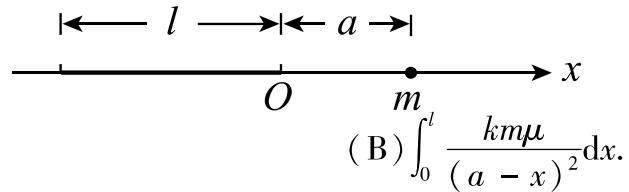

(B) $\int_{0}^{l}\frac{km\mu}{(a-x)^{2}}dx.$

(C) $2\int_{-\frac{l}{2}}^{0}\frac{km\mu}{(a + x)^{2}}\mathrm{d}x.$

$$
2 \int_ {0} ^ {\frac {l}{2}} \frac {k m \mu}{(a + x) ^ {2}} d x.
$$

## 三、(本题共5小题,每小题5分,满分25分)

(1) 设 $\left\{\begin{aligned}x &= t\cos t, \\ y &= t\sin t,\end{aligned}\right.$ 求 $\frac{d^{2}y}{dx^{2}}.$

(2) 计算 $\int_{1}^{4} \frac{\mathrm{d}x}{x(1 + \sqrt{x})}$ .

(3) 求 $\lim_{x\to0}\frac{x-\sin x}{x^{2}(e^{x}-1)}$ .

(4) 求 $\int x\sin^{2}x dx.$

(5) 求微分方程 $xy' + y = xe^{x}$ 满足 $y(1) = 1$ 的特解.

## 四、(本题满分9分)

利用导数证明: 当 x > 1 时, $\frac{\ln(1 + x)}{\ln x} > \frac{x}{1 + x}$ .

五、(本题满分9分)

求微分方程 $y'' + y = x + \cos x$ 的通解.

六、(本题满分9分)

曲线 $y = (x - 1)(x - 2)$ 和 x 轴围成一平面图形, 求此平面图形绕 y 轴旋转一周所成的旋转体的体积.

## 七、(本题满分9分)

如图, A 和 D 分别是曲线 $y = e^{x}$ 和 $y = e^{-2x}$ 上的点, AB 和 DC 均垂直 x 轴, 且 $|AB| : |DC| = 2 : 1$ , $|AB| < 1$ , 求点 B 和 C 的横坐标, 使梯形 ABCD 的面积最大.

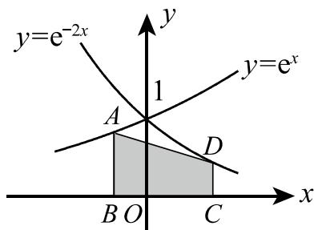

八、(本题满分9分)

设函数 $f(x)$ 在 $(-\infty, +\infty)$ 上满足 $f(x) = f(x - \pi) + \sin x$ ，且 $f(x) = x, x \in [0, \pi)$ . 计算 $\int_{\pi}^{3\pi} f(x) \mathrm{d}x$ .

# 1992 年全国硕士研究生招生考试试题

# (试卷 Ⅲ)

## 一、填空题(本题共5小题,每小题3分,满分15分)

(1) 设 $\left\{\begin{aligned}x &= f(t) - \pi, \\ y &= f(\mathrm{e}^{3t} - 1)\end{aligned}\right.$ 其中 f 可导，且 $f'(0) \neq 0$ ，则 $\frac{dy}{dx}\bigg|_{t=0} =$ \_\_\_\_.

(2) 函数 $y = x + 2 \cos x$ 在 $\left[0, \frac{\pi}{2}\right]$ 上的最大值为 \_\_\_\_.

(3) $\lim_{x\to 0}\frac{1 - \sqrt{1 - x^2}}{\mathrm{e}^x - \cos x} = \underline{\quad}$ .

(4) $\int_{1}^{+\infty}\frac{\mathrm{d}x}{x(x^2 + 1)} = \underline{\quad}$ .

(5) 由曲线 $y = x \mathrm{e}^{x}$ 与直线 $y = \mathrm{e}x$ 所围成的图形的面积 $S =$ \_\_\_\_.

## 二、选择题(本题共5小题,每小题3分,满分15分)

(1) 当 $x \to 0$ 时, $x - \sin x$ 是 $x^{2}$ 的 ( )
(A) 低阶无穷小.
(B) 高阶无穷小.
(C) 等价无穷小.
(D) 同阶但非等价的无穷小.

(2) 设 $f(x) = \begin{cases} x^{2}, & x \leqslant 0, \\ x^{2} + x, & x > 0, \end{cases}$ 则 ( )  
(A) $f(-x) = \begin{cases} -x^{2}, & x \leqslant 0, \\ -(x^{2} + x), & x > 0. \end{cases}$ (B) $f(-x) = \begin{cases} - (x^{2} + x), & x < 0, \\ -x^{2}, & x \geqslant 0. \end{cases}$ (C) $f(-x) = \begin{cases} x^{2}, & x \leqslant 0, \\ x^{2} - x, & x > 0. \end{cases}$ (D) $f(-x) = \begin{cases} x^{2} - x, & x < 0, \\ x^{2}, & x \geqslant 0. \end{cases}$

(3) 当 $x \to 1$ 时, 函数 $\frac{x^{2} - 1}{x - 1} e^{\frac{1}{x - 1}}$ 的极限 ( )
(A) 等于 2.
(B) 等于 0.
(C) 为 $\infty$ .
(D) 不存在但不为 $\infty$ .

(4) 设 $f(x)$ 连续, $F(x) = \int_{0}^{x^{2}} f(t^{2}) \, dt$ , 则 $F'(x)$ 等于 ( )
(A) $f(x^{4})$ . (B) $x^{2}f(x^{4})$ . (C) $2xf(x^{4})$ . (D) $2xf(x^{2})$ .

(5) 若 $f(x)$ 的导函数是 $\sin x$ ，则 $f(x)$ 有一个原函数为（）
(A) $1+\sin x.$ (B) $1-\sin x.$ (C) $1+\cos x.$ (D) $1-\cos x.$

## 三、(本题共5小题,每小题5分,满分25分)

(1) 求 $\lim_{x\to\infty}\left(\frac{3+x}{6+x}\right)^{\frac{x-1}{2}}$ .

(2) 设函数 $y = y(x)$ 由方程 $y - x\mathrm{e}^{y} = 1$ 所确定, 求 $\frac{\mathrm{d}^2y}{\mathrm{d}x^2}\bigg|_{x=0}$ 的值.

(3) 求 $\int \frac{x^{3}}{\sqrt{1 + x^{2}}} dx.$

(4) 求 $\int_{0}^{\pi} \sqrt{1 - \sin x} \, \mathrm{d}x$ .

(5) 求微分方程 $(y - x^3)\mathrm{d}x - 2x\mathrm{d}y = 0$ 的通解.

## 四、(本题满分9分)

设 $f(x) = \left\{ \begin{array}{ll}1 + x^2, & x\leqslant 0,\\ \mathrm{e}^{-x}, & x > 0, \end{array} \right.$ 求 $\int_1^3 f(x - 2)\mathrm{d}x.$

## 五、(本题满分9分)

求微分方程 $y'' - 3y' + 2y = xe^{x}$ 的通解.

六、(本题满分9分)

计算曲线 $y = \ln (1 - x^2)$ 上相应于 $0 \leqslant x \leqslant \frac{1}{2}$ 的一段弧的长度.

## 七、(本题满分9分)

求曲线 $y = \sqrt{x}$ 的一条切线 $l$ ，使该曲线与切线 $l$ 及直线 $x = 0, x = 2$ 所围成的平面图形面积最小.

## 八、(本题满分9分)

已知 $f''(x) < 0, f(0) = 0$ ，证明对任何 $x_1 > 0, x_2 > 0$ ，有 $f(x_1 + x_2) < f(x_1) + f(x_2)$ .

# 1993年全国硕士研究生招生考试试题

# (试卷 Ⅲ)

## 一、填空题(本题共5小题,每小题3分,满分15分)

(1) $\lim_{x\to 0^{+}}x\ln x = \underline{\quad}$ .

(2) 函数 $y = y(x)$ 由方程 $\sin(x^{2} + y^{2}) + e^{x} - xy^{2} = 0$ 所确定，则 $\frac{dy}{dx} =$ \_\_\_\_.

(3) 设 $F(x) = \int_{1}^{x} \left(2 - \frac{1}{\sqrt{t}}\right) \mathrm{d}t (x > 0)$ ，则函数 $F(x)$ 的单调减少区间是 \_\_\_\_.

(4) $\int \frac{\tan x}{\sqrt{\cos x}} \, \mathrm{d}x = \underline{\quad}$ .

(5) 已知曲线 $y = f(x)$ 过点 $\left(0, -\frac{1}{2}\right)$ ，且其上任一点 $(x, y)$ 处的切线斜率为 $x \ln(1 + x^{2})$ ，则 $f(x) =$ \_\_\_\_.

## 二、选择题(本题共5小题,每小题3分,满分15分)

(1) 当 $x \to 0$ 时, 变量 $\frac{1}{x^{2}} \sin \frac{1}{x}$ 是 ( )
(A) 无穷小.
(B) 无穷大.
(C) 有界的,但不是无穷小.
(D) 无界的,但不是无穷大.

(2) 设 $f(x) = \begin{cases} \frac{|x^{2} - 1|}{x - 1}, & x \neq 1, \\ 2, & x = 1, \end{cases}$ ，则在点 x = 1 处函数 $f(x)$ ( )
(A) 不连续. (B) 连续,但不可导.
(C) 可导,但导数不连续. (D) 可导,且导数连续.

(3) 已知 $f(x)=\left\{\begin{aligned}x^{2},&0\leqslant x<1,\\ 1,&1\leqslant x\leqslant2,\end{aligned}\right.$ 设 $F(x)=\int_{1}^{x}f(t)\mathrm{d}t(0\leqslant x\leqslant2)$ ，则 $F(x)$ 为（）
(A) $\left\{\begin{aligned}\frac{1}{3}x^{3},&0\leqslant x<1,\\ x,&1\leqslant x\leqslant2.\end{aligned}\right.$ (B) $\left\{\begin{aligned}\frac{1}{3}x^{3}-\frac{1}{3},&0\leqslant x<1,\\ x,&1\leqslant x\leqslant2.\end{aligned}\right.$ (C) $\left\{\begin{aligned}\frac{1}{3}x^{3},&0\leqslant x<1,\\ x-1,&1\leqslant x\leqslant2.\end{aligned}\right.$ (D) $\left\{\begin{aligned}\frac{1}{3}x^{3}-\frac{1}{3},&0\leqslant x<1,\\ x-1,&1\leqslant x\leqslant2.\end{aligned}\right.$

(4) 设常数 $k > 0$ ，函数 $f(x) = \ln x - \frac{x}{\mathrm{e}} + k$ 在 $(0, +\infty)$ 内的零点个数为（ ） (A)3. (B)2. (C)1. (D)0.

(5) 若 $f(x) = -f(-x)$ ，在 $(0, +\infty)$ 内 $f'(x) > 0, f''(x) > 0$ ，则 $f(x)$ 在 $(-∞, 0)$ 内（）
(A) $f'(x)<0,f''(x)<0.$ (B) $f'(x)<0,f''(x)>0.$ (C) $f'(x)>0,f''(x)<0.$ (D) $f'(x)>0,f''(x)>0.$

## 三、(本题共5小题,每小题5分,满分25分)

（1）设 $y = \sin [f(x^2)]$ ，其中 $f$ 具有二阶导数，求 $\frac{\mathrm{d}^2y}{\mathrm{d}x^2}$

(2) 求 $\lim_{x\to-\infty}x(\sqrt{x^{2}+100}+x)$ .

(3) 求 $\int_{0}^{\frac{\pi}{4}}\frac{x}{1+\cos2x}dx.$

(4) 求 $\int_{0}^{+\infty} \frac{x}{(1 + x)^3} \mathrm{d}x$ .

(5) 求微分方程 $(x^{2} - 1)\mathrm{d}y + (2xy - \cos x)\mathrm{d}x = 0$ 满足初值条件 $y(0) = 1$ 的特解.

## 四、(本题满分9分)

设二阶常系数线性微分方程 $y'' + \alpha y' + \beta y = \gamma e^{x}$ 的一个特解为 $y = e^{2x} + (1 + x)e^{x}$ ，试确定常数 $\alpha, \beta, \gamma$ ，并求该方程的通解.

## 五、(本题满分9分)

设平面图形 A 由 $x^{2} + y^{2} \leqslant 2x$ 与 $y \geqslant x$ 所确定, 求图形 A 绕直线 x = 2 旋转一周所得旋转体的体积.

## 六、(本题满分9分)

作半径为 r 的球的外切正圆锥, 问此圆锥的高 h 为何值时, 其体积 V 最小, 并求出该最小值.

## 七、(本题满分9分)

设 $x > 0$ ，常数 $a > \mathrm{e}$ .证明： $(a + x)^{a} <   a^{a + x}$

## 八、(本题满分9分)

设 $f'(x)$ 在 $[0, a]$ 上连续，且 $f(0) = 0$ ，证明： $\left|\int_{0}^{a} f(x) \mathrm{d}x\right| \leqslant \frac{Ma^2}{2}$ ，其中 $M = \max_{0 \leqslant x \leqslant a} |f'(x)|$ .

# 1994年全国硕士研究生招生考试试题

# (试卷 Ⅲ)

## 一、填空题(本题共5小题,每小题3分,满分15分)

(1) 若 $f(x) = \begin{cases} \frac{\sin 2x + e^{2ax} - 1}{x}, & x \neq 0, \\ a, & x = 0 \end{cases}$ ，在 $(-∞, +∞)$ 上连续，则 a = \_\_\_\_.

(2) 设函数 $y = y(x)$ 由参数方程 $\left\{\begin{aligned} x &= t - \ln(1 + t), \\ y &= t^{3} + t^{2} \end{aligned}\right.$ 所确定，则 $\frac{d^{2}y}{dx^{2}} =$ \_\_\_\_ .

(3) $\frac{\mathrm{d}}{\mathrm{d}x}\left(\int_{0}^{\cos 3x}f(t)\mathrm{d}t\right) =$

(4) $\int x^{3} \mathrm{e}^{x^{2}} \mathrm{d}x = \underline{\quad}$ .

(5) 微分方程 $y \, dx + (x^{2} - 4x) \, dy = 0$ 的通解为 \_\_\_\_.

## 二、选择题(本题共5小题,每小题3分,满分15分)

(1) 设 $\lim_{x\to0}\frac{\ln(1+x)-(ax+bx^{2})}{x^{2}}=2$ , 则 ( )
(A) $a = 1, b = -\frac{5}{2}.$ (B) a = 0, b = -2.

(C) $a = 0, b = -\frac{5}{2}.$ (D) a = 1, b = -2.

(2) 设 $f(x) = \begin{cases} \frac{2}{3}x^{3}, & x \leqslant 1, \\ x^{2}, & x > 1, \end{cases}$ 则 $f(x)$ 在点 x = 1 处的 ( ) 
(A) 左、右导数都存在. (B) 左导数存在,但右导数不存在.
(C) 左导数不存在,但右导数存在. (D) 左、右导数都不存在.

(3) 设 $y = f(x)$ 是满足微分方程 $y'' + y' - e^{\sin x} = 0$ 的解，且 $f'(x_0) = 0$ ，则 $f(x)$ 在 ( ) (A) $x_0$ 的某个邻域内单调增加. (B) $x_0$ 的某个邻域内单调减少. (C) $x_0$ 处取得极小值. (D) $x_0$ 处取得极大值.

(4) 曲线 $y = e^{\frac{1}{x^{2}}} \arctan \frac{x^{2} + x + 1}{(x - 1)(x + 2)}$ 的渐近线有（）
(A)1 条. (B)2 条. (C)3 条. (D)4 条.

(5) 设 $M = \int_{-\frac{\pi}{2}}^{\frac{\pi}{2}} \frac{\sin x}{1 + x^{2}} \cos^{4} x \, dx, N = \int_{-\frac{\pi}{2}}^{\frac{\pi}{2}} (\sin^{3} x + \cos^{4} x) \, dx, P = \int_{-\frac{\pi}{2}}^{\frac{\pi}{2}} (x^{2} \sin^{3} x - \cos^{4} x) \, dx$ ，则有（）
(A) N < P < M.
(B) M < P < N.
(C) N < M < P.
(D) P < M < N.

## 三、(本题共5小题,每小题5分,满分25分)

(1) 设 $y = f(x + y)$ ，其中 f 具有二阶导数，且其一阶导数不等于 1，求 $\frac{d^{2}y}{dx^{2}}$ .

(2) 计算 $\int_0^1 x (1 - x^4)^{\frac{3}{2}} \mathrm{d}x$ .

(3) 计算 $\lim_{n\to\infty}\tan^{n}\left(\frac{\pi}{4}+\frac{2}{n}\right)$ .

(4) 计算 $\int \frac{dx}{\sin 2x + 2\sin x}$ .

(5) 如图, 设曲线方程为 $y = x^{2} + \frac{1}{2}$ , 梯形 OABC 的面积为 D, 曲边梯形 OABC 的面积为 $D_{1}$ , 点 A 的坐标为 $(a,0)$ , a > 0. 证明: $\frac{D}{D_{1}} < \frac{3}{2}$ .

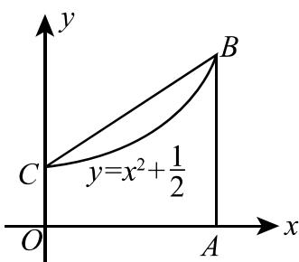

## 四、(本题满分9分)

设当 $x > 0$ 时，方程 $kx + \frac{1}{x^2} = 1$ 有且仅有一个解，求 $k$ 的取值范围.

## 五、(本题满分9分)

设 $y = \frac{x^{3} + 4}{x^{2}}$ ,

(1) 求函数的增减区间及极值;

(2) 求函数图形的凹凸区间及拐点；

(3) 求其渐近线；

(4) 作出其图形.

## 六、(本题满分9分)

求微分方程 $y'' + a^{2}y = \sin x$ 的通解, 其中常数 a > 0.

## 七、(本题满分9分)

设 $f(x)$ 在 $[0,1]$ 上连续且递减，证明：当 $0 < \lambda < 1$ 时， $\int_0^\lambda f(x)\mathrm{d}x \geqslant \lambda \int_0^1 f(x)\mathrm{d}x.$

## 八、(本题满分9分)

求曲线 $y = 3 - |x^2 - 1|$ 与 $x$ 轴围成的封闭图形绕直线 $y = 3$ 旋转所得的旋转体体积.

# 1995年全国硕士研究生招生考试试题

# (试卷 Ⅲ)

## 一、填空题(本题共5小题,每小题3分,满分15分)

(1) 设 $y = \cos(x^{2})\sin^{2}\frac{1}{x}$ ，则 $y' =$ \_\_\_\_ .

(2) 微分方程 $y'' + y = -2x$ 的通解为 \_\_\_\_.

(3) 曲线 $\left\{\begin{aligned}x &= 1 + t^{2}, \\ y &= t^{3}\end{aligned}\right.$ 在 t = 2 处的切线方程为 \_\_\_\_.

(4) $\lim_{n\to\infty}\left(\frac{1}{n^{2}+n+1}+\frac{2}{n^{2}+n+2}+\cdots+\frac{n}{n^{2}+n+n}\right)=$ \_\_\_\_.

(5) 曲线 $y = x^{2} e^{-x^{2}}$ 的渐近线方程为 \_\_\_\_.

## 二、选择题(本题共5小题,每小题3分,满分15分)

(1) 设 $f(x)$ 和 $\varphi(x)$ 在 $(-∞, +∞)$ 上有定义， $f(x)$ 为连续函数，且 $f(x) \neq 0, \varphi(x)$ 有间断点，则
(A) $\varphi[f(x)]$ 必有间断点. (B) $\left[\varphi(x)\right]^{2}$ 必有间断点.
(C) $f[\varphi(x)]$ 必有间断点. (D) $\frac{\varphi(x)}{f(x)}$ 必有间断点.

(2) 曲线 $y = x(x - 1)(2 - x)$ 与 x 轴所围图形的面积可表示为 ( )
(A) $-\int_{0}^{2}x(x-1)(2-x)\mathrm{d}x.$ (B) $\int_{0}^{1}x(x-1)(2-x)\mathrm{d}x-\int_{1}^{2}x(x-1)(2-x)\mathrm{d}x.$ (C) $-\int_{0}^{1}x(x-1)(2-x)\mathrm{d}x+\int_{1}^{2}x(x-1)(2-x)\mathrm{d}x.$ (D) $\int_{0}^{2}x(x-1)(2-x)\mathrm{d}x.$

(3) 设 $f(x)$ 在 $(-∞, +∞)$ 内可导，且对任意 $x_{1}, x_{2}$ ，当 $x_{1} > x_{2}$ 时，都有 $f(x_{1}) > f(x_{2})$ ，则（）
(A) 对任意 $x, f'(x) > 0.$ (B) 对任意 $x, f'(-x) \leqslant 0.$ (C) 函数 $f(-x)$ 单调增加. (D) 函数 $-f(-x)$ 单调增加.

(4) 设函数 $f(x)$ 在 $[0,1]$ 上 $f''(x) > 0$ ，则 $f'(1), f'(0), f(1) - f(0)$ 或 $f(0) - f(1)$ 的大小顺序是
(A) $f'(1)>f'(0)>f(1)-f(0).$ (B) $f'(1)>f(1)-f(0)>f'(0).$ (C) $f(1)-f(0)>f'(1)>f'(0).$ (D) $f'(1)>f(0)-f(1)>f'(0).$

(5) 设 $f(x)$ 可导, $F(x) = f(x)(1 + |\sin x|)$ . 若 $F(x)$ 在 x = 0 处可导, 则必有 ( )  
(A) $f(0) = 0.$ (B) $f'(0) = 0.$ (C) $f(0)+f'(0)=0.$ (D) $f(0)-f'(0)=0.$

## 三、(本题共6小题,每小题5分,满分30分)

(1) 求 $\lim_{x\to0^{+}}\frac{1-\sqrt{\cos x}}{x(1-\cos\sqrt{x})}$ .

(2) 设函数 $y = y(x)$ 由方程 $x\mathrm{e}^{f(y)} = \mathrm{e}^y$ 确定, 其中 $f$ 具有二阶导数, 且 $f' \neq 1$ , 求 $\frac{\mathrm{d}^2y}{\mathrm{d}x^2}$ .

(3) 设 $f(x^{2} - 1) = \ln \frac{x^{2}}{x^{2} - 2}$ ，且 $f[\varphi(x)] = \ln x$ ，求 $\int \varphi(x) \, \mathrm{d}x$ .

(4) 设 $f(x) = \begin{cases} x \arctan \frac{1}{x^{2}}, & x \neq 0, \\ 0, & x = 0, \end{cases}$ 试讨论 $f'(x)$ 在 x = 0 处的连续性.

(5) 求摆线 $\left\{\begin{aligned} x &= 1 - \cos t, \\ y &= t - \sin t \end{aligned}\right.$ 一拱 $(0 \leqslant t \leqslant 2\pi)$ 的弧长 S.

(6) 设单位质点在水平面内作直线运动, 初速度 $v \bigg|_{t=0} = v_{0}$ . 已知阻力与速度成正比(比例常数为 1),

问 $t$ 为多少时此质点的速度为 $\frac{v_0}{3}$ ? 并求到此时刻该质点所经过的路程.

四、(本题满分8分)

求函数 $f(x) = \int_{0}^{x^2}(2 - t)\mathrm{e}^{-t}\mathrm{d}t$ 的最大值和最小值.

五、(本题满分8分)

设 $y = e^{x}$ 是微分方程 $xy' + p(x)y = x$ 的一个解, 求此微分方程满足条件 $y\bigg|_{x=\ln2}=0$ 的特解.

六、(本题满分8分)

如图, 设曲线 L 的方程为 $y = f(x)$ , 且 $y'' > 0$ . 又 MT, MP 分别为该曲线在点 $M(x_0, y_0)$ 处的切线和法线. 已知线段 MP 的长度为 $\frac{(1 + y'_2)^{\frac{3}{2}}}{y'_0}$ (其中 $y'_0 = y'(x_0), y'_0 = y''(x_0)$ ), 试推导出点 $P(\xi, \eta)$ 的坐标表达式.

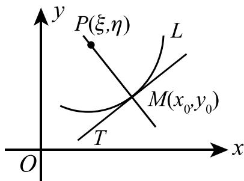

七、(本题满分8分)

设 $f(x)=\int_{0}^{x}\frac{\sin t}{\pi-t}dt$ ，计算 $\int_{0}^{\pi}f(x)\mathrm{d}x.$

## 八、(本题满分8分)

设 $\lim_{x\to0}\frac{f(x)}{x}=1$ ，且 $f''(x)>0$ ，证明 $f(x)\geqslant x$ .

# 1996 年全国硕士研究生招生考试试题

# (试卷 Ⅲ)

## 一、填空题(本题共5小题,每小题3分,满分15分)

(1) 设 $y = (x + \mathrm{e}^{-\frac{x}{2}})^{\frac{2}{3}}$ ，则 $y' \bigg|_{x=0} = \_\_\_$ .

(2) $\int_{-1}^{1}\left(x + \sqrt{1 - x^2}\right)^2\mathrm{d}x = \underline{\quad}$ .

(3) 微分方程 $y'' + 2y' + 5y = 0$ 的通解为 \_\_\_\_.

(4) $\lim_{x\to \infty}x\left[\sin \ln \left(1 + \frac{3}{x}\right) - \sin \ln \left(1 + \frac{1}{x}\right)\right] = \underline{\quad}$ .

(5) 由曲线 $y = x + \frac{1}{x}$ , x = 2 及 y = 2 所围图形的面积 S = \_\_\_\_.

## 二、选择题(本题共5小题,每小题3分,满分15分)

(1) 设当 $x \to 0$ 时, $\mathrm{e}^x - (ax^2 + bx + 1)$ 是比 $x^2$ 高阶的无穷小, 则 ( ) (A) $a = \frac{1}{2}, b = 1$ . (B) $a = 1, b = 1$ . (C) $a = -\frac{1}{2}, b = -1$ . (D) $a = -1, b = 1$ .

(2) 设函数 $f(x)$ 在区间 $(-\delta, \delta)$ 内有定义, 若当 $x \in (-\delta, \delta)$ 时, 恒有 $|f(x)| \leqslant x^{2}$ , 则 x = 0 必是 $f(x)$ 的 ( )
(A) 间断点. (B) 连续而不可导的点.
(C) 可导的点, 且 $f'(0) = 0$ . (D) 可导的点, 且 $f'(0) \neq 0$ .

(3) 设 $f(x)$ 处处可导, 则 ( )
(A) 当 $\lim_{x\to-\infty}f(x)=-\infty$ , 必有 $\lim_{x\to-\infty}f'(x)=-\infty$ .
(B) 当 $\lim_{x\to-\infty}f'(x)=-\infty$ , 必有 $\lim_{x\to-\infty}f(x)=-\infty$ .
(C) 当 $\lim_{x\to+\infty}f(x)=+\infty$ , 必有 $\lim_{x\to+\infty}f'(x)=+\infty$ .
(D) 当 $\lim_{x\to+\infty}f'(x)=+\infty$ , 必有 $\lim_{x\to+\infty}f(x)=+\infty$ .

(4) 在区间 $(- \infty, + \infty)$ 内，方程 $|x|^{\frac{1}{4}} + |x|^{\frac{1}{2}} - \cos x = 0$ （A）无实根. (B) 有且仅有一个实根. (C) 有且仅有两个实根. (D) 有无穷多个实根.

(5) 设 $f(x)$ , $g(x)$ 在区间 $[a, b]$ 上连续，且 $g(x) < f(x) < m$ (m 为常数)，由曲线 $y = g(x)$ , $y = f(x)$ ,
x = a 及 x = b 所围平面图形绕直线 y = m 旋转而成的旋转体体积为( )
(A) $\int_{a}^{b}\pi\left[2m-f(x)+g(x)\right]\left[f(x)-g(x)\right]\mathrm{d}x.$ (B) $\int_{a}^{b}\pi\left[2m-f(x)-g(x)\right]\left[f(x)-g(x)\right]\mathrm{d}x.$ (C) $\int_{a}^{b}\pi\left[m-f(x)+g(x)\right]\left[f(x)-g(x)\right]\mathrm{d}x.$ (D) $\int_{a}^{b}\pi\left[m-f(x)-g(x)\right]\left[f(x)-g(x)\right]\mathrm{d}x.$

## 三、(本题共6小题,每小题5分,满分30分)

(1) 计算 $\int_{0}^{\ln 2}\sqrt{1 - \mathrm{e}^{-2x}}\mathrm{d}x.$

(2) 求 $\int \frac{dx}{1 + \sin x}$ .

(3) 设 $\left\{\begin{aligned}x &= \int_{0}^{t}f(u^{2})\mathrm{d}u, \\ y &= [f(t^{2})]^{2},\end{aligned}\right.$ 其中 $f(u)$ 具有二阶导数，且 $f(u) \neq 0$ ，求 $\frac{d^{2}y}{dx^{2}}$ .

(4) 求函数 $f(x) = \frac{1 - x}{1 + x}$ 在点 x = 0 处带拉格朗日型余项的 n 阶泰勒展开式.

(5) 求微分方程 $y'' + y' = x^{2}$ 的通解.

(6) 设有一正椭圆柱体, 其底面的长、短轴分别为 $2a, 2b$ , 用过此柱体底面的短轴且与底面成 $\alpha$ 角 $\left(0 < \alpha < \frac{\pi}{2}\right)$ 的平面截此柱体, 得一楔形体 (如图), 求此楔形体的体积 $V$ .

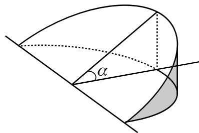

## 四、(本题满分8分)

计算不定积分 $\int \frac{\arctan x}{x^2(1 + x^2)}\mathrm{d}x.$

## 五、(本题满分8分)

设函数 $f(x) = \begin{cases} 1 - 2x^{2}, & x < -1, \\ x^{3}, & -1 \leqslant x \leqslant 2, \\ 12x - 16, & x > 2. \end{cases}$

(1) 写出 $f(x)$ 的反函数 $g(x)$ 的表达式;

(2) $g(x)$ 是否有间断点、不可导点,若有,指出这些点.

## 六、(本题满分8分)

设函数 $y = y(x)$ 由方程 $2y^{3} - 2y^{2} + 2xy - x^{2} = 1$ 所确定, 试求 $y = y(x)$ 的驻点, 并判别它是否为极值点.

## 七、(本题满分8分)

设 $f(x)$ 在区间 $[a, b]$ 上具有二阶导数，且 $f(a) = f(b) = 0$ , $f'(a)f'(b) > 0$ . 证明：存在 $\xi \in (a, b)$ 和 $\eta \in (a, b)$ ，使 $f(\xi) = 0$ 及 $f''(\eta) = 0$ .

## 八、(本题满分8分)

设 $f(x)$ 为连续函数，

(1) 求初值问题 $\left\{\begin{aligned}y' + ay &= f(x), \\ y\bigg|_{x=0} &= 0\end{aligned}\right.$ 的解 $y(x)$ ，其中 a 是正常数；

(2) 若 $|f(x)| \leqslant k$ (k 为常数), 证明: 当 $x \geqslant 0$ 时, 有 $|y(x)| \leqslant \frac{k}{a} (1 - \mathrm{e}^{-ax})$ .

# 1997年全国硕士研究生招生考试试题

## 一、填空题(本题共5小题,每小题3分,满分15分)

(1) 已知函数 $f(x) = \begin{cases} (\cos x)^{x-2}, & x \neq 0, \\ a, & x = 0 \end{cases}$ ，在 x = 0 处连续，则 a = \_\_\_\_.

(2) 设 $y = \ln \sqrt{\frac{1 - x}{1 + x^{2}}}$ ，则 $y''\bigg|_{x=0} =$ \_\_\_\_.

(3) $\int \frac{\mathrm{d}x}{\sqrt{x(4 - x)}} = \underline{\quad}$ .

(4) $\int_{0}^{+\infty}\frac{\mathrm{d}x}{x^2 + 4x + 8} =$

(5) 已知向量组 $\boldsymbol{\alpha}_{1} = (1, 2, -1, 1)$ , $\boldsymbol{\alpha}_{2} = (2, 0, t, 0)$ , $\boldsymbol{\alpha}_{3} = (0, -4, 5, -2)$ 的秩为 2，则 t = \_\_\_\_.

## 二、选择题(本题共5小题,每小题3分,满分15分)

(1) 设 $x \to 0$ 时, $e^{\tan x} - e^{x}$ 与 $x^{n}$ 是同阶无穷小, 则 n 为 ( )
(A)1. (B)2. (C)3. (D)4.

(2) 设在闭区间 $[a, b]$ 上 $f(x) > 0$ , $f'(x) < 0$ , $f''(x) > 0$ . 记 $S_{1} = \int_{a}^{b} f(x) \mathrm{d}x$ , $S_{2} = f(b)(b - a)$ , $S_{3} = \frac{1}{2} [f(a) + f(b)] (b - a)$ , 则（）  
(A) $S_{1} < S_{2} < S_{3}$ . (B) $S_{2} < S_{1} < S_{3}$ . (C) $S_{3} < S_{1} < S_{2}$ . (D) $S_{2} < S_{3} < S_{1}$ .

(3) 已知函数 $y = f(x)$ 对一切 $x$ 满足 $xf''(x) + 3x[f'(x)]^2 = 1 - \mathrm{e}^{-x}$ ，若 $f'(x_0) = 0 (x_0 \neq 0)$ ，则（A） $f(x_0)$ 是 $f(x)$ 的极大值.  
(B) $f(x_0)$ 是 $f(x)$ 的极小值.  
(C) $(x_0, f(x_0))$ 是曲线 $y = f(x)$ 的拐点.  
(D) $f(x_0)$ 不是 $f(x)$ 的极值， $(x_0, f(x_0))$ 也不是曲线 $y = f(x)$ 的拐点.

(4) 设 $F(x) = \int_{x}^{x+2\pi} e^{\sin t} \sin t dt$ ，则 $F(x)()$ (A) 为正常数. (B) 为负常数. (C) 恒为零. (D) 不为常数.

(5) 设函数 $g(x)=\left\{\begin{aligned}&2-x,&x\leqslant0,\\&x+2,&x>0,\end{aligned}\right.$ $f(x)=\left\{\begin{aligned}&x^{2},&x<0,\\&-x,&x\geqslant0,\end{aligned}\right.$ 则 $g[f(x)]=(\quad)$ (A) $\left\{\begin{aligned}&2+x^{2},&x<0,\\ &2-x,&x\geqslant0.\end{aligned}\right.$ (B) $\left\{\begin{aligned}&2-x^{2},&x<0,\\ &2+x,&x\geqslant0.\end{aligned}\right.$ (C) $\left\{\begin{aligned}&2-x^{2},&x<0,\\ &2-x,&x\geqslant0.\end{aligned}\right.$ (D) $\left\{\begin{aligned}&2+x^{2},&x<0,\\ &2+x,&x\geqslant0.\end{aligned}\right.$

## 三、(本题共6小题,每小题5分,满分30分)

(1) 求极限 $\lim_{x\to-\infty}\frac{\sqrt{4x^{2}+x-1}+x+1}{\sqrt{x^{2}+\sin x}}$ .

(2) 设函数 $y = y(x)$ 由 $\left\{\begin{aligned} x &= \arctan t, \\ 2y - ty^{2} + e^{t} &= 5 \end{aligned}\right.$ 所确定，求 $\frac{dy}{dx}$ .

(3) 计算 $\int \mathrm{e}^{2x} (\tan x + 1)^2 \, \mathrm{d}x$ .

(4) 求微分方程 $(3x^{2} + 2xy - y^{2})\mathrm{d}x + (x^{2} - 2xy)\mathrm{d}y = 0$ 的通解.

(5) 已知 $y_{1} = x\mathrm{e}^{x} + \mathrm{e}^{2x}, y_{2} = x\mathrm{e}^{x} + \mathrm{e}^{-x}, y_{3} = x\mathrm{e}^{x} + \mathrm{e}^{2x} - \mathrm{e}^{-x}$ 是某二阶线性非齐次微分方程的三个解, 求此微分方程.

(6) 已知矩阵 $A = \begin{pmatrix} 1 & 1 & -1 \\ 0 & 1 & 1 \\ 0 & 0 & -1 \end{pmatrix}$ ，且 $A^{2} - AB = E$ ，其中 E 是 3 阶单位矩阵，求矩阵 B.

## 四、(本题满分8分)

$\lambda$ 取何值时，方程组 $\left\{ \begin{array}{l} 2x_{1} + \lambda x_{2} - x_{3} = 1, \\ \lambda x_{1} - x_{2} + x_{3} = 2, \\ 4x_{1} + 5x_{2} - 5x_{3} = -1 \end{array} \right.$ 无解，有唯一解或有无穷多解？并在有无穷多解时写出

方程组的通解.

## 五、(本题满分8分)

设曲线 L 的极坐标方程为 $r = r(\theta)$ , $M(r, \theta)$ 为 L 上任一点, $M_{0}(2, 0)$ 为 L 上一定点. 若极径 $OM_{0}$ , OM 与曲线 L 所围成的曲边扇形面积值等于 L 上 $M_{0}$ , M 两点间弧长值的一半, 求曲线 L 的方程.

## 六、(本题满分8分)

设函数 $f(x)$ 在闭区间 $[0,1]$ 上连续，在开区间 $(0,1)$ 内大于零，并满足 $xf'(x) = f(x) + \frac{3a}{2} x^2 (a$ 为常数），又曲线 $y = f(x)$ 与 $x = 1, y = 0$ 所围的图形 $S$ 的面积值为2，求函数 $y = f(x)$ ，并问 $a$ 为何值时，图形 $S$ 绕 $x$ 轴旋转一周所得的旋转体的体积最小.

## 七、(本题满分8分)

设函数 $f(x)$ 连续， $\varphi(x) = \int_{0}^{1} f(xt) \, \mathrm{d}t$ ，且 $\lim_{x \to 0} \frac{f(x)}{x} = A$ （ $A$ 为常数），求 $\varphi'(x)$ 并讨论 $\varphi'(x)$ 在 $x = 0$ 处的连续性.

## 八、(本题满分8分)

就 $k$ 的不同取值情况, 确定方程 $x - \frac{\pi}{2} \sin x = k$ 在开区间 $\left(0, \frac{\pi}{2}\right)$ 内根的个数, 并证明你的结论.

# 1998年全国硕士研究生招生考试试题

## 一、填空题(本题共5小题,每小题3分,满分15分)

(1) $\lim_{x\to 0}\frac{\sqrt{1 + x} + \sqrt{1 - x} - 2}{x^2} =$ \_\_\_\_.

(2) 曲线 $y = -x^{3} + x^{2} + 2x$ 与 x 轴所围成的图形的面积 A = \_\_\_\_.

(3) $\int \frac{\ln(\sin x)}{\sin^2 x} \, \mathrm{d}x = \underline{\quad}$ .

(4) 设 $f(x)$ 连续, 则 $\frac{\mathrm{d}}{\mathrm{d}x}\int_{0}^{x}tf(x^{2}-t^{2})\mathrm{d}t=$ \_\_\_\_.

(5) 曲线 $y = x \ln \left( e + \frac{1}{x} \right) (x > 0)$ 的渐近线方程为 \_\_\_\_.

## 二、选择题(本题共5小题,每小题3分,满分15分)

(1) 设数列 $\{x_{n}\}$ 与 $\{y_{n}\}$ 满足 $\lim_{n\to\infty}x_{n}y_{n}=0$ ，则下列断言正确的是（）
(A) 若 $\{x_{n}\}$ 发散，则 $\{y_{n}\}$ 必发散.
(B) 若 $\{x_{n}\}$ 无界，则 $\{y_{n}\}$ 必有界.
(C) 若 $\{x_{n}\}$ 有界，则 $\{y_{n}\}$ 必为无穷小.
(D) 若 $\left\{\frac{1}{x_{n}}\right\}$ 为无穷小，则 $\{y_{n}\}$ 必为无穷小.

(2) 函数 $f(x) = (x^{2} - x - 2) \mid x^{3} - x$ 的不可导点的个数为( )
(A)0.
(B)1.
(C)2.
(D)3.

(3) 已知函数 $y = y(x)$ 在任意点 x 处的增量 $\Delta y = \frac{y\Delta x}{1 + x^{2}} + \alpha$ ，其中 $\alpha$ 是比 $\Delta x (\Delta x \to 0)$ 高阶的无穷小，且 $y(0) = \pi$ ，则 $y(1) = (\quad)$ (A) $\pi e^{\frac{\pi}{4}}$ . (B) $2\pi$ . (C) $\pi$ . (D) $e^{\frac{\pi}{4}}$ .

(4) 设函数 $f(x)$ 在 $x = a$ 的某个邻域内连续，且 $f(a)$ 为其极大值，则存在 $\delta > 0$ ，当 $x \in (a - \delta, a + \delta)$ 时，必有（）  
(A) $(x - a)[f(x) - f(a)] \geqslant 0.$ (B) $(x - a)[f(x) - f(a)] \leqslant 0.$ (C) $\lim_{t \to a} \frac{f(t) - f(x)}{(t - x)^2} \geqslant 0 (x \neq a).$ (D) $\lim_{t \to a} \frac{f(t) - f(x)}{(t - x)^2} \leqslant 0 (x \neq a).$

(5) 设 A 是任一 $n (n \geqslant 3)$ 阶方阵, $A^{*}$ 是其伴随矩阵, 又 k 为常数, 且 $k \neq 0, \pm 1$ , 则必有 $(kA)^{*}=(\quad)$ (A) $kA^{*}$ . (B) $k^{n-1}A^{*}$ . (C) $k^{n}A^{*}$ . (D) $k^{-1}A^{*}$ .

## 三、(本题满分5分)

求函数 $f(x) = (1 + x)^{\frac{x}{\tan(x - \frac{\pi}{4})}}$ 在区间 $(0,2\pi)$ 内的间断点，并判断其类型.

## 四、(本题满分5分)

确定常数 $a, b, c$ 的值，使 $\lim_{x \to 0} \frac{ax - \sin x}{\int_b^x \frac{\ln(1 + t^3)}{t} \mathrm{d}t} = c (c \neq 0)$ .

## 五、(本题满分5分)

利用代换 $y = \frac{u}{\cos x}$ 将方程

$$
y ^ {\prime \prime} \cos x - 2 y ^ {\prime} \sin x + 3 y \cos x = e ^ {x}
$$

化简,并求出原方程的通解.

## 六、(本题满分6分)

计算积分 $\int_{\frac{1}{2}}^{\frac{3}{2}}\frac{\mathrm{d}x}{\sqrt{|x - x^2|}}.$

## 七、(本题满分6分)

从船上向海中沉放某种探测仪器,按探测要求,需确定仪器的下沉深度y(从海平面算起)与下沉速度v之间的函数关系.设仪器在重力作用下,从海平面由静止开始垂直下沉,在下沉过程中还受到阻力和浮力的作用.设仪器的质量为m,体积为B,海水比重为 $\rho$ ,仪器所受的阻力与下沉速度成正比,比例系数为 $k(k>0)$ .试建立y与v所满足的微分方程,并求出函数关系式 $y=y(v)$ .

## 八、(本题满分8分)

设 $y = f(x)$ 是区间 $[0,1]$ 上的任一非负连续函数.

(1) 试证存在 $x_0 \in (0,1)$ , 使得在区间 $[0, x_0]$ 上以 $f(x_0)$ 为高的矩形面积, 等于在区间 $[x_0, 1]$ 上以 $y = f(x)$ 为曲边的曲边梯形面积;

(2) 又设 $f(x)$ 在区间(0,1)内可导，且 $f'(x) > \frac{-2f(x)}{x}$ ，证明(1)中的 $x_0$ 是惟一的.

## 九、(本题满分8分)

设有曲线 $y = \sqrt{x - 1}$ ，过原点作其切线，求由此曲线、切线及 x 轴围成的平面图形绕 x 轴旋转一周所得到的旋转体的表面积.

## 十、(本题满分8分)

设 $y = y(x)$ 是一向上凸的连续曲线, 其上任意一点 $(x, y)$ 处的曲率为 $\frac{1}{\sqrt{1 + y'^{2}}}$ , 且此曲线上点 $(0, 1)$ 处的切线方程为 $y = x + 1$ , 求该曲线的方程, 并求函数 $y = y(x)$ 的极值.

## 十一、(本题满分8分)

设 $x \in (0,1)$ , 证明:

(1) $(1 + x)\ln^2 (1 + x) <   x^2$

(2) $\frac{1}{\ln 2} - 1 < \frac{1}{\ln(1 + x)} - \frac{1}{x} < \frac{1}{2}$ .

## 十二、(本题满分5分)

设 $(2E - C^{-1}B)A^{\mathrm{T}} = C^{-1}$ ，其中 $E$ 是4阶单位矩阵， $A^{\mathrm{T}}$ 是4阶矩阵 $A$ 的转置矩阵，

$$
\boldsymbol {B} = \left( \begin{array}{c c c c} 1 & 2 & - 3 & - 2 \\ 0 & 1 & 2 & - 3 \\ 0 & 0 & 1 & 2 \\ 0 & 0 & 0 & 1 \end{array} \right), \quad \boldsymbol {C} = \left( \begin{array}{c c c c} 1 & 2 & 0 & 1 \\ 0 & 1 & 2 & 0 \\ 0 & 0 & 1 & 2 \\ 0 & 0 & 0 & 1 \end{array} \right).
$$

求A.

## 十三、(本题满分6分)

已知 $\boldsymbol{\alpha}_{1}=(1,4,0,2)^{\mathrm{T}},\boldsymbol{\alpha}_{2}=(2,7,1,3)^{\mathrm{T}},\boldsymbol{\alpha}_{3}=(0,1,-1,a)^{\mathrm{T}},\boldsymbol{\beta}=(3,10,b,4)^{\mathrm{T}}$ ,问：

(1) $a, b$ 取何值时, $\pmb{\beta}$ 不能由 $\alpha_{1}, \alpha_{2}, \alpha_{3}$ 线性表示?

(2) $a, b$ 取何值时， $\beta$ 可由 $\alpha_{1}, \alpha_{2}, \alpha_{3}$ 线性表示？并写出此表示式.

# 1999年全国硕士研究生招生考试试题

## 一、填空题(本题共5小题,每小题3分,满分15分)

(1) 曲线 $\left\{\begin{aligned} x &= e^{t}\sin 2t \\ y &= e^{t}\cos t \end{aligned}\right.$ 在点 $(0,1)$ 处的法线方程为 \_\_\_\_.

(2) 设函数 $y = y(x)$ 由方程 $\ln(x^{2} + y) = x^{3}y + \sin x$ 确定，则 $\left.\frac{dy}{dx}\right|_{x=0} =$ \_\_\_\_ .

(3) $\int \frac{x + 5}{x^2 - 6x + 13} \, \mathrm{d}x =$ \_\_\_\_.

(4) 函数 $y = \frac{x^{2}}{\sqrt{1 - x^{2}}}$ 在区间 $\left[\frac{1}{2}, \frac{\sqrt{3}}{2}\right]$ 上的平均值为 \_\_\_\_.

(5) 微分方程 $y'' - 4y = e^{2x}$ 的通解为 \_\_\_\_.

## 二、选择题(本题共5小题,每小题3分,满分15分)

(1) 设 $f(x)=\left\{\begin{aligned}&\frac{1-\cos x}{\sqrt{x}},&x>0,\\ &x^{2}g(x),&x\leqslant0,\end{aligned}\right.$ 其中 $g(x)$ 是有界函数，则 $f(x)$ 在 x=0 处（）
(A) 极限不存在.
(B) 极限存在,但不连续.
(C) 连续,但不可导.
(D) 可导.

(2) 设 $\alpha(x)=\int_{0}^{5x}\frac{\sin t}{t}\mathrm{d}t,\beta(x)=\int_{0}^{\sin x}(1+t)^{\frac{1}{t}}\mathrm{d}t$ ，则当 $x\to0$ 时， $\alpha(x)$ 是 $\beta(x)$ 的（）
(A) 高阶无穷小.
(B) 低阶无穷小.
(C) 同阶但不等价的无穷小.
(D) 等价无穷小.

(3) 设 $f(x)$ 是连续函数, $F(x)$ 是 $f(x)$ 的原函数, 则( )
(A) 当 $f(x)$ 是奇函数时, $F(x)$ 必是偶函数.
(B) 当 $f(x)$ 是偶函数时, $F(x)$ 必是奇函数.
(C) 当 $f(x)$ 是周期函数时, $F(x)$ 必是周期函数.
(D) 当 $f(x)$ 是单调增函数时, $F(x)$ 必是单调增函数.

(4) “对任意给定的 $\varepsilon \in (0,1)$ ，总存在正整数 N，当 $n \geqslant N$ 时，恒有 $\left|x_{n}-a\right| \leqslant 2\varepsilon$ ” 是数列 $\{x_{n}\}$ 收敛于 a 的（）
(A) 充分条件但非必要条件. (B) 必要条件但非充分条件.
(C) 充分必要条件. (D) 既非充分条件又非必要条件.

(5) 记行列式 $\begin{vmatrix} x - 2 & x - 1 & x - 2 & x - 3 \\ 2x - 2 & 2x - 1 & 2x - 2 & 2x - 3 \\ 3x - 3 & 3x - 2 & 4x - 5 & 3x - 5 \\ 4x & 4x - 3 & 5x - 7 & 4x - 3 \end{vmatrix}$ 为 $f(x)$ ，则方程 $f(x) = 0$ 的根的个数为（） (A)1. (B)2. (C)3. (D)4.

## 三、(本题满分5分)

求 $\lim_{x\to0}\frac{\sqrt{1+\tan x}-\sqrt{1+\sin x}}{x\ln(1+x)-x^{2}}.$

## 四、(本题满分6分)

计算 $\int_{1}^{+\infty}\frac{\arctan x}{x^2}\mathrm{d}x.$

## 五、(本题满分7分)

求初值问题 $\left\{ \begin{array}{l} (y + \sqrt{x^2 + y^2}) \, \mathrm{d}x - x \, \mathrm{d}y = 0 (x > 0), \\ y \bigg|_{x=1} = 0 \end{array} \right.$ 的解.

## 六、(本题满分7分)

为清除井底的污泥,用缆绳将抓斗放入井底,抓起污泥后提出井口,已知井深30m,抓斗自重400N,缆绳每米重50N,抓斗抓起的污泥重2000N,提升速度为3m/s.在提升过程中,污泥以20N/s的速率从抓斗缝隙中漏掉.现将抓起污泥的抓斗提升至井口,问克服重力需作多少焦耳的功?

(说明:① $1N \times 1m = 1J$ ; m, N, s, J 分别表示米, 牛顿, 秒, 焦耳. ②抓斗的高度及位于井口上方的缆绳长度忽略不计.)

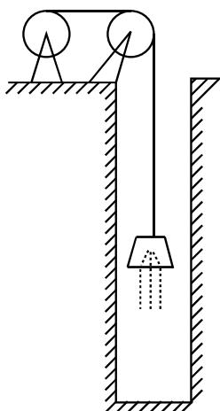

## 七、(本题满分8分)

已知函数 $y = \frac{x^3}{(x - 1)^2}$ ，求

(1) 函数的增减区间及极值;

(2) 函数图形的凹凸区间及拐点;

(3) 函数图形的渐近线.

## 八、(本题满分8分)

设函数 $f(x)$ 在闭区间 $[-1, 1]$ 上具有三阶连续导数，且 $f(-1) = 0, f(1) = 1, f'(0) = 0$ ，证明：在开区间 $(-1, 1)$ 内至少存在一点 $\xi$ ，使 $f'''(\xi) = 3$ .

## 九、(本题满分8分)

设函数 $y(x) (x \geqslant 0)$ 二阶可导，且 $y'(x) > 0, y(0) = 1$ . 过曲线 $y = y(x)$ 上任意一点 $P(x, y)$ 作该曲线的切线及 $x$ 轴的垂线，上述两直线与 $x$ 轴所围成的三角形的面积记为 $S_1$ ，区间 $[0, x]$ 上以 $y = y(x)$ 为曲边的曲边梯形面积记为 $S_2$ ，并设 $2S_1 - S_2$ 恒为 1，求此曲线 $y = y(x)$ 的方程.

## 十、(本题满分7分)

设 $f(x)$ 是区间 $[0, +\infty)$ 上单调减少且非负的连续函数， $a_{n} = \sum_{k=1}^{n} f(k) - \int_{1}^{n} f(x) \, \mathrm{d}x (n = 1, 2, \cdots)$ ，证明数列 $\{a_{n}\}$ 的极限存在.

## 十一、(本题满分6分)

设矩阵 $A = \begin{pmatrix} 1 & 1 & -1 \\ -1 & 1 & 1 \\ 1 & -1 & 1 \end{pmatrix}$ ，矩阵 X 满足 $A^{*}X = A^{-1} + 2X$ ，其中 $A^{*}$ 是 A 的伴随矩阵，求矩阵 X.

## 十二、(本题满分8分)

设向量组 $\boldsymbol{\alpha}_{1}=(1,1,1,3)^{\mathrm{T}},\boldsymbol{\alpha}_{2}=(-1,-3,5,1)^{\mathrm{T}},\boldsymbol{\alpha}_{3}=(3,2,-1,p+2)^{\mathrm{T}},\boldsymbol{\alpha}_{4}=(-2,-6,10,p)^{\mathrm{T}}.$

(1)p 为何值时,该向量组线性无关?并在此时将向量 $\boldsymbol{\alpha} = (4, 1, 6, 10)^{\mathrm{T}}$ 用 $\alpha_{1}, \alpha_{2}, \alpha_{3}, \alpha_{4}$ 线性表示;

(2)p 为何值时,该向量组线性相关?并在此时求出它的秩和一个极大线性无关组.

# 2000 年全国硕士研究生招生考试试题

## 一、填空题(本题共5小题,每小题3分,满分15分)

(1) $\lim_{x\to 0}\frac{\arctan x - x}{\ln(1 + 2x^3)} =$ \_\_\_\_.

(2) 设函数 $y = y(x)$ 由方程 $2^{xy} = x + y$ 所确定，则 dy $\bigg|_{x=0} =$ \_\_\_\_.

(3) $\int_{2}^{+\infty}\frac{\mathrm{d}x}{(x + 7)\sqrt{x - 2}} =$

(4) 曲线 $y = (2x - 1)e^{\frac{1}{x}}$ 的斜渐近线方程为 \_\_\_\_.

(5) 设 $A = \begin{pmatrix} 1 & 0 & 0 & 0 \\ -2 & 3 & 0 & 0 \\ 0 & -4 & 5 & 0 \\ 0 & 0 & -6 & 7 \end{pmatrix}$ ，E 为 4 阶单位矩阵，且 $B = (E + A)^{-1}(E - A)$ ，则 $(E + B)^{-1} =$ \_\_\_\_.

## 二、选择题(本题共5小题,每小题3分,满分15分)

(1) 设函数 $f(x) = \frac{x}{a + e^{bx}}$ 在 $(-∞, +∞)$ 内连续，且 $\lim_{x \to -∞} f(x) = 0$ ，则常数 a, b 满足（）
(A) a < 0, b < 0.
(B) a > 0, b > 0.
(C) $a \leqslant 0, b > 0.$ (D) $a \geqslant 0, b < 0.$

(2) 设函数 $f(x)$ 满足关系式 $f''(x) + [f'(x)]^2 = x$ ，且 $f'(0) = 0$ ，则（）
(A) $f(0)$ 是 $f(x)$ 的极大值.
(B) $f(0)$ 是 $f(x)$ 的极小值.
(C) 点 $(0, f(0))$ 是曲线 $y = f(x)$ 的拐点.
(D) $f(0)$ 不是 $f(x)$ 的极值，点 $(0, f(0))$ 也不是曲线 $y = f(x)$ 的拐点.

(3) 设函数 $f(x), g(x)$ 是大于零的可导函数, 且 $f'(x)g(x) - f(x)g'(x) < 0$ , 则当 $a < x < b$ 时, 有 (A) $f(x)g(b) > f(b)g(x)$ . (B) $f(x)g(a) > f(a)g(x)$ . (C) $f(x)g(x) > f(b)g(b)$ . (D) $f(x)g(x) > f(a)g(a)$ .

(4) 若 $\lim_{x\to0}\frac{\sin6x+xf(x)}{x^{3}}=0$ ，则 $\lim_{x\to0}\frac{6+f(x)}{x^{2}}$ 为（）
(A)0.
(B)6.
(C)36.
(D) $\infty$ .

(5) 具有特解 $y_{1} = e^{-x}, y_{2} = 2xe^{-x}, y_{3} = 3e^{x}$ 的 3 阶常系数齐次线性微分方程是（）
(A) $y'''-y''-y'+y=0.$ (B) $y'''+y''-y'-y=0.$ (C) $y'''-6y''+11y'-6y=0.$ (D) $y'''-2y''-y'+2y=0.$

## 三、(本题满分5分)

设 $f(\ln x) = \frac{\ln(1 + x)}{x}$ ，计算 $\int f(x) \, \mathrm{d}x$ .

## 四、(本题满分5分)

设 $xOy$ 平面上有正方形 $D = \{(x,y) | 0 \leqslant x \leqslant 1, 0 \leqslant y \leqslant 1\}$ 及直线 $l: x + y = t (t \geqslant 0)$ . 若 $S(t)$ 表示正方形 $D$ 位于直线 $l$ 左下方部分的面积, 试求 $\int_{0}^{x} S(t) \mathrm{d}t (x \geqslant 0)$ .

## 五、(本题满分5分)

求函数 $f(x) = x^{2}\ln (1 + x)$ 在 $x = 0$ 处的 $n$ 阶导数 $f^{(n)}(0) (n \geqslant 3)$ .

## 六、(本题满分6分)

设函数 $S(x) = \int_{0}^{x}|\cos t|\mathrm{d}t,$

(1) 当 $n$ 为正整数, 且 $n\pi \leqslant x < (n + 1)\pi$ 时, 证明: $2n \leqslant S(x) < 2(n + 1)$ ;

(2) 求 $\lim_{x\to+\infty}\frac{S(x)}{x}$ .

## 七、(本题满分7分)

某湖泊的水量为 V, 每年排入湖泊内含污染物 A 的污水量为 $\frac{V}{6}$ , 流入湖泊内不含 A 的水量为 $\frac{V}{6}$ , 流出湖泊的水量为 $\frac{V}{3}$ . 已知 1999 年底湖中 A 的含量为 $5m_{0}$ , 超过国家规定指标. 为了治理污染, 从 2000 年初起, 限定排入湖泊中含 A 污水的浓度不超过 $\frac{m_{0}}{V}$ . 问至多需经过多少年, 湖泊中污染物 A 的含量才可降至 $m_{0}$ 以内? (注: 设湖水中 A 的浓度是均匀的).

## 八、(本题满分6分)

设函数 $f(x)$ 在 $[0, \pi]$ 上连续，且 $\int_{0}^{\pi} f(x) \mathrm{d}x = 0, \int_{0}^{\pi} f(x) \cos x \mathrm{d}x = 0.$ 试证明：在 $(0, \pi)$ 内至少存在两个不同的点 $\xi_{1}, \xi_{2}$ ，使 $f(\xi_{1}) = f(\xi_{2}) = 0.$

## 九、(本题满分7分)

已知 $f(x)$ 是周期为5的连续函数，它在 $x = 0$ 的某个邻域内满足关系式

$$
f (1 + \sin x) - 3 f (1 - \sin x) = 8 x + \alpha (x),
$$

其中 $\alpha(x)$ 是当 $x \to 0$ 时比 x 高阶的无穷小，且 $f(x)$ 在 x = 1 处可导，求曲线 $y = f(x)$ 在点 $(6, f(6))$ 处的切线方程.

## 十、(本题满分8分)

设曲线 $y = ax^{2} (a > 0, x \geqslant 0)$ 与 $y = 1 - x^{2}$ 交于点 A，过坐标原点 O 和点 A 的直线与曲线 $y = ax^{2}$ 围成一平面图形。问 a 为何值时，该图形绕 x 轴旋转一周所得的旋转体体积最大？最大体积是多少？

## 十一、(本题满分8分)

函数 $f(x)$ 在 $[0, +\infty)$ 上可导， $f(0) = 1$ ，且满足等式

$$
f ^ {\prime} (x) + f (x) - \frac {1}{x + 1} \int_ {0} ^ {x} f (t) \mathrm{d} t = 0.
$$

(1) 求导数 $f'(x)$ ;

(2) 证明: 当 $x \geqslant 0$ 时, 不等式 $\mathrm{e}^{-x} \leqslant f(x) \leqslant 1$ 成立.

## 十二、(本题满分6分)

设 $\alpha = \begin{pmatrix} 1 \\ 2 \\ 1 \end{pmatrix}, \beta = \begin{pmatrix} 1 \\ \frac{1}{2} \\ 0 \end{pmatrix}, \gamma = \begin{pmatrix} 0 \\ 0 \\ 8 \end{pmatrix}, A = \alpha \beta^{T}, B = \beta^{T} \alpha,$ 其中 $\beta^{T}$ 是 $\beta$ 的转置, 求解方程

$$
2 \boldsymbol {B} ^ {2} \boldsymbol {A} ^ {2} \boldsymbol {x} = \boldsymbol {A} ^ {4} \boldsymbol {x} + \boldsymbol {B} ^ {4} \boldsymbol {x} + \gamma .
$$

## 十三、(本题满分7分)

已知向量组 $\beta_{1}=\begin{pmatrix}0\\ 1\\ -1\end{pmatrix},\beta_{2}=\begin{pmatrix}a\\ 2\\ 1\end{pmatrix},\beta_{3}=\begin{pmatrix}b\\ 1\\ 0\end{pmatrix}$ 与向量组 $\alpha_{1}=\begin{pmatrix}1\\ 2\\ -3\end{pmatrix},\alpha_{2}=\begin{pmatrix}3\\ 0\\ 1\end{pmatrix},\alpha_{3}=\begin{pmatrix}9\\ 6\\ -7\end{pmatrix}$ 具有相同的秩，且 $\beta_{3}$ 可由 $\alpha_{1},\alpha_{2},\alpha_{3}$ 线性表示，求 a,b 的值.

# 2001年全国硕士研究生招生考试试题

## 一、填空题(本题共5小题,每小题3分,满分15分)

(1) $\lim_{x\to 1}\frac{\sqrt{3 - x} - \sqrt{1 + x}}{x^2 + x - 2} =$ \_\_\_\_.

(2) 设函数 $y = f(x)$ 由方程 $\mathrm{e}^{2x+y} - \cos(xy) = \mathrm{e}-1$ 所确定, 则曲线 $y = f(x)$ 在点 $(0,1)$ 处的法线方程为 \_\_\_\_.

(3) $\int_{-\frac{\pi}{2}}^{\frac{\pi}{2}} (x^3 + \sin^2 x) \cos^2 x \, \mathrm{d}x = \underline{\quad}$ .

(4) 过点 $\left(\frac{1}{2},0\right)$ 且满足关系式 $y'\arcsin x + \frac{y}{\sqrt{1 - x^{2}}} = 1$ 的曲线方程为 \_\_\_\_.

(5) 设方程组 $\begin{pmatrix} a & 1 & 1 \\ 1 & a & 1 \\ 1 & 1 & a \end{pmatrix} \begin{pmatrix} x_{1} \\ x_{2} \\ x_{3} \end{pmatrix} = \begin{pmatrix} 1 \\ 1 \\ -2 \end{pmatrix}$ 有无穷多解，则 a = \_\_\_\_.

## 二、选择题(本题共5小题,每小题3分,满分15分)

(1) 设 $f(x) = \begin{cases} 1, & |x| \leqslant 1, \\ 0, & |x| > 1, \end{cases}$ 则 $f\{f[f(x)]\}$ 等于 ( )  
(A)0. (B)1. (C) $\left\{\begin{aligned}&1, &|x| \leqslant 1, \\ &0, &|x| > 1.\end{aligned}\right.$ (D) $\left\{\begin{aligned}&0, &|x| \leqslant 1, \\ &1, &|x| > 1.\end{aligned}\right.$

(2) 设当 $x \to 0$ 时, $(1 - \cos x) \ln(1 + x^{2})$ 是比 $x \sin x^{n}$ 高阶的无穷小, $x \sin x^{n}$ 是比 $e^{x^{2}} - 1$ 高阶的无穷小, 则正整数 n 等于( )
(A)1. (B)2. (C)3. (D)4.

(3) 曲线 $y = (x - 1)^{2}(x - 3)^{2}$ 的拐点个数为( )
(A)0.
(B)1.
(C)2.
(D)3.

(4) 已知函数 $f(x)$ 在区间 $(1 - \delta, 1 + \delta)$ 内具有二阶导数， $f'(x)$ 严格单调减少，且 $f(1) = f'(1) = 1$ ，则（）

(A) 在 $(1 - \delta, 1)$ 和 $(1, 1 + \delta)$ 内均有 $f(x) < x$ .

(B) 在 $(1 - \delta, 1)$ 和 $(1, 1 + \delta)$ 内均有 $f(x) > x$ .

(C) 在 $(1 - \delta, 1)$ 内， $f(x) < x$ ，在 $(1, 1 + \delta)$ 内， $f(x) > x$ .

(D) 在 $(1 - \delta, 1)$ 内， $f(x) > x$ ，在 $(1, 1 + \delta)$ 内， $f(x) < x$ .

(5) 已知函数 $y = f(x)$ 在其定义域内可导, 它的图形如右图所示, 则其导函数 $y = f'(x)$ 的图形为()

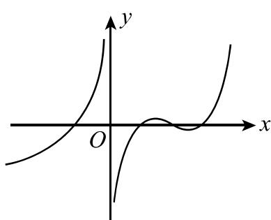

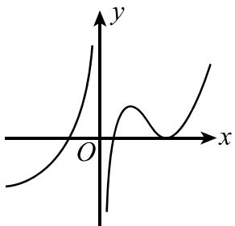  
(A)

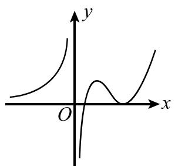  
(B)

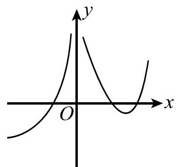  
(C)

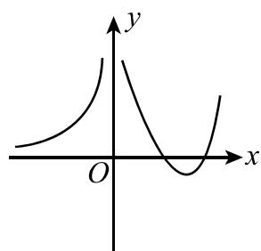  
(D)

## 三、(本题满分6分)

求 $\int \frac{\mathrm{d}x}{(2x^2 + 1)\sqrt{x^2 + 1}}.$

## 四、(本题满分7分)

求极限 $\lim_{t\to x}\left(\frac{\sin t}{\sin x}\right)^{\frac{x}{\sin t-\sin x}}$ ，记此极限为 $f(x)$ ，求函数 $f(x)$ 的间断点并指出其类型.

## 五、(本题满分7分)

设 $\rho = \rho(x)$ 是抛物线 $y = \sqrt{x}$ 上任一点 $M(x, y) (x \geqslant 1)$ 处的曲率半径, $s = s(x)$ 是该抛物线上介于点 $A(1, 1)$ 与 M 之间的弧长, 计算 $3\rho \frac{d^{2}\rho}{ds^{2}} - \left(\frac{d\rho}{ds}\right)^{2}$ 的值.

(在直角坐标系下曲率公式为 $K = \frac{|y''|}{(1 + y'^{2})^{\frac{3}{2}}}$ .)

## 六、(本题满分7分)

设函数 $f(x)$ 在 $[0, +\infty)$ 上可导， $f(0) = 0$ ，且其反函数为 $g(x)$ . 若 $\int_0^{f(x)} g(t) \mathrm{d}t = x^2 \mathrm{e}^x$ ，求 $f(x)$ .

## 七、(本题满分7分)

设函数 $f(x), g(x)$ 满足 $f'(x) = g(x), g'(x) = 2\mathrm{e}^x - f(x)$ ，且 $f(0) = 0, g(0) = 2$ ，求 $\int_0^\pi \left[\frac{g(x)}{1 + x} - \frac{f(x)}{(1 + x)^2}\right]\mathrm{d}x.$

## 八、(本题满分9分)

设 $L$ 是一条平面曲线, 其上任意一点 $P(x, y) (x > 0)$ 到坐标原点的距离恒等于该点处的切线在 $y$ 轴上的截距, 且 $L$ 经过点 $\left(\frac{1}{2}, 0\right)$ .

(1) 试求曲线 L 的方程;

(2) 求 L 位于第一象限部分的一条切线, 使该切线与 L 以及两坐标轴所围图形的面积最小.

## 九、(本题满分7分)

一个半球体状的雪堆,其体积融化的速率与半球面面积S成正比,比例常数K>0.假设在融化过程中雪堆始终保持半球体状,已知半径为 $r_{0}$ 的雪堆在开始融化的 3 小时内,融化了其体积的 $\frac{7}{8}$ ,问雪堆全部融化需要多少小时?

## 十、(本题满分8分)

设 $f(x)$ 在区间 $[-a,a]$ (a > 0) 上具有二阶连续导数, $f(0) = 0$ .

(1) 写出 $f(x)$ 的带拉格朗日余项的一阶麦克劳林公式；

(2) 证明在 $[-a, a]$ 上至少存在一点 $\eta$ ，使 $a^3 f''(\eta) = 3\int_{-a}^{a} f(x) \mathrm{d}x$ .

## 十一、(本题满分6分)

已知矩阵 $A = \begin{pmatrix} 1 & 0 & 0 \\ 1 & 1 & 0 \\ 1 & 1 & 1 \end{pmatrix}$ ， $B = \begin{pmatrix} 0 & 1 & 1 \\ 1 & 0 & 1 \\ 1 & 1 & 0 \end{pmatrix}$ ，且矩阵 X 满足 $AXA + BXB = AXB + BXA + E$ ，其中 E 是 3 阶单位矩阵，求 X.

## 十二、(本题满分6分)

已知 $\alpha_{1},\alpha_{2},\alpha_{3},\alpha_{4}$ 是线性方程组 Ax = 0 的一个基础解系，若 $\beta_{1} = \alpha_{1} + t\alpha_{2}, \beta_{2} = \alpha_{2} + t\alpha_{3}, \beta_{3} = \alpha_{3} + t\alpha_{4}, \beta_{4} = \alpha_{4} + t\alpha_{1}$ ，讨论实数 t 满足什么关系时， $\beta_{1}, \beta_{2}, \beta_{3}, \beta_{4}$ 也是 Ax = 0 的一个基础解系.

# 2002 年全国硕士研究生招生考试试题

## 一、填空题(本题共5小题,每小题3分,满分15分)

(1) 设函数 $f(x) = \begin{cases} \frac{1 - e^{\tan x}}{\arcsin \frac{x}{2}}, & x > 0, \\ a e^{2x}, & x \leqslant 0, \end{cases}$ 在 x = 0 处连续，则 a = \_\_\_\_.

(2) 位于曲线 $y = x \mathrm{e}^{-x} (0 \leqslant x < +\infty)$ 下方, $x$ 轴上方的无界图形的面积是 \_\_\_\_.

(3) 微分方程 $yy'' + y'^{2} = 0$ 满足初始条件 $y \bigg|_{x=0} = 1, y' \bigg|_{x=0} = \frac{1}{2}$ 的特解是 \_\_\_\_.

(4) $\lim_{n\to\infty}\frac{1}{n}\left(\sqrt{1+\cos\frac{\pi}{n}}+\sqrt{1+\cos\frac{2\pi}{n}}+\cdots+\sqrt{1+\cos\frac{n\pi}{n}}\right)=$ \_\_\_\_.

(5) 矩阵 $\begin{pmatrix}0&-2&-2\\ 2&2&-2\\ -2&-2&2\end{pmatrix}$ 的非零特征值是\_\_\_\_.

## 二、选择题(本题共5小题,每小题3分,满分15分)

(1) 设函数 $f(u)$ 可导, $y = f(x^{2})$ , 当自变量 x 在 x = -1 处取得增量 $\Delta x = -0.1$ 时, 相应的函数增量 $\Delta y$ 的线性主部为 0.1, 则 $f'(1) = (\quad)$ (A) - 1.
(B)0.1.
(C)1.
(D)0.5.

(2) 设函数 $f(x)$ 连续, 则下列函数中, 必为偶函数的是 ( )
(A) $\int_{0}^{x}f(t^{2})dt.$ (B) $\int_{0}^{x}f^{2}(t)dt.$ (C) $\int_{0}^{x}t\left[f(t)-f(-t)\right]dt.$ (D) $\int_{0}^{x}t\left[f(t)+f(-t)\right]dt.$

(3) 设 $y = y(x)$ 是二阶常系数微分方程 $y'' + py' + qy = e^{3x}$ 满足初始条件 $y(0) = y'(0) = 0$ 的特解, 则当 $x \to 0$ 时, 函数 $\frac{\ln(1 + x^2)}{y(x)}$ 的极限 ( ) (A) 不存在. (B) 等于 1. (C) 等于 2. (D) 等于 3.

(4) 设函数 $y = f(x)$ 在 $(0, +\infty)$ 内有界且可导，则（）
(A) 当 $\lim_{x \to +\infty} f(x) = 0$ 时，必有 $\lim_{x \to +\infty} f'(x) = 0$ .
(B) 当 $\lim_{x \to +\infty} f'(x)$ 存在时，必有 $\lim_{x \to +\infty} f'(x) = 0$ .
(C) 当 $\lim_{x \to 0^{+}} f(x) = 0$ 时，必有 $\lim_{x \to 0^{+}} f'(x) = 0$ .
(D) 当 $\lim_{x \to 0^{+}} f'(x) = 0$ 存在时，必有 $\lim_{x \to 0^{+}} f'(x) = 0$ .

(5) 设向量组 $\alpha_{1}, \alpha_{2}, \alpha_{3}$ 线性无关, 向量 $\beta_{1}$ 可由 $\alpha_{1}, \alpha_{2}, \alpha_{3}$ 线性表示, 而向量 $\beta_{2}$ 不能由 $\alpha_{1}, \alpha_{2}, \alpha_{3}$ 线性表示, 则对于任意常数 k, 必有 ( )
(A) $\alpha_{1},\alpha_{2},\alpha_{3},k\beta_{1}+\beta_{2}$ 线性无关. (B) $\alpha_{1},\alpha_{2},\alpha_{3},k\beta_{1}+\beta_{2}$ 线性相关.
(C) $\alpha_{1},\alpha_{2},\alpha_{3},\beta_{1}+k\beta_{2}$ 线性无关. (D) $\alpha_{1},\alpha_{2},\alpha_{3},\beta_{1}+k\beta_{2}$ 线性相关.

## 三、(本题满分6分)

已知曲线的极坐标方程是 $r = 1 - \cos \theta$ ，求该曲线上对应于 $\theta = \frac{\pi}{6}$ 处的切线与法线的直角坐标方程

## 四、(本题满分7分)

设 $f(x) = \left\{ \begin{array}{ll}2x + \frac{3}{2} x^2, & -1\leqslant x < 0,\\ \frac{x\mathrm{e}^x}{(\mathrm{e}^x + 1)^2}, & 0\leqslant x\leqslant 1, \end{array} \right.$ 求函数 $F(x) = \int_{-1}^{x}f(t)\mathrm{d}t$ 的表达式.

## 五、(本题满分7分)

已知函数 $f(x)$ 在 $(0, +\infty)$ 内可导， $f(x) > 0$ ， $\lim_{x \to \infty} f(x) = 1$ ，且满足

$$
\lim _ {h \rightarrow 0} \left[ \frac {f (x + h x)}{f (x)} \right] ^ {\frac {1}{h}} = \mathrm{e} ^ {\frac {1}{x}},
$$

求 $f(x)$ .

## 六、(本题满分7分)

求微分方程 $x\mathrm{d}y + (x - 2y)\mathrm{d}x = 0$ 的一个解 $y = y(x)$ ，使得由曲线 $y = y(x)$ 与直线 $x = 1, x = 2$ 以及 $x$ 轴所围成的平面图形绕 $x$ 轴旋转一周的旋转体体积最小.

## 七、(本题满分7分)

某闸门的形状与大小如图所示,其中直线 l 为对称轴,闸门的上部为矩形 ABCD,下部由二次抛物线与线段 AB 所围成.当水面与闸门的上端相平时,欲使闸门矩形部分承受的水压力与闸门下部承受的水压力之比为 5:4,闸门矩形部分的高 h 应为多少 m(米)?

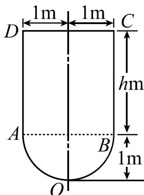

## 八、(本题满分8分)

设 $0 < x_{1} < 3, x_{n+1} = \sqrt{x_{n}(3 - x_{n})} (n = 1, 2, \cdots)$ ，证明数列 $\{x_{n}\}$ 的极限存在，并求此极限.

## 九、(本题满分8分)

设 $0 < a < b$ ，证明不等式

$$
\frac {2 a}{a ^ {2} + b ^ {2}} <   \frac {\ln b - \ln a}{b - a} <   \frac {1}{\sqrt {a b}}.
$$

## 十、(本题满分8分)

设函数 $f(x)$ 在 $x = 0$ 的某邻域内具有二阶连续导数，且 $f(0) \neq 0, f'(0) \neq 0, f''(0) \neq 0$ . 证明：存在唯一的一组实数 $\lambda_1, \lambda_2, \lambda_3$ ，使得当 $h \to 0$ 时， $\lambda_1 f(h) + \lambda_2 f(2h) + \lambda_3 f(3h) - f(0)$ 是比 $h^2$ 高阶的无穷小.

## 十一、(本题满分6分)

已知 A, B 为 3 阶矩阵, 且满足 $2A^{-1}B = B - 4E$ , 其中 E 是 3 阶单位矩阵.

(1) 证明: 矩阵 A - 2E 可逆;

(2) 若 $B = \begin{pmatrix} 1 & -2 & 0 \\ 1 & 2 & 0 \\ 0 & 0 & 2 \end{pmatrix}$ ，求矩阵 A.

## 十二、(本题满分6分)

已知 4 阶方阵 $A = (\alpha_{1}, \alpha_{2}, \alpha_{3}, \alpha_{4}), \alpha_{1}, \alpha_{2}, \alpha_{3}, \alpha_{4}$ 均为 4 维列向量，其中 $\alpha_{2}, \alpha_{3}, \alpha_{4}$ 线性无关， $\alpha_{1} = 2\alpha_{2} - \alpha_{3}$ . 如果 $\beta = \alpha_{1} + \alpha_{2} + \alpha_{3} + \alpha_{4}$ ，求线性方程组 Ax = $\beta$ 的通解.

# 2003 年全国硕士研究生招生考试试题

## 一、填空题(本题共6小题,每小题4分,满分24分)

(1) 若 $x \to 0$ 时, $(1 - ax^{2})^{\frac{1}{4}} - 1$ 与 $x \sin x$ 是等价无穷小, 则 a = \_\_\_\_.

(2) 设函数 $y = f(x)$ 由方程 $xy + 2\ln x = y^{4}$ 所确定, 则曲线 $y = f(x)$ 在点 (1,1) 处的切线方程是 \_\_\_\_.

(3) $y = 2^{x}$ 的麦克劳林公式中 $x^{n}$ 项的系数是 \_\_\_\_.

(4) 设曲线的极坐标方程为 $\rho = \mathrm{e}^{a\theta}(a > 0)$ , 则该曲线上相应于 $\theta$ 从 0 变到 $2\pi$ 的一段弧与极轴所围成的图形的面积为 \_\_\_\_.

(5) 设 $\alpha$ 为 3 维列向量, $\alpha^{T}$ 是 $\alpha$ 的转置, 若 $\alpha\alpha^{T} = \begin{pmatrix} 1 & -1 & 1 \\ -1 & 1 & -1 \\ 1 & -1 & 1 \end{pmatrix}$ , 则 $\alpha^{T}\alpha =$ \_\_\_\_ .

(6) 设3阶方阵A,B满足 $A^{2}B-A-B=E$ ,其中E为3阶单位矩阵,若 $A=\begin{pmatrix}1&0&1\\0&2&0\\-2&0&1\end{pmatrix}$ ,则 $|B|=$ \_\_\_\_.

## 二、选择题(本题共6小题,每小题4分,满分24分)

(1) 设 $\{a_{n}\},\{b_{n}\},\{c_{n}\}$ 均为非负数列，且 $\lim_{n\to\infty}a_{n}=0,\lim_{n\to\infty}b_{n}=1,\lim_{n\to\infty}c_{n}=\infty$ ，则必有（）
(A) $a_{n} < b_{n}$ 对任意 n 成立.
(B) $b_{n} < c_{n}$ 对任意 n 成立.
(C) 极限 $\lim_{n\to\infty}a_{n}c_{n}$ 不存在.
(D) 极限 $\lim_{n\to\infty}b_{n}c_{n}$ 不存在.

(2) 设 $a_{n} = \frac{3}{2}\int_{0}^{\frac{n}{n+1}} x^{n-1} \sqrt{1 + x^{n}} \, dx$ ，则极限 $\lim_{n \to \infty} na_{n}$ 等于（）
(A) $(1+\mathrm{e})^{\frac{3}{2}}+1.$ (B) $(1+\mathrm{e}^{-1})^{\frac{3}{2}}-1.$ (C) $(1+\mathrm{e}^{-1})^{\frac{3}{2}}+1.$ (D) $(1+\mathrm{e})^{\frac{3}{2}}-1.$

(3) 已知 $y = \frac{x}{\ln x}$ 是微分方程 $y' = \frac{y}{x} + \varphi\left(\frac{x}{y}\right)$ 的解，则 $\varphi\left(\frac{x}{y}\right)$ 的表达式为（）
(A) $-\frac{y^{2}}{x^{2}}.$ (B) $\frac{y^{2}}{x^{2}}.$ (C) $-\frac{x^{2}}{y^{2}}.$ (D) $\frac{x^{2}}{y^{2}}.$

(4) 设函数 $f(x)$ 在 $(-∞, +∞)$ 内连续, 其导函数的图形如图所示, 则 $f(x)$ 有 ( )
(A) 一个极小值点和两个极大值点.
(B) 两个极小值点和一个极大值点.
(C) 两个极小值点和两个极大值点.
(D) 三个极小值点和一个极大值点.

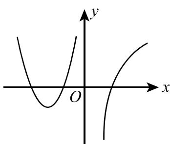

(5) 设 $I_{1} = \int_{0}^{\frac{\pi}{4}} \frac{\tan x}{x} dx, I_{2} = \int_{0}^{\frac{\pi}{4}} \frac{x}{\tan x} dx$ ，则（）
(A) $I_{1}>I_{2}>1.$ (B) $1>I_{1}>I_{2}.$ (C) $I_{2}>I_{1}>1.$ (D) $1>I_{2}>I_{1}.$

(6) 设向量组 I: $\alpha_{1}, \alpha_{2}, \cdots, \alpha_{r}$ 可由向量组 II: $\beta_{1}, \beta_{2}, \cdots, \beta_{s}$ 线性表示, 则()

(A) 当 r < s 时, 向量组 II 必线性相关.

(B) 当 r > s 时, 向量组 II 必线性相关.

(C) 当 r < s 时, 向量组 I 必线性相关.

(D) 当 r > s 时, 向量组 I 必线性相关.

## 三、(本题满分10分)

设函数 $f(x) = \left\{ \begin{array}{ll}\frac{\ln(1 + ax^3)}{x - \arcsin x}, & x < 0,\\ 6, & x = 0,\\ \frac{\mathrm{e}^{ax} + x^2 - ax - 1}{x\sin\frac{x}{4}}, & x > 0, \end{array} \right.$ 问 $a$ 为何值时， $f(x)$ 在 $x = 0$ 处连续； $a$ 为何值时，

$x = 0$ 是 $f(x)$ 的可去间断点？

## 四、(本题满分9分)

设函数 $y = y(x)$ 由参数方程 $\left\{ \begin{array}{l}x = 1 + 2t^2,\\ y = \int_{1}^{1 + 2\ln t}\frac{\mathrm{e}^{u}}{u}\mathrm{d}u, \end{array} \right.$ （ $t > 1$ ）所确定，求 $\frac{\mathrm{d}^2y}{\mathrm{d}x^2}\Bigg|_{x = 9}$

## 五、(本题满分9分)

计算不定积分 $\int \frac{x\mathrm{e}^{\arctan x}}{(1 + x^2)^{3 / 2}}\mathrm{d}x.$

## 六、(本题满分12分)

设函数 $y = y(x)$ 在 $(- \infty, +\infty)$ 内具有二阶导数，且 $y' \neq 0, x = x(y)$ 是 $y = y(x)$ 的反函数.

（1）试将 $x = x(y)$ 所满足的微分方程 $\frac{\mathrm{d}^2x}{\mathrm{dy}^2} + (y + \sin x)\left(\frac{\mathrm{dx}}{\mathrm{dy}}\right)^3 = 0$ 变换为 $y = y(x)$ 满足的微分方程；

(2) 求变换后的微分方程满足初始条件 $y(0) = 0, y'(0) = \frac{3}{2}$ 的解.

## 七、(本题满分12分)

讨论曲线 $y = 4\ln x + k$ 与 $y = 4x + \ln^4 x$ 的交点个数.

## 八、(本题满分12分)

设位于第一象限的曲线 $y = f(x)$ 过点 $\left(\frac{\sqrt{2}}{2}, \frac{1}{2}\right)$ ，其上任一点 $P(x, y)$ 处的法线与 y 轴的交点为 Q，且线段 PQ 被 x 轴平分.

(1) 求曲线 $y = f(x)$ 的方程;

(2) 已知曲线 $y = \sin x$ 在 $[0, \pi]$ 上的弧长为 $l$ ，试用 $l$ 表示曲线 $y = f(x)$ 的弧长 $s$ .

## 九、(本题满分10分)

有一平底容器,其内侧壁是由曲线 $x = \varphi(y) (y \geqslant 0)$ 绕 y 轴旋转而成的旋转曲面(如图),容器的底面圆的半径为 2m. 根据设计要求,当以 $3 ~m^{3} / min$ 的速率向容器内注入液体时,液面的面积将以 $\pi m^{2} / min$ 的速率均匀扩大(假设注入液体前,容器内无液体).

(1) 根据 t 时刻液面的面积, 写出 t 与 $\varphi(y)$ 之间的关系式;

(2) 求曲线 $x = \varphi(y)$ 的方程.

(注:m 表示长度单位米,min 表示时间单位分.)

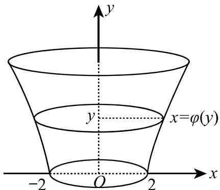

## 十、(本题满分 10 分)

设函数 $f(x)$ 在闭区间 $[a, b]$ 上连续，在开区间 $(a, b)$ 内可导，且 $f'(x) > 0$ . 若极限 $\lim_{x \to a^+} \frac{f(2x - a)}{x - a}$ 存在，证明：

(1) 在 $(a, b)$ 内 $f(x) > 0$ ;

(2) 在 $(a, b)$ 内存在点 $\xi$ ，使 $\frac{b^2 - a^2}{\int_a^b f(x) \mathrm{d}x} = \frac{2\xi}{f(\xi)}$ ;

(3) 在 $(a, b)$ 内存在与 (2) 中 $\xi$ 相异的点 $\eta$ , 使

$$
f ^ {\prime} (\eta) \left(b ^ {2} - a ^ {2}\right) = \frac {2 \xi}{\xi - a} \int_ {a} ^ {b} f (x) \mathrm{d} x.
$$

## 十一、(本题满分10分)

若矩阵 $A = \begin{pmatrix} 2 & 2 & 0 \\ 8 & 2 & a \\ 0 & 0 & 6 \end{pmatrix}$ 相似于对角矩阵 A，试确定常数 a 的值，并求可逆矩阵 P 使 $P^{-1}AP = A$ .

## 十二、(本题满分8分)

已知平面上三条不同直线的方程分别为

$$
\begin{array}{l} l _ {1}: a x + 2 b y + 3 c = 0, \\ l _ {2}: b x + 2 c y + 3 a = 0, \\ l _ {3}: c x + 2 a y + 3 b = 0. \end{array}
$$

试证:这三条直线交于一点的充分必要条件为 $a + b + c = 0$ .

# 2004 年全国硕士研究生招生考试试题

## 一、填空题(本题共6小题,每小题4分,满分24分)

(1) 设 $f(x) = \lim_{n \to \infty} \frac{(n - 1)x}{nx^{2} + 1}$ ，则 $f(x)$ 的间断点为 x = \_\_\_\_.

(2) 设函数 $y(x)$ 由参数方程 $\left\{\begin{aligned}x &= t^{3} + 3t + 1, \\ y &= t^{3} - 3t + 1\end{aligned}\right.$ 确定，则曲线 $y = y(x)$ 向上凸的 x 的取值范围为 \_\_\_\_.  
(3) $\int_{1}^{+\infty}\frac{dx}{x\sqrt{x^{2}-1}} =$ \_\_\_\_ .

(4) 设函数 $z = z(x, y)$ 由方程 $z = \mathrm{e}^{2x - 3z} + 2y$ 确定, 则 $3\frac{\partial z}{\partial x} + \frac{\partial z}{\partial y} = \underline{\quad}$ .

(5) 微分方程 $(y + x^{3})\mathrm{d}x - 2x\mathrm{d}y = 0$ 满足 $y\bigg|_{x=1} = \frac{6}{5}$ 的特解为 \_\_\_\_.

(6) 设矩阵 $A = \begin{pmatrix} 2 & 1 & 0 \\ 1 & 2 & 0 \\ 0 & 0 & 1 \end{pmatrix}$ ，矩阵 B 满足 $ABA^{*} = 2BA^{*} + E$ ，其中 $A^{*}$ 为 A 的伴随矩阵，E 是单位矩阵，则 $|B| =$ \_\_\_\_.

## 二、选择题(本题共8小题,每小题4分,满分32分)

(7) 把 $x \to 0^{+}$ 时的无穷小量 $\alpha = \int_{0}^{x} \cos(t^{2}) \, dt, \beta = \int_{0}^{x^{2}} \tan \sqrt{t} \, dt, \gamma = \int_{0}^{\sqrt{x}} \sin(t^{3}) \, dt$ 排列起来，使排在后面的是前一个的高阶无穷小，则正确的排列次序是（）
(A) $\alpha,\beta,\gamma.$ (B) $\alpha,\gamma,\beta.$ (C) $\beta,\alpha,\gamma.$ (D) $\beta,\gamma,\alpha.$

(8) 设 $f(x) = |x(1 - x)|$ ，则（）
(A)x = 0 是 $f(x)$ 的极值点，但 $(0,0)$ 不是曲线 $y = f(x)$ 的拐点.
(B)x = 0 不是 $f(x)$ 的极值点，但 $(0,0)$ 是曲线 $y = f(x)$ 的拐点.
(C)x = 0 是 $f(x)$ 的极值点，且 $(0,0)$ 是曲线 $y = f(x)$ 的拐点.
(D)x = 0 不是 $f(x)$ 的极值点， $(0,0)$ 也不是曲线 $y = f(x)$ 的拐点.

(9) $\lim_{n\to\infty}\ln\sqrt[n]{\left(1+\frac{1}{n}\right)^2\left(1+\frac{2}{n}\right)^2\cdots\left(1+\frac{n}{n}\right)^2}$ 等于( )

(A) $\int_{1}^{2}\ln^{2}x\,dx.$ (B) $2\int_{1}^{2}\ln x\,dx.$ (C) $2\int_{1}^{2}\ln(1+x)\,dx.$ (D) $\int_{1}^{2}\ln^{2}(1+x)\,dx.$

(10) 设函数 $f(x)$ 连续, 且 $f'(0) > 0$ , 则存在 $\delta > 0$ , 使得 ( ) (A) $f(x)$ 在 $(0, \delta)$ 内单调增加. (B) $f(x)$ 在 $(-\delta, 0)$ 内单调减少. (C) 对任意的 $x \in (0, \delta)$ 有 $f(x) > f(0)$ . (D) 对任意的 $x \in (-\delta, 0)$ 有 $f(x) > f(0)$ .

(11) 微分方程 $y'' + y = x^{2} + 1 + \sin x$ 的特解形式可设为( )
(A) $y^{*}=ax^{2}+bx+c+x(Asin x+B\cos x).$ (B) $y^{*}=x(ax^{2}+bx+c+Asin x+B\cos x).$ (C) $y^{*}=ax^{2}+bx+c+Asin x.$ (D) $y^{*}=ax^{2}+bx+c+A\cos x.$

(12) 设函数 $f(u)$ 连续, 区域 $D = \{(x, y) \mid x^{2} + y^{2} \leqslant 2y\}$ , 则 $\iint_{D} f(xy) \, dx \, dy$ 等于 ( )  
(A) $\int_{-1}^{1} dx \int_{-\sqrt{1-x^{2}}}^{\sqrt{1-x^{2}}} f(xy) \, dy.$ (B) $2 \int_{0}^{2} dy \int_{0}^{\sqrt{2y-y^{2}}} f(xy) \, dx.$ (C) $\int_{0}^{\pi} d\theta \int_{0}^{2\sin\theta} f(r^{2}\sin\theta\cos\theta) \, dr.$ (D) $\int_{0}^{\pi} d\theta \int_{0}^{2\sin\theta} f(r^{2}\sin\theta\cos\theta) r \, dr.$

(13) 设 A 是 3 阶方阵, 将 A 的第 1 列与第 2 列交换得 B, 再把 B 的第 2 列加到第 3 列得 C, 则满足 AQ = C 的可逆矩阵 Q 为 ( )

(A) $\begin{pmatrix}0 & 1 & 0 \\ 1 & 0 & 0 \\ 1 & 0 & 1\end{pmatrix}$ . (B) $\begin{pmatrix}0 & 1 & 0 \\ 1 & 0 & 1 \\ 0 & 0 & 1\end{pmatrix}$ . (C) $\begin{pmatrix}0 & 1 & 0 \\ 1 & 0 & 0 \\ 0 & 1 & 1\end{pmatrix}$ . (D) $\begin{pmatrix}0 & 1 & 1 \\ 1 & 0 & 0 \\ 0 & 0 & 1\end{pmatrix}$ .

(14) 设 A, B 为满足 AB = O 的任意两个非零矩阵, 则必有 ( )
(A) A 的列向量组线性相关, B 的行向量组线性相关.
(B) A 的列向量组线性相关, B 的列向量组线性相关.
(C) A 的行向量组线性相关, B 的行向量组线性相关.
(D) A 的行向量组线性相关, B 的列向量组线性相关.

## 三、解答题(本题共9小题,满分94分. 解答应写出文字说明、证明过程或演算步骤)

(15) (本题满分 10 分)
求极限 $\lim_{x\to0}\frac{1}{x^{3}}\left[\left(\frac{2+\cos x}{3}\right)^{x}-1\right]$ .

(16) (本题满分 10 分)
设函数 $f(x)$ 在 $(-∞,+∞)$ 内有定义,在区间 $[0,2]$ 上, $f(x)=x(x^{2}-4)$ ,若对任意的x都满足 $f(x)=kf(x+2)$ ,其中k为常数.
(I) 写出 $f(x)$ 在 $[-2,0)$ 上的表达式;
(Ⅱ) 问 k 为何值时, $f(x)$ 在 x = 0 处可导.

(17) (本题满分 11 分)
设 $f(x)=\int_{x}^{x+\frac{\pi}{2}}|\sin t|dt,$ （Ⅰ）证明 $f(x)$ 是以 $\pi$ 为周期的周期函数；
（Ⅱ）求 $f(x)$ 的值域.

(18) (本题满分 12 分)

曲线 $y = \frac{e^{x} + e^{-x}}{2}$ 与直线 x = 0, $x = t (t > 0)$ 及 y = 0 围成一曲边梯形. 该曲边梯形绕 x 轴旋转一周得一旋转体, 其体积为 $V(t)$ , 侧面积为 $S(t)$ , 在 x = t 处的底面积为 $F(t)$ .

( I ) 求 $\frac{S(t)}{V(t)}$ 的值;

(Ⅱ) 计算极限 $\lim_{t\to+\infty}\frac{S(t)}{F(t)}$ .

## (19) (本题满分 12 分)

设 $\mathrm{e} < a < b < \mathrm{e}^2$ ，证明 $\ln^2 b - \ln^2 a > \frac{4}{\mathrm{e}^2} (b - a)$

## (20) (本题满分 11 分)

某种飞机在机场降落时,为了减少滑行距离,在触地的瞬间,飞机尾部张开减速伞,以增大阻力,使飞机迅速减速并停下.

现有一质量为 9000kg 的飞机, 着陆时的水平速度为 700 km/h. 经测试, 减速伞打开后, 飞机所受的总阻力与飞机的速度成正比(比例系数为 $k = 6.0 \times 10^{6}$ ). 问从着陆点算起, 飞机滑行的最长距离是多少?

注: kg 表示千克, km/h 表示千米 / 小时.

## (21) (本题满分 10 分)

设 $z = f(x^{2} - y^{2},\mathrm{e}^{xy})$ ，其中 $f$ 具有连续二阶偏导数，求 $\frac{\partial z}{\partial x},\frac{\partial z}{\partial y},\frac{\partial^2z}{\partial x\partial y}.$

## (22) (本题满分9分)

设有齐次线性方程组

$$
\left\{ \begin{array}{l} (1 + a) x _ {1} + x _ {2} + x _ {3} + x _ {4} = 0, \\ 2 x _ {1} + (2 + a) x _ {2} + 2 x _ {3} + 2 x _ {4} = 0, \\ 3 x _ {1} + 3 x _ {2} + (3 + a) x _ {3} + 3 x _ {4} = 0, \\ 4 x _ {1} + 4 x _ {2} + 4 x _ {3} + (4 + a) x _ {4} = 0, \end{array} \right.
$$

试问 a 取何值时,该方程组有非零解,并求出其通解.

## (23) (本题满分9分)

设矩阵 $A = \begin{pmatrix} 1 & 2 & -3 \\ -1 & 4 & -3 \\ 1 & a & 5 \end{pmatrix}$ 的特征方程有一个二重根, 求 a 的值, 并讨论 A 是否可相似对角化.

# 2005 年全国硕士研究生招生考试试题

## 一、填空题(本题共6小题,每小题4分,满分24分)

(1) 设 $y = (1 + \sin x)^{x}$ ，则 $\mathrm{d}y\bigg|_{x=\pi}=$ \_\_\_\_.

(2) 曲线 $y = \frac{(1 + x)^{\frac{3}{2}}}{\sqrt{x}}$ 的斜渐近线方程为 \_\_\_\_.

(3) $\int_{0}^{1}\frac{x\mathrm{d}x}{(2 - x^2)\sqrt{1 - x^2}} = \underline{\quad}$ .

(4) 微分方程 $xy' + 2y = x \ln x$ 满足 $y(1) = -\frac{1}{9}$ 的解为 \_\_\_\_.

(5) 当 $x \to 0$ 时, $\alpha(x) = kx^{2}$ 与 $\beta(x) = \sqrt{1 + x\arcsin x} - \sqrt{\cos x}$ 是等价无穷小量, 则 k = \_\_\_\_.

(6) 设 $\alpha_{1}, \alpha_{2}, \alpha_{3}$ 均为 3 维列向量, 记矩阵

$A = (\alpha_{1}, \alpha_{2}, \alpha_{3}), \quad B = (\alpha_{1} + \alpha_{2} + \alpha_{3}, \alpha_{1} + 2\alpha_{2} + 4\alpha_{3}, \alpha_{1} + 3\alpha_{2} + 9\alpha_{3}).$ 如果 $|A| = 1$ ，那么 $|B| =$ \_\_\_\_ .

## 二、选择题(本题共8小题,每小题4分,满分32分)

(7) 设函数 $f(x) = \lim_{n \to \infty} \sqrt[n]{1 + |x|^{3n}}$ ，则 $f(x)$ 在 $(-∞, +∞)$ 内（）
(A) 处处可导. (B) 恰有一个不可导点.
(C) 恰有两个不可导点. (D) 至少有三个不可导点.

(8) 设 $F(x)$ 是连续函数 $f(x)$ 的一个原函数, “ $M \Leftrightarrow N$ ” 表示“M 的充分必要条件是 N”, 则必有 ( ) (A) $F(x)$ 是偶函数 $\Leftrightarrow f(x)$ 是奇函数. (B) $F(x)$ 是奇函数 $\Leftrightarrow f(x)$ 是偶函数. (C) $F(x)$ 是周期函数 $\Leftrightarrow f(x)$ 是周期函数. (D) $F(x)$ 是单调函数 $\Leftrightarrow f(x)$ 是单调函数.

(9) 设函数 $y = y(x)$ 由参数方程 $\left\{\begin{aligned}x &= t^{2} + 2t, \\ y &= \ln(1 + t)\end{aligned}\right.$ 确定，则曲线 $y = y(x)$ 在 x = 3 处的法线与 x 轴交点的横坐标是（）  
(A) $\frac{1}{8}\ln2 + 3.$ (B) $-\frac{1}{8}\ln2 + 3.$ (C) $-8\ln2 + 3.$ (D) $8\ln2 + 3.$

(10) 设区域 $D = \{(x, y) \mid x^{2} + y^{2} \leqslant 4, x \geqslant 0, y \geqslant 0\}$ ， $f(x)$ 为 D 上的正值连续函数，a, b 为常数，则 $\iint_{D} \frac{a \sqrt{f(x)} + b \sqrt{f(y)}}{\sqrt{f(x)} + \sqrt{f(y)}} \mathrm{d}\sigma = (\quad)$ (A) $ab\pi.$ (B) $\frac{ab}{2}\pi.$ (C) $(a+b)\pi.$ (D) $\frac{a+b}{2}\pi.$

(11) 设函数 $u(x,y)=\varphi(x+y)+\varphi(x-y)+\int_{x-y}^{x+y}\psi(t)\mathrm{d}t$ ，其中函数 $\varphi$ 具有二阶导数， $\psi$ 具有一阶导数，则必有（）

(A) $\frac{\partial^2u}{\partial x^2} = -\frac{\partial^2u}{\partial y^2}$ . (B) $\frac{\partial^2u}{\partial x^2} = \frac{\partial^2u}{\partial y^2}$ . (C) $\frac{\partial^2u}{\partial x\partial y} = \frac{\partial^2u}{\partial y^2}$ . (D) $\frac{\partial^2u}{\partial x\partial y} = \frac{\partial^2u}{\partial x^2}$ .

(12) 设函数 $f(x) = \frac{1}{\mathrm{e}^{\frac{x}{x - 1}} - 1}$ ，则（ ）  
(A) $x = 0, x = 1$ 都是 $f(x)$ 的第一类间断点.  
(B) $x = 0, x = 1$ 都是 $f(x)$ 的第二类间断点.  
(C) $x = 0$ 是 $f(x)$ 的第一类间断点， $x = 1$ 是 $f(x)$ 的第二类间断点.  
(D) $x = 0$ 是 $f(x)$ 的第二类间断点， $x = 1$ 是 $f(x)$ 的第一类间断点.

(13) 设 $\lambda_{1}, \lambda_{2}$ 是矩阵 A 的两个不同的特征值, 对应的特征向量分别为 $\alpha_{1}, \alpha_{2}$ , 则 $\alpha_{1}, A(\alpha_{1} + \alpha_{2})$ 线性无关的充分必要条件是 ( )
(A) $\lambda_{1}\neq0.$ (B) $\lambda_{2}\neq0.$ (C) $\lambda_{1}=0.$ (D) $\lambda_{2}=0.$

(14) 设 A 为 $n (n \geqslant 2)$ 阶可逆矩阵, 交换 A 的第 1 行与第 2 行得矩阵 B, $A^{*}$ , $B^{*}$ 分别为 A, B 的伴随矩阵, 则 ( )
(A) 交换 $A^{*}$ 的第 1 列与第 2 列得 $B^{*}$ .
(B) 交换 $A^{*}$ 的第 1 行与第 2 行得 $B^{*}$ .
(C) 交换 $A^{*}$ 的第 1 列与第 2 列得 $-B^{*}$ .
(D) 交换 $A^{*}$ 的第 1 行与第 2 行得 $-B^{*}$ .

## 三、解答题(本题共9小题,满分94分. 解答应写出文字说明、证明过程或演算步骤)

(15) (本题满分 11 分)

设函数 $f(x)$ 连续，且 $f(0) \neq 0$ ，求极限 $\lim_{x \to 0} \frac{\int_0^x (x - t)f(t)\mathrm{d}t}{x\int_0^x f(x - t)\mathrm{d}t}$ .

(16) (本题满分 11 分)

如图, $C_{1}$ 和 $C_{2}$ 分别是 $y=\frac{1}{2}(1+\mathrm{e}^{x})$ 和 $y=\mathrm{e}^{x}$ 的图像,过点(0,1)的曲线 $C_{3}$ 是一单调增函数的图像,过 $C_{2}$ 上任一点 $M(x,y)$ 分别作垂直于x轴和y轴的直线 $l_{x}$ 和 $l_{y}$ .记 $C_{1},C_{2}$ 与 $l_{x}$ 所围图形的面积为 $S_{1}(x);C_{2},C_{3}$ 与 $l_{y}$ 所围图形的面积为 $S_{2}(y)$ .如果总有 $S_{1}(x)=S_{2}(y)$ ,求曲线 $C_{3}$ 的方程 $x=\varphi(y)$ .

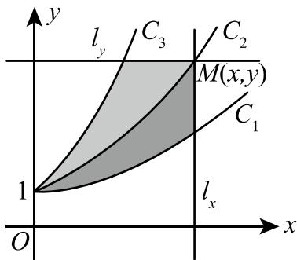

(17) (本题满分 11 分)

如图, 曲线 C 的方程为 $y = f(x)$ , 点 (3,2) 是它的一个拐点, 直线 $l_{1}$ 与 $l_{2}$ 分别是曲线 C 在点 (0,0) 与 (3,2) 处的切线, 其交点为 (2,4). 设函数 $f(x)$ 具有三阶连续导数, 计算定积分

$$
\int_ {0} ^ {3} \left(x ^ {2} + x\right) f ^ {\prime \prime \prime} (x) \mathrm{d} x.
$$

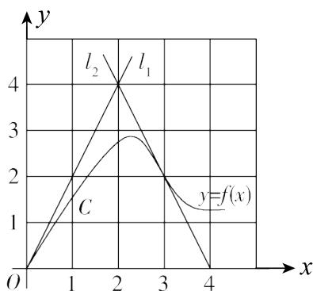

## (18) (本题满分 12 分)

用变量代换 $x = \cos t (0 < t < \pi)$ 化简微分方程 $(1 - x^{2})y'' - xy' + y = 0$ ，并求其满足 $y\bigg|_{x=0} = 1$ ， $y'\bigg|_{x=0}=2$ 的特解.

## (19) (本题满分 12 分)

已知函数 $f(x)$ 在 $[0,1]$ 上连续，在 $(0,1)$ 内可导，且 $f(0) = 0, f(1) = 1$ . 证明：

( I ) 存在 $\xi \in (0,1)$ ，使得 $f(\xi) = 1 - \xi;$

(Ⅱ) 存在两个不同的点 $\eta, \zeta \in (0,1)$ , 使得 $f'(\eta)f'(\zeta) = 1$ .

## (20) (本题满分 10 分)

已知函数 $z = f(x, y)$ 的全微分 $\mathrm{d}z = 2x\mathrm{d}x - 2y\mathrm{d}y$ ，并且 $f(1, 1) = 2$ 。求 $f(x, y)$ 在椭圆域 $D = \left\{(x, y) \mid x^2 + \frac{y^2}{4} \leqslant 1\right\}$ 上的最大值和最小值。

## (21) (本题满分9分)

计算二重积分 $\iint_{D}|x^{2} + y^{2} - 1|\mathrm{d}\sigma$ ，其中 $D = \{(x,y)\mid 0\leqslant x\leqslant 1,0\leqslant y\leqslant 1\}$

## (22) (本题满分9分)

确定常数 $a$ ，使向量组 $\pmb{\alpha}_{1} = (1,1,a)^{\mathrm{T}}$ ， $\pmb{\alpha}_{2} = (1,a,1)^{\mathrm{T}}$ ， $\pmb{\alpha}_{3} = (a,1,1)^{\mathrm{T}}$ 可由向量组 $\pmb{\beta}_{1} = (1,1,a)^{\mathrm{T}}$ ， $\pmb{\beta}_{2} = (-2,a,4)^{\mathrm{T}}$ ， $\pmb{\beta}_{3} = (-2,a,a)^{\mathrm{T}}$ 线性表示，但向量组 $\pmb{\beta}_{1},\pmb{\beta}_{2},\pmb{\beta}_{3}$ 不能由向量组 $\pmb{\alpha}_{1},\pmb{\alpha}_{2},\pmb{\alpha}_{3}$ 线性表示.

## (23) (本题满分9分)

已知3阶矩阵 $\mathbf{A}$ 的第一行是 $(a,b,c),a,b,c$ 不全为零，矩阵 $\pmb {B} = \left( \begin{array}{lll}1 & 2 & 3\\ 2 & 4 & 6\\ 3 & 6 & k \end{array} \right)(k$ 为常数），且 $\pmb {AB} = \pmb{O}$ ，求线性方程组 $Ax = 0$ 的通解.

# 2006 年全国硕士研究生招生考试试题

## 一、填空题(本题共6小题,每小题4分,满分24分)

(1) 曲线 $y = \frac{x + 4\sin x}{5x - 2\cos x}$ 的水平渐近线方程为 \_\_\_\_.

(2) 设函数 $f(x) = \begin{cases} \frac{1}{x^{3}} \int_{0}^{x} \sin(t^{2}) \, dt, & x \neq 0, \\ a, & x = 0 \end{cases}$ ，在 x = 0 处连续，则 a = \_\_\_\_.

(3) 反常积分 $\int_{0}^{+\infty}\frac{x\mathrm{d}x}{(1 + x^2)^2} =$ \_\_\_\_.

(4) 微分方程 $y' = \frac{y(1 - x)}{x}$ 的通解是 \_\_\_\_.

(5) 设函数 $y = y(x)$ 由方程 $y = 1 - x e^{y}$ 确定，则 $\frac{dy}{dx} \bigg|_{x=0} =$ \_\_\_\_.

(6) 设矩阵 $A = \begin{pmatrix} 2 & 1 \\ -1 & 2 \end{pmatrix}$ ，E 为 2 阶单位矩阵，矩阵 B 满足 $BA = B + 2E$ ，则 $|B| =$ \_\_\_\_ .

## 二、选择题(本题共8小题,每小题4分,满分32分)

(7) 设函数 $y = f(x)$ 具有二阶导数，且 $f'(x) > 0, f''(x) > 0, \Delta x$ 为自变量 x 在点 $x_{0}$ 处的增量， $\Delta y$ 与 dy 分别为 $f(x)$ 在点 $x_{0}$ 处对应的增量与微分，若 $\Delta x > 0$ ，则（）(A) $0 < dy < \Delta y.$ (B) $0 < \Delta y < dy.$ (C) $\Delta y < dy < 0.$ (D) $dy < \Delta y < 0.$

(8) 设 $f(x)$ 是奇函数, 除 x = 0 外处处连续, x = 0 是其第一类间断点, 则 $\int_{0}^{x} f(t) \, dt$ 是 ( ) (A) 连续的奇函数. (B) 连续的偶函数. (C) 在 x = 0 间断的奇函数. (D) 在 x = 0 间断的偶函数.

(9) 设函数 $g(x)$ 可微, $h(x) = \mathrm{e}^{1 + g(x)}$ , $h'(1) = 1$ , $g'(1) = 2$ , 则 $g(1)$ 等于 ( ) (A) $\ln 3 - 1$ . (B) $-\ln 3 - 1$ . (C) $-\ln 2 - 1$ . (D) $\ln 2 - 1$ .

(10) 函数 $y = C_{1}e^{x} + C_{2}e^{-2x} + xe^{x}$ 满足的一个微分方程是()
(A) $y''-y'-2y=3xe^{x}.$ (B) $y''-y'-2y=3e^{x}.$ (C) $y''+y'-2y=3xe^{x}.$ (D) $y''+y'-2y=3e^{x}.$

(11) 设 $f(x,y)$ 为连续函数，则 $\int_{0}^{\frac{\sqrt{2}}{4}}\mathrm{d}\theta\int_{0}^{1}f(r\cos\theta,r\sin\theta)r\mathrm{d}r$ 等于 ( )
(A) $\int_{0}^{\frac{\sqrt{2}}{2}}dx\int_{x}^{\sqrt{1-x^{2}}}f(x,y)\mathrm{d}y.$ (B) $\int_{0}^{\frac{\sqrt{2}}{2}}dx\int_{0}^{\sqrt{1-x^{2}}}f(x,y)\mathrm{d}y.$ (C) $\int_{0}^{\frac{\sqrt{2}}{2}}dy\int_{y}^{\sqrt{1-y^{2}}}f(x,y)\mathrm{d}x.$ (D) $\int_{0}^{\frac{\sqrt{2}}{2}}dy\int_{0}^{\sqrt{1-y^{2}}}f(x,y)\mathrm{d}x.$

(12) 设 $f(x, y)$ 与 $\varphi(x, y)$ 均为可微函数，且 $\varphi_y'(x, y) \neq 0$ . 已知 $(x_0, y_0)$ 是 $f(x, y)$ 在约束条件 $\varphi(x, y) = 0$ 下的一个极值点，下列选项正确的是（）
(A) 若 $f'_x(x_0, y_0) = 0$ ，则 $f'_y(x_0, y_0) = 0$ . （B）若 $f'_x(x_0, y_0) = 0$ ，则 $f'_y(x_0, y_0) \neq 0$ .
(C) 若 $f'_x(x_0, y_0) \neq 0$ ，则 $f'_y(x_0, y_0) = 0$ . （D）若 $f'_x(x_0, y_0) \neq 0$ ，则 $f'_y(x_0, y_0) \neq 0$ .

(13) 设 $\alpha_{1}, \alpha_{2}, \cdots, \alpha_{s}$ 均为 n 维列向量, A 是 $m \times n$ 矩阵, 下列选项正确的是()

(A) 若 $\alpha_{1}, \alpha_{2}, \cdots, \alpha_{s}$ 线性相关，则 $A\alpha_{1}, A\alpha_{2}, \cdots, A\alpha_{s}$ 线性相关.

(B) 若 $\alpha_{1}, \alpha_{2}, \cdots, \alpha_{s}$ 线性相关，则 $A\alpha_{1}, A\alpha_{2}, \cdots, A\alpha_{s}$ 线性无关.

(C) 若 $\alpha_{1},\alpha_{2},\cdots,\alpha_{s}$ 线性无关, 则 $A\alpha_{1},A\alpha_{2},\cdots,A\alpha_{s}$ 线性相关.

(D) 若 $\alpha_{1}, \alpha_{2}, \cdots, \alpha_{s}$ 线性无关，则 $A\alpha_{1}, A\alpha_{2}, \cdots, A\alpha_{s}$ 线性无关.

(14) 设 A 为 3 阶矩阵, 将 A 的第 2 行加到第 1 行得 B, 再将 B 的第 1 列的 -1 倍加到第 2 列得 C,
记 $P = \begin{pmatrix} 1 & 1 & 0 \\ 0 & 1 & 0 \\ 0 & 0 & 1 \end{pmatrix}$ , 则() (A) $C = P^{-1}AP$ . (B) $C = PAP^{-1}$ . (C) $C = P^{T}AP$ . (D) $C = PAP^{T}$ .

## 三、解答题(本题共9小题,满分94分. 解答应写出文字说明、证明过程或演算步骤)

(15) (本题满分 10 分)
试确定常数 A, B, C 的值, 使得 $\mathrm{e}^{x}(1 + Bx + Cx^{2}) = 1 + Ax + o(x^{3})$ , 其中 $o(x^{3})$ 是当 $x \to 0$ 时比 $x^{3}$ 高阶的无穷小量.

(16) (本题满分 10 分)
求 $\int\frac{\arcsin e^{x}}{e^{x}}dx.$

(17) (本题满分 10 分)
设区域 $D = \{(x, y) \mid x^{2} + y^{2} \leqslant 1, x \geqslant 0\}$ ，计算二重积分 $I = \iint_{D} \frac{1 + xy}{1 + x^{2} + y^{2}} dx dy.$

(18) (本题满分 12 分)
设数列 $\{x_{n}\}$ 满足 $0 < x_{1} < \pi, x_{n+1} = \sin x_{n} (n = 1, 2, \cdots)$ .
（Ⅰ）证明 $\lim_{n\to\infty}x_{n}$ 存在，并求该极限；（Ⅱ）计算 $\lim_{n\to\infty}\left(\frac{x_{n+1}}{x_n}\right)^{\frac{1}{x_n^2}}$

(19) (本题满分 10 分)
证明: 当 $0 < a < b < \pi$ 时, $b \sin b + 2 \cos b + \pi b > a \sin a + 2 \cos a + \pi a.$

(20) (本题满分 12 分)

$$
(0, + \infty)
$$

$$
z = f \left(\sqrt {x ^ {2} + y ^ {2}}\right)
$$

$$
\frac {\partial^ {2} z}{\partial x ^ {2}} + \frac {\partial^ {2} z}{\partial y ^ {2}} = 0.
$$

（Ⅰ）验证 $f''(u) + \frac{f'(u)}{u} = 0$ ；（Ⅱ）若 $f(1) = 0, f'(1) = 1$ ，求函数 $f(u)$ 的表达式.

(21) (本题满分 12 分)
已知曲线 L 的方程为 $\left\{\begin{aligned}x &= t^{2} + 1, \\ y &= 4t - t^{2},\end{aligned}\right.$ ( $t \geqslant 0$ ).

（I）讨论 $L$ 的凹凸性；

(Ⅱ) 过点 $(-1,0)$ 引L的切线,求切点 $(x_{0},y_{0})$ ,并写出切线的方程;

(Ⅲ) 求此切线与 $L$ (对应于 $x \leqslant x_0$ 的部分) 及 $x$ 轴所围成的平面图形的面积.

已知非齐次线性方程组 $\left\{ \begin{array}{l}x_{1} + x_{2} + x_{3} + x_{4} = -1,\\ 4x_{1} + 3x_{2} + 5x_{3} - x_{4} = -1,\\ ax_{1} + x_{2} + 3x_{3} + bx_{4} = 1 \end{array} \right.$ 有三个线性无关的解.

（Ⅰ）证明方程组系数矩阵 A 的秩 $r(A) = 2$ ; （Ⅱ）求 a, b 的值及方程组的通解.

(23) (本题满分9分)
设3阶实对称矩阵A的各行元素之和均为3, 向量 $\boldsymbol{\alpha}_{1}=(-1,2,-1)^{\mathrm{T}}, \boldsymbol{\alpha}_{2}=(0,-1,1)^{\mathrm{T}}$ 是线性方程组 Ax=0 的两个解.
（Ⅰ）求 A 的特征值与特征向量；（Ⅱ）求正交矩阵 Q 和对角矩阵 $\Lambda$ ，使得 $Q^{T}AQ = \Lambda$ .

# 2007 年全国硕士研究生招生考试试题

## 一、选择题(本题共10小题,每小题4分,满分40分)

(1) 当 $x \to 0^{+}$ 时, 与 $\sqrt{x}$ 等价的无穷小量是 ( )
(A) $1-\mathrm{e}^{\sqrt{x}}$ . (B) $\ln\frac{1+x}{1-\sqrt{x}}$ . (C) $\sqrt{1+\sqrt{x}}-1$ . (D) $1-\cos\sqrt{x}$ .

(2) 函数 $f(x) = \frac{\left(\mathrm{e}^{\frac{1}{x}} + \mathrm{e}\right)\tan x}{x\left(\mathrm{e}^{\frac{1}{x}} - \mathrm{e}\right)}$ 在 $[- \pi, \pi]$ 上的第一类间断点是 $x = (\quad)$ (A)0. (B)1. (C) $-\frac{\pi}{2}.$ (D) $\frac{\pi}{2}.$

(3) 如图, 连续函数 $y = f(x)$ 在区间 $[-3, -2]$ , $[2, 3]$ 上的图形分别是直径为 1 的上、下半圆周, 在区间 $[-2, 0]$ , $[0, 2]$ 上的图形分别是直径为 2 的下、上半圆周. 设 $F(x) = \int_{0}^{x} f(t) \, dt$ , 则下列结论正确的是 ( )
(A) $F(3)=-\frac{3}{4}F(-2).$ (B) $F(3)=\frac{5}{4}F(2).$ (C) $F(-3)=\frac{3}{4}F(2).$ (D) $F(-3)=-\frac{5}{4}F(-2).$

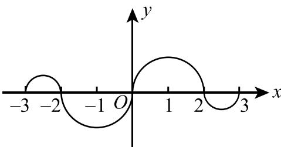

(4) 设函数 $f(x)$ 在 x = 0 处连续, 下列命题错误的是 ( )
(A) 若 $\lim_{x\to0}\frac{f(x)}{x}$ 存在, 则 $f(0)=0.$ (B) 若 $\lim_{x\to0}\frac{f(x)+f(-x)}{x}$ 存在, 则 $f(0)=0.$ (C) 若 $\lim_{x\to0}\frac{f(x)}{x}$ 存在, 则 $f'(0)$ 存在.
(D) 若 $\lim_{x\to0}\frac{f(x)-f(-x)}{x}$ 存在, 则 $f'(0)$ 存在.

(5) 曲线 $y = \frac{1}{x} + \ln(1 + e^{x})$ 渐近线的条数为()
(A)0. (B)1. (C)2. (D)3.

(6) 设函数 $f(x)$ 在 $(0, +\infty)$ 内具有二阶导数，且 $f''(x) > 0$ ，令 $u_n = f(n)$ ( $n = 1, 2, \cdots$ )，则下列结论正确的是（）
(A) 若 $u_{1} > u_{2}$ ，则 $\{u_{n}\}$ 必收敛.
(B) 若 $u_{1} > u_{2}$ ，则 $\{u_{n}\}$ 必发散.
(C) 若 $u_{1} < u_{2}$ ，则 $\{u_{n}\}$ 必收敛.
(D) 若 $u_{1} < u_{2}$ ，则 $\{u_{n}\}$ 必发散.

(7) 二元函数 $f(x, y)$ 在点(0,0)处可微的一个充分条件是( )
(A) $\lim_{(x,y)\to(0,0)}[f(x,y)-f(0,0)]=0.$ (B) $\lim_{x\to0}\frac{f(x,0)-f(0,0)}{x}=0$ ,且 $\lim_{y\to0}\frac{f(0,y)-f(0,0)}{y}=0.$ (C) $\lim_{(x,y)\to(0,0)}\frac{f(x,y)-f(0,0)}{\sqrt{x^{2}+y^{2}}} = 0.$

(D) $\lim_{x\to 0}[f_x'(x,0) - f_x'(0,0)] = 0$ ，且 $\lim_{y\to 0}[f_y'(0,y) - f_y'(0,0)] = 0.$

(8) 设函数 $f(x,y)$ 连续，则二次积分 $\int_{\frac{\pi}{2}}^{\pi} dx \int_{\sin x}^{1} f(x,y) dy$ 等于（）
(A) $\int_{0}^{1}dy\int_{\pi+\arcsin y}^{\pi}f(x,y)dx.$ (B) $\int_{0}^{1}dy\int_{\pi-\arcsin y}^{\pi}f(x,y)dx.$ (C) $\int_{0}^{1}dy\int_{\frac{\pi}{2}}^{\pi+\arcsin y}f(x,y)dx.$ (D) $\int_{0}^{1}dy\int_{\frac{\pi}{2}}^{\pi-\arcsin y}f(x,y)dx.$

(9) 设向量组 $\alpha_{1}, \alpha_{2}, \alpha_{3}$ 线性无关, 则下列向量组线性相关的是 ( )
(A) $\alpha_{1}-\alpha_{2},\alpha_{2}-\alpha_{3},\alpha_{3}-\alpha_{1}.$ (B) $\alpha_{1}+\alpha_{2},\alpha_{2}+\alpha_{3},\alpha_{3}+\alpha_{1}.$ (C) $\alpha_{1}-2\alpha_{2},\alpha_{2}-2\alpha_{3},\alpha_{3}-2\alpha_{1}.$ (D) $\alpha_{1}+2\alpha_{2},\alpha_{2}+2\alpha_{3},\alpha_{3}+2\alpha_{1}.$

(10) 设矩阵 $A = \begin{pmatrix} 2 & -1 & -1 \\ -1 & 2 & -1 \\ -1 & -1 & 2 \end{pmatrix}$ ， $B = \begin{pmatrix} 1 & 0 & 0 \\ 0 & 1 & 0 \\ 0 & 0 & 0 \end{pmatrix}$ ，则 A 与 B() （A）合同且相似. （B）合同，但不相似. （C）不合同，但相似. （D）既不合同，也不相似.

## 二、填空题(本题共6小题,每小题4分,满分24分)

(11) $\lim_{x\to 0}\frac{\arctan x - \sin x}{x^3} = \underline{\quad}$ .

(12) 曲线 $\left\{\begin{aligned} x &= \cos t + \cos^{2}t, \\ y &= 1 + \sin t \end{aligned}\right.$ ，上对应于 $t = \frac{\pi}{4}$ 的点处的法线斜率为 \_\_\_\_.

(13) 设函数 $y = \frac{1}{2x + 3}$ ，则 $y^{(n)}(0) =$ \_\_\_\_.

(14) 二阶常系数非齐次线性微分方程 $y'' - 4y' + 3y = 2\mathrm{e}^{2x}$ 的通解为 \_\_\_\_.

(15) 设 $f(u,v)$ 是二元可微函数, $z = f\left(\frac{y}{x}, \frac{x}{y}\right)$ , 则 $x \frac{\partial z}{\partial x} - y \frac{\partial z}{\partial y} =$ \_\_\_\_ .

(16) 设矩阵 A = $\begin{pmatrix}0 & 1 & 0 & 0 \\ 0 & 0 & 1 & 0 \\ 0 & 0 & 0 & 1 \\ 0 & 0 & 0 & 0\end{pmatrix}$ ，则 $A^{3}$ 的秩为 \_\_\_\_.

## 三、解答题(本题共8小题,满分86分,解答应写出文字说明、证明过程或演算步骤)

(17) (本题满分 10 分)

设 $f(x)$ 是区间 $\left[0, \frac{\pi}{4}\right]$ 上的单调、可导函数，且满足

$$
\int_ {0} ^ {f (x)} f ^ {- 1} (t) \mathrm{d} t = \int_ {0} ^ {x} t \frac {\cos t - \sin t}{\sin t + \cos t} \mathrm{d} t,
$$

其中 $f^{-1}$ 是f的反函数,求 $f(x)$ .

(18) (本题满分 11 分)

设 D 是位于曲线 $y = \sqrt{x} a^{-\frac{x}{2a}} (a > 1, 0 \leqslant x < +\infty)$ 下方、x 轴上方的无界区域.

（I）求区域 D 绕 x 轴旋转一周所成旋转体的体积 $V(a)$ ;

(Ⅱ) 当 a 为何值时, $V(a)$ 最小? 并求此最小值.

## (19) (本题满分 10 分)

求微分方程 $y''(x + y'^{2}) = y'$ 满足初始条件 $y(1) = y'(1) = 1$ 的特解.

## (20) (本题满分 11 分)

已知函数 $f(u)$ 具有二阶导数，且 $f'(0) = 1$ ，函数 $y = y(x)$ 由方程 $y - x\mathrm{e}^{y - 1} = 1$ 所确定。设 $z = f(\ln y - \sin x)$ ，求 $\left.\frac{\mathrm{d}z}{\mathrm{d}x}\right|_{x=0}, \left.\frac{\mathrm{d}^2z}{\mathrm{d}x^2}\right|_{x=0}$ 。

## (21) (本题满分 11 分)

设函数 $f(x), g(x)$ 在 $[a, b]$ 上连续，在 $(a, b)$ 内具有二阶导数且存在相等的最大值， $f(a) = g(a), f(b) = g(b)$ ，证明：存在 $\xi \in (a, b)$ ，使得 $f''(\xi) = g''(\xi)$ .

## (22) (本题满分 11 分)

设二元函数

$$
f (x, y) = \left\{ \begin{array}{l l} x ^ {2}, & | x | + | y | \leqslant 1, \\ \frac {1}{\sqrt {x ^ {2} + y ^ {2}}}, & 1 <   | x | + | y | \leqslant 2, \end{array} \right.
$$

计算二重积分 $\iint_{D} f(x, y) \mathrm{d}\sigma$ ，其中 $D = \{(x, y) | |x| + |y| \leqslant 2\}$ .

## (23) (本题满分 11 分)

设线性方程组

$$
\left\{ \begin{array}{l} x _ {1} + x _ {2} + x _ {3} = 0, \\ x _ {1} + 2 x _ {2} + a x _ {3} = 0, \\ x _ {1} + 4 x _ {2} + a ^ {2} x _ {3} = 0, \end{array} \right.\tag{①}
$$

与方程组

$$
x _ {1} + 2 x _ {2} + x _ {3} = a - 1\tag{②}
$$

有公共解,求 a 的值及所有公共解.

## (24) (本题满分 11 分)

设 3 阶实对称矩阵 A 的特征值为 $\lambda_{1}=1, \lambda_{2}=2, \lambda_{3}=-2, \alpha_{1}=(1,-1,1)^{\mathrm{T}}$ 是 A 的属于 $\lambda_{1}$ 的一个特征向量. 记 $B=A^{5}-4A^{3}+E$ , 其中 E 为 3 阶单位矩阵.

（Ⅰ）验证 $\alpha_{1}$ 是矩阵 B 的特征向量，并求 B 的全部特征值与特征向量；

(Ⅱ) 求矩阵 B.

# 2008年全国硕士研究生招生考试试题

## 一、选择题(本题共8小题,每小题4分,满分32分)

(1) 设函数 $f(x) = x^{2}(x - 1)(x - 2)$ ，则 $f'(x)$ 的零点个数为（）
(A)0.
(B)1.
(C)2.
(D)3.

(2) 如图, 曲线段的方程为 $y = f(x)$ , 函数 $f(x)$ 在区间 $[0, a]$ 上有连续的导数, 则定积分 $\int_{0}^{a} x f'(x) \, dx$ 等于 ( )
(A) 曲边梯形 ABOD 的面积.
(B) 梯形 ABOD 的面积.
(C) 曲边三角形 ACD 的面积.
(D) 三角形 ACD 的面积.

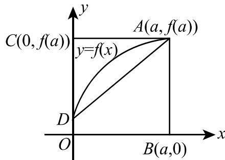

(3) 在下列微分方程中, 以 $y = C_1 e^x + C_2 \cos 2x + C_3 \sin 2x (C_1, C_2, C_3$ 为任意常数) 为通解的是
( )
(A) $y''' + y'' - 4y' - 4y = 0.$ (B) $y''' + y'' + 4y' + 4y = 0.$ (C) $y''' - y'' - 4y' + 4y = 0.$ (D) $y''' - y'' + 4y' - 4y = 0.$

(4) 设函数 $f(x) = \frac{\ln |x|}{|x - 1|} \sin x$ ，则 $f(x)$ 有（）
(A)1个可去间断点,1个跳跃间断点.
(B)1个可去间断点,1个无穷间断点.
(C)2个跳跃间断点.
(D)2个无穷间断点.

(5) 设函数 $f(x)$ 在 $(- \infty, +\infty)$ 内单调有界， $\{x_{n}\}$ 为数列，下列命题正确的是（）
(A) 若 $\{x_{n}\}$ 收敛，则 $\{f(x_{n})\}$ 收敛.
(B) 若 $\{x_{n}\}$ 单调，则 $\{f(x_{n})\}$ 收敛.
(C) 若 $\{f(x_{n})\}$ 收敛，则 $\{x_{n}\}$ 收敛.
(D) 若 $\{f(x_{n})\}$ 单调，则 $\{x_{n}\}$ 收敛.

(6) 设函数 $f$ 连续. 若 $F(u, v) = \iint_{D_{uv}} \frac{f(x^2 + y^2)}{\sqrt{x^2 + y^2}} \mathrm{d}x \mathrm{~d}y$ , 其中区域 $D_{uv}$ 为图中阴影部分, 则 $\frac{\partial F}{\partial u} = (\quad)$ (A) $vf(u^2)$ .

(B) $\frac{v}{u} f(u^2)$ .

(C) $vf(u)$ .

(D) $\frac{v}{u} f(u)$ .

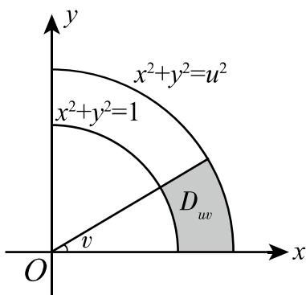

(7) 设 A 为 n 阶非零矩阵, E 为 n 阶单位矩阵, 若 $A^{3} = O$ , 则 ( )
(A) E - A 不可逆, $E + A$ 不可逆.
(B) E - A 不可逆, $E + A$ 可逆.
(C) E - A 可逆, $E + A$ 可逆.
(D) E - A 可逆, $E + A$ 不可逆.

(8) 设 $A = \begin{pmatrix} 1 & 2 \\ 2 & 1 \end{pmatrix}$ ，则在实数域上与 A 合同的矩阵为（）

(A) $\begin{pmatrix}-2 & 1 \\ 1 & -2\end{pmatrix}$ . (B) $\begin{pmatrix} 2 & -1 \\ -1 & 2\end{pmatrix}$ . (C) $\begin{pmatrix} 2 & 1 \\ 1 & 2\end{pmatrix}$ . (D) $\begin{pmatrix} 1 & -2 \\ -2 & 1\end{pmatrix}$ .

## 二、填空题(本题共6小题,每小题4分,满分24分)

(9) 已知函数 $f(x)$ 连续，且 $\lim_{x\to 0}\frac{1 - \cos[xf(x)]}{(\mathrm{e}^{x^2} - 1)f(x)} = 1$ ，则 $f(0) =$ \_\_\_\_.

(10) 微分方程 $(y + x^2\mathrm{e}^{-x})\mathrm{d}x - x\mathrm{d}y = 0$ 的通解是 $y = \underline{\quad}$ .

(11) 曲线 $\sin(xy) + \ln(y - x) = x$ 在点 $(0,1)$ 处的切线方程是 \_\_\_\_.

(12) 曲线 $y = (x - 5)x^{\frac{2}{3}}$ 的拐点坐标为 \_\_\_\_.

(13) 设 $z = \left(\frac{y}{x}\right)^{\frac{x}{y}}$ ，则 $\frac{\partial z}{\partial x} \bigg|_{(1,2)} =$ \_\_\_\_ .

(14) 设 3 阶矩阵 A 的特征值为 2,3, $\lambda$ . 若行列式 $\left|2A\right| = -48$ , 则 $\lambda =$ \_\_\_\_.

## 三、解答题(本题共9小题,满分94分,解答应写出文字说明、证明过程或演算步骤)

(15) (本题满分9分)

求极限 $\lim_{x\to 0}\frac{[\sin x - \sin(\sin x)]\sin x}{x^4}.$

(16) (本题满分 10 分)

设函数 $y = y(x)$ 由参数方程 $\left\{ \begin{array}{l}x = x(t),\\ y = \int_0^{t^2}\ln (1 + u)\mathrm{d}u \end{array} \right.$ 确定，其中 $x(t)$ 是初值问题 $\left\{ \begin{array}{l}\frac{\mathrm{d}x}{\mathrm{d}t} -2te^{-x} = 0,\\ x|_{t = 0} = 0 \end{array} \right.$ 的解，求 $\frac{\mathrm{d}^2y}{\mathrm{d}x^2}.$

(17) (本题满分9分)

计算 $\int_0^1\frac{x^2\arcsin x}{\sqrt{1 - x^2}}\mathrm{d}x.$

(18) (本题满分 11 分)

计算 $\iint_{D} \max \{xy, 1\} \mathrm{d}x \mathrm{d}y$ ，其中 $D = \{(x, y) \mid 0 \leqslant x \leqslant 2, 0 \leqslant y \leqslant 2\}$ .

(19) (本题满分 11 分)

设 $f(x)$ 是区间 $[0, +\infty)$ 上具有连续导数的单调增加函数，且 $f(0) = 1$ 。对任意的 $t \in [0, +\infty)$ ，直线 $x = 0, x = t$ ，曲线 $y = f(x)$ 以及 $x$ 轴所围成的曲边梯形绕 $x$ 轴旋转一周生成一旋转体。若该旋转体的侧面积在数值上等于其体积的2倍，求函数 $f(x)$ 的表达式。

(20) (本题满分 11 分)

（Ⅰ）证明积分中值定理：若函数 $f(x)$ 在闭区间 $[a,b]$ 上连续，则至少存在一点 $\eta\in[a,b]$ ，使得 $\int_{a}^{b}f(x)\mathrm{d}x=f(\eta)(b-a)$ ;

（Ⅱ）若函数 $\varphi(x)$ 具有二阶导数，且满足 $\varphi(2) > \varphi(1)$ ， $\varphi(2) > \int_{2}^{3} \varphi(x) \, dx$ ，则至少存在一点 $\xi \in (1,3)$ ，使得 $\varphi''(\xi) < 0$ .

(21) (本题满分 11 分)

求函数 $u = x^{2} + y^{2} + z^{2}$ 在约束条件 $z = x^{2} + y^{2}$ 和 $x + y + z = 4$ 下的最大值与最小值.

## (22) (本题满分 12 分)

设 n 元线性方程组 Ax = b, 其中

$$
\boldsymbol {A} = \left( \begin{array}{c c c c c c} 2 a & 1 & & & & \\ a ^ {2} & 2 a & 1 & & & \\ & a ^ {2} & 2 a & 1 & & \\ & & \ddots & \ddots & \ddots & \\ & & & a ^ {2} & 2 a & 1 \\ & & & & a ^ {2} & 2 a \end{array} \right) _ {n \times n}, \boldsymbol {x} = \left( \begin{array}{c} x _ {1} \\ x _ {2} \\ \vdots \\ x _ {n} \end{array} \right), \boldsymbol {b} = \left( \begin{array}{c} 1 \\ 0 \\ \vdots \\ 0 \end{array} \right).
$$

( I ) 证明行列式 $\left| A \right| = (n + 1)a^{n}$ ;

(Ⅱ) 当 a 为何值时,该方程组有唯一解,并求 $x_{1}$ ;

(Ⅲ) 当 a 为何值时,该方程组有无穷多解,并求通解.

## (23) (本题满分 10 分)

设 A 为 3 阶矩阵, $\alpha_{1}, \alpha_{2}$ 为 A 的分别属于特征值 -1, 1 的特征向量, 向量 $\alpha_{3}$ 满足 $A\alpha_{3} = \alpha_{2} + \alpha_{3}$ .

（I）证明 $\alpha_{1},\alpha_{2},\alpha_{3}$ 线性无关；

(Ⅱ) 令 $P = (\alpha_{1}, \alpha_{2}, \alpha_{3})$ ，求 $P^{-1}AP$ .

# 2009 年全国硕士研究生招生考试试题

## 一、选择题(本题共8小题,每小题4分,满分32分)

(1) 函数 $f(x) = \frac{x - x^{3}}{\sin \pi x}$ 的可去间断点的个数为( )
(A)1. (B)2. (C)3. (D)无穷多个.

(2) 当 $x \to 0$ 时, $f(x) = x - \sin ax$ 与 $g(x) = x^{2} \ln(1 - bx)$ 是等价无穷小量, 则 (A) $a = 1, b = -\frac{1}{6}.$ (B) $a = 1, b = \frac{1}{6}.$ (C) $a = -1, b = -\frac{1}{6}.$ (D) $a = -1, b = \frac{1}{6}.$

(3) 设函数 $z = f(x, y)$ 的全微分为 dz = x dx + y dy，则点 $(0, 0)$ ( )
(A) 不是 $f(x, y)$ 的连续点. (B) 不是 $f(x, y)$ 的极值点.
(C) 是 $f(x, y)$ 的极大值点. (D) 是 $f(x, y)$ 的极小值点.

(4) 设函数 $f(x, y)$ 连续，则 $\int_{1}^{2}\mathrm{d}x\int_{x}^{2}f(x, y)\mathrm{d}y + \int_{1}^{2}\mathrm{d}y\int_{y}^{4-y}f(x, y)\mathrm{d}x = (\quad)$ (A) $\int_{1}^{2}\mathrm{d}x\int_{1}^{4-x}f(x,y)\mathrm{d}y.$ (B) $\int_{1}^{2}\mathrm{d}x\int_{x}^{4-x}f(x,y)\mathrm{d}y.$ (C) $\int_{1}^{2}\mathrm{d}y\int_{1}^{4-y}f(x,y)\mathrm{d}x.$ (D) $\int_{1}^{2}\mathrm{d}y\int_{y}^{2}f(x,y)\mathrm{d}x.$

(5) 若 $f''(x)$ 不变号, 且曲线 $y = f(x)$ 在点 $(1, 1)$ 处的曲率圆为 $x^{2} + y^{2} = 2$ , 则函数 $f(x)$ 在区间 $(1, 2)$ 内 ( )
(A) 有极值点, 无零点. (B) 无极值点, 有零点.
(C) 有极值点, 有零点. (D) 无极值点, 无零点.

(6) 设函数 $y = f(x)$ 在区间 $[-1, 3]$ 上的图形如图所示，则函数 $F(x) = \int_{0}^{x} f(t) \, \mathrm{d}t$ 的图形为（）

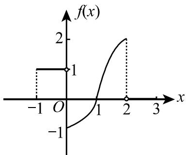

(A)  
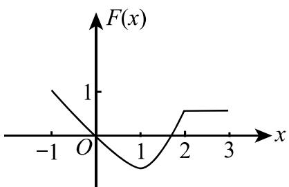

(B)  
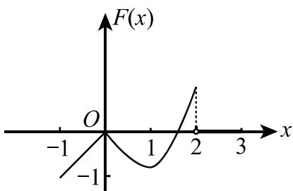

(C)

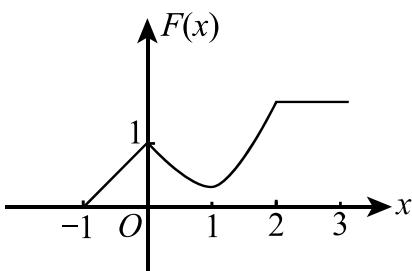

(D)

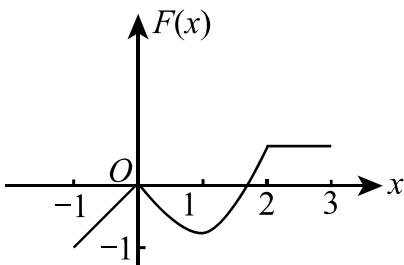

(7) 设 A, B 均为 2 阶方阵, $A^{*}$ , $B^{*}$ 分别为 A, B 的伴随矩阵. 若 $|A| = 2$ , $|B| = 3$ , 则分块矩阵 $\begin{pmatrix} O & A \\ B & O \end{pmatrix}$ 的伴随矩阵为 ( )  
(A) $\begin{pmatrix} O & 3B^{*} \\ 2A^{*} & O \end{pmatrix}$ . (B) $\begin{pmatrix} O & 2B^{*} \\ 3A^{*} & O \end{pmatrix}$ . (C) $\begin{pmatrix} O & 3A^{*} \\ 2B^{*} & O \end{pmatrix}$ . (D) $\begin{pmatrix} O & 2A^{*} \\ 3B^{*} & O \end{pmatrix}$ .

(8) 设 A, P 均为 3 阶矩阵, $P^{T}$ 为 P 的转置矩阵, 且 $P^{T}AP = \begin{pmatrix} 1 & 0 & 0 \\ 0 & 1 & 0 \\ 0 & 0 & 2 \end{pmatrix}$ . 若 $P = (\alpha_{1}, \alpha_{2}, \alpha_{3})$ , Q = ( $\alpha_{1} + \alpha_{2}, \alpha_{2}, \alpha_{3}$ ), 则 $Q^{T}AQ$ 为 ( )  
(A) $\begin{pmatrix} 2 & 1 & 0 \\ 1 & 1 & 0 \\ 0 & 0 & 2 \end{pmatrix}$ . (B) $\begin{pmatrix} 1 & 1 & 0 \\ 1 & 2 & 0 \\ 0 & 0 & 2 \end{pmatrix}$ . (C) $\begin{pmatrix} 2 & 0 & 0 \\ 0 & 1 & 0 \\ 0 & 0 & 2 \end{pmatrix}$ . (D) $\begin{pmatrix} 1 & 0 & 0 \\ 0 & 2 & 0 \\ 0 & 0 & 2 \end{pmatrix}$ .

## 二、填空题(本题共6小题,每小题4分,满分24分)

(9) 曲线 $\left\{\begin{aligned}x &= \int_{0}^{1-t}\mathrm{e}^{-u^{2}}\mathrm{d}u, \\ y &= t^{2}\ln(2-t^{2})\end{aligned}\right.$ 在点 $(0,0)$ 处的切线方程为 \_\_\_\_.

(10) 已知 $\int_{-\infty}^{+\infty} e^{k|x|} dx = 1$ ，则 k = \_\_\_\_.

(11) $\lim_{n\to \infty}\int_0^1\mathrm{e}^{-x}\sin nx\mathrm{d}x = \underline{\quad}.$

(12) 设 $y = y(x)$ 是由方程 $xy + e^{y} = x + 1$ 确定的隐函数，则 $\left.\frac{d^{2}y}{dx^{2}}\right|_{x=0} =$ \_\_\_\_.

(13) 函数 $y = x^{2x}$ 在区间 $(0, 1]$ 上的最小值为 \_\_\_\_.

(14) 设 $\alpha, \beta$ 为 3 维列向量, $\beta^{T}$ 为 $\beta$ 的转置. 若矩阵 $\alpha\beta^{T}$ 相似于 $\begin{pmatrix}2 & 0 & 0 \\ 0 & 0 & 0 \\ 0 & 0 & 0\end{pmatrix}$ , 则 $\beta^{T}\alpha =$ \_\_\_\_ .

## 三、解答题(本题共9小题,满分94分,解答应写出文字说明、证明过程或演算步骤)

(15) (本题满分9分)
求极限 $\lim_{x\to0}\frac{(1-\cos x)[x-\ln(1+\tan x)]}{\sin^{4}x}.$

(16) (本题满分 10 分)

计算不定积分 $\int \ln \left(1 + \sqrt{\frac{1 + x}{x}}\right)\mathrm{d}x(x > 0)$

## (17) (本题满分 10 分)

设 $z = f(x + y, x - y, xy)$ ，其中 $f$ 具有二阶连续偏导数，求 $\mathrm{dz}$ 与 $\frac{\partial^2 z}{\partial x \partial y}$ .

## (18) (本题满分 10 分)

设非负函数 $y = y(x) (x \geqslant 0)$ 满足微分方程 $xy'' - y' + 2 = 0$ . 当曲线 $y = y(x)$ 过原点时, 其与直线 x = 1 及 y = 0 围成平面区域 D 的面积为 2, 求 D 绕 y 轴旋转所得旋转体体积.

## (19) (本题满分 10 分)

计算二重积分 $\iint_{D} (x - y) \, \mathrm{d}x \, \mathrm{d}y$ ，其中 $D = \{(x, y) | (x - 1)^2 + (y - 1)^2 \leqslant 2, y \geqslant x\}$ .

## (20) (本题满分 12 分)

设 $y = y(x)$ 是区间 $(- \pi, \pi)$ 内过点 $\left(-\frac{\pi}{\sqrt{2}}, \frac{\pi}{\sqrt{2}}\right)$ 的光滑曲线. 当 $-\pi < x < 0$ 时, 曲线上任一点处的法线都过原点; 当 $0 \leqslant x < \pi$ 时, 函数 $y(x)$ 满足 $y'' + y + x = 0$ . 求 $y(x)$ 的表达式.

## (21) (本题满分 11 分)

（Ⅰ）证明拉格朗日中值定理：若函数 $f(x)$ 在 $[a, b]$ 上连续，在 $(a, b)$ 内可导，则存在点 $\xi \in (a, b)$ ，使得 $f(b) - f(a) = f'(\xi)(b - a)$ .

（Ⅱ）证明：若函数 $f(x)$ 在x=0处连续，在 $(0,\delta)(\delta>0)$ 内可导，且 $\lim_{x\to0^{+}}f'(x)=A$ ，则 $f_{+}^{\prime}(0)$ 存在，且 $f_{+}^{\prime}(0)=A$ .

## (22) (本题满分11分)

设

$$
\boldsymbol {A} = \left( \begin{array}{c c c} 1 & - 1 & - 1 \\ - 1 & 1 & 1 \\ 0 & - 4 & - 2 \end{array} \right), \quad \boldsymbol {\xi} _ {1} = \left( \begin{array}{c} - 1 \\ 1 \\ - 2 \end{array} \right).
$$

（Ⅰ）求满足 $A\xi_{2} = \xi_{1}, A^{2}\xi_{3} = \xi_{1}$ 的所有向量 $\xi_{2}, \xi_{3}$ ;

(Ⅱ) 对(Ⅰ)中的任意向量 $\xi_{2}, \xi_{3}$ ，证明 $\xi_{1}, \xi_{2}, \xi_{3}$ 线性无关.

## (23) (本题满分11分)

设二次型

$$
f \left(x _ {1}, x _ {2}, x _ {3}\right) = a x _ {1} ^ {2} + a x _ {2} ^ {2} + (a - 1) x _ {3} ^ {2} + 2 x _ {1} x _ {3} - 2 x _ {2} x _ {3}.
$$

（Ⅰ）求二次型f的矩阵的所有特征值；

（Ⅱ）若二次型 $f$ 的规范形为 $y_{1}^{2} + y_{2}^{2}$ ，求 $a$ 的值.

# 2010 年全国硕士研究生招生考试试题

## 一、选择题(本题共8小题,每小题4分,共32分.在每小题给出的四个选项中,只有一项符合题目要求,把所选项前的字母填在题后的括号内.)

(1) 函数 $f(x) = \frac{x^{2} - x}{x^{2} - 1} \sqrt{1 + \frac{1}{x^{2}}}$ 的无穷间断点的个数为 ( )
(A)0.
(B)1.
(C)2.
(D)3.

(2) 设 $y_{1}, y_{2}$ 是一阶线性非齐次微分方程 $y' + p(x)y = q(x)$ 的两个特解, 若常数 $\lambda, \mu$ 使 $\lambda y_{1} + \mu y_{2}$ 是该方程的解, $\lambda y_{1} - \mu y_{2}$ 是该方程对应的齐次方程的解, 则 ( )
(A) $\lambda=\frac{1}{2},\mu=\frac{1}{2}.$ (B) $\lambda=-\frac{1}{2},\mu=-\frac{1}{2}.$ (C) $\lambda=\frac{2}{3},\mu=\frac{1}{3}.$ (D) $\lambda=\frac{2}{3},\mu=\frac{2}{3}.$

(3) 曲线 $y = x^{2}$ 与曲线 $y = a \ln x (a \neq 0)$ 相切，则 $a = (\quad)$ (A)4e. (B)3e. (C)2e. (D)e.

(4) 设 m, n 均是正整数, 则反常积分 $\int_{0}^{1}\frac{\sqrt[m]{\ln^{2}(1-x)}}{\sqrt[n]{x}}dx$ 的收敛性 ( )
(A) 仅与 m 的取值有关. (B) 仅与 n 的取值有关.
(C) 与 m, n 的取值都有关. (D) 与 m, n 的取值都无关.

(5) 设函数 $z = z(x, y)$ 由方程 $F\left(\frac{y}{x}, \frac{z}{x}\right) = 0$ 确定，其中 F 为可微函数，且 $F_{2}^{\prime} \neq 0$ ，则 $x \frac{\partial z}{\partial x} + y \frac{\partial z}{\partial y} =$ ( ) (A)x. (B)z. (C)-x. (D)-z.

(6) $\lim_{n\to \infty}\sum_{i = 1}^{n}\sum_{j = 1}^{n}\frac{n}{(n + i)(n^2 + j^2)} = (\quad)$ (A) $\int_0^1\mathrm{d}x\int_0^x\frac{1}{(1 + x)(1 + y^2)}\mathrm{d}y.$ (B) $\int_0^1\mathrm{d}x\int_0^x\frac{1}{(1 + x)(1 + y)}\mathrm{d}y.$ (C) $\int_0^1\mathrm{d}x\int_0^1\frac{1}{(1 + x)(1 + y)}\mathrm{d}y.$ (D) $\int_0^1\mathrm{d}x\int_0^1\frac{1}{(1 + x)(1 + y^2)}\mathrm{d}y.$

(7) 设向量组 I: $\alpha_{1}, \alpha_{2}, \cdots, \alpha_{r}$ 可由向量组 II: $\beta_{1}, \beta_{2}, \cdots, \beta_{s}$ 线性表示. 下列命题正确的是( )
(A) 若向量组 I 线性无关, 则 $r \leqslant s.$ (B) 若向量组 I 线性相关, 则 r > s.
(C) 若向量组 II 线性无关, 则 $r \leqslant s.$ (D) 若向量组 II 线性相关, 则 r > s.

(8) 设 A 为 4 阶实对称矩阵, 则 $A^{2} + A = O$ . 若 A 的秩为 3, 则 A 相似于 ( ) (A) $\begin{pmatrix}1 & & & \\ & 1 & & \\ & & 1 & \\ & & & 0\end{pmatrix}$ .

(B) $\begin{pmatrix}1 & & & \\ & 1 & & \\ & & -1 & \\ & & & 0\end{pmatrix}$ .

(C) $\left( \begin{array}{cccc}1 &  &  &  &  \\  & -1 &  &  &  \\  &  & -1 &  &  \\  &  &  & 0 \end{array} \right).$ (D) $\left( \begin{array}{cccc} -1 & \text{公众号：研池大叔} & \text{免费分享考研课程}\& \text{书籍}\\ -1 &  &  &  \\  & -1 &  &  \\  &  & 0 \end{array} \right).$

## 二、填空题(本题共6小题,每小题4分,共24分,把答案填在题中横线上.)

(9) 3 阶常系数线性齐次微分方程 $y''' - 2y'' + y' - 2y = 0$ 的通解为 $y =$ \_\_\_\_.

(10) 曲线 $y = \frac{2x^{3}}{x^{2} + 1}$ 的渐近线方程为 \_\_\_\_.

(11) 函数 $y = \ln(1 - 2x)$ 在 x = 0 处的 n 阶导数 $y^{(n)}(0) =$ \_\_\_\_.

(12) 当 $0 \leqslant \theta \leqslant \pi$ 时, 对数螺线 $r = e^{\theta}$ 的弧长为 \_\_\_\_.

(13) 已知一个长方形的长 l 以 2 cm/s 的速率增加, 宽 w 以 3 cm/s 的速率增加, 则当 l = 12 cm, w = 5 cm 时, 它的对角线增加的速率为 \_\_\_\_.

(14) 设 A, B 为 3 阶矩阵, 且 $\left|A\right|=3,\left|B\right|=2,\left|A^{-1}+B\right|=2$ , 则 $\left|A+B^{-1}\right|=$ \_\_\_\_.

## 三、解答题(本题共9小题,共94分,解答应写出文字说明、证明过程或演算步骤.)

(15) (本题满分 10 分)

求函数 $f(x) = \int_{1}^{x^2}(x^2 - t)\mathrm{e}^{-t^2}\mathrm{d}t$ 的单调区间与极值.

(16) (本题满分 10 分)

（Ⅰ）比较 $\int_{0}^{1}\left|\ln t\right|\left[\ln(1+t)\right]^{n}dt$ 与 $\int_{0}^{1}t^{n}\left|\ln t\right|dt(n=1,2,\cdots)$ 的大小，说明理由；

(Ⅱ) 记 $u_{n} = \int_{0}^{1} |\ln t| [\ln(1 + t)]^{n} dt (n = 1, 2, \cdots)$ ，求极限 $\lim_{n \to \infty} u_{n}$ .

## (17) (本题满分 11 分)

设函数 $y = f(x)$ 由参数方程 $\left\{\begin{aligned}x &= 2t + t^{2}, \\ y &= \psi(t)\end{aligned}\right.$ (t > -1) 所确定, 其中 $\psi(t)$ 具有 2 阶导数, 且 $\psi(1) = \frac{5}{2}, \psi'(1) = 6$ , 已知 $\frac{d^{2}y}{dx^{2}} = \frac{3}{4(1 + t)}$ , 求函数 $\psi(t)$ .

## (18) (本题满分 10 分)

一个高为 l 的柱体形贮油罐, 底面是长轴为 2a, 短轴为 2b 的椭圆. 现将贮油罐平放, 当油罐中油面高度为 $\frac{3}{2}b$ 时(如图), 计算油的质量. (长度单位为 m, 质量单位为 kg, 油的密度为常量 $\rho$ , 单位为 $kg/m^{3}$ ).

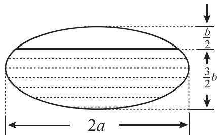

## (19) (本题满分 11 分)

设函数 $u = f(x, y)$ 具有二阶连续偏导数，且满足等式 $4 \frac{\partial^{2} u}{\partial x^{2}} + 12 \frac{\partial^{2} u}{\partial x \partial y} + 5 \frac{\partial^{2} u}{\partial y^{2}} = 0.$ 确定 a, b 的值，使等式在变换 $\xi = x + ay, \eta = x + by$ 下简化为 $\frac{\partial^{2} u}{\partial \xi \partial \eta} = 0.$

## (20) (本题满分 10 分)

计算二重积分 $I = \iint_{D} r^{2} \sin \theta \sqrt{1 - r^{2} \cos 2\theta} \mathrm{d}r \mathrm{d}\theta$ ，其中 $D = \left\{(r, \theta) \mid 0 \leqslant r \leqslant \sec \theta, 0 \leqslant \theta \leqslant \frac{\pi}{4} \right\}$ .

## (21) (本题满分 10 分)

设函数 $f(x)$ 在闭区间 $[0, 1]$ 上连续，在开区间 $(0, 1)$ 内可导，且 $f(0) = 0, f(1) = \frac{1}{3}$ . 证明：存在 $\xi \in \left(0, \frac{1}{2}\right), \eta \in \left(\frac{1}{2}, 1\right)$ ，使得： $f'(\xi) + f'(\eta) = \xi^2 + \eta^2$ .

(22) (本题满分 11 分)

设 $\mathbf{A} = \begin{pmatrix} \lambda & 1 & 1 \\ 0 & \lambda - 1 & 0 \\ 1 & 1 & \lambda \end{pmatrix}, \mathbf{b} = \begin{pmatrix} a \\ 1 \\ 1 \end{pmatrix}$ . 已知线性方程组 $Ax = b$ 存在两个不同的解.

( I ) 求 $\lambda$ , a;

(Ⅱ) 求方程组 Ax = b 的通解.

(23) (本题满分11分)

设 $A = \begin{pmatrix} 0 & -1 & 4 \\ -1 & 3 & a \\ 4 & a & 0 \end{pmatrix}$ ，正交矩阵 Q 使 $Q^{T}AQ$ 为对角矩阵，若 Q 的第 1 列为 $\frac{1}{\sqrt{6}}(1, 2, 1)^{\mathrm{T}}$ ，求 a, Q.

# 2011 年全国硕士研究生招生考试试题

## 一、选择题(本题共8小题,每小题4分,共32分.在每小题给出的四个选项中,只有一项符合题目要求,把所选项前的字母填在题后的括号内.)

(1) 已知当 $x \to 0$ 时, 函数 $f(x) = 3\sin x - \sin 3x$ 与 $cx^k$ 是等价无穷小量, 则 ( ) (A) $k = 1$ , $c = 4$ . (B) $k = 1$ , $c = -4$ . (C) $k = 3$ , $c = 4$ . (D) $k = 3$ , $c = -4$ .

(2) 设函数 $f(x)$ 在 x = 0 处可导，且 $f(0) = 0$ ，则 $\lim_{x \to 0} \frac{x^{2}f(x) - 2f(x^{3})}{x^{3}} = (\quad)$ (A) $-2f'(0)$ . (B) $-f'(0)$ . (C) $f'(0)$ . (D)0.

(3) 函数 $f(x) = \ln |(x - 1)(x - 2)(x - 3)|$ 的驻点个数为 ( )
(A)0.
(B)1.
(C)2.
(D)3.

(4) 微分方程 $y'' - \lambda^{2}y = e^{\lambda x} + e^{-\lambda x} (\lambda > 0)$ 的特解形式为( )
(A) $a(e^{\lambda x}+e^{-\lambda x}).$ (B) $ax(e^{\lambda x}+e^{-\lambda x}).$ (C) $x(ae^{\lambda x}+be^{-\lambda x}).$ (D) $x^{2}(ae^{\lambda x}+be^{-\lambda x}).$

(5) 设函数 $f(x)$ , $g(x)$ 均有二阶连续导数, 满足 $f(0) > 0$ , $g(0) < 0$ , 且 $f'(0) = g'(0) = 0$ , 则函数 $z = f(x)g(y)$ 在点 $(0, 0)$ 处取得极小值的一个充分条件是 ( )
(A) $f''(0)<0$ , $g''(0)>0.$ (B) $f''(0)<0$ , $g''(0)<0.$ (C) $f''(0)>0$ , $g''(0)>0.$ (D) $f''(0)>0$ , $g''(0)<0.$

(6) 设 $I = \int_{0}^{\frac{\pi}{4}} \ln(\sin x) \, dx$ , $J = \int_{0}^{\frac{\pi}{4}} \ln(\cot x) \, dx$ , $K = \int_{0}^{\frac{\pi}{4}} \ln(\cos x) \, dx$ , 则 I, J, K 的大小关系为 ( ) (A) I < J < K. (B) I < K < J. (C) J < I < K. (D) K < J < I.

(7) 设 A 为 3 阶矩阵, 将 A 的第 2 列加到第 1 列得矩阵 B, 再交换 B 的第 2 行与第 3 行得单位矩阵.
记 $P_{1}=\begin{pmatrix}1&0&0\\1&1&0\\0&0&1\end{pmatrix},P_{2}=\begin{pmatrix}1&0&0\\0&0&1\\0&1&0\end{pmatrix}$ ，则A=( )
(A) $P_{1}P_{2}$ . (B) $P_{1}^{-1}P_{2}$ . (C) $P_{2}P_{1}$ . (D) $P_{2}P_{1}^{-1}$ .

(8) 设 $A = (\alpha_{1}, \alpha_{2}, \alpha_{3}, \alpha_{4})$ 是 4 阶矩阵, $A^{*}$ 为 A 的伴随矩阵. 若 $(1, 0, 1, 0)^{\mathrm{T}}$ 是方程组 Ax = 0 的一个基础解系, 则 $A^{*}x = 0$ 的基础解系可为 ( )  
(A) $\alpha_{1}, \alpha_{3}.$ (B) $\alpha_{1}, \alpha_{2}.$ (C) $\alpha_{1}, \alpha_{2}, \alpha_{3}.$ (D) $\alpha_{2}, \alpha_{3}, \alpha_{4}.$

## 二、填空题(本题共6小题,每小题4分,共24分,把答案填在题中横线上.)

(9) $\lim_{x\to 0}\left(\frac{1 + 2^x}{2}\right)^{\frac{1}{x}} = \underline{\quad}.$

(10) 微分方程 $y' + y = e^{-x} \cos x$ 满足条件 $y(0) = 0$ 的解为 y = \_\_\_\_.

(11) 曲线 $y = \int_{0}^{x} \tan t \, dt \left( 0 \leqslant x \leqslant \frac{\pi}{4} \right)$ 的弧长 s = \_\_\_\_.

(12) 设函数 $f(x) = \begin{cases} \lambda e^{-\lambda x} & x > 0, \\ 0, & x \leqslant 0, \end{cases}$ $\lambda > 0$ ，则 $\int_{-\infty}^{+\infty} xf(x) \, dx =$ \_\_\_\_ .

(13) 设平面区域 D 由直线 y = x，圆 $x^{2} + y^{2} = 2y$ 及 y 轴所围成，则二重积分 $\iint_{D} xy \, dy \, d\sigma =$ \_\_\_\_ .

(14) 二次型 $f(x_{1}, x_{2}, x_{3}) = x_{1}^{2} + 3x_{2}^{2} + x_{3}^{2} + 2x_{1}x_{2} + 2x_{1}x_{3} + 2x_{2}x_{3}$ ，则 $f$ 的正惯性指数为 \_\_\_\_.

## 三、解答题(本题共9小题,共94分,解答应写出文字说明、证明过程或演算步骤.)

(15) (本题满分 10 分)

已知函数 $F(x) = \frac{\int_0^x\ln(1 + t^2)\mathrm{d}t}{x^\alpha}$ . 设 $\lim_{x\to +\infty}F(x) = \lim_{x\to 0^+}F(x) = 0$ ，试求 $\alpha$ 的取值范围.

## (16) (本题满分 11 分)

设函数 $y = y(x)$ 由参数方程 $\left\{\begin{aligned}x & = \frac{1}{3}t^{3} + t + \frac{1}{3},\\ y & = \frac{1}{3}t^{3} - t + \frac{1}{3}\end{aligned}\right.$ 确定，求 $y = y(x)$ 的极值和曲线 $y = y(x)$ 的凹凸区间及拐点.

## (17) (本题满分9分)

设函数 $z = f(xy, yg(x))$ ，其中函数 $f$ 具有二阶连续偏导数，函数 $g(x)$ 可导且在 $x = 1$ 处取得极值 $g(1) = 1$ ，求 $\frac{\partial^2 z}{\partial x \partial y} \bigg|_{\substack{x=1 \\ y=1}}$ .

## (18) (本题满分 10 分)

设函数 $y(x)$ 具有二阶导数,且曲线 $l: y = y(x)$ 与直线 y = x 相切于原点.记 $\alpha$ 为曲线 l 在点 $(x, y)$ 处切线的倾角,若 $\frac{d\alpha}{dx} = \frac{dy}{dx}$ ,求 $y(x)$ 的表达式.

## (19) (本题满分 10 分)

（Ⅰ）证明：对任意的正整数 n，都有 $\frac{1}{n+1} < \ln\left(1 + \frac{1}{n}\right) < \frac{1}{n}$ 成立；

(Ⅱ) 设 $a_{n} = 1 + \frac{1}{2} + \cdots + \frac{1}{n} - \ln n (n = 1, 2, \cdots)$ ，证明数列 $\{a_{n}\}$ 收敛.

(20) (本题满分 11 分)

一容器的内侧是由图中曲线绕 y 轴旋转一周而成的曲面, 该曲线由 $x^{2} + y^{2} = 2y \left( y \geqslant \frac{1}{2} \right)$ 与 $x^{2} + y^{2} = 1 \left( y \leqslant \frac{1}{2} \right)$ 连接而成.

(Ⅰ) 求容器的容积;

(Ⅱ) 若将容器内盛满的水从容器顶部全部抽出, 至少需要做多少功?

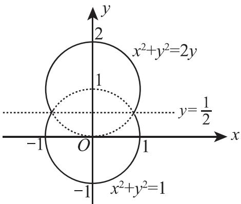

(长度单位: m, 重力加速度为 $g \, m/s^{2}$ , 水的密度为 $10^{3} \, kg/m^{3}$ )

## (21) (本题满分 11 分)

已知函数 $f(x, y)$ 具有二阶连续偏导数，且 $f(1, y) = f(x, 1) = 0, \iint_{D} f(x, y) \, \mathrm{d}x \, \mathrm{d}y = a$ ，其中 $D = \{(x, y) | 0 \leqslant x \leqslant 1, 0 \leqslant y \leqslant 1\}$ ，计算二重积分 $I = \iint_{D} xy f_{xy}''(x, y) \, \mathrm{d}x \, \mathrm{d}y$ .

## (22) (本题满分 11 分)

设向量组 $\boldsymbol{\alpha}_{1}=(1,0,1)^{\mathrm{T}},\boldsymbol{\alpha}_{2}=(0,1,1)^{\mathrm{T}},\boldsymbol{\alpha}_{3}=(1,3,5)^{\mathrm{T}}$ 不能由向量组 $\boldsymbol{\beta}_{1}=(1,1,1)^{\mathrm{T}}$ $\boldsymbol{\beta}_{2}=(1,2,3)^{\mathrm{T}},\boldsymbol{\beta}_{3}=(3,4,a)^{\mathrm{T}}$ 线性表示.

( I ) 求 a 的值;

(Ⅱ) 将 $\beta_{1}, \beta_{2}, \beta_{3}$ 用 $\alpha_{1}, \alpha_{2}, \alpha_{3}$ 线性表示.

## (23) (本题满分 11 分)

设 A 为 3 阶实对称矩阵, A 的秩为 2, 且

$$
\boldsymbol {A} \left( \begin{array}{c c} 1 & 1 \\ 0 & 0 \\ - 1 & 1 \end{array} \right) = \left( \begin{array}{c c} - 1 & 1 \\ 0 & 0 \\ 1 & 1 \end{array} \right).
$$

（Ⅰ）求 A 的所有特征值与特征向量；

(Ⅱ) 求矩阵 A.

# 2012 年全国硕士研究生招生考试试题

## 一、选择题(本题共8小题,每小题4分,共32分.在每小题给出的四个选项中,只有一项符合题目要求,把所选项前的字母填在题后的括号内.)

(1) 曲线 $y = \frac{x^{2} + x}{x^{2} - 1}$ 的渐近线的条数为( )
(A)0.
(B)1.
(C)2.
(D)3.

(2) 设函数 $f(x) = (\mathrm{e}^{x} - 1)(\mathrm{e}^{2x} - 2) \cdots (\mathrm{e}^{nx} - n)$ ，其中 n 为正整数，则 $f'(0) = (\quad)$ (A) $(-1)^{n-1}(n-1)!$ . (B) $(-1)^{n}(n-1)!$ .
(C) $(-1)^{n-1}n!$ . (D) $(-1)^{n}n!$ .

(3) 设 $a_{n} > 0 (n = 1, 2, \cdots)$ , $S_{n} = a_{1} + a_{2} + \cdots + a_{n}$ ，则数列 $\{S_{n}\}$ 有界是数列 $\{a_{n}\}$ 收敛的（）
(A) 充分必要条件.
(B) 充分非必要条件.
(C) 必要非充分条件.
(D) 既非充分也非必要条件.

(4) 设 $I_{k} = \int_{0}^{k\pi} e^{x^{2}} \sin x \, dx (k = 1, 2, 3)$ ，则有（）
(A) $I_{1}<I_{2}<I_{3}.$ (B) $I_{3}<I_{2}<I_{1}.$ (C) $I_{2}<I_{3}<I_{1}.$ (D) $I_{2}<I_{1}<I_{3}.$

(5) 设函数 $f(x, y)$ 可微，且对任意的 $x, y$ 都有 $\frac{\partial f(x, y)}{\partial x} > 0, \frac{\partial f(x, y)}{\partial y} < 0$ ，则使不等式 $f(x_1, y_1) < f(x_2, y_2)$ 成立的一个充分条件是（）  
(A) $x_1 > x_2, y_1 < y_2.$ (B) $x_1 > x_2, y_1 > y_2.$ (C) $x_1 < x_2, y_1 < y_2.$ (D) $x_1 < x_2, y_1 > y_2.$

(6) 设区域 D 由曲线 $y = \sin x, x = \pm \frac{\pi}{2}, y = 1$ 围成，则 $\iint_{D} (xy^{5} - 1) \, \mathrm{d}x \, \mathrm{d}y = (\quad)$ (A) $\pi.$ (B)2. (C)-2. (D)- $\pi.$

(7) 设 $\alpha_{1}=\begin{pmatrix}0\\0\\c_{1}\end{pmatrix},\alpha_{2}=\begin{pmatrix}0\\1\\c_{2}\end{pmatrix},\alpha_{3}=\begin{pmatrix}1\\-1\\c_{3}\end{pmatrix},\alpha_{4}=\begin{pmatrix}-1\\1\\c_{4}\end{pmatrix}$ ，其中 $c_{1},c_{2},c_{3},c_{4}$ 为任意常数，则下列向量
组线性相关的为（）
(A) $\alpha_{1},\alpha_{2},\alpha_{3}.$ (B) $\alpha_{1},\alpha_{2},\alpha_{4}.$ (C) $\alpha_{1},\alpha_{3},\alpha_{4}.$ (D) $\alpha_{2},\alpha_{3},\alpha_{4}.$

(8) 设 A 为 3 阶矩阵，P 为 3 阶可逆矩阵，且 $P^{-1}AP = \begin{pmatrix} 1 & 0 & 0 \\ 0 & 1 & 0 \\ 0 & 0 & 2 \end{pmatrix}$ . 若 $P = (\alpha_{1}, \alpha_{2}, \alpha_{3})$ ， $Q = (\alpha_{1} + \alpha_{2}, \alpha_{2}, \alpha_{3})$ ，则 $Q^{-1}AQ = (\quad)$ (A) $\begin{pmatrix} 1 & 0 & 0 \\ 0 & 2 & 0 \\ 0 & 0 & 1 \end{pmatrix}$ .

(B) $\begin{pmatrix} 1 & 0 & 0 \\ 0 & 1 & 0 \\ 0 & 0 & 2 \end{pmatrix}$ .

(C) $\begin{pmatrix} 2 & 0 & 0 \\ 0 & 1 & 0 \\ 0 & 0 & 2 \end{pmatrix}$ .

(D) $\begin{pmatrix} 2 & 0 & 0 \\ 0 & 2 & 0 \\ 0 & 0 & 1 \end{pmatrix}$ .

## 二、填空题(本题共6小题,每小题4分,共24分,把答案填在题本横线上)

(9) 设 $y = y(x)$ 是由方程 $x^2 - y + 1 = \mathrm{e}^y$ 所确定的隐函数, 则 $\frac{\mathrm{d}^2y}{\mathrm{d}x^2}\bigg|_{x=0} =$ \_\_\_\_.

(10) $\lim_{n\to \infty}n\left(\frac{1}{1 + n^2} +\frac{1}{2^2 + n^2} +\dots +\frac{1}{n^2 + n^2}\right) = \_$ .

(11) 设 $z = f\left(\ln x + \frac{1}{y}\right)$ ，其中函数 $f(u)$ 可微，则 $x\frac{\partial z}{\partial x} + y^{2}\frac{\partial z}{\partial y} =$ \_\_\_\_ .

(12) 微分方程 $y \, dx + (x - 3y^{2}) \, dy = 0$ 满足条件 $y \mid_{x=1} = 1$ 的解为 $y =$ \_\_\_\_ .

(13) 曲线 $y = x^{2} + x (x < 0)$ 上曲率为 $\frac{\sqrt{2}}{2}$ 的点的坐标是 \_\_\_\_.

(14) 设 A 为 3 阶矩阵, $\left|A\right|=3$ , $A^{*}$ 为 A 的伴随矩阵, 若交换 A 的第 1 行与第 2 行得矩阵 B, 则 $\left|BA^{*}\right|=$ \_\_\_\_.

## 三、解答题(本题共9小题,共94分,解答应写出文字说明、证明过程或演算步骤.)

(15) (本题满分 10 分)

已知函数 $f(x) = \frac{1 + x}{\sin x} - \frac{1}{x}$ ，记 $a = \lim_{x \to 0} f(x)$ .

( I ) 求 a 的值;

(Ⅱ) 若当 $x \to 0$ 时, $f(x) - a$ 与 $x^{k}$ 是同阶无穷小量, 求常数 k 的值.

## (16) (本题满分 10 分)

求函数 $f(x, y) = x \mathrm{e}^{-\frac{x^2 + y^2}{2}}$ 的极值.

(17) (本题满分 12 分)

过点(0, 1)作曲线 $L: y = \ln x$ 的切线, 切点为 $A$ , 又 $L$ 与 $x$ 轴交于 $B$ 点, 区域 $D$ 由 $L$ 与直线 $AB$ 围成. 求区域 $D$ 的面积及 $D$ 绕 $x$ 轴旋转一周所得旋转体的体积.

(18) (本题满分 10 分)

计算二重积分 $\iint_{D} xy \, \mathrm{d}\sigma$ ，其中区域 $D$ 由曲线 $r = 1 + \cos \theta (0 \leqslant \theta \leqslant \pi)$ 与极轴围成.

(19) (本题满分 10 分)

已知函数 $f(x)$ 满足方程 $f''(x) + f'(x) - 2f(x) = 0$ 及 $f''(x) + f(x) = 2\mathrm{e}^x$ .

( I ) 求 $f(x)$ 的表达式;

(Ⅱ) 求曲线 $y = f(x^{2}) \int_{0}^{x} f(-t^{2}) \, dt$ 的拐点.

(20) (本题满分 10 分)

证明: $x\ln\frac{1+x}{1-x}+\cos x\geqslant1+\frac{x^{2}}{2}(-1<x<1)$ .

(21) (本题满分 10 分)

（Ⅰ）证明方程 $x^{n} + x^{n-1} + \cdots + x = 1$ (n 为大于 1 的整数) 在区间 $\left(\frac{1}{2}, 1\right)$ 内有且仅有一个实根；

（Ⅱ）记（Ⅰ）中的实根为 $x_{n}$ ，证明 $\lim_{n\to \infty}x_n$ 存在，并求此极限.

(22) (本题满分11分)

设 $\mathbf{A} = \begin{pmatrix} 1 & a & 0 & 0 \\ 0 & 1 & a & 0 \\ 0 & 0 & 1 & a \\ a & 0 & 0 & 1 \end{pmatrix}, \boldsymbol{\beta} = \begin{pmatrix} 1 \\ -1 \\ 0 \\ 0 \end{pmatrix}$ .

（I）计算行列式 $|\mathbf{A}|$ ；

(Ⅱ) 当实数 a 为何值时, 方程组 Ax = $\beta$ 有无穷多解, 并求其通解.

(23) (本题满分11分)

已知 $\mathbf{A} = \begin{pmatrix} 1 & 0 & 1 \\ 0 & 1 & 1 \\ -1 & 0 & a \\ 0 & a & -1 \end{pmatrix}$ , 二次型 $f(x_{1}, x_{2}, x_{3}) = \mathbf{x}^{\mathrm{T}}(\mathbf{A}^{\mathrm{T}}\mathbf{A})\mathbf{x}$ 的秩为2.

（I）求实数 $a$ 的值；

（Ⅱ）求正交变换 x = Qy 将 f 化为标准形.

# 2013年全国硕士研究生招生考试试题

## 一、选择题(本题共8小题,每小题4分,共32分.在每小题给出的四个选项中,只有一项符合题目要求,把所选项前的字母填在题后的括号内.)

(1) 设 $\cos x - 1 = x \sin \alpha(x)$ ，其中 $\left|\alpha(x)\right| < \frac{\pi}{2}$ ，则当 $x \to 0$ 时， $\alpha(x)$ 是（）
(A) 比 x 高阶的无穷小量. (B) 比 x 低阶的无穷小量.
(C) 与 x 同阶但不等价的无穷小量. (D) 与 x 等价的无穷小量.

(2) 设函数 $y = f(x)$ 由方程 $\cos(xy) + \ln y - x = 1$ 确定，则 $\lim_{n \to \infty} n\left[f\left(\frac{2}{n}\right) - 1\right] = (\quad)$ (A)2.
(B)1.
(C)-1.
(D)-2.

$$
f (x) = \left\{ \begin{array}{l l} \sin x, & 0 \leqslant x <   \pi , \\ 2, & \pi \leqslant x \leqslant 2 \pi , \end{array} F (x) = \int_ {0} ^ {x} f (t) \mathrm{d} t \right.
$$

(4) 设函数 $f(x) = \begin{cases} \frac{1}{(x - 1)^{\alpha - 1}}, & 1 < x < \mathrm{e}, \\ \frac{1}{x\ln^{\alpha + 1}x}, & x \geqslant \mathrm{e}. \end{cases}$ 若反常积分 $\int_{1}^{+\infty} f(x) \, \mathrm{d}x$ 收敛，则（）(A) $\alpha < -2.$ (B) $\alpha > 2.$ (C) $-2 < \alpha < 0.$ (D) $0 < \alpha < 2.$

(5) 设 $z = \frac{y}{x} f(xy)$ ，其中函数 f 可微，则 $\frac{x}{y} \frac{\partial z}{\partial x} + \frac{\partial z}{\partial y} = (\quad)$ (A) $2yf'(xy)$ . (B) $-2yf'(xy)$ . (C) $\frac{2}{x}f(xy)$ . (D) $-\frac{2}{x}f(xy)$ .

(6) 设 $D_{k}$ 是圆域 $D = \{(x, y) \mid x^{2} + y^{2} \leqslant 1\}$ 在第 k 象限的部分. 记 $I_{k} = \iint_{D_{k}} (y - x) \, \mathrm{d}x \, \mathrm{d}y \, (k = 1, 2, 3, 4)$ , 则 ( )  
(A) $I_{1} > 0.$ (B) $I_{2} > 0.$ (C) $I_{3} > 0.$ (D) $I_{4} > 0.$

(7) 设 A, B, C 均为 n 阶矩阵. 若 AB = C, 且 B 可逆, 则 ( )
(A) 矩阵 C 的行向量组与矩阵 A 的行向量组等价.
(B) 矩阵 C 的列向量组与矩阵 A 的列向量组等价.
(C) 矩阵 C 的行向量组与矩阵 B 的行向量组等价.
(D) 矩阵 C 的列向量组与矩阵 B 的列向量组等价.

(8) 矩阵 $\begin{pmatrix}1 & a & 1 \\ a & b & a \\ 1 & a & 1\end{pmatrix}$ 与 $\begin{pmatrix}2 & 0 & 0 \\ 0 & b & 0 \\ 0 & 0 & 0\end{pmatrix}$ 相似的充分必要条件为（）  
(A) a = 0, b = 2. (B) a = 0, b 为任意常数.  
(C) a = 2, b = 0. (D) a = 2, b 为任意常数.

## 二、填空题(本题共6小题,每小题4分,共24分,把答案填在题本横线上.)

(9) $\lim_{x\to 0}\left[2 - \frac{\ln(1 + x)}{x}\right]^{\frac{1}{x}} = \underline{\quad}.$

(10) 设函数 $f(x) = \int_{-1}^{x} \sqrt{1 - e^{t}} dt$ ，则 $y = f(x)$ 的反函数 $x = f^{-1}(y)$ 在 y = 0 处的导数 $\frac{dx}{dy} \bigg|_{y=0} =$ \_\_\_\_.

(11) 设封闭曲线 L 的极坐标方程为 $r = \cos 3\theta \left( -\frac{\pi}{6} \leqslant \theta \leqslant \frac{\pi}{6} \right)$ ，则 L 所围平面图形的面积是 \_\_\_\_.

(12) 曲线 $\left\{\begin{aligned}x &= \arctan t, \\ y &= \ln \sqrt{1 + t^{2}}\end{aligned}\right.$ 上对应于 t = 1 的点处的法线方程为 \_\_\_\_.

(13) 已知 $y_{1} = \mathrm{e}^{3x} - x\mathrm{e}^{2x}, y_{2} = \mathrm{e}^{x} - x\mathrm{e}^{2x}, y_{3} = -x\mathrm{e}^{2x}$ 是某二阶常系数非齐次线性微分方程的3个解，则该方程满足条件 $y|_{x=0} = 0, y' |_{x=0} = 1$ 的解为 $y =$ \_\_\_\_.

(14) 设 $A = (a_{ij})$ 是 3 阶非零矩阵， $|A|$ 为 A 的行列式， $A_{ij}$ 为 $a_{ij}$ 的代数余子式。若 $a_{ij} + A_{ij} = 0$ $(i, j = 1, 2, 3)$ ，则 $|A| =$ \_\_\_\_ 。

## 三、解答题(本题共9小题,共94分,解答应写出文字说明、证明过程或演算步骤.)

(15) (本题满分 10 分)

当 $x \to 0$ 时, $1 - \cos x \cdot \cos 2x \cdot \cos 3x$ 与 $ax^n$ 为等价无穷小量, 求 $n$ 与 $a$ 的值.

## (16) (本题满分 10 分)

设 D 是由曲线 $y = x^{\frac{1}{3}}$ ，直线 $x = a (a > 0)$ 及 x 轴所围成的平面图形， $V_{x}$ ， $V_{y}$ 分别是 D 绕 x 轴，y 轴旋转一周所得旋转体的体积。若 $V_{y} = 10V_{x}$ ，求 a 的值。

## (17) (本题满分 10 分)

设平面区域 D 由直线 x = 3y, y = 3x 及 $x + y = 8$ 围成, 计算 $\iint_{D} x^{2} dx dy$ .

(18) (本题满分 10 分)

公众号：研池大叔 免费分享考研课程&书籍

设奇函数 $f(x)$ 在 $[-1, 1]$ 上具有2阶导数，且 $f(1) = 1$ . 证明：

( I ) 存在 $\xi \in (0, 1)$ ，使得 $f'(\xi) = 1$ ;

(Ⅱ) 存在 $\eta \in (-1, 1)$ ，使得 $f''(\eta) + f'(\eta) = 1$ .

(19) (本题满分 10 分)

求曲线 $x^{3} - xy + y^{3} = 1 (x \geqslant 0, y \geqslant 0)$ 上的点到坐标原点的最长距离和最短距离.

(20) (本题满分11分)

设函数 $f(x) = \ln x + \frac{1}{x}$ ,

( I ) 求 $f(x)$ 的最小值;

（Ⅱ）设数列 $\{x_{n}\}$ 满足 $\ln x_{n} + \frac{1}{x_{n + 1}} < 1$ ，证明 $\lim_{n\to \infty}x_n$ 存在，并求此极限.

## (21) (本题满分 11 分)

设曲线 $L$ 的方程为 $y = \frac{1}{4} x^2 -\frac{1}{2}\ln x(1\leqslant x\leqslant \mathrm{e})$

(Ⅰ) 求 L 的弧长;

（Ⅱ）设 D 是由曲线 L，直线 x = 1, x = e 及 x 轴所围平面图形，求 D 的形心的横坐标.

## (22) (本题满分11分)

设 $A = \begin{pmatrix} 1 & a \\ 1 & 0 \end{pmatrix}, B = \begin{pmatrix} 0 & 1 \\ 1 & b \end{pmatrix}$ . 当 a, b 为何值时, 存在矩阵 C 使得 AC - CA = B, 并求所有矩阵 C.

## (23) (本题满分11分)

设二次型 $f(x_{1},x_{2},x_{3}) = 2(a_{1}x_{1} + a_{2}x_{2} + a_{3}x_{3})^{2} + (b_{1}x_{1} + b_{2}x_{2} + b_{3}x_{3})^{2}$ ，记

$$
\boldsymbol {\alpha} = \left( \begin{array}{c} a _ {1} \\ a _ {2} \\ a _ {3} \end{array} \right), \qquad \boldsymbol {\beta} = \left( \begin{array}{c} b _ {1} \\ b _ {2} \\ b _ {3} \end{array} \right).
$$

（Ⅰ）证明二次型f对应的矩阵为 $2\alpha\alpha^{T}+\beta\beta^{T}$ ;

(Ⅱ) 若 $\alpha, \beta$ 正交且均为单位向量, 证明 f 在正交变换下的标准形为 $2y_{1}^{2} + y_{2}^{2}$ .

# 2014年全国硕士研究生招生考试试题

## 一、选择题(本题共8小题,每小题4分,共32分.在每小题给出的四个选项中,只有一项符合题目要求,把所选项前的字母填在题后的括号内.)

(1) 当 $x \to 0^{+}$ 时, 若 $\ln^{\alpha}(1 + 2x), (1 - \cos x)^{\frac{1}{\alpha}}$ 均是比 $x$ 高阶的无穷小量, 则 $\alpha$ 的取值范围是 ( ) (A) $(2, +\infty)$ . (B) $(1, 2)$ . (C) $\left(\frac{1}{2}, 1\right)$ . (D) $\left(0, \frac{1}{2}\right)$ .

(2) 下列曲线中有渐近线的是( )
(A) $y = x + \sin x.$ (B) $y = x^{2} + \sin x.$ (C) $y = x + \sin \frac{1}{x}.$ (D) $y = x^{2} + \sin \frac{1}{x}.$

(3) 设函数 $f(x)$ 具有 2 阶导数， $g(x) = f(0)(1 - x) + f(1)x$ ，则在区间 $[0, 1]$ 上，( )

(A) 当 $f'(x) \geqslant 0$ 时， $f(x) \geqslant g(x)$ .

(B) 当 $f'(x) \geqslant 0$ 时， $f(x) \leqslant g(x)$ .

(C) 当 $f''(x) \geqslant 0$ 时， $f(x) \geqslant g(x)$ .

(D) 当 $f''(x) \geqslant 0$ 时， $f(x) \leqslant g(x)$ .

(4) 曲线 $\left\{\begin{aligned}x &=t^{2}+7,\\ y &=t^{2}+4t+1\end{aligned}\right.$ 上对应于 t=1 的点处的曲率半径是（）
(A) $\frac{\sqrt{10}}{50}.$ (B) $\frac{\sqrt{10}}{100}.$ (C) $10\sqrt{10}.$ (D) $5\sqrt{10}.$

(5) 设函数 $f(x) = \arctan x$ . 若 $f(x) = xf'(\xi)$ , 则 $\lim_{x \to 0} \frac{\xi^{2}}{x^{2}} = (\quad)$ (A)1.
(B) $\frac{2}{3}.$ (C) $\frac{1}{2}.$ (D) $\frac{1}{3}.$

(6) 设函数 $u(x, y)$ 在有界闭区域 $D$ 上连续，在 $D$ 的内部具有 2 阶连续偏导数，且满足 $\frac{\partial^2 u}{\partial x \partial y} \neq 0$ 及 $\frac{\partial^2 u}{\partial x^2} + \frac{\partial^2 u}{\partial y^2} = 0$ ，则（ ）  
(A) $u(x, y)$ 的最大值和最小值都在 $D$ 的边界上取得.  
(B) $u(x, y)$ 的最大值和最小值都在 $D$ 的内部取得.  
(C) $u(x, y)$ 的最大值在 $D$ 的内部取得，最小值在 $D$ 的边界上取得.  
(D) $u(x, y)$ 的最小值在 $D$ 的内部取得，最大值在 $D$ 的边界上取得.

(7) 行列式 $\begin{vmatrix}0 & a & b & 0 \\ a & 0 & 0 & b \\ 0 & c & d & 0 \\ c & 0 & 0 & d\end{vmatrix}=()$ (A) $(ad-bc)^{2}.$ (B) $-(ad-bc)^{2}.$ (C) $a^{2}d^{2}-b^{2}c^{2}.$ (D) $b^{2}c^{2}-a^{2}d^{2}.$

(8) 设 $\alpha_{1}, \alpha_{2}, \alpha_{3}$ 均为 3 维向量，则对任意常数 k, l，向量组 $\alpha_{1} + k\alpha_{3}, \alpha_{2} + l\alpha_{3}$ 线性无关是向量组 $\alpha_{1}$ ， $\alpha_{2}, \alpha_{3}$ 线性无关的（）
(A) 必要非充分条件. (B) 充分非必要条件.
(C) 充分必要条件. (D) 既非充分也非必要条件.

## 二、填空题(本题共6小题,每小题4分,共24分,把答案填在题本横线上)

(9) $\int_{-\infty}^{1}\frac{1}{x^2 + 2x + 5}\mathrm{d}x = \underline{\quad}$ .

(10) 设 $f(x)$ 是周期为 4 的可导奇函数, 且 $f'(x) = 2(x - 1), x \in [0, 2]$ , 则 $f(7) = \_\_\_$ .

(11) 设 $z = z(x, y)$ 是由方程 $\mathrm{e}^{2yz} + x + y^2 + z = \frac{7}{4}$ 确定的函数, 则 $\mathrm{dz}\Big|_{\left(\frac{1}{2}, \frac{1}{2}\right)} = \_$ .

(12) 曲线 L 的极坐标方程是 $r = \theta$ ，则 L 在点 $(r, \theta) = \left(\frac{\pi}{2}, \frac{\pi}{2}\right)$ 处的切线的直角坐标方程是 \_\_\_\_.

(13) 一根长度为 1 的细棒位于 $x$ 轴的区间 $[0, 1]$ 上, 若其线密度 $\rho(x) = -x^2 + 2x + 1$ , 则该细棒的质心坐标 $\bar{x} = \_$ .

(14) 设二次型 $f(x_{1}, x_{2}, x_{3}) = x_{1}^{2} - x_{2}^{2} + 2ax_{1}x_{3} + 4x_{2}x_{3}$ 的负惯性指数为 1，则 a 的取值范围是 \_\_\_\_.

## 三、解答题(本题共9小题,共94分,解答应写出文字说明、证明过程或演算步骤.)

(15) (本题满分 10 分)

求极限 $\lim_{x\to+\infty}\frac{\int_{1}^{x}\left[t^{2}\left(\mathrm{e}^{\frac{1}{t}}-1\right)-t\right]\mathrm{d}t}{x^{2}\ln\left(1+\frac{1}{x}\right)}$ .

## (16) (本题满分 10 分)

已知函数 $y = y(x)$ 满足微分方程 $x^{2} + y^{2}y' = 1 - y'$ ，且 $y(2) = 0$ ，求 $y(x)$ 的极大值与极小值.

## (17) (本题满分 10 分)

设平面区域 $D = \{(x, y) \mid 1 \leqslant x^2 + y^2 \leqslant 4, x \geqslant 0, y \geqslant 0\}$ . 计算 $\iint_{D} \frac{x \sin(\pi \sqrt{x^2 + y^2})}{x + y} \mathrm{d}x \mathrm{d}y$ .

## (18) (本题满分 10 分)

设函数 $f(u)$ 具有2阶连续导数, $z = f(\mathrm{e}^{x}\cos y)$ 满足

$$
\frac {\partial^ {2} z}{\partial x ^ {2}} + \frac {\partial^ {2} z}{\partial y ^ {2}} = (4 z + \mathrm{e} ^ {x} \cos y) \mathrm{e} ^ {2 x}.
$$

若 $f(0)=0,f'(0)=0$ ,求 $f(u)$ 的表达式.

## (19) (本题满分 10 分)

设函数 $f(x)$ ， $g(x)$ 在区间 $[a, b]$ 上连续，且 $f(x)$ 单调增加， $0 \leqslant g(x) \leqslant 1$ . 证明：

( I ) $0 \leqslant \int_{a}^{x} g(t) \, dt \leqslant x - a, x \in [a, b]$ ;

(Ⅲ) $\int_{a}^{a + \int_{a}^{b}g(t)\mathrm{d}t}f(x)\mathrm{d}x\leqslant \int_{a}^{b}f(x)g(x)\mathrm{d}x.$

## (20) (本题满分 11 分)

设函数 $f(x) = \frac{x}{1 + x}, x \in [0, 1]$ . 定义函数列：

$$
f _ {1} (x) = f (x), \quad f _ {2} (x) = f \left(f _ {1} (x)\right), \quad \dots , \quad f _ {n} (x) = f \left(f _ {n - 1} (x)\right), \quad \dots .
$$

记 $S_{n}$ 是由曲线 $y = f_{n}(x)$ ，直线 $x = 1$ 及 $x$ 轴所围平面图形的面积. 求极限 $\lim_{n\to \infty}nS_n$

## (21) (本题满分 11 分)

已知函数 $f(x, y)$ 满足 $\frac{\partial f}{\partial y} = 2(y + 1)$ ，且 $f(y, y) = (y + 1)^2 - (2 - y)\ln y$ ，求曲线 $f(x, y) = 0$ 所围图形绕直线 $y = -1$ 旋转所成旋转体的体积.

(22) (本题满分 11 分)

设矩阵 $A = \begin{pmatrix} 1 & -2 & 3 & -4 \\ 0 & 1 & -1 & 1 \\ 1 & 2 & 0 & -3 \end{pmatrix}$ ，E 为 3 阶单位矩阵.

（I）求方程组 Ax = 0 的一个基础解系；

（Ⅱ）求满足 AB = E 的所有矩阵 B.

## (23) (本题满分11分)

证明 n 阶矩阵 $\begin{pmatrix}1&1&\cdots&1\\1&1&\cdots&1\\\vdots&\vdots&&\vdots\\1&1&\cdots&1\end{pmatrix}$ 与 $\begin{pmatrix}0&\cdots&0&1\\0&\cdots&0&2\\\vdots&&\vdots&\vdots\\0&\cdots&0&n\end{pmatrix}$ 相似.

# 2015 年全国硕士研究生招生考试试题

## 一、选择题(本题共8小题,每小题4分,共32分.在每小题给出的四个选项中,只有一项符合题目要求,把所选项前的字母填在题后的括号内.)

(1) 下列反常积分中收敛的是( )
(A) $\int_{2}^{+\infty}\frac{1}{\sqrt{x}}dx.$ (B) $\int_{2}^{+\infty}\frac{\ln x}{x}dx.$ (C) $\int_{2}^{+\infty}\frac{1}{x\ln x}dx.$ (D) $\int_{2}^{+\infty}\frac{x}{e^{x}}dx.$

(2) 函数 $f(x) = \lim_{t \to 0} \left(1 + \frac{\sin t}{x}\right)^{\frac{x^2}{t}}$ 在 $(-∞, +∞)$ 内 ( )
(A) 连续. (B) 有可去间断点. (C) 有跳跃间断点. (D) 有无穷间断点.

(3) 设函数 $f(x) = \begin{cases} x^{\alpha} \cos \frac{1}{x^{\beta}}, & x > 0, \\ 0, & x \leqslant 0 \end{cases} (\alpha > 0, \beta > 0)$ . 若 $f'(x)$ 在 $x = 0$ 处连续，则 ( ) (A) $\alpha - \beta > 1$ . (B) $0 < \alpha - \beta \leqslant 1$ . (C) $\alpha - \beta > 2$ . (D) $0 < \alpha - \beta \leqslant 2$ .

(4) 设函数在 $(-\infty, +\infty)$ 内连续, 其 2 阶导函数 $f''(x)$ 的图形如右图所示, 则曲线 $y = f(x)$ 的拐点个数为 ( )
(A)0.
(B)1.
(C)2.
(D)3.

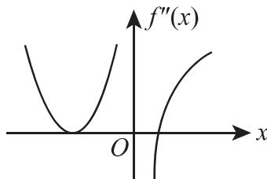

(5) 设函数 $f(u, v)$ 满足 $f\left(x + y, \frac{y}{x}\right) = x^{2} - y^{2}$ ，则 $\left.\frac{\partial f}{\partial u}\right|_{\substack{u=1 \\ v=1}}$ ， $\left.\frac{\partial f}{\partial v}\right|_{\substack{u=1 \\ v=1}}$ 依次是（）
(A) $\frac{1}{2},0.$ (B) $0,\frac{1}{2}.$ (C) $-\frac{1}{2},0.$ (D) $0,-\frac{1}{2}.$

(6) 设 $D$ 是第一象限中由曲线 $2xy = 1, 4xy = 1$ 与直线 $y = x, y = \sqrt{3}x$ 围成的平面区域，函数 $f(x, y)$ 在 $D$ 上连续，则 $\iint_{D} f(x, y) \mathrm{d}x \mathrm{d}y = (\quad)$ (A) $\int_{\frac{\pi}{4}}^{\frac{\pi}{3}} \mathrm{d}\theta \int_{\frac{1}{2\sin 2\theta}}^{\frac{1}{\sin 2\theta}} f(r\cos \theta, r\sin \theta) r \mathrm{d}r.$ (B) $\int_{\frac{\pi}{4}}^{\frac{\pi}{3}} \mathrm{d}\theta \int_{\frac{1}{\sqrt{2\sin 2\theta}}}^{\frac{1}{\sqrt{\sin 2\theta}}} f(r\cos \theta, r\sin \theta) r \mathrm{d}r.$ (C) $\int_{\frac{\pi}{4}}^{\frac{\pi}{3}} \mathrm{d}\theta \int_{\frac{1}{2\sin 2\theta}}^{\frac{1}{\sin 2\theta}} f(r\cos \theta, r\sin \theta) \mathrm{d}r.$ (D) $\int_{\frac{\pi}{4}}^{\frac{\pi}{3}} \mathrm{d}\theta \int_{\frac{1}{\sqrt{2\sin 2\theta}}}^{\frac{1}{\sqrt{\sin 2\theta}}} f(r\cos \theta, r\sin \theta) \mathrm{d}r.$

(7) 设矩阵 $A = \begin{pmatrix} 1 & 1 & 1 \\ 1 & 2 & a \\ 1 & 4 & a^{2} \end{pmatrix}$ ， $b = \begin{pmatrix} 1 \\ d \\ d^{2} \end{pmatrix}$ . 若集合 $\Omega = \{1, 2\}$ ，则线性方程组 Ax = b 有无穷多解的充分必要条件为（）

(A) $a \notin \Omega, d \notin \Omega.$ (B) $a \notin \Omega, d \in \Omega.$ (C) $a \in \Omega, d \notin \Omega.$ (D) $a \in \Omega, d \in \Omega.$

(8) 设二次型 $f(x_{1}, x_{2}, x_{3})$ 在正交变换 $x = Py$ 下的标准形为 $2y_{1}^{2} + y_{2}^{2} - y_{3}^{2}$ ，其中 $P = (e_{1}, e_{2}, e_{3})$ . 若 $Q = (e_{1}, -e_{3}, e_{2})$ ，则 $f(x_{1}, x_{2}, x_{3})$ 在正交变换 $x = Qy$ 下的标准形为（）

(A) $2y_{1}^{2}-y_{2}^{2}+y_{3}^{2}.$ (B) $2y_{1}^{2}+y_{2}^{2}-y_{3}^{2}.$ (C) $2y_{1}^{2}-y_{2}^{2}$ 公众号 $y_{3}^{2}$ 研池大叔免费分享考研课程&书籍

## 二、填空题(本题共6小题,每小题4分,共24分,把答案填在题中横线上.)

(9) 设 $\left\{\begin{aligned}x &= \arctan t, \\ y &= 3t + t^{3},\end{aligned}\right.$ 则 $\frac{d^{2}y}{dx^{2}}\bigg|_{t=1}=$ \_\_\_\_.

(10) 函数 $f(x) = x^{2}2^{x}$ 在 x = 0 处的 n 阶导数 $f^{(n)}(0) =$ \_\_\_\_.

(11) 设函数 $f(x)$ 连续, $\varphi(x)=\int_{0}^{x^{2}}xf(t)\mathrm{d}t.$ 若 $\varphi(1)=1,\varphi'(1)=5$ , 则 $f(1)=$ \_\_\_\_.

(12) 设函数 $y = y(x)$ 是微分方程 $y'' + y' - 2y = 0$ 的解, 且在 x = 0 处 $y(x)$ 取得极值 3, 则 $y(x) =$ \_\_\_\_.

(13) 若函数 $z = z(x, y)$ 由方程 $e^{x+2y+3z} + xyz = 1$ 确定，则 $dz\bigg|_{(0,0)} =$ \_\_\_\_.

（14）设3阶矩阵A的特征值为2，-2,1， $B=A^{2}-A+E$ ，其中E为3阶单位矩阵，则行列式 $|B|=$ \_\_\_\_.

## 三、解答题(本题共9小题,共94分,解答应写出文字说明、证明过程或演算步骤.)

(15) (本题满分 10 分)

设函数 $f(x) = x + a\ln (1 + x) + bx\sin x, g(x) = kx^3$ . 若 $f(x)$ 与 $g(x)$ 在 $x \to 0$ 时是等价无穷小, 求 $a, b, k$ 的值.

## (16) (本题满分 10 分)

设 A > 0, D 是由曲线段 $y = A \sin x \left(0 \leqslant x \leqslant \frac{\pi}{2}\right)$ 及直线 y = 0, $x = \frac{\pi}{2}$ 所围成的平面区域， $V_{1}, V_{2}$ 分别表示 D 绕 x 轴与绕 y 轴旋转所成旋转体的体积. 若 $V_{1} = V_{2}$ ，求 A 的值.

## (17) (本题满分 11 分)

已知函数 $f(x, y)$ 满足 $f_{xy}''(x, y) = 2(y + 1)\mathrm{e}^x$ , $f_x'(x, 0) = (x + 1)\mathrm{e}^x$ , $f(0, y) = y^2 + 2y$ , 求 $f(x, y)$ 的极值.

(18) (本题满分 10 分)

计算二重积分 $\iint_{D} x(x + y) \, \mathrm{d}x \, \mathrm{d}y$ ，其中 $D = \{(x, y) \mid x^2 + y^2 \leqslant 2, y \geqslant x^2\}$ .

(19) (本题满分 11 分)

已知函数 $f(x) = \int_{x}^{1}\sqrt{1 + t^{2}}\mathrm{d}t + \int_{1}^{x^{2}}\sqrt{1 + t}\mathrm{d}t$ ，求 $f(x)$ 零点的个数.

(20) (本题满分 10 分)

已知高温物体置于低温介质中,任一时刻该物体温度对时间的变化率与该时刻物体和介质的温差成正比.现将一初始温度为 $120^{\circ}$ C 的物体在 $20^{\circ}$ C 的恒温介质中冷却,30min 后该物体温度降至 $30^{\circ}$ C,若要将该物体的温度继续降至 $21^{\circ}$ C,还需冷却多长时间?

## (21) (本题满分 10 分)

已知函数 $f(x)$ 在区间 $[a, +\infty)$ 上具有2阶导数， $f(a) = 0, f'(x) > 0, f''(x) > 0.$ 设 $b > a$ ，曲线 $y = f(x)$ 在点 $(b, f(b))$ 处的切线与 $x$ 轴的交点是 $(x_0, 0)$ ，证明 $a < x_0 < b$ .

## (22) (本题满分11分)

设矩阵 $\mathbf{A} = \begin{pmatrix} a & 1 & 0 \\ 1 & a & -1 \\ 0 & 1 & a \end{pmatrix}$ , 且 $A^3 = O$ .

( I ) 求 a 的值;

(Ⅱ) 若矩阵 X 满足 $X - X A^{2} - A X + A X A^{2} = E$ ，其中 E 为 3 阶单位矩阵，求 X.

## (23) (本题满分11分)

设矩阵 $\mathbf{A} = \begin{pmatrix} 0 & 2 & -3 \\ -1 & 3 & -3 \\ 1 & -2 & a \end{pmatrix}$ 相似于矩阵 $\mathbf{B} = \begin{pmatrix} 1 & -2 & 0 \\ 0 & b & 0 \\ 0 & 3 & 1 \end{pmatrix}$ .

(Ⅰ) 求 a, b 的值;

(Ⅱ) 求可逆矩阵 P, 使 $P^{-1}AP$ 为对角矩阵.

# 2016年全国硕士研究生招生考试试题

## 一、选择题(本题共8小题,每小题4分,共32分.在每小题给出的四个选项中,只有一项符合题目要求,把所选项前的字母填在题后的括号内.)

(1) 设 $\alpha_{1}=x(\cos\sqrt{x}-1)$ , $\alpha_{2}=\sqrt{x}\ln(1+\sqrt[3]{x})$ , $\alpha_{3}=\sqrt[3]{x+1}-1$ . 当 $x\to0^{+}$ 时, 以上 3 个无穷小量按照从低阶到高阶的排序是( )
(A) $\alpha_{1},\alpha_{2},\alpha_{3}.$ (B) $\alpha_{2},\alpha_{3},\alpha_{1}.$ (C) $\alpha_{2},\alpha_{1},\alpha_{3}.$ (D) $\alpha_{3},\alpha_{2},\alpha_{1}.$

(2) 已知函数 $f(x) = \begin{cases} 2(x - 1), & x < 1, \\ \ln x, & x \geqslant 1, \end{cases}$ 则 $f(x)$ 的一个原函数是（）  
(A) $F(x) = \begin{cases} (x - 1)^2, & x < 1, \\ x(\ln x - 1), & x \geqslant 1. \end{cases}$ (B) $F(x) = \begin{cases} (x - 1)^2, & x < 1, \\ x(\ln x + 1) - 1, & x \geqslant 1. \end{cases}$ (C) $F(x) = \begin{cases} (x - 1)^2, & x < 1, \\ x(\ln x + 1) + 1, & x \geqslant 1. \end{cases}$ (D) $F(x) = \begin{cases} (x - 1)^2, & x < 1, \\ x(\ln x - 1) + 1, & x \geqslant 1. \end{cases}$

(3) 反常积分 ① $\int_{-\infty}^{0} \frac{1}{x^2} \mathrm{e}^{\frac{1}{x}} \mathrm{d}x$ , ② $\int_{0}^{+\infty} \frac{1}{x^2} \mathrm{e}^{\frac{1}{x}} \mathrm{d}x$ 的敛散性为 ( )

(A) ① 收敛, ② 收敛. (B) ① 收敛, ② 发散.

(C) ① 发散, ② 收敛. (D) ① 发散, ② 发散.

(4) 设函数 $f(x)$ 在 $(-∞, +∞)$ 内连续, 其导函数的图形如图所示, 则( )

(A) 函数 $f(x)$ 有 2 个极值点, 曲线 $y = f(x)$ 有 2 个拐点.

(B) 函数 $f(x)$ 有 2 个极值点, 曲线 $y = f(x)$ 有 3 个拐点.

(C) 函数 $f(x)$ 有 3 个极值点, 曲线 $y = f(x)$ 有 1 个拐点.

(D) 函数 $f(x)$ 有 3 个极值点, 曲线 $y = f(x)$ 有 2 个拐点.

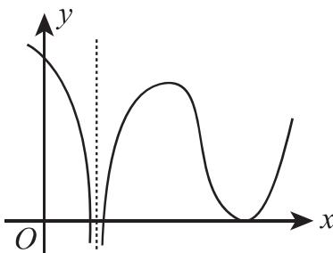

(5) 设函数 $f_{i}(x) (i = 1, 2)$ 具有二阶连续导数，且 $f_{i}''(x_0) < 0 (i = 1, 2)$ . 若两条曲线 $y = f_{i}(x) (i = 1, 2)$ 在点 $(x_0, y_0)$ 处具有公切线 $y = g(x)$ ，且在该点处曲线 $y = f_{1}(x)$ 的曲率大于曲线 $y = f_{2}(x)$ 的曲率，则在 $x_0$ 的某个邻域内，有（）  
(A) $f_{1}(x) \leqslant f_{2}(x) \leqslant g(x)$ . (B) $f_{2}(x) \leqslant f_{1}(x) \leqslant g(x)$ .  
(C) $f_{1}(x) \leqslant g(x) \leqslant f_{2}(x)$ . (D) $f_{2}(x) \leqslant g(x) \leqslant f_{1}(x)$ .

(6) 已知函数 $f(x, y) = \frac{\mathrm{e}^{x}}{x - y}$ ，则（）
(A) $f_{x}^{\prime}-f_{y}^{\prime}=0.$ (B) $f_{x}^{\prime}+f_{y}^{\prime}=0.$ (C) $f_{x}^{\prime}-f_{y}^{\prime}=f.$ (D) $f_{x}^{\prime}+f_{y}^{\prime}=f.$

(7) 设 A, B 是可逆矩阵, 且 A 与 B 相似, 则下列结论错误的是 ( )
(A) $A^{T}$ 与 $B^{T}$ 相似. (B) $A^{-1}$ 与 $B^{-1}$ 相似.
(C) $A + A^{T}$ 与 $B + B^{T}$ 相似. (D) $A + A^{-1}$ 与 $B + B^{-1}$ 相似.

(8) 设二次型 $f(x_{1}, x_{2}, x_{3}) = a(x_{1}^{2} + x_{2}^{2} + x_{3}^{2}) + 2x_{1}x_{2} + 2x_{2}x_{3} + 2x_{1}x_{3}$ 的正、负惯性指数分别为1, 2，则( )
(A) $a > 1.$ (B) $a < -2.$ (C) $-2 < a < 1.$ (D) $a = 1$ 或 $a = -2.$

## 二、填空题(本题共6小题,每小题4分,共24分,把答案填在题本横线上)

(9) 曲线 $y = \frac{x^{3}}{1 + x^{2}} + \arctan(1 + x^{2})$ 的斜渐近线方程为 \_\_\_\_.

(10) 极限 $\lim_{n\to\infty}\frac{1}{n^{2}}\left(\sin\frac{1}{n}+2\sin\frac{2}{n}+\cdots+n\sin\frac{n}{n}\right)=$ \_\_\_\_.

(11) 以 $y = x^2 - \mathrm{e}^x$ 和 $y = x^2$ 为特解的一阶非齐次线性微分方程为 \_\_\_\_.

(12) 已知函数 $f(x)$ 在 $(-∞, +∞)$ 上连续，且 $f(x) = (x + 1)^{2} + 2\int_{0}^{x}f(t)\mathrm{d}t$ ，则当 $n \geqslant 2$ 时， $f^{(n)}(0) =$ \_\_\_\_.

(13) 已知动点 P 在曲线 $y = x^{3}$ 上运动, 记坐标原点与点 P 间的距离为 l. 若点 P 的横坐标对时间的变化率为常数 $v_{0}$ , 则当点 P 运动到点 $(1, 1)$ 时, l 对时间的变化率是 \_\_\_\_.

(14) 设矩阵 $\begin{pmatrix} a & -1 & -1 \\ -1 & a & -1 \\ -1 & -1 & a \end{pmatrix}$ 与矩阵 $\begin{pmatrix} 1 & 1 & 0 \\ 0 & -1 & 1 \\ 1 & 0 & 1 \end{pmatrix}$ 等价, 则 a = \_\_\_\_.

## 三、解答题(本题共9小题,共94分,解答应写出文字说明、证明过程或演算步骤.)

(15) (本题满分 10 分)

求极限 $\lim_{x\to0}(\cos2x+2x\sin x)^{\frac{1}{x^{4}}}$ .

(16) (本题满分 10 分)

设函数 $f(x) = \int_{0}^{1} |t^{2} - x^{2}| \, \mathrm{d}t (x > 0)$ ，求 $f'(x)$ ，并求 $f(x)$ 的最小值.

(17) (本题满分 10 分)

已知函数 $z = z(x, y)$ 由方程 $(x^{2} + y^{2})z + \ln z + 2(x + y + 1) = 0$ 确定, 求 $z = z(x, y)$ 的极值.

## (18) (本题满分 10 分)

## 公众号：研池大叔 免费分享考研课程&书籍

设 D 是由直线 y = 1, y = x, y = -x 围成的有界区域, 计算二重积分 $\iint_{D} \frac{x^{2} - xy - y^{2}}{x^{2} + y^{2}} dx dy$ .

## (19) (本题满分 10 分)

已知 $y_{1}(x) = \mathrm{e}^{x}$ ， $y_{2}(x) = u(x)\mathrm{e}^{x}$ 是二阶微分方程 $(2x - 1)y'' - (2x + 1)y' + 2y = 0$ 的两个解。若 $u(-1) = \mathrm{e}$ ， $u(0) = -1$ ，求 $u(x)$ ，并写出该微分方程的通解。

## (20) (本题满分 11 分)

设 D 是由曲线 $y = \sqrt{1 - x^{2}} (0 \leqslant x \leqslant 1)$ 与 $\left\{\begin{aligned} x &= \cos^{3} t, \\ y &= \sin^{3} t \end{aligned}\right.$ $\left(0 \leqslant t \leqslant \frac{\pi}{2}\right)$ 围成的平面区域，求 D 绕 x 轴旋转一周所得旋转体的体积和表面积.

## (21) (本题满分 11 分)

已知函数 $f(x)$ 在 $\left[0, \frac{3\pi}{2}\right]$ 上连续，在 $\left(0, \frac{3\pi}{2}\right)$ 内是函数 $\frac{\cos x}{2x - 3\pi}$ 的一个原函数，且 $f(0) = 0$ .

（I）求 $f(x)$ 在区间 $\left[0, \frac{3\pi}{2}\right]$ 上的平均值；

（Ⅱ）证明 $f(x)$ 在区间 $\left(0, \frac{3\pi}{2}\right)$ 内存在唯一零点.

## (22) (本题满分11分)

设矩阵 $\mathbf{A} = \begin{pmatrix} 1 & 1 & 1 - a \\ 1 & 0 & a \\ a + 1 & 1 & a + 1 \end{pmatrix}, \boldsymbol{\beta} = \begin{pmatrix} 0 \\ 1 \\ 2a - 2 \end{pmatrix}$ , 且方程组 $Ax = \boldsymbol{\beta}$ 无解.

( I ) 求 a 的值;

(Ⅱ) 求方程组 $A^{T}Ax = A^{T}\beta$ 的通解.

## (23) (本题满分 11 分)

已知矩阵 $A = \begin{pmatrix} 0 & -1 & 1 \\ 2 & -3 & 0 \\ 0 & 0 & 0 \end{pmatrix}$ .

( I ) 求 $A^{99}$ ;

（Ⅱ）设3阶矩阵 $B=(\alpha_{1},\alpha_{2},\alpha_{3})$ 满足 $B^{2}=BA.$ 记 $B^{100}=(\beta_{1},\beta_{2},\beta_{3})$ ，将 $\beta_{1},\beta_{2},\beta_{3}$ 分别表示为 $\alpha_{1},\alpha_{2},\alpha_{3}$ 的线性组合.

# 2017年全国硕士研究生招生考试试题

## 一、选择题(本题共8小题,每小题4分,共32分.在每小题给出的四个选项中,只有一项符合题目要求,把所选项前的字母填在题后的括号内.)

(1) 若函数 $f(x)=\left\{\begin{aligned}&\frac{1-\cos\sqrt{x}}{ax},&x>0,\\&b,&x\leqslant0\end{aligned}\right.$ 在 x=0 处连续，则（） (A) $ab=\frac{1}{2}.$ (B) $ab=-\frac{1}{2}.$ (C) ab=0. (D) ab=2.

(2) 设二阶可导函数 $f(x)$ 满足 $f(1) = f(-1) = 1$ , $f(0) = -1$ 且 $f''(x) > 0$ , 则 ( )
(A) $\int_{-1}^{1}f(x)\mathrm{d}x>0.$ (B) $\int_{-1}^{1}f(x)\mathrm{d}x<0.$ (C) $\int_{-1}^{0}f(x)\mathrm{d}x>\int_{0}^{1}f(x)\mathrm{d}x.$ (D) $\int_{-1}^{0}f(x)\mathrm{d}x<\int_{0}^{1}f(x)\mathrm{d}x.$

(3) 设数列 $\{x_{n}\}$ 收敛, 则 ( )
(A) 当 $\lim_{n\to \infty}\sin x_n = 0$ 时, $\lim_{n\to \infty}x_n = 0$ .
(B) 当 $\lim_{n\to \infty}(x_n + \sqrt{|x_n|}) = 0$ 时, $\lim_{n\to \infty}x_n = 0$ .
(C) 当 $\lim_{n\to \infty}(x_n + x_n^2) = 0$ 时, $\lim_{n\to \infty}x_n = 0$ .
(D) 当 $\lim_{n\to \infty}(x_n + \sin x_n) = 0$ 时, $\lim_{n\to \infty}x_n = 0$ .

(4) 微分方程 $y'' - 4y' + 8y = e^{2x}(1 + \cos 2x)$ 的特解可设为 $y^{*} = (\quad)$ (A) $Ae^{2x} + e^{2x}(B\cos 2x + C\sin 2x)$ .

(B) $Axe^{2x} + e^{2x}(B\cos 2x + C\sin 2x)$ .

(C) $Ae^{2x} + xe^{2x}(B\cos 2x + C\sin 2x)$ .

(D) $Axe^{2x} + xe^{2x}(B\cos 2x + C\sin 2x)$ .

(5) 设 $f(x,y)$ 具有一阶偏导数, 且对任意的 $(x,y)$ , 都有 $\frac{\partial f(x,y)}{\partial x} > 0, \frac{\partial f(x,y)}{\partial y} < 0$ , 则 ( )  
(A) $f(0,0) > f(1,1)$ . (B) $f(0,0) < f(1,1)$ .
(C) $f(0,1)>f(1,0).$ (D) $f(0,1)<f(1,0).$

(6) 甲, 乙两人赛跑, 计时开始时, 甲在乙前方 10 (单位: m) 处, 图中, 实线表示甲的速度曲线 $v = v_{1}(t)$ (单位: m/s), 虚线表示乙的速度曲线 $v = v_{2}(t)$ ,

$v = v_{1}(t)$ （单位：m/s），虚线表示乙的速度曲线 $v = v_{2}(t)$ ，三块阴影部分面积的数值依次为 10,20,3. 计时开始后乙追上甲的时刻记为 $t_{0}$ （单位：s），则（）
(A) $t_{0} = 10$ .
(B) $15 < t_{0} < 20$ .
(C) $t_{0} = 25$ .
(D) $t_{0} > 25$ .

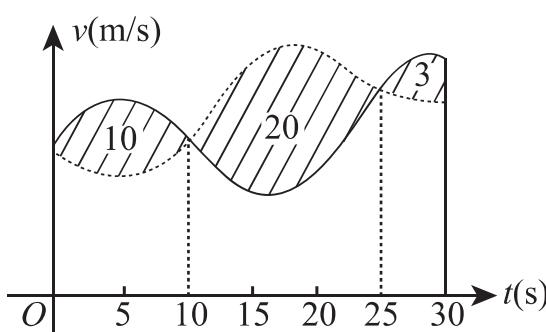

(7) 设 A 为 3 阶矩阵, $P = (\alpha_{1}, \alpha_{2}, \alpha_{3})$ 为可逆矩阵, 使得 $P^{-1}AP = \begin{pmatrix} 0 & 0 & 0 \\ 0 & 1 & 0 \\ 0 & 0 & 2 \end{pmatrix}$ , 则

$A(\alpha_{1} + \alpha_{2} + \alpha_{3}) = (\quad)$ 公众号：研池大叔免费分享考研课程&书籍
(A) $\alpha_{1}+\alpha_{2}.$ (B) $\alpha_{2}+2\alpha_{3}.$ (C) $\alpha_{2}+\alpha_{3}.$ (D) $\alpha_{1}+2\alpha_{2}.$

(8) 已知矩阵 $A = \begin{pmatrix} 2 & 0 & 0 \\ 0 & 2 & 1 \\ 0 & 0 & 1 \end{pmatrix}$ ， $B = \begin{pmatrix} 2 & 1 & 0 \\ 0 & 2 & 0 \\ 0 & 0 & 1 \end{pmatrix}$ ， $C = \begin{pmatrix} 1 & 0 & 0 \\ 0 & 2 & 0 \\ 0 & 0 & 2 \end{pmatrix}$ ，则（）
(A) A 与 C 相似, B 与 C 相似.
(B) A 与 C 相似, B 与 C 不相似.
(C) A 与 C 不相似, B 与 C 相似.
(D) A 与 C 不相似, B 与 C 不相似.

## 二、填空题(本题共6小题,每小题4分,共24分,把答案填在题中横线上.)

(9) 曲线 $y = x \left(1 + \arcsin \frac{2}{x}\right)$ 的斜渐近线方程为 \_\_\_\_.

(10) 设函数 $y = y(x)$ 由参数方程 $\left\{\begin{aligned} x &= t + e^{t}, \\ y &= \sin t \end{aligned}\right.$ 确定，则 $\frac{d^{2}y}{dx^{2}}\bigg|_{t=0} =$ \_\_\_\_.

(11) $\int_0^{+\infty}\frac{\ln(1 + x)}{(1 + x)^2}\mathrm{d}x = \underline{\quad}$ .

(12) 设函数 $f(x,y)$ 具有一阶连续偏导数，且 $\mathrm{d}f(x,y)=y\mathrm{e}^{y}\mathrm{d}x+x(1+y)\mathrm{e}^{y}\mathrm{d}y,f(0,0)=0$ ，则 $f(x,y)=$ \_\_\_\_.

(13) $\int_{0}^{1}\mathrm{d}y\int_{y}^{1}\frac{\tan x}{x}\mathrm{d}x =$

(14) 设矩阵 $A = \begin{pmatrix} 4 & 1 & -2 \\ 1 & 2 & a \\ 3 & 1 & -1 \end{pmatrix}$ 的一个特征向量为 $\begin{pmatrix} 1 \\ 1 \\ 2 \end{pmatrix}$ ，则 $a =$ \_\_\_\_ .

## 三、解答题(本题共9小题,共94分,解答应写出文字说明、证明过程或演算步骤.)

(15) (本题满分 10 分)

求 $\lim_{x\to 0^{+}}\frac{\int_0^x\sqrt{x - t}\mathrm{e}^t\mathrm{d}t}{\sqrt{x^3}}.$

(16) (本题满分 10 分)

设函数 $f(u,v)$ 具有2阶连续偏导数， $y = f(\mathrm{e}^x,\cos x)$ ，求 $\frac{\mathrm{dy}}{\mathrm{dx}}\bigg|_{x=0},\frac{\mathrm{d}^2y}{\mathrm{dx}^2}\bigg|_{x=0}$ .

(17) (本题满分 10 分)

公众号：研池大叔 免费分享考研课程&书籍

求 $\lim_{n\to\infty}\sum_{k=1}^{n}\frac{k}{n^{2}}\ln\left(1+\frac{k}{n}\right)$ .

## (18) (本题满分 10 分)

已知函数 $y(x)$ 由方程 $x^{3} + y^{3} - 3x + 3y - 2 = 0$ 确定, 求 $y(x)$ 的极值.

## (19) (本题满分 10 分)

设函数 $f(x)$ 在区间 $[0,1]$ 上具有2阶导数，且 $f(1) > 0$ ， $\lim_{x \to 0^{+}} \frac{f(x)}{x} < 0$ 。证明：

（Ⅰ）方程 $f(x)=0$ 在区间 $(0,1)$ 内至少存在一个实根；

(Ⅱ) 方程 $f(x)f''(x) + [f'(x)]^{2} = 0$ 在区间 $(0,1)$ 内至少存在两个不同实根.

## (20) (本题满分 11 分)

已知平面区域 $D = \{(x, y) \mid x^2 + y^2 \leqslant 2y\}$ ，计算二重积分 $\iint_{D} (x + 1)^2 \mathrm{d}x \mathrm{d}y$ .

## (21) (本题满分 11 分)

设 $y(x)$ 是区间 $\left(0, \frac{3}{2}\right)$ 内的可导函数，且 $y(1) = 0$ 。点 P 是曲线 $l: y = y(x)$ 上的任意一点，l 在点 P 处的切线与 y 轴相交于点 $(0, Y_{P})$ ，法线与 x 轴相交于点 $(X_{P}, 0)$ ，若 $X_{P} = Y_{P}$ ，求 l 上点的坐标 $(x, y)$ 满足的方程。

## (22) (本题满分 11 分)

设3阶矩阵 $A = (\alpha_{1},\alpha_{2},\alpha_{3})$ 有3个不同的特征值，且 $\alpha_{3} = \alpha_{1} + 2\alpha_{2}$

( I ) 证明 $r(A) = 2$ ;

(Ⅱ) 若 $\beta = \alpha_{1} + \alpha_{2} + \alpha_{3}$ ，求方程组 Ax = $\beta$ 的通解.

## (23) (本题满分11分)

设二次型 $f(x_{1},x_{2},x_{3})=2x_{1}^{2}-x_{2}^{2}+ax_{3}^{2}+2x_{1}x_{2}-8x_{1}x_{3}+2x_{2}x_{3}$ 在正交变换x=Qy下的标准形为 $\lambda_{1}y_{1}^{2}+\lambda_{2}y_{2}^{2}$ ，求a的值及一个正交矩阵Q.

# 2018年全国硕士研究生招生考试试题

## 一、选择题(本题共8小题,每小题4分,共32分.在每小题给出的四个选项中,只有一项符合题目要求,把所选项前的字母填在题后的括号内.)

(1) 若 $\lim_{x\to0}\left(\mathrm{e}^{x}+ax^{2}+bx\right)^{\frac{1}{x^{2}}}=1$ , 则 ( )
(A) $a=\frac{1}{2},b=-1.$ (B) $a=-\frac{1}{2},b=-1.$ (C) $a=\frac{1}{2},b=1.$ (D) $a=-\frac{1}{2},b=1.$

(2) 下列函数中, 在 $x = 0$ 处不可导的是 ( )
(A) $f(x) = |x|\sin |x|$ . (B) $f(x) = |x|\sin \sqrt{|x|}$ .
(C) $f(x) = \cos |x|$ . (D) $f(x) = \cos \sqrt{|x|}$ .

(3) 设函数 $f(x) = \begin{cases} -1, & x < 0, \\ 1, & x \geqslant 0, \end{cases}$ $g(x) = \begin{cases} 2 - ax, & x \leqslant -1, \\ x, & -1 < x < 0, \\ x - b, & x \geqslant 0. \end{cases}$ 若 $f(x) + g(x)$ 在 $\mathbf{R}$ 上连续，
则（）
(A) a = 3, b = 1.
(B) a = 3, b = 2.
(C) a = -3, b = 1.
(D) a = -3, b = 2.

(4) 设函数 $f(x)$ 在 $[0,1]$ 上二阶可导，且 $\int_0^1 f(x)\mathrm{d}x = 0$ ，则（A）当 $f'(x) < 0$ 时， $f\left(\frac{1}{2}\right) < 0.$ （B）当 $f''(x) < 0$ 时， $f\left(\frac{1}{2}\right) < 0.$ （C）当 $f'(x) > 0$ 时， $f\left(\frac{1}{2}\right) < 0.$ （D）当 $f''(x) > 0$ 时， $f\left(\frac{1}{2}\right) < 0.$

(5) 设 $M = \int_{-\frac{\pi}{2}}^{\frac{\pi}{2}} \frac{(1 + x)^{2}}{1 + x^{2}} \, dx$ , $N = \int_{-\frac{\pi}{2}}^{\frac{\pi}{2}} \frac{1 + x}{\mathrm{e}^{x}} \, dx$ , $K = \int_{-\frac{\pi}{2}}^{\frac{\pi}{2}} (1 + \sqrt{\cos x}) \, dx$ , 则 (A) M > N > K.
(B) M > K > N.
(C) K > M > N.
(D) K > N > M.

(6) $\int_{-1}^{0}\mathrm{d}x\int_{-x}^{2 - x^2}(1 - xy)\mathrm{d}y + \int_0^1\mathrm{d}x\int_x^{2 - x^2}(1 - xy)\mathrm{d}y = (\quad)$ (A) $\frac{5}{3}$ . (B) $\frac{5}{6}$ . (C) $\frac{7}{3}$ . (D) $\frac{7}{6}$ .

(7) 下列矩阵中, 与矩阵 $\begin{pmatrix}1 & 1 & 0 \\ 0 & 1 & 1 \\ 0 & 0 & 1\end{pmatrix}$ 相似的为 ( )

(A) $\begin{pmatrix}1 & 1 & -1 \\ 0 & 1 & 1 \\ 0 & 0 & 1\end{pmatrix}$ .

(B) $\begin{pmatrix}1 & 0 & -1 \\ 0 & 1 & 1 \\ 0 & 0 & 1\end{pmatrix}$ .

(C) $\begin{pmatrix}1&1&-1\\0&1&0\\0&0&1\end{pmatrix}.$ (D) $\begin{pmatrix}1&\text{公众号：研池大叔 免费分享考研课程}\&\text{书籍}\\0&1&0\\0&0&1\end{pmatrix}.$

(8) 设 A, B 为 n 阶矩阵, 记 $r(X)$ 为矩阵 X 的秩, $(X, Y)$ 表示分块矩阵, 则 ( )
(A) $r(A, AB) = r(A)$ . (B) $r(A, BA) = r(A)$ .
(C) $r(A,B)=\max\{r(A),r(B)\}$ . (D) $r(A,B)=r(A^{T},B^{T})$ .

## 二、填空题(本题共6小题,每小题4分,共24分,把答案填在题中横线上.)

(9) $\lim_{x\to +\infty}x^2 [\arctan (x + 1) - \arctan x] = \underline{\quad}$ .

(10) 曲线 $y = x^{2} + 2\ln x$ 在其拐点处的切线方程是 \_\_\_\_.

(11) $\int_{5}^{+\infty}\frac{1}{x^2 - 4x + 3}\mathrm{d}x =$

(12) 曲线 $\left\{\begin{aligned}x &= \cos^{3}t, \\ y &= \sin^{3}t\end{aligned}\right.$ 在 $t = \frac{\pi}{4}$ 对应点处的曲率为 \_\_\_\_.

(13) 设函数 $z = z(x, y)$ 由方程 $\ln z + \mathrm{e}^{z - 1} = xy$ 确定, 则 $\frac{\partial z}{\partial x}\bigg|_{(2, \frac{1}{2})} = \underline{\quad}$ .

(14) 设 A 为 3 阶矩阵, $\alpha_{1}, \alpha_{2}, \alpha_{3}$ 为线性无关的向量组. 若 $A\alpha_{1} = 2\alpha_{1} + \alpha_{2} + \alpha_{3}$ , $A\alpha_{2} = \alpha_{2} + 2\alpha_{3}$ , $A\alpha_{3} = -\alpha_{2} + \alpha_{3}$ , 则 A 的实特征值为 \_\_\_\_.

## 三、解答题(本题共9小题,共94分,解答应写出文字说明、证明过程或演算步骤.)

(15) (本题满分 10 分)

求不定积分 $\int \mathrm{e}^{2x}\arctan \sqrt{\mathrm{e}^x - 1}\mathrm{d}x.$

(16) (本题满分 10 分)

已知连续函数 $f(x)$ 满足 $\int_{0}^{x}f(t)\mathrm{d}t + \int_{0}^{x}tf(x - t)\mathrm{d}t = ax^{2}$ .

( I ) 求 $f(x)$ ;

(Ⅱ) 若 $f(x)$ 在区间 $[0,1]$ 上的平均值为 1, 求 a 的值.

## (17) (本题满分 10 分)

设平面区域 $D$ 由曲线 $\left\{ \begin{array}{l}x = t - \sin t,\\ y = 1 - \cos t \end{array} \right.$ （ $0\leqslant t\leqslant 2\pi$ ）与 $x$ 轴围成，计算二重积分 $\iint_{D}(x + 2y)\mathrm{d}x\mathrm{d}y.$

## (18) (本题满分 10 分)

已知常数 $k \geqslant \ln 2 - 1$ . 证明: $(x - 1)(x - \ln^2 x + 2k\ln x - 1) \geqslant 0$ .

## (19) (本题满分 10 分)

将长为 $2\mathrm{m}$ 的铁丝分成三段，依次围成圆、正方形与正三角形.三个图形的面积之和是否存在最小值?若存在，求出最小值

## (20) (本题满分 11 分)

已知曲线 $L: y = \frac{4}{9}x^{2}(x \geqslant 0)$ ，点 $O(0,0)$ ，点 $A(0,1)$ 。设 P 是 L 上的动点，S 是直线 OA 与直线 AP 及曲线 L 所围图形的面积。若 P 运动到点 $(3,4)$ 时沿 x 轴正向的速度是 4，求此时 S 关于时间 t 的变化率。

## (21) (本题满分 11 分)

设数列 $\{x_{n}\}$ 满足: $x_{1} > 0, x_{n}e^{x_{n+1}} = e^{x_{n}} - 1 (n = 1, 2, \cdots)$ . 证明 $\{x_{n}\}$ 收敛, 并求 $\lim_{n \to \infty} x_{n}$ .

## (22) (本题满分11分)

设实二次型 $f(x_{1},x_{2},x_{3})=(x_{1}-x_{2}+x_{3})^{2}+(x_{2}+x_{3})^{2}+(x_{1}+ax_{3})^{2}$ ，其中a是参数.

( I ) 求 $f(x_{1}, x_{2}, x_{3}) = 0$ 的解;

(Ⅱ) 求 $f(x_{1}, x_{2}, x_{3})$ 的规范形.

## (23) (本题满分 11 分)

已知 $a$ 是常数，且矩阵 $\mathbf{A} = \begin{pmatrix} 1 & 2 & a \\ 1 & 3 & 0 \\ 2 & 7 & -a \end{pmatrix}$ 可经初等列变换化为矩阵 $\mathbf{B} = \begin{pmatrix} 1 & a & 2 \\ 0 & 1 & 1 \\ -1 & 1 & 1 \end{pmatrix}$ .

( I ) 求 a;

(Ⅱ) 求满足 AP = B 的可逆矩阵 P.

# 2019年全国硕士研究生招生考试试题

## 一、选择题(本题共8小题,每小题4分,共32分.在每小题给出的四个选项中,只有一项符合题目要求,把所选项前的字母填在题后的括号内.)

(1) 当 $x \to 0$ 时, 若 $x - \tan x$ 与 $x^{k}$ 是同阶无穷小, 则 $k = (\quad)$ (A)1. (B)2. (C)3. (D)4.

(2) 曲线 $y = x \sin x + 2 \cos x \left(-\frac{\pi}{2} < x < 2\pi\right)$ 的拐点坐标为 ( )
(A) $(0,2)$ . (B) $(\pi,-2)$ . (C) $\left(\frac{\pi}{2},\frac{\pi}{2}\right)$ . (D) $\left(\frac{3\pi}{2},-\frac{3\pi}{2}\right)$ .

(3) 下列反常积分发散的是( )
(A) $\int_{0}^{+\infty}xe^{-x}dx.$ (B) $\int_{0}^{+\infty}xe^{-x^{2}}dx.$ (C) $\int_{0}^{+\infty}\frac{\arctan x}{1+x^{2}}dx.$ (D) $\int_{0}^{+\infty}\frac{x}{1+x^{2}}dx.$

(4) 已知微分方程 $y'' + ay' + by = ce^{x}$ 的通解为 $y = (C_{1} + C_{2}x)e^{-x} + e^{x}$ ，则 a、b、c 依次为（）
(A)1,0,1.
(B)1,0,2.
(C)2,1,3.
(D)2,1,4.

(5) 已知平面区域 $D = \left\{(x, y) \mid |x| + |y| \leqslant \frac{\pi}{2}\right\}$ , $I_1 = \iint_{D} \sqrt{x^2 + y^2} \mathrm{d}x \mathrm{d}y$ , $I_2 = \iint_{D} \sin \sqrt{x^2 + y^2} \mathrm{d}x \mathrm{d}y$ , $I_3 = \iint_{D} (1 - \cos \sqrt{x^2 + y^2}) \mathrm{d}x \mathrm{d}y$ , 则（ ）  
(A) $I_3 < I_2 < I_1$ . (B) $I_2 < I_1 < I_3$ .  
(C) $I_1 < I_2 < I_3$ . (D) $I_2 < I_3 < I_1$ .

(6) 已知 $f(x)$ ， $g(x)$ 2 阶可导且 2 阶导函数在 x = a 处连续，则 $\lim_{x \to a} \frac{f(x) - g(x)}{(x - a)^2} = 0$ 是曲线 $y = f(x)$ 和 $y = g(x)$ 在 x = a 对应的点处相切且曲率相等的（）

(A) 充分非必要条件.

(B) 充分必要条件.

(C) 必要非充分条件.

(D) 既非充分又非必要条件.

(7) 设 A 是 4 阶矩阵, $A^{*}$ 是 A 的伴随矩阵, 若线性方程组 Ax = 0 的基础解系中只有 2 个向量, 则 $r(A^{*}) = (\quad)$ (A)0. (B)1. (C)2. (D)3.

(8) 设 A 是 3 阶实对称矩阵, E 是 3 阶单位矩阵. 若 $A^{2} + A = 2E$ , 且 $|A| = 4$ , 则二次型 $x^{T}Ax$ 的规范形为 ( )
(A) $y_{1}^{2}+y_{2}^{2}+y_{3}^{2}.$ (B) $y_{1}^{2}+y_{2}^{2}-y_{3}^{2}.$ (C) $y_{1}^{2}-y_{2}^{2}-y_{3}^{2}.$ (D) $-y_{1}^{2}-y_{2}^{2}-y_{3}^{2}.$

## 二、填空题(本题共6小题,每小题4分,共24分,把答案填在题中横线上.)

(9) $\lim_{x\to 0}(x + 2^x)^{\frac{2}{x}} =$

(10) 曲线 $\left\{\begin{aligned}x &= t - \sin t, \\ y &= 1 - \cos t\end{aligned}\right.$ 在 $t = \frac{3\pi}{2}$ 对应点处的切线在 y 轴上的截距为 \_\_\_\_.

(11) 设函数 $f(u)$ 可导， $z = yf\left(\frac{y^2}{x}\right)$ ，则 $2x\frac{\partial z}{\partial x} + y\frac{\partial z}{\partial y} =$ \_\_\_\_。公众号：研池大叔 免费分享考研课程 & 书籍

(12) 曲线 $y = \ln \cos x \left(0 \leqslant x \leqslant \frac{\pi}{6}\right)$ 的弧长为 \_\_\_\_.

(13) 已知函数 $f(x) = x \int_{1}^{x} \frac{\sin t^2}{t} \, \mathrm{d}t$ ，则 $\int_{0}^{1} f(x) \, \mathrm{d}x = \underline{\quad}$ .

(14) 已知矩阵 $A = \begin{pmatrix} 1 & -1 & 0 & 0 \\ -2 & 1 & -1 & 1 \\ 3 & -2 & 2 & -1 \\ 0 & 0 & 3 & 4 \end{pmatrix}$ ， $A_{ij}$ 表示 $|A|$ 中 $(i, j)$ 元的代数余子式，则 $A_{11} - A_{12} =$ \_\_\_\_.

## 三、解答题(本题共9小题,共94分,解答应写出文字说明、证明过程或演算步骤.)

(15) (本题满分 10 分)

已知函数 $f(x) = \begin{cases} x^{2x}, & x > 0, \\ x\mathrm{e}^x + 1, & x \leqslant 0. \end{cases}$ 求 $f'(x)$ ，并求 $f(x)$ 的极值.

## (16) (本题满分 10 分)

求不定积分 $\int \frac{3x + 6}{(x - 1)^2(x^2 + x + 1)}\mathrm{d}x.$

## (17) (本题满分 10 分)

设函数 $y(x)$ 是微分方程 $y' - xy = \frac{1}{2\sqrt{x}}\mathrm{e}^{\frac{x^2}{2}}$ 满足条件 $y(1) = \sqrt{\mathrm{e}}$ 的特解.

( I ) 求 $y(x)$ ;

（Ⅱ）设平面区域 $D = \{(x, y) \mid 1 \leqslant x \leqslant 2, 0 \leqslant y \leqslant y(x)\}$ ，求 $D$ 绕 $x$ 轴旋转所得旋转体的体积.

(18) (本题满分 10 分)

公众号：研池大叔 免费分享考研课程&书籍

已知平面区域 $D = \{(x, y) | |x| \leqslant y, (x^2 + y^2)^3 \leqslant y^4\}$ ，计算二重积分 $\iint_{D} \frac{x + y}{\sqrt{x^2 + y^2}} \mathrm{d}x \mathrm{d}y.$

## (19) (本题满分 10 分)

设 n 为正整数, 记 $S_{n}$ 为曲线 $y = e^{-x} \sin x (0 \leqslant x \leqslant n\pi)$ 与 x 轴所围图形的面积, 求 $S_{n}$ , 并求 $\lim_{n \to \infty} S_{n}$ .

## (20) (本题满分 11 分)

已知函数 $u(x,y)$ 满足 $2\frac{\partial^2u}{\partial x^2} - 2\frac{\partial^2u}{\partial y^2} + 3\frac{\partial u}{\partial x} + 3\frac{\partial u}{\partial y} = 0$ ，求 $a,b$ 的值，使得在变换 $u(x,y) = v(x,y)\mathrm{e}^{ax + by}$ 下，上述等式可化为 $v(x,y)$ 不含一阶偏导数的等式.

## (21) (本题满分 11 分)

已知函数 $f(x)$ 在 $[0,1]$ 上具有2阶导数，且 $f(0) = 0, f(1) = 1, \int_{0}^{1} f(x) \, \mathrm{d}x = 1$ ，证明：

( I ) 存在 $\xi \in (0,1)$ ，使得 $f'(\xi) = 0$ ;

(Ⅱ) 存在 $\eta \in (0,1)$ ，使得 $f''(\eta) < -2$ .

## (22) (本题满分 11 分)

已知向量组 $\mathbf{I}:\pmb{\alpha}_{1} = \begin{pmatrix} 1\\ 1\\ 4 \end{pmatrix},\pmb{\alpha}_{2} = \begin{pmatrix} 1\\ 0\\ 4 \end{pmatrix},\pmb{\alpha}_{3} = \begin{pmatrix} 1\\ 2\\ a^{2} + 3 \end{pmatrix}$ 与 $\mathrm{II}:\pmb{\beta}_{1} = \begin{pmatrix} 1\\ 1\\ a + 3 \end{pmatrix},\pmb{\beta}_{2} = \begin{pmatrix} 0\\ 2\\ 1 - a \end{pmatrix},$ $\pmb{\beta}_{3} = \begin{pmatrix} 1\\ 3\\ a^{2} + 3 \end{pmatrix}$ . 若向量组 $\mathbf{I}$ 与 $\mathrm{II}$ 等价，求 $a$ 的取值，并将 $\pmb{\beta}_{3}$ 用 $\alpha_{1},\alpha_{2},\alpha_{3}$ 线性表示.

## (23) (本题满分 11 分)

( I ) 求 x, y;

已知矩阵 $\mathbf{A} = \begin{pmatrix} -2 & -2 & 1 \\ 2 & x & -2 \\ 0 & 0 & -2 \end{pmatrix}$ 与 $\mathbf{B} = \begin{pmatrix} 2 & 1 & 0 \\ 0 & -1 & 0 \\ 0 & 0 & y \end{pmatrix}$ 相似.

(Ⅱ) 求可逆矩阵 P, 使得 $P^{-1}AP = B$ .

# 2020 年全国硕士研究生招生考试

# 数学 (二)

(科目代码:302)

## 一、选择题(1～8小题,每小题4分,共32分.下列每题给出的四个选项中,只有一个选项是符合题目要求的,请将所选项前的字母写在题后的括号内.)

(1) 当 $x \to 0^{+}$ 时, 下列无穷小量中最高阶的是 ( ).  
(A) $\int_{0}^{x} (\mathrm{e}^{t^{2}} - 1) \, \mathrm{d}t$ (B) $\int_{0}^{x} \ln(1 + \sqrt{t^{3}}) \, \mathrm{d}t$ (C) $\int_{0}^{\sin x} \sin t^{2} \, \mathrm{d}t$ (D) $\int_{0}^{1 - \cos x} \sqrt{\sin^{3} t} \, \mathrm{d}t$

(2) $f(x) = \frac{\mathrm{e}^{\frac{1}{x - 1}}\ln|1 + x|}{(\mathrm{e}^x - 1)(x - 2)}$ 的第二类间断点的个数为（ ）. (A)1 (B)2 (C)3 (D)4

(3) $\int_{0}^{1}\frac{\arcsin\sqrt{x}}{\sqrt{x(1 - x)}}\mathrm{d}x = (\quad)$ . (A) $\frac{\pi^2}{4}$ (B) $\frac{\pi^2}{8}$ (C) $\frac{\pi}{4}$ (D) $\frac{\pi}{8}$

(4) 设 $f(x)=x^{2}\ln(1-x)$ ，当 $n\geqslant3$ 时， $f^{(n)}(0)=(\quad)$ .
(A) $-\frac{n!}{n-2}$ (B) $\frac{n!}{n-2}$ (C) $-\frac{(n-2)!}{n}$ (D) $\frac{(n-2)!}{n}$

(5) 关于函数 $f(x,y)=\left\{\begin{aligned}xy,&xy\neq0,\\ x,&y=0,\\ y,&x=0,\end{aligned}\right.$ 给出如下结论
① $\left.\frac{\partial f}{\partial x}\right|_{(0,0)}=1;$ ② $\left.\frac{\partial^{2}f}{\partial x\partial y}\right|_{(0,0)}=1;$ ③ $\lim_{(x,y)\to(0,0)}f(x,y)=0;$ ④ $\liminf_{y\to0}\limits_{x\to0}f(x,y)=0.$

其中正确的个数是( ).  
(A)4 (B)3 (C)2 (D)1(6) 设函数 $f(x)$ 在 $[-2,2]$ 上可导，且 $f'(x) > f(x) > 0$ ，则（）.
(A) $\frac{f(-2)}{f(-1)}>1$ (B) $\frac{f(0)}{f(-1)}>e$ (C) $\frac{f(1)}{f(-1)}<e^{2}$ (D) $\frac{f(2)}{f(-1)}<e^{3}$

(7) 设 4 阶矩阵 $A = (a_{ij})_{4 \times 4}$ 不可逆, $a_{12}$ 的代数余子式 $A_{12} \neq 0, \alpha_1, \alpha_2, \alpha_3, \alpha_4$ 为矩阵 $A$ 的列向量组, $A^*$ 为 $A$ 的伴随矩阵, 则方程组 $A^* X = 0$ 的通解为 ( ).  
(A) $X = k_1 \alpha_1 + k_2 \alpha_2 + k_3 \alpha_3$ , 其中 $k_1, k_2, k_3$ 为任意常数  
(B) $X = k_1 \alpha_1 + k_2 \alpha_2 + k_3 \alpha_4$ , 其中 $k_1, k_2, k_3$ 为任意常数  
(C) $X = k_1 \alpha_1 + k_2 \alpha_3 + k_3 \alpha_4$ , 其中 $k_1, k_2, k_3$ 为任意常数  
(D) $X = k_1 \alpha_2 + k_2 \alpha_3 + k_3 \alpha_4$ , 其中 $k_1, k_2, k_3$ 为任意常数

(8) 设 A 为 3 阶矩阵, $\alpha_{1}, \alpha_{2}$ 为 A 的属于特征值 1 的线性无关的特征向量, $\alpha_{3}$ 为 A 的属于特征值 -1 的特征向量, 则使得 $P^{-1}AP = \begin{pmatrix} 1 & 0 & 0 \\ 0 & -1 & 0 \\ 0 & 0 & 1 \end{pmatrix}$ 的可逆矩阵 P 为 ( ).

(A) $(\boldsymbol{\alpha}_{1} + \boldsymbol{\alpha}_{3}, \boldsymbol{\alpha}_{2}, -\boldsymbol{\alpha}_{3})$ (B) $(\boldsymbol{\alpha}_{1} + \boldsymbol{\alpha}_{2}, \boldsymbol{\alpha}_{2}, -\boldsymbol{\alpha}_{3})$ (C) $(\boldsymbol{\alpha}_{1} + \boldsymbol{\alpha}_{3}, -\boldsymbol{\alpha}_{3}, \boldsymbol{\alpha}_{2})$ (D) $(\boldsymbol{\alpha}_{1} + \boldsymbol{\alpha}_{2}, -\boldsymbol{\alpha}_{3}, \boldsymbol{\alpha}_{2})$

## 二、填空题(9～14小题,每小题4分,共24分.请将答案写在题中的横线上.)

(9) 设 $\left\{\begin{aligned} x &= \sqrt{t^{2}+1}, \\ y &= \ln(t + \sqrt{t^{2}+1})\end{aligned}\right.$ ，则 $\frac{d^{2}y}{dx^{2}}\bigg|_{t=1}=$ \_\_\_\_.

(10) $\int_{0}^{1}\mathrm{d}y\int_{\sqrt{y}}^{1}\sqrt{x^{3}+1}\mathrm{d}x=$ \_\_\_\_.

(11) 设 $z = \arctan[xy + \sin(x + y)]$ ，则 $\mathrm{d}z|_{(0,\pi)} =$ \_\_\_\_ .

(12) 斜边长为 2a 的等腰直角三角形平板铅直地沉入水中, 且斜边与水面相齐, 记重力加速度为 g, 水密度为 $\rho$ , 则该平板一侧所受的水压力为 \_\_\_\_.

(13) 设 $y = y(x)$ 满足 $y'' + 2y' + y = 0$ ，且 $y(0) = 0, y'(0) = 1$ ，则 $\int_{0}^{+\infty} y(x) \, dx =$ \_\_\_\_.

(14) 行列式 $\begin{vmatrix} a & 0 & -1 & 1 \\ 0 & a & 1 & -1 \\ -1 & 1 & a & 0 \\ 1 & -1 & 0 & a \end{vmatrix} =$ \_\_\_\_.

## 三、解答题(15～23小题,共94分.解答应写出文字说明、证明过程或演算步骤.)

(15)(本题满分10分)

求曲线 $y=\frac{x^{1+x}}{(1+x)^{x}}(x>0)$ 的斜渐近线方程.

## (16)(本题满分10分)

已知函数 $f(x)$ 连续且 $\lim_{x\to 0}\frac{f(x)}{x} = 1,g(x) = \int_0^1 f(xt)\mathrm{d}t$ ，求 $g^{\prime}(x)$ ，并证明 $g^{\prime}(x)$ 在 $x = 0$ 处连续.

## (17)(本题满分10分)

求函数 $f(x,y)=x^{3}+8y^{3}-xy$ 的极值.

## (18)(本题满分10分)

设函数 $f(x)$ 的定义域为 $(0, +\infty)$ 且满足 $2f(x) + x^{2}f\left(\frac{1}{x}\right) = \frac{x^{2} + 2x}{\sqrt{1 + x^{2}}}$ ，求 $f(x)$ ，并求曲线 $y = f(x)$ ， $y = \frac{1}{2}$ ， $y = \frac{\sqrt{3}}{2}$ 及 y 轴所围图形绕 x 轴旋转所成旋转体的体积.

## (19)(本题满分10分)

平面区域 D 由直线 x=1, x=2, y=x 与 x 轴围成，计算 $\iint_{D}\frac{\sqrt{x^{2}+y^{2}}}{x}dx dy$ .

## (20)(本题满分11分)

设 $f(x) = \int_{1}^{x}\mathrm{e}^{t^2}\mathrm{d}t.$

（I）证明：存在 $\xi \in (1,2)$ ，使得 $f(\xi) = (2 - \xi)\mathrm{e}^{\xi^2}$

（Ⅱ）证明：存在 $\eta\in(1,2)$ ，使得 $f(2)=\ln2\cdot\eta e^{\eta^{2}}$

## (21)(本题满分11分)

设曲线 $y=f(x)$ 可导，且 $f'(x)>0$ ，曲线 $y=f(x)(x\geqslant0)$ 经过坐标原点 O，其上任意一点 M 处的切线与 x 轴交于 T，又 MP 垂直 x 轴于点 P，已知由曲线 $y=f(x)$ ，直线 MP 以及 x 轴所围图形的面积与 $\triangle MTP$ 的面积之比恒为 3:2，求满足上述条件的曲线方程.

## (22)(本题满分11分)

设二次型 $f(x_{1},x_{2},x_{3}) = x_{1}^{2} + x_{2}^{2} + x_{3}^{2} + 2ax_{1}x_{2} + 2ax_{1}x_{3} + 2ax_{2}x_{3}$ 经可逆线性变换 $\begin{bmatrix} x_1 \\ x_2 \\ x_3 \\ x_4 \end{bmatrix} = P \begin{bmatrix} y_1 \\ y_2 \\ y_3 \\ y_4 \end{bmatrix}$ 化为二次型 $g(y_{1},y_{2},y_{3}) = y_{1}^{2} + y_{2}^{2} + 4y_{3}^{2} + 2y_{1}y_{2}$ .

(I) 求 $a$ 的值；

(Ⅱ) 求可逆矩阵 P.

(23)(本题满分11分)

设 A 为 2 阶矩阵, $P = (\alpha, A\alpha)$ , 其中 $\alpha$ 是非零向量且不是 A 的特征向量.

（Ⅰ）证明：P 为可逆矩阵；

（Ⅱ）若 $A^{2}\alpha + A\alpha - 6\alpha = 0$ ，求 $P^{-1}AP$ ，并判断 A 是否相似于对角矩阵.

# 2021年全国硕士研究生招生考试

# 数学 (二)

(科目代码:302)

## 一、选择题(1～10小题,每小题5分,共50分.下列每题给出的四个选项中,只有一个选项是符合题目要求的,请将所选项前的字母写在题后的括号内.)

(1) 当 $x \to 0$ 时, $\int_{0}^{x^{2}} (\mathrm{e}^{t^{3}} - 1) \, \mathrm{d}t$ 是 $x^{7}$ 的 ( ) .
(A) 低阶无穷小 (B) 等价无穷小
(C) 高阶无穷小 (D) 同阶但非等价无穷小

(2) 函数 $f(x)=\left\{\begin{aligned}&\frac{\mathrm{e}^{x}-1}{x},&x\neq0,\\ &1,&x=0\end{aligned}\right.$ 在 x=0 处（）.
(A) 连续且取最大值 (B) 连续且取最小值
(C) 可导且导数等于零 (D) 可导且导数不为零

(3)有一圆柱体,底面半径与高随时间变化的速率分别为2 cm/s,-3 cm/s,当底面半径为10 cm,高为5 cm时,圆柱体的体积与表面积随时间变化的速率分别为( ).
(A) $125\pi\ cm^{3}/s$ , $40\pi\ cm^{2}/s$ (B) $125\pi\ cm^{3}/s$ , $-40\pi\ cm^{2}/s$ (C) $-100\pi\ cm^{3}/s$ , $40\pi\ cm^{2}/s$ (D) $-100\pi\ cm^{3}/s$ , $-40\pi\ cm^{2}/s$

(4) 设函数 $f(x)=ax-b\ln x(a>0)$ 有两个零点，则 $\frac{b}{a}$ 的取值范围是 ( ). 
(A) $(e,+\infty)$ (B) $(0,e)$ (C) $\left(0,\frac{1}{e}\right)$ (D) $\left(\frac{1}{e},+\infty\right)$

(5) 设函数 $f(x)=\sec x$ 在 x=0 处的 2 次泰勒多项式为 $1+ax+bx^{2}$ ，则（）.
(A) $a=1,b=-\frac{1}{2}$ (B) $a=1,b=\frac{1}{2}$ (C) $a=0,b=-\frac{1}{2}$ (D) $a=0,b=\frac{1}{2}$

(6) 设函数 $f(x, y)$ 可微，且 $f(x + 1, e^{x}) = x(x + 1)^{2}$ ， $f(x, x^{2}) = 2x^{2}\ln x$ ，则 $\mathrm{d}f(1, 1) = (\quad)$ .
(A) $dx+dy$ (B)dx-dy (C)dy (D)-dy

(7) 设函数 $f(x)$ 在 $[0,1]$ 上连续，则 $\int_{0}^{1} f(x) \, dx = (\quad)$ .
(A) $\lim_{n\to\infty}\sum_{k=1}^{n}f\left(\frac{2k-1}{2n}\right)\frac{1}{2n}$ (B) $\lim_{n\to\infty}\sum_{k=1}^{n}f\left(\frac{2k-1}{2n}\right)\frac{1}{n}$ (C) $\lim_{n\to\infty}\sum_{k=1}^{2n}f\left(\frac{k-1}{2n}\right)\frac{1}{n}$ (D) $\lim_{n\to\infty}\sum_{k=1}^{2n}f\left(\frac{k}{2n}\right)\frac{2}{n}$

(8) 设二次型 $f(x_{1}, x_{2}, x_{3}) = (x_{1} + x_{2})^{2} + (x_{2} + x_{3})^{2} - (x_{3} - x_{1})^{2}$ 的正惯性指数与负惯性指数依次为（）.
(A)2,0 (B)1,1 (C)2,1 (D)1,2

(9) 设 3 阶矩阵 $A = (\alpha_{1}, \alpha_{2}, \alpha_{3}), B = (\beta_{1}, \beta_{2}, \beta_{3})$ ，若向量组 $\alpha_{1}, \alpha_{2}, \alpha_{3}$ 可以由向量组 $\beta_{1}, \beta_{2}, \beta_{3}$ 线性表出，则（ ）.
(A) $AX = 0$ 的解均为 $BX = 0$ 的解
(B) $A^{\mathrm{T}}X = 0$ 的解均为 $B^{\mathrm{T}}X = 0$ 的解
(C) $BX = 0$ 的解均为 $AX = 0$ 的解
(D) $B^{\mathrm{T}}X = 0$ 的解均为 $A^{\mathrm{T}}X = 0$ 的解

(10) 已知矩阵 $A = \begin{pmatrix} 1 & 0 & -1 \\ 2 & -1 & 1 \\ -1 & 2 & -5 \end{pmatrix}$ ，若存在下三角可逆矩阵 P 和上三角可逆矩阵 Q，使得 PAQ 为对角矩阵，则 P, Q 分别可以取（）.
(A) $\begin{pmatrix}1&0&0\\0&1&0\\0&0&1\end{pmatrix},\begin{pmatrix}1&0&1\\0&1&3\\0&0&1\end{pmatrix}$ (B) $\begin{pmatrix}1&0&0\\2&-1&0\\-3&2&1\end{pmatrix},\begin{pmatrix}1&0&0\\0&1&0\\0&0&1\end{pmatrix}$ (C) $\begin{pmatrix}1&0&0\\2&-1&0\\-3&2&1\end{pmatrix},\begin{pmatrix}1&0&1\\0&1&3\\0&0&1\end{pmatrix}$ (D) $\begin{pmatrix}1&0&0\\0&1&0\\1&3&1\end{pmatrix},\begin{pmatrix}1&2&-3\\0&-1&2\\0&0&1\end{pmatrix}$

## 二、填空题(11～16小题,每小题5分,共30分.请将答案写在题中的横线上.)

(11) $\int_{-\infty}^{+\infty}|x|3^{-x^{2}}dx=$ \_\_\_\_.

(12) 设函数 $y = y(x)$ 由参数方程 $\left\{\begin{aligned} x &= 2e^{t} + t + 1, \\ y &= 4(t - 1)e^{t} + t^{2}\end{aligned}\right.$ 所确定，则 $\left.\frac{d^{2}y}{dx^{2}}\right|_{t=0} =$ \_\_\_\_.

(13) 设函数 $z = z(x, y)$ 由方程 $(x + 1)z + y \ln z - \arctan 2xy = 1$ 确定，则 $\left.\frac{\partial z}{\partial x}\right|_{(0,2)} =$ \_\_\_\_.

(14) 已知函数 $f(t)=\int_{1}^{t^{2}}\mathrm{d}x\int_{\sqrt{x}}^{t}\sin\frac{x}{y}\mathrm{d}y$ ，则 $f'\left(\frac{\pi}{2}\right)=$ \_\_\_\_.

(15) 微分方程 $y''' - y = 0$ 的通解为 \_\_\_\_.

(16) 多项式 $f(x)=\left|\begin{matrix}x & x & 1 & 2x \\ 1 & x & 2 & -1 \\ 2 & 1 & x & 1 \\ 2 & -1 & 1 & x\end{matrix}\right|$ 中 $x^{3}$ 项的系数为 \_\_\_\_.

## 三、解答题(17～21小题,共70分.解答应写出文字说明、证明过程或演算步骤.)

(17)(本题满分10分)

求极限 $\lim_{x\to0}\left(\frac{1+\int_{0}^{x}\mathrm{e}^{t^{2}}\mathrm{d}t}{\mathrm{e}^{x}-1}-\frac{1}{\sin x}\right)$ .

(18)(本题满分12分)

已知 $f(x) = \frac{x|x|}{1 + x}$ ，求 $f(x)$ 的凹凸区间及渐近线.

(19)(本题满分12分)

设函数 $f(x)$ 满足 $\int \frac{f(x)}{\sqrt{x}}\mathrm{d}x = \frac{1}{6} x^2 -x + C,L$ 为曲线 $y = f(x)(4\leqslant x\leqslant 9),L$ 的弧长为 $s,L$ 绕 $x$ 轴旋转一周所形成的曲面面积为 $A$ ，求 $s$ 与 $A$

(20)(本题满分12分)

设 $y=y(x)(x>0)$ 满足微分方程 $xy'-6y=-6$ ，且满足 $y(\sqrt{3})=10$ ，

(I) 求 $y(x)$ ;

（Ⅱ）设 P 为曲线 $y=y(x)$ 上的一点，曲线 $y=y(x)$ 在点 P 的法线在 y 轴上的截距为 $I_{P}$ ，为使 $I_{P}$ 最小，求 P 的坐标.

(21)(本题满分12分)

曲线 $(x^{2} + y^{2})^{2} = x^{2} - y^{2}(x\geqslant 0,y\geqslant 0)$ 与 $x$ 轴围成的区域为 $D$ ，求 $\iint_{D}xy\mathrm{d}x\mathrm{d}y.$

(22)(本题满分12分)

设矩阵 $A=\begin{pmatrix}2&1&0\\1&2&0\\1&a&b\end{pmatrix}$ 仅有两个不同的特征值. 若 A 相似对角于对角矩阵, 求常数 a,b 的值, 并求可逆矩阵 P, 使得 $P^{-1}AP$ 为对角矩阵.

## 一、选择题:1\~10 小题,每小题 5 分,共 50 分,下列每题给出的四个选项中,只有一个选项是符合题目要求的,请将所选选项前的字母填在答题卡指定位置.

(1) 当 $x \to 0$ 时， $\alpha(x), \beta(x)$ 是非零无穷小量，给出以下四个命题

①若 $\alpha(x) - \beta(x)$ , 则 $\alpha^2(x) - \beta^2(x)$

②若 $\alpha^2 (x)\sim \beta^2 (x)$ 则 $\alpha (x)\sim \beta (x)$

③若 $\alpha(x) - \beta(x)$ , 则 $\alpha(x) - \beta(x) = o(\alpha(x))$

④若 $\alpha(x) - \beta(x) = o(\alpha(x))$ ，则 $\alpha(x) \sim \beta(x)$

其中所有的序号是( )
(A) ①② (B) ①④ (C) ①③④ (D) ②③④

(2) $\int_0^2\mathrm{d}y\int_y^2\frac{y}{\sqrt{1 + x^3}}\mathrm{d}x = (\quad)$ (A) $\frac{\sqrt{2}}{6}$ (B) $\frac{1}{3}$ (C) $\frac{\sqrt{2}}{3}$ (D) $\frac{2}{3}$

(3)设函数 $f(x)$ 在 $x = x_0$ 处有2阶导数，则  
(A)当 $f(x)$ 在 $x_0$ 的某邻域内单调增加时， $f^{\prime}\big(x_{0}\big) > 0$ (B)当 $f^{\prime}\big(x_0\big) > 0$ 时， $f(x)$ 在 $x_0$ 的某邻域内单调增加  
(C)当 $f(x)$ 在 $x_0$ 的某邻域内是凹函数时， $f''(x_0) > 0$ (D)当 $f''(x_0) > 0$ 时， $f(x)$ 在 $x_0$ 的某邻域内是凹函数

(4) 设函数 $f(t)$ 连续，令 $F(x,y)=\int_{0}^{x-y}(x-y-t)f(t)dt$ ，则（）
(A) $\frac{\partial F}{\partial x}=\frac{\partial F}{\partial y},\frac{\partial^{2}F}{\partial^{2}x}=\frac{\partial^{2}F}{\partial^{2}y}$ (B) $\frac{\partial F}{\partial x}=\frac{\partial F}{\partial y},\frac{\partial^{2}F}{\partial^{2}x}=-\frac{\partial^{2}F}{\partial^{2}y}$ (C) $\frac{\partial F}{\partial x}=-\frac{\partial F}{\partial y},\frac{\partial^{2}F}{\partial^{2}x}=\frac{\partial^{2}F}{\partial^{2}y}$ (D) $\frac{\partial F}{\partial x}=-\frac{\partial F}{\partial y},\frac{\partial^{2}F}{\partial^{2}x}=-\frac{\partial^{2}F}{\partial^{2}y}$

(5) 设 p 为常数，若反常积分 $\int_{0}^{1}\frac{\ln x}{x^{p}(1-x)^{1-p}}dx$ 收敛，则 p 的取值范围是 ( )
(A) (-1,1)
(B) (-1,2)
(C) (-∞,1)
(D) (-∞,2)

(6) 已知数列 $\{x_{n}\}$ ，其中 $-\frac{\pi}{2} \leq x \leq \frac{\pi}{2}$ ，则（ ）  
(A) 当 $\lim_{n \to \infty} \cos(\sin x_{n})$ 存在时，当 $\lim_{n \to \infty} x_{n}$ 存在.  
(B) 当 $\lim_{n \to \infty} \sin(\cos x_{n})$ 存在时，当 $\lim_{n \to \infty} x_{n}$ 存在.  
(C) 当 $\lim_{n \to \infty} \cos(\sin x_{n})$ 存在时， $\lim_{n \to \infty} \sin x_{n}$ 存在，但 $\lim_{n \to \infty} x_{n}$ 不一定存在.  
(D) 当 $\lim_{n \to \infty} \sin(\cos x_{n})$ 存在时， $\lim_{n \to \infty} \cos x_{n}$ 存在，但 $\lim_{n \to \infty} x_{n}$ 不一定存在.

(7) 已知 $I_{1}=\int_{0}^{1}\frac{x}{2(1+\cos x)}dx$ ， $I_{2}=\int_{0}^{1}\frac{\ln(1+x)}{1+\cos x}dx$ ， $I_{3}=\int_{0}^{1}\frac{2x}{1+\sin x}dx$ ，则（）
(A) $I_{1}<I_{2}<I_{3}$ (B) $I_{2}<I_{1}<I_{3}$ (C) $I_{1}<I_{3}<I_{2}$ (D) $I_{3}<I_{2}<I_{1}$

(8) 设 A 为 3 阶矩阵， $\Lambda=\begin{pmatrix}1&0&0\\0&-1&0\\0&0&0\end{pmatrix}$ ，则 A 的特征值为 1,-1,0 的充分必要条件是( )

(A) 存在可逆矩阵 P,Q，使得 $A=P\Lambda Q$ (B) 存在可逆矩阵 P，使得 $A=P\Lambda P^{-1}$ (C) 存在正交矩阵 Q，使得 $A=Q\Lambda Q^{-1}$ (D) 存在可逆矩阵 P，使得 $A=P\Lambda P^{T}$

(9) 设矩阵 $A=\begin{pmatrix}1&1&1\\1&a&a^{2}\\1&b&b^{2}\end{pmatrix}$ ， $b=\begin{pmatrix}1\\2\\4\end{pmatrix}$ 则线性方程组 Ax=b 解的情况为( )

(A) 无解    (B) 有解    (C) 有无穷多解或无解    (D) 有唯一解或无解

(10)设 $\alpha_{1} = \left( \begin{array}{l}\lambda \\ 1\\ 1 \end{array} \right),\quad \alpha_{2} = \left( \begin{array}{l}1\\ \lambda \\ 1 \end{array} \right),\quad \alpha_{3} = \left( \begin{array}{l}1\\ 1\\ \lambda \end{array} \right),\quad \alpha_{4} = \left( \begin{array}{l}1\\ \lambda \\ \lambda^{2} \end{array} \right)$ ，若向量组 $\alpha_{1},\alpha_{2},\alpha_{3}$ 与 $\alpha_{1},\alpha_{2},\alpha_{4}$ 等价，则 $\lambda$ 的取值范围是（）  
(A) $\{\mathbf{0},\mathbf{1}\}$ (B) $\{\lambda |\lambda \in R,\lambda \neq 2\}$ (C) $\{\lambda |\lambda \in R,\lambda \neq -1,\lambda \neq -2\}$ (D) $\{\lambda |\lambda \in R,\lambda \neq -1\}$

## 二、填空题:11\~16 小题,每小题 5 分,共 30 分.

(11) $\lim_{x\to 0}\left(\frac{1 + e^x}{2}\right)^{\cot x} = \underline{\quad}$ .

(12) 已知函数 $y = y(x)$ 由方程 $x^{2} + xy + y^{3} = 3$ 确定，则 $y''(1) =$ \_\_\_\_.

(13) $\int_{0}^{1}\frac{2x + 3}{x^2 - x + 1} dx = \underline{\quad}$ .

(14) 微分方程 $y''' - 2y'' + 5y' = 0$ 的通解 $y(x) =$ \_\_\_\_.

(15) 已知曲线 L 的极坐标方程为 $r = \sin 3\theta (0 \leq \theta \leq \frac{\pi}{3})$ ，则 L 围成有界区域的面积为 \_\_\_\_.

(16) 设 A 为 3 阶矩阵，交换 A 的第 2 行和第 3 行，再将第 2 列的 -1 倍加到第 1 列，得到矩阵 $\begin{pmatrix}-2&1&-1\\1&-1&0\\-1&0&0\end{pmatrix}$ ，则 $A^{-1}$ 的迹 $tr(A^{-1})=$ \_\_\_\_

## 三、解答题:17\~22 小题,共 70 分. 解答应写出文字说明、证明过程或演算步骤.

(17) 已知函数 $f(x)$ 在 $x = 1$ 处可导且 $\lim_{x \to 0} \frac{f(e^{x^2}) - 3f(1 + \sin^2 x)}{x^2} = 2$ ，求 $f'(1)$ .

(18) 设函数 $y(x)$ 是微分方程 $2xy' - 4y = 2\ln x - 1$ 满足条件 $y(1) = \frac{1}{4}$ 的解，求曲线 $y = y(x)(1 \leq x \leq e)$ 的弧长.

(19) 已知平面区域 $D = \{(x, y) | y - 2 \leq x \leq \sqrt{4 - y^2}, 0 \leq y \leq 2\}$ ，计算 $I = \iint_{D} \frac{(x - y)^2}{x^2 + y^2} dx dy$ 。

(20) 已知可微函数 $f(u, \nu)$ 满足 $\frac{\partial f(u, \nu)}{\partial u} - \frac{\partial f(u, \nu)}{\partial \nu} = 2(u - \nu)e^{-(u + \nu)}$ 且 $f(u, 0) = u^2 e^{-u}$ .

(I) 记 $g(x, y) = f(x, y - x)$ ，求 $\frac{\partial g(x, y)}{\partial x}$ ;

(II) 求 $f(u, v)$ 的表达式和极值.

(21) 设函数 $f(x)$ 在 $(- \infty, +\infty)$ 内具有 2 阶连续导数. 证明: $f''(x) \geqslant 0$ 的充分必要条件是: 对不同的实数 $a, b, f\left(\frac{a + b}{2}\right) \leqslant \frac{1}{b - a} \int_{a}^{b} f(x) \mathrm{d}x$ .

(22) 已知二次型 $f(x_1, x_2, x_3) = 3x_1^2 + 4x_2^2 + 3x_3^2 + 2x_1x_3$ ,

(I) 求正交变换 $x = Qy$ 将 $f(x_{1}, x_{2}, x_{3})$ 化为标准形；

(II) 证明 $\min_{x \neq 0} \frac{f(x)}{x^T x} = 2$ .

# 2023年考研数学二

## 一、选择题，1～10题，每题5分，共50分.

1. 曲线 $y = x \ln \left( e + \frac{1}{x - 1} \right)$ 的斜渐近线方程为
A. $y = x + e$ B. $y = x + \frac{1}{e}$ C. $y = x$ D. $y = x - \frac{1}{e}$

2. 函数 $f(x) = \begin{cases} \frac{1}{\sqrt{1 + x^2}}, & x \leqslant 0 \\ (x + 1)\cos x, & x > 0 \end{cases}$ 的一个原函数为 ( )
A. $F(x)=\left\{\begin{aligned}\ln\left(\sqrt{1+x^{2}}-x\right),&x\leqslant 0\\ (x+1)\cos x-\sin x,&x>0\end{aligned}\right.$ B. $F(x)=\left\{\begin{aligned}\ln\left(\sqrt{1+x^{2}}-x\right)+1,&x\leqslant 0\\ (x+1)\cos x-\sin x,&x>0\end{aligned}\right.$ C. $F(x)=\left\{\begin{aligned}\ln\left(\sqrt{1+x^{2}}+x\right),&x\leqslant 0\\ (x+1)\sin x+\cos x,&x>0\end{aligned}\right.$ D. $F(x)=\left\{\begin{aligned}\ln\left(\sqrt{1+x^{2}}+x\right)+1,&x\leqslant 0\\ (x+1)\sin x+\cos x,&x>0\end{aligned}\right.$

3. 已知 $\{x_{n}\},\{y_{n}\}$ 满足: $x_{1}=y_{1}=\frac{1}{2},x_{n+1}=\sin x_{n},y_{n+1}=y_{n}^{2}(n=1,2,\cdots)$ ，则当 $n\to\infty$ 时，
( )
A. $x_{n}$ 是 $y_{n}$ 的高阶无穷小
B. $y_{n}$ 是 $x_{n}$ 的高阶无穷小
C. $x_{n}$ 与 $y_{n}$ 是等价无穷小
D. $x_{n}$ 与 $y_{n}$ 是同阶但不等价的无穷小

4. 若微分方程 $y'' + ay' + by = 0$ 的解在 $(-∞, +∞)$ 上有界，则
A. a < 0, b > 0    B. a > 0, b > 0    C. a = 0, b > 0    D. a = 0, b < 0

5. 设函数 $y = f(x)$ 由 $\left\{\begin{aligned} x &= 2t + |t| \\ t &= |t| \sin t \end{aligned}\right.$ 确定，则
A. $f(x)$ 连续, $f'(0)$ 不存在
B. $f'(0)$ 存在, $f'(x)$ 在 x = 0 处不连续
C. $f'(x)$ 连续, $f''(0)$ 不存在
D. $f''(0)$ 存在, $f''(x)$ 在 x = 0 处不连续

6. 若函数 $f(\alpha) = \int_{2}^{+\infty} \frac{1}{x(\ln x)^{\alpha + 1}}$ 在 $\alpha = \alpha_0$ 处取得最小值，则 $\alpha_0 =$ A. $-\frac{1}{\ln(\ln 2)}$ B. $-\ln(\ln 2)$ C. $\frac{1}{\ln 2}$ D. $\ln 2$

7. 设函数 $f(x)=(x^{2}+a)e^{x}$ ，若 $f(x)$ 没有极值点，但曲线 $y=f(x)$ 有拐点，则 $\alpha$ 的取值范围是（）
A. [0,1) B. [1,+∞) C. [1,2) D. [2,+∞)

8. 设 A, B 为 n 阶可逆矩阵, E 为 n 阶单位矩阵, $M^{*}$ 为矩阵 M 的伴随矩阵, 则 $\begin{pmatrix} A & E \\ O & B \end{pmatrix}^{*} = (\quad)$ A. $\begin{pmatrix}|A|B^{*}&-B^{*}A^{*}\\O&|B|A^{*}\end{pmatrix}$ B. $\begin{pmatrix}|A|B^{*}&-A^{*}B^{*}\\O&|B|A^{*}\end{pmatrix}$ C. $\begin{pmatrix}|B|A^{*}&-B^{*}A^{*}\\O&|A|B^{*}\end{pmatrix}$ D. $\begin{pmatrix}|B|A^{*}&-A^{*}B^{*}\\O&|A|B^{*}\end{pmatrix}$

9. 二次型 $f(x_{1},x_{2},x_{3}) = (x_{1} + x_{2})^{2} + (x_{1} + x_{3})^{2} - 4(x_{2} - x_{3})^{2}$ 的规范形为 ( )
A. $y_1^2 + y_2^2$ B. $y_1^2 - y_2^2$ C. $y_1^2 + y_2^2 - 4y_3^2$ D. $y_1^2 + y_2^2 - y_3^2$

10. 已知向量 $\alpha_{1}=\begin{pmatrix}1\\2\\3\end{pmatrix},\alpha_{2}=\begin{pmatrix}2\\1\\1\end{pmatrix},\beta_{1}=\begin{pmatrix}2\\5\\9\end{pmatrix},\beta_{2}=\begin{pmatrix}1\\0\\1\end{pmatrix}$ . 若 $\gamma$ 既可由 $\alpha_{1},\alpha_{2}$ 线性表示, 也可由 $\beta_{1},\beta_{2}$ 线性表示, 则 $\gamma=$ A. $k\begin{pmatrix}3\\3\\4\end{pmatrix}, k \in R$ B. $k\begin{pmatrix}3\\5\\10\end{pmatrix}, k \in R$ C. $k\begin{pmatrix}-1\\1\\2\end{pmatrix}, k \in R$ D. $k\begin{pmatrix}1\\5\\8\end{pmatrix}, k \in R$

## 二、填空题，11～16题，每题5分，共30分.

11. 当 $x \to 0$ 时，函数 $f(x) = ax + bx^{2} + \ln(1 + x)$ 与 $g(x) = e^{x^{2}} - \cos x$ 是等价无穷小，则 ab = \_\_\_\_.

12. 曲线 $y = \int_{-\sqrt{3}}^{x} \sqrt{3 - t^{3}} dt$ 的弧长为 \_\_\_\_.

13. 设函数 $z = z(x, y)$ 由 $\mathrm{e}^z + xz = 2x - y$ 确定，则 $\left.\frac{\partial^2 z}{\partial x^2}\right|_{(1,1)} = \underline{\quad}$ .

14. 曲线 $3x^{3}=y^{5}+2y^{3}$ 在 x=1 对应点处的法线斜率为 \_\_\_\_.

15. 设连续函数 $f(x)$ 满足: $f(x+2)-f(x)=x,\int_{0}^{2}f(x)\mathrm{d}x=0$ , 则 $\int_{1}^{3}f(x)\mathrm{d}x=$ \_\_\_\_.

16. 已知线性方程组 $\left\{\begin{aligned} ax_{1} + x_{3} &= 1 \\ x_{1} + ax_{2} + x_{3} &= 0 \\ x_{1} + 2x_{2} + ax_{3} &= 0 \\ ax_{1} + bx_{2} &= 2\end{aligned}\right.$ 有解，其中 a, b 为常数。若 $\left|\begin{matrix}a & 0 & 1 \\ 1 & a & 1 \\ 1 & 2 & a\end{matrix}\right| = 4$ ，则 $\left|\begin{matrix}1 & a & 1 \\ 1 & 2 & a \\ a & b & 0\end{matrix}\right| =$ \_\_\_\_.

## 三、解答题，17～22题，共70分.

17.(本题满分10分)

设曲线 $L:y = y(x)(x > \mathfrak{c})$ 经过点 $(\mathfrak{e}^2,0),L$ 上任一点 $P(x,y)$ 到 $y$ 轴的距离等于该点处的切线在 $y$ 轴上的截距.

(1) 求 $y(x)$ ;

(2) 在 L 上求一点, 是该点处的切线与两坐标轴所围三角形的面积最小, 并求此最小面积.

## 18.(本题满分12分)

求函数 $f(x,y)=x\mathrm{e}^{\cos y}+\frac{x^{2}}{2}$ 的极值.

## 19.(本题满分12分)

已知平面区域 $D = \{(x,y)\mid 0\leqslant y\leqslant \frac{1}{x\sqrt{1 + x^2}},x\geqslant 1\} .$

(1) 求 D 的面积;

(2) 求 D 绕 x 轴旋转所成旋转体的体积.

## 20.(本题满分12分)

设平面有界区域 D 位于第一象限，由曲线 $x^{2} + y^{2} - xy = 1, x^{2} + y^{2} - xy = 2$ 与直线 $y = \sqrt{3}x, y = 0$ 围成，计算 $\iint_{D} \frac{1}{3x^{2} + y^{2}} dx dy.$

## 21.(本题满分12分)

设函数 $f(x)$ 在 $[-a, a]$ 上具有 2 阶连续导数. 证明：

(1) 若 $f(0) = 0$ ，则存在 $\xi \in (-a, a)$ ，使得 $f''(\xi) = \frac{1}{a^2} [f(a) + f(-a)]$ .

(2) 若 $f(x)$ 在 $(-a, a)$ 内取得极值，则存在 $\eta \in (-a, a)$ ，使得

$$
\left| f ^ {\prime \prime} (\eta) \right| \geqslant \frac {1}{2 a ^ {2}} | f (a) - f (- a) |.
$$

## 22.(本题满分12分)

设矩阵 A 满足: 对任意 $x_{1}, x_{2}, x_{3}$ 均有 $A\begin{pmatrix}x_{1}\\x_{2}\\x_{3}\end{pmatrix}=\begin{pmatrix}x_{1}+x_{2}+x_{3}\\2x_{1}-x_{2}+x_{3}\\x_{2}-x_{3}\end{pmatrix}.$

(1) 求 A;

(2)求可逆矩阵 P 与对角矩阵 A, 使得 $P^{-1}AP = A$ .